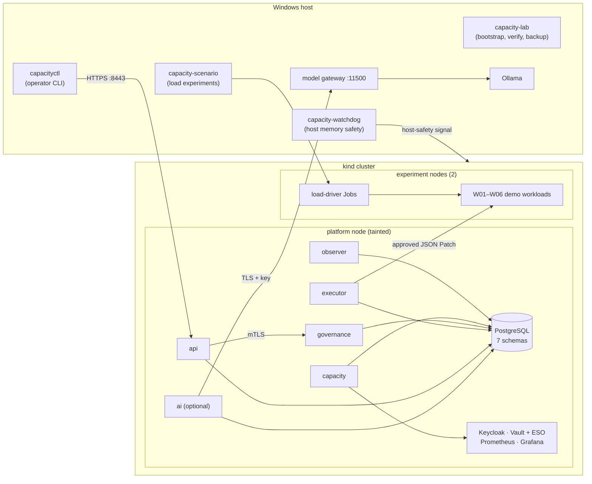
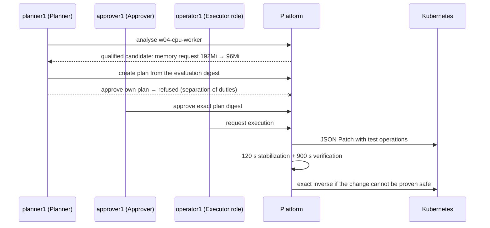

# Autonomous Kubernetes Capacity Planning & Workload Optimization Platform


A complete, local **AIOps platform for Kubernetes capacity planning**. It watches a real
Kubernetes cluster, measures how much CPU and memory each workload really uses, forecasts the
next hour of demand, and proposes better resource **requests** and **limits**. A change is applied
**only** after a planner creates an exact plan, a *different* person approves that exact plan,
and a third role asks for it to run. The platform then checks that the change is safe and
**undoes it automatically** if it cannot prove that. A local language model can comment on the
evidence, but it can never approve, execute or invent numbers.

Everything runs on one workstation: a 4-node Kubernetes cluster, six platform services,
six demonstration workloads, identity, secrets, certificates, monitoring and a local AI model.

> **Is it real?** Yes. The lab described here was built and run, and the evidence is recorded.
> The full governed chain ran live: analysis → plan → refused self-approval →
> approval by a second person → execution by a third → JSON Patch on a running Deployment →
> verification → automatic reversal. All seven live security and topology checks pass on the
> final build, all 257 automated tests pass, and seven encrypted backups were restored and verified
> in isolated containers.
> What has **not** been shown yet is stated just as plainly. See
> [docs/proof-of-operation.md](docs/proof-of-operation.md).

---

## Contents

* [The problem](#the-problem)
* [What the platform does](#what-the-platform-does)
* [Main features](#main-features)
* [Technology stack](#technology-stack)
* [Architecture at a glance](#architecture-at-a-glance)
* [How one change flows](#how-one-change-flows)
* [Quick start](#quick-start)
* [Using the platform](#using-the-platform)
* [Testing and verification](#testing-and-verification)
* [Stopping, resuming and cleaning up](#stopping-resuming-and-cleaning-up)
* [Repository layout](#repository-layout)
* [Important limitations](#important-limitations)
* [Documentation map](#documentation-map)

---

## The problem

Every container in Kubernetes declares two numbers per resource:

* a **request**, which the scheduler reserves on a node for the container, and
* a **limit**, the hard ceiling the container may not exceed.

Teams usually set these by guesswork. A request that is too high wastes capacity, because nodes
fill up with reservations nobody uses. One that is too low causes CPU throttling, slow responses
and, for memory, out-of-memory kills. Automatic right-sizing tools exist, but many change running
workloads with little explanation, no human approval and no guaranteed way back.

This project shows a **safer middle ground**:

* **Explainable:** every recommendation is computed by deterministic code from recorded evidence
  and can be recomputed from its digest.
* **Conservative:** strict safety gates run first, and missing evidence never counts as a pass.
* **Governed:** a human approves the exact change, and no person can approve their own plan.
* **Reversible:** each change is verified after it is applied, and undone if it cannot be proven safe.
* **Reproducible:** the whole thing runs on a single workstation.

## What the platform does

1. **Observes.** The `observer` service lists and watches nodes, Deployments, Pods and their
   *effective* requests, and stores immutable inventory snapshots.
2. **Measures.** The `capacity` service reads Prometheus through a fixed registry of nine
   versioned queries, such as CPU usage in millicores and memory working set in bytes.
3. **Forecasts.** Small, explainable models (persistence, rolling median, exponential smoothing,
   damped Holt, seasonal naive) are chosen by walk-forward backtesting, with calibrated intervals.
   When the evidence is too weak they **refuse** with a typed reason rather than guess.
4. **Optimizes.** The engine generates candidate requests and limits on a bounded grid, checks
   them against four-valued hard gates (pass, fail, unknown, not applicable), simulates whether
   they fit on the nodes, and ranks only the candidates that passed every gate.
5. **Governs.** A planner turns one qualified evaluation into an immutable, digest-identified
   plan. A different approver approves that exact digest, and a person with the Executor role
   requests execution.
6. **Executes.** The `executor` service, the only component allowed to change workloads, re-checks
   the approval. It then applies a JSON Patch whose `test` operations make the patch fail if
   anything changed since planning.
7. **Verifies and recovers.** After a stabilization period the executor compares guardrails
   (latency, errors, OOM restarts, availability, queue growth) with the pre-change baseline under
   comparable load. If it cannot prove the change is safe, it applies the exact inverse.
8. **Explains (optional).** Three fixed AI agents (Analyst → Planner → Reviewer), run through
   Microsoft Agent Framework against a local Ollama model, review the deterministic evidence using
   read-only tools. Their output is validated, and any number not present in the cited evidence is
   rejected.

## Main features

| Area | Highlights |
|---|---|
| Inventory | live LIST/WATCH, effective-request accounting (init containers, sidecars, Pod overhead), immutable snapshots |
| Telemetry | fixed, versioned Prometheus query registry; coverage, gaps and quality flags travel with every series |
| Forecasting | 1-hour (5-minute buckets) and 24-hour (1-hour buckets) horizons; anti-leakage checks; empirical intervals; typed refusals |
| Optimization | tighten-only policy merge, four-valued gates, bounded candidates, scheduler-fit and surge simulation, Pareto ranking |
| Governance | immutable plan revisions, exact-digest approval, separation of duties, operating modes, 15-minute approvals and intents, audited denials |
| Execution | reconcile-first executor, fencing epochs, JSON Patch `test` preconditions, two-level verification, one bounded inverse recovery |
| Kubernetes guard rails | RBAC limits the executor to demo Deployments; a CEL admission policy allows it to change only CPU/memory fields |
| Identity | Keycloak OIDC with PKCE for people, per-namespace role grants, projected ServiceAccount tokens for services |
| Secrets and PKI | Vault + External Secrets per namespace, offline root CA (DPAPI) with a name-constrained intermediate in cert-manager |
| Network | Calico default-deny in every platform and workload namespace, enforcement proven by live probes |
| Data | one PostgreSQL 17 database, seven schemas, seven roles, row-level security, append-only tables, signed audit hash chain |
| Experiments | four reproducible load scenarios against six .NET/Python workloads, capability tokens, host memory watchdog, sealed evidence |
| AI (optional) | protected TLS model gateway, fixed read-only tool broker, pgvector + full-text knowledge base, on-host model qualification |
| Release | digest-pinned images, locked dependencies, six computed release gates that never turn missing evidence into a pass |

## Technology stack

| Layer | Technology | Version (pinned in [`infra/versions.lock.json`](infra/versions.lock.json)) |
|---|---|---|
| Language and tooling | Python, uv, FastAPI, Pydantic, Typer, psycopg, NumPy | Python 3.13, locked in `uv.lock` |
| Demo workloads | ASP.NET Core minimal APIs (W01, W02) and Python (W03–W06) | .NET 10 |
| Cluster | kind on Docker Desktop (WSL2) | kind v0.33.0, `kindest/node:v1.36.4` |
| Networking | Calico (NetworkPolicy enforcement) | v3.33.1 |
| Database | PostgreSQL with pgvector | `pgvector/pgvector:0.8.1-pg17` |
| Identity | Keycloak | 26.8.2 |
| Secrets | HashiCorp Vault, External Secrets Operator | charts 0.34.1 / 2.15.0 |
| Certificates | cert-manager | v1.21.3 |
| Monitoring | Prometheus, kube-state-metrics, Grafana | v3.16.0 / v2.20.0 / 13.3.1 |
| AI runtime | Ollama on the host, Microsoft Agent Framework | `gemma4:e4b`, `nomic-embed-text` |
| Tests | pytest, Testcontainers, xUnit, Ruff | see [docs/testing-strategy.md](docs/testing-strategy.md) |

## Architecture at a glance



* **Six services, one image:** `api`, `observer`, `capacity`, `governance`, `ai` and `executor`
  run from one container image, but each has its own Deployment, ServiceAccount, database role,
  TLS certificate and NetworkPolicy.
* **No message broker:** services coordinate through a PostgreSQL job queue (`FOR UPDATE SKIP
  LOCKED`, leases and fencing) and transactional outbox tables.
* **One writer to the cluster:** only the executor can patch workloads, and Kubernetes itself
  (RBAC plus a CEL admission policy) enforces that it changes nothing but CPU and memory values.

Details: [docs/architecture.md](docs/architecture.md) and
[docs/design-decisions.md](docs/design-decisions.md).

## How one change flows



This is the real sequence recorded on 2026-11-21; the walk-through with every value and timestamp
is in [docs/how-it-works.md](docs/how-it-works.md).

## Quick start

**Prerequisites:**
* Windows 11 with WSL2.
* Docker Desktop with at least 4 CPUs and 10 GiB of memory for its VM, and at least 30 GiB of free disk.
* `kubectl` and `helm` on `PATH`.
* [uv](https://docs.astral.sh/uv/).
* Internet access during the first bootstrap.
* Optional: the .NET 10 SDK, to run the .NET tests on the host, and Ollama, for the AI layer.

The full guide is [docs/setup-guide.md](docs/setup-guide.md).

```powershell
uv sync --all-extras
```

```powershell
.venv\Scripts\Activate.ps1
```

```powershell
capacity-lab preflight
```

```powershell
capacity-lab bootstrap
```

```powershell
capacity-lab verify all
```

`bootstrap` runs 17 idempotent stages, from the local registry to the lab user grants, and records
each completed stage so an interrupted run resumes where it stopped. `verify all` proves seven
properties against the live cluster. Among them: default-deny is really enforced, least-privilege
RBAC, admission policies refusing unsafe Pods, the executor field guard, and every scrape target up.

## Using the platform

Log in (opens the browser; PKCE flow) and look around:

```powershell
capacityctl auth login
```

```powershell
capacityctl capabilities
```

```powershell
capacityctl workloads
```

Analyse a workload; the result is evidence only and changes nothing:

```powershell
capacityctl analysis create w04-cpu-worker --horizon 1h
```

The full path, from analysis through mode switch, plan, approval, execution and verification,
including which role does each step, is in [docs/operator-guide.md](docs/operator-guide.md).
Every command of the four command-line tools is listed in [docs/cli-reference.md](docs/cli-reference.md).

| Host URL | Service |
|---|---|
| `https://localhost:8443` | platform REST API (`/api/v1`, OpenAPI at `/openapi.json`) |
| `https://localhost:8444` | Keycloak (issuer `https://localhost:8444/realms/capacity`) |
| `https://localhost:8445` | Grafana (dashboard "Capacity platform overview") |
| `https://127.0.0.1:11500` | protected model gateway (only while running) |

## Testing and verification

The tests protect behaviour that matters (authority, the numbers behind changes, safe failure,
security boundaries), each at the cheapest layer that can prove it.

| Layer | Tests | Needs | Latest result on the deployed code |
|---|---|---|---|
| Unit | 156 | nothing | passed |
| Security | 31 | nothing | passed |
| Component / API | 21 | Docker | passed |
| Integration (real PostgreSQL) | 31 | Docker | passed |
| Operational (live lab) | 13 | the lab | passed |
| .NET workloads | 5 | .NET 10 SDK | passed |
| End-to-end governed change | 1 | the lab + 6 h of telemetry | ran the full chain once; see limitations |

```powershell
uv run pytest tests/unit tests/security
```

```powershell
uv run pytest tests/component tests/integration
```

```powershell
uv run pytest tests/operational
```

```powershell
capacity-lab release test
```

```powershell
capacity-lab release qualify
```

`release test` runs every suite and keeps its junit results as evidence; `release qualify`
computes six release gates from that evidence and never treats missing evidence as a pass.
Read [docs/testing-strategy.md](docs/testing-strategy.md) for the approach,
[docs/test-catalog.md](docs/test-catalog.md) for every test and what it protects, and
[docs/proof-of-operation.md](docs/proof-of-operation.md) for the recorded results.

## Stopping, resuming and cleaning up

After Docker Desktop or the host restarts (node addresses can change and Vault comes back sealed):

```powershell
capacity-lab resume
```

Take and prove a backup:

```powershell
capacity-lab backup create
```

```powershell
capacity-lab backup verify
```

Delete the cluster. It refuses unless a backup has passed its restore check; without these flags
it only reports what it would delete:

```powershell
capacity-lab destroy --confirm capacity-lab --no-dry-run
```

Host-side state (keys, backups, evidence) stays in `~/.capacity-lab`. See
[docs/backup-and-recovery.md](docs/backup-and-recovery.md).

## Repository layout

```text
configs/        versioned policies, scenarios, inference profile, Grafana dashboard
db/migrations/  nine ordered SQL migrations (schemas, roles, RLS, triggers, views)
docs/           the documentation (start at docs/README.md)
images/         Dockerfiles: one platform image, Python and .NET workload images
infra/          kind cluster config, kustomize baseline, pinned versions
specs/          the accepted specifications and their digest manifest
src/capacity_platform/  all Python code (one package, 13 sub-packages)
tests/          unit, security, component, integration, operational, e2e
workloads/      demo workload sources (.NET W01/W02, Python W03–W06) and .NET tests
```

A file-by-file guide is in [docs/codebase-guide.md](docs/codebase-guide.md).

## Important limitations

* **One host, not highly available.** Vault must be unsealed after every restart (`capacity-lab resume`).
* **Forecasts need time.** About six hours of continuous, well-covered telemetry from a single
  Pod is needed before any change can qualify. A fresh lab, host downtime or any rollout of a
  workload (including a governed change) pauses changes to that workload for about six hours.
* **No live `verified_success` yet.** The live governed chain ran end to end, but its
  verification ended `inconclusive` because of a defect that has since been fixed and covered by
  tests. The executor then reversed the change as designed, and the run has not been repeated on
  the fixed build.
* **W04 CPU decreases cannot qualify yet.** Its queue completion-rate evidence is not derived;
  memory candidates are not affected.
* **Slow disk on the reference host.** Docker's data disk is a hard disk, which makes etcd slow
  under load; an SSD is strongly recommended.
* **No comparisons yet.** Policy thresholds are provisional, and no B0–B3 comparison or forecast
  accuracy has been measured, so no savings are claimed.
* **The local model is not qualified on this host.** AI advisories therefore end as
  `unavailable`, and everything else works without them.
* **P1 features are not installed:** GitOps adapter, image-signature admission and HPA advisory.

The full list is in [docs/limitations.md](docs/limitations.md). What production would need is in
[docs/production-considerations.md](docs/production-considerations.md).

## Documentation map

Start at **[docs/README.md](docs/README.md)**. It groups 34 documents by the question you have.

| If you want to… | Read |
|---|---|
| understand the idea in plain language | [how-it-works.md](docs/how-it-works.md), [glossary.md](docs/glossary.md) |
| see the evidence that it works | [proof-of-operation.md](docs/proof-of-operation.md), [evaluation.md](docs/evaluation.md) |
| install and run it | [setup-guide.md](docs/setup-guide.md), [operator-guide.md](docs/operator-guide.md), [cli-reference.md](docs/cli-reference.md) |
| understand the design | [architecture.md](docs/architecture.md), [design-decisions.md](docs/design-decisions.md) |
| understand the decision logic | [telemetry.md](docs/telemetry.md), [forecasting.md](docs/forecasting.md), [optimization-engine.md](docs/optimization-engine.md), [governance-and-execution.md](docs/governance-and-execution.md) |
| review the security | [security.md](docs/security.md) and the pages it links |
| run or extend the tests | [testing-strategy.md](docs/testing-strategy.md), [test-catalog.md](docs/test-catalog.md) |
| operate or fix it | [observability.md](docs/observability.md), [backup-and-recovery.md](docs/backup-and-recovery.md), [troubleshooting.md](docs/troubleshooting.md) |
