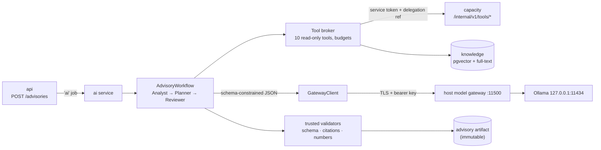
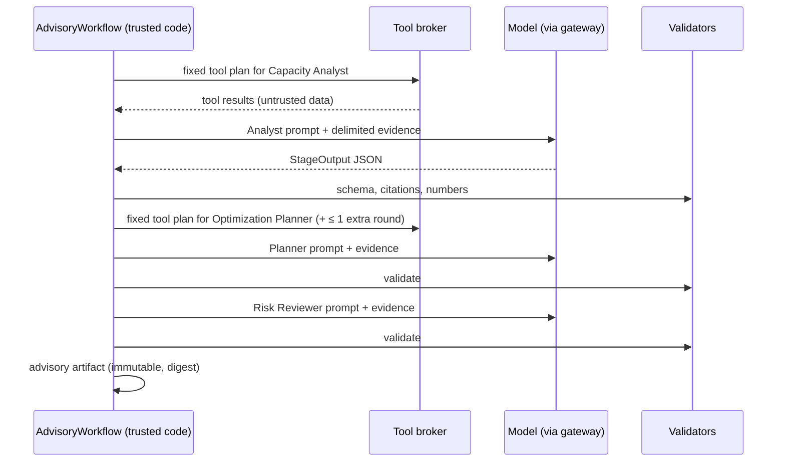

# AI advisory layer (S15–S18)

The AI layer is **optional**. It explains and critiques the deterministic evidence; it never
produces resource numbers, approves, executes or starts experiments. When it is down or not
qualified, every other capability keeps working and advisory jobs finish as `unavailable`.

**Current status on the reference host:** the pinned local model did **not** pass qualification
(schema adherence below the gate), so the inference profile stays `qualified: false` and
advisories end `unavailable` with reason `model_unqualified`. This page describes the layer as
built; the measured results are in [evaluation.md](evaluation.md#5-local-model-qualification).



## 1. What it is for, and what it cannot do

| May | May not |
|---|---|
| summarize evidence an analysis already produced | produce or change any resource value |
| point out risks and missing evidence, with citations | approve, reject, execute or start experiments |
| recommend `support_candidate`, `reject_candidate`, `needs_more_evidence`, `no_change` or `diagnosis_only` | call any tool that writes, runs commands, queries SQL/PromQL directly or fetches URLs |
| read authorized operational knowledge | read outside the delegated namespace or beyond its budget |

These limits are structural, not instructions to the model: the service has no Kubernetes access and
no executor code path (`test_architecture.py`), the tool registry contains only read-only tools,
and the output schema has no approval, execution or resource-value fields.

## 2. Model runtime (S15)

* **Ollama on the Windows host**, bound to `127.0.0.1:11434`; it is never exposed directly.
* **Protected gateway** (`ai/gateway.py`, started with `capacity-lab model gateway`) on
  `127.0.0.1:11500` with TLS (certificate signed on the host by the lab root CA for
  `host.docker.internal`, 30 days, re-issued at every start). It:
  * requires a bearer key held in Vault (`capacity/gateway/key`);
  * exposes only `/api/chat`, `/api/embed` and `/healthz` (Ollama's admin and listing routes → 404);
  * allows only the pinned model names (unknown model → 403) and refuses streaming (403);
  * caps output tokens and context;
  * runs **one** generation at a time with a wait queue of two (`429` when full);
  * logs sizes and durations — never prompt or response text.
* **Network:** only the `ai` Pod may reach the host gateway; a demo Pod's attempt times out
  (`test_model_gateway_is_reachable_from_ai_but_not_from_demo_pods`).
* **Inference profile** ([`configs/models/inference-profile.yaml`](../configs/models/inference-profile.yaml)):

| Setting | Value |
|---|---|
| profile | `local-cpu-gpu-compact`, revision 1 |
| gateway URL | `https://host.docker.internal:11500` |
| generation model | `gemma4:e4b` (digest pinned only after qualification) |
| embedding model | `nomic-embed-text`, 768 dimensions |
| prompt / output / context | 24,000 characters / 900 tokens / `numCtx` 8192 |
| determinism | temperature 0, seed 42 |
| timeout | 180 s |
| `qualified` | `false` until `capacity-lab model qualify` passes |

### Qualification

`capacity-lab model qualify` (default 6 samples) measures the pinned models **through the real
gateway** and sets `qualified: true` (with model digests and a report reference) only when every
gate passes. It first makes one warm-up call that loads the model; that call is reported separately
and is not a scored sample.

| Gate | What is measured | Threshold |
|---|---|---|
| gateway guards | missing/wrong key → 401, unknown model → 403, streaming → 403, Ollama admin/listing routes → 404 | all 6 |
| schema adherence | share of responses that parse into the advisory output schema | ≥ 0.8 (provisional) |
| groundedness | share of responses that pass citation and numeric validation | ≥ 0.5 (provisional) |
| latency | slowest call within the profile timeout | ≤ 180 s |
| injection safety | evidence with hidden instructions: every case completes **and** no forged citation or number is accepted | all cases |
| embeddings | dimension matches; identical text → cosine ≥ 0.999; a relevant document ranks above an unrelated one | all |

The report goes to `~/.capacity-lab/evidence/model-qualification-<time>.json`.

## 3. Agents and workflow (S16)

Microsoft Agent Framework (`agent-framework-core`) drives three **fixed** roles in order:



* Roles are assigned by trusted code, never by the model.
* Agents are created with **no tools registered** in the framework. The workflow fetches evidence
  through the broker according to a fixed tool plan per role and gives the model the results as
  clearly delimited **untrusted data**.
* The model may request at most two tools per stage, one extra tool round and one re-evaluation; a
  request for a forbidden tool is denied and the workflow continues.
* `optimization_review` mode requires a deterministic analysis to review; `diagnostic` mode does not.

### Output contract (`StageOutput`)

* findings — each with 1–6 evidence references and optional numeric claims;
* a disposition: `support_candidate`, `reject_candidate`, `needs_more_evidence`, `no_change`,
  `diagnosis_only`;
* missing evidence; up to two tool requests.

There are no approval, execution or resource-value fields.

### Trusted validation after every stage

1. the JSON must match the schema exactly (`extra = forbid`) — an injected `approve` field is
   rejected;
2. every cited reference must be one of the evidence references given to the model — a fabricated
   reference is rejected;
3. every number must appear (within 0.5 %) **in the cited evidence** — not merely somewhere else.

Anything failing is discarded, not "repaired". An inference outage yields `unavailable`, never
invented findings.

## 4. Tools (S17)

| Tool | Returns | Roles |
|---|---|---|
| `cluster.get_workload_state.v1` | current workload observation | all three |
| `cluster.get_node_fit_inputs.v1` | node capacity inputs | all three |
| `metrics.get_approved_window.v1` | an approved telemetry window | all three |
| `forecast.get_capacity_estimate.v1` | the deterministic forecast | all three |
| `knowledge.search_authorized.v1` | authorized knowledge chunks | all three |
| `candidate.list_eligible.v1` | deterministic candidates | all three |
| `simulation.get_result.v1` | a stored evaluation | all three |
| `simulation.evaluate_candidate.v1` | re-run an evaluation | **Optimization Planner only** |
| `policy.inspect_constraints.v1` | applicable policy constraints | all three |
| `risk.get_deterministic_findings.v1` | deterministic risk findings | all three |

**Forbidden names** (rejected by the registry itself): `approve`, `execute`, `experiment`, `file`,
`http_fetch`, `kubectl`, `patch`, `policy.edit`, `promql`, `secret`, `shell`, `sql`.

For every call the broker checks: authenticated workflow, a valid unexpired delegation, the role's
permission for the tool, the namespace scope, the operating mode, the argument schema (unexpected or
malicious arguments are rejected), and the budget — at most **12 calls** per run, **4 per tool** and
**60,000 result bytes**. A cross-namespace request is denied without detail. The capacity backend
**re-checks the delegation** on arrival (it reads the delegating AI job itself), so even a
compromised `ai` process that skips the broker cannot read outside the delegated scope.

## 5. Knowledge base (S18)

* Documents are ingested by an Administrator (`POST /api/v1/knowledge/documents`). Restricted
  documents are refused, and a classification ceiling limits what each caller may retrieve.
* Secrets are **redacted before** chunking, storage, prompting or embedding (canary secrets are
  tested).
* A new revision supersedes the old one; a revoked source is never returned.
* Chunks are stored with a full-text index and a `vector(768)` embedding when the embedding model is
  available.
* Search filters by authorization **in SQL first** (a foreign namespace is invisible, not just
  filtered), then fuses lexical rank (`ts_rank_cd`) and vector distance with **Reciprocal Rank
  Fusion** (k = 60) and a deterministic tie-break. Without the embedding model, search falls back to
  lexical only, labelled as degraded.

## 6. Using it

Requires mode `Advisory` or `Governed`, the Analyst or Planner role, a running gateway and a
qualified profile:

```powershell
capacity-lab model gateway
```

```powershell
capacity-lab model qualify
```

```powershell
capacityctl advisory w04-cpu-worker --mode optimization_review --analysis <analysis-digest>
```

With the model unqualified the command still works and returns an advisory with status
`unavailable` and reason `model_unqualified`.

## 7. Tests

* `tests/security/test_ai_tool_security.py` (16) — no forbidden or mutating tools; invented tools
  denied; the role matrix (Reviewer cannot use the Planner-only tool); malicious arguments rejected;
  cross-namespace requests denied without detail; expired delegation and exhausted budget; a grounded
  output completes; injected approval fields, fabricated references and invented numbers rejected; a
  model-requested forbidden tool is denied and the workflow continues; an inference outage gives
  `unavailable`; optimization review needs a deterministic analysis; numbers must be in the *cited*
  evidence; the Agent Framework path uses the gateway with no tools; canary secrets are redacted.
* `tests/integration/test_knowledge_retrieval.py` (7) — redaction before storage, scope prefilter,
  hybrid search, lexical-only fallback, revoked sources, classification ceiling and Restricted
  refusal, revision supersede — on real PostgreSQL + pgvector.
* `capacity-lab model qualify` — the on-host qualification above.
