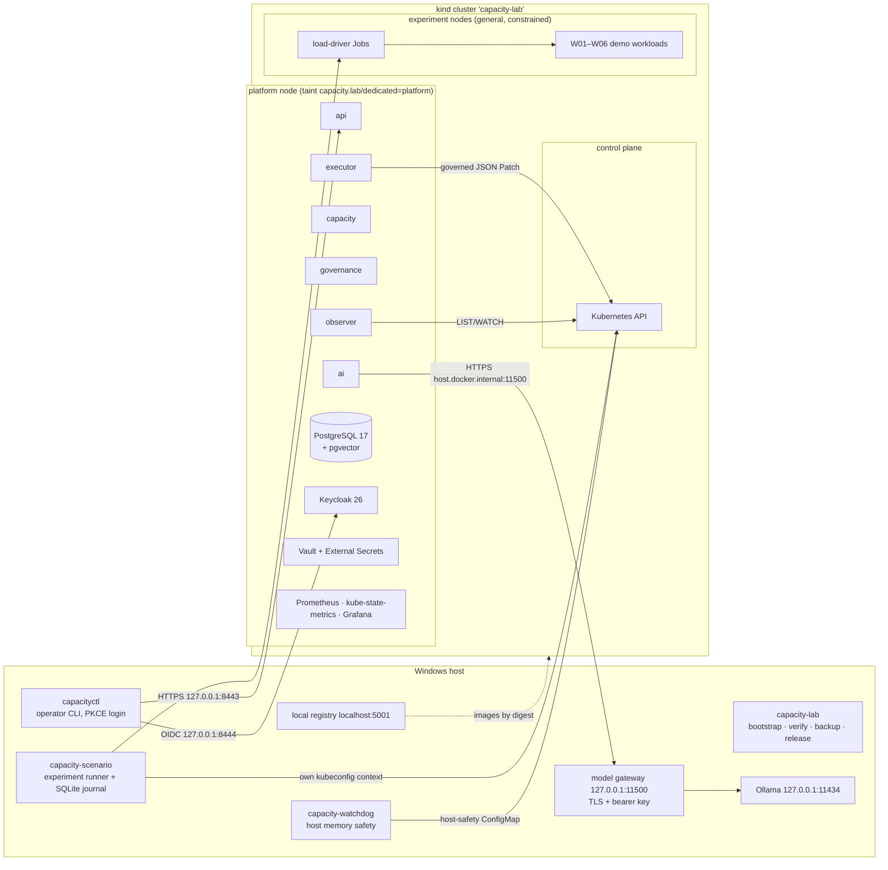
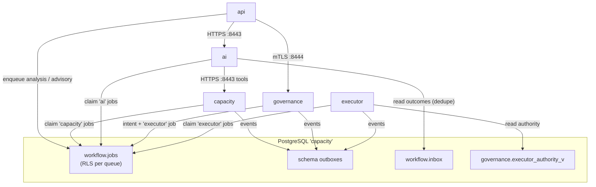
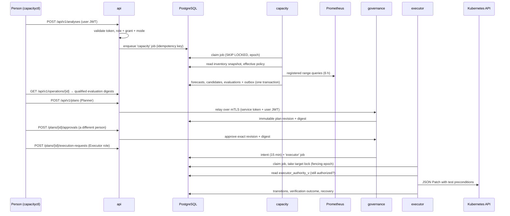
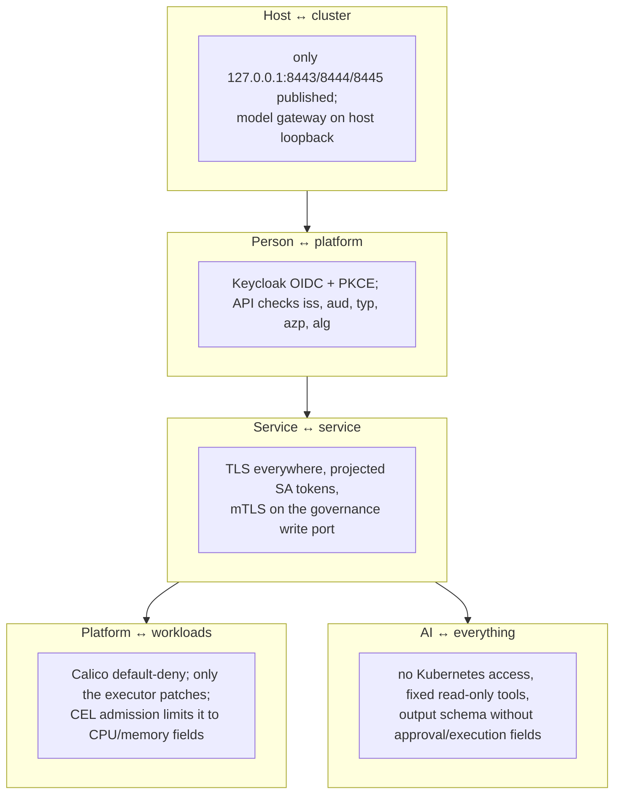

# Architecture

This page explains how the platform is built: which components exist, where they run, how they
talk to each other, where authority lives, and how the system behaves when a part fails. The
reasons behind each choice, and the alternatives considered, are in
[design-decisions.md](design-decisions.md). A plain-language introduction is in
[how-it-works.md](how-it-works.md).

## 1. The big picture

The platform watches a local Kubernetes cluster, forecasts CPU and memory demand, proposes better
resource requests and limits, and applies a change **only** after people approve the exact plan.
An optional local AI layer can comment on the evidence, but it can never approve, execute or
invent resource numbers.

Everything runs on one Windows 11 workstation:

* a **4-node kind cluster** (1 control plane, 1 tainted platform worker, 2 experiment workers)
  inside Docker Desktop on WSL2;
* **host-side tools**: `capacity-lab` (bootstrap, verify, backup, release), `capacityctl`
  (operator CLI), `capacity-scenario` (experiment runner), `capacity-watchdog` (host memory
  safety) and the protected **model gateway** in front of Ollama.

## 2. The six platform services

All six run from **one** container image, started as `capacity-service <role>`. Each has its own
Deployment, ServiceAccount, PostgreSQL role, TLS certificate and NetworkPolicy, so sharing the
image does not share privileges.

| Service | Namespace | ServiceAccount | Responsibility | Writes | Kubernetes API |
|---|---|---|---|---|---|
| `api` | capacity-api | `capacity-api-sa` | public REST API (`/api/v1`), user token validation, authorization, operation tracking, relay of plan actions to governance over mTLS | `workflow` jobs | none |
| `observer` | capacity-core | `capacity-observer-sa` | LIST/WATCH nodes, Deployments, Pods, HPAs; effective-request normalization; inventory snapshots | `inventory` | read-only |
| `capacity` | capacity-core | `capacity-engine-sa` | telemetry, forecasting (S14), gates, candidates, placement simulation, ranking (S19–S22); read-only tool backend for the AI | `capacity` | none |
| `governance` | capacity-core | `capacity-governance-sa` | plans, approvals, revocations, execution intents, operating mode, grants, effective policy | `governance` | none |
| `ai` | capacity-ai | `capacity-ai-sa` | optional advisory workflow (three fixed agents), tool broker, knowledge base | `knowledge` | none |
| `executor` | capacity-execution | `capacity-executor-sa` | reconcile-first application of approved intents, verification, bounded recovery | `execution` | patch demo Deployments only |

Sizing and priority (from `lab/manifests.py`):

| Service | PriorityClass | CPU request / limit | Memory request / limit |
|---|---|---|---|
| `api` | `capacity-platform-standard` | 100m / 500m | 160Mi / 320Mi |
| `observer` | `capacity-platform-critical` | 150m / 500m | 256Mi / 512Mi |
| `capacity` | `capacity-platform-standard` | 200m / 1000m | 320Mi / 768Mi |
| `ai` | `capacity-platform-standard` | 150m / 500m | 256Mi / 512Mi |
| `governance` | `capacity-platform-critical` | 100m / 500m | 192Mi / 384Mi |
| `executor` | `capacity-platform-critical` | 100m / 500m | 192Mi / 384Mi |

Every service serves HTTPS on port 8443 with `/health/live`, `/health/ready` and `/metrics`.
Governance additionally serves a **mutual-TLS listener on 8444** for the privileged routes the API
relays. The [codebase guide](codebase-guide.md) maps each service to its source folder.

### Internal routes

| Service | Route | Caller |
|---|---|---|
| governance (8444, mTLS) | `POST /internal/v1/plans`, `GET /internal/v1/plans/{id}`, `POST …/decisions`, `POST …/revocations`, `POST …/execution`, `PUT /internal/v1/mode` | api only |
| capacity | `POST /internal/v1/tools/{tool_id}`, `GET /internal/v1/forecasts/{id}`, `GET /internal/v1/evaluations/{digest}`, `GET /internal/v1/analyses/{digest}` | ai (tools) |
| ai | `POST /internal/v1/knowledge/documents` | api |
| observer | `GET /internal/v1/status` | diagnostics |

Each internal call carries the caller's **projected ServiceAccount token** (audience
`capacity-internal`, 10-minute lifetime), which the receiver verifies offline against the cluster
JWKS and matches to the expected caller for that route. Calls made on behalf of a person also carry
the person's original access token, which governance validates again itself.

## 3. How services communicate

There is **no message broker**. Services coordinate through PostgreSQL, plus three direct HTTPS
paths where a synchronous answer is needed.

* **Job queue** (`workflow.jobs`): enqueue with an idempotency key; workers claim with
  `FOR UPDATE SKIP LOCKED`, a lease and a fencing epoch; completion only succeeds with the epoch
  that claimed. Row-level security lets each service see only its own queue.
* **Transactional outbox:** a service writes its result and an event in the same transaction, so a
  result is never published without being stored, or the reverse. Consumers deduplicate with
  `workflow.inbox`.
* **Direct HTTPS:** `api → governance` (mTLS, 8444) for plan actions and the mode;
  `api → ai` for knowledge ingestion; `ai → capacity` for read-only tool calls.

Details: [workflow-and-jobs.md](workflow-and-jobs.md).

## 4. Lifecycle of a request

## 5. Data: seven schemas in one database

| Schema | Owner service | Holds |
|---|---|---|
| `inventory` | observer | cluster incarnation, snapshots of nodes/workloads/Pods with effective requests, configuration revisions |
| `capacity` | capacity | query definitions, observation windows, forecasts, analyses, candidates, evaluations |
| `knowledge` | ai | source documents, chunks with `vector(768)` embeddings and full-text index, advisory artifacts |
| `governance` | governance | operating mode, role grants, effective policy, plan revisions/state/transitions, approvals, revocations, intents |
| `execution` | executor | target locks, operations, transitions, outcomes |
| `audit` | everyone (insert only) | one hash-chained event stream |
| `workflow` | everyone (own queue) | jobs, inbox |

Each service connects as its own PostgreSQL role (`svc_api`, `svc_observer`, `svc_capacity`,
`svc_ai`, `svc_governance`, `svc_executor`, plus the read-only `svc_auditor`). A role can write
only its own schema and read only the views it needs. Evidence and decisions are append-only.
Details: [data-model.md](data-model.md).

## 6. Where it runs

| Namespace | Contents | Node pool | Pod Security |
|---|---|---|---|
| capacity-api, capacity-core, capacity-ai, capacity-execution | the six services | platform | restricted |
| capacity-data | PostgreSQL (StatefulSet) | platform | restricted |
| capacity-identity | Keycloak | platform | restricted |
| capacity-observability | Prometheus, kube-state-metrics, Grafana | platform | restricted |
| capacity-system | Vault, External Secrets Operator, `host-safety` ConfigMap | platform | baseline (charts need it) |
| cert-manager | cert-manager (upstream manifest) | platform | upstream default |
| workloads-critical, workloads-standard, workloads-batch | W01–W06 | experiment | restricted |
| capacity-experiments | short-lived load-driver Jobs | experiment | restricted |

The platform node carries the taint `capacity.lab/dedicated=platform:NoSchedule`, so demo load can
never land on it; demo workloads require the experiment pool. Node layout, priority classes,
quotas and admission policies are described in [cluster-topology.md](cluster-topology.md).

## 7. Trust boundaries

1. **Host ↔ cluster:** only three loopback ports are published (8443 API, 8444 Keycloak, 8445
   Grafana, mapped to NodePorts 30443–30445 on the platform node). The model gateway listens on
   host loopback and is reached from the `ai` Pod through Docker Desktop's `host.docker.internal`.
2. **Person ↔ platform:** Keycloak OIDC with PKCE; the API validates issuer, audience, token type,
   authorized client and an allow-list of signing algorithms, then checks role, namespace grant and
   operating mode for every action.
3. **Service ↔ service:** TLS with certificates from cert-manager, projected ServiceAccount tokens
   checked per route, mTLS on the governance write listener.
4. **Platform ↔ workloads:** Calico default-deny; only the executor may patch demo Deployments, and
   the `capacity-executor-field-guard` admission policy limits that patch to CPU/memory fields.
5. **AI ↔ everything:** the AI service has no Kubernetes access, no executor code path (enforced by
   an architecture test), a fixed read-only tool list, and an output schema with no approval or
   execution fields.

Details: [security.md](security.md).

## 8. Behaviour when a part fails

The platform is designed to **fail closed**: when it cannot prove something, it does less, never
more.

| Failure | What happens | Why it is safe |
|---|---|---|
| Prometheus unavailable | each failed registered query leaves that signal missing: forecasts refuse, gates become `unknown`, verification guardrails become `unknown` | unknown evidence never passes a gate; an unverified change is reversed |
| Telemetry gaps or mixed Pods | quality flags (`scrape_gap`, `multiple_series_combined`) make forecasts refuse | no candidate qualifies on weak evidence |
| PostgreSQL unavailable | services report not ready; no job is claimed | nothing is decided without durable state |
| Watchdog stopped | the host-safety signal goes stale after 2 minutes → `unknown`; the executor's preflight refuses; heavy experiments are refused | changes need a fresh "host OK" signal |
| Model gateway or Ollama down, or model unqualified | advisories finish `unavailable` (`model_unqualified` when not qualified) | the AI is optional; deterministic paths are unaffected |
| Vault sealed after a restart | running Pods keep their already-delivered Secrets; External Secrets cannot refresh until `capacity-lab resume` / `unseal` | no secret is served unsealed |
| Executor crashes mid-change | on restart it reads the live object before anything else and reconciles each open operation | no blind retry, no double apply (fencing + `test` operations) |
| Kubernetes write times out | operation becomes `unknown`, then `awaiting_revalidation`; the live object decides the next step | the executor never assumes success or failure |
| Docker restart changes node IPs | API-server NetworkPolicies are stale; `capacity-lab resume` re-renders them and restarts dependants | until then, API clients time out rather than reach anything else |

## 9. Host-side components

| Component | What it does | Identity it uses |
|---|---|---|
| `capacity-lab` | 17-stage bootstrap, live verification, backups and restore drills, audit checkpoints, model qualification, release tests and gates | the kind admin context (bootstrap only) |
| `capacityctl` | the operator CLI for people | the person's Keycloak tokens (PKCE, DPAPI-stored) |
| `capacity-scenario` | runs reproducible load experiments with a SQLite journal | `capacity-lab-runner` context (narrow ServiceAccount, no patch/update) |
| `capacity-watchdog` | measures Windows free memory every 10 s, publishes `host-safety` | `capacity-lab-watchdog` context (may only write that ConfigMap) |
| model gateway | TLS front door for Ollama with a bearer key, model allow-list and concurrency limits | key read from Vault at start |

## Related documents

* [design-decisions.md](design-decisions.md) — why it is built this way
* [cluster-topology.md](cluster-topology.md) — nodes, namespaces, priorities, quotas, admission
* [data-model.md](data-model.md), [workflow-and-jobs.md](workflow-and-jobs.md)
* [telemetry.md](telemetry.md), [forecasting.md](forecasting.md), [optimization-engine.md](optimization-engine.md)
* [governance-and-execution.md](governance-and-execution.md), [ai-advisory.md](ai-advisory.md)
* [security.md](security.md), [network-isolation.md](network-isolation.md)
