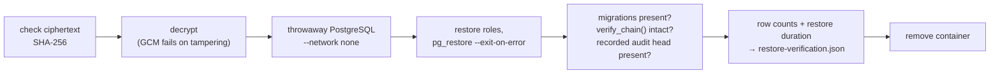

# Backup, restore and recovery (S29)

What state exists, how it is backed up and **proven** restorable, how history is protected against
tampering, and what to do after each kind of failure.

## 1. What needs protecting

| State | Where | Protected by |
|---|---|---|
| platform database (all seven schemas, including the audit chain) | PostgreSQL in `capacity-data` | `capacity-lab backup create` — an encrypted logical dump |
| audit-chain integrity | `audit.events` | signed checkpoints on the host |
| root CA, Vault unseal/root, user passwords, signing and backup keys | `~/.capacity-lab` (DPAPI) | copy the folder to safe storage yourself |
| experiment journal, evidence, release bundles | `~/.capacity-lab` | same |
| Vault data, Keycloak database, Prometheus data | inside the cluster | not backed up; recreated by bootstrap (Keycloak's realm is regenerated from code and Vault; telemetry history is lost) |

## 2. Database backup

```powershell
capacity-lab backup create
```

1. Records the current **audit-chain head before dumping**, so the dump must contain it.
2. Runs `pg_dump -Fc` and `pg_dumpall --roles-only --no-role-passwords` inside the PostgreSQL Pod.
3. Encrypts both with **AES-256-GCM** using a 256-bit key kept DPAPI-protected at
   `~/.capacity-lab/backups/backup.key.dpapi`. Each blob is bound to its role ("dump" / "roles") as
   associated data, so the two cannot be swapped.
4. Writes `~/.capacity-lab/backups/<backup-id>/` with the encrypted files and `manifest.json`
   (migration set, audit head, SHA-256 and size of each encrypted file).

## 3. Restore drill

```powershell
capacity-lab backup verify
```

Restoring is the only proof that a backup works. `verify` takes the latest backup (or a given path)
and:



1. checks the ciphertext digests, then decrypts;
2. starts a throwaway PostgreSQL container with **`--network none`**, so the copy can reach nothing and
   can never be mistaken for the live database. It waits (up to 600 s) until the container's *final*
   server answers over TCP on `127.0.0.1` twice in a row — the image's temporary initialisation server
   listens only on its Unix socket, so it is never mistaken for the real one;
3. restores the roles, then the dump with `pg_restore --exit-on-error`;
4. checks that all migrations are present, `audit.verify_chain()` is intact, and the audit event
   recorded at backup time exists with the same hash;
5. records row counts, the **restore duration** (the database-tier RTO measurement) and, if
   `pg_restore` failed, its error text in `restore-verification.json`, then removes the container.

`capacity-lab destroy` refuses to delete the cluster unless at least one backup has a successful
`restore-verification.json`.

### Recorded drills on the reference host

| Backup | Checks | Restore duration |
|---|---|---|
| `capacity-20261119T220831Z` | all 5 passed | — (not recorded by that version) |
| `capacity-20261120T070450Z` | not completed — the throwaway container was not ready within the then 120 s limit while the disk was saturated (limit now 600 s) | — |
| `capacity-20261120T075851Z` | all 5 passed | 25.5 s |
| `capacity-20261120T210249Z` | all 5 passed | 25.2 s |
| `capacity-20261121T040144Z` | all 5 passed | 26.6 s |
| `capacity-20261121T040748Z` | all 5 passed | 29.3 s |
| `capacity-20261121T054401Z` | first drill **failed** at `pg_restore` (12.3 s): it started while the image's temporary initialisation server was shutting down. After the readiness probe was moved to TCP, three repeat drills of the same backup passed | 27.5 s, 26.6 s, 26.6 s |
| `capacity-20261121T055020Z` | all 5 passed | 27.9 s |

The five checks are: ciphertext digest matches, `pg_restore` succeeded, migrations match, audit chain
intact, recorded audit head present.

## 4. Audit checkpoints

```powershell
capacity-lab audit checkpoint
```

```powershell
capacity-lab audit verify
```

* `checkpoint` signs `{seq, eventHash, time}` of the current chain head with an **Ed25519** key stored
  DPAPI-protected on the host and appends it to `~/.capacity-lab/audit/checkpoints.jsonl`.
* `verify` recomputes the whole chain in the database and checks every signed checkpoint: the signature
  is valid, the event at that sequence still has the same hash, and no events after a checkpoint have
  disappeared.

This detects the case the chain alone cannot: someone with database superuser rights rewriting history
**and** recomputing every later hash. Latest result (2026-11-21 05:10:27):

```json
{"intact": true, "chainBrokenAtSeq": null,
 "head": {"seq": 15, "eventHash": "6c92205194ed036bed111d53b31c26b1ba97a52537e47de3ae2684c6ee6a0808"},
 "checkpointsChecked": 7, "problems": []}
```

## 5. Recovery runbooks

### Docker Desktop or the host restarted

```powershell
capacity-lab resume
```

Node containers can come back with new IP addresses and Vault comes back sealed. `resume` waits for
the nodes, re-renders the dynamic NetworkPolicies if addresses changed, restarts the Pods that depend
on them and any Pod in CrashLoopBackOff, and unseals Vault (restarting it first if it does not answer).
Telemetry for the downtime is lost, so forecasts refuse until enough continuous history exists again.
Restart the watchdog (`capacity-watchdog run`) too.

### Vault sealed or hung

```powershell
capacity-lab unseal
```

If `vault status` does not answer, delete the `vault-0` Pod first; `resume` does this automatically.

### Executor lost in the middle of a change

No manual action: on start the executor reconciles every open operation by reading the live object
before doing anything else ([governance-and-execution.md](governance-and-execution.md)). The
operational test `test_executor_recovers_after_losing_its_pod` deletes the executor Pod, waits for the
replacement to become available, and checks that no operation is left stuck `in_progress` for more
than 10 minutes.

### Scenario runner crashed during an experiment

```powershell
capacity-scenario recover
```

Interrupted runs are aborted (never resumed), their objects are deleted by exact UID, and the run is
marked `inconclusive`.

### A change left in an unexpected state

Read `capacityctl execution <intent-id>`. `escalated` means the executor stopped deliberately (for
example a concurrent edit). Compare the live Deployment with the plan's before/after values, fix it by
hand if needed, and start a new analysis — the executor never retries an escalated operation.

### Rebuilding the lab from a backup

1. Run `capacity-lab bootstrap` on a fresh cluster up to and including the `database` stage.
2. Restore the dump into the new database with the migration identity (the same `pg_restore` used by
   `backup verify`, pointed at the cluster through a port-forward).
3. Continue the bootstrap from `identity` (`capacity-lab bootstrap --from-stage identity`).

This full rebuild has **not been rehearsed** end to end; the release report lists it as `not_run`
([release-and-upgrade.md](release-and-upgrade.md)).

## 6. Limits

* Backups are taken on demand; there is no schedule, so the recovery point is the last manual backup.
* Backups and their keys live on the same machine. A disk failure loses both — copy `~/.capacity-lab`
  elsewhere if the lab data matters.
* Prometheus, Vault and Keycloak data are not backed up.
