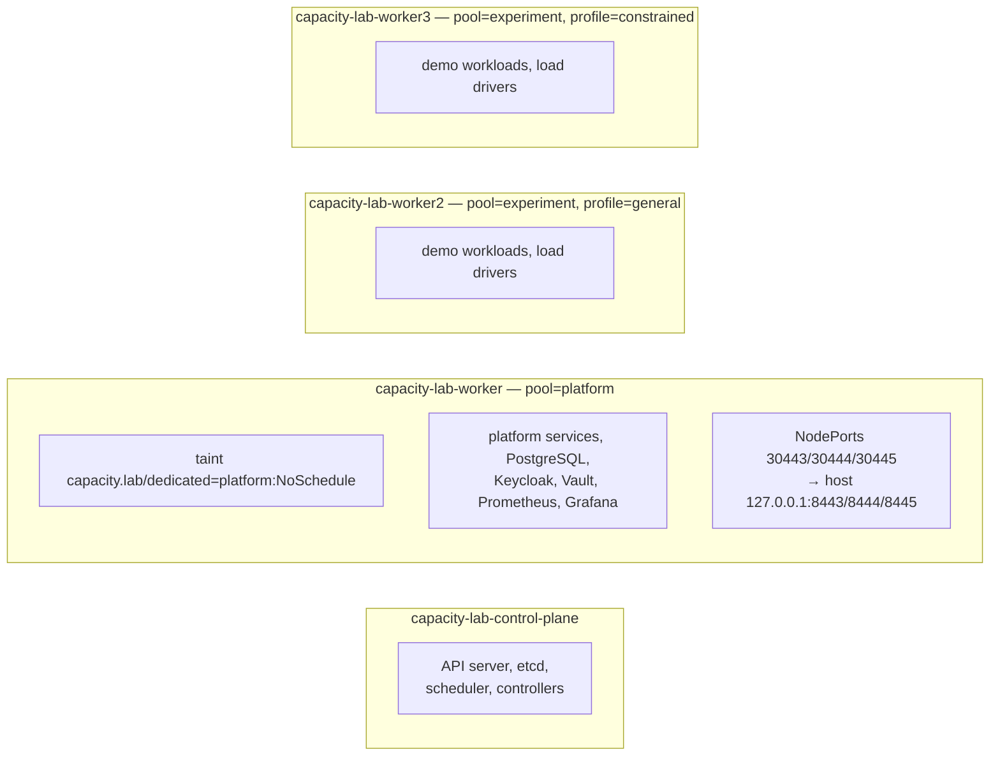

# Cluster topology (S03)

How the local Kubernetes cluster is laid out: nodes and pools, networking, namespaces, scheduling
priorities, budgets, admission rules and the Kubernetes permissions of each identity. The source
of truth is [`infra/kind/cluster.yaml`](../infra/kind/cluster.yaml) and the kustomize baseline in
[`infra/kustomize/base/`](../infra/kustomize/base/), applied by the `cluster`, `calico` and `base`
bootstrap stages.

## 1. Nodes and pools

The cluster is a [kind](https://kind.sigs.k8s.io/) cluster named `capacity-lab`, running
`kindest/node:v1.36.4` (Kubernetes v1.36.4) inside Docker Desktop.



| Node | Labels | Taint | Runs |
|---|---|---|---|
| `capacity-lab-control-plane` | `capacity.lab/node-role=control-plane` | kind default | Kubernetes control plane |
| `capacity-lab-worker` | `capacity.lab/pool=platform` | `capacity.lab/dedicated=platform:NoSchedule` | everything the platform needs (only Pods that tolerate the taint) |
| `capacity-lab-worker2` | `capacity.lab/pool=experiment`, `capacity.lab/profile=general` | none | W01–W06 and load drivers |
| `capacity-lab-worker3` | `capacity.lab/pool=experiment`, `capacity.lab/profile=constrained` | none | W01–W06 and load drivers |

**Why a tainted platform node:** experiments push demo workloads hard on purpose. The taint keeps
that load away from the database, identity and the services that make decisions, so a load test
cannot starve the system that is supposed to judge it. Demo Pods also carry a required node
affinity for `capacity.lab/pool=experiment`, and `capacity-lab verify scheduling` checks live that
no Pod is on the wrong pool.

## 2. Networking

| Setting | Value | Why |
|---|---|---|
| default CNI | disabled (`disableDefaultCNI: true`) | kind's default CNI does not enforce NetworkPolicy |
| CNI | Calico v3.33.1 (manifest URL + SHA-256 in `infra/versions.lock.json`) | real NetworkPolicy enforcement |
| Pod subnet | `192.168.128.0/17` | |
| Service subnet | `10.96.0.0/16` | the `kubernetes` Service is `10.96.0.1:443` |
| Published ports | NodePort 30443 → `127.0.0.1:8443` (API), 30444 → `127.0.0.1:8444` (Keycloak), 30445 → `127.0.0.1:8445` (Grafana) | loopback only — never exposed on the LAN |
| Image registry | local `registry:3` at `localhost:5001`, wired into containerd through `/etc/containerd/certs.d` | images are built on the host and pulled by digest |

Which Pods may talk to which is described in [network-isolation.md](network-isolation.md).

## 3. Namespaces

Every managed namespace is labelled with Pod Security Admission levels (`enforce`, `audit`, `warn`).

| Namespace | Purpose | PSA enforce |
|---|---|---|
| `capacity-api` | `api` service | restricted |
| `capacity-core` | `observer`, `capacity`, `governance` | restricted |
| `capacity-ai` | `ai` service | restricted |
| `capacity-execution` | `executor` | restricted |
| `capacity-data` | PostgreSQL 17 + pgvector | restricted |
| `capacity-identity` | Keycloak 26 | restricted |
| `capacity-observability` | Prometheus, kube-state-metrics, Grafana | restricted |
| `capacity-system` | Vault, External Secrets Operator, `host-safety` ConfigMap, host-tool ServiceAccounts | **baseline** (audit/warn restricted) — the Vault and ESO charts need it |
| `cert-manager` | cert-manager (upstream manifest, unmodified) | upstream default |
| `workloads-critical` | W01 | restricted |
| `workloads-standard` | W02, W03 | restricted |
| `workloads-batch` | W04, W05 (CronJob), W06 (Job template) | restricted |
| `capacity-experiments` | load-driver Jobs | restricted |

## 4. Scheduling priorities

Six PriorityClasses decide who is preempted first when a node runs out of room.

| PriorityClass | Value | Used by |
|---|---|---|
| `capacity-platform-critical` | 100000 | governance, observer, executor, data services |
| `capacity-platform-standard` | 50000 | capacity, ai, api, observability, identity |
| `lab-critical` | 10000 | W01 latency-api |
| `lab-standard` | 1000 | W02 burst-api, W03 memory-profile |
| `lab-flexible` | 100 | W04 cpu-worker, W05 analytics-processor |
| `lab-opportunistic` | 0 | W06 opportunistic-batch (expected to wait when capacity is short) |

The workload catalog ([`contracts/workloads.py`](../src/capacity_platform/contracts/workloads.py))
fixes each workload's class and PriorityClass and refuses to load if they disagree.

## 5. Budgets: quotas and LimitRanges

**ResourceQuotas** cap what each demo namespace may reserve in total:

| Namespace | requests.cpu | requests.memory | limits.cpu | limits.memory | Pods |
|---|---|---|---|---|---|
| workloads-critical | 600m | 768Mi | 1500m | 1Gi | 6 |
| workloads-standard | 900m | 1280Mi | 2 | 2Gi | 10 |
| workloads-batch | 1 | 1280Mi | 2 | 2Gi | 10 |
| capacity-experiments | 300m | 384Mi | 900m | 576Mi | 3 (and 10 ConfigMaps, 10 Secrets) |

**LimitRanges** (`bounds`) bound each Pod:

| Namespace | Pod min | Pod max |
|---|---|---|
| capacity-experiments | 10m / 16Mi | 500m / 256Mi |
| workloads-batch, workloads-standard, workloads-critical | 10m / 32Mi | 1 CPU / 768Mi |

They are declared with `type: Pod`, which bounds without defaulting. A `type: Container` item with
`min`/`max` would make Kubernetes inject default requests and limits into containers that omit
them, hiding missing limits and silently changing experiment evidence (see
[design-decisions.md](design-decisions.md#dd-16-limitranges-that-bound-but-never-default)).

## 6. Admission policies

Beyond Pod Security Admission, four CEL `ValidatingAdmissionPolicy` objects
([`admission.yaml`](../infra/kustomize/base/admission.yaml)) reject unsafe objects. All use
`failurePolicy: Fail` and `validationActions: [Deny, Audit]`.

| Policy | Applies to | Rules |
|---|---|---|
| `capacity-pod-hardening` | Pods in the four platform namespaces, the three demo namespaces and `capacity-experiments` | read-only root filesystem (POL-POD-002); explicit CPU and memory requests **and** limits (POL-POD-003); images pinned by `@sha256:` digest (POL-IMG-001); no `hostPath` volumes (POL-POD-004) |
| `capacity-no-token-automount` | Pods in the demo namespaces and `capacity-experiments` | `automountServiceAccountToken: false` and no projected ServiceAccount token (POL-POD-005) |
| `capacity-experiment-job-template` | Jobs in `capacity-experiments` | label `capacity.lab/template=load-driver-v1`; ServiceAccount `capacity-driver-sa`; node selector `capacity.lab/pool=experiment`; no tolerations; `activeDeadlineSeconds ≤ 3600` and a TTL; only the digest-pinned platform image (POL-EXP-001) |
| `capacity-executor-field-guard` | Deployment updates by `capacity-executor-sa` in namespaces labelled `capacity.lab/demo=true` | replicas, labels, template metadata, container names/images/commands/env, ServiceAccount and scheduling must be unchanged — only CPU/memory requests and limits may differ (POL-EXEC-001) |

`capacity-lab verify security` proves them live with dry-run requests: a privileged Pod, a Pod
without limits, a tag-only image, a token-mounting Pod, a writable root filesystem and a rogue
experiment Job are all **denied**, a compliant Pod is **allowed**, and the executor may patch
resources but is denied when it tries to change replicas, the image or the ServiceAccount.

## 7. Kubernetes permissions per identity

Every platform and host identity has its own ServiceAccount. Only two platform services talk to
the Kubernetes API at all.

| Identity | Granted | Not granted (verified live) |
|---|---|---|
| `capacity-observer-sa` | get/list/watch nodes, namespaces, Pods, quotas, LimitRanges, events, Deployments, ReplicaSets, DaemonSets, StatefulSets, Jobs, CronJobs, HPAs, PDBs, PriorityClasses; read `host-safety` | patch Deployments; read Secrets |
| `capacity-executor-sa` | get/patch Deployments and list HPAs in the three demo namespaces; read `host-safety`; read the cluster incarnation | patch outside demo namespaces; scale; delete Pods; read Secrets |
| `capacity-ai-sa`, `capacity-api-sa`, `capacity-engine-sa`, `capacity-governance-sa` | nothing (no Kubernetes token is mounted) | get Pods; patch Deployments |
| `capacity-runner` (host, context `capacity-lab-runner`) | create/get/list/delete Jobs and create/get/delete ConfigMaps/Secrets in `capacity-experiments`; create/delete batch Jobs in `workloads-batch`; read only the W05 CronJob and W06 template; read demo Deployments | update or patch anything |
| `capacity-watchdog` (host, context `capacity-lab-watchdog`) | write the `host-safety` ConfigMap | anything else |
| `capacity-driver-sa` | nothing; used only as the identity of load-driver Pods (no token mounted) | — |

The live RBAC matrix (12 allow/deny rows) is part of `capacity-lab verify all`; the recorded result
is in [proof-of-operation.md](proof-of-operation.md).

## 8. The host-safety signal

`capacity-system/host-safety` is a ConfigMap written **only** by the host watchdog. It carries
`state` (`ok`, `pressure`, `abort`, `exclusive` or `unknown`), `updatedAt` and a JSON `detail`
with available host memory and each kind node's memory use. The executor treats a signal older
than two minutes as `unknown` and refuses to act; the capacity engine's `host.safety` gate uses it
too. See [workloads-and-experiments.md](workloads-and-experiments.md#4-host-safety-watchdog).

## 9. Inspecting the topology

```powershell
kubectl --context kind-capacity-lab get nodes -L capacity.lab/pool,capacity.lab/profile
```

```powershell
kubectl --context kind-capacity-lab get priorityclass
```

```powershell
kubectl --context kind-capacity-lab get resourcequota,limitrange -A
```

```powershell
kubectl --context kind-capacity-lab get validatingadmissionpolicy
```

```powershell
capacity-lab verify scheduling
```
