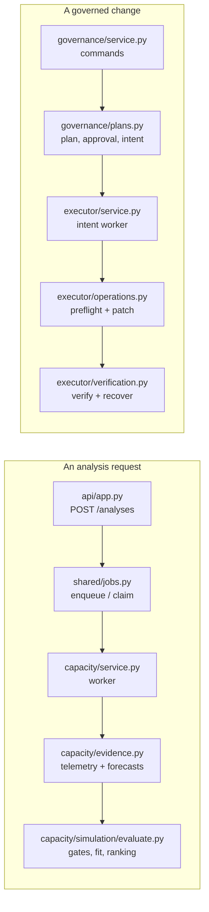

# Codebase guide

A map of the repository for someone about to read or change it: where each responsibility lives,
how the pieces connect, which conventions hold everywhere, and where to add new things.

## 1. Top level

```text
configs/                 versioned configuration read by services and host tools
  dashboards/            Grafana dashboard JSON (capacity-overview.json)
  models/                inference profile for the local model
  policies/              optimization, governance and verification policies
  scenarios/             experiment definitions E01–E04
db/migrations/           nine ordered SQL migrations (never edited once applied)
docs/                    this documentation
images/                  Dockerfiles: platform (one image, six roles), Python and .NET workloads
infra/
  kind/cluster.yaml      node roles, taint, port mappings, containerd registry config
  kustomize/base/        namespaces, scheduling, RBAC, NetworkPolicies, admission policies
  versions.lock.json     pinned third-party versions, URLs and SHA-256 hashes
specs/                   accepted specifications (specs/accepted/) and their digest manifest
src/capacity_platform/   all Python code (one installable package)
tests/                   unit, security, component, integration, operational, e2e + helpers
workloads/
  dotnet/                W01 LatencyApi, W02 BurstApi, shared Common/, xUnit Tests/
  python/                W03 memory_profile.py, W04 cpu_worker.py, W05/W06 batch.py, labkit/
pyproject.toml, uv.lock  Python project, dependencies, tool configuration, locked versions
```

## 2. The Python package

One package, `capacity_platform`, with 13 sub-packages. Six of them are services; the rest are
shared contracts, host tools and release logic.

| Package | Runs in | Responsibility | Key modules |
|---|---|---|---|
| `contracts/` | everywhere | pure data contracts with no I/O | `units.py` (millicores/bytes), `canonical.py` (canonical JSON + SHA-256), `enums.py`, `errors.py` (typed error envelope), `identity.py`, `workloads.py` (W01–W06 catalog), `ownership.py` (GitOps/controller ownership detection) |
| `shared/` | services | infrastructure shared by all services | `db.py` (connections, transactions, outbox, audit insert), `jobs.py` (job queue), `migrate.py` (migration runner + checksum ledger), `auth/oidc.py` (user tokens), `auth/service_identity.py` (projected SA tokens), `redaction.py`, `web.py` (FastAPI app factory, error handlers, correlation IDs), `serve.py` (role entry point) |
| `observer/` | `observer` | cluster discovery | `collector.py` (LIST/WATCH), `normalize.py` (effective requests), `snapshot.py`, `service.py` |
| `capacity/` | `capacity` | the decision engine | `telemetry/registry.py`, `evidence.py` (assembles evidence and forecasts), `forecasting/` (`contracts`, `engine`, `models`, `policy`, `envelope`), `policy/` (`model` tighten-only merge, `gates`), `rightsizing/generator.py`, `placement/fit.py`, `simulation/evaluate.py` (gates + fit + ranking), `candidates.py`, `inputs.py`, `store.py`, `tools.py` (read-only AI tool backends), `service.py` |
| `governance/` | `governance` | authority | `authz.py` (role/action matrix), `plans.py` (plan model, state machine, approvals, intents), `policy_sync.py`, `store.py`, `service.py` (commands, refusal auditing, internal HTTP surface) |
| `executor/` | `executor` | the only writer to workloads | `kube.py` (Kubernetes adapter), `operations.py` (operation state machine, patch building, preflight), `verification.py` (two-level verification, recovery planning), `store.py`, `service.py` (intent worker, verification loop, window observation) |
| `ai/` | `ai` + host gateway | optional advisory layer | `agents/workflow.py` (Analyst → Planner → Reviewer, validators), `broker/` (tool registry and broker), `inference/client.py` (gateway client), `knowledge/store.py` (hybrid retrieval), `gateway.py` (host model gateway), `service.py` |
| `api/` | `api` | public REST API | `app.py` (endpoints, authorization, governance/AI relay over (m)TLS) |
| `cli/` | host | operator CLI | `capacityctl.py` (PKCE login, DPAPI token store, commands) |
| `scenarios/` | host + driver Job | experiments | `schema.py`, `demand.py` (seeded arrival plans), `journal.py` (SQLite), `capability.py` (ES256 tokens), `runner.py`, `driver.py` (in-cluster load driver), `cli.py` |
| `watchdog/` | host | host memory safety | `main.py` |
| `lab/` | host | `capacity-lab` | `cli.py` (17 bootstrap stages and commands), `cluster.py`, `install.py`, `manifests.py` (platform/workload manifests), `infra_manifests.py` (PostgreSQL, observability, Keycloak), `pki.py`, `secrets.py`, `identity.py`, `verify.py` (live checks), `backup.py`, `recovery.py` (`resume`), `model.py` (gateway, qualification), `protect.py` (DPAPI), `tools.py` |
| `release/` | host | release qualification | `gates.py` (pure gate rules), `bundle.py` (test runs, evidence collection, bundle) |

## 3. Where to start reading



* **Service start-up:** `shared/serve.py` (`capacity-service <role>`) builds the app for the role,
  starts the worker threads and serves TLS (and, for governance, the mTLS listener).
* **Bootstrap:** `lab/cli.py` → `run_stage()` → `lab/cluster.py` / `lab/install.py`.
* **Experiments:** `scenarios/cli.py` → `scenarios/runner.py` → `scenarios/driver.py` (in the Job).

## 4. Command-line entry points

Declared in `pyproject.toml` (`[project.scripts]`); all commands are documented in
[cli-reference.md](cli-reference.md).

| Command | Module | Used by |
|---|---|---|
| `capacity-service <role>` | `shared/serve.py:main` | the six platform Deployments (and the load driver) |
| `capacity-lab` | `lab/cli.py:app` | the lab owner |
| `capacityctl` | `cli/capacityctl.py:app` | people using the platform |
| `capacity-scenario` | `scenarios/cli.py:app` | whoever runs experiments |
| `capacity-watchdog` | `watchdog/main.py:app` | the host safety process |

## 5. Conventions that hold everywhere

* **Units:** integer millicores and bytes internally; Kubernetes quantity strings only at the edges
  (`contracts/units.py`).
* **Digests:** `contracts/canonical.digest()` over canonical JSON identifies analyses, candidates,
  evaluations, plans and outcomes.
* **Errors:** raise `PlatformError` (`contracts/errors.py`) with a stable code and a category; the
  app factory turns it into the typed error envelope with the HTTP status of its category. Anything
  else becomes a generic `INTERNAL_ERROR` (the detail goes to the log, never to the client).
* **Fail closed:** missing or unreadable evidence is `unknown`, never a pass and never zero.
* **No secrets in logs:** use the logger (its JSON formatter redacts tokens, passwords and keys);
  never print tokens or DSNs.
* **Authority boundaries:** `tests/unit/test_architecture.py` forbids AI, API, capacity and
  governance code from importing executor code or the Kubernetes client.
* **Comments:** each important file starts with a short, plain-language comment explaining why it
  exists and how it fits in; comments explain *why*, not *what*.
* **Formatting and lint:** `ruff` with a 120-character line length; `ruff check` and
  `ruff format --check` are clean.

## 6. Infrastructure files

| Path | Contents |
|---|---|
| `infra/kind/cluster.yaml` | node roles and labels, platform taint, NodePort → loopback port mappings, Pod/Service subnets, containerd registry config |
| `infra/kustomize/base/namespaces.yaml` | namespaces with Pod Security Admission labels |
| `infra/kustomize/base/scheduling.yaml` | PriorityClasses, ResourceQuotas, LimitRanges (`type: Pod`), `host-safety` ConfigMap |
| `infra/kustomize/base/rbac.yaml` | ServiceAccounts, Roles and bindings for services and host tools |
| `infra/kustomize/base/networkpolicies.yaml` | default-deny, DNS and every allowed flow |
| `infra/kustomize/base/admission.yaml` | the four CEL ValidatingAdmissionPolicies and bindings |
| `src/capacity_platform/lab/manifests.py` | platform and workload manifests (rendered with image digests) |
| `src/capacity_platform/lab/infra_manifests.py` | PostgreSQL, Prometheus, kube-state-metrics, Grafana, Keycloak manifests |
| `images/platform.Dockerfile` | the one platform image (all six roles and the load driver) |
| `images/workload-python.Dockerfile`, `images/workload-dotnet.Dockerfile` | demo workload images |

## 7. Tests layout

```text
tests/
  unit/         pure logic, no I/O (forecasting, gates, governance rules, executor, scenarios…)
  security/     AI tool/broker abuse, prompt-injection outputs, mTLS relay
  component/    the FastAPI boundary with real tokens (Testcontainers PostgreSQL)
  integration/  real PostgreSQL + pgvector with the real service roles
  operational/  checks against the live kind lab
  e2e/          the one governed change on the live lab
  conftest.py   PostgreSQL container fixture, role DSNs
  factories.py  deterministic evidence, targets, policies, nodes
  fakes.py      fake Kubernetes API with real JSON Patch `test` semantics, fake governance/stores
  live.py       helpers for live suites (lab reachability, tokens, API calls, waits)
  auth_helpers.py  locally signed test tokens and JWKS
workloads/dotnet/Tests/   xUnit tests for the .NET workloads
```

What each test protects is listed in [test-catalog.md](test-catalog.md).

## 8. Adding things

| To add… | Do this | Then |
|---|---|---|
| a policy threshold | edit `configs/policies/*.yaml` and **bump `revision`** | `capacity-lab bootstrap --only platform` to deliver the ConfigMap; old results keep the revision they were computed under |
| a telemetry query | add it to `capacity/telemetry/registry.py` with a **new name or revision**; never change an existing query's meaning | add a unit test that runs it through `PrometheusClient` validation |
| a database change | add the next numbered file in `db/migrations`; never edit an applied one | `capacity-lab bootstrap --only database`; integration tests run the full set |
| an AI tool | add it to `ai/broker/registry.py` (read-only, typed arguments, role set, output cap) and implement the backend in `capacity/tools.py`, which must re-check the delegation | security tests for denial paths |
| a gate | add a function to `capacity/policy/gates.py` and to the right phase tuple | golden test in `test_optimization_golden.py` covering pass, fail and unknown |
| a governance command | add the domain rule in `governance/plans.py`, the command in `governance/service.py` wrapped in `_audit_refusals`, and the relay route in `api/app.py` | unit test for the rule, integration test for persistence and denial audit |
| a scenario | add `configs/scenarios/eNN-*.yaml` | `capacity-scenario validate` and `capacity-scenario plan` before running |
| a platform image change | edit code, then rebuild and roll out | see [release-and-upgrade.md](release-and-upgrade.md) |
