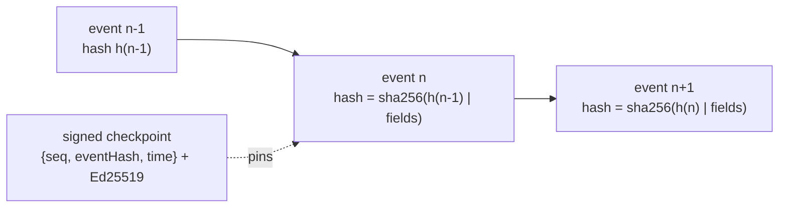

# Data model and database security (S13)

All durable platform state lives in **one PostgreSQL 17 database** (`capacity`) with the
`pgvector` extension, running as a StatefulSet in `capacity-data` (image
`pgvector/pgvector:0.8.1-pg17`, TLS required). This page describes what is stored, who may read or
write it, and how history is protected against change.

## 1. Why one database with seven schemas

* **One consistency boundary.** A result and the event announcing it commit together (see
  [workflow-and-jobs.md](workflow-and-jobs.md)).
* **One thing to secure and back up** inside a laptop's memory budget.
* **Hard separation anyway.** Each service owns one schema and connects as its own role; grants,
  row-level security and triggers enforce the boundaries, and integration tests prove them against
  a real database.

## 2. Migrations

Schema changes are plain SQL files in [`db/migrations`](../db/migrations), applied in order by
`capacity-lab bootstrap` (stage `database`) through a short-lived port-forward with the dedicated
migration identity. Services never migrate their own schema at start-up.

| File | Creates |
|---|---|
| `0001_roles_and_schemas.sql` | the seven schemas; one login role per service (`svc_api`, `svc_observer`, `svc_capacity`, `svc_ai`, `svc_governance`, `svc_executor`) and the read-only `svc_auditor` |
| `0002_workflow_and_audit.sql` | the job queue with row-level security, the inbox for idempotent consumers, the hash-chained audit table and its verification function |
| `0003_inventory.sql` | cluster incarnation, snapshots, configuration revisions, outbox |
| `0004_capacity.sql` | query definitions, observation windows, forecast runs, analyses, candidates, evaluations, evidence pins, experiment registrations, outbox |
| `0005_knowledge.sql` | source documents, chunks (with `vector(768)` and a full-text index), advisory artifacts, workflow checkpoints, outbox |
| `0006_governance.sql` | operating mode, role grants, effective policy, plan revisions/state/transitions, approvals, revocations, execution intents, idempotency records, outbox, `executor_authority_v` |
| `0007_execution.sql` | target locks, operations, operation transitions, outcomes, outbox |
| `0008_read_projections.sql` | read-only views the API uses for listing |
| `0009_tool_delegation.sql` | lets the capacity service read the AI job that delegated a tool call, and the AI service read execution outcomes |

`platform_meta.schema_migrations` stores a SHA-256 checksum per applied file. If an applied file is
later edited, the migrator stops with `MigrationDrift` instead of silently diverging; re-running
the migrations on an up-to-date database is a no-op. The release report re-checks the live ledger
against the files in the repository.

## 3. Tables by schema

| Schema | Tables (views marked) | Notes |
|---|---|---|
| `inventory` | `cluster_incarnation`, `snapshot`, `configuration_revision`, `outbox` | snapshots carry nodes, workloads, Pods with effective requests, HPAs and the controller UID of every Pod |
| `capacity` | `query_definition`, `observation_window`, `forecast_run`, `analysis`, `candidate`, `evaluation`, `evidence_pin`, `experiment_registration`, `outbox` | everything an analysis used and produced, addressable by digest |
| `knowledge` | `source_document`, `chunk`, `advisory_artifact`, `workflow_checkpoint`, `outbox` | chunks hold redacted text, a `tsvector` and an optional 768-dimension embedding |
| `governance` | `operating_mode`, `role_grant`, `effective_policy`, `plan_revision`, `plan_state`, `plan_transition`, `approval`, `approval_revocation`, `execution_intent`, `idempotency`, `outbox`, `executor_authority_v` (view) | `plan_state` is the only mutable "current state" table; history is append-only |
| `execution` | `target_lock`, `operation`, `operation_transition`, `outcome`, `outbox` | one operation per intent, every state change recorded |
| `audit` | `events` | one hash chain for the whole platform |
| `workflow` | `jobs`, `inbox` | all job queues in one table, isolated by RLS |

## 4. Who may do what

Each service connects as its own role, using a DSN that External Secrets copies from Vault into that
service's namespace only.

| Role | Writes | Reads outside its own schema |
|---|---|---|
| `svc_observer` | `inventory.*` | — |
| `svc_capacity` | `capacity.*` | inventory snapshots; effective policy and grants; the AI job that delegated a tool call |
| `svc_governance` | `governance.*`, job inserts for `capacity`/`ai`/`executor` queues | capacity evidence tables (to bind a plan to an evaluation); advisory artifacts by reference |
| `svc_ai` | `knowledge.*` | capacity evidence tables; execution outbox and outcomes |
| `svc_executor` | `execution.*` | `governance.executor_authority_v` and the governance outbox only |
| `svc_api` | job inserts into its allowed queues | capacity evidence; plan, approval and intent state; operating mode; read projections; audit (for status) |
| `svc_auditor` | — | the audit chain and its verification function |

Every role may **insert** into `audit.events`; none may update or delete it.
`tests/integration/test_schema_boundaries.py` connects as each real role to a disposable PostgreSQL
container and checks that cross-schema writes and privileged views are denied, and that an owner can
write its own schema.

## 5. Job queue isolation (row-level security)

`workflow.jobs` holds every queue. RLS policies restrict each role to its own queue — for example
`svc_capacity` sees only `queue = 'capacity'`, and governance may insert only into the `capacity`,
`ai` and `executor` queues. A compromised AI worker therefore cannot claim, read or forge capacity or
execution jobs. Claiming, leases and retries are described in [workflow-and-jobs.md](workflow-and-jobs.md).

## 6. Immutability

Evidence and decisions are append-only. `BEFORE UPDATE OR DELETE` triggers reject changes to:

| Table | Trigger |
|---|---|
| `inventory.snapshot` | `snapshot_immutable` |
| `capacity.query_definition`, `observation_window`, `forecast_run`, `analysis`, `candidate`, `evaluation` | `*_immutable` |
| `knowledge.advisory_artifact` | `advisory_immutable` |
| `governance.plan_revision`, `approval`, `execution_intent` | `*_immutable` |
| `governance.plan_transition`, `execution.operation_transition` | `*_append_only` |
| `execution.outcome` | `outcome_immutable` |
| `audit.events` | `audit_no_update` |

A plan that changes gets a **new revision** with a new digest. Mutable "current state" (for example
`plan_state`) is kept separate from the immutable history, so the history can always be replayed.

## 7. The audit hash chain



* Every insert takes an advisory lock, reads the previous event's hash and computes
  `event_hash = sha256(prev_hash | event_id | time | correlation | machine actor | human actor |
  action | scope | decision | reason | details)` in a `SECURITY DEFINER` trigger.
* The trigger records `session_user` as the machine actor, so a service cannot claim to be another.
* `decision` is `allow`, `deny` or `fact`. Refused governance commands are recorded as `deny`
  **after** their own transaction rolls back (see
  [governance-and-execution.md](governance-and-execution.md#2-refused-commands-are-audited)).
* `audit.verify_chain()` recomputes the chain and returns the first broken sequence number.

A chain alone cannot detect a database superuser who rewrites events **and** recomputes all later
hashes. `capacity-lab audit checkpoint` therefore signs the current head with an Ed25519 key held
on the host (DPAPI-protected), and `capacity-lab audit verify` checks every signed checkpoint
against the live database. The latest verification on the reference host (2026-11-21 05:10) found
the chain intact up to seq 15 with 7 checkpoints checked — see
[proof-of-operation.md](proof-of-operation.md).

Example events recorded during the live governed change:

| Time | Action | Decision | Reason |
|---|---|---|---|
| 03:21:55 | `mode.set` | fact | `mode_Governed` |
| 03:21:57 | `plan.create` | allow | `AwaitingApproval` |
| 03:22:03 | `plan.approve` | allow | `approved` |
| 03:22:05 | `execution.request` | allow | `intent_created` |
| 03:22:06 … 03:39:30 | `execution.transition` ×7 | fact | each operation state |
| 04:11:44 | `mode.set` | deny | `authorization_denied` (viewer) |
| 04:11:48 | `plan.approve` | deny | `AUTHORIZATION_DENIED` (unknown plan) |

## 8. The executor's authority view

The executor never reads governance tables directly. `governance.executor_authority_v` exposes, for
each pending intent, only what the executor needs to decide whether it may act: the plan revision
and digest, the approval bound to it, approval and intent expiry, any revocation, and the current
operating mode. If any of these is missing, expired or revoked, the executor refuses. This keeps
the question "is this still authorized?" in one place, and the integration tests prove a revoked
grant or a mode downgrade after approval blocks execution.

## 9. Units and digests

* **CPU** is stored as integer millicores and **memory** as integer bytes. Kubernetes quantities are
  converted once at the edge (`contracts/units.py`), so no floating-point rounding leaks into
  comparisons. For example `250m` → 250, `0.5` → 500 and `1` → 1000 millicores; sub-millicore or
  malformed values (`0.0001`, `-1`, `1.5.2`) are rejected; `1Gi` (binary, 1,073,741,824 bytes) and
  `1G` (decimal, 1,000,000,000 bytes) are distinguished.
* **Digests** of analyses, candidates, evaluations, plans and outcomes are SHA-256 over canonical
  JSON (`contracts/canonical.py`): sorted keys, no insignificant whitespace. Two services computing
  the same object get the same digest, and the golden tests check that identical inputs give
  identical digests and order.

## 10. Inspecting the data

The migration identity can read everything; use it only for diagnostics:

```powershell
kubectl --context kind-capacity-lab -n capacity-data exec postgres-0 -- psql -U migrator -d capacity -c "select action, decision, count(*) from audit.events group by 1, 2"
```

```powershell
kubectl --context kind-capacity-lab -n capacity-data exec postgres-0 -- psql -U migrator -d capacity -c "select intent_id, to_state, reason, at from execution.operation_transition order by seq"
```

Backups and restore drills of this database are described in
[backup-and-recovery.md](backup-and-recovery.md).
