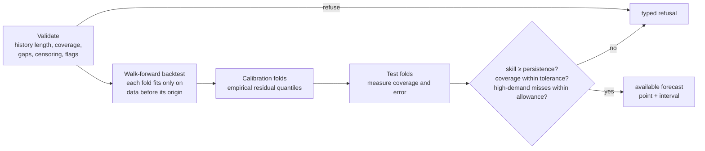

# Forecasting (S14)

The capacity service predicts each workload's CPU and memory demand for the next hour (and, under
stricter conditions, the next 24 hours). Forecasts feed the optimization gates and the demand
envelope; they never change anything on their own. When the evidence is not good enough, the
engine **refuses** with typed reasons instead of guessing. Code:
[`capacity/forecasting/`](../src/capacity_platform/capacity/forecasting).

## 1. In one paragraph

Telemetry is aligned into fixed buckets. The engine checks that the history is long, complete and
clean enough for the requested horizon. It then fits a few simple models on rolling slices of the
past, scores each on what came *after* its slice, and builds a prediction interval from the errors
of earlier slices. A model is used only if it beats the "next value = last value" baseline and its
interval proves honest on later slices. Otherwise the answer is a refusal, which downstream gates
treat as `unknown`.

## 2. Inputs

* **Telemetry** from Prometheus through the fixed query registry (see [telemetry.md](telemetry.md)):
  `container.cpu.rate.millicores` and `container.memory.working_set.bytes` for the workload's
  container, over a 6-hour lookback ending at the last 5-minute boundary.
* **Buckets:** 5 minutes for the 1-hour horizon, 1 hour for the 24-hour horizon. CPU buckets use the
  mean; memory buckets use the maximum. Each bucket is `observed`, `missing` or `censored` (for
  example a CPU-throttled sample, where real demand may be higher than measured).
* **Source quality flags** from the telemetry layer (`scrape_gap`, `multiple_series_combined`,
  `peak_not_guaranteed`, …).
* **As-of time:** every history bucket must end at or before the forecast's `asOfUtc`; anything later
  is refused as `future_information_leakage`.

## 3. Models

A small, fixed portfolio of explainable models (`models.py`):

| Model | Idea | Good for |
|---|---|---|
| `persistence` | next value = last observed value | the baseline every model must match or beat |
| `rolling_median` | median of the last N buckets (N = 12 for 1 h, 24 for 24 h) | noisy, flat demand |
| `ses` | simple exponential smoothing; α chosen by least squares | slowly drifting level |
| `holt_damped` | level + trend, with the trend fading out | gentle ramps without runaway extrapolation |
| `seasonal_naive` | value one season ago (period 24 buckets; 24 h horizon only) | daily patterns |

## 4. How a model is chosen

1. **Eligibility.** The policy for the horizon and resource checks minimum history, coverage,
   longest gap and censored fraction. Every upstream quality flag must be classified: known flags
   map to a refusal reason or are handled by the coverage computation; an **unknown** flag blocks
   eligibility (`unclassified_quality_issue`) rather than being ignored.
2. **Walk-forward backtest.** Origins step through the history (every 3 buckets for 1 h, every 6
   for 24 h, at most 40 / 20 folds). At each origin a model is fitted only on data before it and
   scored on the buckets after it.
3. **Calibrated intervals.** Prediction intervals come from empirical residual quantiles of the
   **earlier** (calibration) folds; coverage is then measured on the **later** (test) folds. The
   reported coverage is therefore never computed on the data that produced the interval.
4. **Selection.** A model qualifies only if:
   * its skill against persistence is ≥ 0 (it is at least as good as the baseline);
   * its interval coverage on test folds is within ±10 percentage points of the nominal 90 %;
   * the share of **high-demand misses** (actual above the upper bound) stays within the allowance —
     10 % for CPU, **8 % for memory**, because memory under-prediction can mean an OOM kill.

   A model with a better average error but a worse tail is **not** promoted over a safer one.

## 5. Policies (provisional values)

| Policy | Bucket | Min history | Min coverage | Min train buckets | Max gap | Max censored | Folds (max / calib / test) | High-demand allowance |
|---|---|---|---|---|---|---|---|---|
| `forecast-cpu-1h-v1` | 5 min | 4 h | 95 % | 24 | 3 buckets | 5 % | 40 / 4 / 4 | 10 % |
| `forecast-memory-1h-v1` | 5 min | 4 h | 95 % | 24 | 1 bucket | 0 % | 40 / 4 / 4 | 8 % |
| `forecast-cpu-24h-v1` | 1 h | 72 h | 95 % | 24 | 1 bucket | 5 % | 20 / 2 / 2 | 10 % |
| `forecast-memory-24h-v1` | 1 h | 72 h | 95 % | 24 | 0 buckets | 0 % | 20 / 2 / 2 | 8 % |

All four use nominal interval coverage 90 % with a tolerance of 10 points. These numbers are
starting points from the specification, not calibrated results. Each forecast records the policy
revision it was evaluated under, so changing a threshold never silently changes the meaning of an
old forecast.

**What "6 hours of telemetry" means in practice:** the 1-hour forecast needs ≥ 4 hours of history
and ≥ 95 % coverage *inside the 6-hour lookback*. Coverage counts the whole window, so a workload
needs about 5.7 hours of continuous data before both conditions hold.

## 6. Refusals are normal results

A refusal is stored like any forecast, with machine-readable reasons:

| Reason | Meaning |
|---|---|
| `insufficient_history` | less history than the policy minimum, or too few comparable runs for a batch envelope |
| `coverage_below_policy` | too many missing buckets or too long a gap |
| `demand_censored` | too many buckets where measured demand may understate real demand (throttling) |
| `memory_spike_fidelity_insufficient` | peak-related flags (`peak_not_guaranteed`, `short_job_unsampled`) on a peak statistic |
| `unclassified_quality_issue` | a source flag the policy does not classify (for example `multiple_series_combined`) |
| `future_information_leakage` | history after the as-of time |
| `temporal_alignment_invalid` | buckets not on the grid or not contiguous |
| `backtest_below_baseline` | no model matched persistence |
| `interval_calibration_failed` | intervals did not achieve their coverage on test folds |
| `high_demand_underprediction` | too many actual values above the upper bound |
| `unsupported_target_or_horizon` | for example a continuous forecast requested for a run-to-completion job |

Downstream, the `forecast.support` gate treats a refused forecast as **unknown**, which blocks a
downsize rather than guessing.

### What happened on the reference host

| When (UTC) | Outcome | Reason |
|---|---|---|
| 2026-11-20, shortly after deployment | refused | `coverage_below_policy` — far less than 6 h of data |
| 2026-11-20, after host downtime | refused | the downtime left almost no samples in the window |
| 2026-11-21 02:44 | **available** (CPU and memory) | 72/73 CPU buckets, memory coverage 0.990 |
| 2026-11-21 03:56 | refused | `unclassified_quality_issue` — three Pod series after a change and its reversal |

Forecast **accuracy** on live data has not been measured; an available forecast only means its
inputs passed the quality checks and its backtest met the policy. See [evaluation.md](evaluation.md).

## 7. Batch workloads (W05/W06)

Run-to-completion jobs have no continuous demand curve. For them the engine builds a **run
envelope** (`envelope.py`) from previous runs of the *same pinned profile*: conservative peaks plus
a margin, with the caveat that sampled peaks are not true maxima. Fewer than the required number of
comparable declared runs gives `insufficient_history`. A suspended batch workload is reported as
*not applicable*, never as zero demand.

## 8. Determinism and anti-leakage, as tested

`tests/unit/test_forecasting.py` (18 tests) pins the behaviour with deterministic synthetic series:

* the bucket grid's count and contiguity; identical input → identical forecast;
* invalid numbers and duplicate timestamps are typed input errors, never coerced;
* missing samples are never treated as zero; history after the cut-off is refused as leakage;
* short history is refused, and compressed scenario time never counts as 24-hour history;
* source flags map to typed refusals; a peak flag blocks a peak statistic but only limits a mean;
* censored CPU demand is refused; a better average error with a bad tail is not promoted;
* undefined metrics are `None`, not zero; the MAE arithmetic matches the specification's example;
* a batch run envelope needs comparable declared runs; an aggregate projection never claims joint
  coverage.
