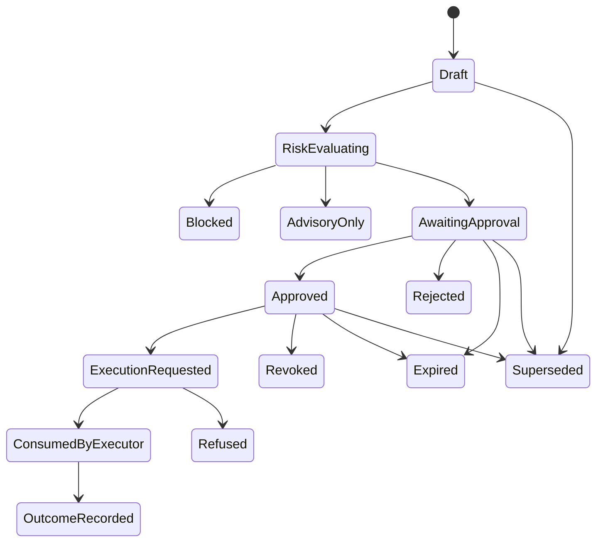
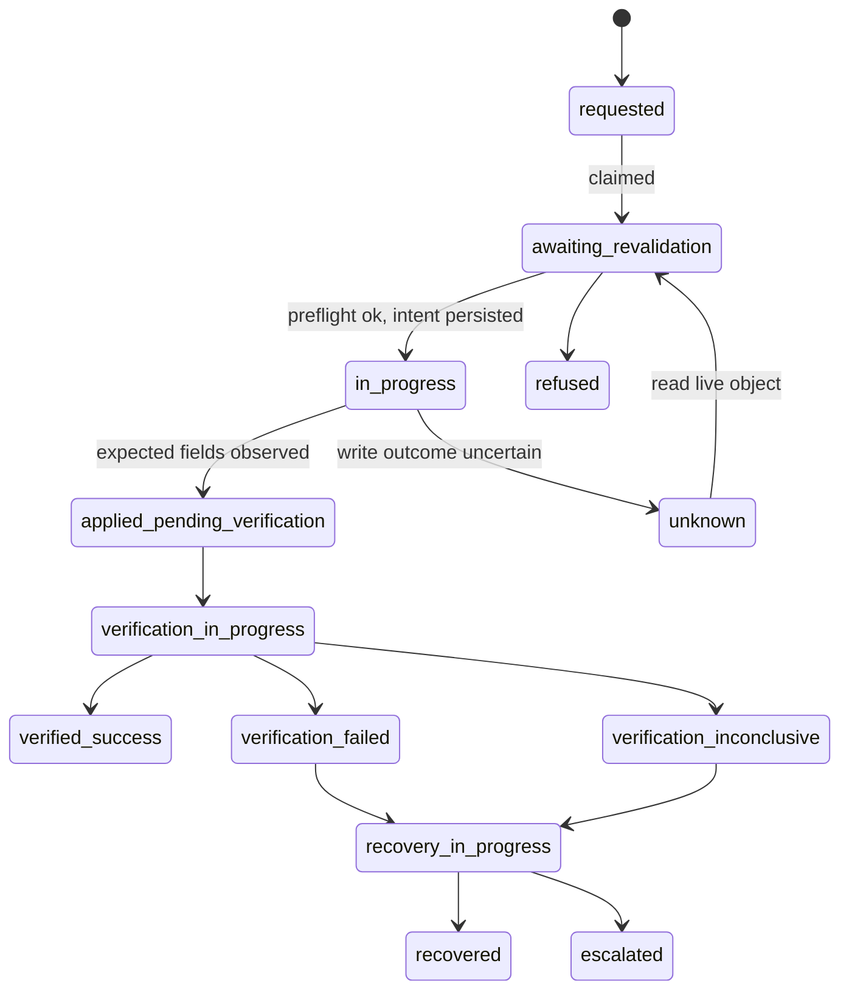

# Governance, execution and verification (S24–S26)

This is the **only** path by which the platform changes a workload. Each step is owned by a
different service and, for people, a different role. This page describes plans and approvals
(governance), how the executor applies an approved change, how the change is verified and undone,
and how refusals are recorded — illustrated with the real run of 2026-11-21.

```mermaid
sequenceDiagram
  participant PL as Planner
  participant AP as Approver
  participant EX as Executor role (person)
  participant G as governance
  participant E as executor service
  participant K as Kubernetes API
  PL->>G: create plan from evaluation digest (mode must be Governed)
  G-->>PL: plan revision + planDigest (AwaitingApproval, 60 min)
  AP->>G: approve revision + exact planDigest
  Note over G: approver ≠ author · role + grant · Governed<br/>approval valid 15 min
  EX->>G: execution request (idempotency key)
  G->>G: intent (15 min) · plan → ExecutionRequested · 'executor' job
  E->>G: read executor_authority_v
  E->>E: preflight (authority, host safety, live object)
  E->>K: JSON Patch: test UID, resourceVersion, container, before-values; replace
  E->>E: verify configuration, then guardrails
  E->>K: exact inverse if not verified
  E->>G: outcome recorded
```

## 1. Plans (S24)

`governance/plans.py` builds an `ExecutionPlan` from exactly one qualified `OptimizationEvaluation`:

* **target:** cluster incarnation, namespace, controller kind/name/**UID**, resourceVersion and
  container name;
* **approved field changes:** each field's `before` and `after` value with its JSON path;
* **references:** policy digest, evidence digests, the evaluation digest, an optional advisory
  artifact, the verification policy reference;
* **risk summary:** whether all required hard gates passed, and any governance reasons;
* **expiry:** 60 minutes after creation.

The plan's **digest** is SHA-256 over its canonical JSON. Plans are immutable; any change produces a
new revision with a new digest, and an old revision's approval never transfers.

### Plan states



A new plan ends in one of three states:

| State | When | Can it run? |
|---|---|---|
| `AwaitingApproval` | evaluation qualified, mode `Governed`, governance policy allows deterministic-only execution for the workload, target is a directly managed Deployment | yes, after approval |
| `Blocked` | a required gate failed or is unknown (`hard_gate_failed` / `hard_gate_unknown`), the policy changed since the analysis (`policy_superseded`), the target is not a Deployment — for example a Job template (`unsupported_action`) — or ownership is ambiguous | never |
| `AdvisoryOnly` | the mode was not `Governed` at creation, **or** the only reasons are non-blocking: the workload needs a review the plan lacks (`deterministic_only_policy_unset`, `review_incomplete`) or the target is GitOps-owned (`adapter_unqualified` — the GitOps adapter is P1 and not installed) | never |

[`configs/policies/governance-policy.yaml`](../configs/policies/governance-policy.yaml) sets
`deterministicOnlyExecutionAllowed: false` for **W01** (Critical), so W01 plans need a completed
advisory review and, while the model is unqualified, remain advisory only. W02–W04 allow
deterministic-only execution. Illegal transitions are rejected (`test_illegal_plan_transitions_are_rejected`).

### Approval rules

An approval is accepted only when **all** hold:

* the caller holds the **Approver** role with a grant covering the target namespace;
* the caller is a human (machine principals are refused), and is **not the plan's author** — checked
  in code and by a database `CHECK` constraint;
* the request names the exact `revision` **and** `planDigest`; a mismatch is `plan_digest_mismatch`;
* the plan is `AwaitingApproval` and not expired;
* the operating mode is `Governed`;
* every required hard gate passed and there are no governance reasons.

An approval is valid for **15 minutes** (never beyond the plan's expiry) and can be revoked until it
is consumed (`POST /plans/{id}/revocations`, Approver).

### Execution request

A person with the **Executor** role asks for execution of an approved revision. Governance checks
the approval again, creates an `ExecutionIntent` (valid 15 minutes, never beyond the approval),
moves the plan to `ExecutionRequested` and inserts an `executor` job carrying only the intent ID. A
retried request with the same idempotency key returns the same intent.

## 2. Refused commands are audited

Every governance command — plan creation and reads, approvals and rejections, revocations, execution
requests and mode changes — that is refused for authorization, state or digest reasons leaves a
`deny` record in `audit.events`. The record holds the command, the requested plan or mode, the human
and the **precise** reason, for example `separation_of_duties`, `plan_digest_mismatch` or the missing
role. The caller only sees the generic denial.

The wrapper that writes it sits outside the command's database transaction. The refused transaction
rolls back first; the denial is then written on a fresh connection, so the rollback cannot erase it
and no lock is held. Validation and outage errors are not decisions and are not recorded as denials.
Verified by `test_refused_commands_leave_durable_denial_records` and live:

| Time (UTC) | Command | Who | Recorded reason |
|---|---|---|---|
| 2026-11-21 04:11:44 | `mode.set` | viewer1 | `authorization_denied` |
| 2026-11-21 04:11:48 | `plan.approve` on an unknown plan | approver1 | `AUTHORIZATION_DENIED` (no existence leak to the caller) |

## 3. The executor (S25)

The executor (`executor/operations.py`, `executor/service.py`) is the only service with permission
to change workloads. For each intent it:

1. **Claims** the `executor` job (lease 2 minutes) and takes a per-target lock with a **fencing
   epoch**. A newer epoch makes an older holder's writes fail, so two executors can never both act on
   one target, and a second operation on the same controller waits for the first.
2. **Re-reads authority** through `governance.executor_authority_v`.
3. **Runs the ordered preflight.** Any reason refuses the operation:

   | Check | Refusal reason |
   |---|---|
   | intent digest intact | `intent_integrity_invalid` |
   | intent binds to this plan digest and approval | `plan_digest_mismatch` |
   | mode still `Governed` | `mode_not_governed` |
   | plan is `ExecutionRequested` | `plan_not_execution_requested` |
   | approval still effective (not expired or revoked) | approval reason |
   | intent not expired | `intent_expired` |
   | requester's grant still valid | `requester_grant_revoked` |
   | effective policy unchanged since planning | `policy_superseded` |
   | adapter is `direct_kubernetes` | `adapter_unqualified` |
   | same cluster incarnation | `cluster_incarnation_mismatch` |
   | target in a demo namespace | `target_disallowed` |
   | host-safety signal fresh (≤ 2 min) and `ok` | `host_pressure` / `exclusive_experiment` |
   | live object exists with the planned UID | `target_not_found` / `target_identity_changed` |
   | container uniquely identified | `container_identity_ambiguous` |
   | owner is direct (no Flux/Argo markers) | `ownership_*` |
   | HPA status known; no CPU-request change on an HPA target | `hpa_status_unknown` / `hpa_request_coupling_unmodeled` |
   | live values equal the plan's before-values | `before_image_mismatch` |

4. **Records the intent to write** before touching the cluster.
5. **Applies a JSON Patch** whose first operations are `test` operations on the UID, the freshly read
   resourceVersion, the container name and each before-value. If anything changed, the API server
   rejects the whole patch.
6. **Reconciles on uncertainty.** If the write times out or the connection drops, the operation is
   `unknown`; the executor never retries blindly. It reads the live object and decides whether the
   change is already there, not there, or something else changed (`awaiting_revalidation`).

Kubernetes adds two independent guards: RBAC lets the executor patch Deployments only in the demo
namespaces, and the `capacity-executor-field-guard` admission policy rejects any executor update that
changes anything except container CPU/memory requests and limits
([cluster-topology.md](cluster-topology.md#6-admission-policies)).

### Operation states



Every transition is stored append-only in `execution.operation_transition` and audited as an
`execution.transition` fact.

## 4. Verification and recovery (S26)

[`configs/policies/verification-policy.yaml`](../configs/policies/verification-policy.yaml)
(revision 1, provisional lab values):

| Setting | Value |
|---|---|
| rollout deadline | 300 s |
| baseline window (before the change) | 900 s |
| stabilization | 120 s |
| evaluation window (after stabilization) | 900 s |
| load comparability tolerance | 20 % |
| inverse attempts | at most 1 |

| Workload | Guardrails |
|---|---|
| W01 latency-api | p95 ≤ 150 ms, errors ≤ 1 %, 0 OOM restarts, availability ≥ 0.99, coverage ≥ 0.9 |
| W02 burst-api | p95 ≤ 300 ms, errors ≤ 2 %, 0 OOM restarts, availability ≥ 0.99, coverage ≥ 0.9 |
| W03 memory-profile | 0 OOM restarts, availability ≥ 0.99, coverage ≥ 0.9 |
| W04 cpu-worker | 0 OOM restarts, queue growth ≤ 0.5 per minute, availability ≥ 0.99, coverage ≥ 0.9 |

A guardrail left empty is not evaluated for that workload (it does not pass by default).

**Level 1 — configuration:** the live object has exactly the planned values, and the rollout
completed within the deadline (`observedGeneration` caught up, replicas updated and available).
An acknowledged patch without a finished rollout is never verified (`test_s26_t01_ack_without_rollout_is_not_verified`).

**Level 2 — operation:** both windows are read through the registered telemetry queries, each at no
less than the query's minimum step; a failed query leaves its guardrail `unknown` and is logged
(`verification query … failed`). Then:

* **guardrails:** any `fail` → fail; any `unknown` → unknown; otherwise pass;
* **load comparability:** `sufficient` when the post-window request rate is within 20 % of the
  baseline's, otherwise `insufficient` (or `unknown` without a baseline rate);
* **benefit:** `supported` (reservation reduced under comparable, safe load), `not_demonstrated` or
  `inconclusive` (`incomparable_load`, `experiment_contamination`, `guardrails_not_passed`).

| Disposition | Operation state |
|---|---|
| `verified_safe_benefit_verified` / `verified_safe_benefit_unproven` | `verified_success` |
| `verification_failed` | `verification_failed` → recovery |
| `verification_inconclusive` | `verification_inconclusive` → recovery |

**Recovery:** if verification fails **or is inconclusive**, the executor builds the exact inverse
(the recorded before-values) — but only if the live object still shows exactly the planned
after-values. It applies it with the same `test` mechanism and the authority already granted. A
concurrent edit, a recreated controller or a used-up attempt budget makes it `escalated` for a
person instead (`test_recovery_escalates_on_concurrent_edit_recreation_or_attempt_limit`). Recovery
never loops.

The outcome record (immutable, digest-identified) keeps every dimension separate: configuration,
rollout, safety guardrails, benefit and its reason, load comparability, the request reservation
delta, the observed CPU delta, the baseline and post-window references, and the recovery reference.

## 5. The live run, step by step

From `~/.capacity-lab/evidence/e2e-governed-change-20261121T035240Z.json` and the audit chain:

| Time (UTC) | Event |
|---|---|
| 03:21:55 | `admin1` sets mode `Governed` (revision 1 → 2) |
| 03:21:57 | `planner1` creates `plan-1698278fbb3b` r1 — W04 memory request 192 Mi → 96 Mi — `AwaitingApproval` |
| 03:21:57–03:22:03 | `planner1` approving own plan → 403; `approver1` with a wrong digest → 409 |
| 03:22:03 | `approver1` approves the exact digest |
| 03:22:05 | `operator1` requests execution → `intent-fb7bbb62d95d` |
| 03:22:06 | executor: claimed → preflight ok → patch applied (`test` UID `0e249f7a-…`, resourceVersion `40353`, container `app`, memory `192Mi`; `replace` → `96Mi`) → expected fields observed |
| 03:22:09 | verification started; rollout healthy at 03:22:39 |
| 03:39:14 | `verification_inconclusive`: configuration pass, rollout healthy, guardrails `unknown`, benefit `inconclusive` (`guardrails_not_passed`) |
| 03:39:30 | exact inverse 96 Mi → 192 Mi applied and observed → `recovered` |

Prometheus held every guardrail signal for the window (availability 1.0, no restarts, empty queue,
request rate ≈ 1.0/s before and after), but the verifier requested the restart count below that
query's 60 s minimum step; the client refused it and the value was missing. The fail-safe behaved as
designed. The verifier was fixed and the fix is covered by unit tests that run the real registry and
client; a `verified_success` on the live lab has not been recorded yet
([proof-of-operation.md](proof-of-operation.md)).

## 6. Tests

| Test file | Protects |
|---|---|
| `tests/unit/test_governance.py` (18) | role/grant/mode authorization, fail-closed grant store, plan issuance states, author ≠ approver, digest binding, expiry/revocation, unknown gates block, deterministic-only policy, GitOps targets, Advisory mode, mode change after approval, legal transitions |
| `tests/unit/test_executor.py` (26) | exact patch with preconditions, forged digests, recreated controllers, concurrent edits, HPA, GitOps, lost responses, crashes before/after patch, stale fences, authority changes, exclusive experiments, expiry, before-image drift, admission refusals, absent limits, verification dispositions and window observation, recovery and escalation |
| `tests/integration/test_governed_chain.py` (8) | the chain across real PostgreSQL roles: apply once and journal everything, idempotent execution requests, author with an approver grant, revoked grant and mode downgrade after approval, opaque out-of-scope reads, one operation per controller, durable denial records |
| `tests/e2e/test_governed_change_live.py` (1) | the full chain on the live lab with four real users |

Details per test: [test-catalog.md](test-catalog.md).
