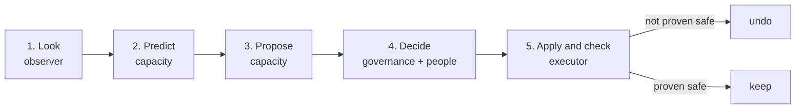

# How it works — a plain-language tour

This page explains the platform without assuming Kubernetes or statistics knowledge, then follows
**one real change** through the system with the values and timestamps recorded on the reference
lab on 2026-11-21. Deeper pages are linked from each step.

## 1. The problem in one picture

Every container in Kubernetes asks for resources with two numbers:

| Number | What it means | If it is too high | If it is too low |
|---|---|---|---|
| **request** | what the scheduler *reserves* for the container on a node | the node fills up with reservations nobody uses: wasted capacity | the node is over-committed; the container competes for CPU and may be evicted |
| **limit** | the ceiling the container may never exceed | little harm, but it hides real needs | CPU is throttled (slow responses); memory over the limit kills the container (OOM) |

Teams usually guess these numbers once and never revisit them. The platform measures what each
workload really uses, predicts what it will need, and proposes better numbers — but it changes
nothing unless people approve the exact change, and it puts the old numbers back if it cannot
prove the new ones are safe.

## 2. The idea in five sentences

1. **Look:** record what is running and how much CPU and memory it really uses.
2. **Predict:** forecast the next hour of demand, or refuse when the data is not good enough.
3. **Propose:** compute a few candidate requests/limits and throw away any that break a safety rule.
4. **Decide:** a planner writes an exact plan, a *different* person approves that exact plan, and a
   third role asks for it to run.
5. **Apply and check:** the one component allowed to change workloads applies the plan, watches
   the workload under the same load as before, and undoes the change if safety is not proven.



An optional AI layer can read the evidence and write a review, but it can only comment. It cannot
change numbers, approve, or execute.

## 3. Who does what

The platform is split into six small services so that no single process holds every power. They
share one container image but each runs with its own identity, database account and network rules.

| Service | Plain-language job | May it change workloads? |
|---|---|---|
| `observer` | keeps an up-to-date inventory of nodes, Deployments and Pods | no (read-only Kubernetes access) |
| `capacity` | reads metrics, forecasts, proposes and checks candidates | no |
| `governance` | keeps plans, approvals, operating mode and permissions | no |
| `api` | the front door for people; checks who you are and what you may do | no |
| `ai` | optional reviewer that explains evidence | no (no Kubernetes access at all) |
| `executor` | applies approved changes, verifies them, undoes them | **yes — the only one**, and only CPU/memory fields of demo Deployments |

People have roles too. In the lab there is one test user per role:

| User | Role | Can |
|---|---|---|
| `planner1` | Planner (+ Analyst) | ask for analyses, create plans |
| `approver1` | Approver | approve or reject a plan someone *else* created |
| `operator1` | Executor | ask the platform to run an approved plan |
| `admin1` | Administrator | switch the operating mode, manage grants, add knowledge |
| `viewer1` | Viewer | read only |

Roles do not stack: the Administrator cannot approve, and the Approver cannot execute.

## 4. Following one real change

The workload is **W04 `cpu-worker`**, a small Python service in the `workloads-batch` namespace
that accepts tasks over HTTP and processes them from a queue. Its hand-set configuration (the
"B0 baseline") is:

| | CPU | Memory |
|---|---|---|
| request | 150m (0.15 of a core) | 192 Mi |
| limit | 500m | 320 Mi |

### Step 1 — Create steady demand and history

A forecast needs history. For about six hours the scenario runner sent W04 a steady stream of
light tasks with scenario **E04** (about one task per second). Seven consecutive one-hour runs
succeeded with **3,312 of 3,312 requests answered** each, client p95 latency 5.5–7.0 ms, and the
same plan digest every time (same seed, same schedule).

Under that load W04 used about **14–15 millicores of CPU** and **35–40 MiB of memory** — far below
its 150m / 192 Mi requests.

→ [workloads-and-experiments.md](workloads-and-experiments.md)

### Step 2 — Look and measure

* The `observer` recorded W04's Deployment, its Pod, its UID and the Pod's *effective* request.
* The `capacity` service read nine registered Prometheus queries over the last six hours, aligned
  to a fixed grid, and recorded how complete the data was. At 02:42 the CPU series had 72 of 73
  five-minute buckets and memory coverage was 0.990.

→ [telemetry.md](telemetry.md)

### Step 3 — Predict

For both CPU and memory the engine backtested several simple models on the history, kept one that
beat the "next value = last value" baseline, and produced a one-hour forecast with an upper bound.

It would have **refused** if the history were too short, had gaps, or mixed several Pods — and it
did refuse at other times that day, which is the intended behaviour (see step 9).

→ [forecasting.md](forecasting.md)

### Step 4 — Propose and check

The engine builds a *protected demand envelope*:

```text
envelope = max(observed peak, forecast upper bound) × (1 + class margin)
```

W04 is in the **Flexible** class: margin 20 %, memory floor 96 Mi, CPU floor 50m, and at most a
50 % decrease in one change. The memory envelope (≈ 40 MiB × 1.2) is far below the floor, so the
candidate is clipped to the floor **and** the change budget: **192 Mi → 96 Mi**. For CPU the
same rules give **150m → 75m**.

Every candidate then runs through hard **gates**, each answering `pass`, `fail`, `unknown` or
`not_applicable`. Examples for the memory candidate:

| Gate | Question | Result at 03:12 |
|---|---|---|
| `target.allowlist` | is this namespace one the platform may touch? | pass |
| `evidence.integrity` | are all inputs present and digest-consistent? | pass |
| `resources.valid` | above floors, limits ≥ requests, on the grid? | pass |
| `memory.oom_spike` | enough continuous memory data, no OOM kills, peak below the new limit with margin? | pass |
| `forecast.support` | is there an eligible forecast supporting a decrease? | pass |
| `scheduler.fit` | would the changed Pod (and the rollout's surge Pod) still fit on a node? | pass |
| `hpa.compatibility` | would an autoscaler react badly to the change? | pass |
| `host.safety` | is the host healthy enough for a change right now? | pass |

**One `fail` rejects a candidate; one `unknown` makes it indeterminate.** Missing evidence never
counts as a pass. The CPU candidate stayed `indeterminate` because one gate (queue completion) has
no derived evidence yet — see [limitations.md](limitations.md).

→ [optimization-engine.md](optimization-engine.md)

### Step 5 — Plan

`admin1` switched the operating mode from `Observe` to `Governed` (a plan created in any other
mode can never be approved). `planner1` created a plan from the qualified evaluation's digest:

* plan `plan-1698278fbb3b`, revision 1, state `AwaitingApproval`;
* the plan records the target (namespace, Deployment, UID, container), the *before* and *after*
  values, and the digests of the policy and evidence it was built from;
* the plan's **digest** is the SHA-256 of its canonical JSON — change any byte and it becomes a
  different plan.

### Step 6 — Approve (and refuse what must be refused)

| Attempt | Result |
|---|---|
| `planner1` tries to approve their own plan | **refused** (403) — separation of duties |
| `approver1` approves with a digest that does not match | **refused** (409) — you approve exactly what you saw |
| `approver1` approves the exact digest | **accepted** at 03:22:03, valid for 15 minutes |

Since the audit fix described in [governance-and-execution.md](governance-and-execution.md),
every refused command also leaves a `deny` record with its precise reason in the audit chain.

→ [governance-and-execution.md](governance-and-execution.md), [identity-and-access.md](identity-and-access.md)

### Step 7 — Execute

`operator1` requested execution at 03:22:05. Governance created an **intent** (valid 15 minutes).
The `executor` claimed it, re-read the authority (approval still valid, not revoked, mode still
`Governed`), checked the host-safety signal and that no autoscaler or GitOps tool owns the
Deployment, and sent this JSON Patch at 03:22:06:

```json
[
  {"op": "test",    "path": "/metadata/uid",             "value": "0e249f7a-d08a-44c1-971a-a15286033f22"},
  {"op": "test",    "path": "/metadata/resourceVersion", "value": "40353"},
  {"op": "test",    "path": "/spec/template/spec/containers/0/name", "value": "app"},
  {"op": "test",    "path": "/spec/template/spec/containers/0/resources/requests/memory", "value": "192Mi"},
  {"op": "replace", "path": "/spec/template/spec/containers/0/resources/requests/memory", "value": "96Mi"}
]
```

The four `test` operations mean: *apply this only if the Deployment is still exactly the one we
planned for*. If anyone had edited it, Kubernetes would have rejected the whole patch. Kubernetes
itself also checks two more things: RBAC lets the executor patch only demo Deployments, and an
admission policy rejects any executor change to anything except CPU/memory values.

The rolling update finished at 03:22:39 and the live Deployment showed exactly the planned value.

### Step 8 — Verify, and undo when not proven

The executor waited 120 s for the workload to settle, then compared a 900 s window *after* the
change with the 900 s *before* it:

| Check | Before | After |
|---|---|---|
| availability | 1.0 | 1.0 |
| restarts / OOM kills | 0 | 0 |
| queue depth | 0 | 0 |
| request rate (load must be comparable within 20 %) | ≈ 1.0/s | ≈ 1.0/s |

The workload was healthy, but the verifier could not read the restart count (it asked Prometheus
for a finer time step than that query allows). A guardrail it cannot read is `unknown`, and an
unknown guardrail is never a pass. At 03:39:14 the operation became
`verification_inconclusive`; at 03:39:30 the executor applied the exact inverse
(96 Mi → 192 Mi) and the operation ended `recovered`.

So the run proved the whole chain and the safety net, but **not** a verified improvement. The
verifier defect was fixed and covered by a unit test; the run has not been repeated on the fixed
build yet.

→ [proof-of-operation.md](proof-of-operation.md)

### Step 9 — Why the next attempt had to wait six hours

After the change and its reversal, W04 had been replaced by new Pods twice. The telemetry queries
select a workload's Pods by name prefix, so the six-hour window now contained three Pod series.
Joining series by name alone could mix unrelated Pods, so the forecasting policy **refuses** such
a window. Forecasts for W04 come back once the window again holds a single Pod — about six hours
after the last rollout. This is a deliberate fail-closed rule, documented in
[limitations.md](limitations.md).

## 5. What keeps it safe, in short

| Risk | What prevents it |
|---|---|
| a bad number reaches the cluster | deterministic code, hard gates, unknown = not a pass |
| someone approves their own change | role separation in code **and** a database constraint |
| the approved change is not the applied change | approval binds to the plan digest; JSON Patch `test` operations |
| the executor changes something else | RBAC + a CEL admission policy limited to CPU/memory fields |
| a change makes things worse | verification against a comparable baseline, automatic exact inverse |
| the AI invents something | no write tools, schema without approval fields, number and citation validators |
| a demo Pod attacks the platform | Calico default-deny network policy, proven by live probes |
| history is rewritten | append-only tables, audit hash chain, host-signed checkpoints |

The full picture is in [security.md](security.md).

## 6. Where to go next

* See it yourself: [setup-guide.md](setup-guide.md) then [operator-guide.md](operator-guide.md).
* Check the evidence: [proof-of-operation.md](proof-of-operation.md).
* Understand the design: [architecture.md](architecture.md) and [design-decisions.md](design-decisions.md).
* Look up a term: [glossary.md](glossary.md).
