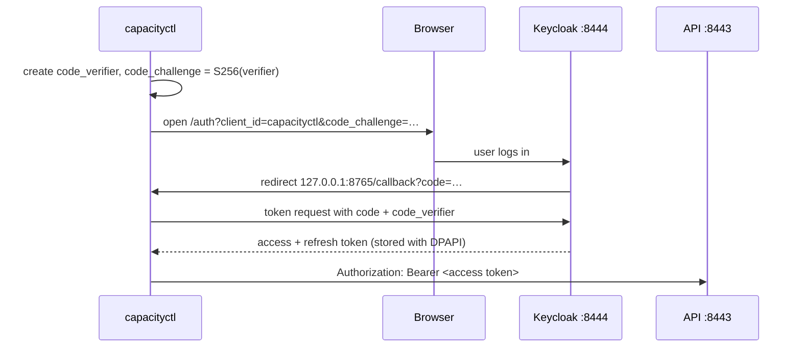

# Identity and access (S06, S07)

How people and services prove who they are, what each role may do, and how permission is scoped to
namespaces and to the operating mode.

## 1. People: Keycloak with PKCE

Keycloak 26.8.2 runs in `capacity-identity` and is reachable from the host at
`https://localhost:8444`; the OIDC issuer is `https://localhost:8444/realms/capacity`. The realm is
generated by `capacity-lab` (`lab/identity.py`), stored in Vault and imported at start-up, so it is
reproducible and never edited by hand.

| Client | Used by | Flow | Notes |
|---|---|---|---|
| `capacityctl` | the operator CLI | authorization code + PKCE (S256), loopback redirect `http://127.0.0.1:8765/callback` | public client; no secret |
| `capacity-e2e` | automated end-to-end and operational tests only | direct access (password) grant | **test only**; accepted because the lab deploys `OIDC_ALLOWED_CLIENTS=capacityctl,capacity-e2e` |

Realm settings: access tokens live **10 minutes** (`accessTokenLifespan: 600`), SSO sessions time out
after 30 minutes idle. The realm declares the `basic` (`sub`) and `roles` (`realm_access.roles`)
client scopes explicitly, because a realm import with a `clientScopes` list does not create
Keycloak's built-in ones.

### Logging in with capacityctl

```powershell
capacityctl auth login
```

```powershell
capacityctl auth status
```

```powershell
capacityctl auth logout
```

`login` opens the browser, receives the code on the loopback port, exchanges it with the PKCE
verifier and stores the tokens **encrypted with Windows DPAPI** (current user only). Tokens are never
printed. The CLI trusts the lab root CA at `~/.capacity-lab/pki/root-ca.crt`.



### Token checks in the API (and again in governance)

`shared/auth/oidc.py` validates every bearer token:

* signature against Keycloak's JWKS, algorithms limited to **RS256/ES256** (no `none`, no HS*);
* `iss` must equal the configured issuer; `aud` must contain `capacity-api`;
* the token must be an **access** token (`typ: Bearer`) — an ID token is rejected;
* `azp` (authorized party) must be an allowed client;
* expiry and not-before with a small, bounded clock-skew allowance;
* `sub` and `realm_access.roles` must be present.

Any failure returns `401` with a generic error envelope; the reason is logged, the token is not.
Governance receives the user's original token from the API and **validates it again itself** — it
never trusts a forwarded user header.

## 2. Roles

Roles are **not hierarchical**: having one never implies another. The authorization matrix
(`governance/authz.py`, `ACTION_ROLES`):

| Action | Viewer | Analyst | Planner | Approver | Executor | Administrator |
|---|---|---|---|---|---|---|
| `inventory.read`, `evidence.read`, `plan.read`, `execution.read`, `audit.read` | ✓ | ✓ | ✓ | ✓ | ✓ | ✓ |
| `forecast.request`, `analysis.request`, `advisory.request` | | ✓ | ✓ | | | |
| `plan.create` | | | ✓ | | | |
| `plan.approve`, `plan.reject`, `approval.revoke` | | | | ✓ | | |
| `execution.request` | | | | | ✓ | |
| `grant.administer`, `knowledge.ingest`, `mode.set` | | | | | | ✓ |

Additional rules:

* `plan.approve` and `execution.request` are allowed **only in `Governed` mode**; advisories need
  `Advisory` or `Governed`.
* Sensitive actions (`plan.create`, `plan.approve`, `plan.reject`, `approval.revoke`,
  `execution.request`, …) need **fresh** grant state; if the grant store is degraded they fail closed.
* Machine principals can never hold sensitive actions.
* The Administrator is **not** an implicit approver or executor.
* Unknown actions are denied.

## 3. Grants: roles scoped to namespaces

A role does nothing without a **grant** in `governance.role_grant` naming the cluster and the
namespaces it covers. There is no wildcard: cluster-wide reads need an explicit `*cluster*` entry.
Revoking a grant takes effect at the next authority check, even for an intent that already exists.

The `grants` bootstrap stage creates grants for the lab test users:

| Lab user | Roles | Scope |
|---|---|---|
| `planner1` | Planner, Analyst | demo namespaces + `*cluster*` |
| `approver1` | Approver | demo namespaces + `*cluster*` |
| `operator1` | Executor | demo namespaces + `*cluster*` |
| `viewer1` | Viewer | demo namespaces + `*cluster*` |
| `admin1` | Administrator | demo namespaces + `*cluster*` |

Passwords are generated per installation and stored DPAPI-encrypted under
`~/.capacity-lab/identity/`. Print one only when you need it (the single explicit way to display a
credential):

```powershell
capacity-lab credentials planner1
```

If the realm is re-imported, Keycloak issues new user IDs; re-running the `grants` stage creates
grants for the new IDs and revokes those for the old ones.

## 4. Separation of duties

Creating, approving and executing a plan need three different roles, and the approver must be a
different person from the plan's author. The author check exists in governance code **and** as a
database `CHECK` constraint, so even a bug in the service cannot store a self-approval. On
2026-11-21 the live test showed `planner1` (who also holds the Analyst role) being refused when
approving their own plan.

## 5. Operating modes

| Mode | Effect |
|---|---|
| `Observe` (default) | collection, forecasting and analysis only |
| `Advisory` | adds AI advisories |
| `Governed` | additionally allows approvals and execution requests |

A plan created outside `Governed` mode is issued as `AdvisoryOnly` and can never be approved, so the
mode is set **before** creating the plan. Changing the mode needs the Administrator role and the
current mode revision (optimistic concurrency); a stale revision is refused:

```powershell
capacityctl capabilities
```

```powershell
capacityctl mode Governed --expected-revision <modeRevision>
```

A mode downgrade after an approval blocks the execution of that approval.

## 6. Services: workload identity

* Each platform Deployment has its own ServiceAccount (`capacity-api-sa`, `capacity-observer-sa`,
  `capacity-engine-sa`, `capacity-governance-sa`, `capacity-ai-sa`, `capacity-executor-sa`).
* `automountServiceAccountToken` is false everywhere. Instead, Pods mount a **projected token** with
  audience `capacity-internal` and a 10-minute lifetime at
  `/var/run/secrets/capacity/token-dir/token`, rotated by the kubelet.
* The receiving service verifies it **offline** against the cluster JWKS (published as the `sa-jwks`
  ConfigMap), checks issuer and audience, and matches the caller's ServiceAccount to the route — for
  example, governance's internal routes accept only `capacity-api-sa`.
* Only the observer and the executor receive a Kubernetes API token, and RBAC limits them to
  read-only discovery and governed patches respectively ([cluster-topology.md](cluster-topology.md#7-kubernetes-permissions-per-identity)).
* The `capacity-no-token-automount` admission policy rejects demo and experiment Pods that try to
  mount a ServiceAccount token at all.

## 7. Host tools

The scenario runner and the watchdog use their own kubeconfig (`~/.capacity-lab/kubeconfig`,
contexts `capacity-lab-runner` and `capacity-lab-watchdog`) with 24-hour tokens for narrow
ServiceAccounts. They never use the kind admin context. Regenerate them with:

```powershell
capacity-lab bootstrap --only host-identities
```

## 8. Tests

* `tests/component/test_api_boundaries.py` — missing token → typed 401; invalid tokens and
  `alg=none` rejected; a viewer sees only granted namespaces and cannot request an analysis;
  out-of-scope analyses and unknown operations are opaque; no generic relay endpoints; arbitrary
  request fields rejected; governance requires the API's machine identity; a forged user header does
  not authenticate.
* `tests/unit/test_governance.py` — the role matrix, namespace scope, revoked grants, no implicit
  administrator powers, machine principals, Governed-only actions, fail-closed grant store.
* `tests/operational/test_live_lab.py::test_api_requires_a_valid_user_token_over_tls` — the live
  API refuses requests without a valid token and serves TLS that chains to the lab root.
