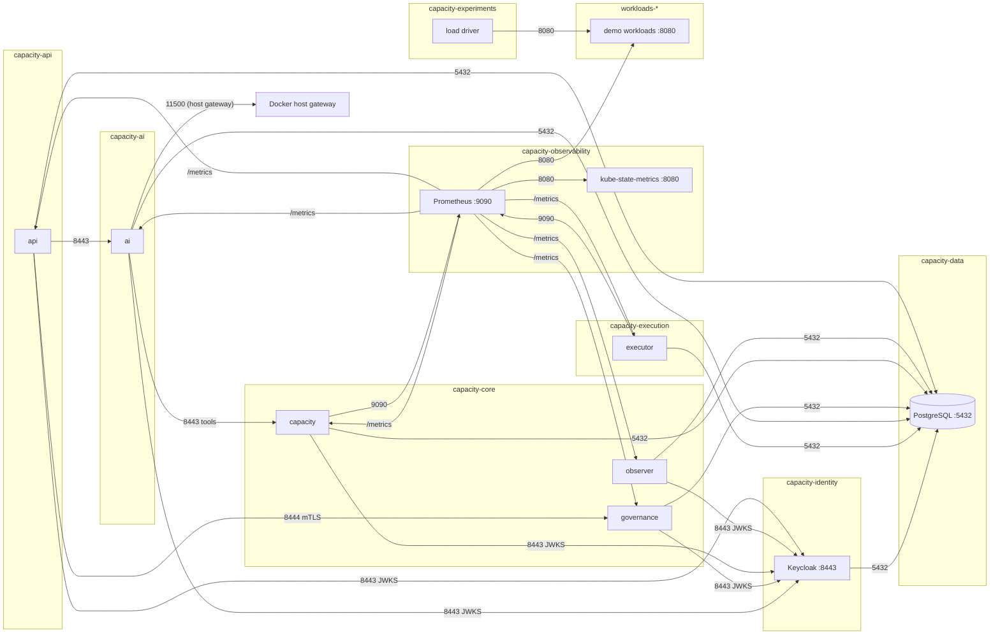

# Network isolation (S07)

The cluster uses **Calico v3.33.1** (Pod CIDR `192.168.128.0/17`) so that Kubernetes NetworkPolicy
is actually enforced. kind's default CNI would accept policies and silently ignore them, which is
why the bootstrap refuses to continue until enforcement is proven by live probes.

## 1. Model: deny everything, then allow named flows

Every managed namespace — the four platform namespaces, `capacity-data`, `capacity-identity`,
`capacity-observability`, the three demo namespaces and `capacity-experiments` (11 in total) — gets
two baseline policies from [`infra/kustomize/base/networkpolicies.yaml`](../infra/kustomize/base/networkpolicies.yaml):

* `default-deny` — no ingress and no egress for any Pod;
* `allow-dns` — egress to CoreDNS on port 53.

Each approved flow then has its own policy. NetworkPolicy only controls *reachability*: every
protected endpoint still authenticates the caller (TLS, tokens, mTLS).



## 2. Static flows

| From | To | Port | Policies |
|---|---|---|---|
| api | governance (mTLS listener) | 8444 | `api-egress`, `governance-from-api` |
| api | ai (knowledge ingestion) | 8443 | `api-egress`, `ai-flows` |
| api, observer, capacity, governance, ai, executor | PostgreSQL | 5432 | `postgres-clients` + per-service egress (`api-egress`, `core-flows`, `engine-flows`, `ai-flows`, `executor-flows`) |
| api, observer, capacity, governance, ai | Keycloak (JWKS) | 8443 | service egress, `keycloak-flows` |
| ai | capacity (tool endpoint) | 8443 | `ai-flows`, `engine-flows` |
| capacity, executor | Prometheus | 9090 | `engine-flows`, `executor-flows`, `prometheus-flows` |
| Prometheus | platform `/metrics` | 8443 | `prometheus-flows`, `api-metrics-ingress`, `core-flows`, `ai-flows`, `executor-flows` |
| Prometheus | demo exporters, kube-state-metrics | 8080 | `prometheus-flows`, `demo-ingress`, `ksm-flows` |
| Grafana | Prometheus | 9090 | `grafana-flows`, `prometheus-flows` |
| load-driver Jobs (label `capacity.lab/template=load-driver-v1`) | demo workloads | 8080 | `driver-egress`, `demo-ingress` |
| Keycloak | PostgreSQL | 5432 | `keycloak-flows`, `postgres-clients` |

## 3. Flows rendered from live discovery

Some addresses only exist after the cluster is created, and Docker can reassign them on restart. The
`network-dynamic` bootstrap stage discovers them, stores them in
`~/.capacity-lab/release/network.json`, and applies eight more policies labelled
`capacity.lab/rendered=network-dynamic`:

| Policy | Allows |
|---|---|
| `observer-kube-api`, `executor-kube-api`, `prometheus-kube-api`, `ksm-kube-api` | egress to the Kubernetes API server (control-plane IP on 6443 and the `kubernetes` Service on 443) |
| `api-nodeport`, `keycloak-nodeport`, `grafana-nodeport` | NodePort ingress from the kind node network for the API (8443), Keycloak (8443) and Grafana (3000) — how the host reaches `localhost:8443/8444/8445` |
| `ai-model-gateway` | **only the `ai` Pod** → the Docker host gateway IP on 11500 (the protected model gateway) |

In total the live cluster holds **46** NetworkPolicies: 11 `default-deny`, 11 `allow-dns`, 16 named
static flows (`demo-ingress` exists in three namespaces) and 8 rendered ones.

After a Docker or host restart the node addresses can change (observed: control plane 172.18.0.3 →
172.18.0.5). The rendered policies then point to the old addresses and API clients time out.
`capacity-lab resume` re-discovers the addresses, re-renders the policies and restarts the Pods that
depend on them.

## 4. Proving enforcement

`capacity-lab verify networking` — also the `verify-network` bootstrap stage, which **fails the
bootstrap** on a wrong result — starts a target Pod and short-lived probe Pods, and records what
actually happens:

| Probe | Expected | Observed 2026-11-21 05:10 |
|---|---|---|
| a Pod labelled as an approved driver in `capacity-experiments` → demo workload :8080 | `CONNECTED` | `CONNECTED` |
| an unlabeled Pod in `capacity-experiments` → demo workload | `TIMEOUT` | `TIMEOUT` |
| a Pod in `workloads-batch` → a workload in another namespace | `TIMEOUT` | `TIMEOUT` |
| DNS lookup from a restricted namespace | `CONNECTED` | `CONNECTED` |

The evidence JSON is written to `~/.capacity-lab/evidence/verify-networking-*.json` (or as part of
`verify-all-*.json`). The operational suite adds one more live probe: the `ai` Pod reaches the host
model gateway while a demo Pod's attempt times out
(`test_model_gateway_is_reachable_from_ai_but_not_from_demo_pods`).

```powershell
capacity-lab verify networking
```

```powershell
kubectl --context kind-capacity-lab get networkpolicy -A
```

## 5. Known gaps

* `capacity-system` (Vault, External Secrets Operator) and `cert-manager` are not under
  default-deny in the lab; Vault still requires authentication and TLS for every request.
* The database policy admits clients from the platform namespaces; per-service separation at the
  database is done by credentials, grants and RLS, not by network policy.
* There is no egress gateway and no mTLS on every hop (only on the governance write port).

See [limitations.md](limitations.md) and [production-considerations.md](production-considerations.md).
