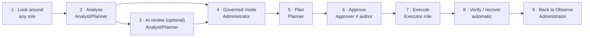

# Operator guide

How people use the platform day to day with `capacityctl`, from looking around to a verified change.
Each step names the role it needs; in the lab one test user holds each role (`planner1`,
`approver1`, `operator1`, `admin1`, `viewer1`). The full option list of every command is in
[cli-reference.md](cli-reference.md); the rules behind each step are in
[governance-and-execution.md](governance-and-execution.md).



## Before you start

* The lab is up and verified ([setup-guide.md](setup-guide.md)).
* The watchdog is running (`capacity-watchdog run`) — without a fresh host-safety signal the
  executor refuses changes.
* The workload has about **six hours of continuous telemetry from a single Pod**. Otherwise its
  forecasts refuse and no candidate can qualify. For W04, run E04 back to back to build history
  ([workloads-and-experiments.md](workloads-and-experiments.md)).

## Log in

Each person logs in as themselves (the browser opens; PKCE flow):

```powershell
capacityctl auth login
```

```powershell
capacityctl auth status
```

`auth logout` deletes the stored tokens.

## 1. Look around (any role)

```powershell
capacityctl capabilities
```

```powershell
capacityctl workloads
```

```powershell
capacityctl nodes
```

* `capabilities` shows the **operating mode** (`Observe`, `Advisory`, `Governed`) and its
  **revision**, inventory freshness, and which capabilities are available, disabled by mode, or not
  installed (for example the GitOps adapter).
* `workloads` shows the **configured** requests and limits of the demo workloads you are granted —
  not their usage.
* `nodes` shows allocatable and requested resources per node.

## 2. Analyse a workload (Analyst or Planner)

```powershell
capacityctl analysis create w04-cpu-worker --horizon 1h
```

```powershell
capacityctl operation <operation-id> --watch
```

```powershell
capacityctl analysis show <analysis-digest>
```

The operation result lists the analysis digest, any **qualified** evaluation digests and the
forecast IDs. A completed analysis is evidence only — nothing has changed.

How to read it:

| Field | Meaning |
|---|---|
| `baselineGates` | checks that apply before any candidate (scope, allow-list, evidence integrity, supported action) |
| `refusals` | fields the engine would not touch, with a reason (for example `coverage_insufficient`) |
| `evaluations[]` | each candidate: before/after values, its 13 gate results, placement, and `status` — `qualified`, `rejected` (a gate failed) or `indeterminate` (evidence unknown) |

An empty `qualified` list is a valid answer: the platform prefers "no recommendation" to a guess. Look
at the non-pass gates to see why. Examples from the reference host:

| Gate result | Meaning | What to do |
|---|---|---|
| `forecast.support = unknown (forecast_refused)` | the forecast refused (too little or mixed history) | keep the workload under steady load; wait for six clean hours |
| `memory.oom_spike = unknown (memory_tail_unqualified)` | a gap or peak flag in the memory series | wait until the gap leaves the 6-hour window |
| `slo.queue_completion = unknown (queue_evidence_unknown)` | W04 CPU decreases lack completion-rate evidence | known limitation; memory candidates are unaffected |

## 3. Optional: ask for an AI review (Analyst or Planner; mode Advisory or Governed)

```powershell
capacityctl advisory w04-cpu-worker --mode optimization_review --analysis <analysis-digest>
```

The advisory comments on the deterministic evidence with citations. It cannot change numbers or
approve anything, and it is `unavailable` if the local model is not running or not qualified (the
current state on the reference host). W01 plans **require** a completed review, because the
governance policy does not allow deterministic-only execution for the Critical workload.

## 4. Switch to Governed mode (Administrator)

```powershell
capacityctl capabilities
```

```powershell
capacityctl mode Governed --expected-revision <modeRevision>
```

A plan created in `Observe` or `Advisory` mode is issued as `AdvisoryOnly` and can **never** be
approved, so the mode is set **before** the plan is created. The expected revision prevents two
administrators from overwriting each other.

## 5. Create a plan (Planner)

```powershell
capacityctl plans create <evaluation-digest>
```

```powershell
capacityctl plans show <plan-id>
```

The plan shows each field's `before` and `after`, the target (namespace, Deployment, UID,
container), the expiry (60 minutes) and the `planDigest`. Its state is `AwaitingApproval`, or
`Blocked` / `AdvisoryOnly` when policy does not allow a direct change (the reasons are listed in the
plan's risk section). Attach a completed advisory with `--advisory-artifact <digest>`.

## 6. Approve (Approver — a different person from the planner)

```powershell
capacityctl plans approve <plan-id> --revision 1 --digest <planDigest>
```

The CLI shows the exact changes and refuses if the digest you typed does not match the plan; you then
confirm interactively (`--yes` skips the prompt). The approval is valid for **15 minutes**. To reject
instead, add `--reject`. To withdraw an approval before execution:

```powershell
capacityctl plans revoke <plan-id> --revision 1 --reason "load pattern changed"
```

If the planner tries to approve their own plan, the request is refused (403) and a `deny` record with
reason `separation_of_duties` (or the missing role) is written to the audit chain.

## 7. Request execution (Executor role)

```powershell
capacityctl plans execution-request <plan-id> --revision 1
```

```powershell
capacityctl execution <intent-id>
```

The executor re-checks the authority, verifies the live Deployment still matches what was planned,
patches it with `test` preconditions, then verifies: first that the configuration is exactly as
planned and the rollout finished, then — after 120 s of stabilization — that the workload's
guardrails held over 900 s under load comparable to the 900 s before the change.

## 8. Read the outcome

`capacityctl execution <intent-id>` shows the operation state, its transitions and the outcome.

| End state | Meaning | What happens |
|---|---|---|
| `verified_success` | applied; guardrails held (benefit verified or unproven) | the change stays |
| `verification_inconclusive` → `recovered` | applied, but safety could not be proven (missing data or incomparable load) | the exact inverse was applied automatically |
| `verification_failed` → `recovered` | a guardrail broke | the previous values were restored |
| `escalated` | something could not be resolved safely (for example a concurrent edit) | a person must look; nothing more is done automatically |
| `refused` | authority or preconditions no longer held | nothing was changed; the transition reason says why |

The real run on 2026-11-21 ended `verification_inconclusive` → `recovered` (see
[proof-of-operation.md](proof-of-operation.md)).

**Note:** a governed change rolls the workload's Pod — twice if it is reversed. Forecasts for that
workload then refuse for about six hours, because the telemetry window contains several Pods.

## 9. Return to Observe (Administrator)

```powershell
capacityctl mode Observe --expected-revision <modeRevision>
```

## Everyday checks for the lab owner

```powershell
capacity-lab verify all
```

```powershell
capacity-lab audit checkpoint
```

```powershell
capacity-lab audit verify
```

```powershell
capacity-lab backup create
```

```powershell
capacity-lab backup verify
```

See [backup-and-recovery.md](backup-and-recovery.md), [observability.md](observability.md) and
[troubleshooting.md](troubleshooting.md).
