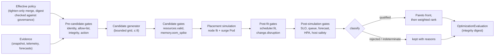

# Optimization engine (S19–S22)

The optimization engine turns evidence — current requests and limits, observed usage, forecasts,
SLO telemetry, node capacity — into a short list of **candidate** resource changes for one
workload, each with gate results, a placement result and, if it qualifies, a rank. It is pure,
deterministic code: the same inputs produce the same candidates, in the same order, with the same
digests. Code lives under [`capacity/`](../src/capacity_platform/capacity).



## 1. Policy (S19)

[`configs/policies/optimization-policy.yaml`](../configs/policies/optimization-policy.yaml)
(policy `demo-resource-governance`, revision 1) defines:

* **what may change:** `cpu_request`, `memory_request`, `cpu_limit`, `memory_limit`;
* **where:** `workloads-critical`, `workloads-standard`, `workloads-batch` only;
* **search grid:** 5 millicores and 1 MiB; at most **8 candidates** per analysis;
* **ranking weights:** efficiency 1.0, fit benefit 0.5, risk 0.8, change cost 0.2, Pareto
  tolerance 0.01;
* **per-class parameters** (all provisional):

| Class | CPU floor | Memory floor | CPU margin | Memory margin | Max decrease | Max increase | Other limits |
|---|---|---|---|---|---|---|---|
| Critical (W01) | 100m | 128 Mi | 50 % | 30 % | 25 % | 100 % | p95 ≤ 150 ms, errors ≤ 1 %, throttling ≤ 10 %, ≥ 500 SLO requests, memory gap ≤ 30 s |
| Standard (W02, W03) | 50m | 96 Mi | 30 % | 25 % | 35 % | 100 % | p95 ≤ 300 ms, errors ≤ 2 %, throttling ≤ 15 %, ≥ 300 SLO requests, memory gap ≤ 30 s |
| Flexible (W04, W05) | 50m | 96 Mi | 20 % | 20 % | 50 % | 100 % | completion ≥ 99 %, memory gap ≤ 60 s |
| Opportunistic (W06) | 25m | 64 Mi | 15 % | 20 % | 50 % | 100 % | completion ≥ 95 %, coverage ≥ 90 %, memory gap ≤ 60 s |

Every class requires a forecast for a downsize (`require_forecast_for_downsize: true`) and ≥ 95 %
CPU and memory coverage (Opportunistic: 90 %). One workload override exists: W03 uses a 35 % memory
margin, because memory spikes are the point of that workload.

### Tighten-only merge

Cluster, namespace and workload overrides may only make a parameter **stricter** — a higher floor,
a larger margin, a smaller change budget, fewer allowed actions. An override that tries to loosen a
value raises `PolicyConflict` instead of silently applying
(`test_workload_override_may_not_relax_class_floor`). The resolved policy has its own digest; the
capacity worker checks it against `governance.effective_policy` before use, so the engine never
runs on a policy governance has not accepted.

## 2. Candidate generation (S20)

For each allowed field the generator (`rightsizing/generator.py`) builds a **protected demand
envelope**:

```text
CPU:     envelope = max(observed CPU p95, S14 forecast upper bound) × (1 + CPU margin)
memory:  envelope = max(observed max sampled working set, forecast upper bound) × (1 + memory margin)
```

From the envelope it enumerates a small, fixed set of values:

| Level | Value |
|---|---|
| nominal | envelope, rounded up to the grid |
| conservative | envelope × 1.15, rounded up |
| budget edge | the largest decrease the change budget allows, if it is still above the envelope |

Each value is then **raised to the class floor**, **clamped to the change budget**
(`current × (1 − max decrease)` … `current × (1 + max increase)`), deduplicated and sorted.
Increases are proposed only for under-reserved workloads and decreases only for over-reserved ones,
so noise cannot flip a workload back and forth. Limits are raised when the envelope plus margin
would exceed them. The cartesian product of field levels is bounded by `maxCandidates`. If a field's
evidence is not qualified, the generator returns a **typed refusal** for that field
(`coverage_insufficient`, `current_request_absent`, …) instead of inventing numbers.

**Worked example (W04, Flexible, 2026-11-21):** observed CPU ≈ 15m and memory ≈ 40 MiB under E04
load. The CPU envelope (≈ 18m) and the memory envelope (≈ 48 MiB) are below the floors; the floors
(50m, 96 Mi) and the 50 % change budget give exactly two decreases — **CPU 150m → 75m** and
**memory 192 Mi → 96 Mi** — plus their combination.

## 3. Gates (four-valued)

Every rule returns `pass`, `fail`, `unknown` or `not_applicable`, with a reason code and evidence
references. There are **13 gates in four phases** (`policy/gates.py`):

| Phase | Gate | Checks | Typical non-pass reasons |
|---|---|---|---|
| pre-candidate | `identity.scope` | the caller's scope was verified for this target | `scope_unverified` |
| pre-candidate | `target.allowlist` | the namespace/workload is one the policy allows | `target_disallowed`, `target_identity_ambiguous` |
| pre-candidate | `evidence.integrity` | inputs present, digest-consistent and fresh | `inventory_stale` |
| pre-candidate | `action.supported` | the change type is supported; ownership is direct (no GitOps controller) | `action_unsupported`, `ownership_ambiguous`, `gitops_owner_unknown` |
| candidate | `resources.valid` | quantities valid, above floors, limits ≥ requests, within the change budget and quota, no unqualified QoS-class change | `floor_violation`, `request_exceeds_limit`, `change_budget_exceeded`, `quota_exceeded`, `qos_class_change_unqualified` |
| candidate | `memory.oom_spike` | for memory decreases: coverage and max gap within policy, no peak/gap flags, no OOM kills, new limit above the peak envelope | `memory_tail_unqualified`, `oom_risk` |
| post-fit | `scheduler.fit` | the changed Pod fits on an eligible node | `node_fit_failure`, `scheduler_unsupported` |
| post-fit | `change.disruption` | the rolling update's surge Pod also fits | `disruption_risk`, `rollout_unmodeled`, `rollout_overlap_unknown` |
| post-simulation | `slo.latency_errors` | W01/W02 CPU decreases: p95 latency, errors, throttling, enough requests | `slo_violation`, `cpu_throttling_present`, `slo_evidence_unknown` |
| post-simulation | `slo.queue_completion` | W04–W06 CPU decreases: no growing queue, completion within deadline ≥ class minimum | `batch_deadline_risk`, `queue_evidence_unknown` |
| post-simulation | `forecast.support` | a continuous-demand downsize has an eligible S14 forecast | `forecast_refused` |
| post-simulation | `hpa.compatibility` | no CPU-based HPA reacts to a CPU-request change | `hpa_request_coupling_unmodeled`, `hpa_status_unknown` |
| post-simulation | `host.safety` | the host-safety signal is fresh and `ok` | `host_safety_unknown` |

**Classification oracle:** any required `fail` → `rejected`; any required `unknown` →
`indeterminate`; otherwise `qualified`. Missing evidence therefore never counts as a pass
(`test_four_way_gate_oracle`).

**Live example:** at 02:44 on 2026-11-21 the three W04 candidates were all `indeterminate`. The
memory candidates stopped at `memory.oom_spike = unknown` because a 45-second telemetry gap was
still in the window. The CPU candidates stopped at `slo.queue_completion = unknown` because W04's
completion-within-deadline rate is not derived from its metrics yet — so W04 CPU decreases cannot
qualify today ([limitations.md](limitations.md)). At 03:12, with the gap gone, the memory candidate
passed every gate.

## 4. Placement simulation (S21)

`placement/fit.py` checks whether the changed Pod still fits on a node:

* **effective request accounting** — the larger of the biggest init container and the sum of app
  containers plus restartable sidecars, plus Pod overhead (`observer/normalize.py`);
* **constraints** — taints and tolerations, node selectors, required node affinity expressions;
* **residuals** — node allocatable minus what other Pods already reserve (a negative residual stays
  visible instead of being clipped);
* `place_many` — bounded backtracking (5,000 branches) to place several hypothetical Pods; a greedy
  failure is never taken as proof of infeasibility;
* **fragmentation** — how much usable capacity remains for a given Pod shape;
* **surge** — during a rolling update the surge Pod must also fit, otherwise the change is a
  disruption risk.

The placement result records the algorithm (`s21-fit-v1`), the number of fit-capable nodes, per-node
reasons (for example `taint_not_tolerated`, `node_affinity_mismatch` for the platform and
control-plane nodes) and stranded capacity.

The simulator is an approximation of the Kubernetes scheduler: it does not model Pod topology
spread, inter-Pod affinity, volume topology or scheduler plugins. A candidate whose correctness
depends on those is `indeterminate` (`scheduler_unsupported`), never qualified.

## 5. Ranking (S22)

Only qualified candidates are ranked (`simulation/evaluate.py`):

1. **Objectives** per candidate:
   * *efficiency* — the average fraction of request released, `(before − after) / before`;
   * *fit benefit* — the change in fit-capable nodes divided by the eligible nodes (−1 … 1);
   * *risk* — for decreases, `min(1, envelope / new request)`: the closer the new request is to the
     protected demand, the higher the risk;
   * *change cost* — fields changed / 4 plus half the average relative change.

   Each dimension is normalized separately; millicores and bytes are never added together.
2. Keep the **Pareto front**: drop any candidate that another beats on every objective (within the
   0.01 tolerance).
3. Order the front by the policy weights, with a deterministic tie-break on the candidate digest.

The result is an `OptimizationEvaluation` with an integrity digest. A planner creates a plan **from
that digest**, so a plan always refers to exactly one evaluated candidate. Rejected and
indeterminate candidates are kept, with their reasons, in the same analysis.

## 6. Reading an analysis

```powershell
capacityctl analysis create w04-cpu-worker --horizon 1h
```

```powershell
capacityctl analysis show <analysis-digest>
```

| Field | Meaning |
|---|---|
| `baselineGates` | the pre-candidate gates |
| `refusals` | fields the generator would not touch, with a reason |
| `evaluations[]` | each candidate: `candidate.fields` (before/after), `hardGates`, `placement`, `status` (`qualified`/`rejected`/`indeterminate`), `rank`, `objectives`, `integrityDigest` |
| `policyDigest` | the effective policy the analysis ran under |

An empty `qualified` list is a valid answer: the platform prefers "no recommendation" to a guess.

## 7. Tests

* `tests/unit/test_optimization_golden.py` (19 tests) — golden fixtures F01–F15: split fit is not
  node fit; a memory gap across a burst blocks a downsize; a latency guard blocks a CPU cut despite
  low CPU; missing latency evidence is unknown; low CPU with a growing queue is not qualified; a Job
  template is advisory-only; an active HPA blocks CPU-request changes; the platform node is never
  used for demo Pods; only qualified candidates are ranked; a recreated controller changes the
  candidate identity; unsupported scheduler constraints are indeterminate; identical inputs give
  identical digests and order; an OOM in the window rejects a memory downsize; the four-way oracle;
  tighten-only overrides.
* `tests/unit/test_accounting_and_rightsizing.py` (11 tests) — quantity parsing, effective-request
  accounting (init containers, sidecars, terminating and pending Pods, negative residuals), increase
  candidates for under-reserved workloads, refusal instead of fabricated candidates, bounded and
  stable candidate lists.
