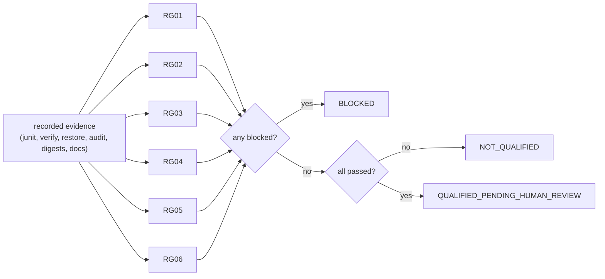

# Release, pinning and upgrades (S29, S32)

How every input to the lab is pinned, how a new build is rolled out, how to roll back, and how the
release decision is computed from evidence.

## 1. What a release is made of

| Piece | Pinned how | Where recorded |
|---|---|---|
| Python dependencies | `uv.lock` (versions and hashes) | repository |
| .NET dependencies | `packages.lock.json`, restored with `--locked-mode` | repository |
| third-party manifests (Calico v3.33.1, cert-manager v1.21.3) | URL + SHA-256, verified at every install | `infra/versions.lock.json` |
| kind binary (v0.33.0) and node image (`v1.36.4@sha256:…`) | URL + SHA-256; node image by digest | `infra/versions.lock.json` |
| Helm charts (Vault 0.34.1, External Secrets 2.15.0) | exact chart version | `infra/versions.lock.json` |
| third-party images (PostgreSQL, Prometheus, kube-state-metrics, Grafana, Keycloak, registry, base images) | exact tags | `infra/versions.lock.json` |
| platform and workload images | built locally, deployed **by digest** | `~/.capacity-lab/release/images.json` |
| database schema | ordered migrations with a checksum ledger | `db/migrations`, `platform_meta.schema_migrations` |
| specifications | SHA-256 per accepted source file | `specs/manifest.yaml` |

The platform Deployments, the load-driver admission policy and the workload manifests all reference
images as `localhost:5001/<name>@sha256:<digest>`, never by a mutable tag — and the
`capacity-pod-hardening` admission policy rejects any Pod whose image is not digest-pinned.

Currently deployed on the reference host (`images.json`, 2026-11-21):

| Image | Digest |
|---|---|
| `capacity-platform` | `sha256:7b22d7a860744e91ed9e5333b42e6bfb30a47e22435ad6431bf2aec4c4ebbc6a` |
| `workload-python` (W03–W06) | `sha256:0921d5008ffbb48a93824d5ea7539f4c08c82ccc0cee9093574a1fb7b9df90fe` |
| `w01-latency-api` | `sha256:7c6850d628ce0998fd2e7f113a413867c218c64f6966789e944a61ff3f04cd66` |
| `w02-burst-api` | `sha256:7954a0da834a3b2cb0a2598ebe9f89d33e4cc956188bba35fcdf4180a91d51e8` |

## 2. Building and deploying a new version

```powershell
capacity-lab bootstrap --only images
```

```powershell
capacity-lab bootstrap --only platform
```

```powershell
capacity-lab bootstrap --only workloads
```

`images` rebuilds the four images, pushes them to the local registry and rewrites `images.json` with
the new digests; `platform` and `workloads` roll the Deployments to those digests and wait for the
rollouts.

**Keep `images.json` equal to what runs.** Base images are pinned by tag, so rebuilding a workload
image can produce a new digest from unchanged sources. Either run `workloads` after `images` (which
rolls the demo workloads — and pauses their forecasts for about six hours, see
[telemetry.md](telemetry.md#5-why-a-rollout-pauses-forecasting)), or keep the deployed workload
digests in `images.json` when only the platform changed.

Schema changes are new numbered files in `db/migrations`:

```powershell
capacity-lab bootstrap --only database
```

An already-applied migration must never be edited — the migrator stops with `MigrationDrift` if its
checksum changed.

Policy changes are delivered with the `platform` stage (ConfigMaps); bump the policy `revision` first.

## 3. Rollback

* **Software rollback:** check out the previous source revision, rebuild and redeploy. Older digests
  also stay in the local registry until it is cleaned, so a Deployment can be pointed back to a
  previous digest.
* **Schema rollback:** migrations are forward-only. Restore the pre-upgrade backup
  ([backup-and-recovery.md](backup-and-recovery.md)) if a migration must be undone.
* A software rollback is **not** the same as the executor's inverse recovery, which only reverts one
  approved resource change on one workload.

No upgrade or rollback between two releases has been rehearsed (there is no earlier release).

## 4. Release qualification (S32)

The release decision is computed from recorded evidence, never asserted:

```powershell
capacity-lab release test
```

```powershell
capacity-lab release qualify
```

`release test` runs every suite (`unit`, `security`, `component`, `integration`, `operational`, `e2e`,
`dotnet`) and keeps the junit results in `~/.capacity-lab/evidence/tests/` with a `summary.json`.
`release qualify` evaluates six gates and writes a bundle to
`~/.capacity-lab/release-qualification/<id>/qualification.json`:

| Gate | Evidence it reads | Hard items (failure blocks) |
|---|---|---|
| RG01 architecture traceability | spec source digests vs `specs/manifest.yaml`; [spec-traceability.md](spec-traceability.md) | changed spec sources |
| RG02 tests and security | junit results per suite; latest `verify all` evidence | security, component, integration, operational, e2e suites; live security verification |
| RG03 quantitative evaluation | B0–B3 arm availability, paired comparison evidence, model qualification | — |
| RG04 operational reliability | restore drill, audit verification, observability targets, watchdog, rebuild drill | restore drill, audit integrity |
| RG05 delivery compatibility | image digests, version lock, live migration ledger, upgrade/rollback rehearsal | migration ledger |
| RG06 docs and handoff | required documents, README, human reviewer record | — |

Rules (`release/gates.py`, pure functions, `tests/unit/test_release_gates.py`):

* missing evidence is `not_run`, never a pass; a skipped suite maps to `not_run`;
* a failed **hard** item makes its gate **blocked**;
* anything else that is not passed makes the gate **not qualified**;
* the overall outcome is `BLOCKED` (any gate blocked), `NOT_QUALIFIED` (any gate not passed) or
  `QUALIFIED_PENDING_HUMAN_REVIEW` (all six passed);
* a human reviewer may refuse a passing result but can **never** override a failed gate.



The latest qualification bundle and its reasons are reported in
[evaluation.md](evaluation.md#6-release-qualification).
