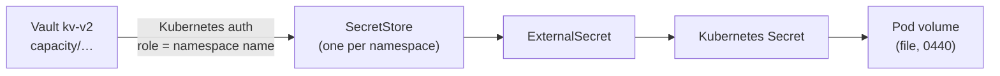
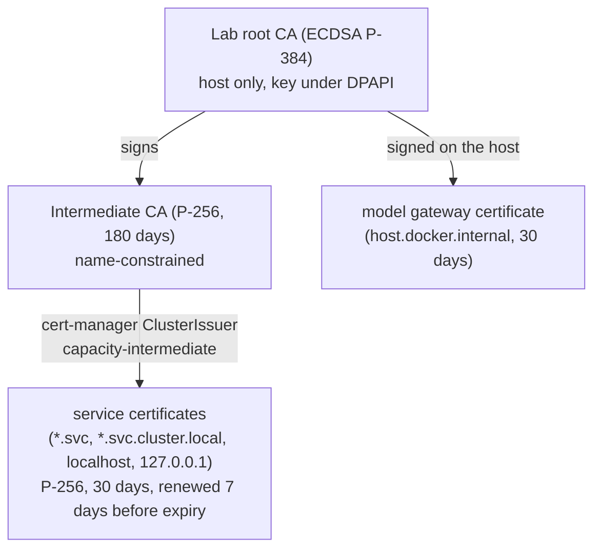

# Secrets and certificates (S08)

Where every credential and key comes from, where it is stored, how it reaches the Pod that needs it,
how certificates are issued, and how each item is rotated today.

## 1. Principles

* **Generated, never typed:** every password, key and token is generated by `capacity-lab` or by the
  component itself; none is committed or chosen by hand.
* **Stored once:** cluster-side secrets live in Vault; host-side keys live in `~/.capacity-lab`
  encrypted with Windows DPAPI.
* **Delivered narrowly:** each namespace can read only its own Vault paths; Secrets are mounted as
  files (mode `0440`), never as environment variables.
* **Never displayed:** values are never printed or logged; the log formatter redacts tokens,
  passwords and keys. `capacity-lab credentials <user>` is the single explicit way to display a lab
  user's password.

## 2. Where secrets live

| Secret | Generated by | Stored in | Delivered to |
|---|---|---|---|
| database password and DSN for each service | `capacity-lab` (random, 24 bytes) | Vault `capacity/db/<service>` | External Secrets → `db-<service>` Secret in that service's namespace |
| migration identity password | `capacity-lab` | Vault `capacity/db/migrator` | PostgreSQL bootstrap Secret |
| Keycloak admin password, Keycloak DB password, realm JSON | `capacity-lab` | Vault `capacity/keycloak/*`, `capacity/db/keycloak` | `capacity-identity` Secrets |
| Grafana admin password | `capacity-lab` | Vault `capacity/grafana/admin` | `capacity-observability` Secret |
| model gateway bearer key | `capacity-lab` | Vault `capacity/gateway/key` | `model-gateway-key` Secret in `capacity-ai`; read from Vault by the host gateway at start |
| Vault unseal key and root token | Vault init | host, DPAPI: `~/.capacity-lab/vault/init.json.dpapi` | used only by `capacity-lab` |
| lab root CA private key | `capacity-lab` | host, DPAPI: `~/.capacity-lab/pki/root-ca.key.dpapi` | never enters the cluster |
| lab user passwords | `capacity-lab` | host, DPAPI: `~/.capacity-lab/identity/` | Keycloak realm import |
| backup encryption key (AES-256) | `capacity-lab` | host, DPAPI: `~/.capacity-lab/backups/backup.key.dpapi` | never enters the cluster |
| audit checkpoint signing key (Ed25519) | `capacity-lab` | host, DPAPI: `~/.capacity-lab/audit/checkpoint.key.dpapi` (public key `checkpoint.pub`) | never enters the cluster |
| experiment capability signing key (ES256) | `capacity-lab` | host `~/.capacity-lab/keys` | public key as a ConfigMap in the demo namespaces |
| `capacityctl` tokens | Keycloak | host, DPAPI, per user | used only by the CLI |

DPAPI encrypts data for the current Windows user on the current machine, so the files are useless if
copied to another account or computer.

## 3. Vault and External Secrets

Vault (Helm chart 0.34.1) runs as a single server with file storage and TLS in `capacity-system`.
External Secrets Operator (chart 2.15.0) copies values into Kubernetes Secrets:



Isolation is **per namespace**: each consuming namespace has a `vault-reader` ServiceAccount, a
Vault Kubernetes-auth role with the same name as the namespace, and a Vault policy that can read only
that namespace's paths. A compromised namespace cannot materialize another namespace's credentials.
External Secrets refreshes every 10 minutes.

### After a restart: unseal

The lab uses manual unseal with one key share. After Docker Desktop or the host restarts, Vault
starts **sealed** and External Secrets cannot refresh until it is unsealed. Running Pods keep working
because their Secrets already exist.

```powershell
capacity-lab unseal
```

`capacity-lab resume` also unseals Vault, restarting the Vault Pod first if `vault status` does not
answer within 20 seconds.

## 4. Certificates



* **Root CA:** created on the host by `capacity-lab bootstrap --only pki`; its key never leaves the
  host. Clients trust the root certificate — `~/.capacity-lab/pki/root-ca.crt` on the host and the
  `capacity-trust` ConfigMap in each namespace.
* **Intermediate CA:** issued by the root and given to cert-manager (v1.21.3) as the
  `capacity-intermediate` ClusterIssuer. Its **name constraints** allow only `*.svc`,
  `*.svc.cluster.local`, `localhost` and `127.0.0.0/8`, so even a stolen intermediate key cannot mint
  a certificate for an arbitrary internet name.
* **Key identifiers:** root and intermediate carry Subject/Authority Key Identifiers and correct key
  usage; Python 3.13's strict certificate verification requires them.
* **Service certificates:** one cert-manager `Certificate` per service (ECDSA P-256, 30-day duration,
  renewed 7 days before expiry, a new key on every renewal), valid for both server and client
  authentication. The API presents its certificate as a **client certificate** on the governance
  mTLS listener; the relay builds its TLS context on every call, so a renewed certificate is used
  without restarting the Pod.
* **Model gateway certificate:** signed on the host by the root, because the intermediate is
  deliberately not allowed to sign `host.docker.internal`.

Re-running `capacity-lab bootstrap --only pki` issues a new intermediate. Existing leaf certificates
stay valid; to re-issue them, delete their Secrets so cert-manager recreates them, then restart the
Pods that serve TLS (see [troubleshooting.md](troubleshooting.md#2-certificates-and-tls)).

### Checking a certificate chain by hand

```powershell
kubectl --context kind-capacity-lab get certificate -A
```

```powershell
curl.exe --ssl-no-revoke --cacert $HOME\.capacity-lab\pki\root-ca.crt https://localhost:8443/health/live
```

`--ssl-no-revoke` is needed because Windows' TLS stack checks revocation and the lab CA publishes no
revocation list.

## 5. Rotation (current behaviour)

| Item | Rotation |
|---|---|
| service TLS certificates | cert-manager renews automatically 7 days before expiry |
| ServiceAccount tokens | projected, 10-minute lifetime, rotated by the kubelet |
| user access tokens | 10 minutes (Keycloak realm setting); `capacityctl` refreshes them |
| gateway TLS certificate | re-issued every time `capacity-lab model gateway` starts |
| experiment capability tokens | issued per run, expire at the run deadline plus 60 s (max 3600 s) |
| database passwords, gateway key | manual: change in Vault; External Secrets refreshes Secrets within 10 minutes; restart the Pods |
| intermediate CA | manual: re-run the `pki` stage (180-day validity) |
| root CA, backup key, checkpoint key | not rotated in the lab |

Production-grade rotation and key custody (HSM/KMS, auto-unseal, dynamic database credentials) are
discussed in [production-considerations.md](production-considerations.md).
