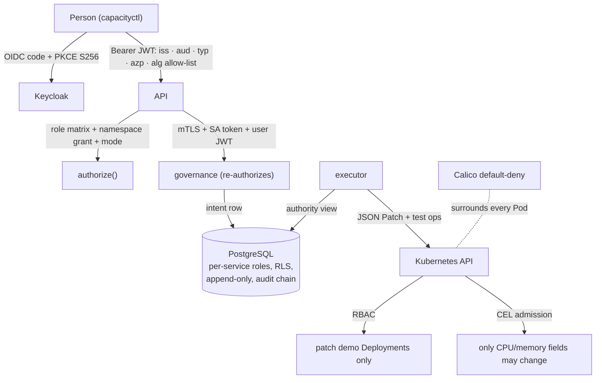

# Security overview

This page summarizes the security model: what must never happen, which controls prevent it, how
each control is verified, and what is deliberately simplified in the lab. Deeper pages cover each
area:

* [identity-and-access.md](identity-and-access.md) — users, roles, grants, tokens, service identity
* [network-isolation.md](network-isolation.md) — Calico default-deny and the allowed flows
* [secrets-and-pki.md](secrets-and-pki.md) — Vault, External Secrets, certificates, rotation
* [cluster-topology.md](cluster-topology.md) — Pod Security, admission policies, RBAC per identity
* [ai-advisory.md](ai-advisory.md) — model gateway, tool broker, prompt-injection defences
* [data-model.md](data-model.md) — database roles, RLS, immutability, audit chain

## 1. What must never happen

| Invariant | Enforced by | Verified by |
|---|---|---|
| No workload changes without an approved, unexpired, unrevoked plan | governance state machine; `executor_authority_v`; ordered executor preflight | `test_governance.py`, `test_executor.py`, integration chain, live E2E |
| Nobody approves their own plan | governance code **and** a database `CHECK` constraint (`approver <> author`) | `test_t01_author_cannot_approve_own_plan_even_with_approver_grant`, integration test, live (403 at 03:21) |
| What runs is exactly what was approved | approval bound to revision + plan digest; intent bound to approval; JSON Patch `test` operations on UID, resourceVersion, container and before-values | `test_t03_changed_payload_does_not_match_approval`, `test_t03_concurrent_edit_between_get_and_patch_never_overwrites` |
| The executor changes only CPU/memory of demo Deployments | RBAC (get/patch Deployments in demo namespaces only) **and** the `capacity-executor-field-guard` CEL admission policy | `capacity-lab verify security` (replicas, image, ServiceAccount changes denied) |
| The AI layer cannot change anything | no Kubernetes access; no executor code path; read-only tools; schema without approval/execution fields | `test_architecture.py`, `test_ai_tool_security.py` |
| A service cannot act as another service | per-service projected ServiceAccount tokens (audience `capacity-internal`) checked per route; per-service DB roles; `session_user` recorded in audit | `test_governance_requires_api_machine_identity`, `test_schema_boundaries.py` |
| Only the API reaches governance's write port | mutual TLS with a lab-CA client certificate; NetworkPolicy `governance-from-api` | `tests/security/test_internal_mtls.py` (real handshake), live relay probe |
| Evidence and decisions cannot be rewritten silently | append-only triggers; audit hash chain; host-signed Ed25519 checkpoints | `test_audit_is_append_only_and_tamper_is_detected`, `capacity-lab audit verify` |
| Refused governance commands leave a trace | a `deny` audit record with the precise reason, written after the refused transaction rolls back | `test_refused_commands_leave_durable_denial_records`, live (04:11) |
| A demo Pod cannot reach the platform or the model | Calico default-deny; per-flow policies; only the `ai` Pod may reach the host gateway | `capacity-lab verify networking`, `test_model_gateway_is_reachable_from_ai_but_not_from_demo_pods` |
| Secrets never appear in logs, prompts or evidence | log redaction filter; redaction before knowledge chunking; secrets mounted as files; DPAPI on the host | `test_canary_secrets_are_redacted_before_prompting_or_embedding`, `test_redaction_happens_before_storage` |

## 2. Layers of control

1. **Authentication.** People log in through Keycloak (authorization code + PKCE S256). The API and
   governance validate the signature (RS256/ES256 allow-list — no `none`, no HS*), issuer, audience
   `capacity-api`, token type (an ID token is rejected), authorized party (`azp` in the allowed
   clients) and expiry with bounded clock skew. Services authenticate to each other with projected
   ServiceAccount tokens verified offline against the cluster JWKS; a forged user header never
   authenticates.
2. **Authorization.** Six non-hierarchical roles, each useful only with a grant covering the target
   namespace (`governance.role_grant`). Approvals and execution requests additionally need
   `Governed` mode. Unknown actions are denied. Sensitive actions fail closed when grant state
   cannot be read fresh. Out-of-scope and non-existent objects give the same opaque denial.
3. **Transport.** All HTTP is TLS with certificates from cert-manager chained to an offline lab
   root CA. The governance write port requires a client certificate.
4. **Network.** Calico default-deny in every platform and workload namespace; 46 policies in total;
   enforcement proven by live probes during bootstrap and verification.
5. **Admission.** Pod Security Admission `restricted` on platform and workload namespaces, plus four
   CEL policies: `capacity-pod-hardening`, `capacity-no-token-automount`,
   `capacity-experiment-job-template`, `capacity-executor-field-guard`.
6. **Data.** Per-service database roles, row-level security on the job queue, append-only tables, an
   audit hash chain with signed checkpoints, and backups encrypted with AES-256-GCM.
7. **Secrets.** Generated credentials live in Vault; each namespace can read only its own paths;
   Secrets are mounted as files (0440), never as environment variables; host-side keys are encrypted
   with Windows DPAPI.
8. **Workload hardening.** Every platform and demo Pod: non-root, read-only root filesystem, all
   capabilities dropped, `RuntimeDefault` seccomp, digest-pinned image, explicit requests and limits,
   no default ServiceAccount token.
9. **Experiment containment.** Load can be generated only with a short-lived ES256 capability token
   scoped to one run and workload; drivers must use the pinned image, a fixed template, the
   experiment pool and a finite deadline; the runner has no update or patch permission anywhere.

## 3. Threat model summary

| Threat | Example | Main defences | Verified by |
|---|---|---|---|
| Stolen or forged user token | token from another client, issuer or algorithm | issuer/audience/type/azp/alg checks, 10-minute lifetime | `test_api_boundaries.py` (`alg=none`, invalid tokens, forged headers) |
| Privilege escalation by a person | planner approves own plan; viewer requests execution; admin approves | role matrix, namespace grants, author ≠ approver, no implicit roles | unit + integration governance tests |
| Stale or replayed authority | executing after revocation, expiry, grant removal or mode change | 15-minute approval and intent TTLs; authority re-read before every write | `test_t05_*`, `test_t10_*`, `test_grant_revoked_after_intent_blocks_execution`, `test_mode_downgrade_after_approval_blocks_execution` |
| Lost update on the cluster | someone edited the Deployment after planning | `test` operations, fencing epochs, reconcile-first | `test_t03_*`, `test_t09_*`, `test_t11_*`, `test_t12_*` with a fake API server |
| Compromised platform service | AI worker tries to patch a Deployment or read another queue | no RBAC, no executor code, NetworkPolicy, DB role, RLS | `test_architecture.py`, `test_job_queue_row_level_security`, `capacity-lab verify security` |
| Compromised executor | executor changes the image or replicas | CEL field guard, RBAC scoped to demo namespaces | live field-guard check |
| Prompt injection | instructions hidden in retrieved documents or evidence | untrusted-data framing, fixed tools, strict schema, citation and numeric validators | `test_ai_tool_security.py`, model qualification injection cases |
| Data exfiltration through the AI | cross-namespace tool request, oversized results | delegation re-checked by capacity, scope prefilter in SQL, budgets | `test_cross_namespace_request_is_denied_without_detail`, `test_scope_prefilter_hides_foreign_namespace_completely` |
| Lateral movement | demo Pod calls the database or the model gateway | Calico default-deny | network probes, operational tests |
| Tampering with history | rewriting audit events or applied migrations | append-only triggers, hash chain, signed checkpoints, migration checksum ledger | `capacity-lab audit verify`, `test_changed_migration_file_is_detected_as_drift` |
| Host exhaustion during experiments | load test starves the workstation | watchdog thresholds, abort, host-safety signal blocking changes | `test_watchdog_thresholds`, `test_dead_watchdog_fails_closed`; observed live at 04:36 |
| Supply-chain substitution | a changed upstream manifest or image | SHA-256-verified manifests and kind binary, digest-pinned images, admission requires digests | bootstrap verification, `capacity-pod-hardening` |

## 4. Recorded security evidence

The latest live verification on the final build (2026-11-21 05:10,
`evidence/verify-all-20261121T051022.json`) passed all seven checks: default-deny enforcement,
least-privilege RBAC (12 allow/deny rows), seven admission cases, the executor field guard,
observability targets, node-pool placement and the six-Deployment topology. Details:
[proof-of-operation.md](proof-of-operation.md#2-live-verification-of-the-running-lab).

## 5. What is simplified in the lab

The lab keeps a single Vault unseal share, host-held root CA and backup keys, a lab-only PKI without
revocation lists, `capacity-system` and `cert-manager` outside default-deny, and a test-only
password-grant client (`capacity-e2e`) accepted by the API for automated tests. These are listed,
with production replacements, in [production-considerations.md](production-considerations.md) and
[limitations.md](limitations.md#security-gaps-in-the-lab).
