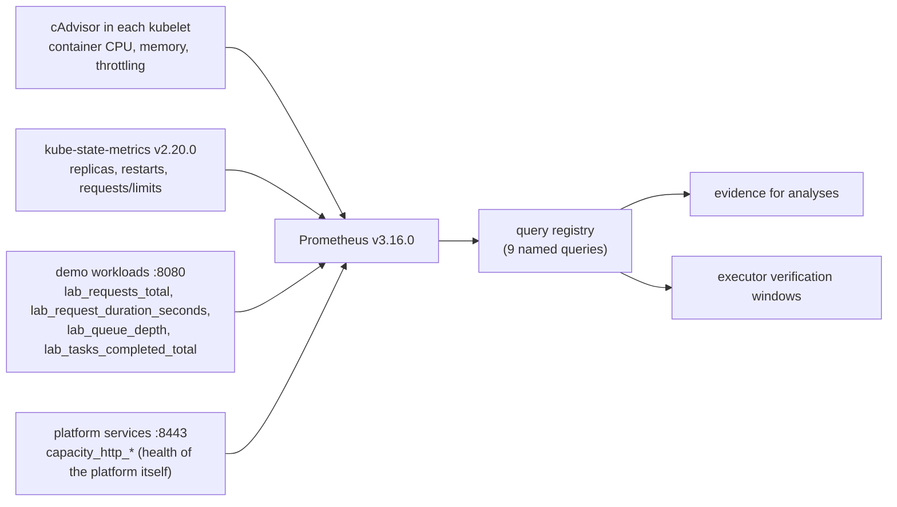

# Telemetry (S12)

Telemetry is the raw material of every decision: forecasts, gates and post-change verification all
read it. This page explains where the numbers come from, the fixed set of queries the platform may
run, how results are aligned and judged for quality, and how those quality judgements travel into
forecasts and gates. Code: [`capacity/telemetry/registry.py`](../src/capacity_platform/capacity/telemetry/registry.py)
and [`capacity/evidence.py`](../src/capacity_platform/capacity/evidence.py).

## 1. Where the numbers come from



| Source | Scrape job | What it provides |
|---|---|---|
| kubelet cAdvisor (through the API-server proxy, verified cluster CA) | `kubernetes-cadvisor` | container CPU usage, memory working set, CFS throttling — only these series are kept (cardinality budget) |
| kube-state-metrics | `kube-state-metrics` | Deployment replicas, Pod container restarts, object state |
| demo workloads with label `capacity.lab/demo-service=true` | `demo-workloads` | application metrics with bounded labels (`workload`, `operation`, `outcome`) |
| the six platform services (by Service DNS name over HTTPS) | `capacity-platform` | HTTP request counts and latency per service, route template and status class |

Scrape configuration and dashboards are described in [observability.md](observability.md).

## 2. The query registry

The engine **never** runs free-form PromQL. It may run only these nine registered queries
(revision 1 of each):

| Query ID | Unit | Statistic | Min step | Max series | What it measures |
|---|---|---|---|---|---|
| `container.cpu.rate.millicores` | millicore | rate | 15 s | 10 | `1000 × sum by (pod) (rate(container_cpu_usage_seconds_total[5m]))` for the workload's container |
| `container.cpu.throttle.ratio` | ratio | rate | 15 s | 10 | throttled CFS periods / periods, per Pod |
| `container.memory.working_set.bytes` | byte | max_sampled | 15 s | 10 | `max by (pod) (container_memory_working_set_bytes)` |
| `container.oom.restarts` | count | interval_summary | **60 s** | 10 | container restarts in the last hour (`increase(...[1h])`) |
| `app.http.p95.seconds` | second | pNN_estimate | 15 s | 1 | p95 from the workload's request-duration histogram |
| `app.http.error.ratio` | ratio | rate | 15 s | 1 | error responses / all responses |
| `app.http.request.rate` | per_second | rate | 15 s | 1 | requests per second (the "comparable load" signal) |
| `app.queue.depth` | count | max_sampled | 15 s | 1 | W04's queued tasks |
| `workload.availability.ratio` | ratio | min_sampled | 15 s | 1 | available replicas / desired replicas |

Each definition also has a maximum range of 7 days. The definitions are stored immutably in
`capacity.query_definition` with an expression digest, so evidence can always name exactly which
query produced it.

### Rules the client enforces

* **Selectors are allow-listed.** The template is filled only with the workload's namespace, Pod
  prefix, container and workload label from the catalog, and each value must match
  `^[a-z0-9]([a-z0-9.-]{0,61}[a-z0-9])?$`; anything else is refused (`selector_invalid`).
* **Range and step are bounded.** A range longer than the definition's maximum is refused
  (`range_invalid`); a step **below the definition's minimum** is refused (`step_invalid`).
* **Series and size are bounded.** More series than `max_series` is refused (`too_many_series`);
  responses larger than 2 MB are treated as unavailable.
* **Failures are typed.** An unreachable Prometheus gives `metric_unavailable` (retryable).

The minimum-step rule matters in practice: the live verification on 2026-11-21 asked for the
restart count at 15 s, the client refused it, and the guardrail was unreadable. The verifier now
queries every series at `max(15 s, the definition's minimum step)` and logs any failed query
(`tests/unit/test_executor.py::test_healthy_fully_observed_w04_window_passes_its_guardrails`).

## 3. Alignment, coverage and quality flags

Every result is aligned onto a fixed grid `[start, end)` with the requested step:

1. Each grid slot starts **empty** (missing). Missing is never turned into zero.
2. Samples are placed in their slot; if several series land in one slot (for example two Pods
   during a rollout), the **maximum** is kept.
3. NaN, infinite and negative samples are **dropped as invalid**, not zeroed.
4. Flags are recorded on the series:

| Flag | Set when | Consequence downstream |
|---|---|---|
| `target_missing` | the query returned no series at all | no evidence for that signal |
| `multiple_series_combined` | more than one series (Pod) was returned | **forecasts refuse** (`unclassified_quality_issue`) — see §5 |
| `invalid_sample_dropped` | a NaN/Inf/negative sample was dropped | recorded with the evidence |
| `scrape_gap` | at least one grid slot is empty while some data exists | memory evidence also gets `peak_not_guaranteed`; the memory gate becomes `unknown` |

Two numbers summarise quality:

* **coverage** = filled slots / expected slots;
* **max gap** = the longest run of empty slots × step, in seconds.

## 4. The evidence window

An analysis reads a **6-hour** window ending at the last 5-minute boundary
(`EVIDENCE_LOOKBACK`), at a 15 s step (60 s for restarts):

* CPU: p95, maximum and mean millicores, coverage, sample count, p95 throttling ratio, flags;
* memory: maximum sampled and p99 working set, coverage, max gap, OOM-killed Pods of this
  controller, restarts, flags;
* W01/W02: p95 latency, error rate, request count;
* W04: queue-depth trend (least-squares slope per minute).

For forecasting the 15 s series are aggregated into 5-minute buckets (mean for CPU, max for
memory). A bucket with no valid sample stays missing.

Worked example from the reference host, 2026-11-21 02:42: CPU had **72 of 73** five-minute buckets
and memory coverage was **0.990**. The only missing samples were three 15 s slots (45 s) at 20:45,
the moment telemetry resumed after host downtime. Because of that gap the memory series carried
`scrape_gap` → `peak_not_guaranteed`, and the memory gate stayed `unknown` until the gap left the
6-hour window at 02:50. At 03:12 the window was gap-free and the memory candidate qualified.

## 5. Why a rollout pauses forecasting

Telemetry queries select a workload's Pods by **name prefix** (`pod=~"cpu-worker-.*"`). After a
rollout the window contains the old and the new Pod — after a change *and* its reversal, three
Pods. The aligner combines them (taking the maximum per slot) and flags the series
`multiple_series_combined`.

The forecasting policy maps every known quality flag to a refusal reason or to "handled"; a flag it
does not know is treated as an **unclassified quality issue** and refuses. `multiple_series_combined`
is deliberately not classified: joining series by name alone could mix unrelated Pods (the specs
forbid name-only joins without Pod-UID lineage). Consequence: forecasts for a workload refuse until
the 6-hour window again contains a single Pod, about six hours after its last rollout. Accepting such
windows safely would need a lineage check from each series' Pod UID to the target controller, which
is not implemented ([limitations.md](limitations.md)).

## 6. How quality reaches decisions

| Where | What it checks |
|---|---|
| forecasting eligibility | minimum history, coverage, longest gap, censored fraction; every source flag must be classified ([forecasting.md](forecasting.md)) |
| `memory.oom_spike` gate | memory coverage ≥ the class minimum (0.95 for most classes), max gap ≤ the class limit (30 s Critical/Standard, 60 s Flexible/Opportunistic), no `scrape_gap` / `peak_not_guaranteed` / `short_job_unsampled`, no OOM kills ([optimization-engine.md](optimization-engine.md)) |
| `slo.latency_errors` gate (W01/W02) | p95 latency, error rate, throttling, minimum request count |
| `slo.queue_completion` gate (W04–W06) | queue growth and completion within deadline — the completion rate is **not derived yet**, so this gate is `unknown` for CPU decreases |
| verification guardrails | post-window coverage ≥ 0.9; availability, restarts, queue growth, latency and errors per workload ([governance-and-execution.md](governance-and-execution.md)) |

## 7. Checking telemetry by hand

Prometheus is not published on the host; port-forward it:

```powershell
kubectl --context kind-capacity-lab -n capacity-observability port-forward pod/prometheus-0 9090:9090
```

Then open `http://127.0.0.1:9090` and run, for example:

```text
1000 * sum by (pod) (rate(container_cpu_usage_seconds_total{namespace="workloads-batch",pod=~"cpu-worker-.*",container="app"}[5m]))
```

```text
sum by (outcome) (increase(lab_tasks_completed_total{namespace="workloads-batch"}[6h]))
```

`capacity-lab verify observability` checks that every scrape target is up.
