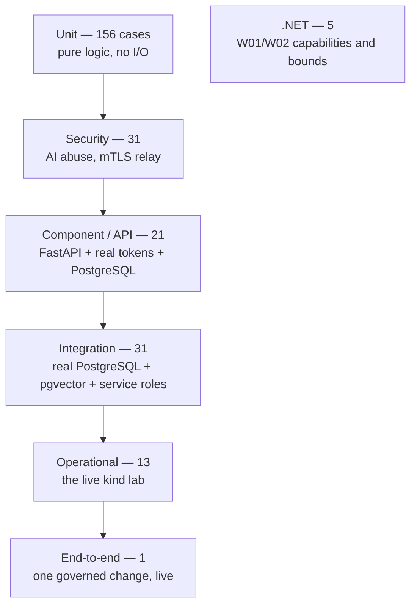

# Testing strategy (S30)

Tests protect the behaviour that matters: **authority** (who can change what), the **numbers** that
drive resource changes, **safe failure**, and the **security boundaries**. Each behaviour is tested at
the cheapest layer that can prove it, and a rule is re-tested at another layer only when that layer
catches a different kind of failure. This page explains the layers, the techniques, how to run each
suite and what is not covered. Every individual test is listed in [test-catalog.md](test-catalog.md);
recorded results are in [proof-of-operation.md](proof-of-operation.md).

## 1. Principles

* **Risk first, not coverage first.** No test exists only because a file or class exists.
* **Cheapest reliable layer.** Pure logic is unit-tested; anything whose correctness depends on
  PostgreSQL semantics (grants, RLS, triggers, rollback) is tested against a real PostgreSQL; anything
  that depends on Kubernetes enforcement is verified on the live cluster.
* **Real dependencies over mocks** where it matters: real PostgreSQL + pgvector in containers, real
  migrations, real service roles, a real TLS handshake, the real telemetry client. Fakes are used only
  where a real dependency would make the test non-deterministic (the Kubernetes API for executor edge
  cases, the model for AI-security cases).
* **Deterministic.** Seeded data, fixed clocks, synthetic series with known answers.
* **Honest results.** A suite that cannot run is **skipped**, and the release report counts it as
  `not_run` — never as passed.

## 2. Layers



| Layer | Folder | Test functions → junit cases | Needs | What it proves |
|---|---|---|---|---|
| Unit | `tests/unit` | 117 → **156** | nothing | forecasting, optimization golden fixtures, effective-request accounting, governance rules, executor state machine and patching, verification windows through the real telemetry client, scenario contracts and run quality, worker readiness, release-gate rules, architecture boundaries |
| Security | `tests/security` | 19 → **31** | nothing | AI tool-broker denials, forbidden tools, delegation and scope, budgets, prompt-injection outputs, validators, secret redaction; the API → governance relay over a real mutual-TLS handshake |
| Component / API | `tests/component` | 11 → **21** | Docker | the FastAPI boundary with locally signed tokens: issuer/audience/algorithm/client checks, role and scope enforcement, error envelope, idempotency, opaque denials, machine identity |
| Integration | `tests/integration` | 24 → **31** | Docker | real PostgreSQL + pgvector: migrations and drift, per-role grants, RLS on the job queue, leases and fencing, append-only and tamper detection, the governed chain across service roles, durable denial records, hybrid retrieval |
| Operational | `tests/operational` | 7 → **13** | the kind lab | live network enforcement, RBAC, admission, executor field guard, observability, placement, topology, TLS + OIDC wiring, model-gateway isolation, restore drill, audit checkpoints, executor recovery after Pod loss |
| End-to-end | `tests/e2e` | 1 → **1** | the kind lab + ~6 h of telemetry | one governed change from analysis to verification outcome with four different users |
| .NET | `workloads/dotnet/Tests` | **5** | .NET 10 SDK | capability token verification, fail-closed key handling, deterministic bounded work, bounded metric labels in W01/W02 |

Parametrized tests expand into several junit cases, which is why the case counts are higher than the
function counts. The distribution is deliberately bottom-heavy: many fast unit tests, a moderate
number of integration tests, few API tests, a handful of live checks and one end-to-end test.

## 3. Techniques

| Technique | Where | Why |
|---|---|---|
| **Golden fixtures** | `test_optimization_golden.py` | hand-checked inputs with expected candidates, gate results and rankings (F01–F15) pin the engine's behaviour |
| **Synthetic series with known answers** | `test_forecasting.py` | anti-leakage, refusals, interval coverage and model selection are checked against series whose correct result is known |
| **Fake Kubernetes API with real JSON Patch `test` semantics** | `tests/fakes.py` | executor tests can simulate conflicts, timeouts after success, crashes, recreated controllers and ownership changes deterministically |
| **Real telemetry client with a stubbed HTTP answer** | `test_executor.py` window tests | catches queries the client would refuse (for example a step below the registered minimum) |
| **Disposable PostgreSQL containers** | `tests/conftest.py` (Testcontainers, `pgvector/pgvector:0.8.1-pg17`) | grants, RLS, triggers and rollback behave exactly as in production; the real migrations are applied and the real service roles connect |
| **Locally signed tokens and JWKS** | `tests/auth_helpers.py` | the API's token validation runs end to end without Keycloak |
| **Throwaway PKI and a real TLS listener** | `test_internal_mtls.py` | the mutual-TLS relay is proven with a real handshake, not a mock |
| **Architecture test** | `test_architecture.py` | parses imports so AI, API, capacity and governance code can never reach executor code or the Kubernetes client; asserts exactly six platform Deployments |
| **Live verification as tests** | `tests/operational` | runs the same checks as `capacity-lab verify all` and records the evidence file the release report reads |
| **Recorded evidence** | `capacity-lab release test` | junit results per suite plus a summary are kept as release evidence |

Helpers: `tests/factories.py` (deterministic evidence, targets, policies, nodes), `tests/fakes.py`
(fake Kubernetes, governance port, stores), `tests/live.py` (lab reachability, cached tokens, API
calls, waits).

## 4. Running the tests

Fast suites (no Docker, no cluster) — about 11 seconds for 187 tests:

```powershell
uv run pytest tests/unit tests/security
```

With Docker (Testcontainers starts a disposable PostgreSQL):

```powershell
uv run pytest tests/component tests/integration
```

Against the running lab (start `capacity-lab model gateway` first, otherwise the gateway isolation
test skips):

```powershell
uv run pytest tests/operational
```

```powershell
uv run pytest tests/e2e
```

The .NET workload tests:

```powershell
dotnet test workloads/dotnet/Tests/Tests.csproj
```

Everything, with junit results kept as release evidence in `~/.capacity-lab/evidence/tests/`:

```powershell
capacity-lab release test
```

Selected suites:

```powershell
capacity-lab release test --suite integration --suite operational
```

Markers: `integration` (needs Docker), `operational` (needs the lab), `model` (needs the gateway),
`e2e` (critical governed workflow). The default per-test timeout is 300 s; the E2E test allows 3600 s.

## 5. Operational tests in detail

| Test | Checks |
|---|---|
| `test_live_verification_check_passes` (7 cases: `network_default_deny_enforced`, `rbac_least_privilege`, `admission_negative_cases`, `executor_field_guard`, `observability_targets`, `placement_pools`, `topology_and_six_deployments`) | each live check of `capacity-lab verify all` passes; the evidence file is written for the release report |
| `test_six_platform_deployments_are_available` | the six Deployments are available |
| `test_api_requires_a_valid_user_token_over_tls` | the live API refuses requests without a valid token; TLS chains to the lab root |
| `test_model_gateway_is_reachable_from_ai_but_not_from_demo_pods` | the `ai` Pod reaches the host gateway; a demo Pod times out (skips if the gateway is not running) |
| `test_backup_restores_into_an_isolated_instance` | a fresh backup restores in a network-less container with every check passing |
| `test_audit_chain_matches_signed_checkpoints` | the chain is intact and matches every signed checkpoint |
| `test_executor_recovers_after_losing_its_pod` | after deleting the executor Pod, the replacement becomes available and no operation is stuck `in_progress` |

## 6. The end-to-end test — and when it skips

`tests/e2e/test_governed_change_live.py` walks the whole chain on the live lab with real Keycloak
users:

1. `planner1` requests an analysis of W04 and waits for it;
2. if nothing qualified, the test **skips**, naming the gate that stopped each candidate;
3. `admin1` switches to `Governed` (a plan created in any other mode is advisory-only);
4. `planner1` creates the plan; it must be `AwaitingApproval`;
5. `planner1` approving their own plan must be refused (403); `approver1` with a wrong digest must be
   refused (409/422); `approver1` approves the exact digest (201);
6. `operator1` requests execution (202);
7. the executor must apply the change; the live Deployment must hold **exactly** the planned values;
8. the operation must reach a verification outcome (`verified_success`, `verification_inconclusive`
   or `recovered`); the record is written to `~/.capacity-lab/evidence/e2e-governed-change-*.json`;
9. finally the mode is set back to `Observe`.

It skips on a fresh lab, after host downtime, or within about six hours of any rollout of W04, because
the forecast then refuses. That is intentional: the test never forces or fakes a change.

Practical points:

* Run it while E04 load is steady, starting about 20 minutes into a run, so the 15-minute baseline and
  the evaluation window see the same demand; otherwise the benefit is `inconclusive`
  (`incomparable_load`).
* It takes about 20 minutes. It asks for a fresh token at each call because a single access token
  expires long before verification ends.
* A completed run changes W04 (and possibly reverses it), which pauses W04's forecasts for about six
  hours — so it cannot be repeated immediately.

## 7. Static checks

```powershell
uv run ruff check src tests
```

```powershell
uv run ruff format --check src tests
```

```powershell
uv run mypy
```

`ruff` (lint and formatting, 120-character lines) is clean. `mypy` is configured but **not clean**: it
reports 94 findings in 23 files, concentrated in the dictionary-heavy manifest builders and a few
dynamic model and server constructions. None of them is part of a release gate.

## 8. What is not covered automatically

* statistical evaluation of forecast accuracy and of B0–B3 comparisons — an evaluation protocol with
  its own evidence ([evaluation.md](evaluation.md));
* load and soak testing beyond the scenario catalogue;
* upgrade and rollback between releases (there is no earlier release);
* the full rebuild-from-backup drill;
* a live `verified_success` — the live chain has run once and ended `recovered`
  ([proof-of-operation.md](proof-of-operation.md)).
