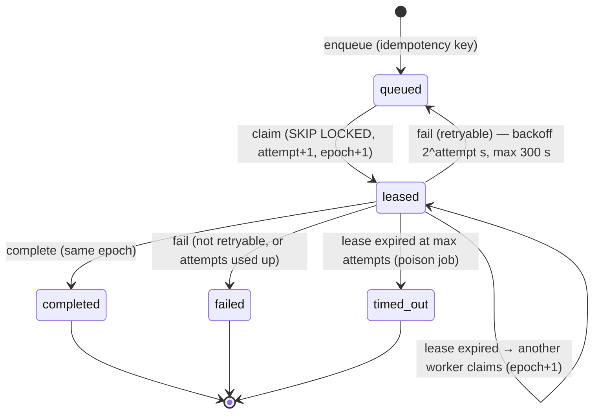

# How work moves between services (jobs and outbox)

The platform has **no message broker**. This page explains how long-running work is queued,
claimed, retried and published using PostgreSQL alone, which guarantees that gives, and where its
limits are. The code is in [`shared/jobs.py`](../src/capacity_platform/shared/jobs.py) and
[`shared/db.py`](../src/capacity_platform/shared/db.py). Why this was chosen over a broker is
explained in [design-decisions.md](design-decisions.md#dd-02-postgresql-jobs-and-outbox-instead-of-a-message-broker).

## 1. Queues and who uses them

All queues live in one table, `workflow.jobs`, separated by the `queue` column and by row-level
security.

| Queue | Enqueued by | Claimed by | Typical job | Lease |
|---|---|---|---|---|
| `capacity` | api (`POST /analyses`) | capacity worker | `analysis` — build evidence, forecast, generate and evaluate candidates | 5 min |
| `ai` | api (`POST /advisories`) | ai worker | `advisory` — run the three-agent review | 10 min |
| `executor` | governance (on an execution request) | executor intent worker | apply one intent (payload: the intent ID only) | 2 min |

## 2. Life of a job



1. **Enqueue.** The API inserts a row with the queue, a kind (for example `analysis`), the payload,
   a payload digest and an **idempotency key** built from the user and the `Idempotency-Key`
   header. Sending the same request twice returns the same job; reusing a key with a *different*
   payload raises `IdempotencyConflict` (HTTP 409).
2. **Claim.** A worker selects the oldest visible job of its queue with `FOR UPDATE SKIP LOCKED`, so
   two workers never take the same row and never block each other. Claiming sets the lease owner and
   `lease_expires_at`, increments `attempt` and increments the **fencing epoch**. A job whose lease
   expired can be claimed again by another worker.
3. **Complete or fail.** `complete` and `fail` succeed only if the worker still holds the epoch it
   claimed with (`WHERE fencing_epoch = %s AND state = 'leased'`). A worker that stalled past its
   lease — for example during a long pause — cannot overwrite the result of the worker that took
   over.
4. **Retry.** A failure the worker marks as retryable (for example a target lock held by another
   operation, `target_locked`) returns the job to `queued` with exponential backoff: `next_visible_at = now() + min(300, 2^attempt)`
   seconds. After `max_attempts` (default 3) the job ends `failed` with its error code.
5. **Poison jobs.** If workers keep dying while holding a job, the next claim attempt parks it as
   `timed_out` with `attempts_exhausted` instead of crashing workers forever.

`GET /api/v1/operations/{id}` shows the state (`queued`, `leased`, `completed`, `failed`,
`timed_out`) and, when completed, the result. A completed analysis is **evidence**, not an approved
or executed change.

### Worker readiness

Each worker loop records its last error. `/health/ready` reports `database: down` while the last
round-trip failed and recovers on the next successful claim — including when the queue is empty
(`tests/unit/test_worker_readiness.py` protects that recovery).

## 3. Queue isolation

Row-level security on `workflow.jobs` limits each service role to its own queue:

* the API may insert into the `capacity` and `ai` queues and read them back for status;
* governance inserts the `executor` job for each execution intent (its policy also permits the
  `capacity` and `ai` queues);
* each worker may claim only its own queue;
* the capacity worker may additionally **read** (not claim) the AI job that delegated a tool call,
  so it can check the delegation scope on every tool request.

`tests/integration/test_schema_boundaries.py::test_job_queue_row_level_security` proves this with
the real roles.

## 4. Publishing results: the transactional outbox

When a service stores a result, it writes an event into its own schema's `outbox` table **in the
same transaction**. Either both the result and the event exist, or neither does.

```mermaid
sequenceDiagram
  participant S as Producer (e.g. executor)
  participant DB as PostgreSQL
  participant C as Consumer (e.g. ai)
  S->>DB: BEGIN
  S->>DB: INSERT outcome
  S->>DB: INSERT outbox event
  S->>DB: COMMIT (both or neither)
  C->>DB: read new outbox events (at least once)
  C->>DB: INSERT workflow.inbox (consumer, event_id) ON CONFLICT DO NOTHING
  Note over C,DB: already processed → skip; new → handle
```

Consumers read the outbox at least once and use `workflow.inbox` (`already_processed`) to ignore
duplicates, giving effectively-once processing per consumer. Examples:

* `execution.outbox` carries verified outcomes, which the AI service reads to build operational
  knowledge notes;
* `governance.outbox` announces new intents;
* `capacity.outbox` announces completed analyses.

## 5. Correlation

Every job, outbox event and audit event carries a `correlation_id` that starts at the API request
(`X-Correlation-ID` header, or generated). Logs are JSON lines that include it, so one action can be
followed across services:

```powershell
kubectl --context kind-capacity-lab -n capacity-api logs deploy/capacity-api | Select-String "<correlation-id>"
```

See [observability.md](observability.md).

## 6. What this design guarantees

| Property | How |
|---|---|
| a job is processed by one worker at a time | `SKIP LOCKED` + lease |
| a stale worker cannot overwrite a newer result | fencing epoch checked on complete/fail |
| a retried request does not create a second job | idempotency key + payload digest |
| a result is never announced without being stored | transactional outbox |
| a duplicate event is not handled twice by a consumer | `workflow.inbox` |
| a crashing job cannot take workers down forever | `max_attempts` and `timed_out` parking |
| a service cannot read or claim another queue | row-level security |

The expired-lease and fencing behaviour is proven against a real database by
`test_expired_lease_reclaim_fences_out_the_old_worker`; idempotency by
`test_idempotent_enqueue_and_conflicting_payload`.

## 7. Limits of this design

* Workers poll; latency from enqueue to claim is a few seconds.
* Throughput is bounded by one PostgreSQL instance — ample for capacity analysis on a lab cluster,
  not intended for high-rate event streaming. At much higher rates a broker or a
  `LISTEN/NOTIFY` wake-up would be needed (see [production-considerations.md](production-considerations.md)).
* There is no exactly-once guarantee across PostgreSQL and Kubernetes. The executor handles that
  boundary separately with intents, fencing, `test` preconditions and reconciliation
  ([governance-and-execution.md](governance-and-execution.md)).
