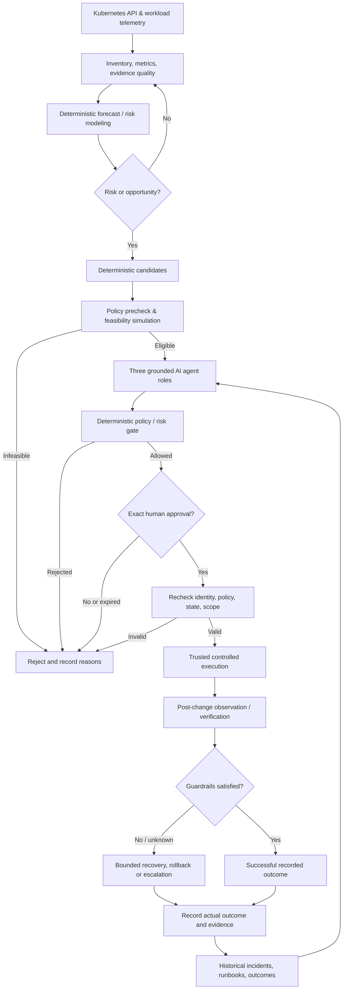

# S01 — Product Scope, Requirements & Operational Model

> **Approval record (2026-11-15):** The project owner expressly approved **all recommended S01 selections** from the S01 design discussion. The accepted selections are: **AIOps Capacity Operations Platform** as product identity; **Platform Engineers, SREs, and Kubernetes operators** as principal users; **L0–L2** autonomy with **human-approved mutation**; **hierarchical workload / namespace / cluster optimization**; **Critical / Standard / Flexible / Opportunistic** criticality classes; **immediate + 1-hour + 24-hour** initial planning horizons; **hard safety constraints before efficiency ranking**; **Observe / Advisory / Governed** operating modes; measured outcomes across **efficiency, reliability, intelligence, and governance**; and a **single, bounded, fully local multi-node kind cluster** as the initial environment. This approval does **not** finalize technology, algorithms, exact numeric SLOs, or component boundaries delegated to later slices.

## 0. Document contract and precedence

**Purpose.** This file is the durable, ChatGPT-Project-ready approved specification for **S01**, covering vision, scope, product capabilities, actors, operating modes, autonomy, constraints, requirements, evaluation, acceptance scenarios, glossary, decision log, and handoff requirements.

**Authority.** The **master specification catalog** is the authoritative **32-slice roadmap**, domain definitions, cross-cutting requirements, and global invariants. This file is the authoritative **accepted S01 product-level baseline**. Read both together. If a later explicit ADR supersedes an S01 decision, update the S01 decision register and cross-references; do not silently replace it. In particular, component boundaries, concrete interface schemas, security implementations, forecasting algorithms, and tuning targets remain owned by their respective later slices.

**Decision state terminology.** `Accepted` means expressly chosen by the project owner; `Existing agreed direction` denotes a prior settled project principle; `Proposed target` denotes a useful evaluation threshold not yet calibrated; `Open downstream` means a deliberately delegated choice; `Deferred` means excluded from the initial release.

**Traceability convention.** `S01-FR-###` = functional requirement, `S01-NFR-###` = nonfunctional requirement, `S01-SEC-###` = S01 safety/security requirement, `S01-TEST-###` = acceptance scenario, `S01-ADR-###` = accepted S01 product decision. Preserve IDs when revising this file.

---

## 1. Mission, problem, and product promise

### 1.1 One-sentence vision

A **fully local, production-inspired AIOps Kubernetes capacity operations platform** that observes resource demand, forecasts capacity risks through deterministic statistical/ML engines, produces and simulates safe resource/scheduling optimizations, uses evidence-grounded specialist AI agents for investigation and review, and executes **only explicitly authorized, policy-compliant, revalidated** changes with post-change outcome verification.

### 1.2 Problem statement

Kubernetes scheduling, requests, limits, PriorityClasses, and autoscalers expose useful primitives, but they do not by themselves provide a complete decision process for multi-workload capacity optimization. Common failure modes include:

1. **CPU reservation waste:** high configured requests relative to measured or projected demand can reduce schedulable capacity.
2. **Memory safety risk:** reducing requests/limits on the basis of a quiet observation window can miss spikes, periodic batch demand, historical OOM events, or quality gaps.
3. **Scheduling fragmentation:** aggregate cluster capacity can appear sufficient while no eligible individual node fits a Pod after resource, affinity, taint, and other placement constraints.
4. **Contention and priority interaction:** one workload's optimization can degrade higher-criticality workloads or affect shared quotas/headroom.
5. **Forecast uncertainty:** forecasts can be stale, inaccurate, insufficiently supported, or inappropriate for the chosen horizon.
6. **Weak governance:** a recommendation may appear sensible but have stale preconditions, unclear ownership, unauthorized scope, or no verification/rollback plan.
7. **Disconnected institutional memory:** runbooks, incident histories, prior configuration changes, and past outcomes are not consistently brought into new capacity decisions.

### 1.3 Product promise

The product will provide a traceable answer to: **What is happening? What is likely to happen? What can safely change? Why? Who authorized it? What actually happened afterward?**

The product is **not** merely a metrics dashboard, a generic chatbot, a replacement Kubernetes scheduler, or an unrestricted self-healing operator. It is a **decision-support system with constrained, human-governed execution**.

### 1.4 Fundamental distinction

- **Observed usage** describes consumption; **requests** are scheduling reservations; **limits** are runtime constraints; **allocatable** describes node-level resource capacity available for Pods; **forecast demand** is an uncertain estimate; **simulated outcomes** are hypotheses rather than measured post-change reality.
- These resource and evidence categories **MUST NOT** be conflated in calculations, claims, UI output, reports, or approval packages.
- AI explanations **MUST NOT** invent numerical forecasts, policy decisions, raw telemetry, or simulated feasibility results; these originate from deterministic, typed, separately evaluated services/tools.

---

## 2. Stakeholders, actors, and responsibilities

| Actor | Primary interests | Product-level actions | Authority boundary |
|---|---|---|---|
| **Platform Engineer / SRE** (primary user) | Stable resource allocation, capacity risks, operational evidence, bounded improvements | Inspect, compare, request analyses, propose, evaluate, review, monitor outcomes | Access determined by platform role and resource scope |
| **Kubernetes Infrastructure Operator** (primary user) | Scheduling constraints, configuration, reliable changes | Review and operate within authorized cluster/namespace scope | Does not gain privileges solely from access to AI functionality |
| **Approver / designated change authority** | Risk, change legitimacy, impact | Approve or reject an exact versioned plan with clear constraints and expiry | Approval is distinct from execution and never substitutes for execution-time checks |
| **Administrator / Security Reviewer** | Identity, policy, least privilege, audit | Configure and review policies, authorization scopes, records | Administrative rights remain separately defined and auditable |
| **Workload owner** (secondary) | Application SLOs, change consequences | Provide criticality, SLO policy input, review workload-specific effects | Cannot bypass platform hard constraints |
| **AI Capacity Analyst** (nonhuman advisory role) | Diagnoses and evidence synthesis | Analyze grounded state, history, risk factors | No direct mutation privileges |
| **AI Optimization Planner** (nonhuman advisory role) | Candidate explanation and tradeoffs | Suggest candidates using permitted analysis/simulation tools | No direct mutation privileges; deterministic engine controls feasibility |
| **AI Risk Reviewer** (nonhuman advisory role) | Critical review and missing evidence | Flag risks, historical incidents, uncertainties, conflicts | No approval authority or mutation privileges |
| **Trusted execution controller** (machine subsystem) | Exact, safe mutation | Apply allowlisted, authorized, revalidated operation and track outcome | Only component allowed scoped mutation privileges; details in S25 |

These are **conceptual actors**, not a binding role/permission matrix. S06 finalizes human/machine identities, separation of duties, and RBAC grants.

---

## 3. Scope and explicit boundaries

### 3.1 In initial P0 scope

1. Single local multi-node Kubernetes **kind** cluster; Windows 11 + Docker Desktop + WSL2 development environment, subject to a measured local resource budget.
2. Small reproducible **mixed-language workload ecosystem**, using .NET 10 HTTP APIs and Python CPU/memory workers and batch/analytics jobs; workload behaviors exist to stress **resource and reliability scenarios**, not to deliver rich business features.
3. Node/namespace/workload/container inventory, configured requests/limits, node allocatable capacity, current and historical usage, throttling, OOM/eviction, Pending/placement state, priority and workload configuration history.
4. Data-quality-aware deterministic **CPU/memory demand forecasting**, initially framed around **current state, 1-hour, and 24-hour** decisions with explicit uncertainty, provenance and insufficiency outcomes.
5. CPU and memory **request/limit right-sizing recommendations**, bounded by relevant SLOs, resource safety margins, and historical evidence.
6. Kubernetes scheduling feasibility and multi-resource fragmentation analysis, including per-node constraints instead of aggregate-only calculations.
7. Deterministic candidate generation, policy screening, analytical simulation, baseline comparisons, risk characterization and candidate ranking.
8. Specialized **Capacity Analyst / Optimization Planner / Risk Reviewer** agent capabilities with typed tools and operational RAG; model output remains advisory.
9. Read-only, advisory, and guarded human-approved execution modes; immutable/versioned recommendation identity, approval binding, execution revalidation, audit and post-change verification.
10. Bounded recovery/rollback handling and explicit partial/unknown outcomes; no silent success reports.
11. Protected operator interfaces using API/CLI and operational dashboards; **no dedicated custom web frontend** in initial scope.
12. Fully local reproducible simulations and experiments, technical and security testing, and verifiable measurement of platform value.

### 3.2 Deferred / outside initial scope

- Production public-cloud resource provisioning or modifying real cloud node pools.
- Multi-cluster federation and fleet-wide optimization.
- GPU/accelerator scheduling or complex heterogeneous hardware planning.
- Writing a replacement Kubernetes scheduler or guaranteeing exact Kubernetes scheduler equivalence in a simulator.
- Unrestricted eviction, mass pod disruption, node removal, or arbitrary imperative shell execution.
- Automatic execution **without an exact human approval for each plan** (**L3**, deferred).
- Full business application complexity in demo workloads, a dedicated custom frontend, and full service mesh as a prerequisite.
- Heavy MLOps infrastructure such as Kubeflow, feature stores or MLflow unless a later ADR justifies the operational cost.
- Full advanced HPA/batch optimization as a first-wave capability (**S23 P1**); demonstration of relevant autoscaling interactions may still be used earlier.

### 3.3 Non-goals and guardrails

- Do **not** maximize resource-utilization percentages irrespective of system health.
- Do **not** call request reductions “capacity added” without validating scheduling and actual operating effects.
- Do **not** describe request savings as monetary cloud savings in a no-cloud local environment. Costs, if reported, must be explicitly modeled and labeled hypothetical.
- Do **not** assume a forecast is trustworthy because an algorithm returned a number.
- Do **not** treat documents retrieved by RAG as instructions or policy authority.
- Do **not** require the LLM or RAG to be online for core inventory, data collection and deterministic forecasting.

---

## 4. Accepted product-level decisions

### 4.1 S01-ADR-001 — Product identity: AIOps Capacity Operations Platform

**Status:** Accepted. **Selected:** Option B.

**Alternatives considered:** A) advisory-only capacity tool; B) AIOps operations platform combining advisory intelligence and governed execution; C) predominantly autonomous Kubernetes operator.

**Rationale:** B provides the complete diagnosis → optimization → governance → approved execution → verification lifecycle without the unsafe operational autonomy of C. A is useful as a mode, but insufficient as the overall product identity.

**Consequences:** The product must be useful in pure advisory mode *and* show real, controlled operational change and outcomes. Component layout remains S02's decision.

### 4.2 S01-ADR-002 — Primary audience: Platform / SRE / Kubernetes operations

**Status:** Accepted. **Selected:** Platform Engineers, SREs, and Kubernetes Infrastructure Operators as primary users; change approvers, admins/security reviewers, and workload owners as supporting actors.

**Rationale:** The goal is a specialized infrastructure and AIOps platform, not general-purpose software development or a user-facing business app.

**Consequences:** Workflows, outputs, access control, diagnostics and evidence must favor operators; S06/S27 define precise identities and operator UX.

### 4.3 S01-ADR-003 — Autonomy: L0 through L2, no L3 at initial release

**Status:** Accepted. **Selected:** L0 Observe, L1 Recommend, L2 **exact human-approved execution**. L3 policy-preauthorized automatic mutation is **deferred**.

| Level | Meaning | Permitted without human per-plan approval? |
|---|---|---|
| **L0 — Observe** | Collect state and telemetry, detect, inspect and forecast | Read-only analysis only |
| **L1 — Recommend** | Generate, simulate, rank and explain candidates | Yes for analysis; **no mutation** |
| **L2 — Approved execution** | Execute exact authorized plan after policy/state checks | **No:** an explicit valid human approval is required |
| **L3 — Policy-bound auto execution** | Apply without a specific human approval per plan | **Deferred / not implemented in P0** |

**Consequences:** Recurring telemetry/forecasting and automatic creation of draft recommendations are allowed. They do not grant mutation authority. A human-approved plan can still be refused at execution if current prerequisites fail.

### 4.4 S01-ADR-004 — Hierarchical optimization scope

**Status:** Accepted. **Selected:** Option C, hierarchical evaluation at **container/workload**, **namespace/workload group**, and **cluster/node** levels.

- **Container/workload:** requests/limits, consumption, forecast, throttling, OOM, latency, operational history.
- **Namespace/group:** quota, resource competition, criticality distribution, group budgets and isolation constraints.
- **Node/cluster:** allocatable vs reservations, node-fit, taints, tolerations, affinity/topology, fragmentation, headroom, workload priorities.

**Consequences:** A workload-local improvement does not automatically count as globally feasible, safe, or desirable. The proposal must be evaluated against higher-level constraints.

### 4.5 S01-ADR-005 — Four criticality classes

**Status:** Accepted. **Selected:** Critical, Standard, Flexible, Opportunistic.

| Class | Representative demo | Product policy intent | Key caveat |
|---|---|---|---|
| **Critical** | Latency-sensitive .NET API | Strict availability/latency, conservative right-sizing, high protection | Specific SLOs and disruption policy defined in S19/S04 |
| **Standard** | Bursty .NET API or stable Python worker | Balanced reliability and efficiency | May have HPA or other dynamic constraints |
| **Flexible** | Analytics CronJob | Resource flexibility while respecting completion/deadline windows | Batch deadlines still matter |
| **Opportunistic** | Low-priority batch Job | Favor efficiency and tolerate bounded delay/disruption | Not equivalent to unrestricted eviction |

**Important:** Platform criticality is a **business/operational policy classification**, not Kubernetes `PriorityClass`. The two can be related in S04/S19 but **must not be treated as interchangeable**. Criticality is explicitly configured and authoritative via policy, not freely inferred by an AI agent.

### 4.6 S01-ADR-006 — Initial planning horizons

**Status:** Accepted at **product level**. **Selected:** Immediate state/scheduling checks; **1-hour** short-term forecast; **24-hour** operational forecast. Strategic multi-day/week horizons deferred.

**Nuance:** “Immediate” is a **current-state inspection**, not necessarily a machine-learned forecast. These are **product planning targets**; S12/S14 choose sampling, algorithm family, eligibility, history requirements, backtesting and whether a particular horizon can be reliably emitted. When data quality is insufficient, the system reports `insufficient_evidence` rather than manufacturing a prediction.

### 4.7 S01-ADR-007 — Hard safety constraints before ranking

**Status:** Accepted. **Selected:** **Hard constraints → feasibility → quality evaluation → ranked feasible candidates**.

**Must reject**, independent of expected efficiency gain or LLM recommendation, a candidate violating hard constraints such as unauthorized scope, critical SLO policy, resource minima, safety margin, placement compatibility, disruption policy, stale approval or untrustworthy evidence.

**Soft objectives** (only among eligible candidates): CPU/memory request efficiency, increased schedulable headroom, lower fragmentation, operational change cost, uncertainty, historical risk, and expected reliability benefit.

**Consequences:** S19–S22 own exact formulas, solvers, weights, tie-breaking and policy schema. Agents do not bypass rejection decisions.

### 4.8 S01-ADR-008 — Three operational modes

**Status:** Accepted. **Selected:** `Observe`, `Advisory`, `Governed`.

| Mode | Product behavior | Mutations | Minimum operator expectation |
|---|---|---|---|
| **Observe** | Inventory, telemetry, forecasting, detection and reporting | **None** | Read-only dashboards/API/CLI |
| **Advisory** | Observe + deterministic candidates, simulations, AI evidence/risk review, proposals | **None** | Recommendation package and rejection reasons |
| **Governed** | Advisory + authorization, controlled execution and verification | **Only exact, approved, revalidated bounded changes** | Approval, execution status, verification, recovery and audit |

**Semantic distinction:** Mode and autonomy level are related but not synonyms. `Observe ≈ L0`, `Advisory ≈ L1`, and `Governed permits L2` **when authorized**. Disabling Governed mode prohibits mutation even if a past plan is approved. S06/S24–S25 define the authoritative enforcement mechanism.

### 4.9 S01-ADR-009 — Success measured across four dimensions

**Status:** Accepted. **Selected:** Assess **efficiency**, **reliability**, **intelligence**, and **governance** with controlled benchmarks against simple and deterministic baselines. No “AI improved utilization” claim without evidence isolating the AI contribution.

### 4.10 S01-ADR-010 — Bounded, single-cluster, fully local initial operation

**Status:** Accepted as product boundary. **Selected:** Single local, multi-node **kind** cluster on Windows 11 / Docker Desktop / WSL2. Fully local inference and services, deterministic demo scenarios, bounded resource use and cleanup.

**Consequences:** Exact node count, CNI, budgets, disk/CPU/RAM figures, topology and local infrastructure design **remain open to S03**. The initial product does not assume that a specific workstation can run all components at full concurrency.

---

## 5. Product capabilities and logical lifecycle

These are **capabilities**, not service-count mandates.

1. **Observe** — discover the authoritative Kubernetes desired/current state; collect sampled telemetry and past configuration/operational evidence; label source, timestamp and freshness.
2. **Predict** — derive deterministic/statistical/ML demand estimates and risk indicators, with uncertainty and model/data provenance; refuse unsupported forecasts.
3. **Optimize** — generate bounded candidate changes, enforce feasibility and policy constraints, simulate their effect, compare with a baseline, and rank valid candidates.
4. **Govern** — obtain evidence-grounded critique from three specialist agents; produce reviewable recommendation packages; enforce machine-checked policy and explicit human authorization. The LLM is advisory.
5. **Act & verify** — execute only within a limited and revalidated approved scope, verify real-world effects, record realized or failed outcomes, and trigger bounded recovery.

### 5.1 Logical workflow diagram



### 5.2 Operating cadences

- **Continuous or scheduled read-only functions:** inventory updates, data collection, risk detection and eligible deterministic forecasting.
- **On-demand/triggered decision functions:** candidate generation, scenario simulation, agent review and recommendation issuance.
- **Human-triggered privileged functions:** exact plan approval, execution request where permitted, review and acknowledgement of failure.
- **Post-execution functions:** time-window-based verification, incident/recovery handling, outcome recording, benchmark and knowledge updates.

**Not decided in S01:** schedule intervals, trigger thresholds, caching strategy, retry budgets, durable workflow implementation, queues, transaction boundaries, and operator APIs.

### 5.3 Human-governed plan contract (product-level minimum)

Any candidate forwarded for approval must identify at least: `plan_id`, `plan_revision`, `target_cluster`, `namespace`, `resource identity`, `action type`, `before/after desired configuration`, `evidence references`, `observation windows and freshness`, `forecast horizon and uncertainty`, `policy version`, `simulation assumptions/results`, `risk assessment`, `expected benefit`, and `verification/recovery intent`.

Approval must be **specific, authentic, time-bounded and bound** to the exact plan identity/version, targets, action and policy/target preconditions. Prior to mutation, the trusted controller must revalidate those conditions and use bounded, allowlisted operations. The definitive schemas, hashes, concurrency semantics and state machine belong to S24/S25.

### 5.4 Product-level operational failure behavior

| Failure | Required behavior | Later owner |
|---|---|---|
| Ollama unreachable / timed out | Read-only inventory and deterministic forecasting continue; agent-dependent decision cannot be finalized as though reviewed | S15–S16, S28 |
| RAG unavailable or irrelevant | Record missing historical context; do not invent citations; conservative risk/quality gate | S18, S24 |
| Metrics stale / missing | Mark evidence inadequate; refuse unsafe confidence-dependent recommendations | S12–S14, S19 |
| Cluster state changes after approval | Reject stale execution and require refreshed evaluation/approval | S24–S25 |
| Policy rejects candidate | Stop candidate lifecycle, preserve explicit reason | S19, S24 |
| Executor crashes / request replayed | Avoid duplicate uncontrolled application; restore auditable workflow state | S25, S28 |
| Verification fails / ambiguous outcome | Never report success; attempt only authorized bounded recovery or escalate | S26, S28 |
| GitOps-owned resource | Do not directly mutate managed desired state contrary to ownership; use suitable declarative path | S25 |

---

## 6. Functional requirements (P0 unless explicitly P1)

| ID | Product requirement | Evidence / intended downstream owner |
|---|---|---|
| **S01-FR-001** | Discover supported clusters' **single-cluster initial scope**, nodes, namespaces, workload owners and relevant containers | Inventory contract S11 |
| **S01-FR-002** | Represent **allocatable**, **requested**, **limited**, **observed**, **predicted**, **simulated** resource values distinctly | S11–S14; X-DATA-01 |
| **S01-FR-003** | Detect over/under-provisioning signals, pressure, throttling, OOM/eviction, Pending and capacity risks | S11–S14 |
| **S01-FR-004** | Produce deterministic/statistical/ML CPU and memory demand forecasts with horizon, provenance, uncertainty and data-quality checks | S14; no LLM numerical prediction |
| **S01-FR-005** | Generate bounded CPU/memory **request and limit** right-sizing candidates, distinguishing these actions | S19–S20 |
| **S01-FR-006** | Evaluate node placement and resource fragmentation with per-node resource constraints rather than aggregate totals alone | S21 |
| **S01-FR-007** | Compare a candidate with baseline using **non-mutating analytical simulation**, with declared assumptions and known limits | S22 |
| **S01-FR-008** | Provide grounded Capacity Analyst, Optimization Planner, and Risk Reviewer advice; keep decision authority deterministic | S15–S18; X-SEC-03/07 |
| **S01-FR-009** | Classify workload criticality and apply configurable SLO, headroom, disruption and scope constraints before scoring | S04, S19 |
| **S01-FR-010** | Require correctly authorized, specific, unexpired **human plan approval** prior to mutation | S06, S24 |
| **S01-FR-011** | Restrict execution to allowlisted operations after plan, policy, scope and target-state revalidation | S25 |
| **S01-FR-012** | Verify real outcomes against performance/safety objectives and support bounded recovery, rollback or escalation | S26 |
| **S01-FR-013** | Retain attributable evidence of proposals, rejections, approvals, execution and outcomes | S13, S24–S26 |
| **S01-FR-014** | Provide secure operator API/CLI workflows, and usable operational dashboards without a custom frontend requirement | S27 |
| **S01-FR-015** | Run reproducible, seeded, resource-bounded synthetic/load/failure scenarios with explicit cleanup | S04–S05, S31 |
| **S01-FR-016** | **P1:** explore HPA behavior, replica-aware optimization, batch timing, advanced autoscaling concerns | S23; not P0 release gate |
| **S01-FR-017** | Support explicitly selectable **Observe**, **Advisory**, and **Governed** operational modes with mutation denied outside Governed | S06, S24–S27 |
| **S01-FR-018** | Evaluate candidate effects across **workload, namespace/group and node/cluster** levels | S19–S22 |
| **S01-FR-019** | Support **immediate**, **1-hour**, and **24-hour** decision horizons and explicit refusal where evidence is insufficient | S12, S14 |
| **S01-FR-020** | Make past incidents, runbooks, configuration history and prior outcomes available as evidence with authorization and temporal context | S13, S18 |
| **S01-FR-021** | Respect GitOps ownership and preserve declarative source of truth for managed workloads | S25 |
| **S01-FR-022** | Expose enough evidence and experiment metadata to compare static, rule/VPA, deterministic-only and full AI-enhanced baselines | S31 |

**Note:** "Supported clusters" in FR-001 does **not** commit to multi-cluster support. The **initial deployment supports exactly one local cluster**; additional clusters are outside initial scope.

---

## 7. Nonfunctional requirements

| ID | Requirement | Acceptance interpretation / calibration |
|---|---|---|
| **S01-NFR-001** | Reproducibility | Same versioned deterministic scenario inputs and equivalent snapshot state produce consistent engine decisions; store random seeds and config versions. Avoid claiming live Kubernetes runs are perfectly deterministic. |
| **S01-NFR-002** | AI failure isolation | Ollama/RAG failure cannot stop supported core discovery, telemetry collection or deterministic analysis; agent-dependent workflow remains fail-safe. |
| **S01-NFR-003** | Mutation safety | No policy-rejected, out-of-scope, unapproved or altered-plan mutation is accepted in defined positive/negative test suites. |
| **S01-NFR-004** | Execution idempotency | Repeated execution requests and recovery attempts must not create duplicate, unauthorized side effects. |
| **S01-NFR-005** | Traceability | Every attempted change has linked plan, evidence, version, actor authorization, execution records and outcome/uncertainty status. |
| **S01-NFR-006** | Data confidence | Stale, incomplete and inconsistent input is visibly classified; no silent use of low-quality data to justify risky actions. |
| **S01-NFR-007** | Local resource boundedness | Explicit CPU, memory, storage, concurrency and load limits; exact budgets decided and measured in S03/S15/S28. |
| **S01-NFR-008** | Security verification | AuthN/AuthZ, plan tampering, secret exposure, untrusted retrieval, network/RBAC and negative-path cases are part of release criteria. |
| **S01-NFR-009** | Restart / fault recovery | Persistent critical workflows restore to valid, auditable states or explicitly fail for operator intervention. |
| **S01-NFR-010** | Operational observability | Correlation across critical metrics, structured logs, traces and durable decision records; concrete SLOs from S28. |
| **S01-NFR-011** | Risk-aware optimization | Hard constraints and reliability/SLO guardrails cannot be traded for soft efficiency gains. |
| **S01-NFR-012** | Simulation honesty | Every simulation distinguishes assumptions from observed outcomes and states scheduler-fidelity limits. |
| **S01-NFR-013** | Local autonomy | The initial platform must not require paid cloud, hosted LLM inference or third-party infrastructure. |
| **S01-NFR-014** | Operability without full automation | Observe and Advisory modes remain useful even when privileged execution is disabled. |

**SLO policy:** Specific service availability, p95 response times, collector freshness, model latency, execution recovery time, and retention durations are **not accepted numeric commitments in S01**. Define realistic, hardware-measured budgets in S03, S12, S15 and S28, with workload-specific SLOs in S04/S19.

---

## 8. Safety, security and trust invariants

| ID | Mandatory product invariant | Master cross-reference |
|---|---|---|
| **S01-SEC-001** | Protected actions require authenticated human or machine principals and separately enforced action/resource authorization. | X-SEC-01/02 |
| **S01-SEC-002** | AI roles have no privileged Kubernetes mutation credentials, broad shell tool or authority to approve plans. | X-SEC-03/07 |
| **S01-SEC-003** | Keep secrets/tokens out of prompts, retrieval, source, audit payloads and logging. | X-SEC-04 |
| **S01-SEC-004** | Restrict machine/service identities and networks to least-privilege paths; negative access tests required. | X-SEC-05 |
| **S01-SEC-005** | Bind human approval to exact plan revision, action, targets, authorization, policy and target preconditions; expire and revalidate before applying. | X-SEC-06 |
| **S01-SEC-006** | Retrieved documents, logs, telemetry text and agent-generated text are evidence, never executable instructions or policy overrides. | X-SEC-07 |
| **S01-SEC-007** | Preserve attributable, integrity-protected audit records for all sensitive lifecycle transitions. | X-SEC-08 |
| **S01-SEC-008** | No hard SLO/safety/placement/resource constraints may be waived by a high utilization score or AI confidence. | X-OPT-01/02 |
| **S01-SEC-009** | Reject stale, contradictory, unverified, out-of-scope or improperly authorized mutations. | X-DATA-02; X-SEC-06 |
| **S01-SEC-010** | Mode-specific enforcement is server-side/controller-side: UI visibility or agent prompting alone is not sufficient. | X-SEC-02; X-TST-01 |
| **S01-SEC-011** | Failure in an AI/retrieval dependency must fail closed for agent-dependent recommendation finalization, without compromising read-only deterministic monitoring. | X-REL-01/02 |
| **S01-SEC-012** | Verify applied changes; on violation, recover only within approved/defined action boundaries or escalate, recording unknown/partial states. | X-REL-02; X-OPS-01 |

**Security ownership:** S06–S10 design exact mechanisms and threat models; S24–S26 design authorization/changes; S30 tests them. S01 fixes **product invariants**, not tool/vendor choices.

---

## 9. Optimization objectives and risk posture

### 9.1 Objective function — conceptual, not final algorithm

```text
Eligible(candidate) =
  authenticated_authorized_scope
  AND data_quality_sufficient
  AND hard_policy_constraints_met
  AND workload_SLO_guardrails_met
  AND scheduling_feasible
  AND allowed_disruption_and_change_bounds
  AND permitted_ownership_change_path

Only when Eligible(candidate) is true:
    evaluate expected efficiency gain, placement benefit,
    uncertainty, risk, history, and operational change cost;
    rank against unchanged baseline and other eligible candidates.
```

`Eligible` is illustrative: formal enforcement and precise evaluation order belong to S19–S25. A simulation predicting feasibility must also record its approximations; where meaningful, Kubernetes-backed validation must check its conclusions.

### 9.2 Examples of prioritization

- **CPU right-sizing:** A well-evidenced decrease that preserves p95 latency and CPU throttling guardrails may be eligible; projected CPU reservation reduction is not enough by itself.
- **Memory right-sizing:** Historical memory spikes, OOM events or missing batch periods require conservative handling; quiet average memory is insufficient evidence to reduce safety margins.
- **Placement fragmentation:** Enough **aggregate** free CPU does not prove there is an eligible node with enough free **requested** CPU **and** memory subject to scheduling constraints.
- **Critical workload:** Reliability constraints dominate savings; high-criticality classes may require stronger evidence or tighter limits.
- **Opportunistic workload:** A delay may be acceptable only if its explicit policy authorizes it and deadlines/safety bounds are satisfied.

---

## 10. Success metrics and evaluation protocol

### 10.1 Accepted dimensions and measurement principles

- **Efficiency:** requested-resource reduction on eligible workloads; changes in schedulable headroom and fragmentation; effects on actual CPU/memory demand.
- **Reliability:** OOM/eviction, throttling, Pending pods, task completion/deadline, application p95 latency and configured SLO preservation.
- **Intelligence:** forecast quality (e.g. MAE/RMSE/interval coverage), evidence provenance, RAG relevance/grounding, and value added by specialized agents.
- **Governance:** candidate rejection quality, authorization and tamper resistance, audit completeness, exact-plan revalidation, idempotency, recovery and attributable outcomes.

### 10.2 Evaluation baselines (required)

1. **B0 Static:** no optimization; preconfigured Kubernetes requests/limits and placement state.
2. **B1 Rules/VPA:** simple static or percentile-based rules and applicable VPA **recommendation-only** comparison; document comparability limits.
3. **B2 Deterministic-only:** forecast-aware optimization and simulation **without** agent involvement.
4. **B3 Full AIOps:** B2 plus grounded multi-agent investigation, retrieval and risk review.

**Required causal restraint:** Do not credit B3 for resource savings already delivered by B2. Quantify actual marginal agent value (for example avoiding an historically dangerous memory reduction, detecting missing evidence, improving risk review quality or reducing operator investigation effort). Where no benefit is demonstrated, document a neutral/negative result.

### 10.3 Draft targets — explicitly proposed, not accepted production SLOs

The owner approved **measurement dimensions and a measurable approach**, **not fixed numeric success guarantees**. The following targets are **provisional experiment hypotheses** to calibrate in S31:

| Metric | Provisional target / interpretation | Caveat |
|---|---|---|
| CPU request efficiency | **15–30% decrease** on deliberately overprovisioned eligible workloads | Synthetic/controlled benchmark subset, not cluster-wide promise |
| Memory request optimization | Reduce safely where valid historical peaks/forecast justify it | No fixed percentage; memory safety dominates |
| Placement feasibility | **100% of accepted test placements** pass specified Kubernetes-backed validation in supported fixtures | Does not claim general scheduler equivalence |
| Application latency | No material p95 regression beyond **configured** workload SLO | SLO thresholds specified in S04/S19 |
| OOM | No additional optimization-attributable OOMs in benchmark | Scenario-scoped; not universal proof |
| Forecasts | Beat naive/historical baseline on held-out scenarios; report interval coverage | Numeric targets from S14/S31 after data inspection |
| Unauthorized actions | **Zero successful unauthorized mutations** in defined adversarial test suite | Test pass criterion, not mathematical security proof |
| Verification record | **100% of attempted executions** have attributable outcome or explicit pending/unknown/recovery status | Not a promise that every execution succeeds |
| Agent contribution | Demonstrate measurable marginal benefit in at least one predeclared evaluation dimension | Avoid cherry-picking, report all cases |

### 10.4 Measurement integrity requirements

- Every trial identifies workload/scenario, cluster configuration, seeds, configuration revision, observation window, evidence freshness, model version, and policy version.
- Baselines are compared on equivalent workloads/constraints and comparable demand windows; disclose where exact equivalence is impossible.
- Report both **predicted** and **realized** benefit and any discrepancies.
- Report refusals, inconclusive forecasts, rejected/unsafe candidates and operational regressions, not only successes.
- A local multi-node kind lab supports **controlled engineering evidence**, not general claims of production-scale effectiveness or direct monetary savings.

---

## 11. Local-lab operating requirements

**Accepted direction:** Windows 11 host; Docker Desktop + WSL2; one multi-node **kind** cluster; all services/models and demo workloads hosted locally.

**Must support:**
- Fully scripted, repeatable deployment and cleanup with **Python automation** consistent with the broader project direction.
- Explicit workload simulation limits: load intensity, duration, CPU/memory budget, namespaces, and deterministic seed/config artifacts.
- A small **mixed-language ecosystem** rather than a complex product application: proposed S04 examples include latency-sensitive .NET 10 HTTP API, bursty .NET API/HPA, Python memory workload, Python CPU worker, analytics CronJob, low-priority Job. Final profiles, counts, scheduling policies and image contracts are S04 choices.
- Namespace/scope allowlisting and separation of operational platform load from demo/test load.
- Resource budgets for observability, databases, model runtime and test workloads, accounting for the limited local machine.
- A way to disable or limit costly agent inference while retaining read-only and deterministic functions.
- Experiment labeling distinguishing **synthetic** telemetry/workload scenarios from live-observed behavior and simulated decisions.

**Open downstream:** actual node count, worker sizing, CNI, network policy topology, ingress, stateful storage, secrets tooling, Prometheus retention/scrape cadence, model size and runtime location, CPU/GPU allocation, CI/CD and GitOps implementation. Do not interpret the named proposals as accepted technologies.

---

## 12. User journeys and representative scenarios

### UJ-01 — Safe CPU request optimization

**Given** a Standard workload has sustained CPU demand well below its request, **when** the platform acquires adequate history and forecast evidence, **then** it proposes a bounded request reduction, simulates scheduling consequences, applies SLO/criticality policy, obtains specialist risk review and exact human approval, performs pre-apply revalidation, and tracks real throttling/latency/placement outcomes. A failed guardrail causes bounded recovery or escalation.

### UJ-02 — Memory-spike / incident protection

**Given** a Flexible analytics workload appears idle for much of a day but has a historical spike or OOM, **when** a naïve proposal reduces its memory allowance, **then** historical evidence and conservative peak-aware rules flag the risk. The system rejects or withholds an unsafe change, citing the missing or contradictory evidence. An AI risk narrative cannot override the deterministic gate.

### UJ-03 — Fragmented node capacity

**Given** aggregate free requested CPU across the cluster appears sufficient for a pending Pod, **but** no eligible node satisfies combined CPU/memory and placement constraints, **when** the system evaluates the Pod, **then** it identifies the node-fit obstacle and explores bounded resource/placement alternatives rather than misclassifying total free CPU as schedulable space.

### UJ-04 — Altered approval / stale precondition

**Given** an approver authorized exact plan revision and target state, **when** the plan payload, scope, policy, or target resource state changes, **then** execution rejects the attempt, preserves the security audit trail, and requires new evaluation or approval as appropriate.

### UJ-05 — Prompt injection in retrieved runbook

**Given** retrieved text instructs an agent to disable policy or scale a service to zero, **when** AI tools consume that text, **then** it is classified as untrusted evidence and cannot cause unauthorized mutation, approval or tool permission escalation.

### UJ-06 — Ollama / RAG outage

**Given** local inference or retrieval fails, **when** collection and deterministic forecasting continue, **then** the core analytical platform remains usable. Any agent-dependent risk review is unavailable or explicitly incomplete; the system never presents invented agent findings as completed.

### UJ-07 — GitOps-managed resource

**Given** a resource is GitOps-managed, **when** a validated recommendation is authorized, **then** the system follows an approved declarative/GitOps workflow rather than silently patching resource state in conflict with its source of truth. Exact adapter workflow is decided in S25.

### UJ-08 — Unsuccessful change and safe recovery

**Given** an approved change has been applied, **when** post-change verification reveals a configured SLO breach or ambiguous state, **then** the platform does not report success, records evidence and transitions to a bounded recovery/rollback/escalation path under explicit operational policy.

---

## 13. Acceptance criteria and tests

Each `S01-TEST` below is a **product-level acceptance contract** to be expanded into automated/integration/operational tests in the owner slices. The S01 document is **ready to guide S02**; it is not a claim that implementation tests already pass.

| Test ID | Preconditions / action | Expected observable product behavior | Core trace |
|---|---|---|---|
| **S01-TEST-001** | Overprovisioned CPU workload; request optimization analysis | Evidence-based candidate and feasibility assessment; cannot apply without validated exact approval | FR-003/005/007/010, NFR-011 |
| **S01-TEST-002** | Quiet memory window plus spike/OOM evidence | Refuses unsupported aggressive memory reduction with explicit rationale | FR-004/005/020, SEC-008/009 |
| **S01-TEST-003** | Aggregate free resources but impossible per-node fit | Correctly reports placement infeasibility; simulation does not assert false fit | FR-002/006, NFR-012 |
| **S01-TEST-004** | Ollama unavailable | Inventory/telemetry/eligible deterministic forecast continue; AI review marked unavailable | FR-004/008, NFR-002, SEC-011 |
| **S01-TEST-005** | Unprivileged identity requests mutation | No mutation; authorization failure and attributable audit evidence | FR-010/011/013, SEC-001/004 |
| **S01-TEST-006** | Plan revision or resource state altered after approval | Controller rejects stale/tampered execution | FR-010/011, SEC-005/009 |
| **S01-TEST-007** | Change on GitOps-owned Deployment | Rejects disallowed direct patch; follows accepted source-of-truth workflow | FR-021, SEC-009 |
| **S01-TEST-008** | Post-change metric/SLO failure | Records failure; initiates bounded recovery/rollback/escalation; never falsely reports success | FR-012/013, NFR-009 |
| **S01-TEST-009** | Insufficient/stale samples for 1h/24h horizon | Emits insufficiency or uncertainty state, not fabricated confident forecast | FR-004/019, NFR-006 |
| **S01-TEST-010** | Repeatable benchmark across B0–B3 | Records comparable inputs, outcomes, deterministic gains and marginal AI contribution separately | FR-015/022, NFR-001 |
| **S01-TEST-011** | Execution requested in Observe/Advisory mode | Mutating operation rejected even with otherwise valid request | FR-017, SEC-010 |
| **S01-TEST-012** | Workload-level gain causes cluster-level incompatibility | Candidate rejected or re-ranked with cross-level evidence | FR-018, SEC-008 |
| **S01-TEST-013** | RAG contains an instruction to bypass policy | Instruction ignored as untrusted; cannot grant tool or mutation privileges | FR-008/020, SEC-002/006 |
| **S01-TEST-014** | Replay same execution after restart | No duplicate unauthorized side effects; audit contains coherent state | FR-011/013, NFR-004/009 |
| **S01-TEST-015** | Synthetic load exceeds configured bounds | Runner stops/refuses action, records safety reason, cleans up within defined constraints | FR-015, NFR-007 |
| **S01-TEST-016** | Authorized approved change lacks adequate verification data | State recorded as pending/unknown rather than successful; follow policy-defined escalation | FR-012/013, NFR-005/006 |

### S01 completion gate

- [x] Product mission, value proposition, target audience and product identity selected.
- [x] Initial scope, exclusions and boundaries identified.
- [x] Autonomy L0–L2 and three product modes explicitly chosen.
- [x] Hierarchical optimization scope and four criticality classes selected.
- [x] Planning targets and policy precedence accepted at product level.
- [x] Functional, nonfunctional and safety product contracts recorded.
- [x] Logical operational lifecycle, scenarios, success measurement and S01 tests written.
- [x] Decision log and handoff ownership documented.
- [ ] Implementation-level API/data schemas (intentionally **S02 and later**).
- [ ] Quantitative calibrated SLO and resource budgets (intentionally **S03/S04/S14/S15/S28/S31**).
- [ ] Verified deployed system and passing full tests (intentionally **later milestones**).

**S01 design-status verdict:** **Accepted as the product baseline / ready to begin S02 architecture design.** This is **not** a declaration of implementation readiness of the overall platform.

---

## 14. Glossary

| Term | Meaning in this project |
|---|---|
| **Capacity** | Resource availability and feasible allocation under Kubernetes placement constraints, not simply observed unused CPU/RAM. |
| **Allocatable** | Node resource quantity available to Pods after Kubernetes/system reservations; scheduling also depends on other constraints. |
| **Request** | Container resource reservation used by Kubernetes scheduling; can differ from measured usage. |
| **Limit** | Container runtime ceiling/enforcement setting; semantics vary between CPU and memory. |
| **Observed usage** | Measured consumption in a specified time window and telemetry source. |
| **Forecast demand** | Statistical/deterministic estimate for a declared horizon with uncertainty and provenance; not a model-generated guess from an LLM. |
| **Headroom** | Capacity margin calculated from a specified basis (e.g., request/allocatable or observed/forecast). Every report must label the basis. |
| **Fragmentation** | Capacity distributed such that one or more pending workloads cannot fit on any individually eligible node despite apparently sufficient aggregate quantities. |
| **Right-sizing** | Safe change proposal to resource requests/limits relative to demand, reliability, placement and policy. |
| **Criticality class** | Product policy classification of operational sensitivity; distinct from Kubernetes scheduling PriorityClass. |
| **Hard constraint** | Non-negotiable requirement that rejects a candidate if unmet. |
| **Soft objective** | Preference used to rank already feasible, permitted candidates. |
| **Candidate** | Hypothetical scoped configuration change before authorized application. |
| **Plan** | Versioned change intent bound to targets, evidence, checks, policy and expected outcomes. |
| **Approval** | Human authorization for exact plan/action/target/policy state, valid only under defined time and preconditions. |
| **Simulation** | Non-mutating analytical/Kubernetes-backed test of a hypothesis; not proof of production outcome. |
| **Post-change verification** | Measurement of effects after applied changes relative to safety and success guardrails. |
| **Operational RAG** | Retrieval of incidents, runbooks, config history and past decisions as supporting evidence, never policy authority. |
| **Grounded agent** | AI role constrained to approved tools and traceable evidence; no independent mutation authority. |
| **Observe / Advisory / Governed** | Product-level modes limiting what operators and system workflows may do. |
| **L0 / L1 / L2 / L3** | Autonomy grades from observation through recommendations, exact approved execution and deferred preauthorized automatic execution. |
| **GitOps ownership** | Resource desired state managed declaratively through a repository/controller; direct mutations must not undermine declared ownership. |
| **Synthetic evidence** | Telemetry or scenarios deliberately generated for local experiments and labeled accordingly. |

---

## 15. Downstream decisions that remain open

**No new technology choice is accepted merely because it appears in the roadmap.** Particularly:

| Owner | Open design decisions / handoff |
|---|---|
| **S02** | Logical service/module boundaries, number of deployable units, API/events, persistence and workflow ownership, interaction contracts and trust boundaries. |
| **S03** | kind node count/topology, local resource budget, CNI, namespace/ingress/storage approach and bootstrap contract. |
| **S04–S05** | Concrete workload criticality mapping, SLOs, CPU/memory request baselines, load profiles, scenario YAML, fault/cleanup controls. |
| **S06–S10** | Keycloak and identity choice, precise permission matrix, security enforcement, CNI/network policies, secrets, AI threat controls and supply chain tools. |
| **S11–S13** | Inventory ownership and watches, telemetry fidelity, sampling/retention, data model and durable evidence storage. |
| **S14** | Model family, windowing, horizon reliability, uncertainty, insufficiency gates and backtesting acceptance thresholds. |
| **S15–S18** | Ollama model/runtime, Microsoft Agent Framework adoption details, tool contracts, RAG storage/hybrid search, context and prompt-security implementation. |
| **S19–S22** | Concrete constraints, headroom floors, risk tolerance, solver/scoring, right-sizing, scheduler approximation and validation. |
| **S23** | Optional P1 autoscaling and batch optimization scope. |
| **S24–S26** | Plan schemas, signatures/integrity, approval TTL, state machine, executor path, GitOps adapter, post-change observation windows and rollback. |
| **S27–S29** | API/CLI schemas and UX, platform SLOs/recovery, local CI/GitOps stack and deployment automation. |
| **S30–S32** | Test depth, measured benchmark thresholds, readiness criteria and operational release proof. |

### 15.1 Existing proposed tools retained as proposals only

The master catalog **proposes**, but S01 does not choose, Microsoft Agent Framework, local Ollama, Prometheus/Grafana/kube-state-metrics, Python-first forecasting/control services, FastAPI/Typer, PostgreSQL + pgvector, Keycloak OIDC, Kubernetes/direct/GitOps execution adapters and Helm/Kustomize/local CI. Do not elevate these to `Accepted` status without the owner slice's explicit decision.

---

## 16. Requirement-to-slice ownership matrix

| Product theme | Principal S01 IDs | Downstream slices |
|---|---|---|
| Cluster and demand intelligence | FR-001–004, FR-019; NFR-006 | S11–S14 |
| Workload profile and load reproducibility | FR-015; NFR-001/007 | S03–S05, S30–S31 |
| Optimization and feasibility | FR-005–007, FR-009/018; NFR-011/012 | S19–S23 |
| Agentic review, RAG and tooling | FR-008/020; SEC-002/006/011 | S09, S15–S18 |
| User access, approval and mutation | FR-010/011/017/021; SEC-001/004/005/009/010 | S06–S08, S24–S25 |
| Verification, recovery, audit | FR-012/013; NFR-004/005/009/010; SEC-007/012 | S13, S24–S26, S28 |
| Operator experience | FR-014 | S27 |
| Comparative proof and product readiness | FR-022; TEST-001–016 | S30–S32 |

Every downstream design should map its detailed requirements, contracts, security tests and ADRs back to this product baseline and the master catalog cross-cutting IDs (`X-SEC-*`, `X-REL-*`, `X-DATA-*`, `X-OPT-*`, `X-OPS-*`, `X-DEL-*`, `X-TST-*`).

---

## 17. Next-slice handoff: S02

S02 — **System Architecture & Component Contracts** — should begin with the following **binding inputs**:

1. The platform is a **single-cluster, fully local, production-inspired AIOps operations platform**, not a generic backend application or full autonomous Kubernetes operator.
2. The five product capabilities are **Observe, Predict, Optimize, Govern, Act & Verify**; these are **not mandatory microservice boundaries**.
3. Observe/Advisory/Governed must be independently enforceable; **mutations are prohibited outside Governed** and always require exact human approval in P0.
4. Deterministic engines own numerical forecasting, feasibility, policy validation, candidate generation and authorized execution checks. Agents **analyze and advise only**.
5. Security and data trust boundaries must separate untrusted retrieval/model output, deterministic decision engines, authorization, and mutation credentials.
6. Support hierarchical workload → namespace/group → node/cluster analysis with explicit provenance and staleness.
7. There must be persistent, attributable lifecycle state supporting plans, approvals, execution and outcomes; exact storage/interface choices are S02/S13/S24.
8. The system must survive loss of local LLM/RAG without losing core read-only analytical ability.
9. Design against constrained local resources, keeping AI runtime concurrency/budgets and demonstration workload scale bounded.
10. Ensure components expose sufficient traceable data for B0/B1/B2/B3 benchmarking; no unsubstantiated AI impact claims.

**S02 deliverables:** system-context/container/component views, proposed deployable units and module responsibilities, interactions and API/event ownership, trust boundaries, failure semantics, data ownership/dependencies, ADRs and unresolved questions for cross-domain coordination.

---

## 18. Consolidated decision register

| ID | Decision | Accepted choice | Status | Primary downstream impact |
|---|---|---|---|---|
| S01-ADR-001 | Product identity | AIOps Capacity Operations Platform | **Accepted** | All |
| S01-ADR-002 | Target audience | Platform Engineer / SRE / Kubernetes operators | **Accepted** | S06, S27 |
| S01-ADR-003 | Autonomy | L0–L2, human-approved exact changes; L3 deferred | **Accepted** | S24–S25 |
| S01-ADR-004 | Scope | Hierarchical workload / namespace / cluster | **Accepted** | S11, S19–S22 |
| S01-ADR-005 | Criticality | Critical / Standard / Flexible / Opportunistic | **Accepted** | S04, S19 |
| S01-ADR-006 | Planning | Immediate state + 1h + 24h planning horizons | **Accepted product target** | S12, S14 |
| S01-ADR-007 | Optimization priority | Hard safety/policy/feasibility constraints before ranking | **Accepted** | S19–S22, S24 |
| S01-ADR-008 | Operating modes | Observe / Advisory / Governed | **Accepted** | S06, S24–S27 |
| S01-ADR-009 | Success criteria | Efficiency / reliability / intelligence / governance; comparative evidence | **Accepted framework** | S30–S31 |
| S01-ADR-010 | Deployment boundary | One bounded fully local multi-node kind cluster, Windows 11/Docker Desktop/WSL2 | **Accepted** | S03 |

**Version and change policy:** If later findings make any of these decisions impractical, propose an explicit `Superseded` ADR with rationale, cross-slice impact and owner approval. Do not silently reinterpret an accepted S01 requirement or convert proposed measurement thresholds into release guarantees.

**Final S01 status:** **Product-level architectural choices ACCEPTED; requirements captured; ready for S02.**
