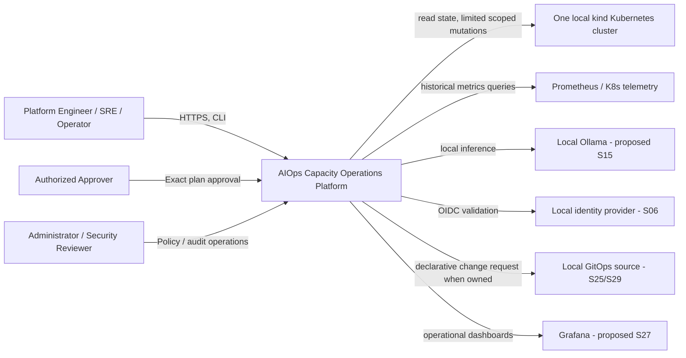
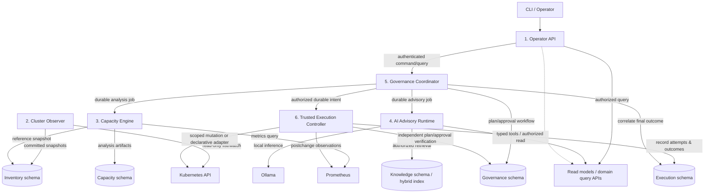
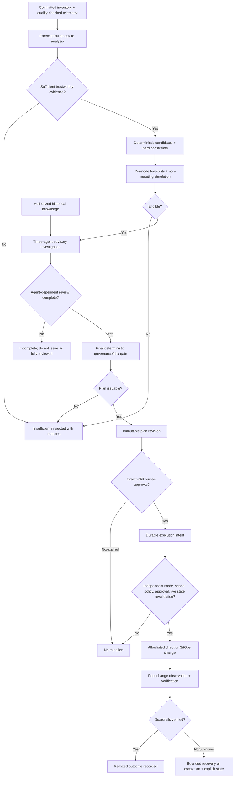
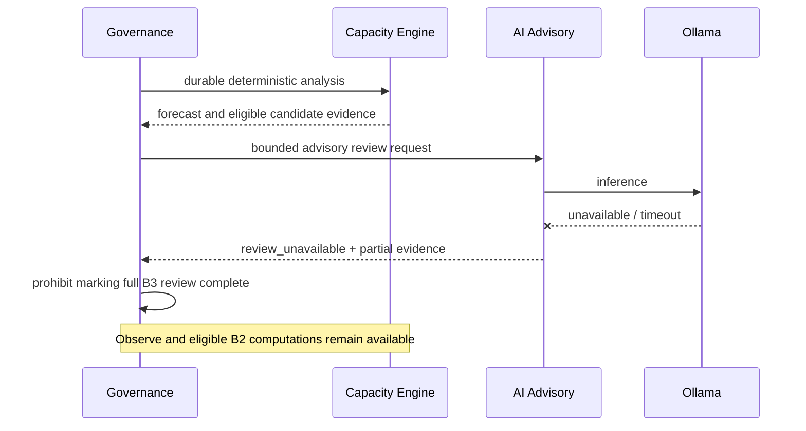

# S02 — System Architecture & Component Contracts

> **Approval record (2026-11-16):** The project owner explicitly chose **all recommended S02 options** from the preceding S02 design discussion. Accepted: **Option B hybrid modular distributed control plane; six separately deployed custom platform roles; a modular monorepo and versioned shared contracts; synchronous REST for immediate commands/queries combined with PostgreSQL-backed durable asynchronous jobs; no mandatory message broker in P0; one PostgreSQL instance with distinct logical schema owners and least-privilege access; a single AI Advisory Runtime containing the three logical agents; a separate Governance Coordinator and a separately privileged Trusted Execution Controller; immutable evidence/plan identity, traceable typed boundaries, graceful AI failure isolation, and four principal logical trust zones.** These are accepted **architecture decisions**, not proof that code has been implemented or runtime tests have passed. Technical choices explicitly delegated to later slices remain open.

## 0. Document contract, precedence, and design status

**Purpose.** Establish the S02 reference architecture for a fully local, production-inspired Kubernetes capacity operations platform. Define component/module boundaries, deployables, communications, data ownership, contract principles, trust boundaries, resilience semantics, deployment dependencies, acceptance cases, ADRs, and handoffs.

**Authority and precedence.** Read this document together with the **Master Specification Catalog v1.0.0** (32-slice roadmap and cross-cutting invariants) and **accepted S01 v1.0.0** (product scope, safety and operational model). This document is authoritative for S02 only. It does not silently supersede S01. Future slices may refine implementation details within these boundaries; material changes to accepted S02 architecture require a superseding ADR and traceability update.

**Decision terminology.** `Accepted` = explicitly approved by owner; `Required upstream` = binding S01/catalog invariant; `Reference contract` = S02 architectural rule whose definitive field-level implementation is delegated; `Open downstream` = intentionally unresolved technical implementation decision; `Deferred` = not required in P0.

**Traceability IDs.** `S02-FR-###`, `S02-NFR-###`, `S02-SEC-###`, `S02-TEST-###`, `S02-ADR-###`. Existing S01 IDs keep their meanings. In examples, names, paths, values and timings are **illustrative** unless labeled accepted.

**Design status:** Accepted S02 architecture baseline / ready to guide S03 and parallel security/data slice design. **Not** a fully validated implementation-ready contract set for every downstream slice. Final schemas, authorization policies, SLO values and algorithm behavior must be specified and tested in their owning slices.

---

## 1. Architectural drivers and non-negotiable invariants

### 1.1 Accepted operational context

- Exactly **one bounded local multi-node kind cluster**, developed on Windows 11 + Docker Desktop + WSL2. Node count, pod distribution, CNI, storage and memory budgets belong to S03.
- A **small mixed-language demo workload ecosystem**: .NET 10 HTTP APIs and Python resource-stressing worker/batch jobs; workload details S04 and scenario orchestration S05.
- Five product capabilities: **Observe → Predict → Optimize → Govern → Act & Verify**. These capabilities are **not one-microservice-per-stage mandates**.
- Hierarchical analysis at **container/workload, namespace/group, and node/cluster** levels.
- Workload criticality: **Critical, Standard, Flexible, Opportunistic**, explicitly configured, *not* synonymous with Kubernetes PriorityClass.
- Decision horizons: **immediate/current state; 1 hour; 24 hours**. An unavailable forecast must declare insufficient evidence.
- Modes: **Observe** (read-only), **Advisory** (recommendations without mutations), **Governed** (only explicitly approved bounded mutations). L0–L2 only; L3 deferred.
- Hard policy/safety/placement gates precede ranking. Human approval is **specific to an immutable plan revision**; execution revalidates current target state and authority.
- LLM/RAG are advisory and can fail without disabling core read-only/deterministic analysis.
- Distinguish **allocatable / requests / limits / observed / historical / forecast / simulated / realized** capacity concepts in every interface; distinguish projected savings from actual measured improvements and avoid cloud cost claims without an explicitly hypothetical model.
- Benchmarks B0 static, B1 rule/VPA recommendation-only, B2 deterministic-only, B3 deterministic plus grounded agents; measure AI's *marginal* contribution, not benefits already delivered by B2.

### 1.2 Quality attribute priority

1. **Mutation safety and authorization integrity** above availability or efficiency.
2. **Traceability and evidence provenance** from Kubernetes state through outcome verification.
3. **Fault isolation**: AI/LLM failures cannot cascade into observer/forecast failure.
4. **Recoverability** of approvals, execution attempts, and incomplete outcomes across process restarts.
5. **Local resource economy**: minimal mandatory infrastructure, bounded concurrency and resource use.
6. **Determinism and testability** of numeric engines and hard policy gates.
7. **Operator usability** through API/CLI/Grafana, without a dedicated custom frontend.

### 1.3 Explicit S02 non-goals

No multi-cluster fleet manager; cloud node provisioning; replacement scheduler; L3 automatic mutation; broad shell access; unrestricted eviction; GPU placement; mandatory MLflow/Kubeflow/feature-store infrastructure; service mesh prerequisite; detailed forecasting formulas, IAM matrices, Kubernetes manifest layouts, specific numeric SLOs or final public OpenAPI schemas in S02.

---

## 2. Architecture options and accepted decision

| Alternative | Benefits | Limitations | Decision |
|---|---|---|---|
| **A. Modular monolith + isolated executor** | Lowest process overhead, easier local debugging | AI/forecast/API share resources and failure modes unless extra process isolation introduced | Not selected |
| **B. Hybrid modular distributed control plane** | Trust/failure/resource boundaries without one service per module; realistic durable operations | Requires explicit contracts, service identity, job persistence and recovery | **Accepted** |
| **C. Fine-grained microservices** | Independent scaling and deployment of every capability | High operational, distributed transaction and local resource cost for a single lab | Not selected |

**Accepted architecture:** Six logically owned custom deployment roles, implemented as separate running processes/Deployments; internal modules remain cohesive. A shared modular monorepo is allowed. Shared library or image does not imply shared identity, data write permission or runtime trust. **Do not merge the Operator API and Governance Coordinator without an explicit superseding S02 ADR.** A possible later optimization is not an accepted change to the six-role baseline.

---

## 3. System context and C4-style views

### 3.1 Level 1 — System context



The system manages its *demonstration workloads* on the same accepted cluster, but treats the workload namespace/identity and platform identity as different security scopes. Whether Ollama runs on the host or inside the cluster remains S03/S15.

### 3.2 Level 2 — Container/deployment view



**Diagram constraint:** Arrows mean *authorized logical interactions*, not direct SQL or unrestricted network rights. All reads/writes must respect the ownership matrix; a domain query API may be an internal endpoint or narrowly granted read model/projection. The DB cylinders may reside on **one PostgreSQL server** with distinct roles/schemas.

### 3.3 Level 3 — Major modules per deployment

| Deployable | Modules within deployment | Explicitly excluded responsibilities |
|---|---|---|
| **Operator API** | HTTP endpoints; request validation; identity validation integration; permission checks; query aggregation; correlation; API error mapping | Numeric calculations, unbounded inference, authoritative plan mutation, Kubernetes write credentials |
| **Cluster Observer** | Cluster list/watch adapters; resource identity graph; snapshot assembly; configuration diff; freshness/consistency scoring | Approvals, right-sizing decision authority, Kubernetes mutation |
| **Capacity Engine** | Evidence validation; forecasting; deterministic risk; candidate generation; policy prechecks; placement/fragmentation; simulation; scoring of *eligible* results | Final human approval, agent reasoning as numerical authority, Kubernetes mutation |
| **AI Advisory Runtime** | Microsoft Agent Framework integration candidate (S16); Capacity Analyst, Optimization Planner, Risk Reviewer; tool broker; context assembly; retrieval and citation processing | Approval authority, arbitrary shell, privileged kube credentials, bypassing policy |
| **Governance Coordinator** | Plan/revision service; deterministic final gate; review status; approval registry; workflow/job orchestrator; mode enforcement; outbox; audit coordination | Direct Kubernetes mutations; writing execution attempt facts on behalf of controller |
| **Trusted Execution Controller** | Independent authorization/precondition evaluator; execution intent claiming; direct Kubernetes adapter; GitOps adapter; idempotency/reconciliation; verification coordination; bounded recovery | Issuing or granting approvals; interpreting LLM text as commands; unrestricted cluster credentials |

**Placement choice:** Six **separate processes and separate custom Deployment workloads** in the P0 reference topology; actual replicas and pod placement S03/S28. Capacity computation may additionally launch bounded Jobs later if warranted, but that does not change the six ownership roles. A process can contain many deterministic functions; a logical agent is not necessarily a Deployment.

### 3.4 Code vs runtime boundaries

- One modular monorepo with independently testable packages, clear dependency direction, and potentially common base image or build pipeline.
- Package sharing allowed for **versioned schemas, stable value objects, tracing and error envelopes**.
- No shared import of privileged executor operation logic into AI/analysis/API processes.
- No shared writable ORM models/repositories across schema boundaries. Cross-module operations go through owned ports/contracts.
- Domain models remain owned by their modules; prevent `shared_kernel` from becoming a large implicit distributed monolith.

---

## 4. Deployables, ownership and trust identity inventory

| ID | Deployable | Kubernetes workload (initial) | Runtime profile | K8s API access | Data-write ownership | Key upstream dependencies |
|---|---|---|---|---|---|---|
| `api` | Operator API | Deployment | Low-latency, stateless | **None** required for normal path | No authoritative domain writes; owns only API-specific ephemeral/read-model state if needed | Identity, domain query APIs, Governance |
| `observer` | Cluster Observer | Deployment | Periodic/watch, modest steady state | **Read-only** scoped list/watch/get | `inventory` | Kubernetes API, PostgreSQL |
| `capacity` | Capacity Engine | Deployment worker | Bounded CPU-intensive async jobs | **None** in normal engine; consumes snapshots | `capacity` | inventory, metrics query, PostgreSQL |
| `ai` | AI Advisory Runtime | Deployment | High latency, strict inference concurrency | **None** | `knowledge` for retrieval data via owned repository; advisory artifact ownership defined below | Ollama, tool broker, authorized evidence APIs |
| `governance` | Governance Coordinator | Deployment | Durable stateful control workflow | **None** | `governance`, owned workflow records, outbox | DB, API, Capacity, AI |
| `executor` | Trusted Execution Controller | Deployment | Low concurrency, safety-critical | **Scoped write** plus minimum read | `execution` | Gov authoritative state, target API, metrics and GitOps adapter |

**Database nuance:** The AI runtime should not be presumed to own arbitrary ingestion data. Under this S02 baseline, `knowledge` is a **logical Knowledge domain**; S18 may provide an in-process ingestion worker within `ai` or a distinct library/Job run by that owner, without adding another permanent Deployment. Advisory review records are written by the **AI domain** (separate table under `knowledge` or a dedicated AI-owned schema selected in S13/S18). Governance owns acceptance and plan-state linkage; it does not rewrite AI findings.

**Security nuance:** An API principal who can approve a plan does not automatically receive execution permissions. An internal caller's network reachability does not imply authorization. The executor independently checks authentic plan/approval records and current rules.

---

## 5. Communication decisions and interaction matrix

### 5.1 Selected communication style

- **HTTPS REST** for operator queries, immediate commands, and bounded authenticated internal query/command endpoints.
- **PostgreSQL-backed durable asynchronous jobs** for CPU-intensive analysis, advisory inference, and long-running workflows. No mandatory RabbitMQ/Kafka in P0.
- **Domain events as durable facts** with transactional outbox where necessary; no requirement to publish every fact on an external bus.
- **Direct read-only PromQL HTTP queries** for time-series windows, with typed result conversion, timeouts, freshness and source metadata.
- **Kubernetes list/watch** for inventory; only the executor has scoped mutation access.
- **Typed in-process tool invocation** for agents through an authorization-aware broker; outside service calls are separately checked.

### 5.2 Communication ownership matrix

| Source → destination | Interaction | Synchronous / durable | Trust conditions | Failure outcome |
|---|---|---|---|---|
| CLI → API | OIDC-protected query/command | Sync REST | Human role + scope | Explicit 4xx/5xx; no hidden action |
| API → Governance | Plan, approval, execution-request commands | Sync authenticated internal REST | User identity context + machine identity; Governance independently authorizes | Command fails or returns durable accepted job; never bypass policy |
| API → inventory/capacity/AI read models | Queries | Sync REST or owned projection | Resource scope, authorization, paging | Partial/temporarily unavailable data clearly labeled |
| Observer → Kubernetes | List/watch/get | Long-running read-only | Dedicated ServiceAccount, limited API verbs | Last snapshot stale; no manufactured current state |
| Observer → inventory store | Snapshot commit | DB transaction | Single writer, provenance | No partly committed snapshot advertised |
| Governance → Capacity | `RunAnalysis` job | Durable async | Typed scope, snapshot/policy references | Retry bounded or terminal failure |
| Capacity → Prometheus | Bounded metrics query | Sync HTTP | Query allowlists, cardinality/time bounds | Insufficient evidence or degraded result |
| Governance → AI | `ReviewPlan` job | Durable async | Typed read-only context, no privileged tokens | Review unavailable/incomplete; not falsely completed |
| AI → tool broker | Grounded evidence retrieval/simulation requests | Typed calls | Per-tool allowlist, inherited principal/scope, data budgets | Partial/denied tool results; no authority escalation |
| AI → Ollama | Model inference | Sync bounded | Local endpoint ACL, token/time budgets, redaction | Explicit failure; deterministic core unaffected |
| AI → knowledge | Metadata filtered retrieval | Authorized domain API | Namespace, time, source trust, principal scope | Empty/unavailable explicitly reported |
| Governance → Executor | `ExecuteApprovedPlan` intent | **Durable async**, not arbitrary public endpoint | Plan/authentic approval/version/mode + independent executor checks | Rejected, pending, or recoverable; never unsafe implicit retry |
| Executor → Kubernetes / GitOps | Allowed change | Controlled API/adapter | Dedicated identity, ownership and live resource preconditions | Reconcile unknown outcome prior to retry |
| Executor → outcome store | Attempts, verification, recovery | DB transaction | Single-writer execution facts | Recovery on restart; unknown outcome visible |

### 5.3 Why no mandatory message broker

The number of expected local workflows is small and most work is command-oriented with durable DB state. A broker would introduce another server, operational maintenance and possible divergence between plan state and message state. It is not necessary for P0 correctness. **A future broker is an explicit ADR change**, triggered by demonstrated queue volume, independent fan-out, retention needs or operational constraints. Migrating should preserve idempotency, ownership, outbox and security semantics.

### 5.4 Durable job lifecycle (reference contract)

States: `queued → leased → running → completed | failed | cancelled | timed_out`; a lease may expire and become re-claimable only after safe recovery rules. Define bounded `attempt`, `max_attempts`, `lease_expires_at`, `next_visible_at`, `created_at`, `correlation_id`, `idempotency_key`, `payload_digest`, `schema_version`. Separate **job state** from **plan state**, **approval state** and **execution state**. PostgreSQL row locking/`FOR UPDATE SKIP LOCKED` may implement claiming, with transactional lease transitions and resource budgets. This is a reference pattern; final SQL schema and failure semantics S13/S24/S25.

**Critical safety rule:** A durable job system normally provides *at-least-once processing*, not exactly-once external effects. On restart, executor must re-read Kubernetes/Git state and reconcile the record before attempting any further write. An expired lease does **not** itself grant re-execution authority.

### 5.5 API availability and backpressure

- Return job handles for long-running work; do not block API request threads on Ollama or extended computation.
- Reject or queue requests above explicit concurrent work limits; do not silently overcommit local resources.
- Use bounded timeouts, deadlines, exponential backoff with jitter for safe read-only operations; mutating retries require executor-specific reconciliation.
- No cross-service transaction assumed; use transactional outbox/compensating or explicit recovery states where work spans boundaries.
- User-facing availability must not be confused with authority: `202 Accepted` means an operation was durably accepted for processing, **not** that a plan was approved or Kubernetes state changed.

---

## 6. API, event, tool and artifact contract conventions

### 6.1 Four interface categories

1. **Query** — read state/evidence without authoritative mutation.
2. **Command** — requests an operation; acceptance does not imply success.
3. **Domain event** — durable record that a state transition/fact occurred, not an authorization capability.
4. **Artifact** — immutable evidence/analysis result with referenceable identity, origin and method metadata.

External API details (resource names, HTTP status catalog, exact field schemas) are S27's responsibility. The following are S02 **reference resources**, not final normative endpoint names.

| Resource category | Illustrative API | Owner | Access class |
|---|---|---|---|
| Inventory | `GET /api/v1/inventory/workloads` | Observer read interface | Scoped read |
| Snapshot | `GET /api/v1/snapshots/{snapshot_id}` | Observer | Scoped read |
| Forecast jobs/results | `POST /api/v1/forecasts/jobs`; `GET /api/v1/forecasts/{forecast_id}` | Capacity | Authorized analysis/read |
| Optimization analysis | `POST /api/v1/analyses`; `GET /api/v1/analyses/{analysis_id}` | Capacity | Authorized analysis/read |
| Candidate plan | `GET /api/v1/plans/{plan_id}` | Governance | Scoped read |
| Advisory review | `POST /api/v1/plans/{id}/reviews` | Governance coordinating AI | Authorized advisory request |
| Approval | `POST /api/v1/plans/{id}/approvals` | Governance | Explicit human role, exact plan revision |
| Execution request | `POST /api/v1/plans/{id}/executions` | Governance, routed to executor | Governed only, distinct authorization |
| Execution status | `GET /api/v1/executions/{execution_id}` | Executor read model | Scoped read |
| Platform capabilities | `GET /api/v1/capabilities` | API/Governance | Role-aware status |

### 6.2 Common artifact envelope (reference)

```json
{
  "schema_version": "1.0",
  "artifact_id": "analysis-001",
  "artifact_type": "capacity.analysis",
  "cluster_id": "local-kind",
  "scope": { "namespace": "demo-standard", "workload_id": "deployment/demo-api" },
  "snapshot_id": "snapshot-042",
  "observed_at": "2026-11-16T08:00:00Z",
  "evaluated_at": "2026-11-16T08:05:00Z",
  "evidence": {
    "quality": "sufficient",
    "references": ["evidence-101"],
    "source_type": "live_observation"
  },
  "producer": { "component": "capacity-engine", "version": "0.1.0" },
  "correlation_id": "correlation-001"
}
```

**All example values are fictional.** Contract fields and enum vocabularies must be finalized in S11–S14/S13. Model output must *not* be allowed to replace authoritative envelope provenance. Observed timestamp, computed timestamp, source freshness, policy version and current target resource version represent different things.

### 6.3 Typed analysis artifacts

| Artifact | Required conceptual fields | Authoritative producer |
|---|---|---|
| `InventorySnapshot` | cluster identity, capture window, objects/owner identities, object resource versions, allocatable/requests/limits, consistency/freshness, revision/digest | Observer |
| `EvidenceWindow` | metric expression/template/version, series identifiers, start/end/granularity, source and quality, missingness, observed-vs-synthetic label | Evidence layer/Capacity |
| `ForecastResult` | target, horizon (current/1h/24h), input window, estimator/version, uncertainty interval/representation, sufficiency status, provenance | Capacity |
| `CandidateEvaluation` | target, exact before/after proposed fields, policy snapshot, hard rejection reasons, feasibility outcome, expected benefit **basis**, simulation assumptions | Capacity |
| `AdvisoryReview` | agent role/version, typed claims, evidence IDs, uncertainties, missing context, tool trace digest, conclusion advisory-only | AI |
| `PlanRevision` | plan ID + revision, canonical digest, target owner/UID/version, exact allowed action, config delta, simulation, policy version, review state, expiry & verification/recovery intent | Governance |
| `ApprovalRecord` | authentic approver identity/scope, exact revision/digest, target & action, policy binding, validity window, decision and audit link | Governance |
| `ExecutionIntent` | exact approved plan reference, unique idempotency key, execution request authority, current mode/policy preconditions, request provenance | Governance |
| `ExecutionAttempt` | attempt ID, target precondition read, adapter, operation result, reconciliation state, status/error/audit IDs | Executor |
| `OutcomeRecord` | actual observed before/after measurements, verification window, SLO result, realized benefit, recovery or unknown status | Executor / verification owner |

**No universal `capacity` numeric value**: quantities must record resource (`cpu`, `memory`), unit, basis (`allocatable`, `requested`, `limited`, `observed`, `forecasted`, `simulated`, `realized`), time/context and target. CPU `m` and memory bytes/IEC units are not interchangeable; conversion rules are detailed downstream.

### 6.4 Proposed domain event catalog

| Event name | Publisher/owner | Intended consumption | Critical semantic guard |
|---|---|---|---|
| `InventorySnapshotCommitted` | Observer | Capacity scheduling / diagnostics | Snapshot may be current only within declared freshness |
| `ForecastCompleted` | Capacity | Analysis consumers | Numerical result is **not** policy clearance |
| `ForecastInsufficient` | Capacity | Operator/Governance | No fabricated confident forecast |
| `CandidateEvaluationCompleted` | Capacity | Governance | Includes rejected candidates and reasons |
| `AdvisoryReviewCompleted` | AI | Governance | Advice, not approval or action |
| `AdvisoryReviewUnavailable` | AI | Governance | Cannot present full agent review as completed |
| `PlanRevisionIssued` | Governance | API/audit | Immutable identity, not automatically approved |
| `PlanApproved` / `PlanRejected` | Governance | API/audit | Event is historical fact, **not** executable command |
| `ExecutionRequested` | Governance | Executor | Must independently validate current authorization/state |
| `ExecutionRefused` | Executor | Governance/operator | Preserve refusal reason, no mutation |
| `ExecutionApplied` | Executor | Verifier/Governance | API write is not verified success |
| `VerificationCompleted` | Executor/Verifier | Governance/outcome/benchmark | Record successful, failed, partial or unknown observations |
| `RecoveryEscalated` | Executor | Operator/audit | Never report unverified recovery success |

**Delivery conventions:** versioned serialized event envelope, event ID, producer and creation timestamp, causation/correlation ID, actor/machine principal reference where relevant, aggregate ID and revision, typed payload schema and digest. Consumers deduplicate event IDs; event order is meaningful **within a plan or execution aggregate**, not guaranteed globally. Durable outbox write must commit atomically with the owning domain transition. Events can be consumed via polling until a broker is justified.

### 6.5 Agent tool contracts

All agent tools go through a typed broker and use only allowlisted evidence-facing capabilities, provisionally:

- `get_inventory_snapshot(scope, snapshot_id)`
- `query_telemetry(metric_profile, window, scope)`
- `get_forecast(forecast_id)`
- `get_candidate_evaluation(candidate_id)`
- `search_operational_knowledge(query, time_filter, namespace_scope)`
- `request_bounded_simulation(candidate_ref, scenario_ref)` — **only** a non-mutating deterministic simulation job
- `get_policy_explanation(policy_ref)` — read-only explanation, not policy modification

Tool responses must include source/evidence references, policy/retrieval filters, freshness, output size and authorization status. Forbidden tool categories: generic `kubectl` shell, arbitrary HTTP to cluster endpoints, token/secret retrieval, approval creation, plan mutation, execution, Kubernetes mutation. Actual names/schema and security test cases belong to S09/S17.

### 6.6 API/version compatibility

- `/api/v1` is a reference convention, final routes S27.
- Version persistent events/artifacts explicitly (major incompatibility never silently coerced across security-critical fields).
- Prefer additive field evolution where safe; unknown security-sensitive enum or action type is rejected.
- Durable historical artifacts must remain interpretable for audit and replay using stored producer/model/policy/config version/digests.
- Plan revisions are immutable. Edits result in a *new revision*, invalidate prior revision-specific approvals as appropriate, and require fresh governance checks.
- All externally supplied identifiers, owner references and scopes are validated against authoritative sources; no trust in agent- or user-authored descriptive labels.

---

## 7. Persistence and information ownership

### 7.1 Accepted storage pattern

**One PostgreSQL instance**, with independently owned schemas and database roles. **Prometheus remains the time-series source**; Kubernetes API is authoritative for live cluster desired/observed state; a GitOps repo is authoritative desired source when applicable. PostgreSQL + pgvector is selected **as the S02 reference architecture**, while S13/S18 retain responsibility for exact tables, indexes, vector/retrieval choices and retention. Selection of a database topology here does not imply every proposed additional infrastructure tool in S01 is now accepted.

| Logical domain owner | Schema (reference name) | Write authority | Examples | Who may read |
|---|---|---|---|---|
| Observer / Inventory | `inventory` | Observer service role | Immutable snapshots, resource identity mapping, configuration evidence | Scoped API/Capacity/Governance/Executor via owned interface or read projection |
| Capacity | `capacity` | Capacity service role | Forecasts, quality flags, candidates, simulations, baseline evaluations | API/Governance/AI through authorized read ports |
| Knowledge & Advisory | `knowledge` | Knowledge/AI domain role | Documents, chunks, source metadata, embeddings, retrieval indexes, completed advisory artifacts | AI broker; Governance/Operator via scoped read API |
| Governance | `governance` | Governance service role | Plan revisions, approvals, review status, exact execution intents, aggregate workflow history | Executor read-only trusted interface; API scoped query |
| Execution | `execution` | Executor role | Claims, attempts, reconciliation, verified/unknown outcomes, recovery details | Governance/API through read APIs/projections |
| Audit | `audit` | Limited append path via authorized domain adapters | Attributable, integrity-linked lifecycle and security audit facts | Auditor/security read views; no arbitrary update |
| Workflow infrastructure | `workflow` | Owner-scoped worker/job roles | Job scheduling, leases, outbox/inbox, delivery, bounded retry records | Only owner service/process and permitted infrastructure adapters |

**One writer per authoritative aggregate**, not necessarily one physical database transaction across all domains. Prefer schema-specific DB credentials with no routine cross-schema writes. Under a single instance, privileged database administrator compromise remains within one host's threat boundary; audit immutability needs independent controls, not merely a SQL convention (S08/S24).

### 7.2 Data lifecycle and source of truth

| Data | Authority | S02 preservation rule |
|---|---|---|
| Live object spec, UID, `resourceVersion`, ownership, scheduling status | Kubernetes API | Snapshot provenance, reload before mutation; do not treat stale cache as executable precondition |
| Historical CPU/memory/app latency/evictions | Prometheus and approved telemetry providers | Store query refs and quality/window, not redundant raw series by default |
| Forecast numerical predictions | Capacity Engine | Persist input & method digests, uncertainty and insufficiency |
| Hypothetical placement and candidate benefits | Capacity Engine | Label simulated, never report as realized |
| Runbooks, incidents, operational history | Knowledge ingestion sources | Preserve origin, time, access scope and untrusted/evidence classification |
| Operational plan and approval | Governance | Exact immutable revision/approval binding and audit |
| Applied mutation/actual outcome | Executor | State reconciliation, observed-vs-intended status and verification evidence |
| GitOps-managed desired configuration | Declarative repository/controller | Executor cannot silently undermine ownership; adapter behavior S25 |

### 7.3 Immutable snapshot and analysis manifest

Analysis inputs must be replayable enough for local experiment comparison. Proposed `AnalysisInputManifest` references:

1. Cluster ID, captured inventory snapshot ID/digest, resource UIDs/versions relevant to workload and node fit.
2. Telemetry source, query template/version, time window/resolution, data quality and missingness.
3. Workload criticality and configured SLO/headroom/disruption policy snapshot/version.
4. Forecast/model code and configuration version; requested horizon; uncertainty metadata.
5. Scenario seed/config and synthetic-vs-observed label.
6. Analysis algorithm/version, simulation limitations and output digests.
7. Correlation, actor, producer and generation timestamps.

A Kubernetes/Prometheus composite snapshot is **not atomic across systems**. Declare the temporal skew and consistency limitations. A snapshot checksum supports reproducibility and tamper detection, **not** a guarantee that current target state is unchanged. Executor revalidation is mandatory.

### 7.4 Transaction and consistency boundaries

- A domain operation writes its authoritative aggregate and corresponding outbox event in **one local PostgreSQL transaction**.
- Cross-domain workflows use persisted commands, events and reconciliation; do not imply a global distributed transaction.
- The `PlanApproved` state is committed only after authoritative identity, scope, exact plan revision/digest, time-bound approval and policy checks.
- Execution attempts and Kubernetes external writes **cannot** be made atomic with PostgreSQL commits. Store intent first, apply with preconditions, and reconcile subsequent actual state.
- Historical and operational read models may be eventually consistent; an executor cannot use an eventually consistent query cache as the sole proof of current authorization.

### 7.5 Retention, migrations, backup

Schema migration ownership per domain; versioned migration compatibility; retention tiers and physical backup method S08/S13/S28. Approval/execution/audit evidence must outlive active jobs for the eventual S28-defined retention period. Disabling or losing RAG ingestion must not delete authoritative plan or approval records. Do not store secrets in prompt transcripts, analytics, RAG chunks or trace/audit payloads.

---

## 8. Governance, approval, execution and verification

### 8.1 Separation of authorities

- **Capacity** owns calculations and *eligibility evidence*, not approval.
- **AI** owns advisory findings, not safety policy, numerical forecast, approval or execution.
- **Governance** owns exact plan revisions, final deterministic gating, mode control and approval records, not cluster writes.
- **Executor** owns independently validated, scoped mutation attempts, reconciliation and outcome facts, not issuing plan approvals.
- **Human approver** must be authenticated and authorized for the target/action; future S06/S24 define full separation-of-duties rules.

### 8.2 Product workflow



The incomplete-review branch is not automatically an executable plan. S24 defines exact handling of draft and degraded findings. Deterministic-only B2 analysis must remain independently useful, but if an operator claims a completed B3 three-agent review, all required agent roles must have valid outcomes.

### 8.3 Approval binding (architectural minimum)

An approval must bind: canonical plan ID/revision/digest, targets (cluster/namespace/resource owner UID and identity), bounded action and before/after desired configuration, evidence and policy versions, allowed actor/scope, issue/expiry time, expected preconditions, and verification/recovery intent. Revision or scope changes invalidate the old approval for that new content. The Executor independently verifies authoritative approval and *live* target state. Detailed cryptographic and concurrency semantics S24/S25.

### 8.4 Mutation preconditions and GitOps ownership

- Globally deny mutation outside `Governed`, regardless of UI, approval cache or request path.
- Deny mutation if caller, approved plan, target, current mode, policy or resource state is stale/invalid/unauthorized.
- Enforce allowlisted resource types, fields and action classes; **no arbitrary shell command**.
- Detect GitOps ownership before mutation; use a reviewed declarative change path or refuse (S25). A GitOps change request is not proof of reconciliation or outcome success.
- Use Kubernetes optimistic concurrency/current version preconditions where appropriate; actual scheduling/rollout still requires verification.
- Recovery may only operate within approved and policy-defined boundaries, else escalate. An executor restart is never an excuse for broad unrestricted rollback.

### 8.5 Execution status semantics

Keep distinct states for `requested`, `awaiting_revalidation`, `refused`, `in_progress`, `applied_pending_verification`, `verified_success`, `verification_failed`, `partial`, `unknown`, `recovery_in_progress`, `recovered`, `escalated`. Final enums and legal transitions S25/S26. “Kubernetes API returned success” corresponds at most to **applied_pending_verification**.

---

## 9. Trust boundaries, identity and security

### 9.1 Four accepted logical trust zones

| Zone | Participants | Trust classification | Enforcement principle |
|---|---|---|---|
| **A. Operator access** | CLI/API/Grafana, human identities | External-facing, authenticated but not automatically authorized | Independent per action/resource authorization |
| **B. Deterministic intelligence and governance** | Observer, Capacity, Governance (distinct internal rights) | Trusted code; service-specific scopes | Read-only credentials except protected governance DB writes; machine identity and bounded interfaces |
| **C. AI/retrieved evidence** | Three logical agents, Ollama, knowledge retrieval, tool data | Model/retrieved text/tool responses may be untrusted | Typed allowlisted tools, scope-bound read access, no privileged mutation path |
| **D. Privileged execution** | Executor + scoped direct/GitOps adapters | Highest-impact bounded operations | Distinct identity, independently verified exact authorization and live state |

These are **logical** zones, not an assertion of finalized Kubernetes namespaces; S03/S07 establish physical networking, admission and RBAC. Shared database or host infrastructure does not collapse the zones.

### 9.2 Mandatory trust rules

- Authenticated service identity and action/resource authorization for protected internal APIs; authenticated CLI/human principals for protected operator actions.
- AI Runtime has **no** privileged Kubernetes token, executor DB writer credential, approval-issuer authority or unrestricted shell/HTTP tool.
- Observer has limited list/get/watch; API/Capacity/Governance do not inherit observer or executor Kubernetes credentials.
- A `PlanApproved` event is **evidence**, not a bearer authorization granting mutation. Executor retrieves and verifies authoritative plan/approval state and freshness.
- DB owner roles restricted by schema, with particularly sensitive approval and execution/audit writes separated.
- Model output, runbook content, telemetry string fields and retrieved documents are **data**, never machine-enforced policy or executable instructions.
- Secret redaction and token exclusion from LLM prompts, knowledge store, logs, artifacts and audit payloads.
- Mode enforcement in Governance **and** Executor; RBAC, policy and admission defenses independent of prompt wording.
- Negative access-path tests for any role that might read or write a protected target.

### 9.3 Threat-to-control mapping

| Threat | Boundary/control | Test owner |
|---|---|---|
| Prompt injection in incident/runbook | Evidence vs instruction separation; typed tools; no mutation tool | S09/S17, S02-TEST-002 |
| Agent fabricates numerical forecast | Only Capacity-signed/versioned forecast artifact accepted by gate | S14/S24 |
| User alters approved plan payload | Canonical revision/digest binding + authoritative lookup | S24/S25 |
| API service compromised | No K8s write creds; no approval DB write; service-specific auth | S06/S07/S02-TEST-003 |
| Replay of execution intent | Idempotency key, owner leases, actual-state reconciliation | S25/S02-TEST-006 |
| DB role crosses schema | GRANT boundary and negative DB permission tests | S08/S13/S02-TEST-007 |
| GitOps controller reverts direct patch | Ownership detection, declarative adapter or rejection | S25 |
| Stale metrics/snapshot | Quality/freshness refusal + live preflight target checks | S11–S14/S25 |
| Insider/admin edits audit DB | Append-only design with integrity verification and separately controlled admin/backups | S08/S24/S28 |

---

## 10. Resilience, failure semantics and local resource protection

| Dependency/failure | Observer | Capacity | AI Advisory | Governance | Executor | Expected operator result |
|---|---|---|---|---|---|---|
| Ollama unavailable | Continues | Continues | Explicit unavailable/incomplete | Cannot label B3 review complete | Existing valid execution still subject to unchanged policy/approval; no AI bypass | Observe/B2 useful; B3 degraded |
| Knowledge/RAG unavailable | Continues | Continues | Explicit missing historical context | Conservative gate / incomplete if required | No policy relaxation | Clear missing evidence |
| Prometheus unavailable | Inventory possible | Insufficient/stale metrics → refuse unsafe claims | May view only authorized existing evidence | No fresh untrustworthy plan finalization | Verification may remain unknown | No fabricated success |
| Kubernetes API unavailable | Snapshot stale | Historical analysis may remain available with freshness flags | Read-only past context possible | Cannot assume fresh execution preconditions | No mutation; reconcile later | Unavailable/current-state unknown |
| PostgreSQL unavailable | May read K8s but cannot commit authoritative snapshot | No durable new result | No durable review | Fail closed on plans/approvals | No new verifiable authorized intent; no mutation | Critical workflow unavailable, not unsafe |
| Capacity worker crash | Unaffected | Recover/retry safe job with bounds | No direct dependency on live process for saved artifacts | Durable state preserved | Unaffected | Retry/failed job visible |
| Governance restart | Unaffected | Queued/running jobs recover by owner | Review jobs recover by owner | Reload state/leases/outbox | Independent authoritative validation | No false approval progression |
| Executor crash during change | Unaffected | Unaffected | Unaffected | Await execution facts | Re-read live actual state; reconcile before write/retry | Pending/partial/unknown explicit |
| Verification evidence missing | Unaffected | Evidence may be incomplete | No authority change | Outcome cannot finalize successful | Pending/unknown/escalation | Never success without proof |
| Queue overload/LLM slow | Collector protected | Bounded jobs | Concurrency/token budgets | Backpressure with explicit status | Low separate concurrency | No starving monitoring/execution |

### 10.1 Process and dependency health

Liveness assesses process health, readiness accounts for critical owned dependencies; do **not** make every component globally unready merely because Ollama is down. API can expose `capabilities` and partial availability separately from core health. Metrics freshness and analysis eligibility must not be inferred from HTTP 200. Define concrete readiness/alert thresholds in S28 and measured resource caps in S03/S15.

### 10.2 Recovery requirements

- Durable job claim/reclaim, bounded retry policy, poison-job handling and cancellation/expiry rules.
- Reconciliation of incomplete plan/execution state on each Governance/Executor restart.
- Attributable and durable records for `unknown` or `partial` states; no silent pending forever.
- Recovery and rollback are separate privileged operations bounded by authorization/policy; escalation if preconditions cannot be re-established.
- No unbounded requests, result pagination, prompts or tool loops, especially under resource-constrained local inference.

### 10.3 Local deployment considerations

- The six custom roles may share repository/build layers but retain independent Deployment, service identity, health and resource settings.
- External infrastructure services **are not included in the six**: PostgreSQL, Prometheus, Grafana, identity provider, Ollama, telemetry exporters, GitOps components and demo workloads.
- Initial replica count can be one per custom role; exact HA not implied on one local workstation. Restart durability is required; availability and failover S28.
- Bound forecast workers, AI inference concurrency, evidence query cardinality, job backlog and test workload scenarios. Avoid mandatory full-time model inference in Observe mode.
- Scheduled or conditional analysis triggers must obey the current operating mode and resource budget; only explicitly approved plans mutate.

---

## 11. Workflows and detailed sequence views

### 11.1 Safe CPU request optimization

```mermaid
sequenceDiagram
    actor U as Operator
    participant API as Operator API
    participant OBS as Cluster Observer
    participant CAP as Capacity Engine
    participant AI as AI Advisory
    participant GOV as Governance
    participant EX as Executor
    participant K as Kubernetes
    OBS->>K: list/watch state (read-only)
    OBS-->>CAP: committed inventory snapshot reference
    U->>API: request bounded analysis
    API->>GOV: authorized analysis command
    GOV->>CAP: durable analysis job
    CAP-->>GOV: forecast + candidates + feasibility artifacts
    GOV->>AI: durable review job, only safe references
    AI-->>GOV: grounded advisory artifacts
    GOV->>GOV: deterministic final safety gate
    GOV-->>API: immutable plan/revision (if eligible)
    U->>API: approve exact plan revision
    API->>GOV: approval command with identity context
    GOV->>GOV: authenticate/authorize; commit exact approval
    U->>API: request permitted execution
    API->>GOV: authorized execution request
    GOV->>EX: durable execution intent reference
    EX->>GOV: independently verify authentic plan/approval
    EX->>K: read current target/preconditions
    alt valid policy, mode, scope, version and ownership
        EX->>K: bounded allowed mutation with preconditions
        EX->>K: observe rollout / actual state
        EX-->>GOV: verified/failed/unknown outcome
    else invalid
        EX-->>GOV: refusal + audit record
    end
    GOV-->>API: latest governed lifecycle status
```

### 11.2 AI outage



### 11.3 Executor crash at uncertain outcome

```mermaid
sequenceDiagram
    participant GOV as Governance
    participant DB as Durable records
    participant EX as Executor
    participant K as Kubernetes API
    GOV->>DB: commit authorized intent
    EX->>DB: claim intent; record attempt
    EX->>K: bounded mutation with preconditions
    K-->>EX: response may be lost
    Note over EX: crash before outcome is committed
    EX->>DB: restart and inspect incomplete attempt
    EX->>K: read actual target UID/resourceVersion/spec/status
    alt desired change observed and consistent
        EX->>DB: record reconciled applied_pending_verification
    else not applied and all preconditions still valid
        EX->>DB: safe retry policy decision / new attempt
    else ambiguous/conflict
        EX->>DB: unknown or refused; escalate as needed
    end
```

**Important:** In a real crash, the `restart` line represents a new process invocation, not an in-process continuation. The diagram deliberately does not claim atomicity between DB and Kubernetes.

---

## 12. Requirements — S02-owned architecture contracts

### 12.1 Functional

| ID | Architectural requirement | Trace |
|---|---|---|
| **S02-FR-001** | Implement six independently deployable custom roles with explicit internal modules and no accidental shared privileged runtime | S01-FR-001–014; catalog S02 |
| **S02-FR-002** | Expose protected resource-oriented operator query/command boundary and async job handles | S01-FR-014, S27 |
| **S02-FR-003** | Observer constructs timestamped, identified, quality-classified inventory snapshots from read-only Kubernetes access | S01-FR-001/002, S11 |
| **S02-FR-004** | Capacity executes deterministic forecasting, candidate generation, feasibility, simulation and hard policy prechecks with versioned artifacts | S01-FR-004–007/018/019, S14/S19–S22 |
| **S02-FR-005** | AI runtime hosts three advisory roles behind a typed tool broker; no agent owns approval or execution | S01-FR-008/020, S15–S18 |
| **S02-FR-006** | Governance owns immutable plan/revision identities, approval binding, final gate and durable workflow state | S01-FR-010/013/017, S24 |
| **S02-FR-007** | Separate executor independently verifies approved plan, mode, policy and live target preconditions before allowed mutation | S01-FR-011/021, S25 |
| **S02-FR-008** | Support durable job and event processing with bounded retries, traceable correlation and failure states | S01-NFR-004/005/009 |
| **S02-FR-009** | Persist attributable outcomes, distinguish applied/verified/failed/partial/unknown, and coordinate bounded recovery | S01-FR-012/013, S26 |
| **S02-FR-010** | Enforce authoritative storage writers and owned interfaces for cross-domain access | S01-NFR-005/006, S13 |
| **S02-FR-011** | Preserve enough input provenance and output classification to benchmark B0/B1/B2/B3 separately | S01-FR-022, S31 |
| **S02-FR-012** | Enforce Observe/Advisory/Governed server-side, independent of UI and LLM availability | S01-FR-017, SEC-010 |

### 12.2 Nonfunctional

| ID | Architectural requirement | Verification approach |
|---|---|---|
| **S02-NFR-001** | AI/LLM outage does not interrupt inventory/eligible deterministic analysis | Fault-injection integration test |
| **S02-NFR-002** | Workflow restart recovery preserves prior authoritative transitions, no false approvals/completions | Crash/restart tests |
| **S02-NFR-003** | No reliance on exactly-once message/Kubernetes mutation semantics | Duplicate/replay/uncertain outcome tests |
| **S02-NFR-004** | Immutable/identified provenance, temporal context and schema versions for critical artifacts | Contract/property tests |
| **S02-NFR-005** | Local concurrency, CPU/memory, telemetry queries and inference limits configurable and enforced | Resource-bound operational tests |
| **S02-NFR-006** | Independently test numerical and policy modules without an LLM or live cluster | Pure unit/fixture tests |
| **S02-NFR-007** | No false statement that simulated results or request reduction equal realized capacity savings | API/schema/report tests |
| **S02-NFR-008** | All critical decisions and attempts correlated across logs, metrics, traces and durable audit | Traceability integration test |
| **S02-NFR-009** | Cross-service evolution rejects incompatible safety-critical contract versions | Compatibility tests |
| **S02-NFR-010** | Component readiness expresses dependency-specific degradation rather than indiscriminate whole-platform failure | Fault matrix tests |

### 12.3 Security

| ID | Architectural requirement | Trace |
|---|---|---|
| **S02-SEC-001** | AI/API/Capacity/Governance do not have Kubernetes mutation credentials | S01-SEC-002/004, X-SEC-03/05 |
| **S02-SEC-002** | Executor uniquely owns bounded write credentials, with identity and independent current authorization checks | S01-SEC-001/005/009, X-SEC-06 |
| **S02-SEC-003** | Runtime-enforced mode denial outside Governed irrespective of approved historical plans | S01-SEC-010 |
| **S02-SEC-004** | Retrieved/model text can never serve as instruction, policy override or execution authorization | S01-SEC-006, X-SEC-07 |
| **S02-SEC-005** | Plan revision/digest/action/scope/policy/target preconditions bound to time-limited human approval | S01-SEC-005 |
| **S02-SEC-006** | Schema-specific storage ownership and restricted service credentials; independent audit controls | S01-SEC-007, X-SEC-08 |
| **S02-SEC-007** | Secrets and tokens excluded from evidence, prompts, logs and stored advisory artifacts | S01-SEC-003 |
| **S02-SEC-008** | Internal APIs require verified machine identity and authorized actions; network adjacency never implies trust | X-SEC-01/02/05 |
| **S02-SEC-009** | Execution reconciliation guards against replay, plan tampering and concurrent target changes | S01-NFR-004, SEC-009 |
| **S02-SEC-010** | Hard constraints and verified evidence requirements cannot be weakened by AI confidence or expected efficiency | S01-SEC-008/011 |

---

## 13. Acceptance test contract and architecture release gate

Each test below is a **design acceptance case**, to become automated tests in S30 and its respective implementation slice. Status is **not implemented / not yet executed**.

| Test ID | Setup / action | Expected observable result | Primary contracts |
|---|---|---|---|
| **S02-TEST-001** | Stop Ollama while Collector and Capacity have valid metrics | Snapshots/forecasts continue; AI review unavailable, no fake B3 completion | FR-003/004/005, NFR-001 |
| **S02-TEST-002** | Inject runbook telling agent to bypass policy or mutate target | Agent cannot invoke mutation; Governance ignores instruction as authority | SEC-001/004/010 |
| **S02-TEST-003** | Attempt Kubernetes write with API/Observer/Capacity/AI/Governance identities | All writes denied; only scoped Executor identity may apply allowed operations | SEC-001/002 |
| **S02-TEST-004** | Alter plan action/target/revision after approval | Governance/Executor reject approval binding, record event | FR-006/007, SEC-005 |
| **S02-TEST-005** | Kill Capacity/AI worker during durable job | Leased job recovers/terminates explicitly; no fabricated success; bounded retries | FR-008, NFR-002 |
| **S02-TEST-006** | Crash Executor after Kubernetes request but before DB completion; replay intent | Reconcile live actual state; no uncontrolled duplicate mutation | FR-007/009, NFR-003, SEC-009 |
| **S02-TEST-007** | Cross-schema write attempt by non-owner DB principal | Denied; authorized writer still works | FR-010, SEC-006 |
| **S02-TEST-008** | Inspect forecast/candidate/plan/outcome chains | Exact source, time, data type, version, correlation and evidence traceable | FR-004/011, NFR-004/008 |
| **S02-TEST-009** | Request execution in Observe or Advisory with valid older approval | Denied by Governance and Executor | FR-012, SEC-003 |
| **S02-TEST-010** | Apply write but withhold verification telemetry | `applied_pending_verification` → explicit unknown/failed/escalated; never verified success | FR-009, NFR-007 |
| **S02-TEST-011** | Deliver incompatible or unknown safety-relevant event/plan schema | Reject/quarantine safely; retain auditable error | NFR-009, SEC-005 |
| **S02-TEST-012** | Same deterministic scenario across B2/B3, AI enabled only in B3 | Independent deterministic results; advisory contribution separately attributable | FR-011, NFR-006 |
| **S02-TEST-013** | Current Kubernetes UID/resourceVersion differs after approval | No mutation; stale precondition and refusal recorded | FR-007, SEC-005/009 |
| **S02-TEST-014** | Resource declared GitOps-owned; direct patch requested | Refuse direct path; declarative adapter or explicit unsupported outcome | FR-007, S01-FR-021 |
| **S02-TEST-015** | Induce PostgreSQL outage during approve/execute request | No unverifiable new approval/intent and no unauthorized write; explicit failure | NFR-002, SEC-002 |
| **S02-TEST-016** | Overload AI concurrency and collector telemetry concurrently | AI backpressure while collector stays inside budget | NFR-001/005/010 |
| **S02-TEST-017** | Mixed observed, forecast, simulated values returned in API | Each has explicit basis/unit/time/source; no silent conflation | FR-011, NFR-007 |
| **S02-TEST-018** | Cross-scope request by authenticated but unauthorized agent/operator | Tool/API/data read denied, no cross-namespace leakage | SEC-007/008 |

**Architecture design completion gate:**

- [x] Product/S01 invariants reviewed and preserved.
- [x] Main architectural alternatives evaluated and **Option B accepted**.
- [x] Six deployable owners and module responsibilities accepted.
- [x] C4-style context/container/component views supplied.
- [x] Communication style, durable jobs, events, data ownership accepted.
- [x] Logical trust zones, mutation isolation and failure behavior accepted.
- [x] ADRs and architectural acceptance cases recorded.
- [ ] Complete physical cluster/topology and calibrated local resource quotas — **S03**.
- [ ] Exact machine identities, network policies, OIDC/RBAC and secrets mechanisms — **S06–S09**.
- [ ] Final SQL schemas, query contracts and telemetry/forecast implementations — **S11–S14**.
- [ ] Final AI orchestration and RAG implementations — **S15–S18**.
- [ ] Formal policy/optimization algorithms, versioned plan state machines, executor/verification implementation — **S19–S26**.
- [ ] Final OpenAPI and executable deployment manifests — **S27–S29**.
- [ ] Integration/security/fault benchmark tests actually passing — **S30–S32**.

**Status:** S02 **accepted as architecture baseline**, with implementation contracts owned by downstream slices. This does **not** claim code readiness or production readiness.

---

## 14. Formal accepted ADRs

### S02-ADR-001 — Hybrid modular distributed platform

**Status:** Accepted, 2026-11-16. **Selected:** Option B. **Alternatives:** A monolith + executor; C fine-grained microservices. **Rationale:** Real isolation of AI, computation, governance and mutation while limiting local operational overhead. **Consequences:** Explicit process identities, durable workflows, contracts, tracing; no per-capability microservice mandate.

### S02-ADR-002 — Six separate custom deployment roles

**Status:** Accepted. **Selected:** Operator API, Cluster Observer, Capacity Engine, AI Advisory Runtime, Governance Coordinator, Trusted Execution Controller. **Alternative:** combine API + Governance; split agents/engine further. **Rationale:** Different trust, failure, latency and authority boundaries. **Consequences:** Independent Deployments/credentials and module ownership; any consolidation requires new ADR.

### S02-ADR-003 — Modular monorepo and versioned shared contracts

**Status:** Accepted. **Selected:** Cohesive Python-first modular packages with independent process entrypoints, shared bounded schema/value utilities, versioned contracts. **Alternative:** separate repositories, unrestricted common model library. **Rationale:** Testability and operational economy. **Consequences:** Prevent shared privileged logic or cross-module ORM writer access.

### S02-ADR-004 — REST + durable asynchronous workflows

**Status:** Accepted. **Selected:** REST for immediate query/command, persistent jobs for analysis, agents, governance/execution. **Alternative:** synchronous-only HTTP. **Rationale:** Long-running computation and human authorization survive API timeouts/restarts. **Consequences:** Job resources, correlation, retry/idempotency contracts.

### S02-ADR-005 — PostgreSQL-backed job/outbox, no mandatory message broker

**Status:** Accepted. **Selected:** Durable PostgreSQL queues/leases and transactional outbox. **Alternative:** RabbitMQ/Kafka mandatory from P0. **Rationale:** Bounded local workload and infrastructure economy. **Consequences:** Design for at-least-once processing and live-state reconciliation; broker may be revisited by ADR with evidence.

### S02-ADR-006 — One PostgreSQL instance, schema-level authoritative ownership

**Status:** Accepted. **Selected:** One PostgreSQL server with `inventory`, `capacity`, `knowledge`, `governance`, `execution`, `audit`, `workflow` logical schemas and scoped roles; Prometheus remains time-series authority. **Alternative:** per-service database servers or one unrestricted shared schema. **Rationale:** Strong conceptual boundaries with low local overhead. **Consequences:** Separate migrations/writer grants, read ports/projections, integrity/backup security controls in later slices.

### S02-ADR-007 — Typed, versioned evidence and authority boundaries

**Status:** Accepted. **Selected:** Typed commands/queries/events/artifacts; strict data basis, provenance, revision, correlation, sufficiency and policy identity. **Alternative:** ad hoc JSON and agent-produced commands. **Rationale:** Prevent category confusion, stale decisions and non-reproducible conclusions. **Consequences:** Versioned schema checks and explicit refusal on incompatible security-critical payloads.

### S02-ADR-008 — One AI runtime with three logical agents

**Status:** Accepted. **Selected:** Capacity Analyst, Optimization Planner, Risk Reviewer as logically distinct agent roles in one bounded AI Advisory Deployment with typed tool broker. **Alternative:** separate pods/services per agent. **Rationale:** Avoid tripling operational overhead and preserve a single unprivileged AI trust zone. **Consequences:** Role-level contracts, bounded inference, tool authorization, and explicit partial/unavailable review status; framework/model selection S15/S16.

### S02-ADR-009 — Governance and execution separated by privilege

**Status:** Accepted. **Selected:** Governance owns plans/approval/workflow; Executor owns scoped Kubernetes/GitOps mutations, attempts and live revalidation. **Alternative:** API/agent/optimizer directly applies approved plans. **Rationale:** Defense in depth, replay safety and independent authority checks. **Consequences:** Durable intent, exact approval binding, no cross-zone escalation, reconciliation and post-change verification.

### S02-ADR-010 — Four principal logical trust zones

**Status:** Accepted. **Selected:** Operator access; deterministic intelligence/governance; AI/untrusted evidence; privileged execution. **Alternative:** trust solely from in-cluster network proximity. **Rationale:** Strong AI/control plane and mutation isolation. **Consequences:** S06–S09 define identities, networks and secrets; security-negative acceptance cases mandatory.

### S02-ADR-011 — AI-independent deterministic core and truthful degradation

**Status:** Accepted as S02 implementation of binding S01 invariant. **Selected:** Observer/Capacity are independent of Ollama/RAG; agent-required review fails incomplete and mutation requirements remain unchanged. **Alternative:** AI mandatory on all operating paths or silent AI fallback. **Rationale:** Core operational usability and fail-safe governance. **Consequences:** Capability-aware status, fault isolation, partial workflows and measurable B2/B3 split.

### S02-ADR-012 — Durable provenance, audit and verification distinction

**Status:** Accepted. **Selected:** Immutable referenced evidence/plan revisions, attributable state/outbox/audit, execution states separating `applied` from `verified`. **Alternative:** overwrite-in-place plan and success-on-write. **Rationale:** Security, empirical measurement and post-crash truthfulness. **Consequences:** S13/S24–S26 specify data model, cryptographic properties, verification and recovery.

---

## 15. Cross-cutting compliance index

| Master invariant | S02 architectural mechanism |
|---|---|
| `X-SEC-01/02` | Protected human/service APIs with separate action/scope authorization |
| `X-SEC-03` | AI Runtime has no mutation credential or execution tools |
| `X-SEC-04` | Redacted evidence, prompt and logging contracts |
| `X-SEC-05` | Per-deployable identity, minimal K8s/database/network grants |
| `X-SEC-06` | Canonical exact approval plus live independent executor validation |
| `X-SEC-07` | Untrusted knowledge/LLM output cannot become policy/commands |
| `X-SEC-08` | Owned append-only/intact attributable audit and durable lifecycle |
| `X-REL-01` | Core forecasting and observer independent from Ollama/RAG |
| `X-REL-02` | Job durability, bounded retries, reconciliation and unknown states |
| `X-DATA-01` | Basis-typed capacity and evidence artifacts |
| `X-DATA-02` | Snapshot, time, source quality and model/policy provenance |
| `X-OPT-01` | Hard constraints before ranking, independent governance/exec gates |
| `X-OPT-02` | Simulation limits recorded; later Kubernetes-backed validation |
| `X-OPS-01` | Correlation of metrics/logs/traces and audit artifacts |
| `X-DEL-01` | Versioned schemas/configuration/seeds and reproducibility manifests |
| `X-TST-01` | Functional, negative security and fault-path acceptance matrix |

---

## 16. Downstream contract ownership and handoffs

| Slice(s) | Binding inputs received from S02 | Still open to define in owner slice |
|---|---|---|
| **S03** | Six custom roles; one cluster; separated workloads/privileges; low local overhead | Exact kind topology, CNI, namespaces, ingress, storage and measured resource budget |
| **S04–S05** | Mixed .NET/Python demo workloads isolated from platform; reproducible evidence | Concrete workload/SLO/scenario/load contracts and cleanup limits |
| **S06–S08** | Four trust zones; separate identities; executor-only mutation, schema roles | OIDC selection/config, role matrix, NetworkPolicy/CNI, credentials/secrets, encryption, DB/audit protections |
| **S09–S10** | Typed tool broker, untrusted RAG/LLM, no privileged AI tools | Threat corpus, adversarial tests, admission and supply-chain policies |
| **S11–S13** | Observer owns snapshots, Prometheus history, schema ownership, typed quality/provenance | Actual identity resolution, sampling, SQL tables, API DTOs, migrations and retention |
| **S14** | Capacity numerical forecast only; explicit horizon and insufficiency | Model family, windows, backtesting, uncertainty, freshness thresholds |
| **S15–S18** | One AI Runtime with three logical roles, grounded tools, Knowledge domain | Local model topology, Agent Framework workflow details, hybrid search, ingestion/citation contract |
| **S19–S22** | Engine modularity; hard constraints → feasibility → quality → rank | Objectives, solver, placement fidelity, scoring, safety margin algorithms |
| **S23** | Advanced autoscaling/batch optimization P1 | Optional extensions, no P0 architecture change without ADR |
| **S24** | Governance owns plan/approval/final gate and immutable revisions | Exact state machine, TTL, canonicalization/signing, role binding |
| **S25** | Executor exclusively owns scoped mutation and reconciliation | Allowed Kubernetes operations, GitOps adapter, concurrency, locks/retries and dry runs |
| **S26** | `applied` distinct from verified, unknown/partial explicit | Verification windows, guardrails, recovery approval/playbooks |
| **S27** | Operator API is thin, authenticated, async job handles, no custom UI | Definitive OpenAPI, Typer CLI, status/error formatting, Grafana links |
| **S28** | Independent failure domains, durable recovery and correlation | Calibrated SLOs, resource limits, monitoring, backups and restore drills |
| **S29** | Modular monorepo, six Deployments, pinned build and reproducibility | Helm/Kustomize, GitOps, local CI, scripts, artifact policy |
| **S30–S31** | S02 test cases, baselines and attributable evidence | Executable tests, benchmark methods, measured outcomes and thresholds |
| **S32** | Accepted ADR and design baseline | Release proof, docs, upgrade/recovery/runbook handoff |

### Open downstream matters (not S02 approval blockers)

1. Whether and how Microsoft Agent Framework and Semantic Kernel are deployed (S16); the one-runtime/three-role boundary is fixed, framework internals are not.
2. Exact location, size and acceleration of Ollama (S15, S03).
3. Exact OIDC product and authentication/service identity scheme (S06/S07).
4. Forecast engine library/algorithm choices (S14) and optimizer solver/formulas (S19–S22).
5. SQL/pgvector implementation specifics, vector vs full-text weights, retention and actual service-to-service read ports (S13/S18).
6. Definitive `PlanRevision`, `ApprovalRecord`, `ExecutionIntent` canonical serialization and digest/signature scheme (S24/S25).
7. The applicable GitOps ownership detection and declarative change adapter (S25).
8. Resource limits, startup ordering, whether ancillary infrastructure runs on host vs cluster, HA assumptions and tested recovery targets (S03/S28).

---

## 17. Suggested initial repository organization (reference, not mandatory filename contract)

```text
repo/
  specs/
    master/
      Autonomous_Kubernetes_Capacity_Planning_Master_Spec_Catalog.md
    slices/
      S01-product-scope/
      S02-system-architecture/
      S03-cluster-topology/
  platform/
    operator_api/
    observer/
    capacity/
      evidence_quality/
      forecasting/
      rightsizing/
      placement/
      simulation/
      deterministic_policy/
    ai_advisory/
      agents/
      tool_broker/
      context/
      knowledge/
    governance/
      plans/
      approvals/
      risk_gate/
      workflow/
    executor/
      authorization/
      reconciliation/
      adapters/
      verification/
    contracts/
    shared_kernel/
  workloads/
    dotnet/
    python/
  tests/
    unit/
    integration/
    component/
    e2e/
    security/
    operational/
  infra/
  scripts/
```

**Design rule:** S02 fixes **ownership and runtime boundaries**, not the concrete language/framework for every adapter nor exact repository directory naming. Python remains the proposed main platform language in the master catalog; the demo ecosystem's .NET 10/Python mix is already accepted. Python is the accepted local automation direction from S01.

---

## 18. Consolidated decision register

| ADR | Selected outcome | Status | Key downstream impact |
|---|---|---|---|
| S02-ADR-001 | Option B hybrid modular distributed control plane | **Accepted** | All |
| S02-ADR-002 | Six separate custom deployment roles | **Accepted** | S03/S07/S28/S29 |
| S02-ADR-003 | Modular monorepo, shared versioned contracts, no broad shared domain writes | **Accepted** | S13/S27/S29 |
| S02-ADR-004 | Synchronous REST + durable async jobs | **Accepted** | S13/S24/S27 |
| S02-ADR-005 | PostgreSQL-backed jobs/outbox; broker not mandatory P0 | **Accepted** | S13/S24/S25/S28 |
| S02-ADR-006 | One PostgreSQL instance and schema-level ownership | **Accepted** | S08/S13/S18 |
| S02-ADR-007 | Typed versioned evidence/command/event/artifact conventions | **Accepted** | S11–S27 |
| S02-ADR-008 | One AI Runtime with 3 logical specialist agents | **Accepted** | S09/S15–S18 |
| S02-ADR-009 | Governance and Executor separate privilege and lifecycle ownership | **Accepted** | S06/S24–S26 |
| S02-ADR-010 | Four logical trust zones | **Accepted** | S03/S06–S09 |
| S02-ADR-011 | Deterministic core isolated from AI failure | **Accepted** | S14–S18/S28 |
| S02-ADR-012 | Immutable evidence, lifecycle audit, applied vs verified status | **Accepted** | S13/S24–S26/S31 |

**Change-control rule:** Any later slice contradicting an accepted S02 boundary must explicitly propose `Superseded` with tradeoffs, S01/cross-cutting requirement analysis, migration consequences and owner approval. Do not treat a useful future optimization as implicitly selected.

## 19. Handoff summary — Next: S03

**S03 must design the physical infrastructure that can host these six deployables plus local dependencies and demo workloads without making the lab prohibitively expensive.** Establish actual kind node count, namespaces, CNI/NetworkPolicy capability, local storage, cluster role placement, ingress and resource budget. S03 is not authorized to collapse the privileged executor's distinct identity or give the API/AI write privileges merely to simplify networking. S06/S07 should subsequently verify those boundaries with explicit negative tests.

**Final S02 status:** **Architecture APPROVED / ready to drive downstream slices.** Deployment, contracts and safety behaviors are selected at the S02 abstraction level; concrete implementations, measured capacity budgets, execution semantics and runtime acceptance evidence are not yet claimed.
