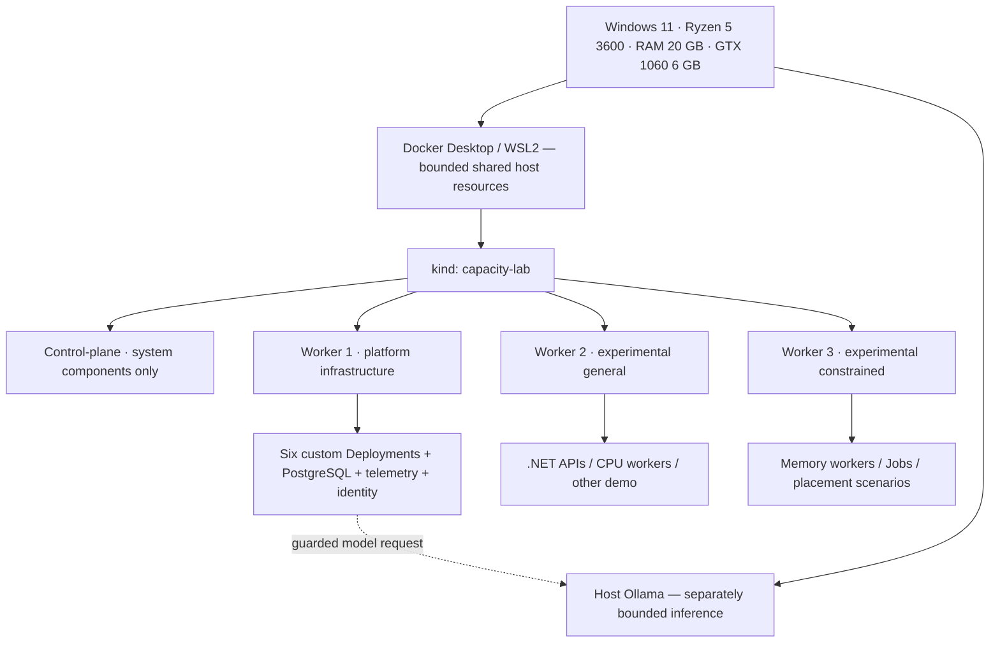
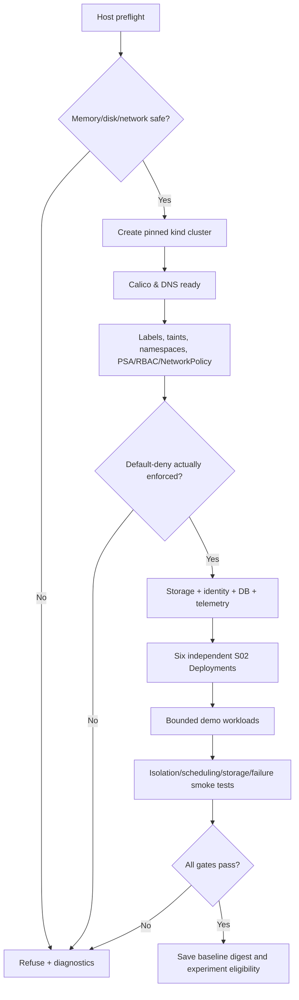

# S03 — Local Kubernetes Infrastructure & Cluster Topology

> **Approval record (2026-11-16).** The project owner approved **all recommended S03 architecture options**: one kind control-plane and **three kind workers**; one reserved platform worker and two experimental workers; **Calico** with enforced default-deny Kubernetes NetworkPolicies; namespace partitioning by privilege/function; localhost-bound HTTPS entry; local PVCs plus independent backups; node labels/taints, affinities, ResourceQuota, LimitRange and PriorityClass; **host-side Ollama**; Python-first reproducible bootstrap; and rigorous distinction between scheduling capacity and physical host contention. The owner supplied hardware: **20 GB RAM, Ryzen 5 3600, GTX 1060 6 GB**. These are **accepted design choices**, **not** evidence that the cluster has been installed, tested or benchmarked.
>
> **Important sizing qualification.** Initial memory/CPU values herein are **provisional engineering targets**, not measured limits or guaranteed allocations. Preflight and instrumented calibration must validate them before an executable deployment profile is marked ready. If the full stack fails budgets, retain the accepted topology and six deployment boundaries while reducing concurrency, replica counts, auxiliary services and demo workload envelopes; do **not** silently remove a worker or collapse S02 roles.

## 0. Authority, precedence and traceability

- **Master catalog**: `Autonomous_Kubernetes_Capacity_Planning_Master_Spec_Catalog.md` (32 slices, eight domains); S03 is P0 and owns kind topology, OS/WSL2 budgets, CNI, namespaces, ingress, local storage, quotas, reservations, automation and isolation validation.
- **S01**: governs product objectives, Observe/Advisory/Governed autonomy, criticality, SLO/headroom and safety. S01 principles are reflected in accepted S02 §1.1. **The complete S01 source was not independently available for a line-by-line reread while preparing this artifact.** Verify any S01-specific numeric requirements against the canonical S01 file before implementation; do not treat S03 estimates as superseding it.
- **S02**: accepted Option B hybrid modular distributed control plane; exactly six separately deployed custom roles (`api`, `observer`, `capacity`, `ai`, `governance`, `executor`); REST + PostgreSQL-backed async jobs/outbox without mandatory broker; one PostgreSQL instance with logical schema/role ownership; one AI runtime with three logical agents; four logical trust zones; strict governance/execution separation.
- **S03 owns infrastructure choices**, not implementation decisions that S06–S10, S12–S13, S15, S24–S25, S27–S29 are assigned to finalize. In particular, Keycloak, secrets backend, precise PKI/service authentication, precise ingress controller/version, persistent data schemas, model size and precise GitOps mechanism are **not** implicitly approved by accepting S03.
- If two specs disagree, preserve earlier explicit approvals unless a later accepted ADR explicitly supersedes them. Store accepted S03 decisions in the master register on the next authorized catalog revision.

### Product invariants applied to the lab

1. A **single bounded local kind cluster** manages its own carefully isolated mixed-language demo workloads; **no cloud** provisioning, no second standing cluster, no custom scheduler, no GPU placement objective.
2. Observe → Predict → Optimize → Govern → Act & Verify; resource scopes are container/workload, namespace/group and node/cluster.
3. Criticality classes: **Critical, Standard, Flexible, Opportunistic** (business policy), distinct from Kubernetes `PriorityClass` and node labels.
4. Horizons: **current state, 1 hour, 24 hours**; insufficient samples must be declared, not fabricated. B0/B1/B2/B3 comparisons distinguish static, rule/VPA, deterministic and agent-enhanced approaches.
5. Kubernetes **allocatable**, **requests**, **limits**, **observed**, **historical**, **forecast**, **simulated** and **realized** are never interchangeable quantities.
6. AI runtime/Ollama have **no direct mutation authority**. The separately deployed Executor has the only bounded mutation identity; it revalidates immutable approval, policy, target UID/resourceVersion and ownership immediately before changes.
7. Physical host overload can affect all kind nodes: namespace/taint isolation does **not** imply independent physical failure domains.

## 1. Requirements

| ID | Normative requirement | Verification |
|---|---|---|
| S03-FR-001 | Provision exactly one named kind cluster with one control plane and three schedulable workers. | Node role/count inspection |
| S03-FR-002 | Retain six distinct custom platform Deployments with independent ServiceAccounts, health checks and resource controls. | Deployment/SA inventory |
| S03-FR-003 | Reserve one worker for infrastructure/platform Pods; allow demo workloads only on two experiment workers by default. | Label/taint/affinity scheduling tests |
| S03-FR-004 | Use Calico with effective Kubernetes NetworkPolicy ingress/egress enforcement. | Bidirectional allowed/denied connectivity tests |
| S03-FR-005 | Establish namespaces and enforce default deny except explicitly authorized traffic, including DNS/API/telemetry exceptions. | Policy inventory + negative tests |
| S03-FR-006 | Expose only selected operator-facing interfaces through localhost-bound TLS access; never expose DB/Executor/AI internal ports as public entrypoints. | Host listener tests |
| S03-FR-007 | Provide local PVC support, durable PostgreSQL data and independent backups with restore drill. | Restart, cluster destruction warning, restore validation |
| S03-FR-008 | Bound requests, limits, namespace quotas, limits/defaults and workload priority within measured local limits. | Admission and node allocatable checks |
| S03-FR-009 | Run Ollama on Windows host, reachable through a protected constrained endpoint to AI runtime only. | Access tests, outage tests |
| S03-FR-010 | Provide Python-driven preflight, bootstrap, validate, baseline, backup, reset and explicit destroy workflows. | Repeat execution and safety tests |
| S03-FR-011 | Export experiment baseline identity including node allocatable, CNI versions, scheduling labels/taints, host conditions and synthetic/live provenance. | Artifact schema validation |
| S03-FR-012 | Support workload fragmentation and quota admission failure tests without necessarily inducing real host OOM. | Pending/FailedScheduling evidence |
| S03-NFR-001 | All installation artifacts pinned and compatible; manifests/Helm settings tracked with reproducible hashes. | Lock/version audit |
| S03-NFR-002 | Preserve OS headroom and abort/scale down scenarios on host pressure thresholds. | Preflight/stress checks |
| S03-NFR-003 | Read-only deterministic core remains operational on Ollama failure (subject to independent dependencies). | Fault injection |
| S03-NFR-004 | Bootstrap idempotent where possible, fail closed at unsafe security gates and preserve diagnostic state. | Faulted rerun |
| S03-SEC-001 | Dedicated identities and scoped RBAC; disable automount of SA tokens except workloads explicitly requiring them. | Token and RBAC tests |
| S03-SEC-002 | Pod Security Admission baseline with exceptions documented; no blanket privileged namespace. | Invalid-Pod admission tests |
| S03-SEC-003 | Deny AI→Executor, demo→control plane services, demo→DB, and unauthorized namespace traffic. | Negative network tests |
| S03-SEC-004 | Enforce bounded authenticated access to host Ollama, without LAN-wide unauthenticated listeners. | Host/network access tests |
| S03-SEC-005 | Block unsafe bootstrap completion when policy enforcement or identity controls have not been validated. | Deliberate misconfiguration |

## 2. Accepted topology



### 2.1 Node inventory, labels and taints

| kind node (initial names) | Role | Required labels (own domain) | Scheduling protections |
|---|---|---|---|
| `capacity-lab-control-plane` | Kubernetes API/scheduler/etcd | `capacity.lab/node-role=control-plane` | Retain default control-plane `NoSchedule`; do not tolerate for ordinary custom Pods |
| `capacity-lab-worker` | Platform | `capacity.lab/pool=platform` | `capacity.lab/dedicated=platform:NoSchedule`; platform Pods must tolerate and require matching pool |
| `capacity-lab-worker2` | Experiment A | `capacity.lab/pool=experiment`, `capacity.lab/profile=general` | No platform toleration; scenario-specific node selection |
| `capacity-lab-worker3` | Experiment B | `capacity.lab/pool=experiment`, `capacity.lab/profile=constrained` | No platform toleration; scenario-specific node selection |

**Enforcement is two-sided:** taint alone does not force platform Pods onto the platform node; platform Deployments must use required node affinity/selectors and tolerations. Similarly, demo Pods use required affinity for `pool=experiment` and omit the platform toleration. Essential cluster DaemonSets may need tolerations and still consume each node's allocatable resource; account for them before publishing experiment budgets.

**Experiments:** Normal scheduler freedom spans both experiment nodes; constrained scenarios can temporarily apply node affinity, pod anti-affinity, topology spread, tolerations and explicit priorities. Do not permanently pin all workloads to a single node, which would invalidate meaningful scheduling comparisons. No production-style HA claim: all four nodes share one Windows/WSL host and Docker daemon.

### 2.2 kind declaration skeleton (illustrative, not pinned install manifest)

```yaml
kind: Cluster
apiVersion: kind.x-k8s.io/v1alpha4
name: capacity-lab
networking:
  disableDefaultCNI: true
  # podSubnet/serviceSubnet must be selected after collision scan
nodes:
  - role: control-plane
    extraPortMappings:
      - containerPort: 30443
        hostPort: 8443
        listenAddress: "127.0.0.1"
        protocol: TCP
  - role: worker
  - role: worker
  - role: worker
```

**Caution:** The `extraPortMappings` entry maps host port 8443 to a control-plane node port. It does **not** install ingress, serve TLS, route traffic, or guarantee connectivity. The selected ingress implementation must deliberately bind to the matching target on that node (e.g. a validated NodePort/hostPort arrangement); otherwise remove/alter this mapping. Prefer a tested matching binding over a decorative config. If an ingress Pod is targeted to the control-plane via `hostPort`, its tolerations/security exceptions must be narrowly documented; an alternative is mapping the port on a worker node hosting the ingress controller. Final ingress manifest belongs to S27/S29 integration and must pass an end-to-end TLS test.

## 3. Hardware-aware resource budget — 20 GB host

### 3.1 Host facts versus assumptions

| Dimension | User-confirmed fact | S03 working assumption / policy |
|---|---|---|
| RAM | 20 GB physical | Not all RAM usable by Docker; Windows/host apps and Ollama need reserved headroom |
| CPU | Ryzen 5 3600: 6 physical / 12 logical threads | Constrain concurrent analysis/load generation; don't interpret 12 threads as 12 isolated cores |
| GPU | GTX 1060 6 GB | **Host Ollama only**, if local runtime/driver supports desired model; no kind GPU scheduling or GPU benchmarking |
| OS/runtime | Windows 11 + Docker Desktop + WSL2 from project baseline | Actual WSL2 memory cap and disk location must be verified; no assumption about current `.wslconfig` |
| SSD free space | Not supplied | Disk availability mandatory preflight; cluster must not install if budget cannot be met |

### 3.2 Selected starting envelope

- **Candidate WSL2/Docker ceiling: 12 GiB RAM** (approximately 12.9 GB decimal), conditional on preflight measurements. Preserve at least **5 GiB** for Windows, Docker host-side overhead and other applications under typical workload; maintain additional free/available memory while experiments run. The host-side Ollama process and its model cache compete with those Windows resources, **not** inside the Kubernetes allocation. If Windows/Ollama demand is higher, lower the WSL2 ceiling/profile and reduce concurrency instead of driving the host into swap/thrashing.
- **WSL2 logical processors: start at 8** as an optional explicit `.wslconfig` setting if host activity warrants it; this is a scheduling share, not exclusive CPU ownership. Consider 6 if contention persists. Do not claim hard per-kind-worker CPU partitions.
- **Pod requests planning target:** baseline steady-state requested memory **≤ 7 GiB** including infrastructure when possible; bounded experimental additions initially **≤ 2 GiB requested**. Leave **≥ 2 GiB** uncommitted allocatable margin where measured availability permits. These are provisional policies; actual Kubernetes node allocatable is read live, and per-node scheduling fit takes precedence over cluster totals.
- **Heavy execution policy:** one capacity compute job OR one CPU/memory saturation scenario at a time during baseline measurements; one Ollama inference request at a time; avoid concurrent model loading and stress tests. Full B3 comparisons may run serially after resetting state.
- **Initial replica count:** one per each of the six Deployments and one PostgreSQL instance; no HA promises. Optional auxiliary controllers and identity should be installed resource-consciously and have measured footprints.

### 3.3 First-pass request budget (not performance benchmarks)

The following is a design *envelope* for requests, not exact manifests/actual usage. Values are **total per logical category**; each category may include several Pods and DaemonSet shares. Limit values must be calibrated separately, especially memory limits for PostgreSQL, Prometheus and Python workers.

| Category | Initial CPU request target | Initial memory request target | Notes |
|---|---:|---:|---|
| Calico, CoreDNS, cluster add-ons, exporters | 400m | 600 Mi | Shared node infrastructure; measure actual DS footprint |
| Six S02 custom Deployments combined | 850m | 1,350 Mi | Individually controlled; Capacity/AI peaks above requests |
| PostgreSQL (single instance) | 300m | 650 Mi | Local PVC, schema ownership and backup |
| Prometheus, Grafana, kube-state-metrics | 450m | 900 Mi | Configure scrape cardinality and retention conservatively |
| OIDC provider, ingress, cert/secret add-ons | 350m | 750 Mi | Keycloak remains S06 decision; allow for selected provider |
| Platform subtotal | **2,350m** | **4,250 Mi** | Excludes Kubernetes node/container process overhead |
| Demo baseline Deployments | 800m | 1,200 Mi | Explicit S04 profiles on experiment workers |
| Bounded burst/Job allowance | 600m | 800 Mi | Admission/runner budgets; not permanent reservation |
| Planned aggregate Pod requests | **3,750m** | **6,250 Mi** | Relative to *per-node measured allocatable* and actual quotas |

Headroom in WSL2 is **not** simply 12 GiB minus above Pod requests: Pod usage may exceed requests, and control-plane/kubelet/node-container processes, overlay filesystem cache, host networking and Docker overhead consume memory. Calibrate with kubelet, container/host telemetry and Windows counters. 12 GiB is an **upper configuration candidate**, not a guarantee that every listed component will fit.

### 3.4 Pressure management and no-go rules

Preflight must record: Windows physical memory free/available, Ollama idle and model-loaded resident footprint, WSL2 cap and current use, Docker storage free, CPU architecture/threads, Docker engine/kind versions, available ports, DNS and host routes. Provisional warnings: >80% steady WSL2 memory use or <2 GiB host available; abort destructive stress tests when <1.5 GiB host available or memory pressure/oom alerts are observed. **Thresholds are tuning placeholders**; do not present as universal safe limits. The scenario runner enforces bounded durations, concurrency and cleanup; host-side watchdog is preferable because an overloaded cluster may not run its own protective controller.

**GPU rule:** GTX 1060 6 GB does not justify running a large LLM concurrently with heavy memory stress. S15 must benchmark an appropriately sized quantized model, context and VRAM budget. If model does not fit or exceeds host policy, reduce model size or run deferred B3 tests; maintain B2 deterministic functionality.

## 4. Namespace map and placement

| Namespace | Role / primary workloads | Node pool | Privilege constraint |
|---|---|---|---|
| `capacity-api` | Operator API | platform | Operator ingress only; no Kubernetes mutation |
| `capacity-core` | Observer, Capacity Engine, Governance | platform | Separate SAs; Observer scoped read only; Capacity and Governance no K8s mutation |
| `capacity-ai` | AI Advisory Runtime | platform | Read-only typed tools, no direct K8s API or Executor traffic |
| `capacity-execution` | Trusted Execution Controller | platform | Separate scoped mutating SA; strict inbound controls |
| `capacity-data` | PostgreSQL | platform | No public ingress, schema/DB role permissions |
| `capacity-observability` | Prometheus, Grafana, metrics exporters where appropriate | platform + exporter DaemonSets on monitored nodes | Metrics auth/allowlists; no privileged write to app state |
| `capacity-identity` | Local OIDC if selected in S06 | platform | Protected local issuer, secrets and tokens |
| `capacity-system` | Project-local ingress/cert/secret controllers where applicable | platform | Hardened Pod admission; explicit exceptions |
| `workloads-critical` | Critical demo class | experiment | No platform node placement; bounded SLO scenarios |
| `workloads-standard` | Standard class | experiment | Normal workloads |
| `workloads-batch` | Flexible/Opportunistic Jobs | experiment | Lower priority, strict quotas and TTL cleanup |

Kubernetes `kube-system` and CNI namespaces continue to exist separately. **Criticality is an explicit product-policy field, not guaranteed by namespace or priority.** S04 defines mapping from a workload's declared class to scheduling policies; mixed-class experiments require explicit handling. Namespace names are accepted S03 convention unless later explicitly superseded.

- **Namespace isolation is not an authorization mechanism by itself.** For each namespace apply Pod Security Admission labels with appropriate restricted/baseline posture, ServiceAccounts, RBAC, NetworkPolicy, quotas and deployment admission requirements.
- All six Deployments remain separately deployed even where multiple are grouped in `capacity-core`.
- Deny default SA token automount; mount projected token only when a concrete scoped Kubernetes API use requires it.
- All supported workload resource changes target designated demo namespaces unless additional authorized scope is explicitly introduced in governance policy.

## 5. Calico networking and trusted access paths

**Accepted CNI:** Calico with Kubernetes NetworkPolicy enforcement; kind `disableDefaultCNI: true`. Install from a **version-pinned** compatible manifest or operator bundle (including CRDs) and align Pod CIDR/IP pools with the kind subnet. No hardcoded CIDR in this accepted spec; bootstrap checks WSL/Docker/VPN routes and fails conflicting candidates. Initially IPv4-only.

### 5.1 Network-policy baseline

Every S03 managed application namespace starts **default-deny ingress and egress**. Apply explicit allow rules for required connectivity, not whole-namespace catch-all exposure. Kubernetes NetworkPolicy alone does not supply service authentication, encryption or all host-network firewall controls. Calico/Kubernetes behavior around host endpoints and access to the API server must be tested in the installed version.

| Source | Destination | Policy intent | Additional controls |
|---|---|---|---|
| localhost ingress | `capacity-api` / Grafana / optional identity | Allow explicitly selected HTTPS listener only | OIDC/roles/TLS and host firewall |
| `api` | `governance` and approved read APIs | Allow scoped internal service traffic | Machine auth/action authorization |
| `observer` | Kubernetes API | Allow read/list/watch only | Dedicated scoped Kubernetes RBAC |
| `capacity` | Prometheus, approved snapshots, owned DB | Allow | Authenticated internal APIs / DB roles |
| `governance` | owned DB, approved Capacity/AI services | Allow | Protected durable plan and approval state |
| `executor` | Kubernetes API, authorized governance validation/read, execution schema | Allow bounded | Dedicated mutation SA and live revalidation |
| `ai` | typed evidence/tool facade, protected host Ollama endpoint, owned Knowledge data | Allow **only needed flows** | No credentials granting privileged writes |
| `ai` | Kubernetes API / `executor` | **Deny** | Also deny via absence of RBAC/SA credentials |
| any demo namespace | internal platform DB, Executor, AI, Governance | **Deny by default** | No platform secrets in demos |
| monitoring components | approved `/metrics` ports | Allow minimal pull paths | Metric endpoint auth as required |
| allowed Pods | cluster DNS | Allow narrowly scoped UDP/TCP DNS | DNS source/destination verified |

**Host Ollama path:** host-side service must not be directly bound to `0.0.0.0` without a firewall/auth gateway. Expose via a tested Windows/WSL/Docker Desktop reachable address plus an **authenticated bounded local reverse-proxy or equivalent protected interface**; allow traffic exclusively from the AI runtime and deny the demo namespaces. Default Windows host Ollama listening on loopback may not be reachable from kind without proxy plumbing. Implement and validate this route in S15/S07; a generic `host.docker.internal` hostname is not proof of safety or reachability. Block any route that could bypass the intended gateway; account for NetworkPolicy limits on host endpoints.

### 5.2 Ingress choice

Accepted posture: **localhost-bound HTTPS ingress**; no public LAN listener, external LoadBalancer or cloud DNS. Exact controller and Gateway API/Ingress API route implementation are **deliberately delegated** to S27/S29, with a pinned supported controller. Candidate host `127.0.0.1:8443`; route `/api`, `/grafana` and OIDC if provisioned. These are placeholders, **not frozen HTTP contracts**. For OIDC a stable issuer/redirect URI and hostname are required; local certificate trust must match CLI/browser/internal clients. No permanent port forwarding of PostgreSQL, Prometheus admin, AI runtime or Executor.

### 5.3 Security boundary threats

| Threat | Preventative and detective control |
|---|---|
| Demo Pod attempts DB/executor traffic | Default deny, negative tests, no credentials |
| AI prompt injection asks to patch Deployment | No direct K8s tokens, denied route, typed tools, separate Executor authority |
| Cross-namespace data read | SAs, app authorization, DB schema permissions, retrieval namespace filters |
| NetworkPolicy misinstallation | Bootstrap hard-stop on explicit allowed/denied probes |
| Host-side Ollama service exposed to LAN | Loopback/proxy binding, Windows firewall test, authentication at gateway |
| Ingress allows privileged internal endpoint | Route inventory, allowlist and external negative tests |

## 6. Resource quotas, priority and scheduling constraints

### 6.1 ResourceQuota and LimitRange

Implement namespace ResourceQuota for aggregate `requests.cpu`, `requests.memory`, `limits.cpu`, `limits.memory`, Pods, and PVCs where appropriate. Set LimitRange min/max/defaults primarily for platform safety. **Every S04 workload/scenario declares explicit request/limit values** to avoid hidden default injection changing experiment evidence. ResourceQuota is an **admission accounting** mechanism, not guaranteed resource reservation or physical host isolation.

**Initial quotas:** derive from measured node allocatable and the table in §3.3, not arbitrary static values. The resource-control admission policy must allow platform Pods and necessary DaemonSets to remain operational, and must record quota/LimitRange versions in baseline. Never configure experimental quotas so high that two demo workers can jointly exhaust the Windows host without a scenario watchdog.

### 6.2 PriorityClasses (accepted relative policy; provisional numbers)

| Name | Example priority | Intended usage | Default preemption posture |
|---|---:|---|---|
| `capacity-platform-critical` | 100000 | Governance, observer, executor and other essential runtime | `Never` initially; avoid system-reserved numeric ranges |
| `capacity-platform-standard` | 50000 | Capacity/AI/UI and supporting services | `Never` initially |
| `lab-critical` | 10000 | Critical demo applications | `Never` except explicit test |
| `lab-standard` | 1000 | Standard demo apps | `Never` initially |
| `lab-flexible` | 100 | Flexible job/worker | `Never` initially |
| `lab-opportunistic` | 0 | Low-priority batch | `Never` initially |

Check collisions and Kubernetes priority bounds before applying. Controlled preemption tests may use explicit opt-in PriorityClasses; **priority is not a substitute for product criticality or authorization**.

### 6.3 Observability and simulation credibility

- Capture `node.status.allocatable`, capacity, requests by Pod/container, limits, affinity, taints, tolerations, priority, topology spread and quota. Capture CPU throttle/OOM/evictions, memory working set, Pending events and application latency separately.
- **Scheduling model:** scheduler checks per-node requested resources vs allocatable subject to constraints; a sum of unused cluster-wide requests cannot certify a Pod will fit anywhere.
- **Real host usage:** kind workers share the same hardware; do not claim that a Kubernetes label creates a 2 GB memory worker. Do not use undocumented or unverified per-kind-node hard-memory settings as authoritative node sizes.
- **Synthetic model:** to test hypothetical heterogeneous nodes, feed the simulator a separately marked synthetic inventory, never pass it off as observed Kubernetes status. Validate chosen cases against real Kubernetes scheduling where comparable.
- Workload profiles and scenario seed, traffic distribution, deployment revisions, node snapshots, model/forecast provenance and current host load are experiment inputs.

## 7. Storage architecture and lifecycle

### 7.1 Deployment policy

- Accept a **simple local PVC** storage class (the exact kind image's default StorageClass must be discovered and verified at bootstrap); avoid Ceph, Longhorn and other heavyweight distributed storage for this one-workstation lab.
- Use **one PostgreSQL instance** (StatefulSet, one replica and one PVC) for `inventory`, `capacity`, `knowledge`, `governance`, `execution`, `audit`, `workflow` schema ownership per S02. Each logical domain uses its own role/migrations; shared instance does **not** imply broad cross-schema write access.
- Prometheus stays authoritative for time series; do not duplicate all samples into PostgreSQL. Use a bounded local TSDB PVC and config-managed Grafana dashboards.
- Demo workloads use ephemeral storage unless a scenario explicitly tests storage. Enforce ephemeral storage budgeting when supported and track image/layer/cache growth in Docker.

### 7.2 Initial space planning (disk free must be checked)

| Asset | Planning envelope | Recoverability |
|---|---:|---|
| PostgreSQL PVC | 5–10 GiB | Mandatory host-external backup and successful restore test |
| Prometheus TSDB PVC | 5–10 GiB | Retention 3–7 days initially, tuned in S12 against 24h horizons/backtests |
| Grafana / optional service state | 1–2 GiB | Prefer declarative dashboards/settings |
| Ollama model files | Model-dependent, separately measured host disk | Re-downloadable but pinned digest/version metadata |
| Docker images/kind nodes/build cache | Dynamic; calculate via preflight | Rebuildable; set disk cleanup guardrails |
| Backups/research results | Separate host location **outside** deletable kind Docker volumes | Preserve across cluster destruction |

A claimed PVC size may not enforce a physical disk quota under local storage. The storage budget needs both Kubernetes volume accounting and underlying Docker/WSL2 virtual-disk monitoring. Retention must be adequate to cover selected forecast evaluation windows; if insufficient, export reproducible scenario evidence/fixtures and label historical limitations.

### 7.3 Backup and deletion rules

Before destructive `cluster destroy`, display a dry-run report listing cluster identity, affected namespaces, PVCs, backup time/verification, and data classes. By default, refuse destructive cleanup when the only known authoritative PostgreSQL copy is at risk. Allow explicit destructive override only with separate confirmation and visible consequences. `workloads reset` must not touch `capacity-data`, `capacity-execution`, `capacity-core` persisted state or backup directories. Verification must restore into an isolated test instance and validate governance/execution record integrity, not merely check that a dump file exists.

## 8. Local bootstrap contract

### 8.1 Tooling model

A **Python-first Typer management CLI** coordinates existing pinned tools (`docker`, `kind`, `kubectl`, Helm/Kustomize where chosen). Using those binaries through Python subprocess is acceptable; no Bash/PowerShell business logic is required. A management CLI is **not** a seventh permanent platform service. Store manifests/config/lockfiles in Git and generate a machine-readable installed-version manifest after each successful run.

### 8.2 Entrypoints (contract, not implemented code)

```text
capacity-lab preflight [--profile compact|balanced]
capacity-lab cluster create [--config PATH]
capacity-lab cluster inspect
capacity-lab cluster validate
capacity-lab infrastructure install
capacity-lab platform deploy
capacity-lab workloads deploy
capacity-lab bootstrap --profile balanced
capacity-lab verify networking|security|storage|scheduling|all
capacity-lab snapshot baseline
capacity-lab backup create
capacity-lab restore verify
capacity-lab workloads reset [--dry-run]
capacity-lab cluster destroy --dry-run
capacity-lab cluster destroy --confirm CLUSTER_NAME
```

### 8.3 Stage gates



- **Preflight:** host memory/CPU, GPU/Ollama footprint (if enabled), available disk, Docker/WSL2 versions, node image compatibility, virtualized network conflicts, ports, clock and host-backed backup location.
- **Create:** immutable kind node image by digest; configure `disableDefaultCNI`; test control-plane reachability.
- **Network:** install version-pinned compatible Calico, verify CNI readiness, route/CIDR matching, kube DNS, policy semantics.
- **Isolation:** namespaces, SA tokens, Pod Security Admission, quotas/LimitRanges, labels/taints/affinity and negative probes.
- **Dependencies:** PostgreSQL, optional S06 identity provider, Prometheus/exporters/Grafana, local ingress/cert resources; test persistent volumes and authorization.
- **Platform:** six distinct Deployments, resource limits, probes, no unexpected mutation credentials; test durability and readiness.
- **Experiment:** deploy six-type S04 catalog when defined; load S05 scenarios only within budget; publish baseline.
- **Failure:** preserve logs, cluster state and installer stage journal; avoid unsafe automatic deletion or retry loops.

### 8.4 Baseline manifest schema (conceptual)

```yaml
schema_version: "s03.baseline.v1"
cluster:
  name: capacity-lab
  provider: kind
  kubernetes_version: "<pinned in release lock>"
  kind_node_image_digest: "<sha256>"
  cni: {name: calico, version: "<locked version>", policy_verified: true}
host:
  os: windows-11
  ram_physical_gb: 20
  cpu: "Ryzen 5 3600"
  gpu: "GTX 1060 6GB"
  wsl2_memory_cap_gib: "<measured>"
  ollama_runtime: host
nodes:
  - {name: "<node>", pool: "<pool>", allocatable_cpu_m: "<measured>", allocatable_memory_bytes: "<measured>"}
policies:
  namespace_policy_digest: "<sha256>"
  network_policy_digest: "<sha256>"
  resource_budget_digest: "<sha256>"
experiment:
  evidence_kind: observed  # observed | simulated | forecasted
  synthetic_capacity_model_id: null
  scenario_seed: null
  snapshot_timestamp_utc: "<runtime timestamp>"
```

Never fill `measured` fields with hypothetical values. Persist original Kubernetes source metadata and environment version for provenance. S13 decides the canonical evidence schema; this S03 file is a provisioning manifest example.

## 9. Reliability, restoration and failure matrix

| Fault | Expected behavior | Required proof |
|---|---|---|
| Host Ollama disabled | Observer/Capacity deterministic functions continue; AI review incomplete | S02 degraded-mode test |
| Experiment Pod OOM / crash | Bounded blast radius; metrics/events captured; normal platform availability | Pod event and platform health |
| Experiment node unschedulable | Pending and per-node feasibility evidence; platform remains on platform worker | Event + live node inventory |
| Calico misconfigured | No claim of secure readiness; refuse bootstrap completion | Fail-closed policy probe |
| PostgreSQL unavailable | No new authoritative plan/approval/intent; no unsafe execution | Mutation refusal and durable recovery |
| Prometheus data unavailable/stale | Missing evidence flagged; no unsupported numeric recommendation | Data quality gate |
| Executor restarts mid-operation | Reconcile durable intent against real target before retry | Idempotency/restart test |
| Control-plane/API unavailable | No new changes; restore and reconcile after return | Operational runbook |
| Local PVC inaccessible | Declare failure; recover verified backup, do not fake durability | Restore drill |
| Windows global memory exhaustion | Possible all-node failure despite Kubernetes namespaces | Host watchdog + declared lab limitation |

Monitoring/alerts should include Windows available memory, WSL2/Docker memory, per-node allocatable/requested/usage, Kubernetes `MemoryPressure`/`DiskPressure`, unschedulable Pods, CPU throttle, Pod OOM, PVC and Docker virtual disk growth, failed NetworkPolicy checks, and backup freshness. Exact SLOs/alert thresholds follow S28.

## 10. Verification plan and acceptance tests

| Test ID | Method | Pass criteria / evidence |
|---|---|---|
| S03-TEST-001 | Create cluster from clean preflight | Exactly 1 CP + 3 Ready workers, versions/digest captured |
| S03-TEST-002 | Observe every node | Valid CPU/memory allocatable and container/DaemonSet overhead recorded |
| S03-TEST-003 | Submit demo Pod without platform toleration | Never scheduled to platform node |
| S03-TEST-004 | Submit platform Pod with approved selector/toleration | Only on platform pool, absent test override |
| S03-TEST-005 | Probe cross-namespace denied traffic | Connections blocked by actual Calico policy; logs collected |
| S03-TEST-006 | Probe essential DNS/API/metrics/DB paths | Only intended destinations reachable with appropriate identity |
| S03-TEST-007 | Attempt AI→K8s API and Executor | Network denied and credentials unavailable; no mutation |
| S03-TEST-008 | Check `kubectl auth can-i` for each SA | Only Executor has scoped mutation authority; Observer scoped read; other roles no mutation |
| S03-TEST-009 | Submit namespace quota violation | Admission rejects; no uncontrolled Pod creation |
| S03-TEST-010 | Construct a per-node requests-fragmentation scenario | Pod Pending/FailedScheduling despite adequate aggregate unrequested CPU/memory |
| S03-TEST-011 | Restart PostgreSQL and validate stored governance data | Persistent data intact |
| S03-TEST-012 | Backup, restore into test instance, verify referential state | Restoration successful; dump existence alone not sufficient |
| S03-TEST-013 | Re-run bootstrap with same inputs | No unexpected duplication or data loss; conflicts report clearly |
| S03-TEST-014 | Stop host Ollama | Deterministic core up, explicit AI unavailability, no approval bypass |
| S03-TEST-015 | Verify localhost listener / LAN probes | Only approved bound ports reachable; no public DB/Executor/Ollama endpoint |
| S03-TEST-016 | Deliberately disable NetworkPolicy enforcement | Readiness/security validation fails closed |
| S03-TEST-017 | Export baseline after successful validation | Complete versions, node snapshots, policy hashes, host envelope and evidence labels |
| S03-TEST-018 | Reset workloads and dry-run destroy | No authoritative state deleted; destructive action requires explicit confirmation |
| S03-TEST-019 | Run bounded resource pressure test | Host safety watchdog aborts in defined thresholds; no uncontrolled escalation |
| S03-TEST-020 | Cross-check configured PriorityClass and product criticality | Classes remain independent; no unintended preemption |

**Acceptance gate:** Design approval is **already accepted**, implementation **not started**. The infrastructure is operationally accepted only after the tests above pass and S06–S08 controls have been implemented/validated. Tests relying on later slices can be marked `blocked-by-slice` with a clear prerequisite, never falsely marked passing.

### Requirement coverage

- S03-FR-001–003 → tests 001–004, 010, 017.
- S03-FR-004–006, SEC-001–005 → tests 005–008, 015, 016.
- S03-FR-007 → tests 011–012, 018.
- S03-FR-008, 012 → tests 002, 009, 010, 019–020.
- S03-FR-009 / NFR-003 → tests 007, 014, 015.
- S03-FR-010–011 / NFR-001–004 → tests 001, 013, 017–019.

## 11. Accepted ADR register

| ADR | Status | Accepted choice | Main tradeoff / consequence |
|---|---|---|---|
| S03-ADR-001 | **Accepted** | One control plane + three kind workers | Better placement diversity, no independent host fault domains |
| S03-ADR-002 | **Accepted** | One platform worker + two experimental workers | Logical separation and experimental flexibility; shared physical resources |
| S03-ADR-003 | **Accepted** | Calico, IPv4 first, default-deny NetworkPolicy | Policy assurance requires real negative testing and compatible CNI pins |
| S03-ADR-004 | **Accepted** | Functional/privilege-driven namespace map | Namespace grouping doesn't replace SA, DB auth, TLS or RBAC |
| S03-ADR-005 | **Accepted** | Localhost-bound HTTPS entry posture | Exact ingress controller/issuer details finalized later |
| S03-ADR-006 | **Accepted** | Local PVC and external backup/restore | Host/local node state not highly available |
| S03-ADR-007 | **Accepted** | Node affinity/taints, quotas/limits and priority controls | These controls alter scheduling and must be captured in evidence |
| S03-ADR-008 | **Accepted** | Calibrated, bounded 20 GB host profile; candidate 12 GiB WSL2 ceiling | Full stack must pass measurement; restrict concurrency under pressure |
| S03-ADR-009 | **Accepted** | Host Ollama, no GPU scheduling within kind | Host contention and protected network route require explicit control |
| S03-ADR-010 | **Accepted** | Python-first declarative bootstrap/validation/cleanup | Lock/pinning and state journaling required |
| S03-ADR-011 | **Accepted** | Separate live observed vs synthetic capacity model | Prevents misrepresenting scheduler experiments as physical node independence |
| S03-ADR-012 | **Accepted** | Mandatory negative isolation and recovery gates | More verification work, materially stronger evidence |

### Deferred / delegated decisions — **not blockers to architecture approval**, but blockers to particular implementations

1. Exact kind/Kubernetes version, Calico release and image digests: select pinned mutually compatible versions from official documentation and validate on workstation before implementation (S29).
2. Windows/WSL2 actual allocation, disk size/free space, runtime headroom and Ollama VRAM footprint: measure preflight; adapt budgets, not topology.
3. Exact localhost TLS routing/ingress implementation, stable OIDC issuer, cert lifecycle and client callbacks (S06–S08/S27–S29).
4. Keycloak or another approved OIDC provider, secrets manager, PKI, selective mTLS, Pod admission exceptions and service authentication (S06–S08).
5. Individual Deployment requests/limits, final quotas and alert thresholds (S04/S12/S15/S28; calibrated S03 baseline).
6. Canonical schema/storage retention, Prometheus scrape intervals/label budget, backups and evidence models (S12–S13/S18/S28).
7. Ollama model selection, inference gateway/proxy address, tokens/concurrency and host protection (S15, S07–S09).
8. Exact executor RBAC resource/action scope and GitOps adapter (S24–S25); S03 only reserves the isolated namespace and service identity boundary.

## 12. Inter-slice handoffs

| Recipient slice | Contract supplied by S03 |
|---|---|
| S04 | Node pools, namespace/priority conventions, bounded demo resource envelope, schedulability policy |
| S05 | Bootstrap/baseline APIs, scenario-safe reset, budget and host watchdog rules |
| S06–S08 | Namespace/SA boundaries, CNI and default-deny base, TLS/issuer/secret decisions still delegated |
| S11–S12 | Node labels/allocatable provenance, CNI and metrics exporter placement, retention envelope |
| S13 | One persistent Postgres service, backup/recovery constraints, baseline artifact requirements |
| S14/S19–S22 | Real vs synthetic node inventories, per-node scheduling constraints and fragmentation fixtures |
| S15–S18 | Host Ollama secured access, AI budget and no-mutation boundary |
| S24–S26 | Dedicated executor namespace and RBAC boundary; resilient DB/backup guarantees; approval revalidation |
| S27–S29 | Localhost TLS posture, Python bootstrap interfaces, pinned infrastructure artifacts |
| S30–S31 | Negative policy, restart, quota, scheduler and pressure test fixtures; measured B0–B3 baseline |
| S32 | Operational installation, backup/restore and declared single-host limitations |

## 13. Repository artifact layout (implementation proposal, not yet generated)

```text
specs/slices/S03-local-kubernetes-infrastructure/
  01-purpose-and-scope.md
  02-requirements.md
  03-architecture-and-alternatives.md
  04-contracts-and-data.md
  05-security-and-threat-model.md
  06-failure-modes-and-operations.md
  07-acceptance-tests.md
  08-decisions-and-open-questions.md
infra/
  kind/
  calico/
  namespaces/
  policies/
  storage/
  observability/
  ingress/
  deployment-profiles/
tools/capacity_lab/        # Python management CLI
configs/compatibility.lock.yaml
```

This single Markdown artifact is suitable as the **S03 Project source of truth**; splitting into the standard eight per-slice spec files is an optional repository implementation step. No cluster manifests, bootstrap CLI or benchmarks are claimed to exist yet.

---

**Final S03 architecture decision:** **Approved** four-node single-host kind laboratory, Calico enforcing policy, functional/privilege namespaces, localhost-bound ingress posture, local PVC + backups, bounded resource governance, host Ollama, Python automation and evidence-grounded live-versus-simulated capacity separation. **Implementation readiness remains conditional on host measurements and security integration tests.**
