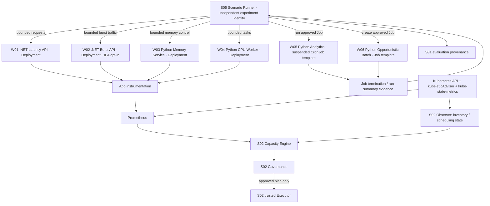

# S04 — Mixed-Language Demonstration Workloads

> **Approval record (2026-11-17).** The owner accepted the six-workload small realistic ecosystem, **.NET 10 HTTP APIs plus Python workers and Jobs**, **four steady-state Deployments plus two on-demand batch/Job workloads**, **versioned YAML profiles with explicit bounded resource behavior**, and **Prometheus-compatible observability, calibrated workload SLOs and security controls**. All S04 ADRs explicitly labeled **Accepted** in this document reflect those selections and the architecture-level consequences required to make them consistent with accepted S01–S03. **Approval is architectural, not evidence of implementation, load calibration, or an installed cluster.** Numerical values presented as starting targets remain **provisional** until measured.

## 0. Document contract, authority, and precedence

- **Master catalog v1.0.0** governs the 32-slice roadmap and cross-cutting invariants. S04 owns measurable demo application behavior, workload resource profiles, Kubernetes workload-controller templates, health/metrics contracts, criticality mapping, and acceptance tests.
- **S01 accepted**: AIOps Capacity Operations Platform; Observe/Advisory/Governed; L0–L2; criticality `Critical`, `Standard`, `Flexible`, `Opportunistic`; hierarchy workload/namespace/node-cluster; current, 1-hour and 24-hour planning; hard safety gates before ranking; explicitly governed mutations; fair B0/B1/B2/B3 evaluation.
- **S02 accepted**: six *platform* deployables `api`, `observer`, `capacity`, `ai`, `governance`, `executor`; REST plus PostgreSQL-backed durable jobs/outbox; no required broker; independent AI and deterministic analysis; privilege-separated executor. **The six S04 demonstration workloads do not count as the six S02 platform deployables.**
- **S03 accepted**: one kind control-plane + three workers; one tainted platform worker and two experiment workers; Calico/default-deny; S03 namespace map; localhost-restricted operator access; local storage and Python automation; host Ollama; provisional request envelopes and physical host pressure safeguards.
- **Precedence**: preserve accepted upstream ADRs. S04 implementation choices must not revise S01–S03; changes need explicit superseding decisions. S05 owns scenario timing/traffic, S07–S08 own security implementation, S12 owns authoritative metric/query definitions, S19 owns hard optimization/SLO policy, S23 owns advanced autoscaling, S25 owns governed changes, and S31 owns comparative evaluation protocol.
- Terminology: **Accepted** = owner-approved S04 architectural choice; **Provisional** = numeric example requiring calibration; **Open downstream** = technical detail intentionally delegated; **Deferred** = outside S04 P0.

## 1. Purpose, goals, and non-goals

**Purpose:** Provide a small yet heterogeneous and measurable population of Kubernetes workloads supporting CPU/memory right-sizing, prediction, scheduling/fragmentation, historical spike protection, priority, HPA interaction, and before/after verification.

**Goals:**
1. Produce reproducible bounded CPU/memory/HTTP/batch behaviors whose ground truth and actual container behavior are separately observable.
2. Expose clear and stable workload identities and actionable Kubernetes resource/scheduling configuration.
3. Supply application-level guardrails (latency, errors, processing, completion) so efficiency gains cannot conceal reliability regression.
4. Make experiments safe on the accepted 20 GB RAM, Ryzen 5 3600, Windows 11/Docker Desktop/WSL2 host; support instrumented scaling down when host pressure demands it.
5. Provide versioned profiles and traceable evidence suitable for S11–S14, S19–S23, S31 and grounded AI analysis.

**Non-goals:** Complete business domain, production customer traffic, external cloud/paid services, GPU workloads, service mesh, mandatory external broker, application DB per workload, custom scheduler, autonomous workload mutation, forced live OOM, permanent load generation, or automatic installation of VPA in update mode.

## 2. Selected architecture and alternatives

| Option | Assessment | Decision |
|---|---|---|
| A — Pure independent synthetic loops | Cheapest but weak application SLO and end-to-end behavior | Rejected as sole approach |
| **B — Six small realistic mixed-language workloads** | Explicit app types and controller diversity, credible workload signals, manageable implementation | **Accepted** |
| C — Two universal configurable synthetic engines | Good code reuse, weaker distinct identities and behavior contracts | Rejected as deployment architecture; selected *shared utility libraries* permitted |

**Deployment policy:** Four Deployments W01–W04 at one replica each during normal baseline. W05 is a CronJob *definition with schedule suspended by default*; an explicitly authorized scenario may create a Job from its template or temporarily enable its schedule within a scenario-specific window. W06 is a versioned Job template, created only by a scenario. Completed Jobs may remain briefly for evidence, then are cleaned up subject to retention rules. **No permanent W05/W06 active Pods.**

**P0 HPA policy:** W02 includes an optional, bounded HPA manifest for experiments, but HPA is disabled/not installed in the baseline. The HPA behaviors are useful to demonstrate; replica-aware optimization and comprehensive HPA/VPA policy are **S23 P1**, not a mandatory S04 P0 acceptance gate. HPA-enabled scenarios must record request-based target scaling effects.

### 2.1 Logical topology



S05 runner writes and resets only explicitly scoped experimental resources under an independently approved experiment-control policy. It **must not** impersonate the privileged S02 Executor or silently bypass governance for optimized resource-change execution. Precise authorization matrix deferred to S07/S25.

## 3. Canonical workload inventory

| ID | Stable name | Runtime/controller | Namespace | Criticality | PriorityClass | Primary phenomenon |
|---|---|---|---|---|---|---|
| W01 | `latency-api` | ASP.NET Core .NET 10 Minimal API, Deployment/ClusterIP Service | `workloads-critical` | Critical | `lab-critical` | Latency-SLO-sensitive right-sizing |
| W02 | `burst-api` | ASP.NET Core .NET 10 Minimal API, Deployment/ClusterIP; HPA opt-in | `workloads-standard` | Standard | `lab-standard` | Bursts, scaling and latency/throttling |
| W03 | `memory-profile` | Python lightweight HTTP-control service, Deployment/ClusterIP | `workloads-standard` | Standard | `lab-standard` | Memory working set, spikes, peak/OOM protection |
| W04 | `cpu-worker` | Python lightweight HTTP task service, Deployment/ClusterIP | `workloads-batch` | Flexible | `lab-flexible` | Sustained/idle CPU, queueing and right-sizing |
| W05 | `analytics-processor` | Python batch executable, suspended CronJob → scenario Job | `workloads-batch` | Flexible | `lab-flexible` | Periodic analytical resource peaks |
| W06 | `opportunistic-batch` | Python batch executable, scenario Job template | `workloads-batch` | Opportunistic | `lab-opportunistic` | Node-fit, Pending, low-priority delay |

**Important:** W04 is intentionally `Flexible` and in `workloads-batch`, not Standard; S01's examples allow Standard *or* Flexible worker interpretations and do not mandate W04's class. This accepted S04 assignment is explicit, not inferred from namespace. Class is a product-policy property; `PriorityClass` is scheduler behavior. Existing S03 priority classes use `preemptionPolicy: Never` by default. Do not claim W06 can preempt higher priority Pods in P0.

**Node placement:** Every workload requires `capacity.lab/pool=experiment` and has **no** `capacity.lab/dedicated=platform` toleration. W01–W04 can run on either `capacity-lab-worker2` (general) or `capacity-lab-worker3` (constrained), unless an explicitly versioned scenario adds further node constraints. S03 labels do not imply actual physical partitioning. No hard-affinity to specific experiment worker in reference baseline.

## 4. Per-workload behavior, API/image and lifecycle contracts

All long-running services listen internally on **8080**, never on public ingress. Endpoints and API formats are *S04 accepted reference contracts*, to be realized and OpenAPI-validated during implementation. No arbitrary expressions, remote scripts, user-controlled code evaluation, or unbounded allocations. Unless a workload needs a different protocol, use HTTP JSON over ClusterIP and protect control paths via network isolation plus authenticated service identity once S07 finalizes it. Liveness/ready/metrics access and control access have distinct authorization policies.

### 4.1 W01 — Latency API

- **Behavior:** deterministic, bounded CPU work (e.g. fixed-input checksum or numerical transform), selectable `idle`, `normal`, `heavy` profile; stable result checksum with seed/input contract; configurable bounded concurrency; warmup captured.
- **Routes:** `GET /health/live`, `GET /health/ready`, `GET /metrics`, `POST /api/v1/compute` with `{profile, seed, work_units}` validated against an allowlist and server-side maxima.
- **Observations:** request success/error, histogram request duration, CPU consumption/throttling, ready state, startup/warmup; app p95 + error guardrail.
- **Lifecycle:** refuse work during shutdown, cancel/drain within grace, return 429/503 on bounded overload; no readiness oscillation solely because CPU is busy.
- **Success example:** prove request reduction is rejected if SLO regression or insufficient forecast evidence, even if steady CPU is low.

### 4.2 W02 — Burst API

- **Behavior:** bounded CPU per request, baseline traffic + burst patterns driven *only by S05*, non-dangerous profiles `normal` and `burst`.
- **Routes:** same health/metrics convention; `POST /api/v1/process` with bounded work parameters.
- **Observations:** throughput, p95 latency, error/timeout, request CPU, replicas desired/current/available, HPA metric status and pending scheduler events.
- **HPA (experiment-only, provisional):** `minReplicas: 1`, `maxReplicas: 3`, CPU utilization target `70%`; deployment must declare CPU requests; stabilization and scale policies versioned in scenario. Confirm metrics-server availability as a **preflight prerequisite** before HPA scenarios. Add each HPA replica to request accounting; 70% of 150m request ≈ 105m measured CPU per replica *for target calculation*, not a limit.
- **Confounding control:** for CPU-right-sizing tests either disable/fix HPA or explicitly model HPA and document the resulting change to utilization denominator and replica count.

### 4.3 W03 — Memory Profile Service

- **Behavior:** physically touch memory pages in bounded allocations; `steady`, `ramp`, `spike`, `retain` modes. Retention has an automatic TTL, concurrency cap and internal allocation ceiling; never allocate host-wide uncontrolled memory.
- **Routes:** `GET /health/live`, `GET /health/ready`, `GET /metrics`, `POST /api/v1/profile/runs`, `GET /api/v1/profile/runs/{id}`, `POST /api/v1/profile/runs/{id}/cancel`; idempotent run submission with bounded parameters.
- **Observations:** active allocated bytes (logical), retained bytes, allocation-failure/cancel count, cgroup memory usage/working set, container restart/OOMKilled signal, phase timings.
- **Semantics:** logical Python allocation is **not** equivalent to container working-set memory, RSS, request or limit. Validate with container metrics. Deliberate OOM is optional controlled negative test, not default; host-pressure abort rules prevail.

### 4.4 W04 — CPU Worker

- **Behavior:** bounded in-process queue; deterministic numeric processing/hashing; active/idle periods; no mandatory broker or DB. Avoid uncontrolled background loops; track task cancellation, deadline and backpressure. Specify GIL/native thread characteristics for selected computation method.
- **Routes:** `GET /health/live`, `GET /health/ready`, `GET /metrics`, `POST /api/v1/tasks`, `GET /api/v1/tasks/{id}` and bounded cancellation control (optional).
- **Observations:** tasks accepted/completed/failed, queue depth, active workers, processing duration, queue delay, CPU utilization/throttle, rejection counts.
- **Semantics:** in-memory queued work may be lost on crash/restart; this is a declared demo limitation, not durable-delivery promise. Accepted completion denominators exclude rejected requests and distinguish cancelled runs.

### 4.5 W05 — Analytics Processor

- **Behavior:** deterministic seeded dataset generation (or pinned local fixture), bounded aggregation/transforms, digest of result, measured peak memory and duration; batch command exits with status `0` success or nonzero for explicit failure.
- **Controller:** CronJob *template*, `spec.suspend: true` in steady baseline. S05 runs a named Job from its template or enables the schedule for a bounded episode; `concurrencyPolicy: Forbid`, explicit `startingDeadlineSeconds`/`activeDeadlineSeconds`, backoff and TTL policy calibrated.
- **Inputs:** CLI arguments/env or mounted versioned config: profile ID, dataset version/hash, seed, row count capped, chunk size capped, deadline, experiment identity.
- **Output:** versioned concise result/summary artifact and exit code. Use termination record and a durable S05-collected artifact before TTL cleanup. A very short Job might disappear before a Prometheus scrape; absence of samples is **not zero CPU/memory**.
- **Security:** no API token required inside Job; no persistent shared write permission; use small ephemeral output volume as needed.

### 4.6 W06 — Opportunistic Batch

- **Behavior:** deterministic CPU/bounded-memory batch command with configurable resource requirements, deadline and retry limit; no long-running controller by default.
- **Controller:** versioned Kubernetes Job template created on demand; `priorityClassName: lab-opportunistic`, `preemptionPolicy: Never` from S03 priority policy; `activeDeadlineSeconds`, finite backoff, TTL after evidence capture.
- **Observations:** time Pending, FailedScheduling reason, node eligibility and request-fit, admitted/running time, completion/deadline, CPU/memory, placement.
- **Interpretation:** demonstrate aggregated spare resources vs insufficient *single eligible node* capacity; distinguish resource-fit vs taints, affinities, quotas, admission failures. Do not claim artificial worker labels create actual hardware partitions.

### 4.7 Common container/image contract

- One immutable, independently addressable workload image per W01–W06 identity (shared source utility and multi-stage build permitted). Images pinned by **digest** in reproducibility manifests.
- .NET 10 pinned supported runtime/base images; Python minor version and full dependency lock pinned at implementation. No version guessed as a verified installed version.
- Non-root numeric UID/GID, dropped capabilities, `allowPrivilegeEscalation: false`, seccomp `RuntimeDefault`, read-only root filesystem with minimal `emptyDir` writable mounts (e.g. `/tmp`), explicit requests and limits; build/test native library requirements.
- Startup/liveness/readiness probes for Deployments; Job success based on process exit/status; SIGTERM graceful shutdown and bounded termination grace. `/metrics` and health must not disclose secrets or unbounded metadata.
- Dedicated ServiceAccounts per workload with `automountServiceAccountToken: false`; no Kubernetes API RBAC and no DB/AI/Executor direct traffic permissions. Service identity/auth scheme finalized S07.

## 5. Provisional reference resource matrix and budget rules

Values below are **initial tuning candidates, not production limits, measured utilization, or authorization to ignore resource checks**. CPU `m` = millicores; memory `Mi` = mebibytes. Each row has *one replica or one active Job*.

| Workload | CPU request | CPU limit | Memory request | Memory limit | Default activation |
|---|---:|---:|---:|---:|---|
| W01 | 200m | 500m | 256Mi | 384Mi | 1 Deployment |
| W02 | 150m | 400m | 192Mi | 320Mi | 1 Deployment; HPA off |
| W03 | 100m | 300m | 320Mi | 448Mi | 1 Deployment |
| W04 | 150m | 500m | 192Mi | 320Mi | 1 Deployment |
| **Steady demo subtotal** | **600m** | **1,700m** | **960Mi** | **1,472Mi** | **4 Deployments** |
| W05 | 250m | 500m | 384Mi | 512Mi | 0 active unless scenario |
| W06 | 200m | 400m | 256Mi | 384Mi | 0 active unless scenario |
| **Both batch active additional** | **450m** | **900m** | **640Mi** | **896Mi** | **Temporary scenario only** |
| **Reference worst-case single-instance requests** | **1,050m** | **2,600m** | **1,600Mi** | **2,368Mi** | Only if per-node fit/host guardrails pass |

**S03 relationship:** This steady subtotal is below the S03 demo request envelope of **800m/1,200Mi** by **200m/240Mi**; both Jobs together are below the separate provisional experiment allowance of **600m/800Mi** by **150m/160Mi**. Under the reference table, platform subtotal remains the S03 provisional **2,350m/4,250Mi**; adding S04 steady gives **2,950m/5,210Mi**, adding both Jobs gives **3,400m/5,850Mi** of aggregate Pod requests. These totals are illustrative arithmetic, **not actual node allocatable, physical consumption or guaranteed scheduling**; extra HPA replicas, scenario-runner Pods, DaemonSet distribution, overlapping CronJob runs and transient controllers must be counted separately. S03 planned aggregate envelope **3,750m/6,250Mi** is an allowance, not an always-on reservation or guaranteed entitlement.

**Hard admission/experiment rule:** preflight must check actual eligible per-node allocatable minus requested resources, quota/LimitRange, other scenario Pods and host pressure; reject or serialize scenarios that violate limits. Because actual memory may rise above requests toward limits, and kind workers share one host, additional host-visible watchdog checks are required (S03/S05). One heavy CPU/memory saturation scenario **or** heavy capacity analysis job at a time; avoid concurrent Ollama model loading and stress. If calibrations show host pressure, lower concurrency/profile resource values without changing accepted cluster topology or removing workload identities.

**Operational notes:** For W03, intended safe live allocations must be capped below the effective memory limit, accounting for Python/runtime/allocator overhead. For W01/W02, CPU limits and throttling/latency are tested; request changes do not directly imply throttling absent limit/contention. For HPA, `maxReplicas=3` could add **300m/384Mi** requests relative to W02 baseline, requiring recalculation. For W05/W06, admission fit and expected failure must not be mistaken for genuine host OOM experiments.

## 6. WorkloadProfile v1alpha1 — versioned declarative contract

**Accepted:** use validated **YAML files**, not a new Kubernetes CRD/controller in P0. A WorkloadProfile documents desired baseline and bounded modes; it does not replace Kubernetes as authoritative *actual* state, or silently reconcile over S24/S25 governed changes.

### 6.1 Required logical fields

| Section | Required fields | Validation/source-of-truth notes |
|---|---|---|
| Header | `apiVersion`, `kind`, `metadata.id`, `metadata.revision` | `capacity.lab/v1alpha1`, `WorkloadProfile`; immutable versioned identity |
| Image/runtime | language, version, digest | digest required for reproducible executed run |
| Kubernetes target | kind, namespace, workload name, container name, baseline replicas or suspended template | map to actual UID/generation/resourceVersion at run time |
| Policy | criticality, PriorityClass, allowed namespace and node pool | policy-authoritative mapping, not inferred from labels |
| Resources | explicit CPU/memory requests and limits | `request <= limit`; namespace quota/LimitRange + actual fit validation |
| Behavior | allowed profiles, intensity parameters, per-run maxima, TTL/concurrency/deadline | schema-level and server-side bounds |
| Health/metrics | port, paths or batch run-summary contract | metrics allowlist/label vocabulary |
| SLO references | SLO policy reference and expected SLIs | targets may be provisional pending S19/calibration |
| Optimization flags | permitted proposal types, class-based limitations | **never** grant mutation authority |

Example **illustrative schema instance** (digest placeholder must be replaced with real image digest before deployment):

```yaml
apiVersion: capacity.lab/v1alpha1
kind: WorkloadProfile
metadata:
  id: w01-latency-api
  revision: 1
spec:
  runtime:
    language: dotnet
    version: "10"
    imageDigest: "sha256:<resolved-build-digest>"
  kubernetes:
    kind: Deployment
    namespace: workloads-critical
    workloadName: latency-api
    containerName: app
    baselineReplicas: 1
  classification:
    criticality: Critical
    priorityClass: lab-critical
  scheduling:
    requiredNodePool: experiment
  resources:
    requests: { cpu: 200m, memory: 256Mi }
    limits: { cpu: 500m, memory: 384Mi }
  behavior:
    defaultProfile: normal
    allowedProfiles: [idle, normal, heavy]
    maxConcurrentOperations: 4   # provisional, calibrate
    maxRunSeconds: 120          # provisional, calibrate
  service:
    port: 8080
    livePath: /health/live
    readyPath: /health/ready
    metricsPath: /metrics
  reliability:
    sloPolicyRef: critical-api-policy-v1
  optimization:
    allowRequestRecommendation: true
    allowLimitRecommendation: true
    allowPlacementRecommendation: true
    mutationRequiresApproval: true
```

### 6.2 Ownership and identity consistency

- Profile establishes **declared baseline**, not observed fact or a secret admission token.
- S05 records scenario ID, seed, profile revision, image digest, Kubernetes manifest digest, actual workload UID, generation/resourceVersion, node snapshot, active HPA/cron configuration, time bounds and data-provenance type.
- Kubernetes API/kube-state-metrics supply current applied scheduling and resource state; Prometheus supplies sampled observed metrics. Never treat profile requests as verified current requests after a governed change.
- Ownership policy prohibits scenario reset from overwriting a governed optimization result or GitOps-managed resource. Explicit baseline reset must check target ownership, active runs, approved execution state and expected object version; S05/S25 finalize mechanisms.
- Live observed, simulated, forecasted, historical and realized values remain distinctly typed and labeled. Short synthetic windows cannot be presented as 24 hours of actual historical observation.
- Profile changes affecting resource semantics or metrics schema require revision, explicit validation and traceable experiment annotation.

## 7. SLO, behavior and reliability contracts

All numeric performance thresholds in this table are **provisional calibration targets**. No S01 numeric SLO was previously accepted, and S19 must formalize hard guardrails and request-floor policies. Do not apply uncalibrated thresholds as product-enforced guarantees.

| Workload | Primary SLI | Provisional evaluation target | Safeguard |
|---|---|---|---|
| W01 | successful-request p95 / errors | p95 <= 150 ms under documented normal reference load | reject degraded critical latency or errors |
| W02 | successful-request p95 / errors / scale-out lag | p95 <= 300 ms after declared burst stabilization | HPA replica and traffic context required |
| W03 | unexpected OOM and run completion | no unexpected OOM under normal/ramp | peak/memory buffer; do not overfit average |
| W04 | accepted-task completion within declared deadline | >= 99% for healthy bounded reference run | track queue delay/backpressure separately |
| W05 | per-run Job completion/deadline | healthy reference jobs succeed within configured deadline | peak-aware history, avoid false zero-sample inference |
| W06 | fit, Pending delay, and completion | outcome matches declared placement/deadline contract | distinguish intended Pending from runtime failure |

Each scored run must record load profile, request volume/task sample size, measurement window, warmup/exclusions, seed, attempts/error types, Pod restarts/evictions, host pressure, confidence/quality status, timestamp and config revision. Where sample size is too small, report `insufficient_evidence`. Application p95 is a histogram estimate, not a deterministic constant. Real runs can vary with shared host contention; identical seeds are not proof of identical scheduling/timings.

**Health and shutdown:** `/health/live` = process still viable; `/health/ready` = safe to accept bounded work, not merely low CPU use; optional startup probe for .NET warmup; jobs rely on process completion and Kubernetes Job status. Stop new work on SIGTERM; drain/cancel bounded in-flight operations with grace and report incomplete work truthfully. Do not turn pressure into probe feedback loops that accidentally cause restarts and confound attribution.

## 8. Telemetry and evidence contract

**Collection layers:**
1. App instrumentation: HTTP request count/latency/error, task count/duration/queue depth, logical memory allocation and run lifecycle.
2. Kubelet/cAdvisor and container state: CPU usage rates, throttling, memory working-set/usage, restarts/OOM/eviction. Exact metrics and queries owned S12.
3. Kube-state-metrics + Observer/Kubernetes API: requests/limits, replicas, priority, Pending/events, Job status, object IDs/versions, node allocatable, taints/affinities/quotas. Exact join logic S11–S13.
4. Durable experiment artifacts: profile revision, scenario seed, load schedule, image digest, node snapshot, run outcome, batch summary, failure annotations, and timestamps.

**Application metrics — provisional names; S12 confirms final schema:**

| Name | Instrument | Core labels (bounded) |
|---|---|---|
| `lab_requests_total` | Counter | workload, operation, outcome |
| `lab_request_duration_seconds` | Histogram | workload, operation (bounded route template), outcome |
| `lab_tasks_completed_total` | Counter | workload, outcome |
| `lab_task_duration_seconds` | Histogram | workload, operation |
| `lab_tasks_inflight` | Gauge | workload |
| `lab_queue_depth` | Gauge | workload |
| `lab_memory_allocated_bytes` | Gauge | workload, profile |
| `lab_workload_info` | Gauge with constant 1 | workload, bounded version/profile labels only |

Prefer standard OpenTelemetry HTTP semantic instrumentation when available; do not double-count the same traffic in auto and custom metrics. **No per-request ID, unbounded task ID, arbitrary user string, seed, unique run UUID, raw URI or full exception text as time-series labels.** Keep high-cardinality identity in logs/artifact metadata. S12 defines scrape/auth/retention/cardinality and PromQL reference queries, not S04.

**Short-lived Job caveat:** Prometheus may miss W05/W06 Pods between scrapes. S05 must capture Job termination state and a compact versioned result/summary **before TTL cleanup**; a controlled push/scrape design may be evaluated in S12, but must not be assumed. Missing container samples are marked missing rather than interpolated as zero. Analytics output size and total data retention are bounded.

## 9. Security, trust and network posture

- One namespace/class assignment as §3, separate unprivileged ServiceAccounts; no demo mounted Kubernetes API token or mutation RBAC.
- Non-root UID/GID, no privilege escalation, no capabilities, seccomp `RuntimeDefault`, read-only root FS, bounded writable `emptyDir` mounts. Align with S03 Pod Security Admission and verify actual image compatibility; S08 defines final admission implementation.
- Calico default-deny ingress/egress inherited from S03. Explicitly permit scenario-runner-to-control endpoints, approved Prometheus scrape, DNS if required, and response traffic. Deny demo→platform namespaces, DB, AI, governance, Executor, unrestricted Kubernetes API and host Ollama.
- Control routes (memory/task load) are **protected operations**; require scenario-runner machine authorization and bound rate/intensity server-side, not merely network reachability. Exact workload identity/cert/auth mechanism delegated S07.
- No source secrets; no sensitive inputs by design; no user-provided arbitrary code/paths; redact tokens/IDs where appropriate; no credentials in metrics/logs/Prometheus labels.
- Do not use unbounded CPU/memory endpoints to bypass host safety, nor build scenario-runner credentials into demo images.
- Synthetic or malicious *data* in a scenario cannot become instruction or authorization to mutate the platform; all optimized changes still require S24/S25 policies and explicit approval.

### 9.1 Threat/negative test matrix

| Threat | Control | Required negative evidence |
|---|---|---|
| Anonymous/unscoped stress request | Protected control API + bounded server-side parameters | 401/403 or transport-denied, no work started |
| Memory bomb / massive work units | Schema maximum, concurrency and TTL, host watchdog | Request rejected, no sustained unsafe allocation |
| Demo Pod token/RBAC escalation | No automount + absent RBAC | API mutation/list forbidden |
| Demo → DB/Executor/AI | Calico deny + absence of credentials | Connection blocked, no role leak |
| Reconcile over governed plan | Ownership/version/precondition check | Reset/refresher rejects divergent approved target |
| Insecure container | Admission/security-context validation | Privileged/root-capability Pod rejected |
| Metric-cardinality injection | Bounded values, route template labels | No unbounded series creation |
| False OOM or false no-demand inference | Evidence provenance/missing-sample semantics | Inconclusive rather than fabricated outcome |

## 10. Failure modes and recovery

| Failure | Expected behavior | Recovery/evidence |
|---|---|---|
| W01/W02 crash/restart | Unavailable until probes pass; SLO failure visible | Restart counts, error/latency samples, versioned rollout |
| W03 exceeds internal cap | Reject/stop profile; do not intentionally OOM in normal mode | Allocation refusal and status, memory telemetry |
| W04 worker restart | In-memory queue lost explicitly; no pretend durable tasks | Pending/failed results recorded, S05 scenario reset |
| W05/W06 missed scrape/terminated fast | Mark missing samples; still capture Job outcome | S05 durable summary and Kubernetes Job condition |
| W06 Pending due to fit/affinity | No unsafe resource mutation from application | FailedScheduling reason and S21 feasibility check |
| Prometheus unavailable | No trustworthy metrics result or right-sizing evidence | Explicit `insufficient_evidence`; no automatic fail-open |
| Scenario runner crash | Workload max-duration bounds, TTL and bounded cleanup | On restart reconcile orphaned *scenario-owned* objects only |
| Host memory/CPU pressure | Abort/serialize stress, preserve essential platform | Windows/WSL/kind watchdog, intervention record |
| Ollama unavailable | Demo workloads and deterministic measurement operate independently | S02 AI unavailable status; no unsafe execution |
| Default-deny policy misconfigured | Fail closed and surface test failure | Positive+negative connectivity tests; no broad allow shortcut |

## 11. S04/S05 separation and experiment coverage

**S04 owns:** application behavior, images, profile catalog, bounded controls, metric/health contracts, Kubernetes resource templates and class mapping. **S05 owns:** scenario YAML, schedule/load rate, seed, run orchestration, simulation vs live evidence labeling, permitted creation/reset, cleanup, host pressure interlocks and experiment artifact correlation. S31 owns benchmark comparison methodology. Do not add a permanently running load generator as a seventh demo workload.

| Experiment ID | Workloads | Hypothesis / pass criteria |
|---|---|---|
| E01 CPU overprovisioning | W04 | CPU requests can be reduced only within completion and forecast constraints; measure request waste |
| E02 latency guardrail | W01 | Reject/revert candidate where latency/errors exceed calibrated hard constraint |
| E03 memory historical spike | W03/W05 | Prior real/simulated incident evidence blocks unsupported memory reduction |
| E04 fragmentation | W06 plus selected colocated Pods | Aggregate free != node-fit; distinguish actual and synthetic scheduler state |
| E05 burst/HPA (P1 advanced) | W02 | Account for request denominator, replica scaling, and Pending during burst |
| E06 priority/contention | W01/W04/W06 | Protect critical class and respect `preemptionPolicy: Never`; quantify bounded batch delay |

**Evidence truth labels:** `observed_live`, `historical_observed`, `simulated`, `forecast`, `candidate_estimate`, `realized_post_change`. Names are example enum values; S13 standardizes definitive schema. Forecast 1h/24h cannot be manufactured by time-compressing a short run. Scheduling feasibility must be evaluated with per-node actual allocatable/requests, affinity, taints and constraints, not merely summed unused capacity.

## 12. Requirements with traceability

| ID | Normative requirement | Dependency |
|---|---|---|
| S04-FR-001 | Deliver six distinct workloads W01–W06 with stable identity and cross-language behaviors | S01/ master |
| S04-FR-002 | Run exactly four Deployments in reference baseline, one replica each | S03 |
| S04-FR-003 | Supply suspended W05 CronJob template and on-demand W06 Job template | S05 |
| S04-FR-004 | Validate and version every declarative WorkloadProfile | S05/S29 |
| S04-FR-005 | Enforce bounded workload controls (CPU, memory, concurrency, deadlines) | S05 |
| S04-FR-006 | Map explicit criticality/priority/namespace/node-pool rules | S01/S03 |
| S04-FR-007 | Export app SLIs and Kubernetes-measurable resource/scheduling evidence | S11/S12 |
| S04-FR-008 | Provide lifecycle, startup/ready/live or Job-status contracts | S28 |
| S04-FR-009 | Support opt-in, bounded W02 HPA reference test without P0 auto-optimization dependency | S23 |
| S04-FR-010 | Preserve actual/synthetic/forecast/evidence source separation | S13/S31 |
| S04-NFR-001 | Respect calibrated per-node requests, quotas, host overhead and pressure envelopes | S03/S05 |
| S04-NFR-002 | Use pinned images/libraries and seeded deterministic computational inputs | S29/S31 |
| S04-NFR-003 | Graceful termination, explicit timeouts/backpressure and truthful crash semantics | S28 |
| S04-NFR-004 | Use bounded cardinality, evidence freshness and missing-data status | S12/S13 |
| S04-NFR-005 | No claim of guaranteed repeatability of real scheduler timings/physical host behavior | S31 |
| S04-SEC-001 | Dedicated no-token/no-RBAC non-root restricted workload identities | S07/S08 |
| S04-SEC-002 | Calico default-deny and scoped positive+negative traffic tests | S03/S07 |
| S04-SEC-003 | Authenticate and authorize load-control operations; server-enforce budgets | S07/S05 |
| S04-SEC-004 | Scenario actions must not bypass governed resource mutation or ownership checks | S24/S25 |
| S04-SEC-005 | No secrets, privileged executor/AI access, or unbounded arbitrary code execution | S08/S09 |

## 13. Verification and acceptance matrix

| Test ID | Requirement coverage | Objective proof |
|---|---|---|
| S04-TEST-001 | FR-001/002 | Four W01–W04 Deployments each Ready at 1 replica; W05/W06 no active Pods at baseline |
| S04-TEST-002 | FR-001/003 | W05 suspended template and W06 versioned Job instantiate, finish and clean safely |
| S04-TEST-003 | FR-004/NFR-002 | Invalid profile (negative/over-limit/unknown namespace) rejected; digest/revision captured |
| S04-TEST-004 | FR-005/SEC-003 | Oversized duration, concurrency, work units, memory rejected; no runaway load |
| S04-TEST-005 | FR-006/SEC-001 | Pod scheduling restricted to experiment pool; no platform toleration/token |
| S04-TEST-006 | FR-007/NFR-004 | App metrics present with bounded labels, CPU/memory and Kubernetes object state joinable |
| S04-TEST-007 | FR-007/010 | Batch missed-scrape scenario reports absent samples, not zero usage |
| S04-TEST-008 | FR-008/NFR-003 | Probes and SIGTERM correct; queue/task state clearly reflects cancellation/loss |
| S04-TEST-009 | FR-009 | Opt-in HPA reference scenario works when metrics-server installed; disabled baseline stays 1 replica |
| S04-TEST-010 | NFR-001 | Live preflight checks per-node capacity, Pod totals/limits, quotas and host pressure; unsafe case refused |
| S04-TEST-011 | SEC-001/002 | Disallowed demo→DB/AI/Executor/API requests and Kubernetes mutation rejected |
| S04-TEST-012 | SEC-003 | Unauthorized control operation rejected and produced no load |
| S04-TEST-013 | SEC-004 | Profile reset after governed target change rejected on ownership/version mismatch |
| S04-TEST-014 | FR-010 | Simulated fragmentation and observed live scheduler events never conflated |
| S04-TEST-015 | NFR-002/005 | Seeded outputs repeat for same deterministic input; runtime times may vary |
| S04-TEST-016 | FR-007/S01 hard safety | Before/after critical W01 workload SLO regression causes candidate failure, not efficiency-only success |
| S04-TEST-017 | SEC-005 | Privileged/unsafe admission config blocked; no exposed secrets/LLM instructions |
| S04-TEST-018 | NFR-001/003 | Host pressure triggers cancel/cleanup safely without platform resource mutation |

**Quality gate:** design of S04 is **accepted**; engineering implementation is **not validated**. S04 is ready to hand off typed interfaces to S05/S07/S12/S29. Coding/release gate still requires security identity and S05 orchestration implementation, version pinning, measured node/host budget validation, calibrated SLOs, evidence and negative tests. Do not mark `implemented`, `benchmarked`, or `release-ready` from this approval.

## 14. Accepted ADR register

| ADR | Status | Accepted choice | Key rationale/consequences |
|---|---|---|---|
| S04-ADR-001 | **Accepted** | Six small realistic mixed-language workloads (Option B), shared language-local utilities allowed | Diverse authentic SLIs without business complexity |
| S04-ADR-002 | **Accepted** | W01/W02 ASP.NET Core .NET 10, W03–W06 Python | Mixed runtime profiles |
| S04-ADR-003 | **Accepted** | Four baseline 1-replica Deployments; W05 suspended CronJob template; W06 on-demand Job | Respect S03 host budget; batch activated for scenarios |
| S04-ADR-004 | **Accepted** | Versioned validated YAML WorkloadProfile, no P0 CRD | Reproducibility without extra control plane |
| S04-ADR-005 | **Accepted** | Explicit bounded runtime profiles, quotas/requests/limits and preflight enforcement | Avoid dangerous synthetic load/false fit |
| S04-ADR-006 | **Accepted** | Exact namespaces/class/PriorityClass/node-pool map in §3 | Preserves S01 class semantics and S03 scheduling boundaries |
| S04-ADR-007 | **Accepted** | Prometheus-compatible app SLIs combined with Kubernetes metrics and durable batch evidence | Supports right-sizing, risk and evaluation |
| S04-ADR-008 | **Accepted** | Calibration-based SLO/SLI contracts, no unmeasured numeric commitments | Efficiency cannot mask reliability regressions |
| S04-ADR-009 | **Accepted** | Restricted non-root/no-token containers, default-deny, protected bounded workload controls | Demo workloads cannot threaten control plane |
| S04-ADR-010 | **Accepted** | S04 behaviors separated from S05 traffic/experiments/cleanup and S25 authority | Clear ownership and safe governance |
| S04-ADR-011 | **Accepted** | W02 HPA experiment-only at baseline; advanced scaling remains P1/S23 | Avoid conflicts with S01-FR-016 and uncontrolled replica usage |
| S04-ADR-012 | **Accepted** | Label synthetic, observed, historic, forecast, realized evidence separately | No false claims from artificial experiment conditions |
| S04-ADR-013 | **Accepted** | Four-workload starting matrix from §5 **as provisional calibration baseline only** | Initial budget compatible with S03 envelopes; values not measured |
| S04-ADR-014 | **Accepted** | Bounded, reproducible small API and worker operations; no mandatory broker/app database | Preserve S02 lightweight deployment philosophy |

### 14.1 Explicit reconciliation with sources

1. **Six vs six:** S02's six platform roles are unchanged; S04 adds six distinct demonstration identities, not six new privileged platform roles.
2. **S03 demo budget:** Four one-replica Deployments initially consume provisional **600m/960Mi** requests, leaving headroom in S03 **800m/1,200Mi** demo category. Jobs are transient and accounted under separate scenario allowance. Their resource limits are *not* reservations or host isolation.
3. **W02 HPA:** S01-FR-016 explicitly puts advanced autoscaling at **P1**. Therefore baseline HPA remains disabled; basic opt-in HPA instrumentation is supported without treating autoscaling optimization as P0 mandatory.
4. **W05 CronJob vs two scenario Jobs:** W05 retains its required **CronJob identity** with `suspend: true`; S05 may launch a Job from template or temporarily schedule it. W06 remains a native **Job template**. Both are scenario-only active executions.
5. **W04 criticality:** Explicitly `Flexible`, `workloads-batch`, `lab-flexible`; no conflict with S01's nonbinding worker examples.
6. **Host risk:** 20 GB physical RAM and candidate 12 GiB WSL2 ceiling are accepted constraints, but not proofs of viable installed performance; actual per-node fit and pressure measurements control execution.
7. **Forecast horizon:** S01 current/1h/24h targets remain. Compressed synthetic data cannot count as 24h of observed telemetry; S12/S14 decide minimum evidence eligibility.
8. **Governance:** Scenario setup may have scoped workload creation permissions, but approved optimization target mutations belong to S24/S25 governed executor; profile reset cannot overwrite its authority.
9. **Security completeness:** Workload security properties are accepted requirements; actual authentication/PKI/admission implementations and versions are delegated to S06–S08. No claim they are installed.

## 15. Open downstream details and handoff contract

**Not architecture approval blockers, but implementation gates where relevant:**

- **S05**: exact scenario YAML schema, runner API/driver protocols, load model, seed/timeline, cleanup, auth, experiment identity/evidence writer, host watchdog and abort rules; how Job creation is authorized without grant of platform optimizer mutation powers.
- **S07–S08**: service-to-service authentication, secret mounts, exact NetworkPolicies, PSA/admission policy, certificates and ServiceAccount inventory.
- **S11–S13**: Kubernetes identity join schema, exact metric names/PromQL, scrapes and short-lived Job evidence durability; revision lineage and retention.
- **S19/S23**: calibrated hard SLOs/request floors/headroom; HPA/VPA interplay and advanced scaling strategy.
- **S25**: scoped experiment lifecycle permissions vs trusted executor and GitOps ownership; no bypass.
- **S29/S30/S31**: pinned image/runtime versions, CI/security release checks, actual workstation preflight, calibration suite, baseline comparative experiment methodology and regression tests.

### 15.1 Suggested repository layout (reference; not an additional accepted directory mandate)

```text
workloads/
  dotnet/{LatencyApi,BurstApi,Common}/
  python/{memory_profile,cpu_worker,analytics,batch,common}/
  profiles/w01-latency-api.yaml ... w06-batch.yaml
  kubernetes/{base,overlays,policies}/
  tests/{unit,contract,integration,operational}/
specs/slices/S04-mixed-language-demonstration-workloads/
  01-purpose-and-scope.md
  02-requirements.md
  03-architecture-and-alternatives.md
  04-contracts-and-data.md
  05-security-and-threat-model.md
  06-failure-modes-and-operations.md
  07-acceptance-tests.md
  08-decisions-and-open-questions.md
```

**Source note:** This consolidated project-ready artifact contains all eight master-catalog specification topics within one Markdown file. The suggested split-file layout is optional when code generation begins.

## 16. Slice completion and future ADR handling

**S04 architectural decisions: approved on 2026-11-17.** Detailed operational and numeric claims remain subject to actual test results. Subsequent implementation may change provisional calibration numbers, endpoint parameter caps or metric naming under owning-slice contracts *without revising accepted architectural choices*. Changing the six-workload catalog, four-plus-two activation strategy, class mapping, profile ownership, core runtime mix, governance boundary or HPA baseline policy requires a superseding S04 ADR and coordinated master catalog update.

**Next step:** S05 — Workload Simulation & Scenario Orchestration; begin from S04 WorkloadProfile/behavior/security/evidence contracts and S03 live host safety conditions, not from arbitrary synthetic loads.
