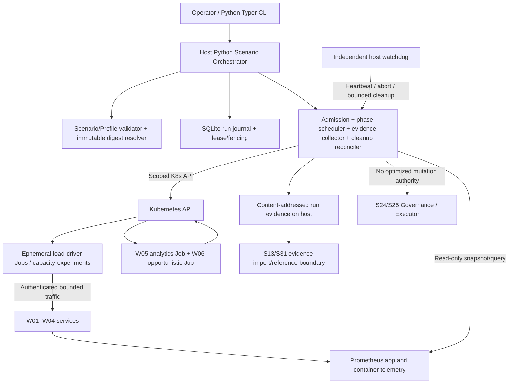
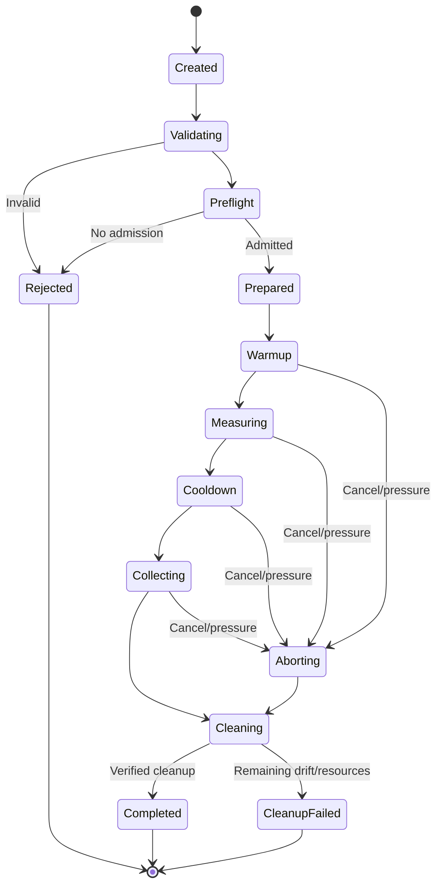

# S05 — Workload Simulation & Scenario Orchestration

> **Approval record (2026-11-17).** The project owner explicitly approved the recommended S05 architecture and all fifteen proposed S05 ADRs. Accepted choices include: **host-side Python/Typer orchestrator plus ephemeral in-cluster Python load-driver Jobs; versioned declarative `ExperimentScenario` YAML; seeded open-loop/closed-loop workload adapters; journaled phased scheduling; SQLite local execution journal; controlled allowlisted faults; per-node/host safety gates and independent watchdog; dedicated experiment namespace; strict separation from the S25 governed Executor; immutable evidence packages; ownership-aware idempotent cleanup; serial-first B0–B3 comparison support.** The owner requested this artifact for use as a ChatGPT Project source. **Approval is architectural only:** no installed Kubernetes cluster, tested workload, calibrated workload intensity, verified identity implementation, successful experiment or measured benchmark is claimed.

## 0. Contract, authority, precedence, and status vocabulary

- **Master catalog v1.0.0** governs 32 slices and cross-cutting invariants. S05 supplies the experimental behavior and orchestration contract for the six S04 workloads.
- **S01 accepted:** AIOps Capacity Operations Platform; Observe/Advisory/Governed modes and L0–L2 autonomy; explicitly human-approved optimized mutations; Critical/Standard/Flexible/Opportunistic criticality; hierarchical workload/namespace/cluster evaluation; current/1-hour/24-hour horizons; B0/B1/B2/B3 evaluation and hard safety constraints.
- **S02 accepted:** exactly six **platform** deployables (`api`, `observer`, `capacity`, `ai`, `governance`, `executor`), REST and PostgreSQL-backed durable workflows/outbox without a required broker, privilege-separated trusted executor. S05 is a local experiment utility, **not** a seventh persistent platform service and **not** an alternative governance controller.
- **S03 accepted:** single Windows 11/Docker Desktop/WSL2 kind cluster with one control-plane and three workers (platform-dedicated tainted worker plus two experiment workers); Calico default-deny; measured per-node scheduling checks; 20 GB physical RAM/Ryzen 5 3600; candidate 12 GiB WSL2 cap; Python automation; host Ollama; provisional resource/host thresholds.
- **S04 accepted:** exactly six distinct demonstration workloads W01–W06, four baseline one-replica Deployments, suspended W05 CronJob template and on-demand W06 Job, bounded APIs and resources, pinned `WorkloadProfile` revisions, SLO/metrics/provenance requirements and optional W02 HPA (baseline off).
- **Precedence:** accepted S01–S04 ADRs cannot be silently superseded. S05-ADR-010's new `capacity-experiments` namespace is an owner-approved **extension requiring an explicit S03 namespace-map addendum** and S03/S07 policy and quota revalidation; it is not evidence that the S03 source file has already been edited. Existing workload namespace assignments and node pools remain unchanged.
- **Decision vocabulary:** `Accepted` = owner approved architectural choice; `Provisional` = example thresholds/rates requiring calibration; `Open downstream` = precise implementation protocol/limits delegated to owner slice; `Deferred` = excluded from P0; `Verified` = only after implementation and tests.

## 1. Purpose, success criteria and boundaries

**Purpose.** Make workload and scheduling demand controllable, replayable, measurable and safely reversible in a resource-constrained local Kubernetes lab, such that S11–S14, S19–S23 and S31 can evaluate capacity forecasts and proposed optimizations against real experiments and correctly labeled simulations.

**P0 success means:**

1. Operators can lint, plan, preflight, run, abort, inspect and clean scenarios via Python CLI with typed config and no arbitrary code execution.
2. Identical pinned inputs and seed yield the **same planned demand schedule and deterministic payloads**, not guaranteed identical real-world latency, Pod placement or observed CPU usage.
3. Light/moderate/exclusive run classes and live per-node/host admission prevent uncontrolled resource pressure.
4. Scenario-owned resources are created from allowlisted immutable templates; all Kubernetes mutation capabilities are separated from S25 optimization execution authority.
5. Actual workload, Kubernetes and Prometheus measurements are correlated with exact workload identities, actual spec versions, clock windows and data quality.
6. Interrupted/aborted scenarios stop new load, reconcile only scenario-owned resources, preserve evidence where possible and surface unresolved cleanup explicitly.
7. S31 can run comparable demand plans for B0–B3 serially and analyze empirical results without mislabeling simulated or synthetic data.

**Non-goals:** permanent load generator Deployment, custom Kubernetes operator/CRD, SaaS load-test service, general-purpose chaos engine, node/container host shutdown in P0, unrestricted Pod eviction, raw arbitrary Kubernetes manifest executor, arbitrary scripts via YAML, autonomous optimization mutation, full HPA/VPA optimization in P0, production traffic import, claims of 24-hour observed history from compressed runs, new platform message broker, or new application business logic.

### 1.1 Explicit slice ownership

| Owner | Owns | S05 relationship |
|---|---|---|
| S04 | W01–W06 application behavior, control APIs, image/templates, resources, SLO/SLI definitions | S05 drives only declared bounded behavior and approved Job templates |
| S05 | Scenario schema, traffic schedules, run phases, temporary resource lifecycle, fault orchestration, independent watchdog, experiment evidence | This specification |
| S06–S08 | Human/machine auth, RBAC, network isolation, secrets and admission | S05 requires capabilities; exact implementation delegated |
| S11–S13 | Kubernetes state, Prometheus metric/query definitions, evidence/intelligence schema | S05 records raw provenance and exports integration-ready bundles |
| S14 | Deterministic numerical forecasting and evidence eligibility | S05 furnishes test inputs; does not produce forecasts |
| S19–S22 | Policy, right-sizing, fit simulator, analytical optimization simulation | S05 exercises live behavior but does not rank/approve candidates |
| S23 | HPA and advanced autoscaling | E05 is optional P1 |
| S24–S26 | Approval, exact execution, post-change verification/rollback | Experiment setup cannot bypass their authority |
| S28 | Platform outage and recovery experiments | Broad platform faults deferred there |
| S30–S31 | Testing and formal comparative evaluation/statistics | S05 captures reliable measurement/test assets |

## 2. Selected deployment architecture

**Accepted Option B: Hybrid orchestration.** A host-run Python orchestration program (Typer) reads immutable scenario files, performs preflight, schedules phases and controls ephemeral Python load-driver Kubernetes Jobs. Host-side orchestration owns journaling, evidence packaging and cleanup; drivers run with experiment-node placement, small measured resource limits and protected connections to S04 workloads.

**Rejected as primary topology:** (A) host-only generator — simpler but unreliable host-to-ClusterIP connectivity and additional network confounders; (C) permanent distributed load-testing controller — unnecessarily adds infrastructure and a privileged always-on control plane. A host-only adapter is permissible for non-traffic maintenance checks, but measurements must record generator topology.



### 2.1 Component boundaries

| Component | Deployment/runtime | Responsibilities | Forbidden authority |
|---|---|---|---|
| Scenario CLI/Orchestrator | Windows/WSL2 host Python environment, pinned dependencies | Validate/plan/preflight/run/abort/status/compare | No S25 execution creds; no generic cluster-admin |
| Scenario registry | Versioned Git YAML + resolved digests | Scenario/profile revision identity | Not actual Kubernetes state authority |
| Phase scheduler | Orchestrator library | Monotonic-relative timing, phase transitions, exclusive run coordination | No persistent service/controller requirement |
| Load driver | Short-lived, digest-pinned Python container Job | Generate requests; record dispatch/response/lag; obey deadlines | No mounted Kubernetes API token, no platform DB/AI/Executor access |
| Kubernetes experiment adapter | Orchestrator library, scoped API client | Read relevant objects; create/deactivate owned Jobs; protected fault actions | No baseline Deployment request/limit mutations |
| Host watchdog | Separate Python process on host | Observe Windows/WSL2/Docker pressure; stop/cancel unsafe run; reconcile known drivers when possible | No platform-service edit, S25 mutation or broad delete |
| Run journal | Local SQLite, persisted outside kind | Run state, intents/results, leases, resources/UIDs, cleanup status | Not authoritative platform plan/approval store |
| Evidence collector | Orchestrator | Snapshot, query, fetch Job summaries, validate quality and integrity | Cannot fabricate absent samples |
| Artifact exporter | Host filesystem, immutable by run ID | Manifest, checksums, provenance, summary | No alteration of earlier finalized run |

### 2.2 Separate namespace extension and placement

- **Accepted S05 extension:** `capacity-experiments` is a dedicated namespace for ephemeral driver Jobs and strictly approved experiment fixtures. Add it to S03's namespace map in a **follow-up S03 documentation revision/addendum**; do not change S03's existing namespace names.
- Driver Pods require `capacity.lab/pool=experiment` and never tolerate the `capacity.lab/dedicated=platform` taint. A driver must not be scheduled onto the platform worker.
- W01 remains `workloads-critical`, W02/W03 remain `workloads-standard`, and W04/W05/W06 remain `workloads-batch`, with exact S04 classes and PriorityClasses.
- `capacity-experiments` needs restricted Pod Security Admission, explicit requests/limits, ResourceQuota including Pods and request/limit budgets, LimitRange, dedicated tokenless driver ServiceAccount, Calico default-deny, and allowlisted traffic to target control APIs. Host-to-API and local socket routing need S03/S07 validation; no assumption that host can route to a ClusterIP.
- ResourceQuota provides admission accounting, not true physical isolation; kind workers share host resources.

## 3. Scenario contract: `ExperimentScenario v1alpha1`

S05 uses YAML files, **not** a Kubernetes CRD. `apiVersion: capacity.lab/v1alpha1`, `kind: ExperimentScenario`. Pydantic typed models, JSON Schema export and safe YAML parsing are implementation recommendations selected under the Python architecture. A scenario is immutable within an executed run; schema changes use explicit version/revision and migration rules.

| Section | Required content | Rules |
|---|---|---|
| Header | `apiVersion`, `kind`, `metadata.id`, `metadata.revision` | Stable ID/version, known enum, normalized names |
| Targets | Workload IDs and pinned WorkloadProfile revisions; namespace expectations | Workload identity and actual UID/version rechecked during preflight |
| Execution | Seed, maximum time, parallel driver cap, execution class, allowed run mode | Finite and bounded; no implicit unlimited defaults |
| Phases | Ordered ID, duration, measurement inclusion, one or more traffic/task/job actions | Total phase duration plus guard margin ≤ max; no unapproved overlap |
| Demand actions | `target`, operation/profile, model, rate/arrival shape, inflight cap, deadline | Server-side S04 parameter maxima; no arbitrary URLs/scripts |
| Fault actions | Fault catalog ID, target, start/stop/TTL, expected observation | Requires explicit fault authorization and safe cleanup |
| Safety | Host policy ref, per-run caps, observed pressure abort flags | Not permitted to weaken central hard limits |
| Evidence | Metrics windows/query refs, cluster snapshots, driver/Job results, quality gates | Capture missingness and time skew |
| Cleanup | Owned Job deletion, cancel active runs, drift checks, retention | Cannot overwrite S25/GitOps state |

### 3.1 Canonical example (illustrative and **not calibrated**)

```yaml
apiVersion: capacity.lab/v1alpha1
kind: ExperimentScenario
metadata:
  id: e02-latency-guardrail
  revision: 1
spec:
  targets:
    - workloadId: w01-latency-api
      profileRevision: 1
      namespace: workloads-critical
  execution:
    seed: 42017
    executionClass: moderate
    mode: live
    maxDurationSeconds: 600
    maxParallelDrivers: 1
  phases:
    - id: warmup
      durationSeconds: 60
      measurement: excluded
      actions:
        - kind: httpTraffic
          target: w01-latency-api
          operation: compute
          model: constant
          requestsPerSecond: 5
          profile: normal
    - id: baseline
      durationSeconds: 120
      measurement: included
      actions:
        - kind: httpTraffic
          target: w01-latency-api
          operation: compute
          model: constant
          requestsPerSecond: 15
          profile: normal
    - id: heavy
      durationSeconds: 120
      measurement: included
      actions:
        - kind: httpTraffic
          target: w01-latency-api
          operation: compute
          model: constant
          requestsPerSecond: 25
          profile: heavy
    - id: cooldown
      durationSeconds: 60
      measurement: excluded
      actions:
        - kind: idle
  safety:
    maxInflightRequests: 32
    requestTimeoutSeconds: 3
    hostPressurePolicyRef: local-host-safe-v1
    abortOnUnexpectedOOM: true
  evidence:
    collectKubernetesSnapshots: true
    collectPrometheusMetrics: true
    collectDriverSummary: true
    retainJobSummary: true
  cleanup:
    deleteOwnedDriverJobs: true
    restoreScenarioOverrides: true
    verifyBaseline: true
    retainArtifacts: true
```

**Validation tiers:** (1) structural/semantic schema, no arbitrary code/paths/URL targets; (2) authorized scope, approved faults, hard maxima, workload profile compatibility; (3) live Kubernetes resource identity/ownership, quota, schedulability, observed pressure, cluster connectivity and temporal readiness. Unknown fields should be rejected in security-sensitive parts of the schema. Resolved run manifests contain image digests/algorithm versions and effective values, never secrets.

### 3.2 Typed execution interfaces (logical contracts, not final HTTP routes)

```text
validate(scenario_yaml) -> ValidationReport
plan(scenario_ref, seed_override?) -> ImmutableDemandPlan + SideEffectPreview
preflight(plan, actor, scope) -> AdmissionReport + ClusterSnapshotRef
run(plan, actor, execution_capability) -> RunId
status(run_id) -> RunStatus + PhaseStatus + QualityFlags
abort(run_id, actor, reason) -> AbortIntentReceipt
cleanup(run_id, actor) -> CleanupReport
compare(run_ids[]) -> ComparableRunSet | IncompatibleRunReasons
```

`plan` and `validate` have no Kubernetes writes. `preflight` is read-only except for separately approved lease claiming during admission, if implementation requires it; document the distinction. `run` records an intent before each external operation. Repeated abort/cleanup are idempotent with at-least-once attempt and Kubernetes UID/version reconciliations. Final public REST endpoints are S27; these contracts initially exist as Python types/CLI commands.

## 4. Demand generation design

### 4.1 Supported traffic patterns

| Model | Shape | Primary experiment |
|---|---|---|
| `constant` | Fixed open-loop requests/s or tasks/s | E01/E02 steady baseline |
| `stepBurst` | Configured baseline, start/end and higher bounded peak | W02 burst; E02/E06 |
| `ramp` | Piecewise linear/step-up demand through allowed ceiling | Saturation/queue behavior |
| `periodic` | Repeated bounded high/low windows (not 24h evidence) | W03/W05 season-like exercise |
| `replay` | Pinned, local, synthetic inter-arrival trace with digest | Optional P0 replay capability |

**Open-loop default for W01/W02 HTTP capacity:** dispatch according to predetermined offered rate without waiting for previous completion; enforce global max in-flight, connection pools, queue capacity and timeout. **Closed-loop alternative:** bounded virtual clients issue a next operation only after completion/think time; useful for W04 task workflow. Closed-loop achieved request rate is not equivalent to fixed offered arrival rate.

The planned **schedule** is deterministic given scenario/config digest, seed, generator algorithm/version, traffic model and operation parameters. Use a monotonic relative clock for timing, a wall UTC clock for evidence windows and an explicitly specified RNG algorithm; independent named random streams for phase, payload and inter-arrival variation prevent unrelated actions from changing reproducibility. Payload checksums/output digests must match S04 deterministic inputs.

### 4.2 Generator accounting

Store `planned_arrivals`, `dispatch_attempted`, `dispatch_accepted`, `completed`, `response_success`, `response_error`, `timeout`, `rejected`, `generator_dropped`, `cancelled`, `dispatch_lag`, `offered_rate`, `attempted_rate` and `achieved_rate` with **explicit numerator/denominator**. Never infer achieved workload throughput from configured target rate; avoid coordinated omission. If generator overload/drops exceed calibrated data-quality thresholds, flag affected measurement as `inconclusive`.

The driver must be bounded on CPU request/limit, memory request/limit, concurrency, queue depth, total operations, HTTP connections, duration, log payload size, artifact size and ephemeral storage. Async Python + `httpx` is the selected reference approach; external k6/Locust drivers are optional non-P0 adapters, not mandatory services.

### 4.3 Workload adapters

| Target | Driver action | Response/evidence |
|---|---|---|
| W01 `latency-api` | `POST /api/v1/compute` with allowlisted `idle/normal/heavy`, seed/work units | Latency, timeout/error and checksum |
| W02 `burst-api` | `POST /api/v1/process`, bounded `normal/burst` | Achieved throughput, latency, errors; HPA metadata when enabled |
| W03 `memory-profile` | Authenticated `POST /api/v1/profile/runs`; poll/cancel | Logical allocation, actual memory, run state, TTL/abort |
| W04 `cpu-worker` | `POST /api/v1/tasks`; poll bounded task completion | Queue depth, task completion/rejection/deadline |
| W05 `analytics-processor` | Start Job from suspended CronJob **template**, normally without modifying its schedule | Exit state, result digest, peak and telemetry coverage |
| W06 `opportunistic-batch` | Instantiate approved Job template with bounded resource/placement parameters | Pending, FailedScheduling, admission/completion/deadline |

W05 CronJob `spec.suspend: true` stays the default. P0 prefer **create a separately named Job from the approved immutable CronJob template** rather than unsuspending the standing CronJob. Temporary CronJob schedule enablement is allowed by S04 only under explicit scenario-specific controls, but *not* required by S05 P0 because it would demand extra mutation authority and restoration complexity. W02 HPA stays disabled at baseline; E05 P1 can use a separate versioned, explicitly approved setup flow.

## 5. Scheduling, run isolation and lifecycle

### 5.1 Trigger classes

1. On-demand operator CLI execution (P0).
2. Serial execution of a selected scenario suite (P0).
3. Scheduled local time trigger via host-native schedule invoking **the same** validated CLI pipeline (P0 optional, no new persistent controller).
4. Telemetry-triggered autonomous stress or AI-launched fault/mutation (deferred).

**Experiment scheduling** is not Kubernetes Pod placement. S05 chooses when/what to launch; the native Kubernetes scheduler decides fit and actual Pod placement. S21/S22 own analytical scheduling feasibility.

### 5.2 Execution classes and locks

- `light`: low-rate checks; overlap permitted only with explicitly compatible targets and after summed budget checks.
- `moderate`: sustained or moderate batch; serialized by default.
- `exclusive`: saturation, memory pressure, fragmentation and benchmark runs; require one global exclusive lease and suspension/avoidance of conflicting heavy capacity analyses/model loading.

A host-persistent SQLite lease contains `lease_id`, `owner_run_id`, `fencing_generation`, `expires_at`, last heartbeat and conflict scope. Leases are not cluster-distributed consensus. A stale runner stops new actions on lost lease. **Expiry never proves old Kubernetes Jobs stopped**; reconcile live owned resources before granting the next conflicting run. For P0, one active host orchestration owner is the simplest enforced posture; simultaneous host processes need OS file/DB locking and fencing checks. Never advertise this as globally distributed multi-host coordination.

### 5.3 Lifecycle state machine



**Orthogonal outcome field:** `passed`, `failed_hypothesis`, `inconclusive`, `aborted`. A workflow may complete while the experiment hypothesis fails. Unexpected early termination or lost evidence cannot be scored as success. Warmup, baseline, stress and cooldown have per-phase start/end stamps, monotonic offsets, workload modes and included/excluded evaluation flags. Multi-action phases are allowed for E06, but summed driver and workload budgets are recalculated.

**Journal transitions:** Append/write a durable intent before side effects, persist observed Kubernetes UID/resourceVersion and result afterward, and commit phase completion only when driver/Job outcomes are reconciled. External K8s actions are not atomic with SQLite; recovery uses compare-and-reconcile, not blind replay.

## 6. Fault injection catalog and restrictions

| Fault ID | P0 behavior | Mechanism | Safety/observability requirement |
|---|---|---|---|
| F01 | Bounded W01/W02 traffic overload | Approved demand model and S04 endpoints | No unbounded threads, report actual offered/achieved |
| F02 | W03 memory spike | Authenticated bounded S04 profile, auto TTL/cancel | Verify real cgroup working set; default no forced OOM |
| F03 | W04 task/CPU saturation | Bounded task submission and queue backpressure | Record accepted/completed/rejected distinctly |
| F04 | W05/W06 deadline/non-completion | Explicit Job deadline/limited template | Capture Job conditions/exit before TTL where possible |
| F05 | W06 expected Pending | Allowlisted request/affinity fixture under bounded quota | Capture true scheduler reason; not a fake simulated state |
| F06 | Selected experiment Pod termination | Restricted, separately authorized exact Pod UID delete | Deployment recovery and accidental disruption measured |
| F07 | W02 burst/HPA | Optional P1 only | HPA off at baseline; metrics-server preflight |
| F08 | Prometheus/Ollama outage | **Deferred** to S28 | Never collapse deterministic monitoring silently |
| F09 | Node shutdown, network partition, disk exhaustion | **Deferred** from P0 | Shared-host/platform blast radius too large |

**Pre-fault:** validate actor, fault type, namespace/resource identity, expected UID, target ownership, active governance state and host budget; snapshot relevant state. **During fault:** enforce maximum duration and server-side caps; record injection intent and actual observed outcome. **After fault:** cancel/stop and verify recovery; if recovery is uncertain, quarantine run and block dependent comparisons.

Possible fault outcome values: `injected`, `observed`, `not_observed`, `recovered`, `recovery_failed`, `interrupted`, `inconclusive`. A successful control API call is not proof that the intended CPU/memory/scheduler effect occurred. W06 priority does not imply preemption: S03 uses `preemptionPolicy: Never` by default.

## 7. Four-layer safety and resource admission

1. **Declarative limits:** seed and action count, fixed rate ceilings, per-phase duration, target allowlist, aggregate maximum duration, bounded fault type/TTL.
2. **Live cluster preflight:** actual eligible **per-node** allocatable and requested CPU/memory; requests versus limits; node taints/tolerations, affinity, PriorityClasses, quotas/LimitRanges, other Jobs, HPA replicas, transient deployments, daemonset overhead and resource versions. Placement fit cannot be inferred from summed cluster free CPU/memory.
3. **Independent host watchdog:** Windows available memory, WSL2 usage/cap, Docker engine/kind health, disk, pressure and runner heartbeat. Kind workers are not physically separate hosts.
4. **S04 server-side enforcement:** individual endpoint memory allocations/work units/TTL/queue/concurrency limits and Job deadlines, even if the runner misbehaves.

### 7.1 S03/S04 numeric starting references — **not measurements**

| Category | CPU requests | Memory requests | Notes |
|---|---:|---:|---|
| S03 initial platform envelope | 2,350m | 4,250Mi | Provisional platform subtotal |
| S04 W01–W04 baseline | 600m | 960Mi | Four Deployments × 1 replica |
| S04 W05 optional active | +250m | +384Mi | Scenario Job only |
| S04 W06 optional active | +200m | +256Mi | Scenario Job only |
| S03 bounded burst/Job allowance | 600m | 800Mi | **Envelope** not a reservation |
| Extra load-driver Pods | **additional, measured** | **additional, measured** | Not hidden inside baseline/batch totals |

Both W05/W06 together require an extra **450m/640Mi** requests; this leaves only **150m/160Mi** of the separate S03 experimental allowance *before* load driver Pods and any other experiment objects. Therefore simultaneous W05+W06+driver execution is **not assumed feasible**. Serialize Jobs, use small calibrated drivers, or reduce/approve alternate bounded profiles only after actual per-node and host preflight.

Reference S03 warnings: WSL2 steady usage >80%, Windows available RAM <2 GiB; abort stress when Windows available RAM <1.5 GiB or actual OOM/pressure. Candidate 12 GiB WSL2 ceiling and 20 GB host are architectural constraints, **not** validated free memory or universal safe bounds. Exact watchdog thresholds must be calibrated and never weakened by YAML. Conserve model resources: no concurrent heavyweight Ollama load and exclusive stress when unsafe.

**Expected unschedulability exception:** F05 can intentionally produce a bounded Pending W06 Job with `expectedUnschedulable=true`, but this exception *only* alters the per-node-fit experiment expectation. It does **not** bypass ResourceQuota, admission, host pressure, authorized namespace, TTL, or privileged resource checks.

### 7.2 Watchdog authority and failure behavior

Watchdog runs as an independent Python host process, owns a narrow experiment-cleanup credential/adapter and can signal/cancel a local run or delete **verified scenario-owned** driver/Job resources after matching UID and journal. It cannot mutate the platform worker, change baseline resource requests, disable policies or touch the trusted Executor. If Kubernetes API/network is unreachable, watchdog cannot promise cleanup; rely on finite driver active deadlines, S04 TTL/bounds, persisted reconciliation and an explicit unresolved state. Host/process restart is a failure scenario, not implicit proof of safety.

## 8. Identity, security, trust boundaries and ownership

**Core rule:** experiment setup and teardown are a bounded, separately approved capability; changing an optimized workload spec is a governed S24/S25 action. Scenario profiles, AI outputs, RAG text and labels never grant permission.

| Operation | Scenario role | Governing rule |
|---|---|---|
| Call protected S04 bounded control endpoints | Allow if authenticated/scope checked | S07 machine identity + server-side caps |
| Read relevant S04 Pod/Job/controller status/events | Allow scoped read | No platform secrets or unrelated namespace reads |
| Create owned driver Jobs under `capacity-experiments` | Allow via constrained template/admission | Digest-pinned images, explicit quota/SA/node pool |
| Create W05/W06 named Jobs from approved templates | Allow with target-scoped policy | Immutable template digest, bounded limits, UID journaling |
| Cancel/delete owned ephemeral Job | Allow with exact UID/owner verification | Least-privilege adapter, no arbitrary name deletes |
| Terminate S04 experiment Pod (F06) | Requires distinct fault capability | Expected UID and narrowly controlled blast radius |
| Patch baseline W01–W04 requests/limits or replicas | **Denied** | S25 governed adapter only |
| Mutate platform/GitOps-managed targets, node labels/taints, RBAC | **Denied** | Outside S05 P0 authority |
| Reset a governed change as cleanup | **Denied** | Separate authorized S25 flow with revalidation |

**RBAC nuance:** Kubernetes namespaced RBAC generally cannot independently implement arbitrary ownership-by-label constraints for Job deletes or restrict all Job create fields; use a restricted experiment operation broker/adapter plus validated admission and narrow SA verbs/resourceNames where applicable, and test negative paths. Creation admission should verify template/digest, exact namespaces, images, non-root security context, requests/limits, SA/token policy, experiment ownership and prohibited privilege features. An owner label alone is insufficient security proof.

**Network:** Calico default-deny, with only approved driver→W01/W02/W03/W04 routes, appropriate DNS, health/metrics scrape paths and permitted control-plane API access. No driver to `capacity-data`, `capacity-ai`, `capacity-core`, `capacity-execution`, OIDC secrets or host Ollama. Keep machine tokens/certs outside scenario YAML, logs, metrics and evidence. S06–S08 decide real auth, certificate and secret distribution; **no claim S05 permissions are implemented yet**.

**Host-credential trust:** host Python orchestration and watchdog must use separately scoped, locally protected kubeconfigs/credentials; use least privileges, no implicit default admin context, explicit cluster identity validation. A compromised host remains high impact, so local-only is not equivalent to secure-by-default.

## 9. Cleanup and crash recovery

### 9.1 Ownership and journal

Each created object has a journal record keyed by `run_id`, action sequence, intended resource identity, namespace, object UID, resourceVersion/generation as applicable, template digest, creation time and allowed cleanup action. Kubernetes labels such as `capacity.lab/managed-by=scenario-runner` and bounded scenario ID support discovery, **but are never the sole ownership test**. The complete high-cardinality UUID stays in journal/annotations and exported manifest, not Prometheus metric labels.

Three separate operations:
- `cleanup`: cancel traffic, stop and remove scenario-owned temporary Jobs/fixtures after collecting evidence.
- `restore`: only undo explicitly tracked, authorized **scenario-owned** transient overrides with compare-and-swap/version checks.
- `baseline-reset`: separately deliberate operation with a fresh ownership, GitOps, plan/approval, UID/version and current-state check. Never blindly reapply original S04 manifests or undo S25 changes.

### 9.2 Cleanup order

1. Stop issuing new arrivals; cancel known W03/W04 tasks/profiles and mark incomplete work correctly.
2. Stop/delete verified owned driver and scenario Jobs when termination allowed and deadline reached.
3. Collect Job termination status, last logs/summary, scheduler events and before/after snapshots **before TTL deletion when possible**.
4. Delete only verified owned ephemeral resources; use bounded Kubernetes API retries, idempotency and UID preconditions.
5. Reconcile any scenario-specific temporary state; detect external edits, S25-governed ownership or GitOps drift and **refuse destructive overwrite**.
6. Verify no active drivers or unauthorized leftovers; check baseline and host recovery; export cleanup report.
7. Finalize manifest/checksums and release lease only when no conflicting active work can be mistaken as stopped. Else set `CleanupFailed`, quarantine affected scope and block follow-on experiments.

**Crash recovery:** On new CLI/watchdog process start, inspect incomplete journal intents, list only allowlisted relevant objects and compare recorded UIDs. Stop orphan load within available credentials, complete collection/cleanup, mark original run `interrupted`/`inconclusive`, and require new `run_id` for fresh traffic. Never resume a partially executed stress phase and claim original schedule equivalence. SQLite intent commit and Kubernetes external side effects are not atomic; reconcile uncertain actions instead of replaying without checks.

**Short-lived Jobs:** missing Prometheus samples must be `missing`, not zero. Capture exit status, Job condition, application digest and concise summary before TTL where possible; if evidence is lost, report it as an explicit quality failure.

## 10. Evidence, data model, provenance and retention

### 10.1 Evidence package

```text
experiments/
  scenarios/e01-cpu-overprovisioning.yaml
  scenarios/e02-latency-guardrail.yaml
  scenarios/e03-memory-spike.yaml
  scenarios/e04-fragmentation.yaml
  scenarios/e05-burst-hpa.yaml
  scenarios/e06-priority-contention.yaml
  runs/<run-id>/
    manifest.json
    scenario.resolved.yaml
    demand-plan.json
    preflight.json
    cluster-snapshot.before.json
    cluster-snapshot.after.json
    host-snapshot.json
    workload-revisions.json
    arrivals-summary.json
    phase-results.json
    faults.json
    kubernetes-events.json
    prometheus-queries.json
    metrics-summary.json
    job-summaries/
    cleanup-report.json
    outcome.json
    checksums.json
```

This directory is an **illustrative artifact convention**, not evidence that these outputs exist. Each completed bundle is content-addressed with a manifest SHA-256 and per-file hashes. A hash demonstrates consistency/tamper detection when verified against a trusted reference, **not** immunity to malicious edits on the same host. S08/S13/S28 decide stronger integrity/retention, backups and platform ingestion.

### 10.2 Minimum run manifest and measurement semantics

Record: `run_id`, `scenario_id/revision/digest`, `seed`, generator/library revision, demand-plan digest, exact image digests, WorkloadProfile IDs/revisions/digests, applied controller Pod/Job UID/spec versions, namespace/priority/pool, requests/limits and HPA status, node allocatable/request snapshot, quota/admission version, host configuration/pressure, experiment actor/authorization reference (not token), time bounds/phase monotonic offsets, PromQL expression/template revision/step, timestamps/time skew, faults, cleanup state, error/inconclusive reasons and evidence quality.

**Truth labels (align definitive enum with S13):** `observed_live`, `historical_observed`, `simulated`, `forecast`, `candidate_estimate`, `realized_post_change`. A generator's artificial demand can cause actual **observed_live** CPU/memory and scheduler events; it does not turn analytical simulation into observed fact. Record synthetic workload origin independently of evidence provenance. Real time and simulated time must never be silently merged; a 10-minute run is not a 24-hour observation.

Define query windows precisely (wall UTC plus relative phase clock); capture scrape interval, missing sample ratio, telemetry availability and cross-source temporal skew. S12 owns final PromQL and metric names. Do not put UUID, seed, unbounded task identifiers, raw URLs or user payload in metric labels. Short sampling windows and histogram p95 estimates require S31 sample adequacy checks. The Kubernetes API is the authority for current object state; Prometheus for observed time-series; the profile is the declared baseline, not proof of applied configuration.

### 10.3 Evidence quality gates

Return `insufficient_evidence`/`inconclusive` where essential samples are absent; driver saturates/drops planned arrivals; actual demand materially differs; Jobs vanish before summary capture; host pressure contaminates runs; critical object state is stale; clocks/skew invalidate comparison; cleanup remains unresolved; or HPA changes unexpectedly. Do not replace missing readings with zeros or manufacture confidence. S12/S14/S31 own final thresholds, statistical repetition and error bars.

## 11. Catalog of scenarios and calibration fixtures

| ID | Priority | Workloads | Traffic/action | Hypothesis and evidence |
|---|---|---|---|---|
| E01 CPU overprovisioning | P0 | W04 | Seeded sustained + idle/active tasks | Request-vs-observed/forecast distinction, tasks within deadline |
| E02 latency guardrail | P0 | W01 | Normal then bounded heavy open-loop HTTP | Reject/identify SLO degradation despite apparent resource savings |
| E03 memory historical spike | P0 | W03/W05 | Steady + bounded spike + on-demand analytics Job | Spike/peak-aware safety; historical evidence not hidden by averages |
| E04 fragmentation | P0 | W06 + approved placement fixtures | Bounded unschedulable native Job | Aggregate spare requests ≠ eligible single-node fit; actual scheduler reason |
| E05 burst/HPA | P1 | W02 | Burst profile with HPA opt-in | Correct replica/request denominator, Pending and lag; baseline HPA off |
| E06 priority/contention | P0 | W01/W04/W06 | Concurrent but bounded differentiated demand | Critical latency/reliability preserved, low-priority delay measured, no assumed preemption |
| CAL-01 driver overhead | P0 fixture | W01/W04 | Low-rate reference | Offered/achieved lag, generator is not hidden bottleneck |
| CAL-02 idle baseline | P0 fixture | W01–W04 | No load | Distinguish application idle from infrastructure overhead |
| CAL-03 abort/reconciliation | P0 fixture | Ephemeral driver/Job | Safe cancellation/crash | Watchdog, state journal and cleanup proof |

Optional replay mode uses pinned *synthetic or previously captured* demand fixtures for deterministic off-line forecasting/optimization analysis. Off-line time-series replay is distinct from Kubernetes-backed experiments and cannot prove live scheduler behavior.

## 12. S31 comparative experiment interface

S05 makes serial, isolated trials possible under common demand-plan digests for:

- **B0** static requests/configuration.
- **B1** rule-based/VPA recommendation-only baseline.
- **B2** deterministic forecast-aware optimization without agents.
- **B3** full AI-enhanced advisory/governed platform.

Repeat controlled runs with multiple seeds or block/order randomization as S31 decides; record host load, actual manifests, HPA state, Ollama activity, timing and system differences. Running the same arrival plan does **not** guarantee same observed performance on shared Windows/WSL2 hardware. When a B2/B3 variant requires an actual resource modification, only S24/S25 may authorize/execute that change, with S26 verification. S05 cannot restore such changes unaided. Keep offline hypothesis simulation and live verified outcomes separate. S31 decides statistical sufficiency, benchmark metrics and comparisons; S05 must not make final value claims.

## 13. CLI and operator workflow

Recommended Typer surface (command names represent contracts, not implemented commands):

```text
scenario list
scenario validate experiments/scenarios/e01-cpu-overprovisioning.yaml
scenario plan experiments/scenarios/e01-cpu-overprovisioning.yaml
scenario preflight experiments/scenarios/e01-cpu-overprovisioning.yaml
scenario run experiments/scenarios/e01-cpu-overprovisioning.yaml --seed 42017
scenario status <run-id>
scenario abort <run-id>
scenario evidence <run-id>
scenario cleanup <run-id>
scenario compare <run-id-a> <run-id-b>
```

`plan` includes expected objects, namespaces, side effects, traffic and resource requests/limits, maxima and cleanup strategy. No write without run authorization; destructive/emergency commands require scoped actor/capability checks and durable audit. Exit codes distinguish schema invalid, preflight rejected, runtime aborted, evidence inconclusive, cleanup failed and successful execution.

## 14. Reliability, observability and failure matrix

| Failure | Required behavior | Evidence/recovery |
|---|---|---|
| Orchestrator crash | Driver deadlines remain finite; watchdog detects missed heartbeat | Journal recovery, UID reconciliation, run marked interrupted |
| Watchdog crash | New heavy admissions fail closed until watchdog restored | Watchdog heartbeat failure; server-side TTL and local intervention |
| Kubernetes API unavailable | Stop local admission, attempt bounded abort; no claim remote Jobs deleted | Unknown cleanup state, reconcile on recovery |
| Prometheus unavailable | Continue protected shutdown and Kubernetes evidence if possible | Mark metric-dependent scoring inconclusive |
| W01/W02 overload | Driver does not grow unbounded backlog | Generated/attempted/dropped, errors/latency, cap proof |
| W03 memory allocation denied | S04 caps enforce rejection/TTL | Allocation failure, real memory, no assumed OOM |
| W04 worker restart | In-memory queue may be lost (S04 known limitation) | Reconcile task IDs/status; do not count lost as completed |
| W05/W06 short-lived before scrape | No fake zero usage | Job summary/conditions; missing signal flag |
| W06 Pending for known constraint | Do not automatically repair it | FailedScheduling/events, actual constraints, bounded deadline |
| Host pressure | Abort stress, stop owned drivers and protect host | Watchdog metrics/actions and residual risk |
| Unauthorized/invalid fault | Fail before side effects, audit denial | Negative security test and no resource changes |
| Cleanup detects S25/GitOps drift | Refuse overwrite; quarantine affected run/scope | Actual UID/version + conflict record |
| Duplicate CLI/action retry | Idempotent receipt and compare/reconcile | Unique run/action keys, no duplicate uncontrolled Job |
| Ollama unavailable | Scenario/telemetry remain functional | No dependence on AI for safe run execution |

**Observability:** correlate structured orchestration logs by `run_id`, `scenario_id`, phase, `action_id` and `fault_id`; metrics for phase durations, admission refusals, generator drop rate, cleanup failures, active driver count, watchdog health and artifact quality; bounded tracing where available. Avoid high-cardinality tags on Prometheus. S28 owns final alert thresholds and platform-level SLOs.

## 15. Functional, nonfunctional and security requirements

| ID | Normative requirement | Primary proof |
|---|---|---|
| S05-FR-001 | Validate and execute versioned declarative `ExperimentScenario` | TEST-001/002 |
| S05-FR-002 | Seeded constant, burst, ramp and periodic demand | TEST-001/003 |
| S05-FR-003 | Open-loop HTTP and bounded closed-loop task model | TEST-003/004 |
| S05-FR-004 | Phase-based time-bounded execution and explicit measurement windows | TEST-004/009 |
| S05-FR-005 | Allowlisted safe faults with injection/observation/recovery records | TEST-010/011 |
| S05-FR-006 | Scoped ephemeral drivers and W05/W06 activation | TEST-005/012 |
| S05-FR-007 | Capture workload, cluster, Prometheus and host evidence with origin | TEST-006/013 |
| S05-FR-008 | Idempotent abort, cleanup and crash reconciliation | TEST-007/008 |
| S05-FR-009 | Serial scenario-suite and independent run IDs | TEST-009/014 |
| S05-NFR-001 | Same pinned seed/input generates identical *planned* schedule/payload | TEST-001 |
| S05-NFR-002 | Finite duration, concurrency, requests, memory and disk budgets | TEST-002/003/015 |
| S05-NFR-003 | Local durable run/side-effect journal with safe uncertainty recovery | TEST-007/008 |
| S05-NFR-004 | Missing, stale, overloaded-generator evidence is not scored as success | TEST-003/006/013 |
| S05-SEC-001 | Scenario role cannot mutate optimized baseline workloads/S25 objects | TEST-016 |
| S05-SEC-002 | Scoped namespace/template/UID-based experiment create/delete policy | TEST-005/016/017 |
| S05-SEC-003 | Unknown arbitrary code/faults/host endpoints rejected | TEST-002/017 |
| S05-SEC-004 | Cleanup cannot overwrite GitOps or governed resource changes | TEST-018 |
| S05-REL-001 | Host pressure/dead watcher blocks or aborts heavy stress | TEST-015/019 |
| S05-REL-002 | Orphan reconciliation before conflicting new experiments | TEST-008/014 |

### 15.1 Acceptance test plan

| ID | Scenario | Required expected result |
|---|---|---|
| S05-TEST-001 | Same pinned YAML/seed/version repeated | Same arrival schedule and payload digests; timestamps/runtime allowed to differ |
| S05-TEST-002 | Invalid schema, unbounded duration/rate, unknown target/fault, arbitrary command | Fail closed without load/cluster side effects |
| S05-TEST-003 | Driver resource saturation and insufficient in-flight budget | No unbounded queue; drops/timeouts tracked; invalid sample quality flagged |
| S05-TEST-004 | Constant/burst/ramp/periodic plus closed-loop, multiple phases | Planned model reproduced and phase windows precisely reported |
| S05-TEST-005 | W05 Job from suspended template; W06 on-demand Job | Correct UID/namespace, bounded Job status, captured summary and cleanup; CronJob stays suspended |
| S05-TEST-006 | Missing Prometheus samples | Explicit missing/insufficient evidence; never zero-filled |
| S05-TEST-007 | Repeated abort/cleanup | Safe idempotent finalization and no unrelated deletes |
| S05-TEST-008 | Kill runner after side-effect intent before response | Reconcile uncertain object by UID/metadata; no blind duplicate or phase resume |
| S05-TEST-009 | Serial suite / phase interlock | Time windows and outcome per run; no unapproved overlap |
| S05-TEST-010 | F02 real memory spike, F05 actual Pending | Injection ≠ observed proof; cgroup and scheduler evidence captured |
| S05-TEST-011 | F06 restricted Pod termination | Authorized UID-only action, recovery/availability recorded |
| S05-TEST-012 | Driver on experiment pool, baseline workload topology preserved | No placement on platform worker; W01–W04 baseline persists |
| S05-TEST-013 | Missing Job summary or high temporal skew | Run inconclusive where needed, quality reason explicit |
| S05-TEST-014 | Lease expiry with old driver still running | No new conflicting experiment until owned work reconciled |
| S05-TEST-015 | Unsafe per-node fit/quota/host budget | Preflight refusal; intentional Pending only through constrained F05 exception |
| S05-TEST-016 | Attempt scenario role patch Deployment resources / platform object | Forbidden; no mutation |
| S05-TEST-017 | Unauthorized route/cross-namespace access and poisoned YAML | Network/auth denial; no tokens/secret leakage or execution |
| S05-TEST-018 | Approved S25 resource change during scenario; cleanup/reset attempted | Detect current version/GitOps ownership, refuse overwrite |
| S05-TEST-019 | Host available RAM below calibrated abort / watchdog absent | Stress canceled or not admitted; bounded unresolved state when API unavailable |
| S05-TEST-020 | Run B0–B3 with same demand-plan digest | Exact inputs tracked, differences documented; no unapproved S25 mutation |

**Testing strategy:** extensive pure-model/schema/demand-schedule unit tests; HTTP-driver integration tests with bounded fake workload; Kubernetes adapter contract tests with fakes; security negative tests with a real restricted ServiceAccount; a few kind E2E tests for Pending, Job cleanup, default-deny network, Pod termination, watchdog/restart; operational tests for crash/host pressure. Actual SLO thresholds and statistical benchmark efficacy are S19/S31-owned implementation gates.

## 16. Accepted ADR register

| ADR | Status | Accepted choice | Rationale and consequence |
|---|---|---|---|
| S05-ADR-001 | **Accepted** | Hybrid host Python orchestrator + ephemeral in-cluster load-driver Jobs | In-cluster traffic, no permanent runner platform service |
| S05-ADR-002 | **Accepted** | Declarative, versioned, digest-resolved `ExperimentScenario v1alpha1` YAML | Reproducible config without CRD |
| S05-ADR-003 | **Accepted** | Async Python HTTP generator with S04 workload adapters | Fit custom task/memory/job APIs without extra mandatory tooling |
| S05-ADR-004 | **Accepted** | Seeded open-loop default, bounded closed-loop support | Preserve offered-load attribution while supporting workflows |
| S05-ADR-005 | **Accepted** | Journaled phase state machine, bounded windows and explicit outcomes | Durable intent, crash reconciliation, correct evidence |
| S05-ADR-006 | **Accepted** | Local Typer CLI, no persistent scenario controller/broker | Low host cost; S02 six platform services unchanged |
| S05-ADR-007 | **Accepted** | Allowlisted Kubernetes/API faults, no required P0 chaos platform | Narrow, testable blast radius |
| S05-ADR-008 | **Accepted** | Kubernetes resource admission + independent host watchdog | Protect shared physical host and essential services |
| S05-ADR-009 | **Accepted** | Experiment-scoped authority separate from S25 Executor | No alternate optimization mutation path |
| S05-ADR-010 | **Accepted** | Dedicated `capacity-experiments` namespace | Isolate ephemeral drivers; requires S03 addendum/policy revalidation |
| S05-ADR-011 | **Accepted** | SQLite host journal + content-addressed immutable evidence exports | Local durability and inspectable provenance |
| S05-ADR-012 | **Accepted** | UID/ownership-aware cleanup, quarantine and safe restart recovery | No blind reset/authorized-work rollback |
| S05-ADR-013 | **Accepted** | Distinct live/historical/simulated/forecast/realized provenance | Avoid misleading capacity claims |
| S05-ADR-014 | **Accepted** | Serial B0–B3 comparative runs sharing pinned demand plans | Enable fair S31 evaluation within host capacity |
| S05-ADR-015 | **Accepted** | E01–E04/E06 P0, E05 HPA advanced behavior P1 | Preserve S01/S04 HPA baseline and P1 boundary |

### 16.1 Alternatives and tradeoffs on record

- **Host-only generator** rejected as sole option; host-to-ClusterIP issues, traffic-path confounding and observability loss. Host orchestration still selected.
- **Permanent distributed controller** rejected for P0; persistent resources and privilege footprint incompatible with local-lab simplicity.
- **k6/Locust mandatory** not selected; can integrate later through versioned driver adapter if needed.
- **Chaos Mesh/Litmus mandatory** not selected for P0; native controlled faults sufficient and easier to audit.
- **Baseline patch for experiment setup** not selected as general runner power; approved Jobs/templates and authenticated bounded S04 controls prioritized.
- **SQLite is runner journal**, never a substitute for S02 PostgreSQL authoritative plan/workflow/audit aggregates.

## 17. Upstream reconciliation and downstream open gates

### 17.1 Cross-slice reconciliation

1. **Six platform deployables remain six**: S05 host CLI and transient Jobs are not additions to S02's persistent platform service count.
2. **Namespace extension is explicit**: add `capacity-experiments` to S03 via a source update/addendum during implementation; preserve all other S03 namespaces and node placement conventions.
3. **No fake host isolation**: kind workers share Windows/WSL2; scenario quota/request envelope and watchdog are complementary not interchangeable.
4. **S04 workload map preserved**: W01/W02/W03/W04 controller types/namespaces/classes and W05 suspended/W06 on-demand policy remain unchanged.
5. **S04 W02 HPA stays off** at baseline; opt-in E05 is P1 and must capture request-denominator/replica consequences.
6. **Governance preserved**: no runner-controlled optimization patch, no reset of S25/GitOps decisions. S05's fixture/Job setup uses independently constrained authority.
7. **Source truth preserved**: S04 WorkloadProfile = declared behavior/baseline; Kubernetes = applied object/resource state; Prometheus = observed time series; S14/S22 = forecasts/analytical simulations; S13/S31 = evidence interpretation and evaluation.
8. **Physical budget unverified**: S03/S04 sample CPU/memory values, 12 GiB WSL2 candidate and warning thresholds are provisional until actual preflight and calibration.
9. **No synthetic 24h assertion**: live 1h/24h forecast evaluation requires appropriate historical or time-correct replay evidence; compressed synthetic phases do not manufacture observed days.

### 17.2 Open downstream implementation details (not architecture-approval blockers)

| Slice | Pending decision/validation |
|---|---|
| S03 + S07–S08 | Namespace-map addendum; runtime Calico policy, service identity/cert mechanism, restricted Kubernetes admission implementation; negative permissions verified |
| S11–S13 | Resource identity joins, PromQL and scrape interval, short-Job summary transport, evidence import/retention/provenance enum |
| S19 | Calibrated critical SLO floors, allowed request changes and hard policy thresholds |
| S23 | HPA-enabled experiment setup and full autoscaling analysis |
| S24–S25 | Version/ownership revalidation and controlled optimized change/reset workflow |
| S28 | Host watchdog operational alerts, restart/backup behavior, broader chaos/outage tests |
| S29 | Python dependency lock, image digest pinning, exact Kubernetes/Calico versions and manifest deployment |
| S30–S31 | Fault-test depth, sample sizes, effect statistics, B0–B3 benchmark reports |

**Implementation-blocking prerequisites:** pinned workload/driver images, real per-node and host budget calibration, a verified narrow experiment identity/RBAC/admission path, protected workload control endpoints, Calico negative-path checks, journal durability tests, and evidence collection/abort/cleanup tests. Their absence does not revoke architectural approval but means **not yet implemented / not release-ready**.

## 18. Suggested implementation packages and repository layout

### 18.1 Engineering sequence

1. Contract/schema: `ExperimentScenario` Pydantic validation, safe YAML parser, version/digest handling, deterministic seeded plan generator.
2. Driver/adapter: bounded `asyncio` HTTP task load; W01/W04 tests; optional in-cluster driver Jobs with explicit resources and network policy.
3. Kubernetes planning: read-only per-node/host/quota/owner preflight, W05/W06 template Jobs, namespace and admission policies.
4. Lifecycle: Typer CLI, SQLite intent journal, serial/exclusive lease, phase scheduler, watchdog and idempotent cleanup.
5. Fault/evidence: F01–F06, Job summaries, Prometheus/cluster snapshots, quality flags and artifact hashes.
6. Benchmark handoff: CAL fixtures, E01–E04/E06 suites and S31 comparison interface; retain E05 as P1.

### 18.2 Suggested layout (not prescriptive)

```text
experiments/
  scenarios/{e01,e02,e03,e04,e05,e06}*.yaml
  schemas/experiment-scenario.v1alpha1.schema.json
  src/scenario_runner/
    cli.py
    contracts/
    demand/
    adapters/{http,kubernetes,prometheus,workloads}/
    lifecycle/
    safety/
    faults/
    evidence/
    persistence/
  drivers/python/
  kubernetes/{namespace,rbac,networkpolicy,quotas,job-templates}/
  tests/{unit,contract,integration,e2e,operational,security}/
  runs/                    # ignored local generated artifacts
specs/slices/S05-workload-simulation-scenario-orchestration/
  01-purpose-and-scope.md
  02-requirements.md
  03-architecture-and-alternatives.md
  04-contracts-and-data.md
  05-security-and-threat-model.md
  06-failure-modes-and-operations.md
  07-acceptance-tests.md
  08-decisions-and-open-questions.md
```

This consolidated `.md` is project-ready and covers the eight master-catalog spec concerns in one file; split files are optional for implementation.

## 19. Completion gate and change policy

**Architecture: ACCEPTED on 2026-11-17. Implementation: NOT STARTED/NOT VERIFIED.** S05 architectural decisions are approved, not operational proof. S05 can hand typed expectations to S06/S07/S08/S11–S13/S25/S28/S30/S31. Before coding, implementation-blocking authentication, quota and host budgets must be resolved; before product readiness, run acceptance/security/failure tests with actual evidence.

Changing hybrid topology, YAML ownership, independence from S25, approved driver isolation, evidence provenance, basic lifecycle/cleanup or P0/P1 experiment boundary requires a **superseding S05 ADR**, coordination with impacted upstream slices, and update of the master catalog decision register. Numeric thresholds, pinned package versions and exact endpoint authentication mechanisms may be calibrated by their owning downstream slices without misrepresenting initial S05 approval.

**Suggested next slice:** **S06 — Identity, Authentication & Authorization**, using this S05 host operator + machine identity + scoped fault-capability model as explicit input.
