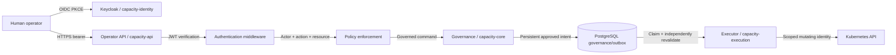
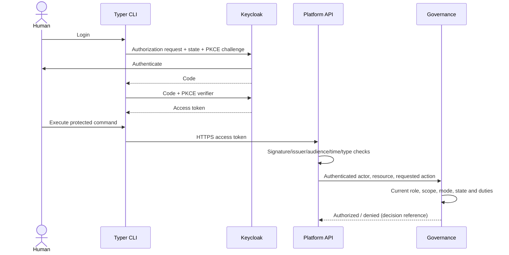

# S06 — Identity, Authentication & Authorization

> **Approval record (2026-11-17).** The owner explicitly approved **Keycloak + OIDC** as the human identity provider and **RBAC + resource scope + policy conditions** as the application authorization architecture. This specification formalizes those choices and the minimum consequences needed to implement them consistently with S01–S05. Detailed profiles, suggested defaults and mechanisms not expressly selected are identified as *implementation recommendations* or *downstream open*. **Accepted architecture is not an implemented, security-tested, or release-ready system.**

## 0. Authority, precedence and boundaries

- Master catalog v1.0.0 is the authoritative 32-slice roadmap and security-invariant catalog.
- S01: AIOps Capacity Operations Platform; Observe / Advisory / Governed modes; L0–L2 (no L3); human-approved exact changes; Critical / Standard / Flexible / Opportunistic classifications; current/1h/24h horizon; hard safety constraints before scoring; B0–B3 evaluation.
- S02: exactly six persistent custom platform Deployments: `api`, `observer`, `capacity`, `ai`, `governance`, `executor`; modular monorepo, typed contracts, REST plus PostgreSQL-backed durable jobs/outbox, no required broker; independent deterministic core and AI; authoritative schema owners; Governance and Executor separated.
- S03: one control-plane + three workers, Calico/default-deny, localhost HTTPS, `capacity-identity` namespace, one shared-host kind lab with provisional memory/CPU budgets.
- S04: six distinct W01–W06 demonstration workloads; four baseline Deployments and suspended W05/on-demand W06; unprivileged tokenless Pods and bounded protected controls.
- S05: host Typer/Python orchestrator, independent watchdog, SQLite journal, ephemeral in-cluster tokenless driver Jobs in accepted added `capacity-experiments` namespace; experimental mutations never constitute S25 optimization authority. S03 namespace-map addendum is still required.
- S06 owns human principals, access tokens, role-to-permission models and authorization contracts. **S07** owns ServiceAccount identity, workload authentication/TLS, Kubernetes RBAC and network policies. **S08** owns credentials, signing keys, certificate PKI, admission and data protection. **S09** owns agent/tool/RAG security; **S24** owns plan approval lifecycle; **S25** owns execution enforcement.

**Decision vocabulary:** Accepted = user-approved architecture or necessary invariant; Proposed implementation = suggested technical mechanism not independently approved; Open downstream = belongs to another slice; Verified = requires actual passing tests.

## 1. Purpose, scope and explicit non-goals

**Purpose.** Authenticate human operators, distinguish human and machine authorities, authorize every protected API/workflow by action and exact scope, and prevent access to observation or planning capabilities from implicitly granting plan approval or cluster mutation.

**In scope (P0):** Keycloak realm/client model; OIDC human authentication; CLI public-client login; API JWT verification; Viewer/Analyst/Planner/Approver/Executor/Administrator roles; permission-and-scope policy evaluation; denial/decision recording; mode restrictions; durable authenticated actor context; revocation/freshness expectations; cross-service identity propagation; separation of duties; security and recovery tests.

**Out of scope:** custom password database; deploying a new authorization microservice; treating Keycloak RBAC as a substitute for Governance policy; giving humans Kubernetes mutating kubeconfigs through the platform; AI agents as human principals; implementing S08 PKI/storage or S24/S25 state machines in this slice; auto-approval; public cloud federation; mandatory enterprise SSO integration; break-glass bypass in P0.

## 2. Selected architecture and alternatives

| Option | Tradeoff | Decision |
|---|---|---|
| **Keycloak / OIDC** | Local standard protocols, sessions, MFA and clients; adds identity runtime and DB | **Accepted** |
| Authentik / OIDC | Credible local alternative, different admin footprint | Not selected |
| Custom JWT/password login | Low apparent footprint, unacceptable custom identity/security burden | Not selected |
| Kubernetes authentication for all human APIs | Poor operator/approval semantics | Not selected |

**Authorization: accepted hybrid RBAC + resource scope + policy conditions.** A valid token authenticates the caller, but neither role alone nor network locality authorizes an operation. The authoritative scoped authorization model is owned by Governance; entry services enforce applicable checks and Governance independently rechecks state-changing requests. Executor independently validates durable approval and current policy/state before any change.



The arrows represent authorized logical contracts. Governance→Executor is primarily a durable workflow handoff under S02, **not** an unconditional direct RPC or a header trusted solely because it came from inside the cluster.

## 3. Identity taxonomy and ownership

| Principal class | Source | Authentication | Authority |
|---|---|---|---|
| Human operator | Keycloak `sub` | OIDC bearer access token | S06 role, scoped grant, current policies |
| Local CLI | Keycloak public OAuth client acting for human | Authorization Code + PKCE | Human permissions, no baked-in client secret |
| Persistent service | Dedicated Kubernetes workload identity | S07 token and/or certificate verification | Explicit machine API permissions; never automatic human approval |
| Host scenario orchestrator | Restricted host identity plus authenticated operator context | S07 host credentials; S06 authorization of protected scenario commands | S05 experiment-only capabilities |
| Host watchdog | Separate restricted host identity | S07 narrow credentials | Emergency experiment-only cancellation/cleanup |
| Ephemeral load driver | Dedicated tokenless Pod + scoped short-lived app capability | S07 authenticated control API | S04 bounded operations only |
| AI logical agents | Run under `ai` service, inherited authorized context for read tools | S07 workload identity + delegated bounded context | Advisory only, no human approval or K8s mutation |
| Trusted executor | Dedicated `capacity-executor-sa` | S07 workload identity / K8s authentication | Only independently validated approved mutation |

Never reuse a human token as a durable background job credential. Durable jobs store only validated **attribution and an authorization reference**, not raw access tokens; workers independently authorize sensitive actions at their execution boundary.

## 4. Keycloak deployment and identity contracts

- Use the existing S03 `capacity-identity` namespace and platform-node placement. Keycloak is supporting infrastructure, **not a seventh custom S02 platform business Deployment**.
- Use the already accepted S02 PostgreSQL server with an isolated Keycloak database/principal where supported. DB schema/data ownership stays independent from capacity/governance business schemas; credentials handled by S08.
- Accept a single local realm and distinct OAuth clients for CLI and protected API as the P0 logical default. Realm name/client IDs remain implementation parameters.
- Stable trusted issuer, correct OIDC discovery, audience issuance and signature/JWKS rollover are mandatory. S03 localhost-bound HTTPS posture is unchanged. Candidate hostname `auth.capacity.test` is **illustrative**; S27/S29 must settle browser, Windows, WSL and in-cluster resolver/trust equivalence.
- Protected administrative setup and identity management, least privileged realm administrator, and MFA for approval-capable human accounts are strong recommended defaults; exact MFA and bootstrap/recovery policies are S08/S27 details.
- Keycloak owns users, credentials, groups, authentication and coarse role mapping. Governance owns resource grants, scope assignments, operational constraints and final authorization outcomes. Keycloak group/role updates are inputs—not a source of unrestricted permission.

## 5. OAuth/OIDC login and API validation

**Selected application profile:** human OIDC login. **Implementation recommendation:** OAuth 2.0 Authorization Code + PKCE for Typer public CLI, using browser and temporary loopback redirect, with Device Authorization Grant as fallback only if supported/configured. No client secret is embedded in CLI. S27 finalizes command names, error envelopes and safe local token cache; S08 finalizes token protection.



**Access-token validation must check:** algorithm allowlist/signature and trusted JWKS, exact `iss`, expected API `aud`, expiration and `nbf` with bounded skew, token type, stable `sub`, known client where required and relevant claimed roles. Never accept an ID token in place of an API access token. Treat invalid authentication as 401; valid authentication without permission as 403. Cache verified keys with safe rotation; JWKS availability cannot mean unsigned or unchecked acceptance.

**Default values not accepted as policy yet:** 5–15 minute access-token lifetime, strict privileged-operation reauthorization freshness, bounded token cache. S08/S27 must pin their exact settings and refresh/revocation policies. A valid non-expired JWT can remain cryptographically valid after role removal; Governance must check current effective permissions for approval/execution requests.

## 6. Authorization domain model

**Accepted evaluation rule:** `Allow = Authenticated ∧ RolePermission ∧ ResourceScope ∧ OperatingMode ∧ Resource/WorkflowConditions ∧ CurrentPolicy`.

- `principal`: issuer + stable subject; separately identify calling machine and original authenticated human actor.
- `action`: stable namespaced operation identifier, e.g., `inventory.read`, `forecast.request`, `plan.create`, `plan.approve`, `execution.request`, `experiment.run`, `experiment.fault.pod-terminate`.
- `resource`: cluster ID, namespace, Kubernetes kind/name, stable object UID when a specific live object is required, plan ID/revision as applicable.
- `scope`: explicit cluster/namespace/workload grant; no implicit all-namespace authority from a service's network position or a workload label.
- `conditions`: mode (Observe/Advisory/Governed), criticality, plan author, current approval state, policy version, resource ownership and time-sensitive constraints.
- `decision`: allow/deny and machine-readable reason, policy/grant version, evaluated subject and correlation ID; never echo secrets.

**Authorization must be denial-by-default**, with role permissions non-hierarchical by default. A plan/retrieval result must not leak unauthorized namespace context, including through AI tools, pagination, errors or aggregate queries.

### 6.1 Roles and reference action matrix

| Action | Viewer | Analyst | Planner | Approver | Executor (human) | Administrator |
|---|---|---|---|---|---|---|
| Authorized inventory/metrics/plan read | Yes | Yes | Yes | Yes | Yes | Yes |
| Forecast and analytical investigation | No | Yes | Yes | Conditional | No | Scoped admin function |
| Create/submit candidate plans | No | No | Yes | No | No | Separate explicit grant only |
| Approve/reject exact eligible plan | No | No | No | Yes | No | **No implicit approval** |
| Request execution of approved plan | No | No | No | No | Yes | **No implicit execution** |
| Administer grants/policies/roles | No | No | No | No | No | Yes |
| Audit read | Scoped | Scoped | Scoped | Scoped | Scoped | Administrative scope |

`Executor` is a **human application role**, not the K8s service account or permission to call Kubernetes directly. An admin can receive other roles via an explicitly governed grant, but is not a universal superuser. The exact role→permission registry and conditional exceptions are versioned contracts; S24 owns approval-related hard rules.

### 6.2 Mandatory separation and operating-mode rules

1. Plan creator and approver must be distinct human subjects for governed approval; agents and service accounts cannot approve.
2. Creating, approving and requesting execution are distinct permissions. Distinct third human executor is **not** mandatory for P0 local testing; approval and execution requests remain separately authorized.
3. Observe/Advisory never authorize workload mutation. Only Governed mode plus exact, unexpired approval can proceed to execution consideration; even then Executor revalidates.
4. High-impact administrative roles cannot bypass hard workload/SLO/policy constraints or generate a valid human approval automatically.
5. A role grant is never proof of namespace entitlement, plan freshness, immutable target identity or GitOps ownership.
6. Break-glass override bypass is deferred; do not implement an undocumented backdoor.
7. Single-user lab demonstration may employ two distinct test identities; recording two roles on one principal is not valid separation of duties.

## 7. Protected service boundary and durable authorization envelope

S02's HTTP/async job split remains authoritative. Propose a versioned internal envelope for state-changing API commands:

```json
{
  "schemaVersion": "auth-context/v1alpha1",
  "requestId": "correlation-id",
  "actor": {"issuer": "trusted-issuer", "subject": "stable-human-subject"},
  "callerService": "api",
  "action": "plan.approve",
  "resource": {"cluster": "capacity-lab", "namespace": "workloads-batch", "planId": "plan-0042", "planRevision": 3},
  "authorizationRef": "authz-decision-reference",
  "policyRevision": "policy-revision-reference",
  "issuedAt": "ISO-8601-UTC"
}
```

**Not a bearer credential and not a signed approval record.** Callers cannot simply invent the actor/context headers. The receiver must authenticate the machine, validate the actor/delegation binding through a trusted mechanism and independently authorize the protected operation. Exact assertion integrity, replay defense, TTL, durable serialization and signatures are **open S07/S08/S24 interface details**. An authenticated `api` client cannot authorize itself on behalf of any arbitrary `sub`.

Long-running jobs should persist actor/authorization references, not refresh tokens, and reevaluate critical current permissions at execution time. S24 defines whether and how role revocation invalidates already approved but unexecuted plans; S25 independently checks plan digest/version, target UID/resourceVersion, policy, expiration, permissions and ownership immediately before mutation.

## 8. Approval integrity and execution-request boundaries

Required approval identity bindings: exact plan ID+immutable revision/digest, allowed operation, bounded targets and namespace scope, authenticated approving human, policy/grant revision, approval timestamp/expiration, author/approver distinction, current target-state preconditions and audit reference. An approval cannot be widened to extra workloads or silently retargeted after signing/storing. S24 specifies the final canonical plan digest and approval state machine. S25 specifies optimistic concurrency, conditional mutation, idempotency, GitOps adapter and uncertain-outcome recovery.

**Separation of responsibilities:** `api` validates human caller and request; `governance` owns authoritative approval decisions and durable state; `executor` has independent narrow mutation capability but **no authority to issue approvals**; `ai` supplies advisory evidence only.

## 9. Threat model and security requirements

| Threat | Required control | Negative evidence |
|---|---|---|
| Wrong issuer/audience, forged, expired or ID token | Strict token validation | 401; no operation |
| Valid viewer invokes approval | Explicit action policy | 403 |
| Approver targets foreign namespace | Scoped resource policy | 403; no cross-namespace disclosure |
| Same human authors and approves | Duty separation at Governance | Denial/audit |
| Administrator grants self blanket approval bypass | No implicit approval, audited grant governance | Denial without explicit valid approval |
| AI/tool result contains an approval instruction | Untrusted context never authorization | No approval or mutation |
| User removed from Approver role before approval | Current effective authorization refresh | Rejected despite old JWT role claim |
| Stale or tampered plan revision | Approval bound to immutable plan | Executor/approval rejection |
| Attacker forges user context over internal REST | Mutual service identity and verified actor binding | Denied independently |
| Keycloak is unavailable | No fail-open, bounded read-only degradation | Privileged actions blocked when freshness can't be proved |
| Credential spill via logs/journal | S08 redaction and secret lifecycle | Leak test failure |

Requirements: `S06-FR-001` local OIDC human login; `002` secure CLI public-client flow; `003` strict token validation; `004` six application roles; `005` scoped resource/action/condition enforcement; `006` mode enforcement; `007` distinct author/approver; `008` durable actor audit; `009` independent receiver authorization; `010` fail-closed sensitive authorization freshness; `011` typed S07/S24/S25 handoffs. Security requirements `S06-SEC-001` no human direct mutation credentials, `002` no token/header impersonation, `003` no AI/service approval, `004` no implicit admin escalation, `005` no sensitive tokens in logs/storage/evidence. NFRs: bounded auth latency and JWKS refresh, resource budgets consistent with S03, deterministic deny reasons, auditable correlation and outage recovery. Numeric SLOs are open S28.

## 10. Failure, reliability, and operational behavior

| Condition | Response |
|---|---|
| Keycloak down | No new auth; existing appropriately verified JWTs may allow bounded reads. Sensitive actions require current policy/freshness and fail closed if unavailable. |
| JWKS stale or unknown key | Attempt controlled refresh; reject unknown/unverifiable signature. |
| Policy store unavailable | No plan approval or execution authorization; retain audit/uncertainty signals where possible. |
| Human authorization changed while a durable job waits | Re-evaluate at sensitive action boundary; never treat queued job as timeless grant. |
| Actor context lost/invalid after service handoff | Reject sensitive operation, no default service impersonation. |
| Retry/duplicate approval request | Idempotency and exact revision state contract under S24; no duplicate implicit approvals. |
| Keycloak/DB restart | Restore persistent identity state and keys under S08/S28; do not claim access continuity without tests. |

Emit low-cardinality authentication outcomes, authorization denial counts and duration histograms; sensitive decision records link actor, action, scope, result, policy/grant revision and `correlation_id`. Avoid user/token IDs as Prometheus labels; detailed IDs belong in controlled audit storage.

## 11. Acceptance tests

| ID | Required proof |
|---|---|
| S06-TEST-001 | Public CLI PKCE authentication succeeds with valid locally trusted OIDC issuer and no embedded secret. |
| S06-TEST-002 | Missing/invalid credentials produce 401. |
| S06-TEST-003 | Wrong signature, issuer, audience, type, expiration and not-before are each rejected. |
| S06-TEST-004 | Viewer cannot create or approve a plan. |
| S06-TEST-005 | Approver cannot approve another namespace/workload outside explicit scope. |
| S06-TEST-006 | Same authenticated `sub` cannot author and approve the same plan. |
| S06-TEST-007 | Observe and Advisory modes prohibit execution requests. |
| S06-TEST-008 | Current role/grant revocation prevents new privileged approvals despite previously issued token. |
| S06-TEST-009 | Altered plan revision/digest cannot reuse an earlier authorization. |
| S06-TEST-010 | Forged user delegation from an authenticated internal service is denied. |
| S06-TEST-011 | IdP/policy dependency outage has defined read/degraded vs fail-closed privileged behavior. |
| S06-TEST-012 | Raw access/refresh tokens and sensitive claims do not leak via logs, trace fields or durable workflow payloads. |
| S06-TEST-013 | Admin role cannot implicitly approve/execute or bypass author separation. |
| S06-TEST-014 | Namespace-filtered query and AI tool context do not disclose out-of-scope objects. |

**Quality gate:** Architectural S06 is accepted; release requires OIDC route/issuer/TLS proof, authenticated service handoffs, current policy checks, separation tests, secret protection and negative E2E evidence with real Keycloak/API/Governance configurations. No implemented/verified claim.

## 12. Accepted ADR register

| ADR | Status | Decision |
|---|---|---|
| S06-ADR-001 | **Accepted** | Keycloak + OIDC for human authentication; integrate with existing `capacity-identity` and local PostgreSQL posture. |
| S06-ADR-002 | **Accepted design consequence** | Public CLI with standards-based OIDC; Authorization Code + PKCE recommended profile, final CLI details delegated S27. |
| S06-ADR-003 | **Accepted design consequence** | Validate issuer, audience, signature, expiration, token kind and actor identity on protected API routes; no fail-open. |
| S06-ADR-004 | **Accepted** | RBAC plus explicit resource scope and policy conditions. |
| S06-ADR-005 | **Accepted design consequence** | Six catalog human roles; no automatic role hierarchy or Administrator bypass. |
| S06-ADR-006 | **Accepted design consequence** | Governance authoritative for current scoped policy and plan authorization, with enforcement in services and independent Executor checks. |
| S06-ADR-007 | **Accepted design consequence** | Human author and approver must differ; separate approval vs execution request; no AI/machine approval. |
| S06-ADR-008 | **Accepted design consequence** | Exact plan/target approval attribution and fail-closed privileged operations; final state binding S24/S25. |
| S06-ADR-009 | **Accepted design consequence** | No additional permanent standalone authz microservice in P0; preserve S02 six platform Deployments. |

## 13. Explicit downstream open gates

| Owner | Not finalized here |
|---|---|
| S07 | Actual machine verifier/token audiences, authenticated delegation envelope, per-service TLS/mTLS mapping and host principals. |
| S08 | Realm bootstrap, exact token lifetime/refresh/revocation, MFA policy, signing/secret storage, service certificate lifecycle, DB encryption and backups. |
| S09 | Per-agent/tool principals, effective namespace-scope propagation, prompt-injection redaction and RAG access decisions. |
| S13/S18 | Authoritative authorization metadata storage and auth-aware knowledge-index projections. |
| S24 | Approval state machine, canonical digest/signature representation, expiry, revocation semantics and duty policy exceptions. |
| S25 | Executor exact authorization recheck, target compare-and-swap, GitOps ownership and fail-safe unknown outcomes. |
| S27 | Stable OIDC issuer/CLI redirect/device-grant fallback, precise API endpoints and error mapping, Grafana login. |
| S28–S30 | SLA/SLO, IdP recovery, audit retention, threat/security negative-path validation and release evidence. |

### Cross-slice reconciliation checklist

- S01 autonomy and modes unchanged; no autonomous L3 or approval bypass.
- S02 API/Observer/Capacity/AI/Governance/Executor Deployment split, PostgreSQL ownership and durable outbox unchanged.
- S03 Calico/localhost identity exposure and 20 GB shared-host budget unchanged.
- S04 demo Pods have no Kubernetes mutation identity; protected bounded APIs remain required.
- S05 host runner/watchdog and ephemeral driver identity remain separate; runner does not gain S25 authority.

**Completion statement:** S06 architecture accepted 2026-11-17, **not implemented or security validated**. Implementation must resolve listed gates before privileged API and execution workflows are enabled.
