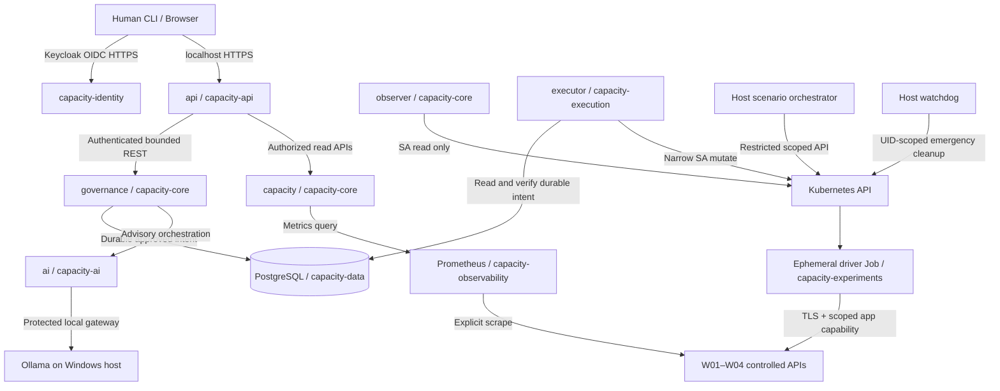

# S07 — Workload Identity, Service Security & Network Isolation

> **Approval record (2026-11-17).** The owner approved **Kubernetes-native workload identity + authenticated TLS/selective mTLS**, **short-lived scoped application capabilities for experimental drivers**, and **no required service mesh in P0**. S03's accepted **Calico/default-deny network policy** remains authoritative. This document records the minimum coherent design for those choices while delegating concrete PKI/admission/secret mechanisms to S08 and exact execution authorization to S24/S25. No live cluster, PKI, RBAC or isolation test is claimed to exist.

## 0. Authority and previous-slice reconciliation

| Accepted upstream slice | Binding requirement for S07 |
|---|---|
| S01 | L0–L2, Observe/Advisory/Governed, hard safety and human approval before mutation; no privileged AI agents. |
| S02 | Six custom deployables: `api`, `observer`, `capacity`, `ai`, `governance`, `executor`; no standalone service mesh or new always-on custom runtime; scoped Observer vs Executor K8s roles; REST plus durable PostgreSQL jobs. |
| S03 | One kind control-plane + three workers: platform tainted worker and two experiment workers; Calico with verified default deny; namespace map, localhost HTTPS, host Ollama and shared-host resource constraints. |
| S04 | W01–W06 exact namespace/criticality/priority mapping; non-root, no Kubernetes API token/RBAC; W01–W04 protected bounded control endpoints, W05 suspended template, W06 on-demand. |
| S05 | Host Python/Typer orchestrator and separate watchdog, ephemeral Python load-driver Jobs in `capacity-experiments`, host SQLite journal and content-addressed evidence, owned-UID cleanup and no S25 optimized mutation power. |
| S06 | Human Keycloak/OIDC and application RBAC + scoped resource and policy checks; machine identity is not human approval authority. |

**S03 addendum obligation:** Add S05-approved `capacity-experiments` to the accepted namespace map in a controlled S03 revision; require experiment-pool scheduling, restricted Pod policy, default deny, quota/LimitRange and dedicated tokenless driver SA. Preserve all existing namespace names and workload assignments. This spec does not claim to have edited the original S03 source.

**Boundary:** S07 owns network, service auth, Kubernetes RBAC and certificate *requirements*. S08 chooses and implements secret storage, issuance/rotation, Pod admission and security controls. S09 owns agent/tool trust. S25 owns exact executor mutation set.

## 1. Selected options and non-goals

| Design axis | Selected | Alternatives not selected |
|---|---|---|
| Machine identity | Kubernetes ServiceAccounts with audience-bound projected credentials only where needed | Single shared admin token; blanket OAuth client secret in all Pods |
| Internal transport | Authenticated HTTPS/TLS, **selective mTLS** for privileged paths | Mandatory full mesh TLS proxy everywhere |
| Driver control credentials | Short-lived scoped application capabilities, authenticated by W01–W04 | Driver-mounted Kubernetes API token; Keycloak client secret per driver |
| Network segmentation | S03 Calico default-deny ingress+egress with explicit allowlists | Flat networking, CNI replacement |
| Mesh | **No required service mesh in P0** | Mandatory Istio/Linkerd, SPIRE from the start |

**P0 non-goals:** custom Kubernetes scheduler, general service mesh, universal SPIFFE infrastructure, granting agents/direct drivers Kubernetes API access, privileged generic shell/exec path, using NetworkPolicy alone for authentication, introducing a seventh permanent custom platform Deployment, or treating kind workers as independent physical hosts.

## 2. Trust zones and identity topology



`governance`→`executor` may be a durable DB/outbox handoff, **not** a broadly exposed control HTTP endpoint. Actual PostgreSQL schema access must follow S02 ownership (independent DB roles, not arbitrary table writes). Network arrows are logical permitted flows subject to authentication and scoped authorization. Metrics exporters/host control-plane components are supporting infrastructure, not additional platform deployables.

## 3. Kubernetes ServiceAccount inventory

| Component | Namespace | Proposed ServiceAccount | Kubernetes API rights | Token-mount baseline |
|---|---|---|---|---|
| Operator API `api` | `capacity-api` | `capacity-api-sa` | None | automount false |
| Observer `observer` | `capacity-core` | `capacity-observer-sa` | Scoped read/watch | Explicit API-audience projected token |
| Capacity Engine `capacity` | `capacity-core` | `capacity-engine-sa` | None | automount false |
| AI Runtime `ai` | `capacity-ai` | `capacity-ai-sa` | None | automount false |
| Governance `governance` | `capacity-core` | `capacity-governance-sa` | None | automount false; only separately justified service-auth token |
| Trusted Executor `executor` | `capacity-execution` | `capacity-executor-sa` | Scoped read/mutate | Explicit API-audience projected token |
| W01 latency-api | `workloads-critical` | `w01-sa` | None | automount false |
| W02 burst-api | `workloads-standard` | `w02-sa` | None | automount false |
| W03 memory-profile | `workloads-standard` | `w03-sa` | None | automount false |
| W04 cpu-worker | `workloads-batch` | `w04-sa` | None | automount false |
| W05 analytics processor | `workloads-batch` | `w05-sa` | None | automount false |
| W06 opportunistic batch | `workloads-batch` | `w06-sa` | None | automount false |
| Ephemeral driver Job | `capacity-experiments` | `capacity-driver-sa` | None | automount false |

Proposed exact SA names are stable integration targets, not a claim these resources already exist. Keycloak/Prometheus/Calico/other addon SAs are defined in their chart/operator manifests and audited separately, not granted implicit platform mutation rights.

**Token rules:** use bound, expiring, audience-specific projected ServiceAccount tokens if a component needs Kubernetes API or internal ServiceAccount-identity proof. Never rely on a stale long-lived static SA Secret. Setting `automountServiceAccountToken: false` blocks default mount, not explicitly requested projected token volumes. Separate internal-audience tokens from Kubernetes API tokens; a service verifier must require its expected audience and issuer/subject.

**Verifier design (recommended technical implementation):** validate a bound SA JWT via Kubernetes TokenReview for protected service operations, enforcing expected audience, `system:serviceaccount:<namespace>:<name>` identity and Pod-bound validity. TokenReview creation privilege belongs only to explicitly named verifiers. Cached/offline checks must not silently continue accepting revoked/deleted Pod identity for privileged actions. S08/S28 decide availability/caching budget and verifier placement; never provision a general-purpose unrestricted token-review endpoint.

## 4. Kubernetes RBAC rights and boundaries

### 4.1 Observer read permission

- Cluster-scoped read (`get/list/watch`) only for required `nodes` and `priorityclasses` (and other cluster-scoped resources only when formally added).
- Namespaced `get/list/watch` for relevant demo Pods, Deployments, ReplicaSets, Jobs, CronJobs, HPAs, Events, ResourceQuotas and LimitRanges; actual least-privilege namespace RoleBindings (including `capacity-experiments` where justified).
- No general Secrets read, no service-account token creation, no Role/ClusterRole writing, no exec/attach, no Pod create/delete, no Deployment patch, no admission webhook writes.
- S11 will refine exactly which read resources are required; do not grant `*` verbs/resources simply to make discovery pass.

### 4.2 Executor constrained write permission

- Executor holds an independent SA in `capacity-execution`, read permissions needed to identify/verify authorized objects and minimum patch/update rights for S25-approved resources only.
- Only expressly configured target demo namespaces, and only resource kinds/verbs required by the accepted P0 plan action catalog; no platform/identity/data/AI/observability/Calico workloads.
- Never `cluster-admin`, Secrets/RBAC/ServiceAccount write, Node modifications, Pod exec, broad Pod deletion or unconstrained arbitrary manifests.
- **RBAC alone cannot universally restrict patch JSON fields**; S25 operation allowlist and S08 validation/admission must also enforce exactly what fields may change.
- Kubernetes admission, object UID/resourceVersion preconditions, current plan digest, policy and GitOps ownership checks are independent of service-to-service authentication.

### 4.3 Host runner vs watchdog

- The S05 host runner is **not** an in-cluster Pod and must have its own externally protected, restricted kubeconfig and explicit cluster identity/context validation. It can inspect approved demo targets and request only template-constrained ephemeral experiment operations. No baseline Deployment CPU/memory/replica patch privileges.
- The watchdog uses separate narrower credentials limited to cancellation/deletion of *verified scenario-owned* temporary resources after UID/journal matching. No platform workload, node or S25 plan write authority.
- Neither may silently inherit the default kind admin kubeconfig. Do not place credentials in scenario YAML, images or exported evidence. S08 determines issuance/rotation/storage; S29 provides Python bootstrap.
- **Kubernetes RBAC alone cannot enforce label-only Job ownership or image/resource-template restrictions on arbitrary create.** Enforce server-side via admission policy and/or narrowly trusted broker capability *plus* constrained RBAC; a Python validation library alone is insufficient. Any broker design must not introduce unrestricted new permissions or assume a seventh always-on platform Deployment.
- Fault F06 is a separate `experiment.fault.pod-terminate` capability with exact Pod UID/namespace, allowlisted kind and active-run constraints; a generic `experiment.run` authorization cannot automatically delete Pods.

## 5. Service-to-service authentication and TLS

**Accepted principle:** transport reachability is not authority. Each protected application API validates calling machine identity and specific action/scope; particularly privileged workflows use TLS **and** selective mTLS. A certificate proves peer identity only if trust, expected names and usages are checked. It does not approve a plan.

**Reference classification (S07-specific, not Kubernetes-defined):**

| Level | Traffic | Security contract |
|---|---|---|
| L1 | Prometheus-approved `/metrics`, liveness/ready checks | Calico isolation and narrowly exposed endpoints; endpoint authentication as appropriate without breaking kubelet probes |
| L2 | API↔internal read services; Governance↔Capacity/AI; authorized retrieval | HTTPS/TLS, authenticated caller, action/resource authorization |
| L3 | State-changing API→Governance, any privileged Governance/Executor validation path | Strong authenticated caller, **selective mTLS**, bound actor/delegation context, independently revalidated authorization |
| L4 | Executor→Kubernetes API | Kubernetes TLS, audience-bound SA, narrow RBAC, deterministic plan/state/admission checks |

Internal API-to-API impersonation must not depend on an unauthenticated `X-User` header or accepting any leaf certificate issued by a shared CA. Verify expected peer identity (subject/SAN or authenticated bound service token), purpose, audience and authorization.

**Certificate plan:** local trusted CA, separate server/client usages, bounded lifetimes, well-defined identity names and trust bundles, planned key rotation, unavailable/expired certificate fail-closed, no private keys in images/YAML/Git. `cert-manager` is a **candidate for S08** subject to real S03 resource budgets, not an accepted installation decision here. No unconditional SPIRE/Istio requirement. Exact which REST paths use mTLS, ingress controller TLS termination, sidecar/SDK implementation and certificate issuance are open S08/S27/S29 implementation gates.

**Token-versus-mTLS distinction:** For selected internal APIs, audience-scoped projected SA tokens can authenticate clients; for the highest-risk communication links, mTLS additionally authenticates both peers. Neither means `governance` can bypass the plan/approval store or `executor` can accept an arbitrary HTTP command.

## 6. Experiment-driver short-lived application capabilities

**Accepted:** isolated ephemeral driver Jobs authenticate to W01–W04 bounded control endpoints with a **short-lived scoped application capability**. These drivers have `automountServiceAccountToken: false` and no Kubernetes API privileges.

Reference logical claims (not frozen wire schema):

```json
{
  "version": "experiment-capability/v1alpha1",
  "issuer": "trusted-experiment-issuer",
  "subject": "scenario-driver",
  "audience": "capacity-workload-control",
  "experimentRunId": "run-reference",
  "allowedWorkloads": ["w03-memory-profile"],
  "allowedActions": ["profile.start", "profile.cancel"],
  "expiresAt": "short-lived-UTC-timestamp",
  "capabilityId": "opaque-revocation-reference"
}
```

Required design: strong signing/MAC with rotated securely held keys, exact audience/target/action/run binding, short TTL and bounded use; issuer authorization from a validated S05 actor/run, no issuer key in driver or YAML, replay abuse mitigation, no plaintext token in logs/Prometheus or process arguments, secure S08-controlled delivery to driver. Workload server must apply its own max CPU/memory/concurrency/duration regardless of token. Token expiry/cancel and Kubernetes UID ownership govern cleanup and recovery. The exact token format (JWT/PASETO/opaque token), issuer implementation, distribution and revocation are **open S08/S05 integration details**, not an extra approved standalone service.

For W05/W06, no in-Job API token is required unless a later explicit need exists; runner controls Job creation via separate Kubernetes experiment authority. The W05 suspended CronJob template remains suspended by default and W06 remains on-demand.

## 7. Calico namespace and traffic policy

**Immutable upstream choices:** S03 Calico compatible with kind `disableDefaultCNI: true`, IPv4-first, explicit default-deny ingress+egress in managed namespaces, no broad cross-namespace or public LAN routing. S05 adds `capacity-experiments` through an S03 addendum. Every namespace needs DNS and approved monitoring flows only where required; no blanket label-based trust for all Pods in the same namespace.

### 7.1 Namespace/isolation map

| Namespace | Intended traffic and placement | Denial principle |
|---|---|---|
| `capacity-api` | localhost-bound ingress → operator API; authorized API→domain APIs | No direct Kubernetes mutating credentials |
| `capacity-core` | observer/capacity/governance separated by Pod identity and egress | No assumption three Pods share permissions |
| `capacity-ai` | approved typed tools/knowledge and protected host Ollama | No Kubernetes API, Executor, demo control or unrestricted host access |
| `capacity-execution` | durable governance state, minimal verification and Kubernetes API | No public ingress; no AI/direct scenario driver access |
| `capacity-data` | DB access only from identified schema owners/addons | No demo/driver access or public DB ingress |
| `capacity-observability` | approved metrics scrape/query and local Grafana ingress | No unrestricted internal privilege |
| `capacity-identity` | tightly exposed local Keycloak OIDC, restricted DB path | No general demo or driver reachability |
| `capacity-system` | explicit controller dependencies | Controllers not general bypass for app namespaces |
| `workloads-critical` | W01 on experiment pool; approved driver and scrape inbound | No platform secrets/DB/AI/Executor paths |
| `workloads-standard` | W02/W03 on experiment pool; scoped driver + scrape | Same |
| `workloads-batch` | W04 + W05/W06 Jobs on experiment pool | Same; Jobs have no permanent inbound control service by default |
| `capacity-experiments` | ephemeral drivers/fixtures on experiment nodes only | No platform namespace, K8s API or host Ollama reachability |

Kubernetes `kube-system`, CNI components, metrics exporters/DaemonSets and ingress controllers need separately reviewed privileged exceptions where justified. Pod placement/node taints are scheduling controls, not physical or cryptographic isolation on Windows/WSL2.

### 7.2 Reference network flow allowlist

| Source | Destination | Purpose | S07 policy |
|---|---|---|---|
| Local HTTPS ingress | Keycloak, Operator API, Grafana | Human interaction | Allow listener and scoped backend port only |
| `api` | `governance`, authorized Observer/Capacity read APIs | Protected requests | Allow exact ports/Pod identities + app auth |
| `governance` | Capacity/AI and its owned durable DB state | Bounded async orchestration | Explicit egress + peer auth |
| `observer` | Kubernetes API, owned inventory DB | Inventory read/watch and persistence | Allow scoped identity and ports |
| `capacity` | Prometheus, approved inventory APIs/read models, owned DB | Deterministic analysis | Allow; bounded queries |
| `ai` | typed evidence/retrieval endpoints, approved DB access, protected Ollama gateway | Advisory-only tools/inference | Strict allow; forbid bypass route |
| `executor` | Kubernetes API, authoritative Governance read/verification, authorized DB schemas/metrics | Exact approved plan execution | Strictest service identity+RBAC |
| Prometheus | Approved W01–W04 `/metrics` ports and exporters | Scrape | Narrow Pod/ports; app-path auth remains app responsibility |
| Driver | W01–W04 API port 8080 | Bounded authenticated control | Only allowed targets/ports + scoped capability |
| Host experiment adapter/watchdog | Kubernetes API | Narrow experiment lifecycle | External host credentials and API admission; not Pod policies |
| Allowed Pods | CoreDNS | Name resolution | Restrict UDP/TCP 53 and verify in actual kind/CNI |
| Demo/driver | DB, AI, Governance, Executor, Ollama, Kubernetes API | None | Deny; negative tests mandatory |
| AI | Executor/Kubernetes API | None | Deny regardless of advisory context |

**Critical protocol caveat:** NetworkPolicy is L3/L4 and cannot distinguish `/metrics` from `POST /api/v1/profile/runs` when sharing port 8080. W01–W04 must verify the app capability on protected routes independently. Kubelet probes and Prometheus scrape identity must be supported explicitly (including node-sourced probes and auth where appropriate), not weakened via unqualified namespace allow rules.

**Host traffic caveat:** Kubernetes NetworkPolicy alone does not comprehensively firewall the Windows host, hostNetwork Pods, node→Pod traffic or exposed Docker Desktop ports. Validate installed Calico host endpoints, kind control plane reachability, Windows firewall and Docker/WSL routing with both positive/negative probes.

### 7.3 Host Ollama gateway

S03 keeps Ollama on the Windows host. Only `ai` may access a protected inference interface using an authenticated, bounded local reverse proxy or equivalent. Do not expose unauthenticated Ollama on `0.0.0.0` or LAN; use local firewall/access control and validate there is no direct bypass path (e.g., host routing). Specify and test actual kind→host address resolution and TLS identity; hostname assumptions alone do not prove reachability or isolation. The reverse proxy may be a supporting host component and must not quietly introduce a seventh S02 custom Deployment. S15 determines inference capacities/timeouts.

## 8. Threat model and negative cases

| Threat | Multiple enforcement layers | Required proof |
|---|---|---|
| AI prompt-injected attempt to patch W01 | No SA mutation creds, network deny, Governance policy, Executor revalidation | No mutation on attempted direct/indirect path |
| Compromised demo Pod tries to read secrets/DB | No projected API token, no DB credentials, NetworkPolicy | Forbidden/transport denied |
| Driver tries unapproved workload control | Scoped capability verification plus bounded API | 401/403, no work starts |
| Valid driver requests excessive memory | S04 server-side max + host watchdog | Reject safely independent of token |
| Runner directly creates hostile arbitrary Job | RBAC + independent admission/template constraints | Kubernetes API admission denied |
| Runner attempts Deployment resources patch | Restricted K8s RBAC + S25 separation | 403 even via raw client |
| Watchdog deletes unrelated Job | Credential limits + object UID/owner/adapter validation + admission design | Denial; unrelated object intact |
| Credential replay against other audience/service | Audience and service identity checks | Denied |
| Forged in-cluster peer/header | Validated client identity/actor binding | Denied |
| Untrusted or expired mTLS certificate | CA/name/EKU/time verification | TLS handshake refusal |
| Calico rules missing/disabled | Bootstrap positive+negative gates | Deployment not declared secure |
| Direct network route bypasses Ollama proxy | Firewall/route validation | Bypass denied |

## 9. Operating and failure semantics

| Failure | Safe behavior |
|---|---|
| Service token or certificate expires | Fail closed for protected actions; renew/rotate via S08, report actionable diagnostics. |
| K8s TokenReview unavailable | No fail-open for privileged calls; read-only cached data may be marked stale per independent S11 policy. |
| Default-deny policy blocks permitted probe | Surface misconfiguration and fail test; no emergency broad allow-all shortcut. |
| Kubernetes API unavailable mid-scenario | No claim cleanup succeeded; driver TTL/max duration and host watchdog; persist unresolved reconciliation state. |
| Runner/watchdog compromise or lost kubeconfig | Limit K8s damage using server-side credential scope and admission, revoke/rotate under S08; no mutation grant through cleanup. |
| Host Ollama gateway unavailable | AI advisory unavailable; Observer/Capacity deterministic core remains independent. |
| Rotated service certificate/key | Overlap/trust-bundle rollout supported; unknown peer certificates rejected. |
| Short-lived driver capability expires mid-run | Refuse new protected work; bounded in-flight work drains/cancels under workload TTL and run abort policy. |
| NetworkPolicy and ServiceAccount auth disagree | Apply both; connectivity alone never grants permission, and auth does not bypass denied network path. |

Record service-auth failures, policy-denied connections (where CNI supports visibility), TokenReview failures, TLS expiry warnings, failed Job admission, experiment violations and Executor privilege denials with bounded labels. Correlate with scenario/run/plan IDs in structured audit records, not unbounded Prometheus labels.

## 10. Requirements and acceptance tests

**Functional requirements:** `S07-FR-001` unique machine SA identities; `002` no Kubernetes credentials for demo/driver; `003` read-only Observer vs bounded Executor; `004` authenticated TLS/internal services; `005` selected mTLS privileged paths; `006` scope-bound driver application capabilities; `007` separated runner/watchdog API principals; `008` Calico per-namespace default-deny; `009` explicitly allowed observability/probe/DNS; `010` protected host Ollama; `011` live network policy conformance checks; `012` experiment resource creation constraints outside Python alone. **Security requirements:** `S07-SEC-001` no AI mutation credentials; `002` no broad cross-namespace reachability; `003` issuer/audience/peer/operation verification; `004` no arbitrary run-job manifests; `005` no secret leakage; `006` no standard K8s RBAC ownership-by-label assumptions; `007` no Executor bypass via scenario runner. **NFRs:** bounded S03 host overhead; failure isolation; cert/token rotation readiness; explicit fail-closed privileged paths; observable policy denials. Final numeric SLOs delegated S28.

| ID | Acceptance proof |
|---|---|
| S07-TEST-001 | Observer can read approved node/workload data but cannot patch Deployments. |
| S07-TEST-002 | AI has no usable Kubernetes mutation token or network path and cannot reach Executor. |
| S07-TEST-003 | W01–W06 and driver Pods have SA automount off, no roles/bindings, no usable API credentials. |
| S07-TEST-004 | Demo Pod cannot connect to DB, AI, Governance or Executor; positive probes still function. |
| S07-TEST-005 | Driver can call approved target control route with scoped valid capability and server-side limits. |
| S07-TEST-006 | Missing/expired/wrong-target/wrong-action/audience driver capability denied; no load started. |
| S07-TEST-007 | Excessive memory/task requests are denied despite valid capability. |
| S07-TEST-008 | Unapproved Pod/client TLS identity cannot invoke protected privileged API. |
| S07-TEST-009 | API accepts only expected ServiceAccount token audience/identity; invalid bound token denied. |
| S07-TEST-010 | Raw host runner Kubernetes client cannot patch W01–W04 baseline requests/limits or platform resources. |
| S07-TEST-011 | Raw K8s create of Job with unapproved template/image/SA/limits is rejected by server-side enforcement. |
| S07-TEST-012 | Watchdog credential cannot delete unrelated Job or change governed objects. |
| S07-TEST-013 | F06 Pod termination requires distinct capability, namespace/UID/running-state checks. |
| S07-TEST-014 | Driver Pods land only on experiment workers; W01–W06 placement and PriorityClasses match S04. |
| S07-TEST-015 | Default-deny present and Calico dataplane negative connectivity tests pass; missing enforcement fails bootstrap. |
| S07-TEST-016 | Allowed DNS, probes, Prometheus scrape, protected operator login and necessary service calls pass. |
| S07-TEST-017 | AI can reach protected host Ollama only via trusted gateway; demos/drivers/direct bypass cannot. |
| S07-TEST-018 | Certificate rotation/expiry, TokenReview outage and API outage fail safely without issuing mutations. |
| S07-TEST-019 | Driver token/cert/raw SA credential absent from manifest, container image, process args, logs and evidence. |
| S07-TEST-020 | Scenario runner crash leaves bounded Jobs and UID-based reconciliation without rewriting S25 changes. |

**Testing:** unit/contract tests for identity validation, HTTP integration for service auth and scoped capabilities, Kubernetes real-RBAC/admission negative tests using restrictive clients, kind E2E Calico connectivity/placement and host firewall checks, and operational certificate/API outage/cleanup tests. Verify actual installed versions and behavior rather than assuming YAML alone enforces policies.

## 11. Accepted ADR register

| ADR | Status | Decision |
|---|---|---|
| S07-ADR-001 | **Accepted** | Kubernetes-native workload identity with dedicated ServiceAccounts and scoped projected credentials only when needed. |
| S07-ADR-002 | **Accepted design consequence** | No default SA token/RBAC in W01–W06 or ephemeral driver Pods; Observer read vs Executor narrow write. |
| S07-ADR-003 | **Accepted** | Authenticated internal TLS and selective mTLS for sensitive control paths. |
| S07-ADR-004 | **Accepted design consequence** | Exact expected service identity + action authorization, no network-only/header-only trust. |
| S07-ADR-005 | **Accepted upstream preserved** | Calico default-deny ingress+egress and Pod-selective allowlists from S03. |
| S07-ADR-006 | **Accepted upstream preserved** | Host scenario runner, distinct watchdog and tokenless in-cluster load drivers from S05. |
| S07-ADR-007 | **Accepted** | Driver→S04 control authenticated with short-lived scoped application capabilities. |
| S07-ADR-008 | **Accepted design consequence** | Experiment API writes are distinct from S25 optimization; admission/typed operation constraints required beyond basic RBAC. |
| S07-ADR-009 | **Accepted design consequence** | Protected host Ollama access, validated direct-bypass isolation and S03 localhost posture. |
| S07-ADR-010 | **Accepted** | No required service mesh/SPIRE in P0; not precluded from future explicit ADR. |
| S07-ADR-011 | **Accepted upstream extension** | `capacity-experiments` required by approved S05; S03 namespace-map documentation addendum pending. |

## 12. Downstream decisions / implementation blockers

| Owner | Explicitly open |
|---|---|
| **S03 addendum** | Record accepted `capacity-experiments` namespace with quota, taints, node pool and isolation; do not silently modify accepted baseline. |
| **S08** | CA and certificate/controller selection, exact mTLS endpoint list, PKI and key rotation, projected credential delivery, Job admission policy language and enforcement engine, secret backend, protected driver token signing/delivery/revocation. |
| **S09/S17** | AI tool service identity, scoped tool calls, RAG authority and denial semantics. |
| **S11–S12** | Exact Observer read/watches, Prometheus targets/probe paths and scrape authentication; short Job evidence. |
| **S15** | Host Ollama secure gateway address, protocol, timeouts and resource/host firewall integration. |
| **S24/S25** | Exact privilege catalog, approved mutation kinds/fields, authorization transport, plan binding, execution locks, GitOps ownership and revocation. |
| **S27/S29** | Stable OIDC/API hostnames, ingress cert termination and DNS, install order, pinned Kubernetes/Calico versions, Python/bootstrap automation and safe SA bindings. |
| **S28/S30** | Cert/token/Keycloak/API outage tests, security monitoring, recovery, resource calibration, negative policy proof and release readiness. |

**Mandatory implementation gates:** verified Calico isolation; server-side Job-creation enforcement (not just Python validation); no admin kubeconfig inherited by runner/watchdog; reliable scoped driver auth; restricted Executor permissions; secure internal/host routing; secret/cert management; demonstrated positive and negative network probes; measured kind resource fit. None are claimed implemented.

## 13. Completion statement

**S07 architectural choices accepted 2026-11-17; implementation and verification pending.** In particular, NetworkPolicy YAML does not by itself prove host-route isolation, and Kubernetes RBAC cannot on its own enforce all Job-template and authorized-mutation field restrictions. The corresponding server-side controls and tests are required by downstream slices before the platform runs privileged workflows.
