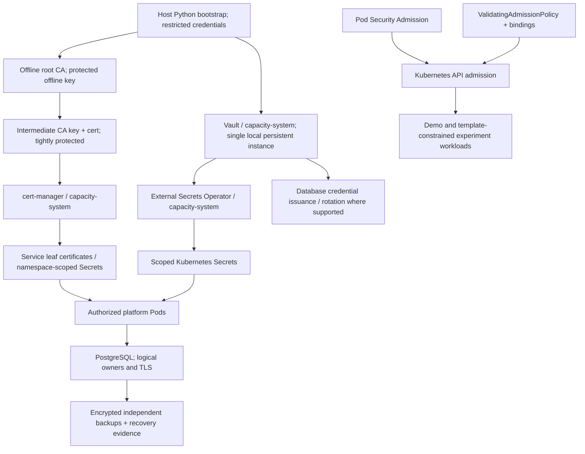

# S08 — Secrets, Data Protection & Security Policy Enforcement

> **Approval record (2026-11-17).** The project owner selected **HashiCorp Vault + External Secrets Operator (ESO)**, **offline-protected root CA + cert-manager-managed intermediate**, and **Kubernetes Pod Security Admission (PSA) + native CEL ValidatingAdmissionPolicy**. The owner also approved the supporting S08 architecture proposed in the S08/S09 review, including differentiated credential delivery, data classification, protected backup/audit integrity, rotation/recovery, bounded experiment admission, and explicit privilege exceptions. All ADRs below are **Accepted at architecture level**. This document does **not** claim that Vault, cert-manager, ESO, Kubernetes encryption-at-rest, or admission controls are deployed or tested. All numerical TTLs/retention/SLOs and final version pins remain implementation/calibration decisions unless fixed explicitly below.

## 0. Document contract, precedence, and ownership

- **Master catalog v1.0.0:** 32-slice specification structure and X-SEC-01…08, X-REL-01…02, X-DATA-01…02, X-OPS-01, X-DEL-01, X-TST-01 are binding.
- **S01:** Observe/Advisory/Governed operation and L0–L2 autonomy; exact human approval for real changes; hard constraints cannot be traded for efficiency.
- **S02:** precisely six separate **custom platform deployables** (`api`, `observer`, `capacity`, `ai`, `governance`, `executor`); PostgreSQL logical schema/role ownership; REST plus durable DB jobs/outbox, no required broker. Vault/ESO/cert-manager are supporting infrastructure, not new custom business services.
- **S03:** one kind control-plane + three workers (one platform-tainted, two experiment); Calico default-deny; existing `capacity-system` for ingress/cert/secret controllers; local PVC + independent backup; localhost-restricted HTTPS; host Ollama; one physical Windows 11 20-GB / Ryzen 5 3600 workstation and candidate 12-GiB WSL2 cap. Request envelopes are **provisional**.
- **S04:** four baseline demo Deployments, suspended W05 CronJob and on-demand W06 Job; restricted non-root/tokenless demo Pods and protected bounded controls.
- **S05:** host Python orchestrator + separate watchdog; SQLite journal; tokenless ephemeral driver Jobs under accepted `capacity-experiments`; narrowly authorized experiment creation/deletion; no S25 optimized resource mutation or blind baseline reset.
- **S06:** Keycloak + OIDC, scoped RBAC/conditions, distinct plan author and approver, nonhierarchical administrator, no human Kubernetes mutation credential through the platform.
- **S07:** per-service Kubernetes ServiceAccounts; audience-bound projected tokens only as needed; authenticated TLS/selective mTLS; Calico default-deny; driver short-lived app capabilities; AI lacks Kubernetes mutation privilege; host runner and watchdog have distinct narrow credentials; no required service mesh.
- **S09:** agent prompt/tool/RAG controls use S08 secrets, signing identities and classification without assuming possession of a secret authorizes an action.
- **Precedence:** This slice specifies security infrastructure and enforcement; S10 owns artifact-signing/supply chain, S13 owns data model, S18 owns knowledge ingestion/query design, S24/S25 own approval/execution decisions, S28 owns restoration/SLOs, S29 owns installation and CI. No acceptance of S08 silently changes an upstream accepted ADR.
- **S03 documentation work:** Add S05-approved `capacity-experiments` to S03 namespace map; revise/calibrate S03 infrastructure budget for Vault/ESO/cert-manager and any extra Kubernetes encryption infrastructure. Original S03 files are not modified by this specification.

**Status vocabulary:** `Accepted` architectural decision; `Implementation recommendation` optional technical profile; `Open downstream` owned by later slice; `Verified` only after real evidence.

## 1. Purpose, scope, boundaries, success criteria

**Purpose:** secure the complete credential/key lifecycle, encrypted transport/storage/backup, operational data disclosure and integrity, and Kubernetes admission enforcement for a fully local but production-inspired cluster.

**P0 outcomes:**
1. Every nonpublic secret has a named authority, consumer, namespace, delivery mode, rotation/revocation path, storage boundary, and backup/recovery treatment.
2. Critical application/host paths use authenticated TLS, and S07-designated privileged paths use selectively enforced mTLS with verified peer names/EKU/trust.
3. Compromised demo/driver/AI Pods cannot retrieve unrelated secrets or gain admission to privileged workloads merely by crafting YAML.
4. Server-side Kubernetes admission enforces relevant immutable Pod/Job safety properties even when a caller bypasses Python validation.
5. Classified operational evidence remains confined to authorized scopes; raw credentials never become prompts, embeddings, logs, metrics, traces, proposal artifacts or experiment bundles.
6. Backup restoration, key rollover, audit-integrity checks and error handling are reproducible, measured and fail closed where authority cannot be confirmed.

**Out of scope:** public cloud KMS/HSM, production HA Vault, multi-cluster PKI, mandatory service mesh, universal encryption of every harmless metric at application field level, mandatory Git-stored secrets, custom Kubernetes operator, replacing S06 human authorization, replicating S24 approval policy in admission, S10 image provenance verifier, giving Vault root credentials to applications, unsupported high availability claims.

## 2. Alternatives and accepted architecture

| Axis | Selected | Alternatives and tradeoffs |
|---|---|---|
| Secret backend | **Vault + ESO** | SOPS+age: simpler Git-driven static secrets, limited online auditing/leases; native Kubernetes Secrets: fewer components but fewer lifecycle/central governance features |
| CA lifecycle | **Offline root CA + cert-manager-managed intermediate CA** | Manual Python/OpenSSL certs: low infrastructure cost but renewal burden; Vault PKI: centralized option but merges availability/trust dependencies |
| Admission | **PSA Restricted + native CEL ValidatingAdmissionPolicy** | Kyverno: rich rules/reports but extra controller; OPA Gatekeeper: flexible Rego but extra controller/language burden |
| Secret delivery | **Consumer-specific** ESO-backed Kubernetes Secrets, direct short-lived issuance, cert-manager cert Secrets, protected host credential store | One static password pattern is insufficient for every consumer |
| Audit | **Append-oriented protected records + external trust anchor/signature verification** | Hashes alone do not protect against attacker rewriting data and hashes together |
| Backup | **Encrypted off-cluster/independent local copy + tested recovery** | PVC-only storage cannot survive kind destruction or host disk loss |

### 2.1 Reference topology



**Placement:** Vault, ESO, cert-manager may use existing `capacity-system` only with individually restricted identity, network and storage. They are *supporting infrastructure*. A single Vault instance is a known failure point. Vault persistence may be local persistent storage with an authenticated client and secured backups; **Vault must never be its own sole recovery-key or backup-key repository**. Root trust material is generated with controlled host bootstrap, protected offline, not committed to Git or mounted in app Pods.

**Important distinction:** Offline root signing of intermediate is separate from how intermediate signing key is stored/operated in-cluster. cert-manager CA issuer's key resides in a Kubernetes Secret; harden its namespace, Secret RBAC, etcd encryption, backups and CA issuance permissions. Do not describe intermediate key as automatically offline or HSM protected.

## 3. Trust zones, identities, and secret ownership

| Zone / consumer | Secret access profile | Hard prohibition |
|---|---|---|
| `capacity-api` | API TLS server cert, narrowly scoped service auth; avoid unnecessary DB credentials | No Vault root, Executor key or Kubernetes mutation kubeconfig |
| `capacity-core` observer | inventory DB role and explicitly projected read token; service cert as needed | No governance/execution writable DB role or Secrets read |
| `capacity-core` capacity | capacity data role, authenticated internal TLS | No Executor/AI secret access |
| `capacity-core` governance | governance/workflow DB role, select trusted service key/cert | No Executor Kubernetes credential or approval key exposed to AI |
| `capacity-ai` | AI-owned knowledge DB permissions, tool-calling identity, Ollama-gateway auth | No mutation token, no high-risk approval/Executor/host secrets |
| `capacity-execution` | distinct execution DB role and projected K8s API token only; key/cert for verification | No approval issuance, no broad Secret/RBAC/Node mutation |
| `capacity-identity` | Keycloak DB credentials, realm signing key and OIDC config | No direct exposure of privileged secrets to demo namespace |
| `capacity-data` | PostgreSQL server key/cert and isolated DB auth | No demo/driver connections |
| demo W01–W06 | normally **no** app Vault/DB/K8s secrets; W01–W04 verify scoped capability using trusted verification material | No client-side capability signing key, K8s token, Vault access |
| `capacity-experiments` ephemeral drivers | per-run bounded capability *only when required*, delivered outside image/args | No SA token, Kubernetes API role, signer key |
| host orchestrator / watchdog | distinct protected least-privilege kubeconfigs, experiment issuer controlled interface if necessary | No default kind admin kubeconfig, no S25 optimized mutation |
| host Ollama gateway | authenticated proxy key/cert and allowlisted AI peer | No unrestricted LAN exposure or anonymous model endpoint |

**Source-of-truth:** Vault is central authority for Vault-managed application secrets, not for cert-manager's private keys or Keycloak's internally managed signing keys unless explicitly integrated. Each such key is still inventoried and backed up under S08. ESO materialization produces another sensitive copy in a Kubernetes Secret and possibly on Pod volumes; Vault does not erase this fact.

### 3.1 SecretInventory v1alpha1 (logical metadata contract; never records values)

```yaml
apiVersion: capacity.lab/v1alpha1
kind: SecretInventoryEntry
metadata:
  id: governance-db-credential
  revision: 1
spec:
  owner: governance
  classification: Restricted
  authority: vault
  consumerService: governance
  consumerNamespace: capacity-core
  delivery: external-secret-mounted-file
  rotationPolicyRef: db-app-rotation-v1
  revocationProcedureRef: rotate-and-verify-db-v1
  backupPolicyRef: secret-backup-exclusion-v1
  forbiddenSinks: [git, logs, traces, metrics, prompts, rag, experiment-evidence]
```

This example does **not** contain a real Vault mount path, sensitive credential, confirmed deployed policy, or guaranteed rotation mechanism. `SecretInventoryEntry` is documentation/schema, not a new Kubernetes CRD. Changes are versioned and reviewed.

## 4. Secrets lifecycle and delivery contracts

### 4.1 Lifecycle

`Generate → protect/store → authorize consumer → deliver → use → monitor lease/age → rotate with overlap → revoke/retire → verify/audit → destroy expired copies`.

- **Bootstrap:** Python setup reads secure host inputs from protected sources; no plaintext terminal echo, shell history, environment dump, Git, CI artifacts or Docker build args. One-time bootstrap/admin credentials are removed/rotated after provisioning.
- **Vault initialization:** initialize once and persist durable state; protect unseal/recovery material independently with deliberate operator procedure. Restart or kind destruction cannot silently create a new trust domain in place of an existing one.
- **Vault policies:** one narrow path/role per consumer; deny list/read of unrelated paths. Kubernetes-auth integration must validate namespace and ServiceAccount identity, projected token audience, issuer and bound lifetime. Only explicitly authorized consumers need direct Vault access.
- **ESO:** namespace-scoped `SecretStore` or tightly controlled shared store; pin ESO controller identity, namespace access and exact permissible Secret destinations. `ExternalSecret` content must not be allowed to escalate consumers into arbitrary namespace credentials. Audit controller RBAC and reject cross-namespace Secret copying.
- **Delivery:** prefer mounted Secret files over process args/environment for sensitive long-lived values; disable debug dumps and avoid storing sensitive mount content in artifacts. Environment variables are permitted only under a documented exception and explicit leakage assessment.
- **Dynamic credentials:** use lease-aware direct Vault access for genuinely short-lived PostgreSQL credentials if consumer/pool supports renew/reconnect/revoke. Do not assert ESO synchronization alone implements correct dynamic lease handling. First P0 implementation may use rotated static application roles while preserving interface for dynamic upgrade.
- **Certificate keys:** cert-manager emits namespace-restricted Kubernetes Secrets; ensure issuer permissions, mount reload, staged trust rollout and post-rotation connectivity tests.
- **Host credentials:** host runner and watchdog have distinct local protected kubeconfigs, cluster identity pinning, filesystem ACLs and expiry/rotation; Python reads protected files/OS credential store without logging bytes.
- **OIDC:** Keycloak realm signing and client secrets are classified Restricted; S06/S27 own token profiles, S08 owns storage/key handling/backup. CLI public client has no client secret; local tokens live in OS-protected storage with logout cleanup.
- **Experiment tokens:** trusted issuer validates run/actor/scope, signs or MACs a run/target/action/audience/expiry-bound capability; driver receives only a copy for its own run (e.g. dedicated short-lived Secret volume with scoped object ownership and cleanup). Never place signing key in driver or workload. Include expiry and optional revocation registry; no resource access after expiry even if Job persists. Exact token format and issuer implementation are S05/S07 integration deliverables.

### 4.2 Security invariants for rotation

1. Old and new material overlap only for bounded, auditable rollout; expired/revoked material must be rejected.
2. A service must be able to reload/reconnect without silently retaining unusable credentials; verify .NET/Python client behavior and PostgreSQL connection pools.
3. Vault/ESO/PKI outage cannot automatically trigger fallback to hardcoded credentials or `insecureSkipVerify`.
4. Issuer and verification keys have separate capability and ACL; a read verifier cannot mint driver capabilities.
5. Secrets must never be written to persisted PostgreSQL job payloads, S05 SQLite journal, manifests, Kubernetes events, RAG embeddings or model prompts.
6. Failed rotation enters explicit `degraded`/`blocked` operational state, not an unrecorded indefinite secret lifetime extension.

## 5. PKI and transport security

### 5.1 Certificate hierarchy and responsibility

- Offline root key stays on protected host/offline medium, used to issue/renew a constrained intermediate and never installed in app Pods.
- cert-manager operates a limited local intermediate CA issuer. Restrict who can create `Certificate`, `Issuer` and `ClusterIssuer` objects; block arbitrary privileged names/SANs and cross-namespace issuance through RBAC and applicable approval/admission rules.
- Define permitted server and client identity names, EKUs, certificate SANs, root/intermediate trust distribution, and renewal/restart procedure; never accept any cert issued by the CA as equivalent to the expected service identity.
- Leaf certificate lifetimes and renewal windows must be bounded, recorded and calibrated; do not impose invented numeric TTLs in this architecture specification.
- Root/intermediate rotation is a staged trust migration with overlap, verifiable identities and rollback that does not re-enable old compromised keys.

### 5.2 Explicit TLS matrix (reference, S07 remains normative for service paths)

| Path | Required peer check | Enforcement owner |
|---|---|---|
| CLI/browser → localhost-bound API/Keycloak | Valid local trust chain, expected hostname, protected HTTPS, OIDC API token | S06/S07/S27 + S08 PKI |
| API → Governance sensitive operations | Client+server identity (selective mTLS), actor/delegation binding and server authorization | S06/S07/S24 |
| Governance → internal sensitive API if used | selective mTLS and exact machine peer identity; never standalone approval authority | S07/S24 |
| Executor → Kubernetes API | Kubernetes TLS, audience-specific projected SA, scoped RBAC, plan revalidation | S07/S25 |
| AI → tools/knowledge services | TLS + authenticated machine + delegated scope | S07/S09/S17 |
| AI → host Ollama proxy | authenticated TLS or equivalent explicitly verified protected host transport; exact host route and firewall tests | S07/S09/S15 |
| Driver → W01–W04 | TLS server verification + short-lived action-bound app capability | S07/S05/S04 |
| PostgreSQL clients | TLS with verified server and isolated auth roles; DB operator procedure tested | S02/S07/S08 |

**No mandatory service mesh.** NetworkPolicy cannot filter HTTP path if `/metrics` and control API share port 8080. App-level capability checks remain necessary. No insecure certificate-verification bypass for local development.

## 6. Data classification, authorization, and retention

| Classification | Data examples | Handling rule |
|---|---|---|
| `Public` | intentionally published spec documentation, synthetic workload descriptions | source integrity, versioning; public sharing only by owner choice |
| `Internal` | node inventories, aggregate metrics, versioned workload profiles, routine forecasts | authorized query, minimal log/metric labels, bounded retention |
| `Confidential` | incident details, namespace-specific operations, plan/actor history, audit findings | resource-scoped access, transport/storage protections, redaction for derived AI contexts |
| `Restricted` | API/refresh tokens, credentials, unseal/recovery keys, private signing keys, app capabilities | secret authority only, never model prompts/embeddings/logs/traces/metrics/evidence exports |

**Metadata fields (logical, S13/S18 implementation):** `classification`, `data_owner`, `cluster_id`, `namespace_scope`, `allowed_resource_scope`, `provenance_type`, `source_id`, `source_version`, `observed_at`, `valid_from`, `valid_until`, `retention_policy_ref`, `redaction_revision`, `integrity_ref`.

**Data minimization:** store compact evidence references rather than unbounded raw Kubernetes object dumps; remove Secret `data` and credential-bearing annotations, headers and environment fields before logging or RAG ingestion. Unknown structured fields are not trusted safe by default. Do not embed secret content and then attempt to remove it only at retrieval time.

### 6.1 Encryption and storage boundaries

- **In transit:** HTTPS/TLS with validated peer names; selective mTLS for S07 high-risk links; PostgreSQL TLS. Calico controls reachability, not encryption.
- **Kubernetes API/etcd:** configure **encryption at rest for Secrets** in the control plane and verify it on the actual kind/Kubernetes version; the encryption-provider key and config have their own protection/recovery lifecycle. Encrypting at rest does not override API/RBAC access, node compromise or accessible Pod volumes. In kind this may require nondefault API-server configuration and a controlled cluster rebuild; S03/S29 own exact integration.
- **Vault:** encrypted storage internals are not equivalent to encrypting all host disk or backup files; require restricted persistent volume and encrypted independent backup. Vault root/recovery and snapshot access are separate.
- **PostgreSQL:** distinct roles and schema ownership (`inventory`, `capacity`, `knowledge`, `governance`, `execution`, `audit`, `workflow`, isolated Keycloak DB as accepted S06); protect PVC/host disk and encrypt independent backups. Row-level security is optional only where a concrete shared-table tenant/scope requirement justifies it; authorization must still be at API/query boundary.
- **Prometheus/Grafana:** bounded retention and scoped query paths; metrics labels exclude secrets, unique IDs, arbitrary user text and raw URLs; admin interfaces not public.
- **S05 host SQLite/artifacts:** protected host directory/ACL, omitted secret values, checksums, independent encrypted exports where needed. A checksum is not tamper protection when reference and data can both be rewritten.
- **RAG:** redact **before** chunking/embedding, enforce source classification and namespace authorization, store provenance/temporal validity, preserve original protected source separately. S09/S18 own query restrictions.

### 6.2 Retention lifecycle and deletion

Retention policy is a **versioned class/data-type mapping**, not one global TTL. S12 owns Prometheus concrete duration; S13 database entities; S18 RAG chunk/index lifecycle; S24/S26 governance record durability; S28 backups and audits. S08 requires each class to specify: retention owner, creation time, expiry/deletion behavior, backup propagation/deletion limitations, legal/operator exceptions if any, index re-build/deletion, and proof of purge. Revoked credentials invalidate immediately by authority even if a protected audit record describing their issuance is retained. Do not store reusable credential bytes in audit history.

## 7. Kubernetes Pod and admission policy enforcement

### 7.1 Layered enforcement

1. **PSA Restricted** in managed application/demo/experiment namespaces (`enforce`, `audit`, `warn` labels pinned to verified Kubernetes version as appropriate); explicitly scoped exceptions for infrastructure controllers only.
2. **ValidatingAdmissionPolicy (CEL) + bindings** for Kubernetes-object-visible immutable constraints, using versioned policies and effective namespace/subject bindings. Validate actual API-server support and fail behavior in kind, including behavior when a policy configuration is absent/misbound.
3. **RBAC** prevents disallowed create/update/delete by role, namespace, kind and verbs; no assumption RBAC restricts arbitrary JSON patch fields or label-owned deletes.
4. **Trusted operation adapters and domain checks** apply authoritative external state such as S05 run journal/UID ownership and S24 plan digest/approval state. CEL cannot independently fetch external SQLite/PostgreSQL records.
5. **Calico default deny + S07 service auth** independently blocks unauthorized routes even when Kubernetes object creation is allowed.

### 7.2 Policy catalog and implementation limits

| ID | Scope / validation | Limit / integration |
|---|---|---|
| `POL-POD-001` | no privileged, escalation, privileged host namespace/network | PSA plus CEL for allowed constrained exceptions |
| `POL-POD-002` | non-root, dropped capabilities, seccomp `RuntimeDefault`, read-only root FS where supported | PSA does **not** guarantee all fields (e.g. read-only root FS), extend CEL; prove real images compatible |
| `POL-POD-003` | explicit CPU/memory requests and limits; finite Jobs and measured quotas | CEL + ResourceQuota/LimitRange; requests do not guarantee physical host safety |
| `POL-POD-004` | deny hostPath/unapproved volumes and writable sensitive mounts | PSA/CEL; infrastructure exceptions narrowly documented |
| `POL-POD-005` | restrict Pod SA identity, token mount and forbidden projected tokens | CEL/RBAC; explicit observer/executor projection authorized |
| `POL-IMG-001` | digest-pinned image refs for governed workloads | CEL shape; image signature/provenance trust is S10 |
| `POL-EXP-001` | experiment template allowlist, namespace/pool/SA, TTL, image, bounded resources | CEL checks stable known object fields; trusted broker/adapter and separate authorizations handle run-specific state |
| `POL-EXP-002` | prevent baseline Deployment patch by experiment actor | RBAC deny; S25 governs optimize; no assumption client-side checks suffice |
| `POL-EXEC-001` | restrict execution mutation resource/field envelopes | targeted CEL where representable + narrow RBAC; S25 independently validates exact plan and target |
| `POL-NS-001` | protect critical namespaces and admission/policy objects | RBAC + restricted platform administrators; protect the policy engine's own policy objects |

**Security caveats:** Admission on Pod creation is not sufficient to restrict all subsequent controller template changes; target both direct Pods and owning controller templates (Deployment/Job/CronJob etc.) where the Kubernetes admission APIs support it. PSA can reject resulting Pods but controller objects may still be accepted: test both. CEL policies are not a general dynamic registry lookup or external decision engine. Job template digest may need approved-field allowlists or a separate trusted admission/broker design if exact source-template provenance cannot be proven from API-visible objects.

**No general create bypass:** The scenario adapter must have only necessary Kubernetes permissions, yet an attacker holding its raw credential must not be able to create arbitrary elevated Jobs. Independent admission verifies image/template/security context/resource caps/SA/namespace; a server-side narrow broker or supplemental validation is required if the native rules cannot enforce a critical invariant. Do not falsely claim arbitrary ownership-by-label deletion can be made secure using Kubernetes RBAC alone.

### 7.3 Infrastructure exception registry

Minimum fields: `exception_id`, `namespace`, `controller_identity`, `requested_privilege`, `justification`, `approver`, `policy_version`, `review_due`, `compensating_controls`, `negative_test_id`. Calico, node/system networking and other essential controllers may need broader permissions, but no blanket exception for demo/AI/executor Pods. Validate any PSA exemptions because broad namespace-level exemptions create exploitable gaps.

### 7.4 Example admission policy intent (pseudocode, **not installable CEL**)

```text
IF subject.namespace == "capacity-experiments" AND resource.kind == "Job":
  REQUIRE allowed image digest and known job template class
  REQUIRE serviceAccount == "capacity-driver-sa" for driver Jobs
  REQUIRE automountServiceAccountToken == false
  REQUIRE nodeSelector pool == experiment and no platform taint toleration
  REQUIRE restricted pod security context and no host privileges
  REQUIRE finite resource/request/limit/deadline/TTL policy
  DENY unauthorized changes to infrastructure identity/policy objects
ELSE apply per-namespace workload and privilege policies
```

Policies must be implemented using resource-specific valid CEL, bindings and RBAC rather than copying the pseudocode into manifests. A scheduled `Job`'s full source/actor/run binding may require a separate verified server-side mechanism.

## 8. Integrity, audit, signing and backups

### 8.1 Security audit contract

`SecurityAuditEvent v1alpha1` minimum: `event_id`, `occurred_at_utc`, `correlation_id`, `actor_machine`, `actor_human_ref?`, `action`, `resource_scope`, `policy_revision`, `credential_version_ref?` (never value), `decision`, `reason_code`, `object_uid/resourceVersion?`, `previous_event_hash?`, `signing_key_id?`, `signature_ref?`.

- Governance owns authoritative approval audit; Executor owns attempt/outcome audit; S08 defines integrity and secret redaction requirements, not new ownership.
- Enforce append-only-at-application level plus restricted DB roles, export checkpoint hashes and sign verification anchors with protected key(s). Avoid promising WORM on mutable local disk. Distinct backup/access controls make malicious rewrite detectable relative to an independent trusted checkpoint.
- Preserve provenance/evidence digest, rule version and scope; no raw prompt, token or credential in audit by default.
- Kubernetes audit logging configuration and retention require S03/S28/S29 coordination. Never silently log full Secret responses or sensitive RequestResponse bodies.

### 8.2 Backup and restore contract

| Asset | Backup | Restoration proof |
|---|---|---|
| Vault state | encrypted consistent snapshot / state backup, independent of kind; protected unseal/recovery material | sealed/unsealed restart and valid authorized secret retrieval, no secret dump |
| Offline root / intermediate | separately protected root materials, controlled intermediate key/cert backup | chain verification and new/old trust handling |
| PostgreSQL incl. identity/governance/knowledge | encrypted logical/physical backup as appropriate, independent host copy | schema ownership, migrations, approval integrity and fresh read consistency |
| Kubernetes encryption config/keys | independently protected under cluster recovery policy | Secret decryption across restore/recreation or documented unsupported restore path |
| S05 journal/evidence | local protected copies with signed/checkpointed manifests | UID reconciliation, restored quality/provenance, unknown state reported |
| Policy manifests & inventories | Git versioned nonsecret policies, signed release controls from S10/S29 as selected | matching policy revision and admission negative tests |

**Shared-host limitation:** Copies on the same workstation do not offer physical disaster tolerance. An independent medium/location is required for meaningful host loss protection; never claim full DR from another directory on the same disk. Restore is prohibited as successful until security identity, encryption keys, revalidated grants and operational consistency are proven.

## 9. Threat model and countermeasures

| Threat | Boundary / control | Mandatory negative proof |
|---|---|---|
| Compromised W03 or driver reads PostgreSQL credentials | no mounted creds/API token; Calico; scoped ESO destinations | forbidden Secret/API/DB access |
| AI prompt attempts to read Vault | AI lacks Vault policy/route; tool deny; S09 context discipline | no secret retrieval or response leakage |
| ESO sync into unauthorized namespace | restricted SecretStores, controller identity/RBAC, destination policy | sync denied; no copied Secret |
| Arbitrary cert for `executor` issued to demo | issuer and namespace restrictions; SAN/purpose policy | issuance rejected |
| Expired or wrong-client cert | peer name/EKU/expiry/trust validation | handshake refused |
| Host runner attempts privileged Job/Deployment patch | restricted kubeconfig + server-side admission/RBAC | raw Kubernetes API denied |
| Invalid Job template bypasses Python | CEL/admission/allowed broker constraints | raw create denied |
| Credential leaked via log/metrics/trace/prompt | redaction, no secret material in these sinks; controlled audit | leak corpus fails with zero sensitive persisted values |
| Mutated evidence + recomputed hash | independent trusted signature/checkpoint | mismatch detected |
| Vault, PKI, identity or encryption key lost | independent backups/recovery runbook, fail closed when unverified | restore drill, explicit blocked result |
| Stale ESO secret after revocation | revocation and rollout/session invalidation plan | old credential no longer grants access |
| System component elevated policy exception abused | least-privileged identity and exception registry | unauthorized workload still rejected |

## 10. Failure, recovery, and observability

| Failure | Safe behavior | Evidence |
|---|---|---|
| Vault down/unsealed state unavailable | no fallback credentials; already valid sessions continue only within actual lease/authorization; new privileged issuance blocked | health, issuance errors, lease expiry |
| ESO reconcile fails | explicit stale/unsynced status; no blind trust in rotated value; services requiring new credential degrade safely | sync condition, version refs |
| cert-manager unavailable | existing valid leaves continue until expiration; issuance/renewal fails closed, alert before expiry | remaining validity, renewal reason |
| Intermediate/root compromise | stop affected issuance, revoke trust/bundle, rotate identities and reissue; do not assume instant mass revocation | trust-version lineage, negative verification |
| Kubernetes Secret decryption impossible | block affected startup/recovery; never recreate unrelated trust automatically | restore failure report |
| PSA/CEL policy misbound or disabled | bootstrap/release gate fails; no claim enforcement based on manifest presence | server-side denied/allowed test results |
| Admission rejects legitimate Controller | diagnose policy/exception; never broad bypass to recover workload | admission rejection and policy rev |
| DB backup lost/invalid | fail readiness and mark recovery objective unmet; do not declare restore success | checksum/restore trial |
| Audit signer unavailable | sensitive transition blocked or durably held in pending, as defined by S24; never silently omit required integrity proof | audit checkpoint backlog |
| Host pressure from security components | preflight budget refusal/scale-down planning, not blind CNI/PSA removal | Windows/WSL/kind pressure and Pod requests |

**Observability:** emit bounded `secret_sync_success`, `vault_lease_renewal_failures`, `certificate_expiry_seconds`, `admission_denials`, `invalid_credential_count`, `backup_last_verified_at`, and `audit_integrity_failures` (names illustrative; S28 standardizes). Never label metrics by secret bytes, unbounded user IDs or raw target names. Provide incident playbooks for secret leak, cert compromise, Vault restart, ESO stale sync, mistaken admission rejection and corrupted evidence.

## 11. Functional and nonfunctional requirements

| ID | Requirement | Acceptance reference |
|---|---|---|
| S08-FR-001 | Operate locally backed Vault with scoped authenticated secret access and protected recovery material | TEST-001/002 |
| S08-FR-002 | ESO syncs only authorized namespaces and allowed destination Secrets | TEST-003 |
| S08-FR-003 | Inventory all restricted credential classes with ownership and lifecycle | TEST-004 |
| S08-FR-004 | Rotate/revoke DB, certificate, service and driver capabilities with verified consumer behavior | TEST-005/006 |
| S08-FR-005 | Establish offline root and controlled cert-manager intermediate issuance/renewal | TEST-007/008 |
| S08-FR-006 | Apply PSA and CEL policies with scoped bindings and protected administration | TEST-009/010 |
| S08-FR-007 | Enforce experiment Job/SA/template and authorized mutation restrictions server-side | TEST-011/012 |
| S08-FR-008 | Classify and protect telemetry, capacity evidence, incidents and operational records | TEST-013/014 |
| S08-FR-009 | Configure and verify local Kubernetes Secret encryption-at-rest where supported | TEST-015 |
| S08-FR-010 | Encrypt independent backups and verify restoration of critical trust/data | TEST-016 |
| S08-FR-011 | Implement verifiable protected governance/evidence audit checkpoints | TEST-017 |
| S08-FR-012 | Maintain enumerated infra admission/security exceptions | TEST-018 |
| S08-SEC-001 | Secret bytes never appear in Git, images, arguments, metrics, traces, AI prompts/RAG or experiment exports | TEST-013 |
| S08-SEC-002 | Machine roles are consumer-scoped; no Vault root or unrestricted Kubernetes Secret read | TEST-002/003 |
| S08-SEC-003 | Cert identities/SAN/EKU and trust chains validated; no insecure skip-verification | TEST-007/008 |
| S08-SEC-004 | Admission policies and RBAC reject bypass through raw Kubernetes API clients | TEST-010/011/012 |
| S08-SEC-005 | Sensitive audit integrity rooted in independently protected key/reference | TEST-017 |
| S08-SEC-006 | Cross-namespace/agent/driver secret exfiltration blocked in defense in depth | TEST-002/014 |
| S08-NFR-001 | Added infrastructure remains inside live measured S03 node/host resource envelopes | TEST-019 |
| S08-NFR-002 | Secret/cert rotation is restart/reconnect-safe, observable and bounded | TEST-005/006/008 |
| S08-NFR-003 | Privileged issuance/admission/recovery fail closed under trust dependency outages | TEST-020 |
| S08-NFR-004 | Configuration/version pins and zero-secret automation are reproducible with Python | TEST-004/019 |

## 12. Acceptance and verification matrix

| Test ID | Scenario | Objective pass evidence |
|---|---|---|
| S08-TEST-001 | Vault initialize, seal/restart, protected recovery | Only authorized bootstrap recovers same Vault state; no new accidental root |
| S08-TEST-002 | Attempt Secret read as demo/driver/AI/foreign service | Denied by network, authentication and/or Vault policy; no value disclosed |
| S08-TEST-003 | ESO source/destination namespace/identity spoof | Unauthorized materialization denied; authorized scoped sync succeeds |
| S08-TEST-004 | Validate SecretInventory and Git/image/config scanning | Missing owner/rotation or literal sensitive value fails CI/preflight |
| S08-TEST-005 | Rotate PostgreSQL credential during consumer use | New connectivity succeeds, old revoked, pool/restart behavior observable |
| S08-TEST-006 | Expire/revoke driver capability with orphan Job | New work denied; no signer key/credential leaked; Job safely reconciled |
| S08-TEST-007 | Issue cert for authorized vs forged privileged SAN | Authorized peer accepted; forged/out-of-scope issuance rejected |
| S08-TEST-008 | Rotate intermediate/leaf with client and server active; expired peer | Bounded overlap succeeds; expired/untrusted/wrong-EKU peer rejected |
| S08-TEST-009 | PSA restricted violations for demo/agent/driver | Privileged, root/escalation/host access rejected as specified |
| S08-TEST-010 | CEL policy modified/missing/misbound | Server-side policy conformance check fails release; forbidden Pod/Job rejected |
| S08-TEST-011 | Host runner direct `kubectl`/client creates hostile Job | Image/template/SA/request/host privilege violation rejected independently of Python code |
| S08-TEST-012 | Runner attempts baseline Deployment edit / watchdog unrelated delete | Kubernetes auth/admission and UID-aware adapter deny; no target changed |
| S08-TEST-013 | Plant canary secrets in HTTP errors, log, metrics, trace, run artifact and AI context | No credential values persisted/disclosed; canary check reproducible |
| S08-TEST-014 | Request confidential namespace data from unauthorized principal | No direct, derived, aggregate or RAG unauthorized disclosure |
| S08-TEST-015 | Inspect actual kind Secret storage encryption config and roundtrip | Encrypt-provider configured and tested; explicit unsupported case blocks secure-readiness claim |
| S08-TEST-016 | Destroy test kind and restore backup under documented keys | Vault/DB/cert/policy trust and data revalidated; independent backup survives |
| S08-TEST-017 | Tamper with audit/evidence and recompute local hashes | Protected external signature/checkpoint fails validation |
| S08-TEST-018 | Audit Calico/infra exception registry | Every exception justified, minimal and negative tested; unrelated Pod denied |
| S08-TEST-019 | Deploy under real S03 budget; perform host stress preflight | Security controllers accounted; no unverified resource fit claim |
| S08-TEST-020 | Vault/ESO/cert-manager/Keycloak/audit key outages | Sensitive operations fail closed or enter explicit pending; deterministic monitoring remains independent where possible |

**Test layering:** policy-schema/unit tests; Vault/ESO/PKI integration with isolated test credentials; real kind RBAC/PSA/CEL denial; bounded host network E2E; backup/rotation/compromise operational exercises. A YAML lint pass is not proof of API-server enforcement.

## 13. Accepted ADR register

| ADR | Status | Accepted architectural choice | Consequence |
|---|---|---|---|
| S08-ADR-001 | **Accepted** | Vault + ESO as local central secret architecture | Stateful supporting components, scoped sync, recovery plan and measured overhead |
| S08-ADR-002 | **Accepted** | Offline protected root CA + cert-manager-managed local intermediate | Explicit CA key custody, issuer policy, namespace cert Secrets, renewal/test |
| S08-ADR-003 | **Accepted** | Delivery tailored to consumer/lease: ESO mounts, direct short-lease retrieval when justified, cert-manager, host protected stores | No blanket rule that ESO alone guarantees dynamic DB rotation |
| S08-ADR-004 | **Accepted** | PSA Restricted + Kubernetes native CEL ValidatingAdmissionPolicy baseline | No mandatory Kyverno/Gatekeeper in P0; verify admission support and bindings |
| S08-ADR-005 | **Accepted** | Independent server-side experiment constraints and S25 mutation segregation | RBAC/CEL plus narrow trusted adapter; ownership journal never a substitute for raw credential restrictions |
| S08-ADR-006 | **Accepted** | Public/Internal/Confidential/Restricted classification and redaction/authorization-aware storage/export | Prevent secrets and unauthorized records entering AI evidence |
| S08-ADR-007 | **Accepted** | Protected TLS/mTLS, Kubernetes API Secret encryption-at-rest, encrypted independent backups | Keys, config, compatibility and restore drills are mandatory |
| S08-ADR-008 | **Accepted** | Append-oriented governance/evidence audit with protected signing/checkpoint integrity | Local hashes by themselves insufficient |
| S08-ADR-009 | **Accepted** | Explicit secret rotation/revocation, backup/restore, failure-safe recovery | No silent long-lived credential fallback |
| S08-ADR-010 | **Accepted** | Explicit minimal privileged infrastructure exceptions | No blanket cluster-wide weakening to run addons |

## 14. Open downstream decisions and implementation blockers

| Owner | Required follow-up, **not** silently finalized here |
|---|---|
| S03 addendum | `capacity-experiments` namespace and updated request/quota envelope for Vault/ESO/cert-manager; verify kind API encryption changes and host fit |
| S05/S07 | Driver issuer format (JWT/PASETO/opaque), narrowly authorized issuance, bounded secret delivery, expiry/revocation, runner/watchdog credential enrollment, exact SA verifier placement |
| S06/S27 | Keycloak realm bootstrap, MFA/recovery, OIDC token lifetime, host/cluster issuer/DNS/cert continuity, protected CLI cache |
| S10/S29 | Pinned supported versions, secured Vault/ESO/cert-manager images, manifests/Helm, supply-chain integrity, Python bootstrap, CEL deployment ordering |
| S11–S13 | Access-control-compatible metric queries, database role/schema implementation, telemetry retention and protected data catalog |
| S15/S17/S18 | Ollama gateway auth credential integration, tool identity, class-aware retrieval redaction and index purge |
| S24/S25 | Exact approval signature/canonical plan digest, current authorization freshness, executor patch field catalog, direct/GitOps ownership and mutation gating |
| S28 | Actual recovery objectives, audit/backup retention, certificate/lease alarms and incident drills |
| S30/S31 | Full negative-path corpus, fault matrix, measurable security proof and benchmark contamination checks |

**Implementation blocking:** Vault data persistence/unseal protection; S03 measured footprint; issuer/key custody; authenticated service TLS; validated Secret-store destination policy; actual live PSA/CEL/server-side experiment enforcement; separate runner/watchdog credentials; restricted Executor; encrypted independent restorable backups; no-secret leakage tests.

## 15. Suggested repository/source layout (reference only)

```text
specs/slices/S08-secrets-data-protection-security-policy/
  01-purpose-and-scope.md
  02-requirements.md
  03-architecture-and-alternatives.md
  04-contracts-and-data.md
  05-security-and-threat-model.md
  06-failure-modes-and-operations.md
  07-acceptance-tests.md
  08-decisions-and-open-questions.md
security/
  secrets/{inventory,external-secrets,vault-policies}/
  pki/{issuers,certificates,trust-bundles}/
  admission/{psa,cel,policy-bindings,exceptions}/
  data-protection/{classifications,redaction,retention,backup}/
  tests/{unit,integration,kind,negative,operational}/
```

This **single consolidated project-source Markdown artifact** contains all eight required catalog specification subjects; split files are optional during implementation. There are no credential bytes or install-ready assumptions embedded in examples.

## 16. Completion gate and change policy

**Architecture ACCEPTED on 2026-11-17; implementation NOT STARTED/NOT VERIFIED by this approval.** Acceptance permits detailed coding specification and S09/S10 integration, not public claims of compliant production operation. Replacing Vault+ESO, offline-root/cert-manager, PSA+CEL, or the experiment-enforcement boundary requires a superseding S08 ADR and cross-slice reconciliation. Implementers may pin versions, choose exact nonsecret names/TTL windows and calibrate quotas/retention under owning-slice specifications, but may not weaken the accepted trust invariants silently.
