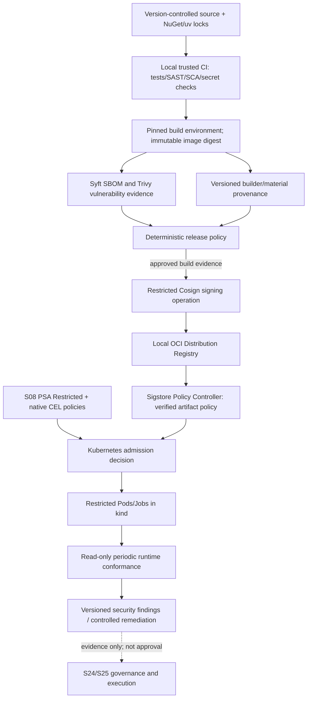

# S10 — Software Supply Chain & Runtime Security

> **Architecture approval record — 2026-11-17.** The owner approved a **lightweight local OCI Distribution Registry**, **Sigstore Policy Controller for cryptographic admission verification**, and **preventive runtime hardening plus periodic conformance/drift assessment** (without mandatory Falco). The owner also approved the remaining recommended S10 architecture: pinned dependencies; local secure CI; focused SAST/SCA, vulnerability scanning and SBOMs; Cosign key-based signing with independently verifiable provenance; layered PSA/CEL/signature enforcement; versioned risk-based release policies and expiring exceptions; separate signing trust and exact-governed deployment authorization. The twelve ADRs in §14 are **Accepted architecturally**. No scanner, signing key, registry, verifier, admission gate, CI runner, cluster or test is claimed installed/verified. Version pins, numerical risk thresholds and deployment wiring remain implementation work under their owning slices.

## 0. Document contract, precedence and status

- **Master catalog v1.0.0:** S10 is **P1**, even though its architecture is approved now; the catalog's S10 scope is locks/scanning/SBOM/signatures/provenance/registry/admission/runtime hardening/patch processes/CI gates. Apply X-SEC-01–08, X-REL-01–02, X-DATA-01–02, X-OPS-01, X-DEL-01 and X-TST-01 where relevant.
- **S01:** local AIOps Capacity Operations Platform; Observe/Advisory/Governed and L0–L2 only; human-approved exact mutations, hard safety before efficiency, criticality classes and evidence-driven B0–B3 results. A CI pass, artifact signature or policy admission is **never** a human approval.
- **S02:** exactly **six custom platform Deployment roles**: `api`, `observer`, `capacity`, `ai`, `governance`, `executor`; modular monorepo, typed interfaces, REST and PostgreSQL durable jobs/outbox, no mandatory broker. OCI registry / CI / Sigstore verification tooling are **supporting infrastructure**, not seventh custom platform services. Preserve `inventory`, `capacity`, `knowledge`, `governance`, `execution`, `audit`, `workflow` data ownership.
- **S03:** one kind control-plane plus three workers (one tainted platform worker, two experiment workers), Windows 11/Docker Desktop/WSL2, 20 GB physical RAM/Ryzen 5 3600, candidate 12 GiB WSL2 cap, Calico/default-deny, localhost HTTPS, host Ollama, local PVC/independent backups. All budgets are provisional and must be remeasured with registry/verifier/CI memory/CPU/disk included. `capacity-experiments` namespace requires the S05-approved **S03 documentation addendum**.
- **S04:** six demo identities W01–W06; four baseline Deployments, W05 suspended CronJob template, W06 scenario-created Job; immutable image digests in profile/run provenance; restricted non-root runtime. W01 `workloads-critical`, W02/W03 `workloads-standard`, W04–W06 `workloads-batch`.
- **S05:** host Python orchestrator/watchdog, SQLite journal, content-addressed run artifacts, ephemeral tokenless driver Jobs in `capacity-experiments`, allowlisted templates and independent UID-scoped cleanup; no optimization mutation authority. S10 must cover driver and scenario-created images as well as baseline images.
- **S06:** Keycloak/OIDC human identity, scoped RBAC+conditions, distinct human plan author/approver; no implicit Administrator bypass. Human authorization for release/promotion is distinct from approval of capacity plans.
- **S07:** dedicated ServiceAccounts, no K8s API credential in demo/driver Pods, restricted Observer and Executor credentials, TLS/selective mTLS, Calico policy. No mandatory service mesh. CI/registry/verifier flows must fit the traffic allowlist rather than opening broad namespace egress.
- **S08:** **Vault + ESO**, offline-protected root CA + cert-manager intermediate, PSA Restricted + native CEL `ValidatingAdmissionPolicy`, independent protected key custody, Restricted-data exclusion, scoped exception registry, encrypted backups and audit integrity. S10 adds **artifact authenticity** verification; it does not replace S08 Pod/object policy or convert a certificate authority into a universal image signer.
- **S09:** three logical agents and deterministic Tool Authorization Broker inside existing `ai` Deployment; agents cannot use shell, Kubernetes mutating API, experiment controls, secrets or approval. Image/security findings are evidence, not instructions or mutation authority.
- **Precedence and ownership:** S10 defines *trust criteria*; **S29** owns concrete pipeline/deployment automation and tooling installation; **S08** owns secret/certificate issuance/admission baseline; **S24/S25** own exact approval and execution; **S28/S30/S32** own operational recovery, test suites and release readiness. No accepted upstream ADR is silently superseded.
- **Terms:** `Accepted` = architecturally owner-approved; `Implementation choice/open` = not independently pinned; `Provisional` = starting measurement/rule; `Verified` = passing installed evidence only.

## 1. Purpose, scope and acceptance outcome

**Mission:** Establish a traceable, cryptographically verifiable chain between an approved source/build and the exact OCI image admitted to Kubernetes, while continuously assessing runtime security configuration and newly disclosed risk without bypassing workload governance.

**P1 outcomes:**
1. Local builds derive from pinned, auditable materials and produce an exact immutable image digest and versioned build identity.
2. The corresponding digest has validated dependency/image evidence, SBOM, provenance, signature(s), and reproducible publication metadata.
3. Deployment policy rejects untrusted signatures, missing/invalid attestations and disallowed workload settings, independent of client-side CI behavior.
4. Protected workloads run non-root, with bounded privileges and only required Kubernetes/namespace permissions; periodic assessor reports drift and new vulnerabilities.
5. Security gate decisions, exemptions, signer/key rollover and remediations are versioned, attributable and testable; no secrets leak into evidence.
6. Offline/local use does not imply online real-time vulnerability intelligence: database freshness and gaps are reported.

**In-scope images:** the six custom platform images, six W01–W06 images, S05 ephemeral driver image, locally built auxiliary Jobs if deployed, and a pin/exception inventory for third-party infrastructure images. The latter may require an explicit vendor-origin verification profile because we do not control their build attestations.

**Non-goals:** replacing existing DevSecOps project with full Harbor stack; mandatory Sigstore public Fulcio/Rekor/keyless infrastructure; custom generic admission webhook; mandatory Falco/eBPF detector; host endpoint detection/response; container malware sandboxing; vulnerability research; unbounded automated remediation; live cluster changes from agents; arbitrary custom build scripts submitted by users; mandatory cloud services; HA registry/Vault on a single workstation; auto-removing running Pods upon new CVEs.

### 1.1 Boundary diagram



## 2. Options and selected architecture

| Decision axis | Accepted choice | Alternatives / why not selected |
|---|---|---|
| Registry | **Lightweight OCI Distribution Registry**, local, authenticated and content-addressable | Harbor richer but larger RAM/DB/storage/admin footprint; public registry violates local-only serving posture |
| Build automation | **Local controlled CI**, versioned pipeline and restricted runner | Direct developer-machine pushes cannot establish consistent trusted builder identity |
| .NET/Python material control | NuGet lock + locked restore; `uv.lock` and frozen sync | Unpinned `latest` dependencies break reproducibility |
| Scanning | **Trivy** vulnerability/SCA/image scanning; focused SAST/secret checks | Scanner duplication adds load without stronger trust; one canonical scanner policy |
| SBOM | **Syft**, format recorded (SPDX or CycloneDX) | No bare dependency-list substitute for digest-attached artifact identity |
| Signatures | **Cosign locally managed key-based signing** | No required public keyless Sigstore infrastructure; unverifiable unsigned tag disallowed |
| Provenance | Trusted locally produced, signed build attestation tied to immutable digest | Untrusted self-assertion, source commit hash alone, or unverified “SLSA-level” marketing insufficient |
| Admission verifier | **Sigstore Policy Controller**, complemented by S08 PSA/CEL | CI-only checks can be bypassed via Kubernetes API; custom webhook adds security-critical custom code |
| Runtime | **Preventive controls + periodic read-only conformance/drift**, no mandatory Falco | Falco is optional later if objective tests justify host/kernel overhead |
| Risk policies | Versioned deterministic rules + narrowly authorized expiring exceptions | Neither unconditional allow-all nor block-every-warning is acceptable |

**Resource constraint:** the registry, signing operation and high-memory scans should run in bounded windows. Prefer CI/scanner on host or temporally controlled Jobs with measured impact; the registry/verifier need persistent supporting runtime only if real admission on every deployment requires it. Revisit the S03 memory envelope before claiming full-stack concurrency. Never place build runners on the experiment worker during exclusive S05 workloads without explicit budget and conflict checks.

## 3. Trust model and artifact identities

### 3.1 Identity levels

| Identity | Meaning | Required material |
|---|---|---|
| `sourceRevision` | Repository/tree state | Git commit, repository identity, protected branch/tag rule |
| `dependencyLockDigest` | Exact dependency resolution intent | `.NET` lock(s), `uv.lock`, verified restore records |
| `builderIdentity` | Trusted execution environment | CI runner/pipeline version, build toolchain and container base image digests |
| `imageDigest` | Exact produced OCI object | `sha256:<digest>` resolved at publication; never a mutable tag for trust |
| `sbomDigest` | Inventory for a specific artifact | SBOM format/version/generator and subject image digest |
| `provenanceDigest` | Build inputs/process lineage | Signed, typed attestation with source/material/build refs |
| `signerKeyId` | Explicit trusted software signing identity | Versioned trust roots and revocation/rotation status |
| `policyRevision` | Rules used for gating | Immutable policy identifier/digest and evaluation timestamp |
| `releaseIdentity` | Approved deployable artifact set | Image digest, attestations, exception refs, promotion decision |

**Canonical subject:** registry host/repository/digest plus canonical OCI manifest identity; changes to registry location or artifact copy must retain cryptographically verifiable digest and applicable signatures. Signature verification checks the *expected signer/key and subject*, not simply presence of any signature. Define multi-architecture image index versus platform-specific manifests during implementation.

**Not synonymous:** a digest proves identity, a signature proves integrity/origin under trusted-key custody, provenance claims build history, a scan describes known findings at its database revision, and admission checks policy. None guarantees the code is non-malicious or overrides S24 human approval.

### 3.2 Logical `BuildArtifactEvidence v1alpha1`

```yaml
apiVersion: capacity.lab/v1alpha1
kind: BuildArtifactEvidence
metadata:
  artifactId: w01-latency-api-release-reference
  revision: 1
spec:
  image:
    repository: registry.capacity.test/workloads/latency-api  # illustrative hostname
    digest: sha256:<resolved-image-digest>
  source:
    repoId: local-monorepo
    commit: <trusted-git-commit>
    sourceTreeDigest: sha256:<resolved-source-digest>
    lockDigests: ["sha256:<dotnet-lock-digest>"]
  builder:
    identity: trusted-local-ci-builder
    pipelineRevision: <revision>
    toolchainRefs: ["pinned-builder-image@sha256:<digest>"]
  evidence:
    sbom: {format: spdx-json, subjectDigest: "sha256:<resolved-image-digest>", digest: "sha256:<sbom-digest>"}
    vulnerabilityReport: {scanner: trivy, dbRevision: <db-revision>, scannedAt: <utc>, digest: "sha256:<report-digest>"}
    provenance: {predicateType: <documented-type>, digest: "sha256:<attestation-digest>"}
    signatureRefs: ["oci-signature-reference"]
  decision:
    policyRevision: release-policy-v1
    result: accepted # outcome only from trusted policy evaluator
    exceptionRefs: []
    evaluatedAt: <utc>
  integrity:
    manifestDigest: "sha256:<canonical-evidence-digest>"
```

**Contract constraints:** Reference placeholders are deliberately **not deployable**. This is a metadata/evidence DTO, not Kubernetes CRD, OCI format guarantee, authoritative proof by itself or a self-trusting approval token. CI must store verifiable signed/attested artifacts using the selected OCI referrer/attachment compatibility profile; verifiers independently dereference subject, signature, trusted key, policy and evidence. S29 pins exact flags/schemas/registry compatibility. Evidence must not contain build secrets, tokens or signature private keys.

## 4. Secure build, verification and promotion lifecycle

### 4.1 Deterministic pipeline stages

1. **Source acquisition:** trusted repository/commit, authorized pipeline configuration, protected ref and clean build context. Reject unexpected submodule/external material or fail with recorded exceptions.
2. **Dependency lock verification:** NuGet locked restore, frozen Python dependencies and recorded package sources; no unresolved dynamic dependencies; base images pinned by digest. Resolve all network-fetched materials before evaluating offline reproducibility.
3. **Source checks:** unit/security tests, focused Semgrep-equivalent SAST, secret detection and dependency checks. Maintain ignore rules as policy-controlled, reviewed changes.
4. **Image build:** multi-stage .NET/Python builds, minimal runtime/base, deterministic inputs where feasible, no credentials in Docker layers/build args/outputs, recorded platform and build toolchain.
5. **Subject resolution:** push or materialize final OCI image and resolve exact digest; do not sign a mutable tag or claim immutable tags alone.
6. **Evidence generation:** Syft SBOM of final artifact, Trivy image/dependency report, provenance and configuration checks; bind all to subject digest.
7. **Release policy evaluation:** validate expected fields, risk policy, database recency, missing metadata and applicable authorized exceptions; reject on unknown security-sensitive schema.
8. **Signing:** authenticated restricted signing operation over correct image/attestation subject(s); produce verifiable references and audit records.
9. **Publication/promotion:** publish image by digest and related evidence, then verify using a separate verification identity; promotion into deployment manifests references digest, policy and release identity.
10. **Admission:** Kubernetes admission validates S08 Pod/object settings and S10 trust according to namespace/subject policy. Re-run evaluation after key/policy/image changes where needed.
11. **Runtime observation:** read-only assessment periodically compares deployed image/config against expected release posture; report findings for operator decision and controlled redeployment.

**Atomicity note:** image, SBOM, signature, provenance and decisions are not one atomic OCI transaction. Release is eligible only once the verifier can retrieve and validate the complete evidence set. A failed intermediate stage must leave an explicitly non-promoted artifact, even if its image bytes already reside in the registry.

### 4.2 Source and builder integrity

- Source control protects pipeline/workflow definitions and permissioned promotion; untrusted pull requests cannot invoke production signing identities.
- Ephemeral or dedicated tightly scoped CI credentials; no default cluster-admin kubeconfig; CI image publication rights are separate from signature-key access and from S25 execution authority.
- Pin Dockerfile base digests, Git revision, compiler/runtime/tool versions, NuGet feeds/PyPI mirror references and lockfiles. A valid `uv.lock` does not automatically prove a supply-chain-safe package.
- Dependency caching must verify package hashes/metadata as appropriate and not silently substitute unverifiable bytes. Rebuild reproducibility is **measured**, not assumed byte-for-byte across all tools.
- For external/third-party images, use a separately versioned upstream-trust policy: digest pin, provenance verification where available, SBOM/scan and explicit allowlisted exception with expiry if evidence differs from local-builder policy. Never forge a local build attestation for third-party software.

### 4.3 Versioned `ArtifactTrustPolicy v1alpha1`

Logical (not installable YAML):

```yaml
apiVersion: capacity.lab/v1alpha1
kind: ArtifactTrustPolicy
metadata: {id: first-party-workloads, revision: 1}
spec:
  appliesTo:
    namespaces: [workloads-critical, workloads-standard, workloads-batch, capacity-experiments]
    imageClass: first-party
  require:
    digestPinned: true
    trustedSignerSetRef: first-party-build-signers-v1
    signedProvenance: true
    subjectBoundSBOM: true
    vulnerabilityDecisionRef: default-release-risk-v1
  missingEvidence: deny
  invalidSignature: deny
  unavailableVerifier: deny
  exceptions:
    grantOnlyBy: restricted-human-release-policy
    expiryRequired: true
    maxScope: exact-image-digest
```

**Do not mistake this for deployable Sigstore configuration**: Sigstore Policy Controller's supported policy types, image fetch behavior, attestation predicates and selectors need version-pinned validation. Some requirements may be enforced by a trusted pre-promotion gate plus independent admission-visible signed claims rather than by an admission policy alone. A vulnerability exception is not automatically cryptographically inspectable by the admission controller without an explicit trusted, subject-bound decision attestation. Avoid unverified claims of complete enforcement.

## 5. Registry and OCI artifact policy

- Deploy one authenticated lightweight OCI Distribution Registry as supporting infrastructure, with persistent local storage, host/LAN exposure restriction and S07 NetworkPolicy where in-cluster.
- Pin Distribution implementation version, validate OCI artifact/referrer support, Cosign signature storage, registry permissions and `imagePullSecrets` handling; don't assume compatibility without actual tests.
- Namespace repository prefixes by owner (`platform`, `workloads`, `experiments`, `infrastructure`) with policy differences, not broad unrestricted push/pull.
- Build principal may push first-party candidate images; promotion/signing principal has separately controlled rights; runtime pull identities are read-only. Verify whether Kubernetes pull secret delivery is required and protect it via S08.
- Images deploy by digest, no `latest`/floating tag as trust identity. Tags may be convenient aliases but cannot be proof of the admitted bytes.
- Retain approved image digests and referenced evidence for configured retention window; garbage collection must not delete current deployments' required image or attestation bytes. Registry deletion and trust revocation are separate operations.
- Registry outage: already running Pod state continues independently; new image pulls may fail; an admission policy must not fail open to compensate. Warmed node caches may affect pulls and must not be treated as proof of registry availability.
- Backup metadata, critical image/evidence digests and trust keys to independent protected storage; a local PVC is not physical disaster recovery.

## 6. Keys, signatures, provenance and revocation

### 6.1 Key custody

- Accept **Cosign local key-pair signing** with strictly separated signing/private key and verifier/public trust set. Signing material may be protected using S08 Vault or a protected host signing operation; exact custody and automation integration remain S08/S29 implementation choices, not license to store unencrypted private keys in Git/CI environments.
- Image-signing keys are **distinct** from S08 root/intermediate PKI keys, OIDC signing keys, S24 approval integrity keys and S08 audit checkpoint keys, except by separately reviewed intentional key hierarchy (not assumed).
- Verifier receives pinned trusted public key/identity and policy revision, never image signer private keys. Restrict who can update verifier trust policy and admission exceptions; test insider tampering.
- Rotate trust with controlled overlap and measured safe cutover. A revoked key does not retroactively erase running Pods; a re-evaluation and controlled remediation workflow is needed.
- Offline/root keys are not automatically equivalent to a hardened HSM. State physical host trust, backup and exposure limitations.

### 6.2 Provenance verification

Minimum signed provenance: immutable subject image digest, source repository and commit/tree, build pipeline and trusted builder identity, dependency/base materials, output platform, creation time and predicate/schema revision. The security policy must verify that asserted source/builder are permitted and attestation subject equals deployed digest.

Use a documented compatible in-toto/SLSA-provenance predicate **where technically supported**; no SLSA level claim without satisfying the exact source/build isolation and verification guarantees. A signature on arbitrary JSON does not make the builder trustworthy.

### 6.3 Trust revocation

Security states: `eligible`, `blocked`, `quarantined`, `exception_active`, `exception_expired`, `revoked`, `evaluation_unknown`. Re-evaluate upon signing-key rotation/revocation, newly published high-impact vulnerabilities, policy revision, external image change, deleted attestation or unexpected manifest drift. For running images, produce a finding and require S24/S25 policy-compliant action; no arbitrary S10 Pod eviction.

## 7. Layered Kubernetes admission and runtime controls

### 7.1 Admission chain (independent authorities)

| Layer | Owner | What it can enforce | What it cannot prove alone |
|---|---|---|---|
| PSA Restricted | S08 | Nonprivileged Pod baseline subject to Kubernetes version | Signature validity; all read-only-FS/resource fields |
| Native CEL `ValidatingAdmissionPolicy` | S08 | API-object-visible image pin syntax, workload fields, SA, templates, resource caps | Registry signature authenticity or arbitrary external plan state |
| Sigstore Policy Controller | S10 | Compatible image signature and associated attestation trust rules | Human S24 approval or all runtime risks |
| Kubernetes RBAC | S07 | Resource type, verb, namespace/RoleBinding | Arbitrary JSON patch field restrictions or UID ownership-by-label |
| Domain adapters | S05/S25 | Run/UID/ownership state, exact plan/action/approval, bounded operation | Cannot replace server-side independent gate |
| Calico / service auth | S07 | Network reachability and authenticated application rights | Image integrity by itself |

**Critical engineering constraints:** verify webhook **fail-closed behavior**, namespace selection/bindings, service/API availability, dry-run handling, fail policy and bootstrapping on the actual installed version. Test the **controller template** admission path as well as generated Pod creation: some policy components primarily intercept Pod admission, not every controller update. An accepted Deployment spec does not mean its Pods can run. Record effective policy on deployment and inspect actual Pods, not just manifests. Admission webhooks/controllers themselves can introduce availability and trust dependencies; permit only narrowly evidenced bootstrap recovery paths for critical infrastructure.

**External image and core add-on bootstrapping:** make a reviewed minimum-trust profile for bootstrap/policy infrastructure when first-party signed provenance is impossible; digest pin and explicitly limit namespace/principals. This is not a general namespace exemption. Calico, cert-manager, ESO, Vault, Keycloak, database and Sigstore verifier images have independently pinned version/evidence/exception records.

### 7.2 Runtime prevention

Common hardened Pod requirements (S04/S07/S08 remain normative):

- Numeric non-root UID/GID; `runAsNonRoot`; `allowPrivilegeEscalation: false`; `capabilities.drop: ["ALL"]`; `seccompProfile: RuntimeDefault` (or stricter separately validated profile).
- Read-only root filesystem and only explicitly bounded `emptyDir` writable paths; `hostPID`, `hostIPC`, privileged host network/path access disallowed for apps.
- `automountServiceAccountToken: false` for all W01–W06 and S05 driver; explicit projected tokens only for authorized Observer/Executor and justified system components.
- Explicit CPU/memory requests/limits; finite Jobs, permitted resource templates and namespace quotas; Kubernetes scheduling safeguards cannot replace S05 host watchdog.
- Calico default-deny and authorized TLS/service identity. No direct demo/driver access to DB, Vault, AI, Ollama, Executor or Kubernetes API.
- Update runtime base images with bounded maintenance and regression checks; enforce no silent change to W01–W06 SLO/measurement behavior during patching.

### 7.3 Periodic runtime conformance evaluator

**Accepted architecture:** bounded, read-only Python assessment as host/CI command or scheduled limited task, *not a seventh permanent custom Deployment*. It may consume authorized S11 inventory projection for topology and direct separately scoped reads only when justified; don't issue it a generic cluster-admin credential. S11 remains owner of inventory observations; S10 owns security rule evaluation.

`RuntimeConformanceFinding v1alpha1` logical fields: `findingId`, `ruleId/revision`, `clusterId`, `namespace`, `objectKind/name/UID`, `podUID?`, `observedImageDigest`, `expectedReleaseRef`, `observedAt`, `inventorySnapshotRef?`, `evidenceRefs`, `severity`, `status`, `scope`, `remediationClass`, `policyRevision`, `assessmentToolVersion`. Never embed secret values or credential-bearing raw annotations.

Check effective image, signature/trust status, declared/reality diff, non-root/seccomp/capabilities/read-only FS, token automount, exposed volumes, privilege fields and new vulnerability assessments. Findings can be `new`, `acknowledged`, `exception_active`, `resolved`, `unknown`; avoid promoting `unknown` to compliant. Drift alert is advisory/security governance evidence, **not** authority for agents or scanner to modify workload resources.

## 8. Vulnerability management and patch strategy

### 8.1 Release policy

- Versioned criteria consider severity, fix availability, exploit evidence where available, affected component/runtime reachability, workload criticality, trusted scanner database recency, and source of evidence.
- Default block policy should treat defined critical/high exploitable conditions as release blockers. **Exact thresholds, feed recency and severity mapping are implementation/calibration gates**, not fixed numeric truth in this architecture.
- Avoid treating an empty scanner report as clean when the vulnerability database is missing, outdated, unsupported, or scanning failed. Record `scan_unknown` and deny protected promotion unless an approved temporary exceptional procedure exists.
- Identical image digest can receive a new risk decision as new advisories appear; rescanning doesn't change its digest.
- Exceptions must be scoped to exact digest/target and finding or policy rule, contain human owner, justification, compensating control, expiry, independent authorization and signed/integrity-protected audit. No model-generated exception or unreviewed free-text suppression.
- Detect broken fixes and regression of security contexts after updates; preserve old/new release evidence for rollback policy decisions.

### 8.2 Remediation classes

`rebuild_image`, `update_dependency`, `replace_base_image`, `tighten_runtime_config`, `rotate_signing_key`, `revoke_artifact`, `investigate_false_positive`, `approve_expiring_exception`. Actual application Deployment mutation still passes S24/S25 governed paths or S29's explicitly authorized declarative deployment process; S10 must not invent a privileged remediation controller.

## 9. Security threat model and misuse cases

| Threat / trust boundary | Required defense | Negative proof |
|---|---|---|
| Mutable tag swapped after scan | Immutable digest and final-artifact re-verification | Retag does not change approved digest |
| Unauthorized signer or tampered provenance | Pinned trusted key/subject/allowed builder, signature verification | Wrong key and altered payload denied |
| SBOM belongs to another image | Subject-bound SBOM digest/attestation checks | Mismatched subject denied |
| CI workflow compromised to access signing key | Protected branch/runner/signing privileges, separate key custody | Untrusted branch cannot sign/release |
| Forged release-exception claim | Authenticated policy decision and signed evidence | Image metadata cannot grant its own exception |
| Scanner DB stale or missing | Freshness and status validation | No `clean` on unknown evidence |
| Arbitrary driver Job with malicious image | S05 template allowlist + S08 CEL + S10 verification | Raw K8s API job creation rejected |
| Untrusted infrastructure image | Explicit upstream policy/exception and digest pin | No blanket namespace exemption |
| Verifier offline | Failure policy blocks protected admission | Cannot bypass by timeout/dry-run/misbound selector |
| Admission policy objects modified | Narrow administrative RBAC; monitored revisions; protected bootstrap | Unauthorized binding removal denied/detected |
| Runtime Pod gains SA/host privileges | PSA/CEL + drift readback; least privilege | Admission or runtime finding |
| Private signing key leaked into logs/OCI | Restricted signer custody, canary scanning and rotation | No private key in image/artifacts/logs |
| AI/tool tries to approve a risky image or auto-redeploy | S06/S09/S24/S25 separation | No agent-issued release or K8s write |
| Shared Windows/WSL host compromised | Recognized lab threat limitation, encrypted independent backups | No unsupported multi-host isolation/HA claim |

## 10. Failure handling and operational resilience

| Failure | Expected behavior | Recovery / observable evidence |
|---|---|---|
| Registry unavailable | New pulls/promotion may fail; do not replace with unknown image | Retry bounded; registry health, digest proof, retention check |
| CI runner crash mid-publish | Candidate incomplete, non-promotable | Reconcile by digest and fully reverify before signing/promoting |
| Trivy DB unavailable/stale | Scan quality unknown; block protected release | Use authenticated, recorded offline database update; report revision |
| Signing service/key inaccessible | No unsigned fallback | Recover protected key path or rotate with authorized process |
| Signature key revoked | Stop new admissions under revoked trust; assess running images | Protected trust-bundle update, re-evaluate, controlled remediation |
| Admission verifier unavailable | Fail closed for protected workloads; running Pods remain unless separate policy | Restore verifier/registry, negative and positive admission drill |
| Verifier/policy bootstrap deadlock | Strictly scoped, documented recovery route; not open-all | Audit exception identity/window/scope and re-enforce afterwards |
| Sidecar/add-on policy incompatibility | Explicit exception path and test, no silent universal bypass | Rebuild valid manifests, verify namespace binding |
| Vulnerability found on running image | Produce urgent finding, not autonomous eviction | Remediate through allowed operator/deployment workflow |
| PostgreSQL / inventory down | Independent admission continues according to verified local policies where designed | Mark conformance evaluation unavailable; avoid fake compliant findings |
| Vault/PKI lost | No fallback embedded secrets or TLS disable | S08 restore/drill and trust verification |
| Host pressure / disk exhaustion | Pause heavy scans/CI, preserve platform/S05 safety | S03 watchdog/host metrics, bounded artifacts, cleanup with retention rules |

### 10.1 Observability

Record `artifact_build_result`, `image_scan_result`, `sbom_generation_result`, `signing_result`, `attestation_verify_result`, `admission_verify_result`, `runtime_conformance_result`, scan feed age/status, registry/verification availability, key expiry/rotation, exceptions due/expired. Prefer counters/histograms/gauges with bounded labels (rule, service class, decision) and structured audit records for full image digests, run IDs, actor refs and policy revisions. No per-image digest or arbitrary CVE text as unbounded Prometheus labels. Correlate deployments, image evidence, inventory snapshot refs and S25 execution references via immutable identifiers.

## 11. Functional, nonfunctional and security requirements

| ID | Requirement | Evidence |
|---|---|---|
| S10-FR-001 | Trusted source, lockfiles and builder provenance for first-party images | Build evidence manifest |
| S10-FR-002 | Publish exact digest-addressed OCI images, not floating refs | Registry/deployment inspection |
| S10-FR-003 | Generate subject-associated SBOM and vulnerability evidence | Independent SBOM/scan verification |
| S10-FR-004 | Evaluate deterministic versioned release risk | Policy decision reasons |
| S10-FR-005 | Cosign sign required image/attestations and verify with pinned trust | Tampering/negative verification |
| S10-FR-006 | Admission check image trust independently of CI through Sigstore verifier | Real kind admission tests |
| S10-FR-007 | Preserve S08 PSA/CEL and namespace/image template enforcement | Pod/controller rejection tests |
| S10-FR-008 | Distinguish first-party and external supporting-image policies | Exception/verification inventory |
| S10-FR-009 | Periodically read back effective runtime hardening and trust drift | Signed/traceable findings |
| S10-FR-010 | Reassess running images on vulnerability/policy/key changes | Re-evaluation report |
| S10-FR-011 | Expiring scoped exceptions, reviewed remediation/patch lifecycle | Audit and expiry tests |
| S10-FR-012 | Recover registry/verifier/key trust without fail-open | Recovery drill |
| S10-NFR-001 | Run in local bounded memory/CPU/disk, schedule heavy scans apart from exclusive S05 experiments | Measured S03 budget |
| S10-NFR-002 | Cryptographic evidence verification deterministic for same trust/policy/evidence inputs | Repeatable tests |
| S10-NFR-003 | Unknown/offline vulnerability intelligence never reported clean | Quality flags |
| S10-NFR-004 | Artifact/attestation/public key/schema version compatibility checked before release | Compatibility tests |
| S10-NFR-005 | Timeouts, bounded retries, idempotent promotion and safe incomplete states | Fault tests |
| S10-SEC-001 | Private signing/CI/registry credentials never in source, layers, evidence, logs or prompts | Canary/secrets tests |
| S10-SEC-002 | Untrusted signer, forged subject/provenance and missing attestations fail closed | Admission negative tests |
| S10-SEC-003 | CI, signer, verifier, registry pull, Executor and human approval are separate authorities | RBAC/role negative tests |
| S10-SEC-004 | No broad namespace exemption or unverified bootstrap bypass | Policy binding and negative probes |
| S10-SEC-005 | Exceptions bind exact digest/risk/scope/expiry and authorized human | Scope/expiry tests |
| S10-SEC-006 | No agent, runtime assessor or scanner receives mutation authority | SA/network/auth probes |
| S10-SEC-007 | Running-image drift and newly revoked keys are not silently compliant | Freshness/reassessment tests |

**Cross-cutting mapping:** S10-FR-001/002/003→X-DEL-01; S10-FR-004/005/006 and SEC-001–005→X-SEC-04/05/08; S10-FR-009/010→X-OPS-01 and X-DATA-02; S10-NFR-005→X-REL-02; all S10-TEST→X-TST-01. Exact upstream mappings are refined in S30 traceability.

## 12. Acceptance and security tests

Tests are specified, **not executed**. `unit/contract` should run on routine commits; `integration` on pinned local containers; `kind admission` requires real registry/PSA/CEL/verifier; `operational` is manually/periodically gated by host budget.

| ID | Layer | Mandatory proof |
|---|---|---|
| S10-TEST-001 | unit/CI | Modified/missing NuGet or uv lock makes protected pipeline fail |
| S10-TEST-002 | CI | Built image resolves to immutable OCI manifest digest; tag swap cannot change release subject |
| S10-TEST-003 | integration | Syft SBOM subject and associated image digest verified |
| S10-TEST-004 | crypto | Wrong Cosign key/trust root rejects artifact |
| S10-TEST-005 | crypto | Changed image or attestation body fails signature/subject verification |
| S10-TEST-006 | provenance | Forged/unapproved builder identity or source ref rejects promotion |
| S10-TEST-007 | CI | Risk-defined critical/high vulnerable artifact blocks release with reason and scanner DB revision |
| S10-TEST-008 | policy | Expired/wrong-digest/wrong-scope release exception does not authorize |
| S10-TEST-009 | kind | Privileged/escalating Pod or controller-generated Pod rejected under PSA/CEL |
| S10-TEST-010 | kind | Direct raw Kubernetes create bypassing CI with untrusted signed/unsigned image is denied |
| S10-TEST-011 | kind | Missing verification controller/broken policy or unreachable verifier does not fail open for protected admissions |
| S10-TEST-012 | integration | Deployed digests/profiles match accepted WorkloadProfile/run manifest identity and security policy |
| S10-TEST-013 | operational | New vulnerability on unchanged digest creates conformance finding, no unauthorized auto-patch |
| S10-TEST-014 | security | Signer/private keys absent from OCI layers, manifests, CI logs, scan reports, prompts and artifacts |
| S10-TEST-015 | offline | Empty/stale/unsupported vulnerability database yields unknown/blocked, not false clean |
| S10-TEST-016 | RBAC | Untrusted PR/CI runner cannot sign, change policy, access S25 execution, or approve plan |
| S10-TEST-017 | registry | Authenticated push/pull separation, attestation compatibility, garbage-collection retention of active digests |
| S10-TEST-018 | kind | Experiment driver Job requires trusted signed image and S05/S08 template constraints |
| S10-TEST-019 | kind | External bootstrap/supporting images use only documented narrowly scoped policy profile; no blanket allow |
| S10-TEST-020 | operations | Key rollover/revocation/recovery preserves audit and blocks old signer per policy |
| S10-TEST-021 | operations | Verifier restart/outage and registry loss produce safe admit/pull behavior; tested recovery |
| S10-TEST-022 | operations | Resource-bounded scanning, image storage and verifier fit actual S03 host/worker budget |
| S10-TEST-023 | security | AI and runtime assessor cannot patch Kubernetes or read signer secrets |
| S10-TEST-024 | contract | Signed decisions/provenance cannot be reinterpreted as S24 human plan approval |

**Release gate:** Do not mark S10 *Verified* until each mandatory tier has observable passing results on actual local infrastructure. If S10 P1 is deliberately staged after initial S11 P0 development, clearly label the system's artifact-admission posture as **not yet enforced**; never market it as secure S10-complete.

## 13. Implementation sequence and realistic resource cost

1. **Design-ready / dependencies:** finalize policy terminology, image inventory and trust matrix; confirm S08 PSA/CEL admission and S07 identities; preserve S03 namespace addendum.
2. **Build baseline:** pinned multi-stage .NET/Python builds, immutable digest manifests, source/lock/toolchain metadata, focused checks.
3. **Evidence:** Syft, Trivy, local DB cache/update SOP, subject-bound provenance/attestations and audit-safe evidence store.
4. **Signing + registry:** protected Cosign key lifecycle, Distribution registry, separate verifier trust root, confirm OCI referrer/signature compatibility.
5. **Admission:** install/pin Sigstore Policy Controller with scoped policies, namespace bindings, S08 PSA/CEL integration, negative tests including controller templates, fail-closed outage path.
6. **Runtime conformance:** read-only bounded scan of actual deployed Pods/images; drift and newly disclosed vulnerability re-evaluation; remediation review workflow.
7. **Operational evidence:** key-rotation, registry backup/recovery, feed updates, CI compromise/denial, resource utilization, S30 traceability and S32 release reports.

No exact image registry storage, scan duration or memory claims can be accepted before measuring the local 20 GB host. Favor on-demand scans; add supporting services only when their contribution and fit are demonstrated. Do not lower S05 pressure or S01 safety gates to fit the scanner stack.

## 14. Accepted ADR register

| ADR | Status | Decision / consequences |
|---|---|---|
| S10-ADR-001 | **Accepted** | Local lightweight OCI Distribution Registry rather than Harbor; implement auth, digest pin, retention and attestation compatibility checks |
| S10-ADR-002 | **Accepted** | Secure local CI using locked .NET/Python dependencies, pinned builder inputs, tests and deterministic release gates |
| S10-ADR-003 | **Accepted** | Trivy-based vulnerability/SCA image scanning plus focused SAST and secret detection; do not falsely assert scanner findings are complete |
| S10-ADR-004 | **Accepted** | Syft-generated subject-bound SBOM (SPDX/CycloneDX compatibility verified under S29) |
| S10-ADR-005 | **Accepted** | Cosign local key-based signature of exact image/attestation subject; separate signer trust and protected private custody |
| S10-ADR-006 | **Accepted** | Trusted versioned builder/material provenance bound to final digest; no unsupported formal assurance-level claim |
| S10-ADR-007 | **Accepted** | Layered S08 PSA Restricted + CEL with S10 cryptographic admission verification; no assumption CEL fetches registry trust |
| S10-ADR-008 | **Accepted** | Sigstore Policy Controller as preferred cryptographic verifier, with verified fail-closed policy and local resource fit |
| S10-ADR-009 | **Accepted** | Deterministic risk-based vulnerability policy, feed freshness checks, narrowly scoped expiring exceptions |
| S10-ADR-010 | **Accepted** | Preventive hardening plus periodic read-only runtime conformance and vulnerability/key/drift reassessment |
| S10-ADR-011 | **Accepted** | No mandatory Falco/eBPF agent, custom security verifier or additional permanent custom platform Deployment; later upgrades require ADR |
| S10-ADR-012 | **Accepted** | Signing key rotation/revocation, artifact trust re-evaluation and human-controlled remediation; S24/S25 governance preserved |

## 15. Downstream handoffs and unresolved implementation gates

| Owner | Must finalize without changing S10 ADRs |
|---|---|
| S03 addendum | Document `capacity-experiments`; recalibrate platform + registry/verifier/CI/PKI storage/memory and node policy |
| S07 | Runtime SA/registry/CI/verifier network matrix, TLS/auth, scoped imagePullSecrets, no AI→Executor bypass |
| S08 | Signing key location/custody, credential access/rotation, secure backups; exact PSA/CEL policies and infrastructure exceptions |
| **S11** | Expose authorized current image digest, object UID, security context and snapshot freshness for conformance, but not security verdict ownership |
| S12/S13 | Security metric nomenclature, audit/evidence reference storage, retention, normalized image trust and workload joins |
| S19/S24–S26 | Whether/how security findings constrain candidate acceptance and rollout; exact approvals/ownership/revalidation/rollback |
| S27 | Operator-visible artifact risk/findings and authorization, without introducing custom frontend |
| **S29** | Gitea/local CI selection and runner restrictions, registry version/OCI compatibility, pinned Cosign/Syft/Trivy/Sigstore versions, install order, bootstrap exception mechanics, actual helm/manifests/pipelines |
| S28 | Registry, signing trust, scanner-feed and verifier alerts, backup restore drills, outage failure policy |
| S30–S32 | Negative-test automation, release matrix, provenance audit, exception evidence, resource fit, operational readiness |

**Explicitly open implementation parameters (not new architectural options):** registry hostname/auth/storage, Gitea Actions versus comparable local CI, exact tool versions/CLI flags, acceptable SBOM/attestation media type, vulnerability risk thresholds and freshness windows, trusted signer-key generation and custody, Sigstore Policy Controller version/API compatibility, webhook namespace selectors and bootstrap exceptions, image index/pull behavior, conformance frequency, scanner host placement, retention and resource budgets. These must be settled and measured before implementation/release; do not silently pretend they were approved numeric settings.

## 16. Suggested repository layout

```text
specs/slices/S10-software-supply-chain-runtime-security/
  01-purpose-and-scope.md
  02-requirements.md
  03-architecture-and-alternatives.md
  04-contracts-and-data.md
  05-security-and-threat-model.md
  06-failure-modes-and-operations.md
  07-acceptance-tests.md
  08-decisions-and-open-questions.md
security/supply-chain/{trust-policies,signing,provenance,sboms,scanning}/
security/admission/{sigstore,cel,psa,exceptions}/
security/runtime/{conformance,findings,tests}/
infra/registry/
ci/{pipelines,runner-policies}/
automation/python/{supply_chain,security_checks}/
```

This single consolidated Markdown file is the authoritative S10 **architecture source** and covers the master catalog's eight specification topics. It is **not a runnable CI system**, deployment manifest bundle or verified security control.

## 17. Completion statement and change control

**S10 architecture ACCEPTED on 2026-11-17; implementation and enforcement NOT VERIFIED; original priority remains P1.** Replacing Distribution with Harbor, replacing Sigstore cryptographic verification with CI-only checks, adding a mandatory detection runtime, relaxing PSA/CEL/approval separation, or altering privileged service boundaries requires a new explicit superseding ADR and coordinated S03/S07–S09/S24–S29 review. Version pins and calibrated thresholds can be finalized by owning slices without overturning the approved principles. No signed image, scanner result or security finding grants a human approval or Kubernetes mutation authorization.
