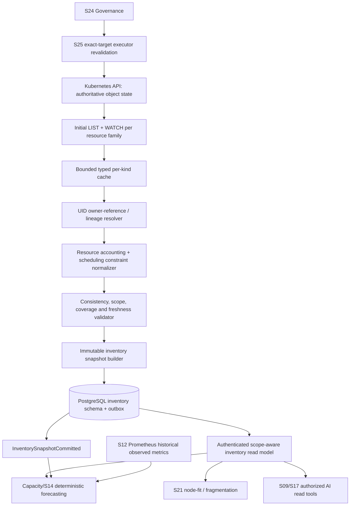
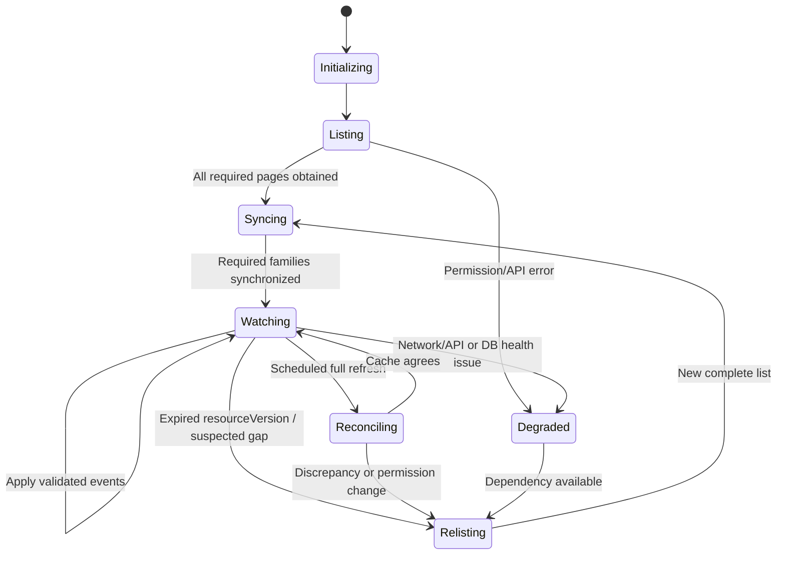
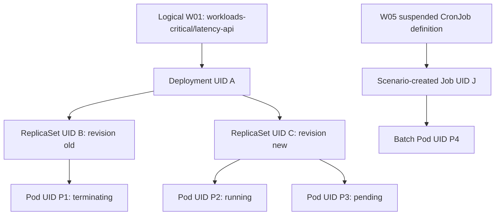

# S11 — Cluster State Discovery & Resource Inventory

> **Architecture approval record — 2026-11-17.** The owner approved **hybrid Kubernetes LIST + WATCH + periodic reconciliation** and **extended resource inventory coverage** (demo workloads plus relevant infrastructure, StatefulSets, DaemonSets and PodDisruptionBudgets). The owner also approved the remaining recommended S11 architecture: run inside existing S02 `observer`, use Kubernetes API as authoritative state, maintain bounded in-memory typed caches plus committed PostgreSQL `inventory` snapshots, stable workload identity alongside exact Kubernetes UID lineage, scheduler-aware effective CPU/memory requests, quality-classified immutable snapshots, per-resource-family synchronization and freshness, semantic events through existing PostgreSQL outbox, scoped read-only access and no Redis/broker/custom operator. All twelve ADRs in §15 are **Accepted architecturally**. No running cluster, completed inventory, validated API watch, database migration, benchmark or automated test is claimed. Example clocks/thresholds and schemas remain provisional until S12/S13/S28/S29 implementation validation.

## 0. Authority, precedence and terminology

- **Master catalog v1.0.0:** S11 is **P0**, owning current Kubernetes configuration and resource identity, nodes/allocatable, Pods/controllers/Jobs, HPA/PriorityClass/constraint metadata, owner mapping, watch/list, snapshot versions, quality and staleness. S12 measures usage/time-series; S13 finalizes durable capacity/intelligence data schemas; S21 evaluates actual candidate placement; S25 revalidates execution state. Apply X-SEC-01/02/04/05/07, X-REL-01/02, X-DATA-01/02, X-OPT-01/02, X-OPS-01, X-DEL-01, X-TST-01.
- **S01:** AIOps Capacity Operations Platform; L0–L2/Observe–Advisory–Governed; current, 1h, 24h planning; workload/namespace/cluster hierarchy; Critical/Standard/Flexible/Opportunistic classes; no invented measured or predicted facts. Request capacity ≠ observed consumption.
- **S02:** exactly six custom persistent Deployments `api`, `observer`, `capacity`, `ai`, `governance`, `executor` and one PostgreSQL instance with separate schemas/roles. **Observer owns `inventory`** and `InventorySnapshotCommitted` outbox. Immediate queries via versioned REST interfaces; durable events via PostgreSQL job/outbox; no mandatory RabbitMQ/Kafka. The Observer is the only S11 Kubernetes watcher in the custom business platform; agents and Capacity use authorized typed evidence interfaces, not a second broad Kubernetes token.
- **S03:** accepted single kind control-plane + three workers (one dedicated/tainted platform worker, two experiment workers), Calico default-deny, 20 GB Windows 11/Docker Desktop/WSL2 shared physical host, candidate WSL2 12 GiB cap and provisional envelopes. Worker node names/labels and node pools are lab configuration, not physical independent host fault zones. S05's approved `capacity-experiments` namespace needs a documented S03 addendum; S11 must include it in discovery when authorized.
- **S04:** W01 `latency-api` in `workloads-critical` (Critical); W02 `burst-api` and W03 `memory-profile` in `workloads-standard` (Standard); W04 `cpu-worker` (Flexible), W05 `analytics-processor` (Flexible), W06 `opportunistic-batch` (Opportunistic) in `workloads-batch`. Four Deployments at one replica; W05 suspended CronJob definition; W06 on-demand Job; optional W02 HPA off in baseline; workload labels/profile revision do not override applied Kubernetes state. W01–W04 experiment-pool node selection and priority policy remain unchanged.
- **S05:** host Python scenario orchestrator/watchdog with SQLite evidence journal and ephemeral tokenless drivers in `capacity-experiments`, controlled Job lifecycle, UID-aware cleanup, snapshot/evidence correlation, no optimizer mutation. S11 must distinguish transient and expected-Pending Pods and avoid treating missed short-lived samples or deleted Jobs as zero usage.
- **S06:** Keycloak/OIDC, application RBAC + namespace/resource scope and conditions. Full internal collection authority does not grant unrestricted external inventory disclosure.
- **S07:** `capacity-observer-sa` only approved read/list/watch API permissions, no patch/create/delete/Secrets/token creation; NetworkPolicy and authenticated internal read APIs; no K8s tokens in `ai`/demo/driver. Required cluster-scoped Node/PriorityClass reads and namespaced Pod/controller/quota/limit/event reads must be explicitly granted. Scope role bindings by namespace where practical.
- **S08:** Vault/ESO, offline-root + cert-manager intermediate, PSA Restricted + native CEL admission, classification/redaction and integrity; inventory must not persist raw Secret data, service tokens, private keys or arbitrary unfiltered Pod configuration.
- **S09:** all three agents access S11 only via read-only `cluster.get_workload_state.v1`/`cluster.get_node_fit_inputs.v1`-style typed tools with broker and backend authorization, scope, provenance/freshness/quality; retrieved labels/events are **untrusted text** and never tool instructions or mutation commands.
- **S10:** supply-chain architecture accepted but **P1** implementation; S11 may expose image digest, security context and object identity as state to S10 evaluator, not own signing/verdicts or make artifact trust a prerequisite for core deterministic inventory processing.
- **Terminology:** `Accepted` = owner-approved architecture; `Provisional` = calibration candidate; `Open downstream` = final wire/schema/API/version value assigned to another slice; `Verified` = tested against real cluster.

## 1. Mission, scope, measurable success, exclusions

**Mission:** maintain a current, explicitly scoped, evidence-quality-classified representation of Kubernetes cluster configuration and scheduling-relevant resource state that supports deterministic capacity forecasting/right-sizing, node-fit/fragmentation analysis, grounded AI reasoning and governance preconditions without claiming Kubernetes' multiple API resources form a single atomic transaction.

**Expected P0 outcomes:**
1. Discover all in-scope Nodes, Namespaces, Pods, named workload controllers and critical scheduler configuration; track identity, lifecycle and ownership across rollouts/recreations.
2. Track Node `capacity` versus `allocatable`, workload/container CPU/memory requests and limits, effective Pod scheduling requests, node-assigned reservations, unscheduled demand and scheduling constraints without substituting observed usage.
3. Continue List/Watch across disconnects and expired resourceVersions, maintain per-kind synchronization health and reconcile missed/deleted state without silent false completeness.
4. Persist normalized, immutable, content-addressed/identified committed snapshots in the S02 PostgreSQL `inventory` domain, with resource versions, capture windows, temporal uncertainty, source type and quality.
5. Expose only authorized, bounded, freshness-aware inventory read/metadata through typed APIs and events; no unchecked full-cluster feed to users or AI.
6. On API/cache/DB/identity/permission failures, mark data stale/partial/unavailable, avoid false safety clearance and recover deterministically.
7. Constrain memory, API load, DB writes and resource/event cardinality for a single Windows/WSL2 kind lab; measure rather than assume local SLOs.

**Out of scope:** custom scheduler or controller; broad Kubernetes mutation; copying the entire etcd/Kubernetes API database; generic CRD/schema discovery; cluster federation; GPU placement and cloud node provisioning; full storage topology optimizer; Prometheus/cAdvisor historical metrics; business-domain app logic; automatically correcting workloads; full scheduler plugin emulation; new Redis or message bus; converting Events into guaranteed complete durable event log; giving an agent direct Kubernetes credentials.

## 2. Selected deployment/module architecture

**Selected:** one S02 `observer` Deployment in `capacity-core`, with an internal Kubernetes collector, typed caches, identity/owner graph, normalizer, snapshot builder, consistency checker, owned PostgreSQL `inventory` repository, and read-only internal API. These are modules, not additional Deployments. The Observer's sole cluster credential remains `capacity-observer-sa` with audience-scoped projected token and S07 NetworkPolicy.



### 2.1 Logical module responsibilities

| Module | Input / operation | Owned output / forbidden action |
|---|---|---|
| Discovery adapter | Explicit Kubernetes `list/watch` and bounded `get` for allowed kinds | Resource delta stream, watch health; **no writes** |
| Per-kind cache | API records identified by cluster/namespace/kind/UID | Current object projection; not durable proof on restart |
| Identity graph | OwnerRefs, controller selectors, `metadata.uid` and generation | Stable relationships and unresolved owner flags; never infer owner solely from name |
| Normalizer | Node status/spec, Pod spec/status, controller templates and policies | Canonical quantities/constraints; never invent Prometheus consumption |
| Resource accounting | Effective Pod resource requests/limits and Pod assignment | Node-request totals, unscheduled demand, accounting caveats |
| Snapshot builder | Quiescent-enough synchronized cache cut with capture timings | Immutable `InventorySnapshot`; **not globally atomic** |
| Quality/reconciler | Watch position, relist, graph integrity, coverage, schema and time | Completeness/freshness/consistency flags and corrections |
| Inventory repository | Owned DB role; immutable snapshot and identity writes; transactional outbox | Auditable snapshot IDs and events; not arbitrary Governance writes |
| Read API | Trusted S06/S07 actor/service and scope, snapshot selectors | Authorized minimal DTOs, pagination and evidence; no direct K8s passthrough |
| Diagnostics | Watch/API errors, relist, cache and DB pressure | Bounded metrics/logs/alerts, no secrets |

**Alternatives rejected:** (A) only periodic full LIST: simple but loses rapid/transient changes and increases full API traffic; (B) watch-only: cannot safely establish a complete initial baseline or recover from all gaps; (D) custom operator/CRD and new event-stream platform: disproportionate complexity for one bounded cluster.

## 3. P0 resource inventory catalog and collection scope

### 3.1 Resource coverage

| Kubernetes API resource | Scope / P0 priority | Captured data / rationale |
|---|---|---|
| `nodes` | Cluster / essential | UID, labels, taints, schedulable status, capacity/allocatable (CPU/memory/pods), addresses suitably sanitized, readiness/pressure conditions, timestamps |
| `namespaces` | Cluster / essential | UID, lifecycle, selected labels/annotations, policy/scope reference; no credentials |
| `pods` | Namespaced / essential | UID, namespace, spec/node assignment/status/conditions, image refs, container resources, init/sidecars, overhead, ownerRefs, tolerations/affinity, runtime identifiers sanitized |
| `deployments.apps` | Namespaced / essential | Desired/current/ready/available replicas, selector/template, generation/observedGeneration, strategy/rollout state |
| `replicasets.apps` | Namespaced / essential | ReplicaSet→Deployment ownership, rollout revisions, Pod membership |
| `daemonsets.apps` | Namespaced / essential | Infrastructure Pod reservation/placement and controller desired/current/ready numbers |
| `statefulsets.apps` | Namespaced / **accepted extended** | Stateful ordinal/UID lifecycle, requests/templates, desired/current replicas; not automatic optimization eligibility |
| `jobs.batch` | Namespaced / essential | Scenario-created W05/W06 Jobs and other batch workloads, completion conditions, deadlines, status, Pod ownership |
| `cronjobs.batch` | Namespaced / essential | Suspended W05 definition, jobTemplate, schedule/suspend state, active job refs; template is not running Pod request |
| `horizontalpodautoscalers.autoscaling` | Namespaced / essential | W02 optional HPA presence/desired/current/status; request-based scaling context; do not assume HPA enabled baseline |
| `priorityclasses.scheduling.k8s.io` | Cluster / essential | Priority value, preemptionPolicy and PriorityClass identity; S03 policy `Never` for default lab classes |
| `resourcequotas` | Namespaced / essential | `hard` and `used` for resources/pods; API-reported quota accounting is distinct from physical capacity |
| `limitranges` | Namespaced / essential | Container/Pod defaults, min/max and max limit/request ratios where set; no inference from profile alone |
| `events` (current supported API) | Namespaced / essential | Relevant FailedScheduling/eviction/deadline/admission diagnostic evidence, reason, involved object UID, first/last or event times and counts |
| `poddisruptionbudgets.policy` | Namespaced / **accepted extended** | Selectors, disruptionsAllowed, desired/current healthy, protected rollout/disruption constraints; S23/S25 consumers |
| PVC/PV/StorageClass metadata | Limited / recommended | Bound/Pending claims, referenced volumes, requested storage, selected topology blockers if present; not full CSI optimization |
| System addons / infra Pods | Relevant namespaces / essential for accounting | Calico, coredns, monitoring, Keycloak, Vault, ESO, cert-manager, PostgreSQL, ingress; count on-node reservations even if not candidate targets |

**Discovery boundaries:** the three `workloads-*` namespaces, S05 `capacity-experiments`, platform namespaces and relevant `kube-system`/CNI/infrastructure objects must be included for accurate node accounting, subject to S07 read permissions. Do not quietly claim cluster-complete totals if RBAC omits any assigned Pod or namespace. Infrastructure is *observable* but **not automatically eligible for resource optimization**. Never infer criticality from namespace/priority alone; S01/S04 accepted product policy is the authority for W01–W06 classification.

**Non-goal caveat:** generic CustomResources, complete StatefulSet/storage semantics, scheduler plugins and GPU capacity can be represented as unsupported dimensions where encountered; not silently ignored when that makes a proposed fit unsafe.

### 3.2 Source-of-truth table

| Information | Authoritative source | Inventory interpretation |
|---|---|---|
| Current desired/applied Pod/container spec | Kubernetes API | Versioned observation, not WorkloadProfile desired baseline |
| Node allocatable/capacity and scheduling metadata | Kubernetes API Node objects | Scheduler resource inputs, not actual free physical host memory |
| Observed CPU/memory/throttling/latency | **S12 Prometheus/kubelet/app metrics** | Not invented by S11; temporal join later |
| Baseline scenario intent/seed/profile | **S04/S05** versioned files and run artifacts | Declared/synthetic, never substituted for actual state |
| Model demand forecast | **S14** deterministic/statistical service | Forecast type and uncertainty separate from current state |
| Approved plan and execute intent | **S24/S25** durable governance/execution store | Snapshot cannot authorize actual mutation |
| Git-managed desired configuration | GitOps owner / **S25** ownership detector | Current API object may diverge; S11 can expose metadata not rewrite Git |
| Image trust/compliance | **S10** verifier/conformance | S11 exposes image/config observations without deciding artifact trust |

## 4. List/Watch/reconciliation lifecycle

### 4.1 Collection algorithm and correctness

1. **Preflight:** verify expected cluster context/identity and `capacity-observer-sa` RBAC for all required resource families and namespaces; discover supported resource API versions and report incompatibility. No implicit fallback to cluster-admin.
2. **Initial LIST:** for each family, issue paginated LIST where appropriate, record returned opaque `metadata.resourceVersion`, capture start/end time and normalized records. LIST pagination/continuation must use the API's documented snapshot semantics and handle expiry or restart from scratch; never mix incompatible partial pages as if complete.
3. **WATCH:** start from appropriate collection resourceVersion; process `ADDED`, `MODIFIED`, `DELETED`, and supported bookmark/error events. Store per-family watch cursor/health; bookmarks are synchronization hints, not a global transactional timestamp.
4. **Update cache:** validate object kind, namespace, UID, resourceVersion and allowlisted schema; apply duplicate-tolerant upsert/delete keyed by UID and exact object identity. A new UID under same name is a recreation, not a modification of the old identity.
5. **Relist/reconcile:** on `410 Gone`/expired watch or unknown continuity, invalidate affected family completeness; run new LIST and reconcile missing/deleted and recreated records before restoring complete status. Detect ordinary network interruption and back off with jitter without busy loops.
6. **Periodic full reconciliation:** cross-check cache against authoritative list even if watchers appear healthy; detect permissions/scope drift, missed deletes and cross-kind reference mismatches. Coalesce frequent events for snapshot writes.
7. **Publish:** only after documented minimal synchronization and consistency validation. Persist snapshot/evidence/transactional outbox in one DB transaction; do not publish event before durable commit.

**No global resourceVersion:** Kubernetes resourceVersion is opaque, may change encoding/semantics and cannot be sorted as universal numeric time or joined across unrelated kinds. Watch events across different kinds have no guaranteed total order. `generation` describes desired spec generation for controllers and `status.observedGeneration` (when present) indicates controller processing, not an inventory transaction barrier.

**Watch-list feature compatibility:** newer Kubernetes may support watch-list and bookmarks under specific feature/version conditions. P0 correctness relies on proven initial LIST+WATCH flow; optional watch-list optimization only after live compatibility tests.

### 4.2 Collector lifecycle



**No `health=ready` merely because process exists:** readiness should represent Collector ability to expose a declared quality mode, and privileged analysis must independently check snapshot admissibility. Avoid readiness oscillation when Kubernetes API is momentarily slow; S28 defines platform-level availability SLO and safe degrade policy.

### 4.3 Event loss and transient object semantics

- Short-lived W05/W06 Jobs and Pods can appear and disappear between list or snapshot materializations, even with continuous WATCH when service/API interruptions occur. Record `transient_coverage_uncertain`, missing evidence and known discontinuity; do not synthesize missing phases.
- Kubernetes Events are TTL-limited, possibly aggregated and best-effort diagnostics; collect early, preserve pertinent reason/UID/times safely, and do not claim an exhaustive scheduler audit log.
- `Pending` Pod may be node-bound or not; distinguish PodScheduled condition, `.spec.nodeName`, scheduling gates, admission failures and status phases. An unscheduled Pod is **demand**, not an actual assigned node reservation.
- S05 durable run evidence and S12 telemetry are complementary, not replacements for incomplete Kubernetes object snapshots.

## 5. Identity, controller lineage and lifecycle model

### 5.1 Identity hierarchy

1. **Cluster instance:** stable configured logical cluster ID + *cluster incarnation* identifying rebuild/recreation (e.g., trusted bootstrap-generated ID and observed immutable cluster anchors). Context string alone is not durable identity; kind recreation must not silently merge UIDs/history.
2. **Logical workload:** namespace/kind/declared workload name and optionally W01–W06 canonical `WorkloadProfile` identity, with lineage across controlled rollouts. Stable logical identity supports historical metrics but cannot prove an exact K8s object has not been recreated.
3. **Controller object:** GVK + namespace/name + exact Kubernetes UID + `generation`/resourceVersion + owner references. Deployment→ReplicaSet→Pod, CronJob→Job→Pod, StatefulSet→Pod, DaemonSet→Pod.
4. **Pod instance:** namespace/name/UID, nodeName, phase, deletion timestamp, scheduling conditions and Pod template/revision linkage.
5. **Container instance:** Pod UID + container name/type plus runtime/container ID and restart generation where actually available; changes in restart/containerID are not a new Pod UID.



A controller selector match or label agreement is useful evidence but **not** secure ownership proof; validate actual ownerReferences and applicable controller UID. Owner chains may be temporarily unresolved during list/watch skew; mark `owner_unresolved` and repair at reconciliation rather than invent lineage. A Job created from a CronJob template is not automatically owned by the original CronJob; check actual ownerReference on the created object, since S05 may intentionally instantiate a separate Job.

### 5.2 Lifecycle state tracking

Track `firstObservedAt`, `lastObservedAt`, `deletedObservedAt?`, `objectUID`, `generation`, `resourceVersion` (opaque), `ownerRefs`, `desired/current/ready/available` where defined, `phase`/Pod conditions, `nodeAssignment`, `rolloutRevision`, and `observationQuality`. Soft tombstones preserve deletion history without retaining unbounded raw object payload. Resource `name` reuse with new UID yields new object record and `WorkloadIdentityRecreated` semantic finding if policy requires it.

**Safe UID preconditions:** inventory references supplied to S24/S25 include exact UID and object metadata, but Executor must independently read the current Kubernetes target just before mutation. Cached matching resourceVersion is only evidence from the time of observation, not an authorization token.

## 6. Scheduling-aware resource accounting

### 6.1 Core invariants

- Node **capacity** and **allocatable** are distinct; use allocatable as the baseline scheduler-advertised upper bound rather than physical Windows/WSL2 available memory.
- `requests` represent scheduler reservation accounting, not observed consumption; `limits` are runtime ceilings where enforced (memory limit can cause OOM, CPU limit can cause throttling).
- `observed_cpu`, `observed_memory`, latency, throttling and OOM metrics belong **S12**; record only status/termination evidence that Kubernetes exposes in S11.
- Normalize Kubernetes `resource.Quantity` carefully: CPU to integer millicores (preserve precision policy; reject/flag under-1m precision rather than silent unsafe rounding), memory to integer bytes; support binary/decimal units. No floating-point arithmetic for hard-fit comparisons if avoidable.
- Pod requests must reflect actual Kubernetes scheduler semantics, including ordinary app containers, init containers, **restartable init sidecars**, Pod overhead and applicable Pod-level resources feature/version support. Do **not** hard-code a simple `max(sum(app), max(init))` for every future Kubernetes version; that formula is valid only under restricted traditional init conditions.
- Account assigned Pods regardless of app versus system ownership. Terminating Pods may still occupy reservations until removed from scheduler accounting; preserve an `accounting_status` and live reconciliation. Don't assume a Pod's phase alone decides scheduler reservation.
- Keep **unassigned** Pod demand separate; it does not consume a particular node's assigned requests. Support Pods with scheduling gates and unassigned Pending state.
- Include scheduler-advertised Pod count/`pods` allocatable and supported extended dimensions where found. Unknown resource dimensions must flag unsupported feasibility, not be treated as zero need.
- Effective CPU/memory limit accounting has distinct semantics from effective requests; request≤limit checks must reflect Kubernetes validation and version-specific cases. Summed container limits are **not** automatically a single Pod-level hard limit unless Pod-level limit applies.

### 6.2 Canonical normalized resource fields

| Name | Unit/basis | Definition / usage |
|---|---|---|
| `node.capacity.cpu_m` | millicores / capacity | API Node status physical/logical advertised CPU quantity |
| `node.allocatable.cpu_m` | millicores / allocatable | Scheduler-advertised eligible capacity before Pod request accounting |
| `node.allocatable.memory_bytes` | bytes / allocatable | Scheduler-advertised memory |
| `pod.effective_request.cpu_m` | millicores / requested | Version-aware scheduling effective CPU request incl. applicable sidecars/overhead |
| `pod.effective_request.memory_bytes` | bytes / requested | Version-aware effective memory request |
| `pod.effective_limits.*` | typed / limited | Runtime container/Pod effective limit representation, not node fit |
| `node.assigned_requested.*` | typed / requested | Sum of relevant node-assigned Pod effective requests, including infrastructure |
| `node.unrequested_allocatable.*` | typed / derived | `allocatable - assigned_requested`, may be negative; not observed free RAM |
| `namespace.unscheduled_demand.*` | typed / requested | Unassigned Pods awaiting placement; separately report effective request sum |
| `pod.request_source` | enum / metadata | Explicit container request, Pod-level request/defaulted API spec and normalization version as applicable |
| `pod.scheduling_status` | enum/status | Assigned, UnassignedPending, GateBlocked, Terminating, Completed or Unknown with caveats |
| `node_fit_input_quality` | enum | Complete/partial/stale/inconsistent/unsupported according to exact required fields |

Use **named resource dimensions** rather than one `capacity` number. Node overhead from system daemons is represented using observed node allocatable and assigned system Pods; do not naively subtract both a kubelet reservation and allocatable reduction twice. For a proposed new Pod, S21 must separately handle daemonset effects and runtime scheduling plugins/constraints.

### 6.3 Illustrative example (not real cluster measurements)

Node X has `allocatable.cpu=2000m`; all assigned Pods collectively request `1300m`; node-unrequested CPU is `700m`. Prometheus (S12) separately reports `450m` observed CPU usage in a corresponding window. These numbers describe different bases: `700m` is unrequested allocatable, not measured idle CPU; `450m` is usage, not scheduling demand. If two nodes each have `300m` unrequested and W06 needs `450m` CPU, total `600m` aggregate is not a valid **single-node fit**. S11 supplies facts, S21 evaluates placement with all constraints, and S05 can exercise a bounded real Pending experiment.

### 6.4 Scheduling restrictions captured, not executed

- Node readiness/pressure status, unschedulable flag, labels and taints with effect.
- Pod nodeSelector, nodeName, node affinity required/preferred expressions, pod affinity/anti-affinity, tolerations, topology spread constraints and scheduling gates.
- PriorityClass names/values, `preemptionPolicy` (accepted lab default `Never`), Pod priority and applicable namespace quota/LimitRange constraints.
- Deployment/StatefulSet/DaemonSet desired/current/ready/available replica state and observed generation; Job/CronJob templates, completion/failed conditions and active deadlines; optional W02 HPA replicas and status.
- PDB selectors and current disruption budget inputs. PDB is relevant to disruption decisions but is not automatically a normal Pod scheduling-fit filter.
- PVC binding and requested storage metadata when it may affect placement; more elaborate volume topology belongs S21/S23 and may make feasibility `unsupported`.
- Scheduler Event reason/message as low-trust diagnostic string; never accept an event as an instruction to move workloads.

**S21 handoff:** S11 makes scheduling inputs available with exact provenance/version; S21 owns algorithms, approximation warnings, simulated alternatives and Kubernetes-backed validation. Do not claim deterministic bit-for-bit parity with all scheduler plugin versions.

## 7. Snapshot consistency, quality, staleness and retention

### 7.1 Consistency model

Kubernetes resource families do **not** provide one globally atomic read snapshot. A Node may be read before a Pod's placement update and a Deployment after its controller event. S11 must describe collection windows, family sync positions and cross-object skew. A snapshot is a **bounded, quality-annotated observation**, not a transactional etcd image or proof that every object existed simultaneously.

Snapshot properties:

- `captureStartedAt`, `captureCompletedAt` in UTC and monotonic capture duration for internal diagnostics.
- Per-kind `resourceVersion` **opaque** value and `listAt/reconciledAt/watchHealth` rather than a fabricated globally ordered version.
- Collection scope, namespaces, resourceKinds, expected vs collected family coverage; permissions and omissions explicitly captured.
- UID/generation/observedGeneration and canonical normalized resource digests; `normalizerRevision`/schema version.
- Temporal skew, unresolved owner refs, dynamic object changes during capture, last successful Kubernetes API contact, API error status and staleness flags.
- Committed PostgreSQL snapshot identity and content integrity hash; hash is not an independent signature against DB administrator tampering (S08 external audit anchors needed for stronger assurance).
- `provenanceType=current_observation|historical_observation|synthetic_fixture`; synthetic inventory **never** promoted as actual K8s state. Store synthetic/test inventory in distinct lineage and access mode.

### 7.2 Quality model

Two axes should remain separate:

1. **Coverage/consistency:** `complete`, `partial`, `inconsistent`, `unavailable`.
2. **Freshness:** `fresh`, `stale`, `unknown`, determined by last verified synchronization and capture window, not merely last object modification.

Additional flags: `temporal_skew_detected`, `watch_gap_detected`, `rbac_scope_incomplete`, `owner_unresolved`, `transient_coverage_uncertain`, `unsupported_resource_dimension`, `quota_status_pending`, `controller_generation_lag`, `api_unavailable`, `db_commit_pending`. Avoid a single catch-all green check masking all uncertainty. An object can be unchanged for hours while the watch remains healthy; last update time is **not** the same as current verification time.

**Eligibility:** standard read/query can return historical/stale evidence clearly labeled if authorized. Deterministic forecasting/right-sizing and high-stakes node-fit require policy-specified coverage and freshness; fail with `insufficient_evidence`/`snapshot_stale`/`incomplete_inventory` instead of assuming missing Pods consume zero. S25 *always* independently refetches live exact target UID/resourceVersion/policy/ownership regardless of snapshot status.

### 7.3 Provisional local-lab refresh parameters

| Dimension | Starting candidate — **not an accepted SLO** |
|---|---|
| Watch update latency | On arrival, bounded by Kubernetes stream and local cache worker |
| Snapshot materialization | Every 15–30 seconds or material relevant changes, with coalescing |
| Full reconciliation | Every ~5 minutes, plus relist when a gap is detected |
| Immediate-analysis freshness | Candidate maximum age 30 seconds, plus verified source sync health |
| Reconnect | Bounded exponential backoff with jitter and controlled rate limiting |
| Historical snapshot storage | Compact normalized state/deltas with periodic full checkpoint; exact retention S13 |

The system must **measure** Kubernetes API query/watch load, DB write amplification, memory cache size, object churn, clock skew and snapshot lag, then calibrate these values under S28/S31. A 30-second snapshot does not prove the underlying list/watch is accurate if RBAC or cache synchrony is compromised.

### 7.4 Compaction and storage semantics

Preserve immutable snapshot manifest/identity and enough normalized material or immutable deltas to reconstruct every referenced snapshot through its retention period. A snapshot ID must never be silently reused or rewritten to point to changed contents; compaction may rewrite physical storage **only** if identity/integrity and referential reconstruction are preserved and explicitly verified. S13 owns actual PostgreSQL schema/indexes/retention and object/delta strategy; no unbounded raw Kubernetes JSON or indefinite snapshot-per-event writes in S11.

## 8. Logical typed data contracts

### 8.1 `InventorySnapshot v1alpha1`

```json
{
  "schemaVersion": "inventory-snapshot/v1alpha1",
  "snapshotId": "inventory-example-0042",
  "cluster": {
    "logicalId": "capacity-lab",
    "incarnationId": "trusted-cluster-instance-ref"
  },
  "capture": {
    "startedAt": "2026-11-17T18:00:00Z",
    "completedAt": "2026-11-17T18:00:02Z",
    "sourceType": "current_observation",
    "coverage": "complete",
    "freshness": "fresh",
    "qualityFlags": ["temporal_skew_detected"]
  },
  "scope": {
    "namespaceScope": ["workloads-critical", "workloads-standard", "workloads-batch", "capacity-experiments"],
    "resourceFamiliesRequired": ["nodes", "pods", "deployments", "replicasets", "jobs", "cronjobs", "daemonsets"]
  },
  "families": {
    "nodes": {"state": "synchronized", "resourceVersionOpaque": "example-rv-nodes", "lastReconciledAt": "2026-11-17T18:00:02Z"},
    "pods": {"state": "synchronized", "resourceVersionOpaque": "example-rv-pods", "lastReconciledAt": "2026-11-17T18:00:02Z"}
  },
  "refs": {
    "nodeSet": "immutable-nodes-ref",
    "podSet": "immutable-pods-ref",
    "workloadSet": "immutable-workloads-ref",
    "constraintSet": "immutable-constraints-ref"
  },
  "integrity": {
    "normalizerRevision": "resource-normalizer-v1",
    "contentDigest": "sha256:<computed-canonical-snapshot-digest>"
  }
}
```

The sample is illustrative/incomplete family enumeration; `coverage=complete` would only be legitimate if all actual configured required families and namespaces were synchronized. These are **logical DTOs**, not final APIs or physical table schemas. `resourceVersionOpaque` is always a string and not used as integer arithmetic. A `contentDigest` requires independently computed canonicalization, not an unverified client claim. For authenticated namespace-scoped API responses, represent output view/scope separately from full-cluster source and avoid returning unauthorized namespace names/counts.

### 8.2 `InventoryObjectRef v1alpha1`

| Field | Required meaning |
|---|---|
| `clusterLogicalId`, `clusterIncarnationId` | Cluster context and recreation boundary |
| `group/version/kind`, `namespace?`, `name`, `uid` | Kubernetes object identity, not name-only key |
| `resourceVersionOpaque`, `generation?`, `observedGeneration?` | Source state provenance and controller convergence |
| `firstObservedAt`, `lastVerifiedAt`, `deletedObservedAt?` | Observation lifecycle, not actual creation timestamp inferred from client |
| `ownerRefs[]`, `logicalWorkloadRef?` | Verified exact hierarchy and stable policy grouping |
| `imageDigest?`, `templateDigest?` | Observed/configured image identity; trust evaluation belongs S10 |
| `classification`, `scope`, `redactionRevision` | S08 information handling and S06 authorization boundaries |
| `sourceSnapshotRef`, `normalizerRevision` | Reconstructability, join and consistency |

### 8.3 `NodeResourceState v1alpha1` / `PodResourceState v1alpha1`

`NodeResourceState`: `nodeRef`, `conditions`, `schedulable`, `labels`, `taints`, `capacity{resourceName,unit,value}`, `allocatable{...}`, `assignedRequests{...}`, `unrequestedAllocatable{...}`, `assignedPodCount`, `qualityFlags`, `snapshotRef`.

`PodResourceState`: `podRef`, `ownerRefChain`, `nodeRef?`, `assigned`, `phase`, `conditions`, `schedulingGates`, `priorityClassName`, `effectiveRequests{...}`, `containerResources[]` (container kind/name/request/limit), `podOverhead?`, `podLevelResources?`, `placementConstraints`, `deletionTimestamp?`, `imageReferences[]`, `accountingRuleRevision`, `qualityFlags`.

**Typing rules:** absent request, missing/unknown field, API-defaulted field and explicit zero must be distinct where their interpretation changes a fit conclusion. CPU normalization is exact/integer at documented precision; memory bytes. Unknown extension/resource dimension is represented rather than silently discarded. Type/classification changes require versioned schema and regression fixtures.

### 8.4 Read interface (reference, S27 final routes)

```text
get_latest_inventory(scope, required_freshness, required_families)
  -> InventorySnapshotRef + Coverage/Freshness/Quality | InsufficientInventory
get_inventory_snapshot(snapshot_id, actor_scope)
  -> AuthorizedInventoryView + Provenance
get_workload_state(namespace, kind, logical_name, optional_uid, snapshot_ref)
  -> WorkloadState + ExactObjectRefs + Quality | NotFound/Denied/Stale
get_node_fit_inputs(target_workload_ref, snapshot_ref)
  -> AuthorizedNodesAndConstraints + Caveats | InsufficientInventory
get_inventory_history(target_ref, start_utc, end_utc, page_token)
  -> BoundedConfigChangeHistory + Quality
```

Use typed input enums, maximum object/page/byte/time budgets, accepted namespace/cluster scopes and stable signed/validated pagination tokens under S17/S27. Never expose arbitrary Kubernetes JSONPath, unrestricted namespace=all or raw credentials to agents. Requests must be independently authorized by receiving service using verified machine and trusted human delegation; authenticated `ai` service alone is not an unlimited reader.

### 8.5 Durable semantic events

S02 already owns `InventorySnapshotCommitted`; do not invent a different transport architecture. Recommended additional **semantic event kinds** (S13/S28 finalize whether persisted as standalone events versus state flags):

| Event | Producer | Consumer / interpretation |
|---|---|---|
| `InventorySnapshotCommitted.v1` | Observer | Capacity; snapshot durable, readable, exact ID/digest and quality, not human execution authorization |
| `InventoryQualityChanged.v1` | Observer | Capacity/diagnostics; collection coverage/freshness degraded/recovered |
| `WorkloadConfigurationChanged.v1` | Observer | Capacity/Governance; resource/replica/scheduling semantics changed, possibly invalidate existing analysis |
| `WorkloadIdentityRecreated.v1` | Observer | Capacity/Governance; same logical key now new object UID, require revalidation |

Event envelope: `schemaVersion`, `eventId`, `eventType`, `producer`, `producedAt`, `clusterId/incarnation`, `aggregateId`, `aggregateRevision`, `snapshotId`, `sourceType`, `quality`, `correlationId`, `eventDigest`, `causationId?`. Outbox row and snapshot commit must share the same PostgreSQL transaction. Consumers deduplicate event IDs; **at-least-once delivery** and only per-aggregate ordering guarantees are assumed. Events are facts, not commands to S25. Full per-Pod event streaming is intentionally avoided to bound DB writes; use coalesced material changes and references to immutable snapshots.

## 9. Database ownership and cross-component consistency

- **`inventory` schema owner:** Observer alone writes snapshot manifests, immutable object/lineage history, accounting views and its transactional outbox. S13 owns actual tables, indexes, partitioning, compaction and retention; S02 ownership boundaries cannot be relaxed by convenient direct `ai` SQL access.
- **Read model:** Capacity and Governance consume read-only scoped Observer API or an explicitly sanctioned least-privilege projection. Agent tools use S09 broker and independently authorized backend; Executor may inspect references but revalidates current Kubernetes API.
- **Prometheus:** not copied sample-by-sample into inventory. S12 retains quantitative CPU/memory utilization/throttling/OOM metrics, joined via cluster, namespace, Pod UID, container identity and time; label renames and Pod recreation require explicit join quality.
- **S05:** scenario run manifest records snapshot IDs, actual object UID/revisions, workload profile/scenario seed and provenance. It must not silently reset S25-governed resources to fit an old baseline.
- **S18:** historical config changes may be indexed as authorized/redacted RAG documents, but retrieved text is never current configuration authority and never instruction to execute.
- **S10:** image digest and security-context state may be projected for security conformance; security signing/private keys and release verdicts remain S10 owner.

**Transaction boundary:** Kubernetes state changes while PostgreSQL commit happens; no distributed transaction is attempted. Snapshot capture window/versions express the separation. A durable DB write after cache observation does not retroactively make it current. When DB commit fails, return `not_committed` and do not send `InventorySnapshotCommitted` prematurely.

## 10. Identity, authorization, disclosure and threat model

### 10.1 Observer Kubernetes RBAC reference

| Resource category | Verbs | Boundary |
|---|---|---|
| Nodes, PriorityClasses and necessary Namespaces | `get,list,watch` | Cluster-scoped `ClusterRole`, avoid wildcards |
| Pods, Deployments, ReplicaSets, DaemonSets, StatefulSets | `get,list,watch` | Explicit controlled namespace `RoleBindings` where feasible |
| Jobs, CronJobs, HPA, Quotas, LimitRanges, PDB, Events | `get,list,watch` | Scope only where needed; add event API group separately |
| PVC/PV/StorageClass | Read only if relevant and explicitly granted | Minimize infrastructure metadata exposure |
| Secrets, serviceaccounts/token, RBAC admin, exec/attach, mutating Pods/Deployments/Nodes | **No rights** | Negative test raw Kubernetes client |

The actual `list/watch` at all-namespace scope may require a ClusterRoleBinding; choose least privilege and prove collection coverage. If limited to namespace RoleBindings, use namespace-specific watches and state exactly which namespace is absent. **Accurate node accounting requires visibility to all Pods assigned to nodes**, including `kube-system`; a partial view must never report cluster-complete headroom. Do not silently grant `*` permissions to solve coverage.

### 10.2 Disclosure and malicious data

- Kubernetes labels, annotations, Events, container commands, args and environment may include secrets, incident text or attacker-controlled strings. Persist **allowlisted normalized fields** and redact Restricted/classified content **before** database/query/RAG; do not blindly serialize `Pod.spec` or raw Event body.
- Some image names, node addresses, usernames or annotations are internal infrastructure metadata. Scope access by authenticated principal plus S06 grant/namespace policy, no unauthorized aggregate counts or pagination leaks.
- Graph ownerRefs/labels are data, not permission claims. A forged workload label cannot make a high-privilege resource eligible for optimization or let a tenant read other namespaces.
- Service-to-service REST protected by S07 TLS/peer identity and S06/S09 trusted delegation, not forged `X-User` headers. The `ai` Pod must not hold observer Kubernetes token or write privileges.
- Direct cluster read remains less privileged than Executor, but can reveal topology; rate-limit and sanitize error bodies to avoid namespaces/existence or credentials disclosure.

### 10.3 Threat matrix

| Threat | Defense | Negative proof |
|---|---|---|
| Observer credential used for Pod/Deployment patch | S07 read-only RBAC; no mutate verbs | Raw client 403; no target change |
| Foreign namespace inventory inference | Server-side action/resource scope, data/query filters | Denied/filtered results and aggregate counts |
| Forged Pod labels/owner name | UID ownerReferences, classification policy and versioned binding | No false trusted workload identity |
| Watch reconnect misses deleted Pod | Relist reconciliation, invalidated coverage, tombstones | Deleted objects removed, completeness restored only after relist |
| Opaque resourceVersion coerced to number | Contract typed string, per-kind watch revision only | Large/non-numeric RV fixture works |
| Short-lived Job omitted | Data-quality flag, S05 run evidence cross-reference | No fake completed samples or zero requests |
| Pod-level/sidecar accounting incorrect | Version-aware resource normalizer, gold fixtures | Exact effective request tests |
| Cluster namespace omitted by RBAC | Explicit coverage failure / fail closed for node-fit | Cannot claim complete available capacity |
| S05 synthetic snapshot injected as live | Provenance label and trusted source validation | Candidate rejects mislabeled fixture |
| Model/tool injects fake workload spec | Server provenance, typed authorized result, no model K8s client | No plan using unvalidated object |
| Stale snapshot used to execute change | S25 live UID/resourceVersion/policy/ownership validation | No mutation on changed resource |
| Credential-bearing annotation in RAG | Pre-persist field allowlist/redaction, no raw JSON forwarding | Restricted canary absent |
| Recreated kind cluster conflated with old | Cluster incarnation + UID lineage | New cluster snapshots cannot reuse identity silently |
| Read-only watch floods API/DB | Backoff, bounded cache, coalescing, rate limits | Pressure test no unbounded growth |

## 11. Failure/recovery/operational behaviors

| Fault | Required behavior | Proof / follow-up |
|---|---|---|
| API server unreachable | Stop claiming fresh; serve scoped historical snapshots clearly stale if policy allows | API alert, no false safe-to-optimize |
| `410 Gone`/watch continuity error | Invalidate resource family, re-LIST/reconcile and resume WATCH | Gap quality flag and corrected cache |
| Observer restart | Reestablish cluster identity; rebuild authoritative LIST, not old DB as live cache | Startup readiness/lineage tests |
| PostgreSQL unavailable | Bounded in-memory cache may continue collecting; no pretend committed snapshot/outbox | `db_unavailable`; recovery commits fresh data |
| Partial RBAC change | Mark resource family/scope partial; no security-bypassing cluster-admin fallback | Denied kind detected by preflight/reconcile |
| High churn / reconnect storm | Rate limits, dedup, event coalescing, bounded in-memory queues | Measured CPU/API/DB overhead |
| Pod renamed/recreated/deleted during collection | UID identity, tombstones and skew flag; revalidate analysis | No name-only identity reuse |
| Duplicate/reordered family events | Per-kind watch/relist correctness; no global version ordering assumption | Replay/concurrency fixtures |
| Node NotReady / taint change | Record condition change and invalidated placement inputs; no direct node mutation | Event/snapshot state diff |
| Event TTL expiry / short Job | Evidence gaps reported and S05 durable run joined when available | No invented diagnostics |
| Unresolvable owner chain | Preserve unlinked object/quality flag; retry at next reconciliation | No fabricated controller |
| Clock skew | Capture window/monotonic diagnostics, explicit uncertain temporal joins | Future-time/negative-duration fixture |
| S10 verifier offline | Inventory observes live Pod image and state, security verdict unavailable separately | Observer still healthy |
| S12 Prometheus unavailable | Kubernetes config collection continues, measured utilization unavailable | Correct missing usage labels |
| Ollama/RAG unavailable | S11 and deterministic core continue | AI-independent fault test |
| Host under RAM pressure | Reduce watch/cache/commit intensity within limits, never claim false complete or violate S05 watchdog | S03 resource-budget drill |

### 11.1 Reliability and health signals

Proposed metrics (final S28/S12 naming may change): collector family watch connected, list duration/API error counts, relist counts/causes, watch gap count, last successful synchronization age, cache object count/bytes, snapshot duration/lag/size, database commit failures, family coverage, unknown owner refs, node resource accounting anomalies, active outbox backlog, publication failures, denied API query count, unauthorized scope attempts and normalization error count.

Prometheus labels are low-cardinality kind/status/reason; **never** put Pod UID, resourceVersion, namespace supplied by arbitrary caller, object names, full Node labels or Event text into metric labels. Full IDs belong in scoped logs/audit. Protect health endpoints via S07 transport policies; avoid liveness probes that cause Pod restart merely because Kubernetes API is briefly unavailable.

## 12. Functional, nonfunctional and security requirements

| ID | Requirement | Trace / evidence |
|---|---|---|
| S11-FR-001 | Read inventory of in-scope Nodes, Namespaces, Pods and required controllers | Master S11; real kind fixture |
| S11-FR-002 | Discover infrastructure workloads and extended StatefulSet/DaemonSet/PDB coverage | Coverage report |
| S11-FR-003 | Initial LIST, per-kind WATCH, gap recovery and periodic reconciliation | Event/relist test |
| S11-FR-004 | Preserve exact cluster instance/UID/controller ownership lineage | UID graph tests |
| S11-FR-005 | Normalize CPU/memory requests/limits, Node allocatable and Pod overhead/version-aware sidecars | Gold accounting fixtures |
| S11-FR-006 | Separate assigned requests, unassigned demand, limits, observed and forecast values | Unit and cross-slice contract |
| S11-FR-007 | Capture node/Pod scheduling constraints, quotas, priority, HPA and controller desired/current state | DTO fixture |
| S11-FR-008 | Build immutable quality-classified source snapshots and enforce explicit freshness | Snapshot completeness tests |
| S11-FR-009 | Persist snapshot/evidence and outbox atomically in owned inventory schema | DB integration test |
| S11-FR-010 | Expose typed authorized read-only inventory and node-fit input APIs | Contract/auth test |
| S11-FR-011 | Preserve short-lived Job/scheduling Event gaps and S05 scenario provenance | Scenario test |
| S11-FR-012 | Detect object recreation/config changes and publish meaningful semantic facts | Identity/config event test |
| S11-FR-013 | Reconcile cluster identity after kind rebuild and avoid mixing independent instances | Restore/rebuild test |
| S11-NFR-001 | Bound cache, API requests, DB writes, snapshot size and watch reconnect cost on local 20 GB host | Load/profile evidence |
| S11-NFR-002 | No false global atomicity/currentness; capture per-family time/version/quality | Schema audit |
| S11-NFR-003 | Bounded retries/backoff/reconciliation, idempotent DB/event processing | Restart/outage tests |
| S11-NFR-004 | Historical snapshots remain reconstructable through policy-defined S13 retention | Delta/compaction tests |
| S11-NFR-005 | Provisional freshness/materialization intervals measured and calibrated, not falsely claimed SLO | S28 dashboard/reports |
| S11-SEC-001 | Observer may not mutate Kubernetes or read Secret payloads/tokens | S07 raw-client RBAC tests |
| S11-SEC-002 | Human and agent inventory disclosure must honor current namespace/resource authorization | S06/S09 cross-scope tests |
| S11-SEC-003 | Labels/Events/annotations untrusted, data redacted/allowlisted before persisted/embedded | Restricted canary tests |
| S11-SEC-004 | Read-only state/snapshot refs are evidence, never executable governance approval | S24/S25 stale execution refusal |
| S11-SEC-005 | No forged machine delegation or AI direct K8s read bypass | S07/S09 peer/context tests |
| S11-SEC-006 | Missing permissions/source coverage fail safe for planning decisions | Partial-read tests |

**Traceability:** S11-FR-001–007 → X-DATA-01/X-OPT-02; FR-008/009/011–013 → X-DATA-02/X-REL-01/02; FR-010 and SEC-001–006 → X-SEC-01/02/05/07; NFR-001/003/005 → X-OPS-01; all tests → X-TST-01. S01-FR-001/002/003 and S02-FR-003 explicitly require reliable inventories. S30 owns complete traceability matrix and evidence collection.

## 13. Acceptance tests and quality gates

These are architectural requirements **not yet executed**. Run unit/property fixtures on each change, PostgreSQL integration with Testcontainers, Kubernetes kind E2E for real watch/RBAC/placement semantics, and selected S05/S28 operational faults. Python pytest/testcontainers are consistent with accepted Python-first service/automation design; package versions remain implementation pins.

| ID | Test tier | Expected proof |
|---|---|---|
| S11-TEST-001 | kind | Initial List/Watch discovers all configured required nodes/namespaces/controllers/Pods |
| S11-TEST-002 | kind | Added/Modified/Deleted object events update cache and immutable snapshots without duplicate UID records |
| S11-TEST-003 | kind/fault | `410 Gone`, disconnect and watch bookmark cases safely relist/recover with quality flags |
| S11-TEST-004 | kind | Deployment rolling update tracks old/new ReplicaSet+Pod UIDs and stable workload lineage |
| S11-TEST-005 | kind | Deleting/recreating same-named controller yields new UID and `identity_recreated` indication |
| S11-TEST-006 | unit | Canonical CPU/memory Quantity parser handles millicores, decimals, Mi/Gi and invalid precision |
| S11-TEST-007 | unit/kind | Effective Pod request calculation matches installed scheduler-visible accounting for init/sidecar/overhead fixtures |
| S11-TEST-008 | kind | Unscheduled W06 Pending demand not counted as node-assigned requests; reason and UID retained |
| S11-TEST-009 | unit/contract | Taints, selectors, node/pod affinity, topology spread, PriorityClass and preemption fields preserved |
| S11-TEST-010 | kind | System/DaemonSet assigned Pod requests included in Node totals despite non-optimizable scope |
| S11-TEST-011 | kind | W05 suspended CronJob template not charged as active Pod; scenario Job counted only when assigned |
| S11-TEST-012 | kind | Optional HPA W02 status and replica effects tracked; baseline HPA disabled |
| S11-TEST-013 | unit/integration | ResourceVersion retained opaque per family; nonnumeric and unrelated RVs never compared globally |
| S11-TEST-014 | integration | Snapshot includes capture window, family sync, quality, normalizer revision, digest, immutable ID |
| S11-TEST-015 | integration/fault | DB outage never publishes false `InventorySnapshotCommitted`; recovery commits fresh truthful snapshot |
| S11-TEST-016 | unit/kind | Partial missing namespace/resource-family RBAC prevents false complete node-fit claim |
| S11-TEST-017 | security | Observer cannot patch/create/delete Pods/Deployments/Jobs, read Secrets or request SA tokens |
| S11-TEST-018 | security/API | Foreign namespace read/list, count/pagination and AI tool requests denied without existence leakage |
| S11-TEST-019 | unit/security | Untrusted Event/annotation/label secret canaries never enter saved normalized views/prompts |
| S11-TEST-020 | kind/fault | API outage/restart marks snapshots stale and relists; doesn't invent current state |
| S11-TEST-021 | kind | Recreated kind cluster obtains new incarnation identity; old snapshot remains historical only |
| S11-TEST-022 | integration | Event coalescing/outbox at-least-once replay is idempotent and bounded |
| S11-TEST-023 | kind/S05 | Short-lived Jobs and missed Event windows produce documented coverage limits; no zero inference |
| S11-TEST-024 | contract | S21 fit inputs include exact resource and constraint refs; unsupported dimensions force caveat/rejection |
| S11-TEST-025 | integration/S25 | Approved old snapshot/UID cannot bypass fresh current target state and policy preconditions |
| S11-TEST-026 | failure | Ollama/RAG, S10 verifier and Prometheus outages do not stop inventory state collection |
| S11-TEST-027 | operations | Bounded high-churn workload tests measure API traffic, object cache memory, DB writes and snapshot lag |
| S11-TEST-028 | integration | Snapshot compaction/reconstruction preserves referenced immutable identities/digests for retention |
| S11-TEST-029 | kind | Namespace resource quotas/LimitRanges and HPA/controller generations tracked independently from actual usage |
| S11-TEST-030 | security | Forged internal user headers/agent role cannot retrieve broader inventory than current delegated grants |

**P0 acceptance gate:** required family coverage proven on actual kind, accurate effective CPU/memory accounting validated against Kubernetes behavior, healthy watch/relist transitions, immutable typed inventory snapshots and outbox, authorization/redaction negative paths, S05 transient workload evidence and live reconciling on failure. If S10 P1 verification is not installed, S11 may still be accepted for deterministic inventory but must explicitly label security-trust evaluation unavailable.

## 14. Implementation phases, cost and integration roadmap

1. **Collector foundations:** choose and pin Python Kubernetes client and supported API versions against actual kind Kubernetes; minimal explicit S07 RBAC; stable cluster incarnation; initial Nodes/Namespaces/Pods/Deployments/ReplicaSets.
2. **Typed cache and correct resource semantics:** Node allocatable, requests, limits, init/sidecars/overhead, units, node assignments, controller graph; test against real Kubernetes scheduling cases before publishing fit inputs.
3. **Extended inventory:** DaemonSet/StatefulSet/Job/CronJob/HPA/PriorityClass/Quota/LimitRange/PDB/Event and limited PVC metadata; include actual platform/kube-system overhead.
4. **List/Watch/reconcile:** separate kind cursors, pagination, reconnect/backoff, expired watch recovery, tombstones, completeness and reconciliation diagnostics.
5. **Snapshot + DB:** S13-owned migrations/indices/roles, immutable manifests/object refs and transactional outbox, coalesced updates, bounded retention; scoped APIs with S06/S09.
6. **S05 integration:** W05/W06 short-lived lifecycle, exact Pod UID, scenario identity and event coverage; confirm `capacity-experiments` addendum and resource map.
7. **S12/S14/S21 integration:** time-series joins, forecast eligibility, node-fit input contract and approximation/unsupported flags; replay B0–B3 inputs in S31.
8. **Operational hardening:** S28 failure/load SLO calibration, S30 positive/negative security E2E, S32 recovery/readiness runbook and quality reports.

**Local cost posture:** one Observer in already budgeted platform worker, bounded cache and write coalescing, not a new cache/queue service. Resource footprint depends on actual cluster object count and event churn; validate on 20 GB host with Calico/Vault/ESO/cert-manager/Keycloak, four baseline W01–W04 Pods, and occasional S05 drivers. Do not invent throughput or memory SLOs from a tiny synthetic cluster; report measurements when available.

## 15. Accepted ADR register

| ADR | Status | Decision / consequences |
|---|---|---|
| S11-ADR-001 | **Accepted** | Cluster discovery and inventory remain in existing S02 `observer` Deployment; no new custom service |
| S11-ADR-002 | **Accepted** | Kubernetes API is source of truth for live configuration/state; profiles/Prometheus/forecasts remain separate |
| S11-ADR-003 | **Accepted** | Initial LIST + WATCH + periodic reconciliation, with per-kind resourceVersion and safe relist |
| S11-ADR-004 | **Accepted** | Typed bounded in-memory cache and immutable committed PostgreSQL `inventory` snapshots; no Redis |
| S11-ADR-005 | **Accepted** | Stable logical workload identity plus exact controller/Pod UID and cluster incarnation lineage |
| S11-ADR-006 | **Accepted** | Scheduler-aware CPU/memory effective Pod request accounting, including relevant sidecars/overhead; distinct usage/limit/forecast bases |
| S11-ADR-007 | **Accepted** | Extended coverage including relevant infrastructure workloads, StatefulSets, DaemonSets, PDBs and essential Kubernetes controller/scheduling resources |
| S11-ADR-008 | **Accepted** | Immutable evidence snapshots with explicit quality, capture skew, content digest and versioned normalization |
| S11-ADR-009 | **Accepted** | Per-resource family sync/freshness, safe incomplete/stale behavior, bounded reconciliation and provisional intervals |
| S11-ADR-010 | **Accepted** | Semantic events via existing S02 PostgreSQL outbox; no per-event message broker or globally ordered K8s event stream |
| S11-ADR-011 | **Accepted** | S07 read-only least-privilege Observer credential, S06 namespace/scope filtering, S08 pre-persist redaction, S09 authorized AI retrieval |
| S11-ADR-012 | **Accepted** | No additional Redis, message broker, custom operator or custom scheduler; S21 owns feasibility and S25 live mutation checks |

## 16. Cross-slice handoffs, open implementation contracts and reconciliation

| Owner | Required handoff / explicit limitation |
|---|---|
| S03 addendum | Add accepted `capacity-experiments`; actual node labels/taints, infra namespaces, Pod quota/allocatable/physical WSL2 pressure; observe all node-assigned Pods |
| S04 | Stable W01–W06 workload profile mapping, exact container names, per-workload criticality and baseline HPA/CronJob states |
| S05 | Bounded scenario run ID/profile revision/seed/Job UID, transient Pending/Job events, evidence quality and cleanup; no snapshot-based reset |
| S06 | Current resource-scoped authorization, machine→actor delegation, anti-disclosure rules and roles |
| S07 | Observer minimal ClusterRole/RoleBindings including infrastructure visibility, projected API token, authenticated service endpoints, Calico flows |
| S08 | Redaction taxonomy, PostgreSQL credential path, audit integrity and prohibited Secret payload collection |
| S09/S17 | Typed broker tools `cluster.get_workload_state.v1` and `cluster.get_node_fit_inputs.v1`, scope/freshness/output budgets, untrusted text handling |
| S10 | Expose observed image/resource config for read-only security conformance; do not own signing/admission verdicts; S10 P1 state independent |
| **S12** | Prometheus query/time-window source, UID/container joins, short Job missingness, exact observed CPU/memory/OOM/throttle terminology |
| **S13** | PostgreSQL inventory tables/indexes/retention, snapshots/deltas/identity/normalized graph, transaction/outbox and evidence reference types; authoritative schemas |
| S14 | Minimum complete/fresh eligible snapshots and deterministic forecast input windows/horizon provenance |
| S18 | Authorized config history ingestion, revision/retention/source trust and pre-embedding redaction; no current state authority from RAG |
| S19–S22 | Node-fit request resources, selector/taint/priority/topology and unsupported fidelity flags; hard constraint policies and analytical simulation |
| S23 | Autoscaler and PDB consistency, HPA request-utilization denominator, replica scaling impacts |
| S24/S25 | Plans bind exact snapshot/UID/version/policy refs; Executor freshly reads target and checks current authorization/ownership before action |
| S27 | Real REST routes, typed error status and pagination/CLI user experience, scope-safe disclosure |
| S28 | Inventory SLOs/reconcile freshness thresholds, resource pressure, backup/restore, API/DB failures, observability |
| S29 | Client/Kubernetes API compatibility pins, deployment manifests, namespace bootstrap, Python automation |
| S30/S31/S32 | Regression tests for resource accounting/watch gaps/security, B0–B3 reproducibility, release/restore gates |

**Open downstream implementation choices, not alternative owner decisions:** Python Kubernetes client/version, exact event API version, S13 SQL schema and immutable/delta representation, cluster incarnation bootstrap key, normalization rules for version-gated Pod-level resource features, watch worker pool sizes, pagination and retry budgets, snapshot serialization and digest canonicalization, object-field allowlist, expected required family scope, fresh/complete thresholds and retention, scheduling-diagnostic Event selection, precise REST DTO routes and tokenized pagination. S11 acceptance never claims these have already been pinned or verified.

### 16.1 Explicit conflicts avoided

1. **No seventh service:** Observer modules are internal to S02; third-party supporting components remain infra.
2. **No AI forecasting:** S11 supplies live observed Kubernetes configuration, S12 sampled metrics, S14 deterministic forecasts, S09 interpretations only.
3. **No false global Kubernetes transaction:** family-wise `resourceVersion`, capture skew and completeness are intrinsic to snapshot contracts.
4. **No accidental optimization of platform infra:** collect its Pods for accounting, but candidate eligibility/policy belongs S19/S24.
5. **No static physical-node assumptions:** kind workers share Windows hardware; Node allocatable is not WSL2 physical free memory.
6. **No authority crossing:** inventory read / outbox event cannot create human approval or authorize Executor Kubernetes patch.
7. **No incorrect batch counting:** suspended CronJob and unscheduled W06 do not consume assigned node requests simply by existing as templates/Pending demand.
8. **No default assumption all Pod requests sum linearly:** init/sidecar/overhead, Pod-level API compatibility and scheduler accounting get version-aware tests.
9. **No runtime-image trust coupling:** S10 has independent P1 verifier; S11 remains operational if security assessment unavailable.

## 17. Suggested repository/source layout

```text
specs/slices/S11-cluster-state-discovery-resource-inventory/
  01-purpose-and-scope.md
  02-requirements.md
  03-architecture-and-alternatives.md
  04-contracts-and-data.md
  05-security-and-threat-model.md
  06-failure-modes-and-operations.md
  07-acceptance-tests.md
  08-decisions-and-open-questions.md
platform/observer/
  kubernetes/{clients,watchers,reconciliation}/
  inventory/{models,normalizers,identity_graph,accounting}/
  snapshots/{builder,quality,persistence,outbox}/
  api/{schemas,auth,queries}/
  tests/{unit,contract,integration,kind,security,operational}/
automation/python/{inventory_validation,coverage_checks}/
```

This **single consolidated Markdown specification** intentionally covers all eight master-catalog artifact topics for use as a ChatGPT Project source; this is not executable Kubernetes manifests, completed database migrations or implemented API source.

## 18. Completion statement and change control

**S11 architecture ACCEPTED on 2026-11-17; implementation / freshness guarantees / scheduling-equivalence testing NOT VERIFIED; original priority P0.** Replacing hybrid LIST/WATCH with polling-only, introducing a new cache/broker/operator, weakening read scope or completeness, treating Pod utilization as schedulable capacity, giving agents a direct Kubernetes credential, or using historical snapshots as S25 execution authority requires a new explicit superseding ADR and coordinated S02/S06–S09/S12–S13/S21/S25 review. The next natural design boundary is **S12 Metrics Collection & Historical Telemetry**.
