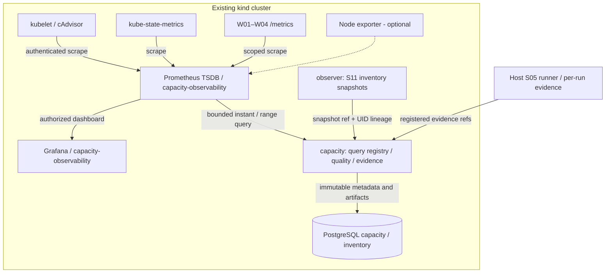
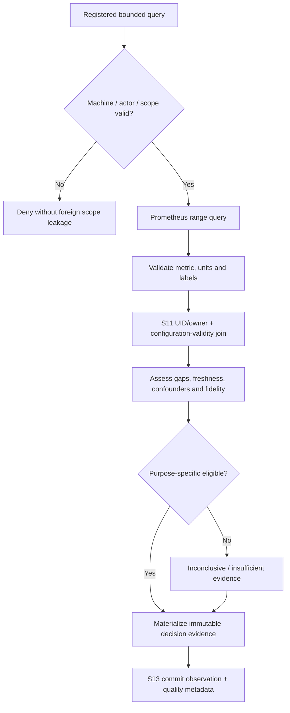

# S12 — Metrics Collection & Historical Telemetry

> **Architecture approval — 2026-11-18.** The owner explicitly approved all seven S12 ADRs described below. S12 uses Prometheus-native pull telemetry (single bounded Prometheus), kubelet/cAdvisor, kube-state-metrics and W01–W04 app instrumentation; an optional node-exporter; registered versioned PromQL and recording rules; multidimensional quality assessment; durable observation/evidence manifests; scoped authorized access; and safe degradation. The **15s core scrape, 30s supporting scrape, 7-day TSDB and 5–10 GiB PVC** are **provisional starting parameters**, not measured guarantees. Architecture is accepted, **no cluster, deployed collector, metrics, benchmark or security test has been verified**.

## 0. Authority, precedence and explicit reconciliation

- **Master v1.0.0:** local AIOps capacity system, trustworthy CPU/memory/latency/throttling/OOM/Pending measurements; numerical forecasts outside the LLM; safe human-governed changes; no unrestricted AI Kubernetes access.
- **S01:** Observe/Advisory/Governed, L0–L2; planning `current`, `1h`, `24h`; Critical/Standard/Flexible/Opportunistic; hierarchy workload/namespace/node-cluster; B0/B1/B2/B3 comparative experiments. Never equate measured use with scheduler reservations or predictions.
- **S02:** exactly six custom Deployments (`api`, `observer`, `capacity`, `ai`, `governance`, `executor`). `capacity` runs S12 approved-query/evidence modules; Prometheus/Grafana/exporters are **supporting infrastructure**, not extra custom services. REST for immediate reads, PostgreSQL-backed durable jobs/outbox; no required broker. `capacity` owns `capacity` schema; `observer` owns `inventory`.
- **S03:** one kind control-plane and three workers (one tainted platform worker, two experiment workers) under a Windows 11/WSL2/Docker Desktop single shared host (20 GB RAM, Ryzen 5 3600); Calico default deny; namespace `capacity-observability`; localhost-restricted access; S03 PVC envelope Prometheus 5–10 GiB, proposed retention 3–7 days; resource budget including Prometheus/Grafana/kube-state-metrics 450m CPU/900Mi requests **provisional**; host pressure and disk checks mandatory.
- **S04:** W01 `.NET latency-api` `workloads-critical` Critical; W02 `.NET burst-api`, W03 Python `memory-profile` in `workloads-standard` Standard; W04 Python `cpu-worker` in `workloads-batch` Flexible; W05 suspended `analytics-processor` CronJob template Flexible; W06 scenario-created `opportunistic-batch` Job Opportunistic; four steady Deployments, two on-demand batch identities. W02 HPA baseline off. App metrics and Job summaries are not interchangeable with cgroup metrics.
- **S05:** host Python/Typer orchestration, independent watchdog, host SQLite journal, immutable per-run evidence, ephemeral drivers under approved `capacity-experiments` namespace (S03 addendum pending); seed/scenario/phase and B0–B3 provenance; synthetic *traffic origin* is distinct from observed *measurement origin*. No autonomous stress by agents.
- **S06–S07:** Keycloak/OIDC human roles + namespace/action scoped grants, Kubernetes SAs, authenticated TLS/selective mTLS, Calico network isolation; `capacity` holds no Kubernetes mutation token; Prometheus scraping needs explicit ingress/egress and verified kubelet/exporter auth. Internal networking alone never authorizes disclosure.
- **S08:** Vault+ESO; offline protected root/cert-manager intermediate; PSA+native CEL; Internal/Confidential/Restricted data classifications, key/backup management. Never metric-label or persist credentials; no public Prometheus admin endpoint.
- **S09:** `ai` contains three logical agents and deterministic Tool Authorization Broker; only registered `metrics.get_approved_window.v1`-style read tools; no arbitrary PromQL, URL or SQL; backend independently authorizes scope; query results are evidence, not instructions.
- **S10:** image integrity/conformance P1; telemetry records producer/extractor revisions but does not decide image trust. **S11:** `observer` is sole custom Kubernetes LIST/WATCH collector; committed, quality-annotated inventory snapshots and identity/UID lineage are authoritative historical configuration reference. Do not duplicate watches in S12 or interpret opaque Kubernetes `resourceVersion` as globally ordered time.
- **S13:** owns exact durable schema/evidence/materialization/retention interfaces, not the raw Prometheus TSDB. **S14/S19–S23/S26/S31:** consumers own numerical models, feasibility, policy gates, verification and comparative study; S12 must supply evidence quality for each decision context.
- **Status vocabulary:** Accepted architecture ≠ installed/verified. Provisional = candidate values to calibrate. Reference = illustrative logical DTO/query. Open downstream = named owner later; no silent amendment of upstream ADR.

## 1. Purpose, boundaries and success criteria

**Mission:** deliver time-windowed, identity-resolved, provenance-rich Kubernetes/container/application measurements accurate enough for capacity forecasting and safety-conscious optimization, without falsely asserting gaps are zero or that different resource types are interchangeable.

**P0 outcomes:** (1) bounded Prometheus scrape targets and retention; (2) a catalog of metrics with units/semantics/versions; (3) allowlisted parameterized PromQL execution; (4) UID/configuration-time correlation with S11; (5) missingness/coverage/freshness/identity/contamination assessment; (6) immutable, reproducible query/result evidence for decision-critical windows; (7) hard no-evidence behavior and recovery; (8) measurable local footprint.

**Not goals:** a second Kubernetes watcher, arbitrary PromQL API, complete general-purpose APM stack, required OTel Collector/Thanos/VictoriaMetrics/TimescaleDB/Loki, per-scrape SQL ingest, complete burst peak reconstruction from 15s sampling, Kubernetes scheduler replacement, autonomous corrections, unbounded labels, new custom long-running Deployment, cloud monitoring or guaranteed 24h seasonal model adequacy from 7d retention.

## 2. Architecture and runtime topology

**Accepted S12-ADR-001: single Prometheus-native pull system.**



| Runtime component | Source and responsibility | Constraints |
|---|---|---|
| Prometheus | Discover/scrape permitted targets, TSDB/PromQL, rules, target health | Single instance, PVC/storage cap, retention, no public admin/remote write in P0 |
| kubelet/cAdvisor | Cgroup-based CPU/memory (where exposed by pinned versions) | Kubernetes API/proxy/TLS/RBAC route and series availability verified; no assumed raw `/metrics/cadvisor` unauthenticated access |
| kube-state-metrics | Export Kubernetes objects' descriptive metrics | It is not a metrics-server replacement or scheduling-authority substitute; S11 remains canonical for effective requests |
| W01–W04 exporters | App-specific request latency/errors, task/queue, logical memory behavior | No attacker-controlled labels or sensitive URI/body; S04 route/metric compatibility checked |
| W05/W06 | Kubernetes Job/Pod status and S05 durable summaries, sparse cAdvisor scrapes | No always-running `/metrics` required; short Job can finish between scrapes |
| Optional node-exporter | Node pressure/disk/CPU diagnostics | Only after measured need and DaemonSet resource/security budget review |
| `capacity` in `capacity-core` | Query registry, typed executor, time/UID join, quality, evidence persistence | No arbitrary user/LLM query string; independent S06/S07 enforcement |
| `observer` in `capacity-core` | S11 authoritative inventory | Only source for S11 object identity/configuration/history APIs |

**No new persistent custom business Deployment.** Supporting addons can have Deployments/DaemonSets under S03/S07/S10 policies. Prometheus and capacity availability are independent of AI inference.

## 3. Metric vocabulary, identity and allowed labels

### 3.1 P0 tier catalog

| Tier / canonical meaning | Candidate exported series / source | Unit and interpretation | Coverage caution |
|---|---|---|---|
| 1 CPU consumed | `container_cpu_usage_seconds_total` / cAdvisor | counter CPU-seconds; `rate` yields cores, x1000 yields millicores | exclude infra pseudo-container and resolve Pod UID; reset handling |
| 1 CPU throttled periods | `container_cpu_cfs_throttled_periods_total`, `container_cpu_cfs_periods_total` | fraction of periods throttled, **not % CPU lost** | CFS names may be unavailable with different runtime/cgroup versions |
| 1 CPU throttled time | `container_cpu_cfs_throttled_seconds_total` | throttled-time counter; diagnostic only | not interchangeable with usage or period ratio |
| 1 Memory working set | `container_memory_working_set_bytes` | gauge bytes; captured point-in-time working set | not hard physical peak, RSS, request or limit |
| 1 Memory usage/RSS | `container_memory_usage_bytes`, `container_memory_rss` | gauges; explanatory context | optional if exporter exposes them |
| 1 Node allocatable | `kube_node_status_allocatable` / KSM | Kubernetes-exported gauge | S11 Node API snapshot is source of truth |
| 1 Pod/container requests | KSM resource-request family if compatible | Kubernetes-exported gauge | S11 effective Pod request accounts init, overhead, pod-level resources, etc. |
| 2 Container lifecycle | KSM container restart/status/termination reason families | status/events | no perfect historical event log; OOMKilled != eviction |
| 2 Scheduling/controller | KSM Pod scheduling/phase/replicas/HPA metrics and S11 Events | descriptive state | Pending can be unscheduled or node-bound; distinguish reasons |
| 2 Job lifecycle | KSM Job start/succeeded/failed/status + S05 summary | run status/duration | a short Job may have zero scrapes despite nonzero work |
| 3 W01/W02 HTTP | bounded requests counter and duration histograms | HTTP rate, error fraction, estimated p95 | histogram bucket+sample sufficiency, configured offered != achieved traffic |
| 3 W03 app memory | controlled allocation/retention gauges and run counts | logical Python bytes, TTL, phase IDs only where bounded | logical allocated != cgroup working set |
| 3 W04 tasks | accepted/completed/rejected counts, queue depth, processing/queue duration | counts, queue gauge, duration histograms | bounded in-process queue can lose tasks on crash |
| 4 diagnostics | node-exporter, selected disk/pressure/process indicators | optional | not P0 optimization authority |

**Exporter compatibility gate:** before deploying query library, record Kubernetes/kubelet/cAdvisor/kube-state-metrics/Prometheus/app exporter versions, target names, actual series+label shapes and histogram mode. Unsupported metric names result in `metric_unavailable`, not fabricated zero. Prefer documented stable families and explicit adapters, never blind renaming. `metrics-server` required for optional S04 W02 HPA is *separate* from Prometheus.

### 3.2 Label cardinality and security

Allowed dimensions include canonical bounded `cluster`, `namespace`, `pod`, `container`, `node`, `job`, exporter-local `workload` where controlled, `route` from fixed templates, HTTP method/status class, and histogram `le` where applicable. Kubernetes Pod names/UIDs create churn and should be used only when needed for lineage, not multiplied by arbitrary app labels. **Never** expose `experimentRunId`, arbitrary user IDs, request IDs, payloads, paths with IDs, tokens, certs, SQL text, free-text Events, full image digests, or exception messages as Prometheus labels. Exact UID/run mapping belongs S11/S05/S13 metadata/evidence, not an unbounded set of metric labels. Maintain per-target/metric-family sample, series and label-length budgets, tested at preflight; scrape sample limit/metric relabel drop must produce a visible quality impact.

### 3.3 Resource semantics and aggregation correctness

- **CPU rate** over a specified lookback window, not instantaneous CPU usage. Counter resets/restarts are not negative CPU consumption.
- **Memory** gauge; sampled max is `max_sampled`, never a guaranteed process peak; use S05/W03 reported peaks only with explicit measurement origin/fidelity.
- **Pod → logical workload:** S11 exact UID/owner chain and valid-time mapping, not workload label alone. Preserve Pod/container/restart identity for transitional rollouts; avoid duplicate sidecar/container totals.
- **Node scheduling:** allocated/requested, allocatable and node-fit come from S11; sampled actual consumption can contextualize but cannot validate placement on its own.
- **App SLO:** count HTTP requests and errors with explicit denominator; histogram quantiles estimated and potentially imprecise for small windows; use predeclared bucket bounds and sample sufficiency. Offered traffic from S05 driver is independent from observed server rate.
- **HPA:** W02 baseline off; in opt-in experiment capture replica/config/time history and denominator changes or mark confounded.
- **Batch:** do not infer zero usage from absent samples; use S05 Job artifacts, completion and S11 state, each tagged by provenance.

## 4. Collection and sampling plan

**Accepted S12-ADR-002** tiered catalog; **S12-ADR-003** starting sampling/retention. These values are not finalized performance SLOs.

| Target | Candidate interval | Rule evaluation | Notes |
|---|---:|---:|---|
| kubelet/cAdvisor | 15s | 30s | profile CPU/memory bursts, per-node endpoint authentication |
| W01–W04 app exporters | 15s | 30s | capped histogram buckets and time-series |
| kube-state-metrics | 30s | 30s | object state checked against S11, not final scheduler accounting |
| Prometheus itself | 30s | 30s | self-monitor scrape failures, storage, targets |
| node-exporter optional | 30s | 30s | only if capacity/security envelope tolerates it |

- Prometheus local TSDB: target **7 days** with **5–10 GiB** S03 PVC and configured size-based bounded retention; S03's original **3–7 day** direction remains respected. Prometheus retention time/size are not independent guarantees; eviction of old blocks may occur earlier with size pressure. Validate actual active blocks/WAL and disk behavior. No automatic SQL copying of all samples.
- Derived resolutions: 1m for summarized trends, 5m for features/selected forecasting, optional hourly summary. Keep unaggregated peak-sensitive evidence where required. A five-minute average cannot prove absence of a 20-second memory spike.
- For 24-hour models, 7 days might be insufficient for seasonal history; S14 must check adequacy and downgrade/refuse if necessary. A compressed S05 5-minute “day” is synthetic scenario time, not 24h observation.
- Production-like source measurement uses UTC wall-clock timestamp; orchestration internal schedule uses monotonic clock. Monitor time skew, wall clock synchronization, scrape timeouts and target scrape jitter. Prometheus does not promise a strict 15.000-second periodic sample from all targets.
- Config declarative and version-pinned; do not enable high-cardinality uncontrolled service discovery. Prometheus storage/CPU must be measured during S05 exclusive tests, including host/WSL2 physical pressure.

## 5. Registered query and recording-rule library

**Accepted S12-ADR-004.** No model/operator-submitted arbitrary PromQL in the capacity or agent workflow. A registry entry comprises `queryId`, `revision`, `expressionDigest`, approved expression template, source metric revisions, arguments and identity selector rules, output type/unit, interval/step/lookback constraints, allowed aggregation, cost/series/bytes budget, expiry/freshness policy, coverage rule, risk-sensitive applicability and migration compatibility. Query IDs are immutable for a given digest; changes require revision bump. Recording rules use versioned config and carry their own rule group/evaluation health, not unproven permanent history.

### 5.1 Illustrative PromQL fragments (not final templates)

**Container CPU rate in millicores:**

```promql
1000 * sum by (namespace, pod, container) (
  rate(container_cpu_usage_seconds_total{container!="",container!="POD"}[5m])
)
```

**Memory working set bytes:**

```promql
container_memory_working_set_bytes{container!="",container!="POD"}
```

**CFS period throttling fraction (guard against zero denominator):**

```promql
sum by (namespace, pod, container) (
  rate(container_cpu_cfs_throttled_periods_total[5m])
)
/
sum by (namespace, pod, container) (
  rate(container_cpu_cfs_periods_total[5m])
)
```

**W01/W02 classical histogram p95 (only if matching histogram is implemented):**

```promql
histogram_quantile(0.95,
  sum by (le, namespace, workload) (
    rate(http_request_duration_seconds_bucket[5m])
  )
)
```

**Contracts:** examples illustrate math only; queries without strict workload-scoped selectors/UID-time mapping are **not directly exposed as public/agent queries**. Final query renderer injects authorized server-resolved selectors using validated enum/identity references, not raw string concatenation with arbitrary regex or free-text. The final metric name/labels/histogram type depend on S04 exporters. Every response includes query execution time, evaluation/range timestamps, estimated query cost and quality; match/no-match is not automatically a valid measured zero. For CFS throttling, denominator zero returns unknown, not zero. CPU `rate` needs adequate samples; a counter reset is accounted for but can reduce confidence.

### 5.2 Query API reference (not S27 public route)

```text
get_approved_window(actor_context, query_id, query_revision,
                    target: CanonicalWorkloadRef,
                    start_utc, end_utc, step_seconds, purpose)
 -> TelemetryQueryResult | Denied | InvalidQuery | InsufficientEvidence
register_observation_window(validated_result, inventory_refs, import_refs)
 -> ImmutableObservationRef | IdempotencyConflict
get_query_definition(query_id, revision, actor_scope)
 -> SanitizedQueryDefinition
```

Maximum range, step, returned series, response bytes and deadline must be enforced server-side. For read requests, authorization must be performed at backend using S06 trusted actor delegation + S07 authenticated caller; policy scope includes cluster-incarnation, namespace, workload and classification. Prefer sanitized prefiltered views for Grafana; raw Prometheus admin UI remains restricted. Query errors do not translate to success with an empty series.

## 6. Observation evidence and result materialization

**Accepted S12-ADR-006.** A query manifest is not the same as immutable measured values: requerying later may change due to source churn, deletion/retention, late ingestion or rule changes. Decision-critical evidence requires either bounded canonical sample-window artifact or sufficiently complete immutable aggregates with provable derivation. Full raw TSDB copy is not required.

### 6.1 Logical `MetricQueryDefinition v1alpha1`

```yaml
schemaVersion: metric-query-definition/v1alpha1
queryId: container.cpu.rate.millicores
revision: 1
source: prometheus
expressionDigest: sha256:<computed-template-digest>
unit: millicore
resultKind: time_series
requiredLabels: [namespace, pod, container]
arguments: [workloadRef, startUtc, endUtc, stepSeconds]
limits:
  maxRangeSeconds: <calibrated-policy-value>
  maxResultSeries: <calibrated-policy-value>
qualityPolicyRef: cpu-demand-v1
```

### 6.2 Logical `ObservationWindow v1alpha1`

```json
{
  "schemaVersion": "observation-window/v1alpha1",
  "observationId": "illustrative-obs-001",
  "cluster": {"logicalId":"capacity-lab", "incarnationId":"verified-incarnation-ref"},
  "target": {"workloadId":"w01-latency-api", "namespace":"workloads-critical"},
  "measurement": {"queryId":"container.cpu.rate.millicores", "queryRevision":1,
                  "startUtc":"2026-11-17T10:00:00Z", "endUtc":"2026-11-17T11:00:00Z",
                  "stepSeconds":15, "unit":"millicore"},
  "provenance": {"measurementOrigin":"historical_observed", "workloadOrigin":"scenario_generated",
                  "prometheusInstanceRef":"prometheus-instance-ref",
                  "inventorySnapshotRefs":["snapshot-ref"], "scenarioRunRef":"run-ref"},
  "quality": {"coverage":"complete", "freshness":"historical", "identity":"resolved",
              "flags":[], "qualityPolicyRevision":"cpu-demand-v1"},
  "artifact": {"contentDigest":"sha256:<computed-digest>", "storageRef":"bounded-immutable-artifact-ref"},
  "committedAt":"UTC timestamp at actual commit"
}
```

Example values are fictional. A `coverage: complete` label is permitted only after actual validation, not from query success alone. Digest syntax placeholders are not valid deployable digests. `storageRef` must resolve to an independently retention-governed local artifact or database-backed immutable representation; S13 finalizes its locator/security. The S05 scenario run ID is not a Prometheus series label. Preserve UTC, inclusive/exclusive interval semantics `[start,end)`, normalized quantities, query template digest, exporter/source version and S11 owner identity mapping revision.

### 6.3 Evidence taxonomy

- `measurementOrigin`: `observed_live | historical_observed | simulated | forecast | candidate_estimate | realized_post_change` (where latter derived types are produced by owner slices, **not generated by S12**).
- `workloadOrigin`: `scenario_generated | baseline_lab | external_or_unknown` (the S05 synthetic input can result in **actual observed container CPU**, not simulated CPU).
- `sourceFidelity`: `scrape_sampled | application_reported | kubernetes_state_observed | analytical_derived | estimated`.
- `aggregation`: `raw_sample | time_mean | max_sampled | pNN_estimate | interval_summary | rate` with explicit denominator/window.
- `sourceQuality`: independent dimensions and limitations; never promote analytical estimates as observed facts.

## 7. Multidimensional quality and eligibility

**Accepted S12-ADR-005.** Do not collapse validity into one `valid=true` flag. S11 inventory quality has `coverage/consistency` and `freshness` axes; S12 adds separate telemetry axes and joins to S11 rather than overwriting it.

| Axis | Required detection / evidence | Example flags |
|---|---|---|
| Collection coverage | expected/actual samples, target presence, up/down, scrape failure and missing intervals | `scrape_gap`, `target_missing`, `coverage_below_policy` |
| Freshness | last successful source sample, query time, source lag | `source_stale`, `late_ingest` |
| Counter continuity | resets, missing lookback values and partial series | `counter_reset`, `insufficient_rate_samples` |
| Workload identity | Pod UID/container/restart ID mapped via S11 valid-time lineage | `owner_unresolved`, `uid_mapping_ambiguous` |
| Temporal alignment | inventory capture ranges vs sample times, rollout history | `spec_changed_mid_window`, `snapshot_skew`, `unmatched_config_interval` |
| Measurement fidelity | sampled peak vs complete run duration; histogram sparsity | `peak_not_guaranteed`, `short_job_unsampled`, `histogram_low_count` |
| Confounding | unexpected HPA, S05 generator drops, overlap, Windows/WSL2 pressure | `hpa_confounded`, `generator_overloaded`, `host_pressure` |
| Integrity/schema | registered query, source/exporter schema, artifact digest | `metric_unavailable`, `schema_mismatch`, `artifact_missing` |
| Authorization | source/result scope and classification valid at retrieval | `scope_denied` (no cross-scope detail returned) |

### 7.1 Coverage mathematics and limitations

For a query window duration `D` and target step `s`, nominal expected evaluation points can be approximated from an explicitly defined `[start,end)` step grid; count expected points at the **actual grid**, not by naive floating-point division. `coverage = present_valid_points / expected_applicable_points` is meaningful only for a known live target and validity intervals. A Pod not yet created should not be counted as a missing scrape; a Pod known running with no metrics may be. Duplicate/invalid/NaN/Inf/stale markers are not valid zero values. Presence of data does not mean every transient peak was captured.

**Provisional 95% target:** useful for some steady continuous profiles, **not** a universal eligibility pass. Missing the one W03 spike period can disqualify memory right-sizing despite 99% coverage. Per-consumer policy must specify minimum history, max gap, temporal skew, percentile observation count, high-risk event coverage and permitted interpolation. Imputation allowed only as an explicit S14 feature transform, never represented as original observation.

### 7.2 Decision-specific quality gates

| Consumer | Mandatory S12 checks | Rejection behavior |
|---|---|---|
| S14 CPU/memory forecasting | interval history continuity, source and identity resolution, trained-on feature semantics, minimum horizon sufficiency | `insufficient_history`, forecast refusal/degraded accuracy with documented limits |
| S20 CPU right-sizing | representative CPU rates/peaks, throttling if exposed, app latency/errors, stable request/HPA context | no evidence-backed downsize if guardrails/coverage unknown |
| S20 memory right-sizing | representative spikes, sampled-max limitations, OOM/restart/eviction history and limits | reject/down-rank when critical spike evidence unresolved |
| S21 fit | S11 complete fresh effective requests/allocatable + constraints | telemetry alone never proves fit |
| S26 verification | compatible before/after windows, SLO and workload load comparability | `inconclusive`, no realized-gain claim |
| S31 B0–B3 | same scenario profile/seeds/demand shape, generator health, clock/host pressure provenance | refuse invalid comparison or flag non-comparability |

### 7.3 Query/quality lifecycle



## 8. Temporal join and transient workloads

Prometheus labels and S11 Kubernetes resourceVersion cannot create an atomic global snapshot. Use explicit: cluster **incarnation**, Pod UID and container identity (only where exposed or reliably mapped), controller lineage S11 ownership, observed configuration validity bounds and scrape timestamps. Mark ambiguous intervals. If W01 CPU request changes at 10:15 during a 10:00–10:30 observation, segment at configuration change or declare `spec_changed_mid_window`; **never** attach the entire window to the final 150m request. If Pod UID is reused in data due to cluster rebuild, cluster incarnation still prevents mixing. If exact container ID is not exposed by series, record identity confidence instead of inventing identity.

For W05/W06 Job windows, store run/job/pod UID, first/last observed intervals and captured vs missing measurement. S05 durable Job results (possibly application measured peak) are *complementary*, not automatically Prometheus historical samples. A Job created from CronJob template may lack ownerRef to CronJob: rely on actual S11 lineage and S05 run reference. If Job cleaned by TTL before scraping, set `short_job_unsampled`; retain S05 outcome and never equate unobserved usage to zero. Pending duration and FailedScheduling reasons are Kubernetes state/event evidence (best effort), not manufactured PromQL metrics.

## 9. Security, authorization and threat model

**Accepted S12-ADR-007: restricted telemetry plane + fail-safe degradation.**

| Threat | Enforcement | Negative test |
|---|---|---|
| PromQL injection / arbitrary query cost | exact registry ID, typed parameters, bounded range/step/series/time/bytes, no arbitrary regex/SQL | model/operator query string denied |
| Cross-namespace data leak via aggregate | filter by authorized canonical identity **before** aggregation when policy requires it; source/query/result scope checked | Viewer scoped to W01 cannot learn W03 existence/count/metrics |
| Prometheus admin endpoint abuse | localhost/network deny, scoped read-only query credentials, no public lifecycle/admin endpoints | foreign Pod/driver cannot access |
| Scrape credentials exposed in metrics/logs | Vault/ESO, secret-mounted auth, label denylist, redaction | no tokens/certs in metrics/evidence |
| Compromised exporter inserts huge labels / spoofed values | target identity, sample/cardinality limits, metric schema whitelist, quality/integrity, source trust flags | poisoned series rejected/inconclusive |
| TLS/identity bypass on kubelet | verify certificate names, expected auth and accepted Kubernetes access mechanism | unauthenticated scrape rejected |
| Kubernetes watch gap misjoined to metrics | S11 per-family quality and valid time checked | no falsely fresh identity |
| AI exfiltrates unbounded raw data | S09 broker and independently checked backend; capped output; prompt-safe structured result | arbitrary tool URL/PromQL prohibited |
| PVC or Prometheus storage exhausted | retention size/time, alert, persistent storage pressure abort, partial/degraded state | no silent success; loss visible |

**Network flows:** Prometheus to permitted W01–W04/exporter/kubelet endpoints only; `capacity` to Prometheus query path under S07; Grafana to allowed read path; S05 host data access through protected authorized path, never incidental admin port. NetworkPolicy alone cannot distinguish app `/metrics` and privileged control routes sharing 8080; W01–W04 independently verify S07 short-lived capability for control operations. Supporting exporter/node host access and hostNetwork route limits need installation-era positive/negative verification.

**Information classification:** raw aggregate capacity signals typically Internal, namespace-scoped incidents/performance and run-history may be Confidential; Restricted credentials never enter metric labels, annotations, results, SQL, logs, audit or RAG. S06/S09 authorization must be performed on each read (including historical evidence). No untrusted Events/free-form text as instructions in AI context.

## 10. Failure modes, observability and recovery

| Failure | State and behavior | Recovery proof |
|---|---|---|
| Prometheus down/unreachable | `telemetry_unavailable`; previously materialized approved evidence still readable; new unsafe requests blocked | recovery query + target freshness and gap report |
| kubelet/cAdvisor family absent | `metric_unavailable`; no fabricated CPU/throttle number | compatibility alert, adapt versioned query/mark unsupported |
| Target scrape fails | gap/coverage flags, no zero fill | restored target and gap preserved in history |
| Prometheus restart / WAL replay | no assumption historical result immutable unless materialized | disk/query consistency, reconnect tests |
| TSDB retention deletes old blocks | historical raw requery unavailable; retained S13 result remains evidence if digest validates | explicit `source_expired`, no unsupported requery claims |
| DB unavailable | Prometheus continues scraping, capacity cannot finalize durable decision evidence; bounded retry via S02 workflow | idempotent replay, no partial commit publication |
| S11 incomplete/expired watch | query may return unjoined signals; identity/temporal quality invalid for safety decisions | S11 re-list/reconcile and new valid observation |
| Job too short / deleted | preserve S05 Job summary, label sampled series absent | nonzero execution without invented CPU/memory samples |
| Series/cardinality surge | budget gate/drop + explicit partial quality; host watchdog if applicable | measured recovered footprint, no unsignaled discard |
| Clock skew | flag temporal mismatch and reject precise joins | synchronized hosts and evidence time comparison |
| AI/Ollama unavailable | S12 collection and deterministic `capacity` independent | continue metric retrieval while AI unavailable |
| Grafana unavailable | does not affect collecting or governed evidence | dashboards restore later |

**S12 itself observed by S28:** scrape target health/age, query error/timeout/series/bytes, TSDB head series/WAL/retention/storage, rules failures, ingestion lag, missingness rate, registered-query reject counts, evidence-materialization lag, UID-join ambiguity, per-namespace disclosure denials, host/WSL2 pressure. Low-cardinality labels only; detailed IDs stay in logs/audit protected by S08. Readiness can expose `ready | degraded | unavailable` with differentiated ability to serve historical evidence; health endpoint is not an approval gate.

## 11. Requirements and measurable contracts

### Functional requirements

| ID | Requirement | Evidence |
|---|---|---|
| S12-FR-001 | Deploy bounded Prometheus pull topology under existing S03 namespace and placement | target discovery + scrape trace |
| S12-FR-002 | Collect supported tier-1 container CPU/memory, Tier-2 lifecycle, Tier-3 app signals | measured metric catalog and version matrix |
| S12-FR-003 | Track W05/W06 sparse samples, S05 summaries and absence separately | ephemeral Job scenario |
| S12-FR-004 | Publish immutable query definitions and bounded typed read contract | query registry schema/contract test |
| S12-FR-005 | Resolve metrics to S11 cluster incarnation/UID/owner/config-validity windows | rollout/recreate test |
| S12-FR-006 | Evaluate distinct quality axes and producer/source provenance | missing/ambiguous/host pressure tests |
| S12-FR-007 | Persist decision-relevant immutable observation and materialized result refs through S13 | digest/ref requery-after-retention test |
| S12-FR-008 | Enforce workload/namespace/authz boundaries and negative disclosure | S06/S09 test corpus |
| S12-FR-009 | Surface explicit unavailable/stale/inconclusive results under failures | fault matrix |
| S12-FR-010 | Export operational telemetry of S12 itself without high cardinality | S28 dashboard, cardinality budget |

### Nonfunctional / security requirements

`S12-NFR-001` Measure collection/scrape/query overhead on accepted hardware; reject budget overruns instead of assuming a 7d TSDB fits. `002` Enforce time+size TSDB retention, physical PVC/WSL2 disk monitoring. `003` Bound query duration/range/step/series/bytes and retries; avoid cascading Prometheus saturation. `004` Version source/metric/query/result contracts; no silent meaning changes. `005` Bounded identity/time skew and explicit non-atomic evidence. `006` No dependency on Ollama/RAG for collection. `S12-SEC-001` no arbitrary AI PromQL/HTTP/SQL, `002` scope before aggregate disclosure, `003` TLS/identity/NetworkPolicy, `004` forbidden labels/credentials, `005` independently validate query source and artifact integrity, `006` no Kubernetes mutating capability.

## 12. Acceptance and regression test matrix

| Test ID | Setup | Required outcome |
|---|---|---|
| S12-TEST-001 | Deploy verified metric sources | all mandatory Tier-1/3 compatible series documented or explicit unsupported status |
| S12-TEST-002 | W01 stable CPU load | rate units/aggregation checked against known workload behavior and counter resets |
| S12-TEST-003 | W01 CPU limit contention | throttled-period ratio distinct from CPU usage and throttled seconds |
| S12-TEST-004 | W03 bounded memory spike | sampled max and uncertainty; missing peak cannot pass memory-safe gate |
| S12-TEST-005 | Kill scrape endpoint for interval | gap recorded, no zero fill or sufficient quality claim |
| S12-TEST-006 | W01 rollout with old/new Pods | correct UID lineage, no double counts, spec window segmentation |
| S12-TEST-007 | recreate kind with same names | separate cluster incarnation evidence |
| S12-TEST-008 | create/complete W05/W06 between scrapes | Job outcome retained, `short_job_unsampled` flags, no false zero |
| S12-TEST-009 | HPA opt-in W02 | replica and CPU utilization denominator changes tagged; non-comparable windows flagged |
| S12-TEST-010 | submit arbitrary PromQL/regex/oversized time window | backend rejects without query execution |
| S12-TEST-011 | Viewer/AI query foreign namespace | denied without foreign series/count/name disclosure |
| S12-TEST-012 | inject labels with tokens/run IDs/long strings | rejected/dropped and quality reflected; no sensitive leakage |
| S12-TEST-013 | Prometheus restart/retention expiry | finalized S13 artifact unchanged and independently verifiable |
| S12-TEST-014 | PostgreSQL outage during materialization | no half-committed observation/outbox, idempotent safe retry |
| S12-TEST-015 | S11 watch gap and Prometheus healthy | join becomes incomplete, no safety-qualified result |
| S12-TEST-016 | generator drops or host pressure | comparison and optimized gain evidence marked contaminated |
| S12-TEST-017 | 7d target under measured series budget | TSDB/PVC/host pressure measured; retention behavior confirmed or budget revised |
| S12-TEST-018 | Ollama/Grafana down | Prometheus collection and deterministic telemetry still function |
| S12-TEST-019 | certificate/NetworkPolicy denial | unauthorized scrapes/queries blocked, permitted probes still work |
| S12-TEST-020 | run B0–B3 comparison | run-specific provenance, quality and comparable windows captured |

**Release gate:** architecture acceptance alone does not satisfy tests. S12 is implementation-ready only after metric/version compatibility, S07 scrape network access, S11 identity alignment, S13 schema/materialization, S08/S06 privacy, PVC sizing and S28 outage behaviors have passing evidence. Thresholds remain provisional until S31/S28 calibration.

## 13. Formal accepted ADR register

| ADR | Status | Decision / reason | Consequences |
|---|---|---|---|
| S12-ADR-001 | **Accepted** | Prometheus-native pull, one TSDB, no mandatory OTel collector | minimal supporting runtime; validate kubelet access |
| S12-ADR-002 | **Accepted** | Tiered CPU/memory, lifecycle, app and optional diagnostics metric catalog | exact metric/exporter versions validated at install |
| S12-ADR-003 | **Accepted** | 15s core/30s supporting scrape, 7d bounded retention **as provisional candidate** | TSDB 5–10GiB/host capacity calibration, never promise data sufficiency |
| S12-ADR-004 | **Accepted** | Versioned allowlisted PromQL/recording rules with typed bounded parameters | no arbitrary user/agent queries |
| S12-ADR-005 | **Accepted** | Multidimensional quality + purpose-specific eligibility | missingness and peaks cannot be concealed by one green flag |
| S12-ADR-006 | **Accepted** | Immutable observation manifests and decision-critical materialized evidence | persist content digest and source/provenance; Prometheus not a permanent archive |
| S12-ADR-007 | **Accepted** | Secured collection/query and safe degradation | S06–S09 gates; no fail-open or false zero |

**Alternatives explicitly not selected for P0:** OTel-first mandatory Collector pipeline, custom Python direct metric poller, separate metrics cluster/long-term TSDB, per-scrape PostgreSQL ingestion, arbitrary PromQL in AI tools, full service mesh for scraping. These may be revisited only through superseding ADR based on measured necessity.

## 14. Inter-slice contracts and open implementation gates

| Slice | Handoff / invariant | Open owner decision |
|---|---|---|
| S03/S29 | Prometheus/kube-state-metrics deployment/pinning, kubelet scrape/auth, TSDB PVC, Calico routes | exact charts/manifests, version pins, sizing and operational startup order |
| S04 | Prometheus exporter metric families and bucket layouts, stable app labels | actual names, buckets and SLO policies |
| S05/S31 | phase windows, generator offer/delivered counts, host pressure, Job summary identity, B0–B3 comparability | evidence import and experiment statistical protocol |
| S06–S08 | source credentials, TLS, authorizations, secret exclusion, classification/retention | exact auth mechanism/certs and secure storage mounts |
| S11 | immutable snapshots and exact UID/config validity/coverage | typed join response and skew policies |
| **S13** | `metric_definition`, `query_definition`, `observation_window`, `observation_quality`, `telemetry_summary`, evidence blobs and foreign refs | exact DDL, indexes, migration/integrity/retention |
| S14 | versioned feature windows and eligibility, history depth | model choice, uncertainty, backtesting and refusal thresholds |
| S17 | authorized `metrics.get_approved_window.v1` tool | wire DTO, pagination, per-tool budget |
| S19–S22 | CPU/memory peak, app reliability, scheduling contexts | algorithm and hard policy calibration |
| S26 | before/after controlled measured windows | change-specific verification SLO and rollback policy |
| S28 | S12 SLOs/alerts/restore and outage procedures | numerical goals and backup tests |
| S32 | architecture-to-live release evidence | actual quality/reliability/security measurements |

## 15. Suggested repository layout and implementation order

```text
specs/domain-c/S12_Metrics_Collection_Historical_Telemetry.md
monitoring/prometheus/scrape-config/          # S29 owns installed values
monitoring/prometheus/rules/                  # versioned approved rule expressions
contracts/telemetry/                         # query, observation, quality schemas
services/capacity/telemetry/                 # registry, selector resolver, query, quality
services/capacity/telemetry/tests/           # unit and fixture-contract tests
tests/integration/telemetry/                 # deployed Prometheus/K8s/auth tests
tests/operational/telemetry/                 # outage, short Job, disk, cardinality
```

Order: (1) discover metrics/version and permitted network paths, (2) implement target scrapes and bounded dashboards, (3) validate time-series cardinality/TSDB sizing, (4) implement registered queries and typed transform, (5) integrate S11 UID/time lineage, (6) add quality/purpose gates, (7) commit through S13 immutable persistence, (8) run S05 scenarios and S30/S31/S28 negative/recovery tests. Stop and recalibrate if full-stack host resources exceed S03 safety envelopes.

## 16. Completion and change policy

**Accepted architecture v1.0.0; no verified implementation.** Later changes to metric semantics, query expression, data-quality eligibility, retention duration, label rules or source identity require a versioned change with migration/compatibility evidence; any change to S02 deployment topology/S03 infrastructure/S06–S09 trust or S11 authority requires upstream superseding approval, not silent S12 edits. Do not label collected measurement as scheduler capacity, reconstructed history as observed, app logical memory as cgroup working set, `max_sampled` as true peak, or agent advice as authorized plan.
