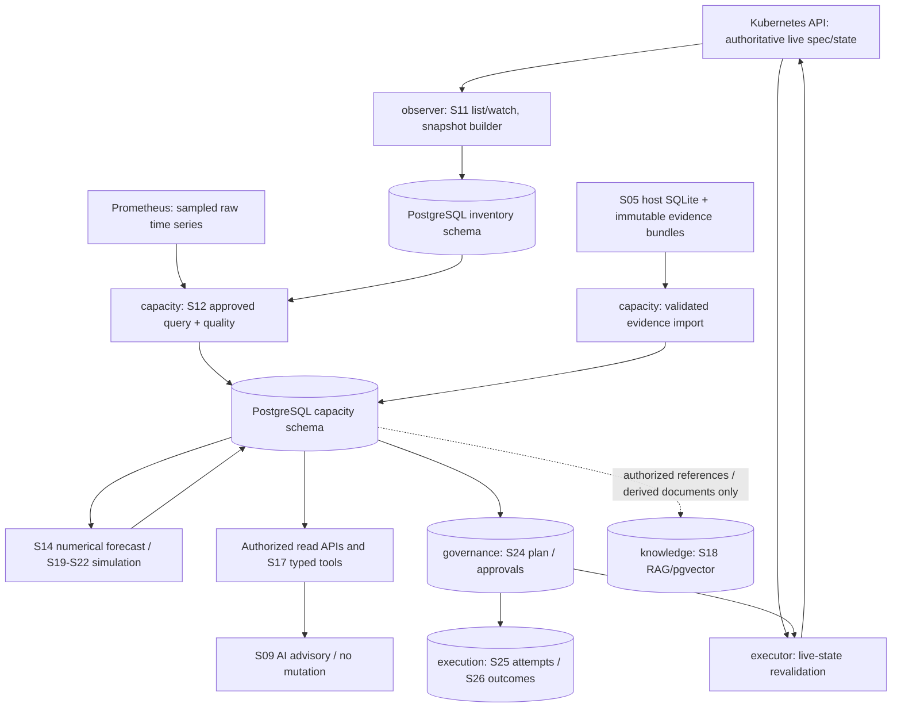
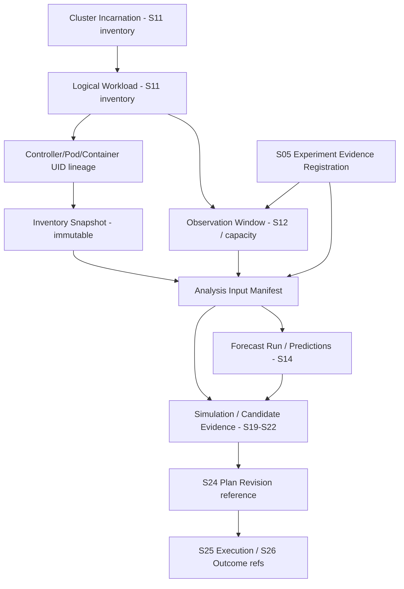
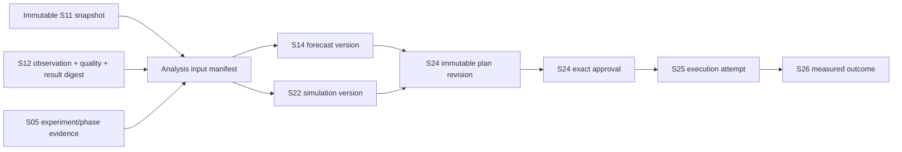

# S13 — Capacity Data Model & Intelligence Storage

> **Architecture approval record — 2026-11-18.** The owner explicitly approved **all seven S13 ADRs**: one PostgreSQL instance with domain-owned schemas and Prometheus as raw time-series authority; canonical identity/observation/forecast/experiment/decision reference models; append-oriented temporal and immutable decision evidence; typed provenance and content-addressed artifacts; relational-first storage with bounded versioned JSONB/indexing; reference-aware class-based retention; and least-privilege schema ownership with idempotent imports and transactional outbox. The architecture is accepted; **no schema, migration, data, deployed database, acceptance test, backtest or operational performance benchmark is claimed to exist**. Illustrative SQL is a reference design, **not an executed migration**. Numeric retention values and actual database/extension versions require installation calibration and downstream policy alignment.

## 0. Authority, precedence, reconciliation and decision vocabulary

**S13 implements storage and evidence contracts without overturning accepted earlier slices.** If a schema proposal conflicts with an upstream invariant, preserve the earlier architectural authority and document a superseding ADR before changing behavior.

| Source | Binding contract on S13 |
|---|---|
| Master catalog v1.0.0 | Numerical forecasting outside the LLM; scheduling requests != observed use; exact authorized mutations, bounded evidence, historical integrity and failure isolation. S13 relates time-series, config and intelligence **without duplicating every Prometheus sample**. |
| **S01** | Local AIOps Capacity Operations Platform; Observe/Advisory/Governed, L0–L2; current/1h/24h; four criticality classes; workload/namespace/node-cluster hierarchy; B0–B3 comparisons; safety before efficiency. |
| **S02** | **Exactly six custom persistent Deployments** (`api`, `observer`, `capacity`, `ai`, `governance`, `executor`); one PostgreSQL server; schemas `inventory`, `capacity`, `knowledge`, `governance`, `execution`, `audit`, `workflow`; single authoritative writer per aggregate; REST + durable SQL jobs/outbox; no required broker or distributed cross-service transaction. |
| **S03** | One kind control plane + three workers, Calico/default-deny, Windows 11/Docker Desktop/WSL2, 20 GB physical RAM / Ryzen 5 3600; local PVCs with independent protected backups; provisional capacity/storage envelope; not actual separate machine fault domains. S05-approved `capacity-experiments` namespace still requires documented S03 addendum. |
| **S04** | W01 `latency-api` (Critical, `workloads-critical`), W02 `burst-api` / W03 `memory-profile` (Standard, `workloads-standard`), W04 `cpu-worker` / W05 `analytics-processor` (Flexible, `workloads-batch`), W06 `opportunistic-batch` (Opportunistic, `workloads-batch`); four baseline Deployments, suspended W05 CronJob, on-demand W06 Job; WorkloadProfiles are desired test inputs, not actual Kubernetes truth. |
| **S05** | Host Python/Typer scenario runner and separate watchdog, host SQLite operational journal and immutable content-addressed evidence, ephemeral drivers, scenario/run/phase/seed identities and fair B0–B3 comparisons. S13 **registers/imports evidence**, does not replace SQLite runner authority or grant experiment mutation power. |
| **S06–S07** | Keycloak/OIDC human actors, action + namespace/resource scope + conditions; service-specific workload identities, authenticated TLS/selective mTLS, Calico network allowlists. AI does not receive direct Kubernetes or unrestricted DB capabilities. |
| **S08** | Vault + ESO; offline-protected root and cert-manager intermediate; PSA + native CEL; `Public`, `Internal`, `Confidential`, `Restricted` classifications; credentials never in telemetry/analysis/RAG, encrypted independent backups, protected audit integrity. |
| **S09** | Three logical agents and in-process Tool Authorization Broker; typed authorized retrieval, query/byte/time budgets, source provenance, no arbitrary SQL/PromQL, no agent mutation/approval authority. |
| **S10** | Digest/signature/provenance P1 supply-chain trust; S13 stores optional image/config artifact references as provenance, not a new image-signing or admission authority. |
| **S11** | Existing `observer` alone performs LIST/WATCH/reconciliation and writes immutable, quality-classified inventory snapshots in `inventory`. Workload and exact Pod/controller UID lineage, effective scheduler requests, spec validity and per-resource-family sync are S11-owned. `resourceVersion` opaque/not a global clock. |
| **S12** | Existing `capacity` executes approved PromQL against one bounded Prometheus; observation windows, multidimensional quality, measurement-origin vs workload-origin, decision-critical result materialization, query revision and source/UID/time alignment. No per-scrape SQL ingestion. |

**Downstream authority:** S14 owns forecasting algorithms, uncertainty and backtesting; S17 tools; S18 RAG/pgvector knowledge indexes; S19–S23 objectives, optimization, candidate generation, placement and simulations; S24 plan/approval state; S25 execution; S26 verified outcomes; S27 public API/CLI; S28 reliability/backup/SLO; S29 deployments/migrations/CI; S30–S32 tests/evaluation/release evidence.

**Status labels:** `Accepted` is owner-approved architecture; `reference` is an illustrative contract or SQL not yet version-pinned; `provisional` is a calibration target; `open downstream` names a later owner; `verified` requires measured passing implementation evidence. Acceptance does not imply implementation.

## 1. Mission, success criteria and boundaries

**Mission.** Persist an auditable and time-correct relationship between immutable Kubernetes inventory, sampled CPU/memory/application telemetry, scenario evidence, numerical forecasts, hypothetical optimization results and governed decisions, while keeping ownership/authority separation and a small local resource footprint.

**P0 outcomes:**
1. Canonical cluster-incarnation, namespace, logical-workload, controller UID, Pod UID and container-instance identities; don't merge recreations by name.
2. Unambiguous configuration/request/observed/forecast/simulated/realized semantics with canonical units and temporal intervals.
3. Decision-critical immutable observation/analysis/forecast/simulation evidence with quality, input digest, lineage and source versions.
4. Bounded, idempotent S05 evidence registration and S11/S12 ingestion without creating a competing source of truth.
5. Domain-authoritative writers, safe cross-domain references, scoped authorized read APIs and transactional outbox facts.
6. Class-specific, reference-aware retention and reproducible compaction/restore without silently breaking referenced evidence.
7. Measurable PostgreSQL cost/latency/disk health under accepted S03 physical constraints; unsafe inference is blocked if data is missing/stale.

**Non-goals:** duplicate Prometheus TSDB sample-for-sample, generic event-sourcing for every Kubernetes watch, globally atomic Kubernetes/Prometheus/SQL snapshots, enterprise warehouse, second Postgres, TimescaleDB/ClickHouse/Redis required in P0, broad materialization of sensitive raw Kubernetes JSON, custom database microservice or broker, storing all agent prompts, unrestricted direct SQL for AI, building a feature store/MLflow, automatic approval/mutation, implementing S24/S25 state machines, or declaring a restored PVC a disaster-recovery solution by itself.

## 2. Accepted storage deployment and responsibility architecture

**S13-ADR-001 Accepted:** the single S02 PostgreSQL instance remains the durable operational intelligence store; S12 Prometheus remains authority for available raw measurements. S11 Kubernetes API remains authoritative for current object state, S05 SQLite for local run execution, and Git for desired config where GitOps-owned. PostgreSQL holds immutable identity/configuration/evidence *records* and necessary compact decision-critical numerical representations.



**Runtime constraint:** S13 introduces PostgreSQL schema/migrations and libraries inside the existing six deployables. It **does not add a seventh persistent custom business Deployment**. Background tasks use existing `capacity`/`observer` jobs and scoped `workflow` leases/outbox; external adapters remain owner-scoped. Supporting PostgreSQL and backup infrastructure do not count as custom business Deployments.

### 2.1 Logical ownership matrix and read boundaries

| Schema / authority | Writer | Data and invariants | Read boundary |
|---|---|---|---|
| `inventory` | `observer` alone | cluster incarnations/IDs, controllers, UID lineage, immutable configuration snapshots/deltas, S11 quality, inventory outbox | authenticated Observer APIs or explicitly reviewed read projection; not unrestricted schema table access |
| `capacity` | `capacity` alone | approved metric definitions/query metadata, observation windows, quality/summary, immutable analysis inputs, numerical forecast records, hypothetical candidate/simulation evidence, S05 experiment registration, capacity outbox | Capacity authorized typed APIs; no arbitrary SQL/PromQL from actor/AI |
| `knowledge` | AI/knowledge domain under S18 | authorized incidents/runbooks/redacted documents/chunks/embeddings and advisory-owned records | S18 retrieval and S09 broker; never source of current K8s state |
| `governance` | `governance` | plan/revision, approvals, policy/risk gates, exact immutable evidence references, approval/execution intents | owned authorized service APIs/read models; S24 owns final lifecycle |
| `execution` | `executor` | exact attempts, uncertain/applied/verified/rolled-back outcomes and reconciliation facts | owned authorized service APIs/read models; S25/S26 own final lifecycle |
| `audit` | narrowly trusted audit append writers | integrity-linked security/governance/execution facts and checkpoint refs | S08-controlled authorized audit API/read models |
| `workflow` | strictly scoped owner worker/job adapters | durable job/lease/outbox/inbox/delivery checkpoints; per-owner grants | owner workflows only; at-least-once not globally ordered |
| Isolated Keycloak DB | Keycloak | human identity/realm state | no direct analytical joins |

**No cross-domain writable shared ORM models.** A convenience foreign-key join across service-owned schemas should not create a privilege, migration or availability coupling. Default: typed immutable reference IDs and owning API or narrowly reviewed read-only projections; within the same authoritative schema, enforce physical foreign keys wherever feasible.

### 2.2 Event/reliability ownership

An owner transaction writes its authoritative state + outbox event atomically in that same database transaction; consumers process at least once and deduplicate event IDs. S11 already defines `InventorySnapshotCommitted.v1`. S13 recommends (not yet finalizes downstream events) `ObservationWindowCommitted.v1`, `AnalysisEvidenceFinalized.v1`, `ForecastFinalized.v1`, `SimulationEvidenceFinalized.v1`, `ExperimentEvidenceRegistered.v1`. These are **facts**, not authorization or execution commands. Do not assume a globally ordered bus or a transaction spanning Kubernetes, Prometheus, SQLite and PostgreSQL.

## 3. Canonical conceptual domain model and identity contracts

**S13-ADR-002 Accepted:** canonical typed identity and evidence domains, preserving exact authority and no name-only equivalence.



### 3.1 Identity layers

1. **Logical cluster**: a configured cluster identifier (`capacity-lab` reference); names/context alone never prove continuity.
2. **Cluster incarnation**: S11 trusted bootstrap/recreation identifier; new kind cluster is new incarnation even if its name/Node labels match.
3. **Namespace/workload**: stable scoped logical ID such as `w01-latency-api`, with namespace, kind, criticality and WorkloadProfile references (product policy is authority). A logical identity is **not an exact live object**.
4. **Controller instance**: GVK, namespace/name, UID, generation and opaque resourceVersion; relationships follow verified Kubernetes ownerReferences/UIDs, never name/selector alone.
5. **Pod instance**: namespace/name/UID, scheduling/creation/deletion observation and node assignment; image/container and owner timeline.
6. **Container incarnation**: Pod UID, declared container name/type, restart count and runtime/container ID where actually available; a restart is not a new Pod UID.
7. **Evidence item**: globally unique immutable ID plus `clusterIncarnationId`, target, time range, schema/producer revisions, provenance, quality and integrity ref.

S13 should use stable references to S11 inventory identities and optionally a **locally cached immutable owner-resolved read projection**, not become a second independent workload registry. For authorization, validate both the immutable canonical target and current caller scope, including historical namespace membership and applicable redactions.

### 3.2 Resource and numerical semantics

| Domain value | Canonical representation | Critical interpretation |
|---|---|---|
| CPU request/limit | integer millicores where contract precision allows; underlying Kubernetes quantity preserved if needed | Scheduler-relevant requests come from S11 effective accounting; CPU limit is not request |
| CPU consumption | nonnegative finite numeric value with explicit `millicore` (or precise decimal cores) and statistic/rate interval | usage `rate` is estimated consumption over a window, not scheduler capacity |
| Memory | integer bytes (`bigint`) | working set, RSS, allocated logical bytes, request and limit are **different dimensions** |
| Latency | finite nonnegative duration, canonical seconds or milliseconds per named contract | histogram p95 is estimated and depends on request count/buckets |
| Ratio | finite dimensionless decimal + explicit numerator/denominator and time semantics | throttling period ratio != throttled CPU time |
| Time | UTC `timestamptz`; windows `[start_utc,end_utc)` | time range and capture/commit clocks are distinct |
| Uncertainty | explicit interval bounds/method, model calibration and unit | predicted quantiles/confidence are not observed peaks |
| Missing | SQL `NULL` + typed reason/quality flag | missing, invalid, zero, inapplicable and unavailable are not equivalent |

For each metric/statistic record, require `metricId`, semantic revision, `resourceDimension`, `statisticKind`, `unit`, `start/end` and query/aggregation algorithm revision. Reject NaN/Infinity, contradictory bounds, incompatible units and unknown safety-relevant dimensions before promotion to finalized evidence.

## 4. Storage entities and boundaries

### 4.1 `inventory` — implementation refinement of S11

| Entity | Primary key / immutable fields | Notes |
|---|---|---|
| `cluster_incarnation` | `incarnation_id`, logical cluster ID, created/first verified, trust anchor refs | recreations do not share identity |
| `logical_workload` | scoped stable logical ID, namespace, kind, policy profile ref | identity/history S11-owned |
| `resource_instance` | incarnation, UID, GVK, name, namespace, first/last observed | exact object identity; no UID-less assumptions |
| `owner_lineage` | child UID, parent UID, validity interval/evidence, resolver version | unresolved/ambiguous explicitly stored |
| `resource_configuration_revision` | object UID, spec hash, effective resource fields, observed validity interval, S11 normalization revision | requests/limits/affinities/priority and template revision; not observed usage |
| `inventory_snapshot` | snapshot ID, incarnation, capture started/completed, scopes/family quality, content digest | S11 accepted immutable `InventorySnapshot` contract |
| `inventory_snapshot_material` | snapshot ID, typed compact refs or immutable material/delta digest | must reconstruct referenced snapshot even after compaction |

S11's `InventorySnapshotCommitted` transaction stays in Observer. Avoid duplicating every unchanged full Pod JSON or secrets/annotations; preserve only approved normalized fields and reconstructable proof. Snapshot member/delta physical representation is **reference implementation**, and must uphold S11 snapshot reconstruction and temporal skew semantics.

### 4.2 `capacity` — approved metric/query and observed evidence

| Entity | Unique identity and required attributes | Integrity rule |
|---|---|---|
| `metric_definition` | `metric_id`, revision, meaning, source/exporter contract, resource dimension, unit, aggregation semantics | versioned immutable definition once referenced |
| `query_definition` | `(query_id,revision)`, canonical expression/template digest, allowed parameters, dependencies, limits, policy ref | expression cannot be edited under existing revision |
| `observation_window` | ID, cluster incarnation, target logical ID/namespace, query ID/revision, exact UTC range/step, capture/commit times, inventory refs, provenance/source revisions, status | immutable once finalized; no silent output replacement |
| `observation_quality` | observation ID, coverage/continuity/freshness/identity/alignment/fidelity/confounding/integrity, flags/policy revision | dimension-specific flags and denominator; no `valid=true` shortcut |
| `telemetry_summary` | observation ID, statistic/metric/unit, sample counts, aggregation/time range, numeric finite value or missing reason | sampled max labeled as sampled, not guaranteed physical peak |
| `evidence_artifact` | digest, canonicalization rev, byte size, format, protected storage ref, class, integrity/retention state | digest independently computed; immutable bytes while referenced |

`ObservationWindow v1alpha1` and `MetricQueryDefinition v1alpha1` are already logically defined in **S12**; S13 stores them and extends provenance. A requested observation may be `pending → processing → finalized | failed | inconclusive`, but a finalized revision is immutable. Failures are retained as audit-safe outcomes; no misleading empty success row.

### 4.3 `capacity` — analysis/forecast/simulation records

| Entity | Core fields | Owner / non-goal |
|---|---|---|
| `analysis_input_manifest` | ID, exact ordered input observation/snapshot/artifact refs, feature/transformation revisions, window/target, quality eligibility result, input digest | S13 storage; actual feature/forecast rules S14 |
| `forecast_run` | ID, model family/version/digest, training/replay context, input manifest, horizon, generation UTC, quality/status, refusal reasons | S14 computes; S13 does not invent forecasts |
| `forecast_prediction` | run ID, target/resource, target time or interval, predicted point/quantile/band, units, uncertainty method, status | probabilistic estimates distinguish intervals from observed values |
| `forecast_evaluation` | run ID/model rev, held-out interval, MAE/RMSE/coverage and sample definitions, backtest protocol ref | S14/S31 own statistical methodology |
| `candidate_analysis` | ID, typed target/request-limit changes, current snapshot/forecast refs, creator/algorithm rev, objective/policy refs, result quality | proposed analytical candidate only, **not approved** |
| `simulation_run` | ID, immutable input manifest/candidate/simulator rev, assumptions, feasible/rejected/inconclusive status | S21/S22 fidelity and constraints authority |
| `simulation_result` | run ID, node-fit and projected benefits/risks/quality, evidence digests, warnings, per-resource dimensions | hypothetical, never realized gains |

**No automatic plan transitions:** a Capacity candidate/simulation can be linked in a Governance plan by stable digest and reference, but only `governance` creates plan revisions/approvals. Only `executor` creates attempts; S26 owns measured outcomes. Forecast and simulation tables are *storage envelopes*; S14/S19–S22 can extend typed fields through versioned migrations without changing evidence immutability.

### 4.4 Experiment registration without replacing S05

`experiment_evidence_registration` links S05 `scenarioId/revision`, `runId`, seed, driver algorithm/version, profile digest(s), baseline class B0–B3, phase UTC windows, source content digest, run class, cluster incarnation, signed/integrity status and artifact storage ref. `experiment_phase` can hold bounded (run, phase, start/end, measurement included/excluded, workload refs). **Do not load S05 SQLite scheduler leases into the main workflow as authoritative cluster locks.**

An import adapter validates manifest revision, allowed path/source, digest/size, external run ownership, clock intervals, cluster/namespace scope, redaction, declared `measurementOrigin` vs `workloadOrigin`, and idempotency; then commits registration and capacity outbox in one transaction. Existing `(producer,run_id,artifact_digest)` is a no-op/replay success. Same `(producer,run_id)` with a **different** digest is a conflict/quarantine, not overwrite. Missing evidence files must surface `artifact_missing` and prevent claimed verification.

## 5. Temporal consistency, immutability and provenance

**S13-ADR-003 and S13-ADR-004 Accepted.** Final decision evidence is append-oriented and linked by stable IDs/digests. Mutable operational pointers/leases are allowed in owner `workflow` or staging tables; finalized evidence is not edited in place.

### 5.1 Time model

| Field | Meaning |
|---|---|
| `source_observed_at` / `window_start_utc`, `window_end_utc` | when source state/measurement applies; interval `[start,end)` |
| `capture_started_at` / `capture_completed_at` | bounded collection/snapshot operation clock, not atomic global snapshot |
| `ingested_at` | when the owner accepted source record into intake/staging |
| `produced_at` | when numerical transform/forecast/simulation produced derived result |
| `committed_at` | when immutable evidence transaction finalized |
| `valid_from_observed`, `valid_until_observed` | best-effort historical config validity based on S11 observation, not proven actual change instant |
| `expires_after` | retention eligibility, not automatic permission to purge an externally pinned artifact |

**No global snapshot transaction.** S11 watch resourceVersions are opaque and per-resource family; Prometheus samples and Kubernetes configuration may observe different instants. Never compare numeric resourceVersions or infer that a later DB commit means the source data was current at commit. Preserve uncertainty windows. A query spanning a rollout/request change must be segmented to stable config intervals or flagged `spec_changed_mid_window` and disqualified for operations needing a stable request denominator.

### 5.2 Provenance dimensions — not a single enum

Use typed independent facets consistent with S12:

- `measurementOrigin`: `observed_live`, `historical_observed`, `simulated`, `forecast`, `candidate_estimate`, `realized_post_change` **with owner restrictions**. S12 only creates observed measurement records; S14 creates forecasts; S22 simulations; S26 realized outcomes.
- `workloadOrigin`: `scenario_generated`, `baseline_lab`, `external_or_unknown`. Synthetic **traffic** can yield genuine observed Kubernetes CPU/memory.
- `sourceFidelity`: `scrape_sampled`, `application_reported`, `kubernetes_state_observed`, `analytical_derived`, `estimated`.
- `aggregation`: `raw_sample`, `rate`, `time_mean`, `max_sampled`, `pNN_estimate`, `interval_summary`, with exact sample counts/window and algorithm revision.
- `sourceVersion`: actual exporter, Prometheus, Kubernetes, normalizer, query-definition and producer revisions; known missing versions flagged, not guessed.
- `security`: classification, owner, namespace/resource scope, redaction revision and integrity ref.

Example: W03 measured working set during an S05 memory-spike phase is `measurementOrigin=historical_observed`, `workloadOrigin=scenario_generated`, `sourceFidelity=scrape_sampled`, `aggregation=max_sampled`. A missing spike cannot be reconstructed as an observed maximum from a scenario's desired allocation settings.

### 5.3 Content addressability and canonicalization

An evidence digest covers canonical bytes (schema/version, sorted key ordering, normalized values and explicit nulls, UTC timestamps, deterministic serialization) or a named canonical artifact. Include canonicalization version and digest algorithm. Hashes detect accidental alterations but do not independently prevent a privileged actor rewriting both bytes and hash; S08 audit trust anchor and protected independent backups are separate. Typed evidence references include `artifactId`, `sha256`, `format`, `byteLength`, `storageClass`, `classification`, `producer`, `producedAt`, `retentionPolicyRef`, `redactionRevision`, and authorization scope.

For decision-critical windows, retain canonical bounded query output bytes **or** complete sufficient immutable numerical aggregates with query/result provenance, as approved by S12. A bare query template digest does not guarantee values remain obtainable after TSDB expiry. Never claim evidence is reconstructable solely from an expired Prometheus range.

### 5.4 Decision evidence pinning and lineage DAG



S13 provides the identity/reference graph and pin metadata; the **authoritative plan and approval DAG edges** are created under S24/Governance, not by arbitrary capacity DB writes. An old plan does not silently point at the latest forecast or silently inherit a newer policy/UID. Changing a decision-critical input implies new artifact revision/digest and possibly a new plan revision, not overwriting an accepted plan's basis.

## 6. Reference logical API / DTO contracts

The following are **internal logical interfaces**, not final public S27 OpenAPI endpoints. Every read is bounded, authenticated and scope-aware; the server, not the client, establishes caller and authorization context.

```text
register_observation_window(requested_source, target_ref, query_id_revision,
                            utc_window, step, snapshot_refs, caller_context)
  -> ObservationJobRef | Denied | InvalidScope | AlreadyRegistered

finalize_observation_window(observation_id, verified_result_ref,
                            quality_report, source_versions)
  -> ImmutableObservationRef | Conflict | InsufficientEvidence

get_observation_window(observation_id, authorized_actor, include_summary)
  -> AuthorizedObservationView + Provenance + Quality | Denied | NotFound

search_workload_evidence(cluster_incarnation, workload_ref, [start,end),
                         measurement_kinds, quality_floor, page_budget)
  -> BoundedEvidencePage + CoverageWarnings | Denied

create_analysis_input_manifest(target, ordered_refs, transform_revisions,
                               eligibility_policy_revision, content_digest)
  -> ImmutableInputManifestRef | IncompatibleInputs | MissingSource

persist_forecast_run(s14_owned_result, input_manifest_ref, idempotency_key)
  -> ForecastRef | RefusedForecastRecord | Conflict

persist_simulation_evidence(s22_owned_result, candidate_ref, input_manifest_ref)
  -> ImmutableSimulationRef | Conflict

register_experiment_evidence(s05_manifest_ref, validated_artifact_bytes_or_ref)
  -> ExperimentRegistrationRef | AlreadyRegistered | DigestConflict | Quarantined

resolve_evidence_bundle(artifact_refs[], authorized_actor, byte_budget)
  -> AuthorizedManifest + DownloadableInternalReferences | Denied | Expired | Missing
```

**Result semantics:** `Denied` never leaks foreign target existence/counts; `NotFound`/`Missing` never becomes a fabricated empty-success series. Pagination cursors bind scope, filter, ordering and expiry to prevent scope broadening; S17/S27 own exact on-wire errors, signed cursors and public routes. Query/import jobs use S02 PostgreSQL `workflow` leases and idempotency, not arbitrary per-request unbounded SQL. No raw actor bearer tokens in durable payloads.

### 6.1 `AnalysisInputManifest v1alpha1` reference

```json
{
  "schemaVersion": "analysis-input-manifest/v1alpha1",
  "manifestId": "illustrative-analysis-001",
  "cluster": {"logicalId": "capacity-lab", "incarnationId": "verified-incarnation-ref"},
  "target": {"namespace": "workloads-critical", "logicalWorkloadId": "w01-latency-api"},
  "timeWindow": {"startUtc": "2026-11-17T10:00:00Z", "endUtc": "2026-11-17T11:00:00Z"},
  "references": {
    "inventorySnapshotIds": ["snapshot-illustrative"],
    "observationIds": ["observation-illustrative"],
    "experimentRegistrationId": null
  },
  "transformations": [{"id": "cpu-5m-mean", "revision": 1, "unit": "millicore"}],
  "quality": {"policyRef": "forecast-input-policy-reference", "eligibility": "unverified_example", "flags": []},
  "provenance": {"measurementOrigin": "historical_observed", "workloadOrigin": "baseline_lab"},
  "integrity": {"canonicalizationRevision": 1, "digest": "sha256:<computed-content-digest>"}
}
```

This payload is *illustrative*: its references do not exist, quality is not claimed, and an example digest placeholder is not a verified hash. Production validation must reject unknown safety-critical schema and verify source references/authorization/temporal coherence.

### 6.2 `EvidenceReference v1alpha1` reference

```json
{
  "schemaVersion": "evidence-reference/v1alpha1",
  "evidenceId": "opaque-immutable-id",
  "ownerDomain": "capacity",
  "evidenceType": "observation_window",
  "targetScope": {"clusterIncarnationId": "verified-ref", "namespace": "workloads-batch"},
  "sourceVersionRef": "query-or-algorithm-revision",
  "classification": "Internal",
  "artifact": {"sha256": "sha256:<computed-digest>", "format": "json", "sizeBytes": 0},
  "qualityRef": "quality-report-ref",
  "createdAtUtc": "actual-production-timestamp"
}
```

Zero `sizeBytes` is a placeholder only; production requires accurate byte length. References are **not access tokens**. Resolve under current authorization and the owning domain; never accept a model-supplied digest as evidence of an authorized fact.

## 7. Reference PostgreSQL schema and migration strategy

**S13-ADR-005 Accepted:** normalized relational-first PostgreSQL, immutable key fields and source references, tightly bounded and versioned JSONB where variation is genuinely needed. Table examples below focus on `capacity`; `inventory` equivalents remain S11/Observer-owned. They illustrate PostgreSQL syntax, **not production-ready complete SQL**. The final migration must include complete grants, retention, RLS decisions (if any), checks, triggers, indexing and measured execution plans.

### 7.1 Example DDL excerpt — owner-local integrity

```sql
-- REFERENCE DDL ONLY. Do not run without S29 migration review.
-- Requires database roles/ownership established separately by S08/S29.
CREATE SCHEMA IF NOT EXISTS capacity;

CREATE TABLE capacity.query_definition (
    query_id          text        NOT NULL,
    revision          integer     NOT NULL CHECK (revision > 0),
    expression_digest text        NOT NULL CHECK (expression_digest ~ '^sha256:[0-9a-f]{64}$'),
    metric_semantics  jsonb       NOT NULL CHECK (jsonb_typeof(metric_semantics) = 'object'),
    limits            jsonb       NOT NULL CHECK (jsonb_typeof(limits) = 'object'),
    created_at        timestamptz NOT NULL DEFAULT now(),
    PRIMARY KEY (query_id, revision)
);

CREATE TABLE capacity.evidence_artifact (
    artifact_digest   text        PRIMARY KEY CHECK (artifact_digest ~ '^sha256:[0-9a-f]{64}$'),
    format            text        NOT NULL,
    canonicalizer_rev integer     NOT NULL CHECK (canonicalizer_rev > 0),
    size_bytes        bigint      NOT NULL CHECK (size_bytes >= 0),
    storage_ref       text        NOT NULL,
    classification    text        NOT NULL CHECK (classification IN ('Public','Internal','Confidential')),
    retention_policy  text        NOT NULL,
    created_at        timestamptz NOT NULL DEFAULT now()
);

CREATE TABLE capacity.observation_window (
    observation_id       uuid        PRIMARY KEY,
    cluster_incarnation  text        NOT NULL,
    namespace            text        NOT NULL,
    workload_id          text        NOT NULL,
    query_id             text        NOT NULL,
    query_revision       integer     NOT NULL,
    window_start         timestamptz NOT NULL,
    window_end           timestamptz NOT NULL,
    step_seconds         integer     NOT NULL CHECK (step_seconds > 0),
    measurement_origin   text        NOT NULL CHECK
       (measurement_origin IN ('observed_live','historical_observed')),
    workload_origin      text        NOT NULL CHECK
       (workload_origin IN ('scenario_generated','baseline_lab','external_or_unknown')),
    status               text        NOT NULL CHECK
       (status IN ('pending','processing','finalized','failed','inconclusive')),
    quality_policy_ref   text        NOT NULL,
    inventory_refs       jsonb       NOT NULL CHECK (jsonb_typeof(inventory_refs) = 'array'),
    result_digest        text        NULL REFERENCES capacity.evidence_artifact(artifact_digest),
    committed_at         timestamptz NULL,
    CHECK (window_start < window_end),
    CHECK (status <> 'finalized' OR (result_digest IS NOT NULL AND committed_at IS NOT NULL)),
    FOREIGN KEY (query_id, query_revision)
       REFERENCES capacity.query_definition (query_id, revision)
);

CREATE TABLE capacity.telemetry_summary (
    summary_id         uuid        PRIMARY KEY,
    observation_id     uuid        NOT NULL REFERENCES capacity.observation_window(observation_id),
    metric_id          text        NOT NULL,
    statistic_kind     text        NOT NULL,
    unit               text        NOT NULL,
    value_numeric      numeric     NULL,
    missing_reason     text        NULL,
    valid_sample_count integer     NOT NULL CHECK (valid_sample_count >= 0),
    expected_count     integer     NULL CHECK (expected_count >= 0),
    CHECK ((value_numeric IS NOT NULL) <> (missing_reason IS NOT NULL)),
    CHECK (expected_count IS NULL OR valid_sample_count <= expected_count)
);

CREATE TABLE capacity.experiment_evidence_registration (
    registration_id    uuid        PRIMARY KEY,
    producer           text        NOT NULL,
    experiment_run_id  text        NOT NULL,
    cluster_incarnation text       NOT NULL,
    manifest_digest    text        NOT NULL REFERENCES capacity.evidence_artifact(artifact_digest),
    scenario_id        text        NOT NULL,
    scenario_revision  integer     NOT NULL CHECK (scenario_revision > 0),
    seed               bigint      NOT NULL,
    registered_at      timestamptz NOT NULL DEFAULT now(),
    UNIQUE (producer, experiment_run_id)
);

CREATE INDEX obs_target_window_idx
    ON capacity.observation_window
    (cluster_incarnation, namespace, workload_id, window_end DESC)
    WHERE status = 'finalized';
CREATE INDEX summary_observation_idx
    ON capacity.telemetry_summary (observation_id, metric_id);
```

**Important reference limitations:** The example `evidence_artifact` classification constraint intentionally excludes `Restricted` *content* because S13 must never persist credentials/capabilities; reference-only metadata about a Restricted object should live in its proper S08 authority under a separate controlled schema. `inventory_refs` JSONB is a bounded immutable list of exact external IDs, not an independently enforced cross-schema FK; the owner verifies references at commit and retrieval. SQL `numeric` is finite in PostgreSQL's ordinary numeric form only with proper input validation (explicitly reject special values including NaN at service/DB boundaries). The example lacks full finalized immutability enforcement, result digest validation, writer ACLs and outbox wiring; these are required as additional migrations/tests.

### 7.2 Additional table schema specifications (migration obligations)

**`capacity.observation_quality`:** `(observation_id FK, quality_revision, coverage_numerator, coverage_denominator, max_gap_seconds, latest_sample_at, identity_status, alignment_status, fidelity_status, confounding_status, flags jsonb checked bounded array, policy_ref, assessed_at)`; unique observation/quality revision and finalization enforcement. Avoid foreign-scope details leaking in quality messages.

**`capacity.analysis_input_manifest`:** `(manifest_id PK, cluster_incarnation, workload_key, window_start, window_end, canonical_digest UNIQUE, transform_revision, policy_ref, eligibility, quality_ref, produced_at, artifact_digest)`, plus normalized `analysis_input_reference(manifest_id FK, ordinal, owner_domain, ref_type, external_ref_id, ref_digest, source_scope)`; unique ordinal; ordered references are digest-defining.

**`capacity.forecast_run`:** `(forecast_run_id PK, input_manifest_id FK, model_id, model_version, model_digest, horizon_key, created_at, produced_at, state, refusal_reason, policy_ref, artifact_digest)`; `forecast_prediction` uses `(forecast_run_id FK, target/resource_dim, target_time/window, unit, statistic_kind, point_value, lower, upper, uncertainty_method, quality)` with checks such as `lower <= upper`, and prediction units matching the resource dimension. Exactly how uncertainty is modeled is S14-owned.

**`capacity.simulation_run`/`simulation_result`:** typed immutable target/request deltas, input refs, simulator revision, assumptions, hard-constraint results, status, rejection causes, projected benefits, uncertainty and content digest; no claim of scheduler-exact proof without S21 Kubernetes validation.

**`capacity.evidence_pin`:** `(owner_domain, owner_record_id, artifact_digest, pin_reason, created_at, release_authority_ref, released_at)` and a compatible external-ref registry. Pin creation/release must be an **authenticated, authorized, idempotent owner operation** rather than a boolean supplied in raw SQL by an arbitrary caller. Governance/Executor pin intents pass via authorized owner APIs; S24/S26 own their actual lifecycle.

**`workflow` outbox:** existing S02 owner-committed event record with stable event ID, version, owner, aggregate ID/revision, payload digest, created/delivery state/attempt and bounded retry; no invented global delivery ordering. Use an owner-scoped workflow table/grant or an owner-local transactional outbox with a safe dispatcher design—**never** an untransactional write to another physical server.

### 7.3 Indexing and physical shape

| Query need | Suggested index / tuning |
|---|---|
| Workload history | `(cluster_incarnation, namespace, workload_id, window_end DESC)` partial for finalized; query plan under target volume |
| Query version | exact `(query_id,revision)` PK |
| Evidence digest | unique digest / artifact reference; avoid excessive duplicate bytes |
| Analysis manifest inputs | `(manifest_id, ordinal)` + optionally referenced artifact lookup |
| Forecast history | `(cluster_incarnation, workload, resource_dimension, horizon, produced_at DESC)` based on denormalized approved search projection |
| Simulation and candidate lookup | target + created time, exact snapshot/manifest refs and policy revision |
| Retention scans | `created_at` / `expires_after` indexes; measure cleanup cost |
| Large append-only data | BRIN on timestamp *only if* measured selectivity/size warrants |
| JSONB keys | GIN *only* for demonstrated bounded search patterns, never arbitrary document indexing |
| Knowledge embedding | pgvector/FTS under S18 `knowledge`, not capacity telemetry tables |

Prefer ordinary B-tree/indexes first. Avoid mandatory partitioning at local scale. Partition time-heavy tables **only if** measured retention/deletion/query cost warrants it; partitioning must respect pinned evidence and cross-partition reference semantics. Migration/SQL tuning uses `EXPLAIN (ANALYZE, BUFFERS)` on synthetic lab data, not claims of production-grade performance without tests.

### 7.4 Immutable write enforcement

- Staging/lease/job records may change until finalization. Finalized evidence content, identity, scope, source refs, query/template revision and digest must be immutable through application checks **and** suitable database roles/triggers/append-only structure.
- Unknown status transitions, status reversal, changing `(query_id,revision)` expression bytes, reusing an evidence ID with a different digest, or rewriting a finalized result is rejected.
- Access-control grants prohibit AI/ordinary operator direct writes even if a client bypasses the Capacity API; tests must use actual DB credentials.
- Correction of an erroneous finalized record requires a **new superseding artifact** with `supersedesRef`, correction reason and auditable timestamp; never erase the erroneous evidence before retention/audit policy allows it.
- An algorithm/model/query schema version change produces a new revision and new outputs; older dependent plans continue resolving old references or enter explicit non-reconstructable state.

### 7.5 Migration and compatibility policy

Use per-domain versioned migrations executed under separately scoped migration identities during S29-controlled maintenance. No service startup auto-`CREATE`/auto-migrate with broad DB superuser credentials. Pin PostgreSQL/pgvector versions after runtime compatibility validation; pgvector is needed for S18 knowledge, not every S13 table. Prefer expand → dual-compatible reader/writer deployment → backfill/validate → contract; record schema revision in evidence and startup preflight. Failed migration must not silently drop referenced records or permit unsafe plan execution; S28 defines backup rollback/restore. Use additive fields with explicit defaults only where semantically safe (never default missing quality to "good"). Contract/breaking changes require revised DTO/ADR and tests against historical fixtures.

## 8. Retention, compaction, storage budgets and backups

**S13-ADR-006 Accepted:** versioned class-specific retention plus reference-aware pinning; **numbers are provisional targets, not universal privacy/legal rules or proven sufficient history.** S08/S24/S26/S28 own higher-priority confidentiality/audit/outcome policies.

| Data class | Proposed initial target | Authority and safeguards |
|---|---|---|
| S12 Prometheus raw TSDB | 7 days target, bounded by 5–10 GiB S03 envelope | S12/S28; sample expiration can outlive/undermine mere query references |
| `capacity` observation summaries and quality | 30 days | preserve while referenced by forecast/plan/verification; retain failure reasons safely |
| `inventory` reconstructable snapshots/config evidence | 30 days minimum target | S11/S13; extend while dependent evidence refers to them |
| Forecast run, predictions, evaluation | 90 days | S14/S13; preserve plan/experiment-linked revisions |
| Simulation/candidate analytical evidence | 90 days | S19–S22/S13; preserve referenced candidate assumptions |
| S05 experiment registration/validated bundles | 90 days (host independent artifact target) | S05 source retained under host artifact policy; S13 import integrity and pins; not a DB source of scenario lease truth |
| S24 plan/approvals | S24/S28 policy, **not** default 90-day cleanup | must outlive active plan and required audit/evaluation |
| S25 attempts/S26 realized outcomes | S25/S26/S28 policy | preserve evidence and recovery references until authority permits purge |
| Audit checkpoints and security facts | S08/S28 independently protected lifecycle | do not permit Capacity TTL to erase integrity chain |
| S18 knowledge chunks/indexes | S18's source-retention and authorized deletion | redact-before-embedding; index delete/rebuild must be covered |

### 8.1 Retention algorithm (logical)

1. Enumerate expired entities by class/policy in bounded batches, without deleting content.
2. Resolve inbound references/pins from authorized owners (including plan, approval, attempt, verification, audit and experiment obligations). A failed lookup/owner outage does **not** imply no references: fail safe/retain.
3. Check downstream materialization/reconstruction: if a referenced snapshot consists of deltas, verify its dependency chain before compaction.
4. For eligible unpinned items, record auditable pending-purge intent and effective policy/version, then delete/compact securely under owner grants.
5. Reconcile independent artifact files, database metadata and backup deletion limitations; report any missing or stranded objects explicitly.
6. Verify post-purge that referenced digests still resolve and that deleted evidence is not advertised. Report disk reclaimed and exceptions.

A `FOREIGN KEY ON DELETE CASCADE` from a retention parent into decision-critical evidence is inappropriate unless every dependent policy/owner permits deletion. Use restrictive constraints and explicit purge workflows. Physical compaction must preserve canonical digest and complete referenced reconstruction, or issue a new physical locator with the **same verified immutable content**.

### 8.2 Storage and backup posture

One PostgreSQL PVC is not an independent failure domain from Prometheus/host evidence directories on the same Windows/Docker/WSL2 machine. Preserve S03 local disk/WSL2 budget and S08 encrypted independent backups with protected access/restore keys, PostgreSQL-consistent backup procedure, restore validation and integrity checks. Do not assume snapshot of a live data directory is a valid database backup. Backup restoration must preserve schema revisions, authority roles, referenced artifact blobs/checkpoints, cluster-incarnation distinctions and current governance evidence; missing external S05 artifact directories must be surfaced after restore. S28 sets RPO/RTO; never assert zero-loss or HA on one workstation.

## 9. Authorization, classification, privacy and threat model

**S13-ADR-007 Accepted:** least-privilege schema roles, owner APIs, scoped reads and idempotent imports; independent service authentication and protected database transport. Use S06 authorization evaluated at request time, S07 TLS/selective mTLS, S08 Vault/ESO database credentials/rotation, scoped NetworkPolicy, S09 tool broker plus backend checks.

### 9.1 Data classification

| Category | Typical stored data | Required controls |
|---|---|---|
| `Internal` | sanitized node/workload config, resource summaries, routine forecasts | authenticated scope checks, version/provenance, narrow query endpoints |
| `Confidential` | namespace-specific incidents, sensitive plans/outcomes, human action/audit refs | scoped disclosure, minimal identifiers, stricter retention/export and audit |
| `Restricted` | tokens, Vault keys, kubeconfigs, client cert private keys, signed driver capabilities | **not stored in S13 analytical/evidence bytes**; only non-secret reference metadata under S08 policy if strictly needed |
| `Public` | intentionally released specs/synthetic example contracts | source integrity; no assumption real cluster details are public |

S13 should **not** turn logs, raw Pod manifests, environment variables, Kubernetes Events free text or unrestricted Prometheus labels into unconstrained JSONB. Ingest allowlisted normalized fields; trim/redact before storage, import, downstream RAG or export; protect even accidentally supplied `Restricted` fields. Do not embed private/secret information and hope retrieval filtering removes it later.

### 9.2 Enforcement matrix

| Caller | Allowed | Denied |
|---|---|---|
| `observer` | `inventory` writes, committed snapshot + owner outbox; protected read dependencies | `capacity` writer, `governance`/`execution` writes, Secrets |
| `capacity` | `capacity` writes; authorized inventory read API/projection; approved S12 Prometheus query | raw Kubernetes mutations, governance approval writes, unreviewed cross-schema SQL |
| `ai` | scope-bounded typed tool results, authorized S18 `knowledge` operations | arbitrary PostgreSQL/PromQL, Executor data writes, impersonation, secret/approval creation |
| `governance` | own plan/approval writes, read exact immutable refs through owner interfaces | rewrite finalized forecast or measurement, executor attempt fabrication |
| `executor` | own attempt/outcome writes and exact referenced verification reads | forge approved plan, rewrite source evidence |
| Host S05 importer | authenticated restricted import request; approved evidence file access | DB superuser/plan writes, arbitrary SQL/data file paths |
| Human operator | S06-scope-aware API/CLI read/authorized workflow actions | direct unrestricted DB, cross-namespace enumeration, raw credentials |
| Backup/migration principal | explicitly limited maintenance with audit and independent custody | routine app use of superuser permissions |

For historical reads, authorization applies to the **requested historical subject/scope and current caller grant**. Do not leak other namespaces through aggregate totals, error messages, quality metadata, pagination counts, graph edges or AI context. A cluster-wide aggregate that includes unauthorized namespaces needs an explicit aggregate disclosure policy; do not pretend adding a WHERE namespace filter after aggregation restores confidentiality.

### 9.3 Threats and mandatory negative controls

| Threat | Required defense and testable outcome |
|---|---|
| AI tries `SELECT * FROM governance.approvals` or arbitrary SQL | no SQL tool; no granted DB writer/read role; backend 403/DB permission denied |
| Compromised Capacity tries approval or Kubernetes writes | DB grants + S07 network/RBAC deny; no Executor SA/token |
| Forged evidence digest/ID | owner independently recomputes digest, verifies source/target/identity and rejects unknown refs |
| Experiment bundle overwritten under same run ID | unique run key + digest conflict quarantined; old evidence intact |
| UID reuse/name collision across kind recreation | incarnation boundary prevents false joins and current-state claims |
| Query spans rollout/config change | typed segment/quality flag, unsafe analytical gate fails |
| Caller requests foreign namespace metrics/plan references | current scoped authorization before processing and disclosure, no count leaks |
| `Restricted` token included in imported evidence | field allowlist/redaction rejects or quarantines; no persistence/prompt/embedding |
| SQL role obtains unauthorized schema write | explicit GRANT/REVOKE negative integration test, no shared superuser |
| Malicious writer changes artifact and digest | independent protected audit checkpoint/backup or signature verification detects where configured; SHA alone insufficient |
| Cleanup purges referenced forecast/snapshot | reference pin policy and restrictive integrity block deletion; no silent broken plan |
| PostgreSQL or artifact directory unavailable | fail closed for new evidence-backed mutation decisions; preserve explicit unavailable state |

## 10. Failure handling, consistency and recovery

| Failure / uncertainty | Expected behavior | Recovery and proof |
|---|---|---|
| Prometheus unavailable | S11 continues; cached finalized S13 evidence readable with **historical** provenance; new required measurements fail/inconclusive | repair source; requery only if raw data survives; no fabricated values |
| Missing W05/W06 scrapes | immutable run summary may remain; do not claim observed CPU/memory peak | `short_job_unsampled`, evidence source fidelity and S20/S26 eligibility controls |
| S11 watcher gap or owner resolution ambiguous | reject precise lineage-dependent joins, record `inventory_partial`/`owner_unresolved` | S11 relist/reconcile; new evidence revision after revalidation |
| Mid-window rollout/HPA change | segment stable config intervals or `spec_changed_mid_window`/`hpa_confounded` | re-evaluate with explicit denominators and refs |
| PostgreSQL write failure | no committed artifact/outbox event, stage/retry bounded via workflow; Prometheus collection independent | idempotent retry, DB restore if necessary |
| Insert succeeds but HTTP response lost | client retry with idempotency key gets same finalized immutable ID/digest | unique keys + conflict detection; no duplicate artifacts |
| Artifact bytes missing after DB commit | mark unavailable/compromised and block dependent evidence, don't silently fetch unrelated same-name file | restore verified blob from independently protected backup, recheck digest |
| DB restored but S05 host artifacts absent | mark registration as missing material, not experimentally reproducible | restore artifacts/checksums or mark incomplete |
| Expired Prometheus range | materialized canonical evidence remains if retained; query-only refs are not reproducible | refusal for nonmaterialized expired window |
| Schema migration incompatibility | reject startup/read of safety-critical unknown schema; no silent drop/default to good | rollback/expand-contract with compatible versions, tested backups |
| Owner API unavailable during retention/pin lookup | don't assume reference released, avoid deletion | retry after owner recovery and revalidate pins |
| Keycloak/PKI/Vault rotation outage | data retained; protected writes/reads fail closed as dictated by S06–S08; no insecure bypass | renew/reload creds with S08 procedures, audit reconnect |
| Disk full or high WAL | stop noncritical imports/analysis, preserve authoritative writes where possible, signal S28; never auto-drop protected evidence | bounded retention eligible items, storage expansion/rebuild after measured pressure |
| Cluster incarnation changes | new analytics lineage; no old run treated as current | explicit historical review or new run under new incarnation |

### 10.1 Transaction and idempotency examples

**Observation finalization:** query result bytes are validated/canonicalized and durably materialized; owner transaction inserts artifact metadata if new, observation quality/summary, transitions observation to `finalized`, and writes the outbox event. A crash between file write and DB commit may leave an orphan blob, eligible for safe garbage collection only after reference reconciliation; a crash after DB commit must not leave a permanently missing external blob. Use durable-write ordering and recovery reconciliation. No cross-filesystem atomicity claim.

**Scenario evidence import:** S05 run finalized → import validates content and actor scope → copy into protected content-addressed artifact store or verify pinned immutable source → transaction registers run/digest/phases + outbox → idempotent response. Repeated run/digest returns existing ref; run/different digest quarantines; source file deletion after registration does not silently remove materialized result.

**Plan linkage:** Governance receives stable, validated Capacity artifact refs; rechecks existence, scope, integrity, quality and relevant freshness; persists exact refs and plan revision under its own transaction. S13 does **not** itself create an approval, and S25 always checks current Kubernetes state before executing.

### 10.2 Operational observability

Expose low-cardinality platform metrics: capacity DB transaction latency/errors, artifact byte growth, missing-artifact count, evidence-finalize conflicts, import quarantine, forecast input refusal, last successful retention pass, expired-but-pinned count, outbox age, connection-pool saturation, migration revision and restore-verification status. Never use actor IDs, Pod UID, run IDs, arbitrary query text, digests, secret paths or exception messages as Prometheus labels. Structured logs carry controlled correlation refs only; sensitive SQL parameters and data values are not logged.

## 11. Functional requirements, nonfunctional requirements and security requirements

### 11.1 Functional requirements

| ID | Requirement | Verification |
|---|---|---|
| S13-FR-001 | Record exact cluster incarnation and stable logical workload distinct from UID-based runtime instances | recreation/rollout test |
| S13-FR-002 | Persist/resolve S11 immutable reconstructable snapshots and configuration valid-time identity | reconstruction and temporal-join tests |
| S13-FR-003 | Register S12 approved query definitions/revisions and immutable observation windows with multidimensional quality | schema/API and quality tests |
| S13-FR-004 | Materialize decision-critical canonical results or sufficient immutable aggregates; never assume retained Prometheus raw samples | TSDB expiry test |
| S13-FR-005 | Store S14 forecast inputs/runs/predictions/refusals/uncertainty and model provenance without owning algorithms | typed forecast contract test |
| S13-FR-006 | Store S19–S22 hypothetical candidate/simulation evidence distinct from realized outcomes | contract and state separation test |
| S13-FR-007 | Register S05 scenario evidence, run/phase/seed/digest idempotently and reject conflicting reimports | importer tests |
| S13-FR-008 | Expose authorized typed read/reference APIs with bounded paging, filters, limits and provenance | API tests |
| S13-FR-009 | Persist immutable evidence/revision and independent source/transform/quality provenance | immutability tests |
| S13-FR-010 | Publish owner semantic facts transactionally via existing S02 outbox | transaction crash/replay test |
| S13-FR-011 | Implement retention by class with reference-aware pins and reconstructability guarantees | retention/compaction tests |
| S13-FR-012 | Support versioned owner migrations, backup/restore integrity and metadata/audit link checking | migration/restore tests |
| S13-FR-013 | Represent missing/refused/partial/inconclusive explicitly; never substitute zero/good quality | negative test |
| S13-FR-014 | Preserve S02 authoritative schema writer boundaries and reject cross-domain unauthorized changes | DB privilege tests |
| S13-FR-015 | Enforce canonical units/range/clock/revision and source-fidelity semantics | property/schema tests |

### 11.2 Nonfunctional and security requirements

| ID | Requirement | Measurement / proof |
|---|---|---|
| S13-NFR-001 | Remain within measured S03 CPU/RAM/disk envelopes including WAL, indexes, backup and independent artifacts | profiling with representative runs |
| S13-NFR-002 | Bounded read latency/result sizes, import concurrency and query/DB pool usage; numeric SLOs S28-owned | load tests and EXPLAIN plans |
| S13-NFR-003 | DB or AI failure doesn't stop S11 Kubernetes watch or S12 Prometheus scrape | isolation fault tests |
| S13-NFR-004 | At-least-once job/outbox processing with idempotent effects and no false global ordering | duplicate/crash tests |
| S13-NFR-005 | No false globally atomic inventory/telemetry snapshot guarantee; expose temporal skew/quality | temporal consistency tests |
| S13-NFR-006 | Every finalized artifact retains deterministic schema/source/producer/quality identity | reconstruction/canonical hash tests |
| S13-SEC-001 | TLS with peer validation, Vault/ESO-managed credentials, owner-specific DB roles | credential rotation/connection test |
| S13-SEC-002 | Current S06 namespace/action/resource scope at protected read and write boundaries | cross-scope tests |
| S13-SEC-003 | `ai`, driver and ordinary API caller cannot execute unrestricted SQL/PromQL or mutate evidence/governance | permission/bypass tests |
| S13-SEC-004 | No Restricted credential bytes in telemetry/artifacts/RAG/logs/backups exported as evidence | redaction/leak tests |
| S13-SEC-005 | Independent protected audit/integrity chain for privileged state; SHA-only not tamper-proof | audit fault test |
| S13-SEC-006 | Destructive retention/import/migration operations have least privileges and auditable intent | role tests and purge drill |

## 12. Acceptance and regression tests

| Test | Scenario | Required result |
|---|---|---|
| S13-TEST-001 | Recreate kind cluster with same logical name | new incarnation; old IDs never become current |
| S13-TEST-002 | W01 rollout changes Pod UID and CPU request | exact UID/spec lineage retained; no name-only merge |
| S13-TEST-003 | S11 snapshot with incomplete resource family | stored as partial; downstream no complete claim |
| S13-TEST-004 | CPU/memory query valid S12 evidence | typed units, query revision and digest match |
| S13-TEST-005 | W03 spike missed by scrapes | `max_sampled` caveat + quality flag preserved; no fabricated true peak |
| S13-TEST-006 | W05 short Job lacks CPU samples but has S05 summary | source fidelity differs; no zero usage claim |
| S13-TEST-007 | Observation crosses W01 request/config revision | segmentation or inconclusive quality; unsafe join blocked |
| S13-TEST-008 | Counter reset/NaN/Inf/empty sample | explicit invalid/missing handling; no finite false result |
| S13-TEST-009 | Retry finalized observation with same ID/digest | idempotent; no duplicate or new outbox fact |
| S13-TEST-010 | Retry same run ID with changed S05 manifest digest | conflict/quarantine; prior record unchanged |
| S13-TEST-011 | Finalized artifact mutation attempt | DB/API refuses or new superseding revision required |
| S13-TEST-012 | Attempt `ai` direct capacity/governance/exec SQL writes | denied at DB and API boundaries |
| S13-TEST-013 | Query foreign namespace and aggregate with hidden foreign contribution | no unauthorized disclosure/count/error leak |
| S13-TEST-014 | Query Prometheus after underlying range expires | retained decision artifact still resolves; unmaterialized query marked unavailable |
| S13-TEST-015 | Owner DB commit fails before outbox publication | no false committed event; retry safely |
| S13-TEST-016 | Crash after commit before response | idempotent read/response, exactly one authoritative fact |
| S13-TEST-017 | Referenced forecast/inventory snapshot reaches 30/90d TTL | pin prevents deletion; dependent plan remains resolvable |
| S13-TEST-018 | Compaction of snapshot delta chain | same digest/reconstruction for all pinned snapshot IDs |
| S13-TEST-019 | Remove storage artifact while DB row exists | integrity detects missing; dependent decisions fail safe |
| S13-TEST-020 | Restore DB without S05 host evidence directory | registration explicitly incomplete, not reproducible |
| S13-TEST-021 | Restore encrypted independent backup | schema refs/roles/checkpoints and artifact integrity verified |
| S13-TEST-022 | Unknown safety-relevant schema/model fields | reject/quarantine, don't default to safe |
| S13-TEST-023 | Import credential-bearing JSON/annotation | reject/redact before persistence and no prompt/log/metric leak |
| S13-TEST-024 | Different workload origins with identical CPU measurement | provenance independent and correctly preserved |
| S13-TEST-025 | S14 forecast refusal for insufficient history | durable refusal record; no invented prediction |
| S13-TEST-026 | S22 candidate/simulation labeled feasible | not an approval or verified savings; S24/S25 unchanged |
| S13-TEST-027 | PostgreSQL unavailable during S12 scrape | scrape continues; S13 finalization fails/retries explicitly |
| S13-TEST-028 | Disk/connection pressure during experiment | bounded imports, diagnostic status, no crash-loop or silent evidence loss |
| S13-TEST-029 | Credential expiry/rotation in DB pool | close/reopen securely, fail-closed privileged writes and audit |
| S13-TEST-030 | B0–B3 evidence import and comparison | exact run/profile/seed/phase/window/digest provenance; no artificial 24h history |

**Release gate:** all critical identity, quality, scope, immutable evidence, authorized owner write, reference pin, outbox/crash, migration, backup/restore and negative security tests pass against a *real* local PostgreSQL/Prometheus/kind configuration. Synthetic fixtures alone prove contracts, not runtime throughput, retention sufficiency or recovery claims. S32 release evidence remains downstream.

## 13. Accepted ADR register — S13

| ADR | Status | Decision and rationale | Consequences |
|---|---|---|---|
| **S13-ADR-001** | **Accepted** | One S02 PostgreSQL with separated domain-owned schemas, Prometheus independent raw TSDB; avoid duplicate SQL sample ingestion and second analytics store | authoritative owner/migration/role and temporal join boundaries |
| **S13-ADR-002** | **Accepted** | Canonical cluster/workload/container identity, observation, analysis, forecast, experiment and decision-reference model | UID/incarnation lineage; no plan-authority theft or source-type conflation |
| **S13-ADR-003** | **Accepted** | Append-oriented immutable decision evidence with UTC temporal intervals and config-validity semantics | superseding revisions; no global snapshot or stale plan silent update |
| **S13-ADR-004** | **Accepted** | Typed provenance taxonomy, canonical content digests, source/version refs and bounded evidence artifacts | independent materialization, classification, integrity checks; digest alone != tamper-proof audit |
| **S13-ADR-005** | **Accepted** | Relational-first PostgreSQL, bounded JSONB, targeted indexes and measured tuning | no mandatory TimescaleDB/warehouse/blanket partitioning; versioned migrations |
| **S13-ADR-006** | **Accepted** | Class-based time retention plus reference-aware pins/compaction/reconstruction | provisional 30/90d values, preserve S24–S28 authority and independent backup |
| **S13-ADR-007** | **Accepted** | Owner-specific DB grants/interfaces, idempotent evidence imports, authenticated scoped reads, atomic owner transaction + outbox | no unrestricted AI SQL, cross-domain writes or at-most-once assumptions |

**Alternatives not selected as P0 baseline:** per-sample relational telemetry replication, TimescaleDB/ClickHouse/warehouse, general-purpose event sourcing, one shared unrestricted schema/ORM, standalone analytical microservice, permanent broker, raw unrestricted JSON dumps, retention by unconditional time-only cascades, LLM-generated SQL and plan-state edits by Capacity. Superseding ADR required for a change to these architectural invariants.

## 14. Downstream contracts, unresolved implementation calibration and boundaries

| Slice | S13 handoff | Owner of still-open details |
|---|---|---|
| S03/S29 | Postgres PVC/backup/cluster namespaces, Calico egress, safe resource/disks | final DB/extension versions, chart/manifests, calibration, recovery automation; S03 `capacity-experiments` addendum |
| S05/S31 | immutable run/phase/seed/profile/driver digests, B0–B3 provenance and artifact importer | S05 actual bundle format; S31 comparison design/statistical controls |
| S06–S09 | authorization scope, service DB roles, TLS/secret source, classification/audit, allowed agent tool references | concrete credential lease, cert/trust bundle, delegation/cursor and RAG redaction protocols |
| S10 | observed image/release digests as references | signing/verifier implementation and live evidence |
| S11 | immutable snapshots, exact UID lineage, effective resource accounting, owner-change events | source snapshot physical compression and exact consistency/staleness calibration |
| S12 | query definitions, observation quality, materialized results, TSDB expiry | Prometheus installed metric compatibility, query cost, sample/quality threshold |
| **S14** | analysis input manifest, forecast run/prediction/evaluation/refusal tables | model families, uncertainty semantics, training/holdout eligibility, algorithm versions |
| S17/S18 | bounded authorized evidence tools; S18 knowledge own ingestion/pgvector index | API/tool DTO and context/authorization filters; index shape/embedding revision |
| S19–S22 | candidates, constraints/simulator evidence, snapshot/forecast links | exact algorithms, physical-vs-analytical feasibility and objective policy |
| S24 | immutable plan-to-evidence references, pin intent and exact revision/digest | plan/approval state machine, binding, expiry, integrity and pin lifecycle |
| S25 | authoritative plan state, execution attempt references and fresh Kubernetes revalidation | controller operations/optimistic preconditions, actual mutation result |
| S26 | before/after windows and realized outcome reference, protected retention | acceptance thresholds, verification windows and rollback logic |
| S27 | secure pagination/filter APIs, error/status contracts | public OpenAPI/CLI names and operator scopes |
| S28 | DB/outbox metrics, SLO, storage, backup and recovery evidence | numerical RPO/RTO, outage SLO, encrypted backup drills and incident runbooks |
| S30/S32 | schema/authorization/property/crash/recovery/regression suites | comprehensive integration/E2E evidence and release-readiness checklist |

**Outstanding calibration—not an unapproved architecture reversal:** exact SQL table/column naming, PostgreSQL/pgvector version, migration framework, artifact file representation, query/snapshot compression, actual per-class TTL and legal/audit requirements, DB connection limits, retention grace, backup schedule, index/partition decisions and quantitative SLO/quality thresholds. Revisions must preserve accepted upstream ADRs.

## 15. Recommended implementation phases and repository source layout

### Phase 1 — minimum authoritative schema

Implement S11 `inventory` identity/snapshot schema + exact versioned migrations and verified `capacity` metric/query/observation/artifact metadata. Establish DB principals/GRANTs, TLS, locks, optimistic uniqueness and negative cross-schema tests. Finalize S11/S12 source join contract before forecasts.

### Phase 2 — immutable evidence lifecycle

Implement S12 query result canonicalization/materialization, quality storage, typed finalization/retry/outbox, artifact store recovery and evidence read APIs. Run W01/W03 and transient W05 evidence tests. Set quotas/size caps and check local disk/CPU impact.

### Phase 3 — analytical contract and experiment import

Implement S05 bundle importer, analysis manifests, S14 forecast runs/refusal/evaluation records, and simulation/candidate stores needed for S19–S22. Keep actual algorithm implementations with their owning slices. Add B0–B3 provenance compatibility tests.

### Phase 4 — governance integration and durability

Integrate exact S24 plan evidence refs/pin APIs, S25 attempt refs, S26 verification evidence, retention sweeper with independent backup + referenced artifact reconstruction, restore drills and audit anchor verification. Measure time/size before enabling longer retention or extra indexes.

```text
specs/domain-c/S13_Capacity_Data_Model_Intelligence_Storage.md
src/shared/contracts/                     # versioned DTOs; not shared writer ORM
src/observer/inventory/                   # S11 writer, identity, snapshots
src/capacity/telemetry/                   # S12 approved queries/quality
src/capacity/persistence/                 # S13 owned repositories/importer
src/capacity/analysis/                    # S14 and S19-S22 owners
src/ai/knowledge/                         # S18 owner; no S13 cross-write
migrations/inventory/                     # Observer-owned applied migrations
migrations/capacity/                      # Capacity-owned applied migrations
migrations/knowledge/                     # S18 owner and pgvector objects
migrations/governance/                    # S24 owner
migrations/execution/                     # S25 owner
migrations/audit/                         # S08/S28 controlled
migrations/workflow/                      # owner-specific S02 durability
infra/postgres/                           # S29 install/roles/backup/restore
artifacts/experiments/                    # protected host S05 evidence, not Git secrets
tests/contracts/
tests/integration/postgres/
tests/integration/evidence/
tests/operational/recovery/
```

Path layout is **illustrative**, respects the S02 modular monorepo, and does not create any additional deployment boundary. Use Python for automation as accepted in S03/S05/S29.

## 16. Completion record and change control

**Accepted S13 architecture, version 1.0.0, approval date 2026-11-18; implementation not started/verified in this document.** This slice fixes the storage/evidence relationships, writer authority, historical/temporal integrity, bounded SQL shape, retention class strategy, security and cross-slice contracts, but intentionally leaves S14/S18/S24–S29 implementation details to their own authoritative specifications.

**Invariants to preserve during implementation:** Prometheus owns raw time-series, Observer owns Kubernetes inventory/UID/snapshot truth, Capacity owns S12/S13 derived analytical evidence, S05 host SQLite owns scenario execution state, Governance owns approvals, Executor owns mutations/outcome attempts, AI remains advisory and authorized, and no candidate or forecast automatically becomes a human-approved plan. An accepted architecture must not be relabeled "verified" until real cluster/database tests and evidence support that statement.
