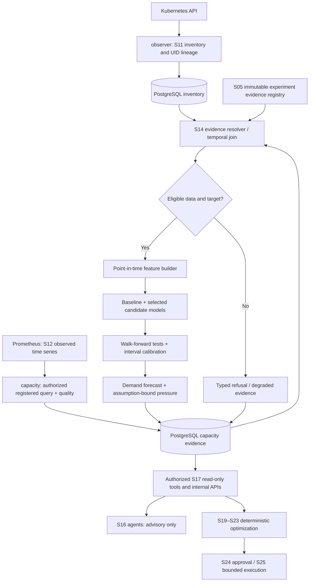

# S14 — Capacity Forecasting & Demand Modeling

> **Architecture approval record — 2026-11-19.** The project owner explicitly approved **S14-ADR-001 through S14-ADR-012**: statistical-first hybrid prediction; resource/horizon semantics; differentiated W01–W06 strategies; baseline-controlled model portfolio; time-safe feature assembly; evidence-grounded uncertainty; separated scheduling/consumption projections; insufficiency/degradation/refusal; temporal backtesting; bounded Python execution in the existing `capacity` Deployment; immutable S13 records; and scoped typed interfaces without AI mutation authority. **Architectural approval is not implementation, training, model evaluation, calibrated accuracy, deployed infrastructure, or a verified production claim.** Numeric thresholds, calibration performance and package versions remain provisional.

## 0. Document authority, precedence and interpretation

- **Master catalog v1.0.0** is authoritative for the 32-slice roadmap, P0 scope, strict deterministic forecasting and separation of scheduling requests from observed demand.
- **S01** accepts AIOps Capacity Operations Platform, `Observe`/`Advisory`/`Governed`, autonomy L0–L2, four workload criticality classes, current/1h/24h horizons, human-approved mutation, B0–B3 evaluation, and hard constraints before efficiency.
- **S02** accepts **exactly six custom persistent platform Deployments**: `api`, `observer`, `capacity`, `ai`, `governance`, `executor`; typed REST and PostgreSQL jobs/outbox, no required message broker, bounded background work and schema ownership. S14 is inside `capacity`, **not a seventh deployable**.
- **S03** accepts one kind control plane, three workers (one platform-tainted, two experiment), Calico/default-deny, Windows 11/Docker Desktop/WSL2, 20 GB physical RAM / Ryzen 5 3600, candidate 12 GiB WSL2 cap, host Ollama, local PVC and independent backup. Resource envelopes are provisional. S05's accepted `capacity-experiments` namespace still needs an S03 addendum.
- **S04** accepts six workload identities: W01 latency-api Critical, W02 burst-api Standard, W03 memory-profile Standard, W04 cpu-worker Flexible, W05 analytics-processor Flexible, W06 opportunistic-batch Opportunistic. W01–W04 baseline Deployments; W05 suspended CronJob; W06 scenario-created Job. W02 HPA baseline disabled.
- **S05** accepts host Python/Typer orchestrator, independently credentialed watchdog, SQLite run journal, ephemeral tokenless load-driver Jobs, seeded declarative scenario plan and immutable experiment evidence; synthetic **workload origin** does not mean the measured cgroup usage is a simulation. No agent-driven experiments or optimized changes.
- **S06** accepts Keycloak/OIDC and RBAC + resource scope + conditions, six application roles, author/approver separation, current permission evaluation. Forecasting needs authorized resource/operation scope; computing a forecast is not an approval.
- **S07** accepts dedicated ServiceAccounts, audience-bound credentials when needed, authenticated TLS/selective mTLS, Calico isolation and no K8s mutation token in `capacity` or `ai`.
- **S08** accepts Vault+ESO, offline root + cert-manager intermediate, PSA Restricted + native CEL admission, classified data, redaction, protected immutable audit and backups. Evidence and model outputs contain no credentials.
- **S09** accepts three logical agents inside `ai`, in-process deterministic Tool Authorization Broker, typed read-only forecast tools, authorized RAG, bounded host Ollama proxy, no model-supplied forecast values or Kubernetes mutation permissions.
- **S10** accepts local OCI Distribution Registry, Syft/Trivy, Cosign, Sigstore Policy Controller, runtime conformance; implementation **P1**. S14 captures model-code/dependency/build identity without making P1 admission a mandatory prerequisite for P0 forecast availability.
- **S11** accepts `observer` as only business-platform Kubernetes LIST/WATCH/reconciler, bounded typed cache, identity/UID lineage, effective scheduler requests, immutable inventory snapshots, per-family quality. K8s `resourceVersion` is opaque, not global time.
- **S12** accepts one bounded Prometheus, cAdvisor/kube-state-metrics/application exporters, registered PromQL, immutable qualified observation/evidence manifests, multidimensional quality. Provisional 15s/30s scrapes, 7-day retention and 5–10 GiB PVC; 5m derived features do not capture all short peaks. No copying of every raw sample into PostgreSQL.
- **S13** accepts one PostgreSQL instance and schemas `inventory`, `capacity`, `knowledge`, `governance`, `execution`, `audit`, `workflow`; `capacity` writer owns analysis manifest/forecast/prediction/evaluation rows; append-oriented typed provenance, reference-aware retention and transactional outbox. Forecast/evaluation retention starting candidate **90 days**, pinned evidence longer as appropriate; retention values provisional.

**Precedence rule:** S14 extends accepted S01–S13 boundaries; it cannot silently supersede existing ADRs. Exact public HTTP paths belong to S27; model fitting and evaluation details to the companion contract; optimizer constraints to S19–S23; S31 owns comparative experiments; S28 owns final operational SLOs. **Accepted** means architecturally approved; **provisional** means unverified threshold; **illustrative** means non-binding example; **verified** requires running evidence.

## 1. Mission, scope and non-goals

**Mission:** Transform quality-qualified, identity-resolved resource observations and inventory context into bounded, reproducible, explainable **numerical CPU and memory demand estimates** for supported horizons, with uncertainty, temporal validity, provenance, honest refusal and safe consumption by downstream analysis.

### 1.1 Required P0 outcomes

1. Correctly distinguish `observed demand`, `predicted demand`, `configured requests`, `limits`, `node allocatable`, `scheduler-fit`, `simulated outcomes` and `realized post-change results` by typed quantities and origin.
2. Support **current-state inspection** (not necessarily ML), **1-hour** forecasting and **conditional 24-hour** forecasting; no unsupported promises of 24-hour quality.
3. Forecast W01–W04 continuous CPU/memory targets; estimate W05/W06 **execution-conditional** demand envelopes only when a future run/profile/window is explicitly assumed.
4. Select baseline/statistical models using point-in-time evaluation rather than model complexity or subjective choice.
5. Emit point and calibrated interval/quantile evidence when supported; preserve fidelity and distinct risk/eligibility axes.
6. Refuse/degrade when evidence insufficient, censored/confounded, unauthorized, model quality inadequate or live state stale; persist typed reason.
7. Derive assumption-labeled node/cluster **operational pressure**, without claiming scheduler placement or replacing S11 effective requests.
8. Persist immutable S13 forecast and evaluation records, outbox facts and complete lineage; support authorized reproducibility.
9. Keep deterministic forecasting operational when Ollama/RAG/AI are offline and within local host budgets.
10. Demonstrate performance, security and failure behavior through S30/S31 acceptance fixtures without inventing measured success.

### 1.2 Explicit non-goals

No LLM-generated resource numbers; generic forecasting-as-a-service SaaS; required GPU/Prophet/LSTM/neural model/MLflow/feature store/Kubeflow; separate prediction/model service; arbitrary user Python/SQL/PromQL; cloud node purchases; future node placement prediction; full HPA policy (S23); actual scheduler emulation (S21); optimal CPU requests (S20); ungoverned patches; automatic retrain-to-execute; reclassification of synthetic scenario duration as 24 hours of wall time; blanket numerical risk probabilities from uncalibrated models.

## 2. Decision record and architecture

### 2.1 Approved model of service

**S14-ADR-001 Accepted:** statistical-first hybrid framework. Start with deterministic persistence, robust rolling and supported exponential-smoothing candidates, with seasonal-naïve only on demonstrated repeating periods. Optional scikit-learn models are versioned, evidence-tested challengers; none automatically override safe baselines.

**S14-ADR-010 Accepted:** the forecast coordinator, feature preparation, bounded model worker, evaluator, interval calibrator, persistence adapter and internal read API are modules of existing S02 **`capacity` Deployment in `capacity-core`**. PostgreSQL `workflow` leased jobs/outbox provide persistence and at-least-once retry. Prometheus remains raw time-series authority; `observer` remains S11 inventory owner.



### 2.2 Runtime module boundaries

| Module | Responsibility | Prohibited |
|---|---|---|
| Forecast request coordinator | Authorize/scope, resolve target, validate horizon, lease bounded job | Inferred human approval, Kubernetes write |
| Evidence resolver | Read S13 immutable manifest, S12 qualified result, S11 valid-time inventory and S05 registration | Raw unregistered PromQL, second LIST/WATCH |
| Feature builder | Typed unit-safe bucket transforms, missingness masks, segmentation, provenance | Changing original observed facts, future leakage |
| Candidate model registry | Allowlisted algorithms and immutable revisioned hyperparameter policy | Arbitrary code, arbitrary loaded pickle |
| Backtester/calibrator | Rolling-origin evaluation, baseline gate, held-out coverage | Testing on training data as qualification |
| Projection builder | Workload/node/cluster demand/pressure given assumptions | Announcing scheduling feasibility |
| Forecast writer | Immutable run/prediction/evaluation/manifest, digest and outbox | Cross-schema writes to Governance/Executor |
| Read/tool interface | Backend scope checks, quality, bounded retrieval and refusal | Foreigner namespace disclosure, model-supplied numbers |
| Job worker | Concurrency/time/CPU/RAM bounds, retry/fencing, cancellation | Unbounded native fit, uncontrolled training concurrency |

### 2.3 Communication and consistency

- S14 requests S12 evidence from already accepted registered query library, never raw user/agent PromQL.
- S14 resolves S11 identity and effective request snapshots through authenticated Observer API or explicitly approved read projection. Inventory and telemetry are not a global transaction; join by UTC validity and explicit capture uncertainty.
- S14 persists owned records transactionally in `capacity` with corresponding `workflow`/outbox publication as supported by owner permissions; downstream consumers receive facts at least once and deduplicate event IDs.
- No critical synchronous dependency on `ai`, Ollama, RAG, Keycloak availability beyond S06/S07 validated caller authorization; no fail-open privileged access.
- Forecast creation is asynchronous when fit/evaluation exceeds bounded immediate serving budget. `202 Accepted` refers only to accepted durable computation intent.

## 3. Prediction semantics and horizon contract

**S14-ADR-002 Accepted:** workload CPU/memory forecasts plus conditional hierarchical pressure outputs; current state is a measurement-based assessment, not an ML forecast.

| Horizon key | Meaning | Candidate bucket granularity | Acceptance semantics |
|---|---|---|---|
| `current` | current S11 requests/allocatable + recent qualified S12 observations | observed window; explicit sample age | assessment, never fictitious future predictions |
| `1h` | future `[asOf,asOf+1h)` | 5-minute buckets (12), provisional | primary P0 model target, conditional on evidence |
| `24h` | future `[asOf,asOf+24h)` | 1-hour buckets (24), provisional | must refuse/degrade without representative temporal validation |

All persisted bucket intervals use UTC `[start,end)`. An as-of timestamp is an **information cutoff**: no feature, label, metadata revision or model fit may use content not legitimately available by cutoff. Record `generatedAt` separately. A late-arriving historical observation is not historically knowable at an earlier cutoff unless availability is evidenced.

### 3.1 Resource/statistic types

- `cpu_consumption_millicores`: finite nonnegative interval CPU-rate summary (derived from cAdvisor counters with versioned `rate` methodology), **not CPU request or CPU cap**.
- `memory_working_set_bytes`: nonnegative sampled gauge statistic; `sampled_max` is **not guaranteed process peak**, and RSS/usage/logical app allocation are distinct.
- `statisticKind`: `bucket_mean`, `bucket_max_sampled`, `upper_tail_quantile_estimate`, and named `run_envelope` only where derivation allows; a `bucket_mean` upper prediction bound is not automatically a maximum-demand bound.
- `cpu_request_millicores`, `memory_request_bytes`, `cpu_limit_millicores`, `memory_limit_bytes`: **observed S11 applied config** and scheduler-relevant requests; no probabilistic reinterpretation.
- Reject negative predictions for nonnegative resources or apply an explicitly versioned nonnegative transform with validation; reject NaN, infinities, incompatible units, upper < lower and missing applicable values.

### 3.2 Workload-specific forecast contract — S14-ADR-003 Accepted

| Workload | Type | Prediction plan | Risk/context |
|---|---|---|---|
| W01 `latency-api` | Critical .NET Deployment | CPU and memory short-window demand + high-demand context | p95/errors/throttling remain hard-guardrail evidence; S19 determines safety |
| W02 `burst-api` | Standard .NET Deployment | Short-term bursts, upper-tail and optionally offered-rate features | HPA off baseline; HPA-on requires time-varying replicas/denominator and conditional scenario assumptions |
| W03 `memory-profile` | Standard Python Deployment | sampled memory baseline, ramp/retention and conservative upper tail | missing spikes / OOM / censoring block downsize-grade confidence |
| W04 `cpu-worker` | Flexible Python Deployment | idle/active CPU, optional task/queue features | low CPU with growing queue is not sufficient spare-capacity evidence |
| W05 `analytics-processor` | Flexible suspended CronJob | **conditional** run demand/duration envelope for declared future Job/profile/window | no implicit future schedule or zero load when inactive; short Job may be unsampled |
| W06 `opportunistic-batch` | Opportunistic on-demand Job | **conditional** run resource envelope for profile and assumed start/window | do not predict Job arrival or node placement, S21 handles fit |

Only S04/S05 authorized scenario/profile manifests can define hypothetical offered demand. A declared future scenario may produce a **scenario-conditional forecast**, not an independently predicted business arrival. Preserve `workloadOrigin` and `measurementOrigin` separately: real cgroup measurements of synthetic scenario load remain observed measurements of synthetic-origin activity.

## 4. Data eligibility, temporal correctness and features

**S14-ADR-005 Accepted:** versioned point-in-time feature pipeline fed by S13 `AnalysisInputManifest v1alpha1`, S12 observation quality and S11 valid-time identity. No new feature store.

### 4.1 Input prerequisites

- Cluster incarnation, namespace and canonical logical workload must match; reconcile Pod UID → container incarnation → controller UID → logical workload for every applicable observation interval.
- S11 snapshots must cover configuration/replica/placement and include per-kind capture/coverage/consistency. Opaque `resourceVersion` is never used as a comparable global timestamp.
- S12 query ID/revision/expression digest, sample artifact/summary digest, source versions, interval/step, missingness, origin, fidelity and multidimensional quality must be present.
- S05 experiment run/phase/profile/seed and driver offered-versus-achieved metrics are joined when scenario-generated; excluded warmup/cooldown and pressure-contaminated windows are never silently admitted.
- Retain `spec_changed_mid_window`, `snapshot_skew`, `owner_unresolved`, `hpa_confounded`, `short_job_unsampled`, `peak_not_guaranteed`, `generator_overloaded`, `host_pressure`, `metric_unavailable`, `schema_mismatch`, `counter_reset` flags when present.

### 4.2 Versioned feature groups

| Group | Candidate features | Conditions |
|---|---|---|
| CPU | 5m mean/rate, rolling medians/quantiles, supported trend, lag values | correct reset/rate continuity; stable target |
| Memory | working-set value, sampled max/quantile, retention slope, change | sampled-peak limits explicit; conservative imputation |
| App demand | requests/s, accepted tasks/s, queue depth, W03 logical allocations | only if instrumented, time-aligned, bounded and available by cutoff |
| Kubernetes context | effective requests, limits, replica count, generation/config revision, HPA presence | time-valid config, not proxy for intrinsic demand |
| Events/health | throttling, restart/OOM, eviction/FailedScheduling, latency/error guardrail | diagnostic/censoring; never a fabricated numeric resource sample |
| Time | actual UTC calendar features, validated cycle indicators | no synthetic time compression misrepresented as calendar history |
| Provenance | scenario phase, known offered demand, source lineage, missing masks | feature provenance only; no secret/prompt exposure |

**Mandatory anti-leakage:** all transforms (normalization, lag building, imputation, model selection and calibration) fit using information available at the relevant train cutoff. No cross-fold scalers, no random shuffled temporal splitting and no use of post-change outcome as pre-change evidence. Calendar features are allowed because the calendar is known; future traffic rates are allowed only as explicit **assumptions** from a pinned plan.

### 4.3 Configuration shift and censoring

Changes to CPU limits, requests, replica count, major workload profile, image or deployment generation may change the demand process. Segment, add a validated regime feature, or refuse. Throttling can censor observed CPU demand; memory limits/OOM can truncate observed needs. Low utilization during capped operation is not evidence of unconstrained demand; mark `demand_censored` and forbid risk-sensitive request reductions until independently qualified. Treat missing memory intervals as unknown spikes, not interpolated zero. Derivative imputation is explicitly tagged and never back-written as authoritative observation.

## 5. Model strategy and selection — S14-ADR-004 Accepted

| Model ID family | Use | Qualification |
|---|---|---|
| `persistence` | no-change last qualified value | minimal deterministic baseline, still subject to data eligibility |
| `rolling_robust` | rolling mean/median + simple conservative envelope | baseline for relatively stable demand |
| `seasonal_naive` | supported, observed repeating periods | multiple real cycles and temporal stability required |
| `exponential_smoothing` | local level/trend; seasonal only if demonstrated | statsmodels-style deterministic fit under bounded search |
| `empirical_upper_tail` | resource-specific conservative demand envelope | peak fidelity/coverage tested; not a calibrated prediction interval by itself |
| `sklearn_regression_challenger` | lagged/exogenous nonlinear candidate | optional; no default promotion without improved held-out performance and uncertainty |

The candidate set, exact hyperparameters, dependency locks, random seeds, numeric precision policy, fitting-code revision, model serialization format and selection policy have stable version identifiers. Same canonical inputs and environment produce numerically identical results within predeclared tolerance; do not claim cross-platform byte-for-byte identity unless tested. A fit may be deterministic even when observed runtime outcomes are not.

**Selection rules:** fit comparable candidates on the same eligible folds; compare against a defined naïve baseline; predeclare metric/loss/guardrails; reject candidates that materially underperform baseline or violate risk policy; do not choose complex over simple by preference. If no candidate qualifies, issue refusal or a distinctly advisory-only diagnostic baseline under explicit permission. Baselines do not bypass hard data-quality gates.

## 6. Uncertainty, reliability and use eligibility

**S14-ADR-006 Accepted:** explicit point predictions and calibrated, typed intervals/quantiles when adequate; no invented scalar confidence score.

- Store `nominalCoverage`, `intervalMethod`, `calibrationWindow`, `heldOutCoverage`, `intervalWidth/score`, `sampleSupport`, independent evaluation ID and validity assumptions.
- Prefer out-of-sample residual/rolling-origin calibration as P0, with time-dependence and overlap caveats. Conformal-style approaches are optional and may **not** claim finite-sample guaranteed coverage under violated exchangeability assumptions.
- Distinguish forecast of a `bucket_mean` from an interval about a `bucket_max_sampled` or physically bounded peak. No promise of true transient memory peak detection from 15s scraping.
- Do not sum independent per-workload intervals and label result a calibrated cluster interval. For aggregation use aligned historical residuals/dependence-aware evaluation or state that the result is a conservative assumption envelope with **no inherited nominal coverage**.
- Quality vector: `sourceQuality`, `identityIntegrity`, `configurationStability`, `sampleSupport`, `modelBacktest`, `intervalCalibration`, `distributionStability`, `horizonSupport`, `decisionEligibility`.
- `eligible` means passed the named policy for a named use, **not** that the future is guaranteed. `advisory_only` is not eligible by default as a downsize proof; downstream S19 determines which evidence classes may justify a candidate.

## 7. Insufficiency, cold-start and refusal — S14-ADR-008 Accepted

### 7.1 Outcome taxonomy

| Outcome | Output contract | Can authorize downstream mutation? |
|---|---|---|
| `eligible` | qualified numerical predictions and validation refs | no; only inputs for S19–S25 checks |
| `degraded` | optional explicitly informational estimate + warnings | no, unless future policy expressly defines a narrowly permitted non-risk use |
| `refused` | typed reasons, quality and evidence references; no valid predictions | no |
| `not_applicable` | explanation of absent/hypothetical demand target | no |
| `failed` | execution/infrastructure failure distinct from insufficiency | no |

**Candidate initial thresholds (not accepted production limits):** for 1h try ≥4h representative history; for 24h try ≥72h; ~95% observed applicable-point coverage for both. These **do not** establish sample independence, daily seasonality or confidence. The companion's policy registry marks each numeric value `provisional/calibration-required`. Eligibility requires sufficient independent origins, fit/calibration history, appropriate effective sample support, target fidelity, cohort stability and baseline-relative performance. S12's 7-day TSDB may not retain adequate 24h seasonal evidence; refuse unsupported seasonality. There is no fallback that expands horizons by pretending simulated short-cycle time equals wall time.

### 7.2 Required refusal codes (versioned registry)

`insufficient_history`, `insufficient_effective_folds`, `coverage_below_policy`, `metric_unavailable`, `identity_unresolved`, `cluster_incarnation_mismatch`, `snapshot_stale_or_partial`, `temporal_alignment_invalid`, `artifact_integrity_invalid`, `source_unavailable`, `config_regime_incompatible`, `hpa_unmodeled`, `demand_censored`, `memory_spike_fidelity_insufficient`, `host_or_generator_contamination`, `future_information_leakage`, `backtest_below_baseline`, `interval_calibration_failed`, `distribution_shift_unresolved`, `unsupported_target_or_horizon`, `missing_conditional_execution_assumption`, `insufficient_scope_or_authorization` (may be returned as authorization error rather than public forecast refusal). Exact public error presentation is S27-owned and must not disclose inaccessible resource identities.

### 7.3 Conservative downgrade rules

- Never turn a missing metric into measured zero, including W05/W06 absent scrapes.
- Never present a point prediction with an uncalibrated band as a calibrated interval.
- Never automatically promote a low-coverage estimate for Critical workload right-sizing.
- Reuse only exact immutable historical artifacts with correct time/scope/model and explicit freshness. Old evidence is not fresh live headroom.
- Outlier removal/denoising must not discard rare but real resource spikes without an independently justified versioned policy.

## 8. Forecast pressure and hierarchy — S14-ADR-007 Accepted

### 8.1 Different capacity meanings

**Request-based scheduling headroom** for node `n`, resource `r`, capture `s`:

`H_scheduler(n,r,s) = allocatable_S11(n,r,s) - sum(effective_assigned_pod_requests_S11(n,r,s))`.

This is a scalar aggregate diagnostic, **not** a placement verdict: S21 handles eligible-node constraints, resource combinations, topology, taints, affinity, quotas and fragmentation. Preserve Pod overhead, init-container effective rules, sidecars and all system Pod reservations as normalized by S11. Negative results can be informative without asserting K8s scheduler state.

**Predicted consumption pressure** under an explicit placement/replica assumption `a`:

`P_consumption(n,r,t|a) = forecast_aggregate_consumption(n,r,t|a) / allocatable_S11(n,r,s)`.

Predicted operational headroom = `allocatable - predicted_consumption`, explicitly named `consumption_headroom_estimate`, not `schedulable_free`.

- Node projection is allowed only with pinned current placement or explicitly hypothetical future placement and stated unknowns. Include infrastructure/background usage where measured; mark coverage gaps rather than treat platform use as zero.
- HPA-on scenarios require bounded replica trajectories or declared forecasts conditional on replica count; S14 does not invent future schedules.
- Kind nodes share one physical workstation; a node-level projected consumption estimate does not guarantee independent physical CPU/RAM supply. Use S05 host pressure as separately sourced veto/quality condition.
- A cluster sum may summarize demand but cannot claim request-fit or a calibrated joint interval without dependence-aware testing. Define included workloads and exclusions to avoid double-counting Pod/control-plane units.

## 9. Typed logical API and data contracts — S14-ADR-011/012 Accepted

The following are **logical interface signatures**, **not approved external REST URLs** (S27 owns routes, HTTP error envelopes, pagination and CLI surface).

```text
request_forecast(verified_actor, target_ref, resource_dimensions, horizon_key,
                 statistic_kinds, intended_use, optional_immutable_manifest_ref,
                 idempotency_key) -> ForecastJobRef | Denied | InvalidRequest | Conflict
get_forecast_status(verified_actor, forecast_job_ref) -> JobState + Quality | Denied
get_forecast(verified_actor, forecast_ref, bounded_projection)
    -> ImmutableForecastView + Evidence/Eligibility | Denied | NotFound
get_forecast_evaluation(verified_actor, evaluation_ref)
    -> SanitizedBacktestReport | Denied | NotFound
get_capacity_pressure(verified_actor, forecast_refs, inventory_snapshot_ref,
                      placement_assumptions, coverage_policy_ref)
    -> ExplicitlyConditionalPressureProjection | InsufficientEvidence | Denied
compare_forecasts(verified_actor, compatible_forecast_refs, comparison_policy_ref)
    -> BoundedComparison | IncompatibleTargets | Denied
```

### 9.1 Request/result model

`ForecastRequest v1alpha1` needs: cluster incarnation, namespace + logical workload, one or both resources, `1h|24h` horizon, target statistic, UTC as-of, optional **already-qualified** evidence ref, requested use, trusted actor/delegation context, idempotency. Current-state request is a **different assessment contract** to avoid `forecast=current` ambiguity. The server chooses/validates source evidence and model; callers cannot supply a privileged quality override, executable code, arbitrary query or arbitrary URI.

`ForecastResult v1alpha1` needs: immutable forecast/run ID and schema revision; as-of + issued/produced UTC; complete bucket grid and units; statistic meaning; point and optional lower/upper with nominal coverage and method; chosen model family/version/code/dependency/environment digests; immutable input manifest and observation/inventory refs; train/calibration/test protocol/evaluation ID; multidimensional quality; supported intended-use class; refusal codes (if applicable); `scenarioConditional` and explicit future assumptions; content digest/classification; serialization revision.

**Illustrative partial envelope, NOT a finalized forecast and NOT measured:**

```json
{
  "schemaVersion": "forecast-result/v1alpha1",
  "forecastId": "example-only",
  "target": {"clusterIncarnationId":"verified-ref", "namespace":"workloads-critical",
             "logicalWorkloadId":"w01-latency-api", "resource":"cpu_consumption_millicores"},
  "asOfUtc": "2026-11-19T05:00:00Z",
  "horizon": "1h",
  "bucketSeconds": 300,
  "statisticKind": "bucket_mean",
  "predictions": [{"bucketStartUtc":"2026-11-19T05:00:00Z",
                   "bucketEndUtc":"2026-11-19T05:05:00Z",
                   "point":220, "lower":130, "upper":310}],
  "model": {"family":"exponential_smoothing", "version":"example-model-rev"},
  "evidence": {"inputManifestRef":"example-only", "evaluationRef":"example-only"},
  "quality": {"status":"illustrative_not_evaluated", "decisionEligibility":"none"}
}
```

A **valid** 1h/300s finalized result requires 12 contiguous buckets, consistent units, stable interval interpretation and verified lineage, not the single illustrative bucket above. Digest placeholder strings are **not valid hashes**. A refused outcome must not have eligible predictions. Internal `ForecastFinalized.v1` event is a fact after durable commit, not an execution command; event version and payload reference follow S02/S13 owner conventions.

### 9.2 S13 persistence mapping

| S13 entity | S14-owned added meaning | Writer |
|---|---|---|
| `capacity.analysis_input_manifest` | ordered evidence refs, transform code/revision, cutoff, segmentation, feature validity masks/digest | `capacity` |
| `capacity.forecast_run` | model family/rev, training/fit origin, horizon, state, policy, refusal and artifact digest | `capacity` |
| `capacity.forecast_prediction` | bucket `[start,end)`, statistic, resource unit, point/interval/method and quality | `capacity` |
| `capacity.forecast_evaluation` | held-out fold cutoffs, MAE/RMSE/bias/pinball/coverage/width, baseline and risk metrics, policy revision | `capacity` |
| `capacity.evidence_artifact` | bounded immutable model/evaluation/feature references and verifiable bytes | `capacity` according to S13 |
| `workflow` | leased computation, state/retry/fencing, idempotent handler and outbox delivery | narrowly scoped existing workflow owner |

No cross-domain arbitrary write to `inventory`, `governance`, `execution` or `knowledge`. S24 immutable plan revisions pin exact forecast ID/digest, not a pointer to “latest”. S13 **provisional** forecast/evaluation retention 90 days and reference-aware plan/experiment retention apply; no deleting referenced artifacts via cascading purge. S08 protects audit integrity and backups; hashes alone are not adversarial rewrite prevention.

## 10. Security, disclosure and trust boundaries

**S14-ADR-012 Accepted.** S06 caller authentication and current namespace/workload/action scope, S07 service TLS/identity, S08 classification and S09 AI broker must all apply.

1. `capacity` has scoped read access to approved metrics/inventory projections and own DB roles; **no Kubernetes mutation ServiceAccount**, `kubectl` or raw agent socket.
2. AI accesses only `forecast.get_capacity_estimate.v1`-style bounded read tools via authenticated machine + trusted delegation + independent backend scope check; no arbitrary SQL, raw PromQL, URL or model execution.
3. Model objects and serialized artifacts are treated as potentially unsafe binary input. Prefer explicit small JSON/typed parameter state, checked digests and strict allowlisted deserializers. No untrusted pickle/joblib loading.
4. Forecast output cannot claim human approval, current scheduler fit, or numeric truth merely because an LLM cited it. Agents cannot change number, quality flag, input digest or refusal status.
5. No secrets, token values, PII, free-text events or full unfiltered Kubernetes specs in features/model artifacts/prompts/metrics. Authenticated reads filter historical scope **before disclosure** and use controlled pagination.
6. Forecast request rate, concurrency, input span/series count, output byte budget and CPU/RAM/timeout budgets are enforced in code and runtime limits, not solely a user-editable client flag.
7. Internal tool output must preserve evidence IDs, classification, validity and source provenance; truncated outputs are marked incomplete.
8. Unauthorized requests must not leak foreign target existence, timestamps, metric counts, or model lineage via error details or inference side-channel where preventable.

## 11. Execution, jobs, error and recovery semantics

**S14-ADR-010 Accepted:** bounded, deterministic computation on existing `capacity` pods using durable job lifecycle. Candidate job stages: `requested -> input_validation -> feature_build -> fit -> walk_forward_evaluation -> interval_calibration -> finalizing -> available`; terminal alternates `refused`, `not_applicable`, `failed`, `cancelled`. A refusal is a **successful policy decision**, not a transient infrastructure exception.

- Acquire lease/fencing per immutable idempotency identity; persist intent and input digest before doing expensive work. At-least-once retries must not insert a conflicting finalized result.
- Canonical job key includes caller-authorized target, cluster incarnation, resources, horizon/statistic, as-of, immutable input digest, model selection policy and model-code/config versions. Same idempotency key with different canonical body yields conflict.
- Bound worker concurrency, process CPU/memory and maximum historical records; measure S03 host pressure. Use supervised subprocess/OS constraints for heavy native fits if required by measured risks; a Python timeout alone does not forcibly stop native computation.
- Producer errors/DB outages cannot publish a finalized result before committed records. On retry inspect existing digest/state, reconcile incomplete staged artifacts; never silently rewrite immutable finalized rows.
- A stale S11 snapshot prohibits a fresh current pressure claim. Previously pinned historical analysis may remain retrievable with explicit age and intended-use restrictions.
- Prometheus unavailable: no fresh observations; an old qualified immutable artifact may be reused only under explicit valid-time policy. Keycloak unavailability is not authorization fail-open.
- Ollama/RAG/unavailable AI: deterministic forecast jobs continue; AI advisory status becomes unavailable without affecting numerical forecasting.
- Host OOM/pressure, overload and disk saturation: stop/defer nonessential jobs, preserve key evidence, report `failed`/`degraded` as appropriate and avoid uncontrolled CPU/RAM competition with S05 experimental workloads.

## 12. Backtesting and acceptance policies — S14-ADR-009 Accepted

- Use strict **rolling-origin / walk-forward** folds, contiguous future holdouts and cutoff-correct transformations. **Never** use random shuffled train/test partitions for temporal qualification.
- Separate model fitting, interval calibration and unbiased final evaluation; record period overlaps and dependent folds. A calibration score measured on calibration data is not an independent test.
- Compare all eligible models against a predeclared naïve baseline on common folds, same target statistic and valid intervals. Refuse candidates with unacceptable degradation or resource-specific upper-tail risk.
- Metrics: MAE, RMSE, bias, baseline skill, pinball/quantile loss, empirical interval coverage, width/interval score, high-demand underprediction, sample/fold support. W03 memory risk emphasizes high-side misses and spike fidelity; W01/W02 CPU results retain latency/throttling context.
- Do not invent fixed performance targets pre-calibration. Thresholds are versioned and chosen using S30/S31 repeatable fixtures/held-out results; threshold policy cannot retroactively relabel previous evaluated artifacts.
- S31 separately evaluates **decision value** under B0 no optimization, B1 naïve heuristic, B2 deterministic forecast-aware and B3 agent-assisted, with matched scenario plans, real observed outcomes, and no false superiority claim from forecast MAE alone.

The companion file `S14_Forecasting_Model_Evaluation_Contracts.md` is normative for detailed feature, fold, interval, error and testing definitions consistent with these ADRs.

## 13. Operational telemetry, NFRs and failure policy

| Dimension | Required requirement | Status |
|---|---|---|
| Correctness | typed units, identity/cutoff integrity, no fictitious zero, no leakage | accepted mandatory |
| Reproducibility | exact input/config/version/digest and numeric tolerance | accepted mandatory; tolerance TBD |
| Resource budget | finite history, task concurrency, CPU/RAM/deadline, host pressure gate | accepted mandatory; values measured in S03/S28 |
| Reliability | durable jobs, retry reconciliation, no false finalization, explicit refusal | accepted mandatory |
| Isolation | OIDC+scope, TLS/machine auth, least-privilege DB, no K8s writes | accepted mandatory |
| Explainability | baseline comparator, model family/metrics/assumptions/refusal reasons | accepted mandatory |
| Performance | model run p50/p95, queue latency, fit time, memory, disk/DB growth | measure; S28 pins SLO |
| Observability | counts of forecasts/refusals by low-cardinality model/horizon/resource/status, calibration drift, evidence-age and DB/outbox failures | accepted mandatory |
| Retention | S13 forecast 90-day provisional target, pin-aware preservation, encrypted independent backup | accepted architecture; values calibration |

Security/operational probes must not label raw actor IDs, run IDs, Pod UIDs, digests, arbitrary namespace names, secrets or raw model inputs as unrestricted Prometheus labels. Structured log correlation IDs are non-secret and retention/classification controlled.

## 14. Functional and non-functional requirements

| ID | Requirement | Acceptance evidence |
|---|---|---|
| S14-FR-001 | Support current inspection and 1h/24h requested horizon semantics | current vs forecast typed contract tests |
| S14-FR-002 | Predict CPU and working-set memory with exact statistic/units | resource fixture comparison |
| S14-FR-003 | Use W01–W04 continuous, W05/W06 conditional profiles | six-workload taxonomy tests |
| S14-FR-004 | Build qualified identity-resolved temporal feature manifests | S11/S12/S13 integration tests |
| S14-FR-005 | Fit/evaluate baseline and optional candidate portfolio deterministically | seeded replay tests |
| S14-FR-006 | Construct and independently test uncertainty intervals | coverage/interval fixtures |
| S14-FR-007 | Reject unsupported data, censored demand and time leakage | negative policy tests |
| S14-FR-008 | Derive assumption-labeled demand pressure without scheduler-fit claims | CPU/memory headroom test |
| S14-FR-009 | Persist immutable forecast/refusal and model lineage | Postgres idempotency/immutability tests |
| S14-FR-010 | Provide scoped typed request/read/evaluation APIs and tool DTOs | auth and schema contract tests |
| S14-FR-011 | Handle durable retries/timeouts and preserve transaction/outbox integrity | fault injection tests |
| S14-FR-012 | Support S31 comparability and post-forecast observation evaluation | matched scenario protocol tests |
| S14-SEC-001 | No AI/direct forecast mutation or approval | adversarial endpoint/tool tests |
| S14-SEC-002 | Scope and actor enforced in backend, no cross-namespace leakage | deny tests |
| S14-SEC-003 | No unsafe serialized model execution, arbitrary query or code | malicious artifact/input tests |
| S14-SEC-004 | Classified evidence, no credentials in artifacts/logs/prompts | scanner/redaction tests |
| S14-NFR-001 | Bounded resources, stable degradation and AI independence | host budget/outage test |
| S14-NFR-002 | Repeatable numeric results under pinned runtime and tolerance | reproducibility benchmark |
| S14-NFR-003 | Verifiable provenance, integrity and reference-aware retention | digest/pin/restore tests |

## 15. Architecture acceptance test catalog

| Test ID | Setup | Expected observable result |
|---|---|---|
| S14-TEST-001 | stable W01 historical CPU with holdout | baseline comparison, unit/horizon correct |
| S14-TEST-002 | W02 burst before cutoff | reported high-demand miss; not falsely calibrated |
| S14-TEST-003 | W03 spike coincides with scrape gap | `memory_spike_fidelity_insufficient` or equivalent refusal |
| S14-TEST-004 | W04 CPU low and queue rising | no blanket low-demand right-size clearance |
| S14-TEST-005 | W05 suspended, no future Job | `not_applicable`, not predicted zero-running demand |
| S14-TEST-006 | W06 scenario-created known profile | conditional envelope with explicit assumption, no invented arrival |
| S14-TEST-007 | HPA opt-in W02 changes replicas | valid-time denominator, segment or `hpa_unmodeled` |
| S14-TEST-008 | new kind incarnation with same workload names | forbid silent historical merge |
| S14-TEST-009 | S12 owner mapping gap or stale inventory | refuse unsafe output, preserve quality |
| S14-TEST-010 | lookahead leakage intentionally inserted | cutoff policy catches future dependency |
| S14-TEST-011 | four folds including calibration/test | no shared fitted preprocessing across folds |
| S14-TEST-012 | underperforming advanced model | baseline wins or explicit refusal, no automatic complexity preference |
| S14-TEST-013 | model interval misses high tail | honest coverage failure/downgrade |
| S14-TEST-014 | pressure vs scheduler headroom mismatch | two metrics separated, no node-fit claim |
| S14-TEST-015 | unauthorized foreign-namespace retrieval | 403/opaque denial, no existence disclosure |
| S14-TEST-016 | agent supplies fake forecast or malicious model ID | denied schema/tool action; no numerical alteration |
| S14-TEST-017 | retry after interrupted DB commit | exactly one consistent immutable finalized digest/outbox fact |
| S14-TEST-018 | resource cap/host pressure | bounded cancel/defer, no OOM cascade |
| S14-TEST-019 | Ollama and AI service disabled | eligible deterministic forecasts continue |
| S14-TEST-020 | source artifact expired while plan pins it | pin prevents purge; retrievable exact evidence |

These are **planned tests**, not reports of passing implementations.

## 16. ADR decision register — all owner-approved

| ADR | Decision | Status | Rationale / consequence |
|---|---|---|---|
| S14-ADR-001 | Statistical-first hybrid forecasting | **Accepted** | explainable resource-light model portfolio, conditional ML challengers |
| S14-ADR-002 | CPU/memory + current/1h/24h + assumption-bounded hierarchy | **Accepted** | typed present vs future semantics |
| S14-ADR-003 | Continuous W01–W04, conditional W05/W06 envelopes | **Accepted** | avoids fictitious batch arrivals |
| S14-ADR-004 | Baselines, rolling/smoothing; seasonality/ML on evidence | **Accepted** | reject unnecessary complexity and unsafe seasonality |
| S14-ADR-005 | Point-in-time S13 feature manifests | **Accepted** | preserve identity, quality and data leakage safety |
| S14-ADR-006 | Interval calibration and multidimensional confidence | **Accepted** | evidence instead of invented numeric confidence |
| S14-ADR-007 | Request-headroom vs predicted-consumption pressure separation | **Accepted** | leave scheduling feasibility to S21 |
| S14-ADR-008 | Cold-start / degraded / refusal policies | **Accepted** | low-data output cannot masquerade as qualified forecast |
| S14-ADR-009 | Walk-forward, baseline and risk-sensitive evaluation | **Accepted** | quantifiable validity and handoff to S31 |
| S14-ADR-010 | Bounded jobs within existing `capacity` Deployment | **Accepted** | preserve S02 six-deployable topology |
| S14-ADR-011 | S13 immutable run/prediction/evaluation records | **Accepted** | authoritative writer, lineage and outbox |
| S14-ADR-012 | Scoped API/AI tool read-only boundaries | **Accepted** | S06–S09 security and no model mutation |

No ADR here pins a specific model hyperparameter, quantitative accuracy threshold, storage capacity, Python version or Prometheus retention beyond previously accepted **provisional** upstream values.

## 17. Cross-slice traceability matrix S01–S13

| Accepted source | Binding input to S14 | S14 design/acceptance link |
|---|---|---|
| S01 | modes/horizons, L0–L2, hard policy, 4 classes, B0–B3 | §§1,3,7,12,15; FR-001/007/012 |
| S02 | six deployables, REST + PostgreSQL workflow/outbox, no broker | §§2,9,11; FR-009/011 |
| S03 | one kind 1+3 nodes, platform/experiment pools, 20GB host and local caps | §§2,8,11,13; TEST-018 |
| S04 | W01–W06 profiles, workload classes, HPA off baseline, SLOs | §§3–4,7,12; TEST-001–007 |
| S05 | seeded scenario plans, artifacts, phases, independent watchdog, origin | §§3–4,12; TEST-005/006 |
| S06 | OIDC and scoped permission, operating mode | §§9–10; SEC-002 |
| S07 | dedicated SAs, transport and Calico, no mutation SA | §§2,10; SEC-001 |
| S08 | Vault/ESO, CA, admission, classified evidence/backup | §§9–11,13; SEC-004 |
| S09 | broker + three advisory roles, no agent forecast inventing | §§2,9–10; TEST-016/019 |
| S10 | pinned source/dependencies/images and verifier; P1 | §§5,9,10; reproducible model-code identity |
| S11 | observer UID lineage, requests, allocatable, snapshot quality | §§3–4,8; TEST-008/014 |
| S12 | registered PromQL, provenance/quality axes, sparse peaks, retention | §§3–7,12; TEST-002/003/009 |
| S13 | analysis_input_manifest, forecast_* tables, immutable evidence/pins | §§4,9,11; TEST-017/020 |

## 18. Named unresolved implementation and downstream handoffs

1. **S14/S30/S31:** choose actual cutoffs for min history, valid coverage, effective sample/fold support, baseline skill, interval calibration, high-demand underprediction, numeric tolerance and decision-quality tier; all provisional until tested.
2. **S27:** finalize HTTP routes/OpenAPI envelopes, CLI user experience, timeouts, pagination, error presentation and request quotas.
3. **S28/S29:** measured worker CPU/RAM budget, environment pins, subprocess containment, scrape/DB pressure, backup and operational recovery thresholds; coordinate S03 resource envelope including already-accepted security infrastructure.
4. **S19/S20:** determine which forecast statistics and evidence-quality classes can support candidate right-sizing; never permit S14 forecasts to bypass Critical/SLO policies.
5. **S21/S22:** implement node-fit/fragmentation and simulation; consume `H_scheduler` and pressure as distinct typed inputs, not scheduler truth from aggregate forecasts.
6. **S23:** opt-in HPA and replica-aware future assumptions are explicitly handled or refused; no P0 automatic HPA tuning.
7. **S16/S17:** finalize authorized typed forecast retrieval tool, agent evidence envelopes and advisory role usage. S15 failure remains isolated.
8. **S13 integration:** actual SQL migration, indexes/grants, bounded JSONB, reference retention, canonical digest and event schema must be tested; this S14 document is not an executed DDL patch.
9. **S03 documentation:** S05-approved `capacity-experiments` namespace addendum remains pending, not silently treated as already applied.

## 19. Definition of architecture complete vs implementation complete

**Architecture complete (this approval):** twelve ADRs accepted, scope and ownership reconciled, design boundaries + typed logical contracts + eligibility and testing policies documented, source documents supplied. **Implementation complete (future):** running bounded `capacity` forecasting code, reconciled upstream implementations, qualified real observations, recorded walk-forward outcomes, tested failure/security semantics, validated resource costs and S30/S31/S32 release evidence. Never publish example metrics or diagrams as measured model performance.
