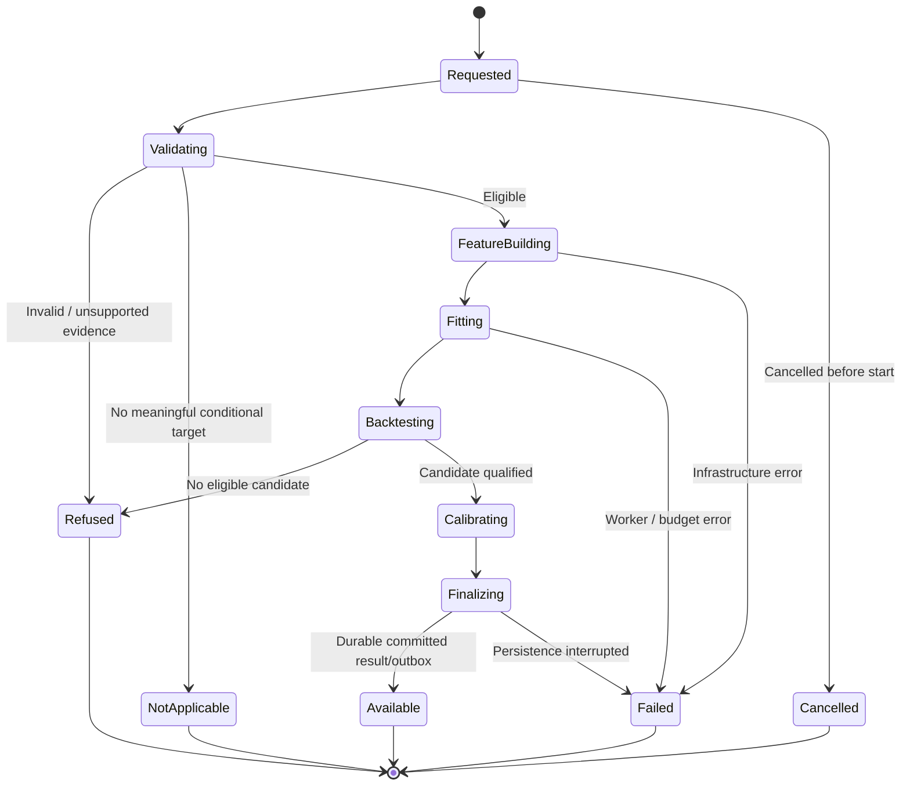

# S14 — Forecasting Model, Evaluation & Acceptance Contracts

> **Use:** Companion reference to the **owner-approved S14-ADR-001…012**, not an alternative architecture. It provides the implementable numeric/evaluation rules and testable contracts. **Provisional threshold examples and illustrative numbers are NOT measured, tuned, deployed or guaranteed.** The authoritative topology/security/data-owner decisions remain in S01–S14, especially S11–S13. Do not treat this file as executable migration, calibrated model report or a substitute for S30/S31 verification.

## 0. Normative boundary and contract language

- `MUST` denotes a requirement implied by accepted ADRs/upstream contracts; `SHOULD` an implementation recommendation; `MAY` an allowed optional implementation.
- Preserve S01 L0–L2/Observe–Advisory–Governed, current/1h/24h, criticality and exact human-approved mutation.
- Preserve S02 exactly six custom Deployments and S13 `capacity` authoritative writer; background work uses existing PostgreSQL workflow, no new broker/MLflow/feature store.
- Preserve S03 single physical Windows host and platform/experiment node distinction; all resource budgets remain measured/calibrated.
- Preserve S04 W01–W06 workload semantics, S05 experiment origin/phase/seed/driver quality, S11 inventory identity and request accounting, S12 qualified observed metrics, S13 immutable manifests/evidence and S06–S10 security.
- Only S14 deterministic code computes predictions; LLM may discuss cited results but may not invent/change numerical outputs.

## 1. Canonical quantity and prediction specification

| Item | Allowed meaning | Validation rule |
|---|---|---|
| `cpu_consumption_millicores` | nonnegative estimated CPU usage rate, millicores over named lookback/bucket | finite, units, counter reset/family correct; not CPU request |
| `memory_working_set_bytes` | sampled gauge of working-set estimate | nonnegative integral bytes; not RSS, allocation or guaranteed true peak |
| `bucket_mean` | forecast future interval mean of sampled rate/gauge | actual aggregation and denominator specified |
| `bucket_max_sampled` | upper observed sample within future interval, not true peak | only train if bucket-level sampled maxima with adequate fidelity |
| `upper_tail_quantile_estimate` | target distributional quantile over explicitly defined windows | record quantile and sample/exceedance support |
| `run_envelope` | conditional resource estimate for W05/W06 job run | actual vs inferred duration/peaks separately noted |
| `current_assessment` | S11 request/allocatable and recently qualified S12 observation | no future prediction claim |
| `scheduling_headroom` | S11 allocatable minus effective assigned requests | not placement success guarantee |
| `consumption_pressure` | predicted usage / S11 allocatable under assumptions | no schedulability interpretation |

Canonical numeric rules: CPU requests and predictions represented in integer millicores where exact enough, otherwise explicit decimal precision; memory in integral bytes (not ambiguous MB/MiB); intervals UTC ISO-8601 and `[start,end)`; confidence nominal coverage in `(0,1)`; missing numeric as null + reason, never zero; no NaN/Inf/negative data (unless the metric explicitly permits negative, which CPU/memory do not). Domain dimension/unit is carried on every artifact, not implied by path.

### 1.1 Forecast bucket grid

For horizon duration `H` and fixed `bucketSeconds = Δ`, define buckets `B_k=[asOf + kΔ, asOf + (k+1)Δ)` for `k=0,...,H/Δ−1`, provided `H` divisible by `Δ` and fixed UTC time grid is semantically permitted. Default candidates: `1h/300s = 12` buckets; `24h/3600s = 24` buckets. A different granularity requires revisioned forecast profile and matching evaluation. Every finalized numeric result covers every bucket or declares explicit missing/refused bucket semantics under a policy; do not silently interpolate omitted future intervals. The `current` assessment is **not** this grid.

### 1.2 Prediction horizon vs evidence lookback

`asOfUtc` is the time of the information cutoff; the target interval begins at `asOfUtc`, and `generatedAtUtc` records production. Training cutoff validity requires both event time **and availability time** when late ingestion matters. The model may include known future calendar values or explicitly declared S05 scenario demand as conditional covariates; future **observed CPU/memory, achieved throughput, replica placement, errors and latency** are unavailable and forbidden.

## 2. Input manifest and evidence resolution

### 2.1 Required `ForecastFeatureInput v1alpha1` logical shape

```yaml
schemaVersion: forecast-feature-input/v1alpha1
clusterIncarnationRef: verified-cluster-incarnation-ref
namespace: workloads-critical
logicalWorkloadRef: w01-latency-api
resource: cpu_consumption_millicores
statisticKind: bucket_mean
asOfUtc: "2026-11-19T05:00:00Z" # illustrative cutoff only
history:
  startUtc: "2026-11-19T01:00:00Z" # illustrative, not qualification
  endUtc: "2026-11-19T05:00:00Z"
  bucketSeconds: 300
manifestRef: immutable-s13-analysis-manifest-ref
observationRefs: [immutable-qualified-observation-ref]
inventorySnapshotRefs: [valid-time-s11-snapshot-ref]
queryDefinitions: [{queryId: container.cpu.rate.millicores, revision: 1}]
transformationRevision: feature-pipeline-revision
qualityPolicyRef: forecast-cpu-1h-policy-revision
workloadOrigin: baseline_lab
measurementOrigin: historical_observed
knownFutureAssumptions: []
```

These are **example references**, not actual evidence. Before any fit, resolve each ref through S13 owner APIs, verify actual immutable digest, classification/authorization, source/capture time, S11 identity, S12 coverage and valid-time configuration. `AnalysisInputManifest` is the durable authority for **what was used**, not a claim of model adequacy by itself.

### 2.2 Eligibility predicate (logical)

```text
eligible_input(target, horizon, intended_use) =
    authenticated_and_scoped
    AND immutable_evidence_integrity_verified
    AND cluster_incarnation_consistent
    AND S11_identity_and_config_valid_for_time
    AND S12_query_and_unit_supported
    AND applicable_coverage_sufficient
    AND temporal_alignment_and_source_freshness_per_policy
    AND source_fidelity_appropriate_for_statistic
    AND scenario_origin_and_phases_handled
    AND confounders_or_censoring_resolved_for_use
    AND sufficient_history_and_evaluable_time_cutoffs
```

A false predicate produces stable refusal reasons. An authorized user with inadequate data is not an authentication error; an unauthorized user must not receive foreign evidence metadata in the refusal body.

### 2.3 Exact source quality flags

| Upstream signal | S14 consequence | Test expectation |
|---|---|---|
| `scrape_gap`, `target_missing`, `coverage_below_policy` | invalid buckets/coverage; potential refusal | never fill with observed zero |
| `source_stale`, `late_ingest` | check as-of visibility and intended use | no lookahead from late evidence |
| `counter_reset`, `insufficient_rate_samples` | repair only through versioned S12-approved rate semantics, else missing | no negative CPU rate |
| `owner_unresolved`, `uid_mapping_ambiguous` | disallow unsafe aggregation | no name-only join |
| `spec_changed_mid_window`, `snapshot_skew`, `unmatched_config_interval` | segment/configure or refuse | no current request applied to historical unrelated config |
| `peak_not_guaranteed`, `short_job_unsampled`, `histogram_low_count` | restrict peak/Job claims | memory max not true physical peak |
| `hpa_confounded`, `generator_overloaded`, `host_pressure` | compare only conditionally or refuse; contamination-specific | do not train silent representative baseline |
| `metric_unavailable`, `schema_mismatch`, `artifact_missing` | refusal or infrastructure failure | no fabricated family fallback |
| `scope_denied` | opaque authorization failure | no metadata/existence leak |

S12 may use other flags; unknown safety-relevant flag defaults to `unclassified_quality_issue` and cannot silently pass risk-sensitive eligibility.

## 3. Point-in-time feature pipeline

### 3.1 Transform stages

1. **Reference resolution:** verify required evidence and S13 digest, validate exact actor scope.
2. **Lineage expansion:** workload → controller UID → Pod UID → container incarnation/restart, with S11 valid-time boundaries and lifecycle classification.
3. **Temporal alignment:** build explicit bucket grid; align S12 samples with source sampling intervals and valid S11 configuration, retaining capture-time uncertainty.
4. **Semantics preservation:** CPU `rate` lookback and memory gauge summaries may not be interchanged; sampled peaks and app logical memory remain distinct.
5. **Regime segmentation:** classify rollout, image/profile/config changes, replica/HPA changes, host and generator contamination; refuse incompatible mixing.
6. **Coverage matrix:** store per-feature/per-bucket observed, imputed, missing, inapplicable, censored; compute applicable denominator from actual target life interval, not naïve wall time.
7. **Fold-scoped transforms:** build rolling lags, standardization, optional imputation using **train-only** fitting; reproduce separately at every cutoff.
8. **Feature artifact:** deterministic schema, ordered columns, units, fold-cutoff refs, transform revision, mask summary and canonical digest; store bounded representation.

### 3.2 Feature registry

| Feature ID (reference) | Resource/workload | Definition | Anti-leakage requirement |
|---|---|---|---|
| `cpu_rate_5m_m` | W01–W04 | S12 approved 5m CPU consumption millicores | lookback entirely before as-of |
| `cpu_rolling_median` | W01–W04 | median of past qualified 5m buckets | fitted lookback and missing mask |
| `cpu_roll_q95` | W01–W04 | empirical high quantile of past qualified buckets | observed support, not future max |
| `mem_working_set_mean` | W01–W04 | sampled-gauge bucket mean bytes | do not infer unsampled spikes |
| `mem_max_sampled` | W01–W04 | maximum observed gauge within interval | fidelity `max_sampled`; sparse-target warning |
| `mem_retention_slope` | W03 | trend of valid observed working set over previous buckets | no future phases or zero-filled drop |
| `app_http_rate` | W01/W02 | actual achieved request rate from bounded app metrics | driver offered rate independent |
| `offered_rate_known_future` | W01/W02 | S05 pinned dispatch plan rate known before prediction cutoff | flag `scenarioConditional=true` |
| `task_rate_queue` | W04 | task acceptance/queue trends | queue cannot be reconstructed from future completion |
| `replica_count` | W02 and controllers | S11 time-valid actual desired/ready or declared future assumption | no future actual HPA count |
| `cpu_limit`, `mem_limit` | all applicable | S11 exact applied limits/context | recognize throttling/OOM demand censoring |
| `calendar_period` | only supported histories | known UTC hour/day features | not compressed simulated wall time |
| `run_profile_hash` | W05/W06 | pinned S04/S05 job/profile/dataset/seed | only for a declared Job execution |

Feature sets must be explicit about whether one predicts per-container, per-Pod, per-replica or logical-workload aggregate. Changing level is a contract revision; aggregation cannot implicitly double-count sidecars or transitional rollout replicas.

### 3.3 CPU vs memory missing-data rules

- CPU rate: a short gap MAY be imputed as a derived feature only with a versioned limited-gap policy and retained mask; output quality cannot become `fully_observed`.
- Memory: missing high-risk periods block peak-oriented inference. Linear interpolation cannot demonstrate a missing spike did not occur. For lower-risk mean-demand analysis, restricted imputation MAY be permitted but is not eligible as sole memory downsize proof.
- Batch Jobs: no cAdvisor scrape does not imply zero. Distinguish run metadata, S05 summary origin, explicit measurement method and observed sampling gaps.
- Non-running workload: mark `not_applicable` for continuous demand; optional future Job assumption defines a different conditional output.

## 4. Candidate model definitions and promotion

### 4.1 Minimal deterministic portfolio

| Model family | Inputs | Fitting concept | Primary guardrails |
|---|---|---|---|
| Persistence | latest valid bucket or documented representative recent window | repeat last qualified level | outlier sensitivity; stale series refuse |
| Rolling robust | recent qualified history | rolling mean or median, optionally conservative empirical quantile | min observations and config regime consistency |
| Seasonal naïve | multiple qualified real observed cycles | repeat corresponding actual phase | cycle adequacy + drift; no fake 24h cycle |
| Exponential smoothing | regularized observed series | bounded level/trend fit; seasonal only evidence-backed | numerical convergence, bounded search, holdout evaluation |
| Empirical upper tail | qualified high-demand observations | historical quantile/envelope for named statistic | memory fidelity, representativeness and tail support |
| scikit-learn challenger | lag/calendar/queue/throughput features | deterministic bounded regression on walk-forward folds | no future exogenous value without declared assumption; evaluation gate |

Hyperparameter grids MUST be finite and versioned. Large ARIMA/auto-search sweeps, unbounded fit loops and neural GPU training are not P0. `statsmodels`, NumPy/pandas and optional `scikit-learn` use pinned lock versions under S10 implementation standards. Model artifacts MUST include algorithm version, feature revision, fitting environment digest, training cutoff, trained parameter digest and serialization/canonicalization revision.

### 4.2 Model promotion rule

A model is **promotable for a specific `(cluster/workload/resource/statistic/horizon/regime/intended-use)`** only when:

1. Data eligibility passed using evidence available at every evaluation cutoff.
2. Candidate and baseline evaluated on the same folds, targets, units and valid observation mask.
3. Minimum effective fold/test support satisfied; no random shuffled temporal splitting.
4. Point and tail-risk metrics pass configured comparative and absolute thresholds.
5. Interval (if required for intended use) calibrated on distinct data and achieves held-out coverage/width/score requirements.
6. No unresolved confounding, censoring, drift or source-fidelity violation materially undermines use.
7. Model artifact and test report are finalized and immutable before use by policy-sensitive optimizers.

If no candidate passes, a diagnostic estimate can only be `degraded` / `advisory_only` under named policy or result `refused`. A baseline does **not** automatically become eligible because other candidates failed.

## 5. Backtesting protocol — S14-ADR-009

### 5.1 Rolling-origin schema

```yaml
schemaVersion: forecast-backtest-policy/v1alpha1
id: walkforward-cpu-1h-v1
status: reference_not_calibrated
splitter:
  type: expanding_window
  targetHorizon: 1h
  forecastBucketSeconds: 300
  minTrainHistory: calibration_required
  stepBetweenOrigins: calibration_required
  embargoSeconds: calibration_required_if_overlap_or_leakage
  maxFolds: bounded_and_calibrated
partitions:
  training: past_only
  intervalCalibration: distinct_time_blocks
  finalTest: separate_later_periods
metrics:
  - mae
  - rmse
  - mean_bias
  - baseline_skill
  - pinball_loss
  - interval_empirical_coverage
  - interval_width
  - high_demand_underprediction
fallback:
  failedEligibility: typed_refusal
```

The YAML is a logical **reference contract**, not deployable validated config. Every target gets per-resource/horizon calibration. `maxFolds` and overlap embargo require measured computation/test design. Preserve actual fold origin times and exact training/calibration/test UTC intervals and source artifact references.

### 5.2 Leakage and temporal independence checks

- Fit scaler/imputer/feature selection separately per training fold; no fitted parameters from the full time series.
- A lag target at prediction origin may reference only timestamps and availability records no later than cutoff.
- Scenario profile/traffic controls known in advance are labeled conditional assumptions; achieved post-origin throughput is not allowed as historical future predictor.
- Avoid treating heavily overlapping horizon forecasts as independent statistically; report effective support and dependence cautions.
- Separate model selection versus final independent test set; a calibration dataset should not be recycled into unbiased coverage claims without explicitly declared cross-validation protocol.
- For each origin, inventory/config/replica/version snapshots are resolved **as they were known then**, not simply using latest S11 snapshot.

### 5.3 Error calculations

For `n` valid matched evaluation observations with actual `y_i` and forecast `ŷ_i` in the same statistic/unit:

- **MAE:** `sum(abs(y_i - ŷ_i)) / n` (mean absolute miss).
- **RMSE:** `sqrt(sum((y_i - ŷ_i)^2) / n)` (emphasizes large misses).
- **Mean bias:** `sum(ŷ_i - y_i) / n` (negative means underforecast on average under this sign convention).
- **Baseline skill (MAE):** `1 - MAE_candidate / MAE_baseline` if baseline MAE > 0; when zero baseline error, mark skill undefined and compare explicitly.
- **Pinball loss for quantile q:** `mean(max(q*(y_i - Q_i), (q-1)*(y_i-Q_i)))`, with defined sign/quantile semantics.
- **Empirical interval coverage:** `count(L_i <= y_i <= U_i) / n`, for matched qualified actuals.
- **Mean interval width:** `mean(U_i - L_i)`; wide intervals alone are not useful.
- **High-demand underprediction:** count/size of `y_i` exceeding point or safety-oriented forecast upper bound, stratified by stated high-demand reference threshold.

Where `n=0`, result is **undefined with refusal reason**, not zero error. All comparisons use same mask/time bucket definitions. Memory underprediction penalties SHOULD be more conservative than CPU where missed peaks can lead to OOM. W01 CPU models retain latency/throttling diagnostics; model accuracy alone cannot override S19 SLO policy.

### 5.4 Illustrative metric example — not actual test result

For actual CPU `[100,150,200]m` and forecasts `[110,130,220]m`, absolute errors `[10,20,20]m`, so `MAE=50/3≈16.7m`. This demonstrates arithmetic, not forecast quality on the project. The metric does not tell us if rare spikes were missed.

## 6. Uncertainty and interval evaluation

### 6.1 Accepted uncertainty contract

Every forecast result MUST distinguish:

- `point`: prediction for exact target statistic.
- `nominalCoverage`: a target level e.g. 0.90 **only when a real interval policy exists**.
- `lower/upper`: finite valid matched-unit interval values, nullable only when policy permits advisory point-only status.
- `method`: out-of-sample empirical residual / horizon-specific calibration / optional conformal-style method, with version and assumptions.
- `calibrationRef`: immutable actual residual and fit provenance with cutoff.
- `empiricalCoverage`: independently held-out measured fraction and effective sample size.
- `intervalWidth` or scoring metric for sharpness.
- `limitations`: autocorrelation, changes in regime, sparse peaks, censoring, extrapolation, simultaneous-node aggregation and related uncertainty.

**No guaranteed 90% claim** merely from naming a nominal 90% interval. Conformal methods under correlated/nonexchangeable time series do not automatically provide unconditional finite-sample guarantees. A calibrated interval for `bucket_mean` is not an interval for instantaneous maximum or for required memory limit.

### 6.2 Reference residual calibration

1. Generate out-of-sample errors on temporal calibration windows for the same resource/horizon/statistic/regime.
2. Use calibrated empirical residual quantiles appropriate for the chosen interval type and explicit sample support; choose one-/two-sided variants by named policy.
3. Prevent reuse of final test outcomes in calibration; evaluate actual hit rate and interval width/score on independent later windows.
4. In stable series, candidate interval can be added around point with nonnegative lower truncation under a versioned transform; clipping changes coverage and must be evaluated.
5. Mark residual distribution shift and poor coverage as `interval_calibration_failed` or `degraded`, not simply increase an invented confidence score.

**Hierarchical uncertainty warning:** If workload A and B each have 90% marginal intervals, summing their upper bounds does **not** produce a calibrated 90% interval for A+B. Valid joint pressure uncertainty requires dependence-aware aligned residual tests or label `conservative_envelope/no_nominal_joint_coverage`.

## 7. Quality/eligibility policy registry

### 7.1 Versioned initial policy candidates — calibration-required

| Policy parameter | 1h starting candidate | 24h starting candidate | Status / risk |
|---|---|---|---|
| History elapsed time | ≥4h | ≥72h | **provisional**; neither guarantees model adequacy |
| S12 applicable-point coverage | ≥95% | ≥95% | **provisional**; validate by target/lifecycle |
| Forecast bucket | 5m | 1h | selected reference granularity, implementation/calibration |
| Minimum independent fold origins | TBD | TBD | must establish real evaluation support |
| Calibration sample minimum | TBD | TBD | do not issue nominal interval without support |
| Maximum permitted gap | resource/fidelity-specific TBD | specific TBD | strict W03/Job gap policy |
| Maximum model fit duration | host-measured TBD | host-measured TBD | local S03/S28 safeguard |
| Maximum model RAM/CPU | host-measured TBD | host-measured TBD | separate from workload safety |
| Baseline-relative improvement | threshold TBD | threshold TBD | predeclare and validate before promotion |
| Absolute MAE/RMSE | scenario-specific TBD | scenario-specific TBD | no arbitrary universal threshold |
| Interval coverage tolerance | resource/use-specific TBD | resource/use-specific TBD | conditional use only until validated |
| High-demand underpredict allowance | Critical/memory stricter TBD | stricter TBD | S19 risk class handoff |
| Drift/retraining rule | stable-test-based TBD | stable-test-based TBD | no silent retraining promotion |
| Forecast freshness/expiry | use-specific TBD | use-specific TBD | S24 pins exact artifact |

**Important:** Numeric candidates are examples for later tuning; the approved S14 architecture is the **presence and enforcement of versioned thresholds**, not these numbers as proven production policies. Store effective policy revision, evaluation date and scenario support. No future policy may silently reinterpret an old artifact's recorded eligibility.

### 7.2 Typed eligibility and rejection schema

```json
{
  "schemaVersion": "forecast-eligibility/v1alpha1",
  "sourceQuality": "qualified_or_rejected",
  "identityIntegrity": "resolved_or_unresolved",
  "configurationStability": "stable_or_segmented_or_incompatible",
  "historySupport": "sufficient_or_insufficient",
  "backtest": "passed_or_failed_or_not_run",
  "intervalCalibration": "validated_or_failed_or_unavailable",
  "distributionStability": "supported_or_shifted_or_unknown",
  "horizonSupport": "supported_or_unsupported",
  "overall": "eligible_or_degraded_or_refused_or_not_applicable",
  "decisionEligibility": "eligible_for_named_evaluation_only_or_advisory_only_or_none",
  "policyRevision": "evaluated-policy-ref",
  "reasonCodes": []
}
```

This is a **logical enum vocabulary example**, not permission to persist strings like `qualified_or_rejected` as actual status. Implement final schemas with fixed allowed enum values and reject unknown safety-critical states. Refusal reason registry must be stable/versioned, with safe external messages that do not disclose foreign resource data.

### 7.3 Mandatory rejection scenarios

- `insufficient_history`: not enough representative actual timestamps/cycles.
- `insufficient_effective_folds`: too few independent walk-forward origins / calibration support.
- `coverage_below_policy`: missing applicable valid samples.
- `memory_spike_fidelity_insufficient`: sampled missing interval or high-risk episode cannot support a peak claim.
- `identity_unresolved`, `cluster_incarnation_mismatch`: unresolved UID/owner or cross-incarnation join.
- `snapshot_stale_or_partial`, `temporal_alignment_invalid`: S11/S12 join not trustworthy.
- `config_regime_incompatible`, `hpa_unmodeled`: changed limits, replicas or HPA not modeled.
- `demand_censored`: throttle/OOM/limit-induced usage not usable as unconstrained demand estimate.
- `host_or_generator_contamination`: model trained on distorted run without permitted conditional provenance.
- `future_information_leakage`: model or transform ingests post-origin observation/info.
- `backtest_below_baseline`, `interval_calibration_failed`, `distribution_shift_unresolved`: qualification not met.
- `missing_conditional_execution_assumption`, `unsupported_target_or_horizon`: no meaningful future W05/W06 request or unsupported horizon.
- `metric_unavailable`, `artifact_integrity_invalid`, `source_unavailable`: missing or tampered authoritative source.

A rejected run stores **what was checked**, policy revision, and scoped reason/evidence refs but no valid predictions. Authentication denials use S06/S27 denial semantics rather than expose rejection details from foreign resources.

## 8. Workload-oriented test dataset and scenario matrix

| Fixture ID | Workload/source | Controlled phenomenon | Primary assertion |
|---|---|---|---|
| F01 | W01 baseline + S12 | stable CPU/latency | persistence and smoother comparable, SLO context separate |
| F02 | W01 capped CPU | throttling + low observed use | never equate measured use with true uncensored demand |
| F03 | W02 S05 stepBurst | abrupt upper-tail burst | high-demand underprediction quantified, not ignored by MAE |
| F04 | W02 HPA opt-in | desired/ready replica changes | conditional total/per-replica lineage, no hidden denominator switch |
| F05 | W03 memory retain/ramp | memory trend/retained bytes | logical app allocation not equal working set |
| F06 | W03 sparse scrape during spike | missing physical peak | refuse unsafe memory downsize evidence |
| F07 | W04 queue backlog | low CPU + delayed work | queue-aware warning; no proof of spare capacity |
| F08 | W05 suspended CronJob | no active run | `not_applicable`, not zero-demand forecast |
| F09 | W05 short Job | zero cAdvisor samples, S05 summary | provenance-specific run envelope, fidelity caveat |
| F10 | W06 scenario Job | assumed start/profile | conditional future envelope, no invented schedule/placement |
| F11 | kind recreated with same names | S11 incarnation mismatch | reject reused name-only history |
| F12 | rollout/restart/config revision | owner+Pod lineage with validity | no mixing incompatible config without segmentation |
| F13 | missing metric family | exporter/version schema drift | explicit `metric_unavailable` |
| F14 | synthetic short-cycle replay | repeated compressed pattern | no 24h seasonal adequacy claim |
| F15 | Windows/WSL2 host-pressure run | host CPU/RAM contention | quality warning and safe refusal/defer |
| F16 | malicious tool/tenant caller | forged model/code/foreign namespace | deny without disclosure/mutation |

Fixtures SHOULD include **pure synthetic numerical unit arrays** (algorithm correctness), **S05-controlled measured lab workloads** (system integration), and **S31 held-out repeated experiments** (operational outcomes). Distinguish these evidence tiers in every report.

## 9. Numerical testing strategy and acceptance catalog

### 9.1 Unit and property tests

- For valid CPU/memory series, predictions finite/nonnegative and resource unit unchanged.
- A fixed forecast profile yields exactly 12 5m buckets for 1h and 24 1h buckets for 24h, with contiguous UTC `[start,end)` windows.
- Empty/NaN/Inf/duplicate timestamps and incompatible units fail typed validation.
- A counter reset does not create negative CPU use; unsupported rate estimation yields missing/quality issue.
- Exact same immutable input/config/version yields deterministic predictions within recorded tolerance; different seed/version/digest changes lineage.
- Missing/inapplicable/zero remain distinct in serialization and analytics.
- A model with better average error but unacceptable high-tail misses is rejected for that resource policy.
- Interval width nonnegative; empirical coverage computed from **qualified actuals** with correct denominator.
- Random shuffled-split use in the accepted qualification path is prohibited by test/contract.

### 9.2 Component/integration tests

- S13 manifest resolution verifies ordered refs/digests and S11 cluster incarnation; any expired/missing pinned artifact causes explicit error.
- S12 source-quality flags propagate to model and result; short Jobs do not become zeros.
- Historical S11 configuration applies only in its valid interval; changes in CPU request/limit/HPA are detected.
- PostgreSQL finalize/outbox is atomic with versioned schema, idempotency and conflict detection; retry does not double-finalize.
- Scope/rate/size limits apply on backend even if AI broker is bypassed.
- Capability test ensures `capacity` has no Kubernetes write rights and no direct AI→Executor route.
- Simulated Prometheus/DB/identity outage does not produce a valid optimistic forecast.
- Unavailable Ollama leaves deterministic result generation operational for otherwise authorized jobs.

### 9.3 Backtest acceptance report schema

```yaml
schemaVersion: forecast-evaluation-report/v1alpha1
forecastRunRef: immutable-run-ref
inputManifestRef: immutable-manifest-ref
model:
  family: rolling_robust
  version: pinned-model-version
  codeDigest: verified-digest-ref
  environmentDigest: verified-environment-ref
target:
  resource: cpu_consumption_millicores
  statistic: bucket_mean
  horizon: 1h
protocol:
  backtestPolicyRef: immutable-policy-ref
  foldOriginsUtc: [actual-evaluated-cutoff-list]
  trainCalibrationAndTestArtifactRefs: [immutable-ref-list]
baseline:
  family: persistence
  metricSummary: validated-result-ref
metrics:
  mae: null
  rmse: null
  meanBias: null
  baselineSkill: null
  intervalCoverage: null
  meanIntervalWidth: null
  highDemandUnderprediction: null
qualification:
  result: not_evaluated
  reasonCodes: [illustrative_only]
```

The example contains no actual folds or outcomes. Nulls are intentionally **not** zero scores; a real evaluation report requires denominators, finite validated metrics where applicable, risk policy revision, counts, horizon and data-quality provenance.

## 10. Conditional W05/W06 demand envelopes

### 10.1 Input requirements

`RunDemandEnvelopeRequest`: approved workload identity W05 or W06, immutable S04 profile and S05 run/Job template revision, optional pinned dataset/seed/duration class, assumed future execution window, desired concurrency/parallelism and explicit limit/request context. No generic manifest YAML or arbitrary command is accepted. The model MAY use history from comparable real Job executions, measured actual resource series and S05 durable summaries, each with `sourceFidelity` and sample support.

### 10.2 Output semantics

`RunDemandEnvelopeResult`: conditional workload resource/statistic/window, expected duration interval where qualified, CPU/memory observed or predicted envelope, sample/peak fidelity, run-profile matching criteria, provenance and refusal reason. Do **not** predict arrival probability, automatic CronJob unsuspension, Pod scheduling outcome or preemption. W06 remains low priority with S03 `preemptionPolicy: Never`. S21 consumes the *configured resource request* and actual Pod constraints for fit; the S14 envelope supplies additional risk context.

## 11. Hierarchical projection and aggregate uncertainty

**Case A — request reservation:** use S11 effective assigned Pod requests for each node, current allocatable and all relevant system Pods. For hypothetical added Pods, request-based what-if is S21/S22; S14 may present an explicit scenario assumption only, not a placement decision.

**Case B — predicted observed demand:** sum aligned compatible workload predictions **only for recognized included workload set and explicit replica/placement assumptions**; account for platform/background consumption or mark it unavailable. Report both aggregate and percent-of-allocatable where denominator valid.

**Case C — uncertainty:** if joint interval not validated, output `aggregateIntervalKind=conservative_envelope`, `nominalCoverage=null`, `jointCalibrationStatus=not_validated`. Do not derive a calibrated cluster p90 by summing p90 workload predictions. Scenario bounds and risk thresholds remain S19/S22 policies, not S14 execution permission.

### 11.1 Simple illustrative calculation

For a logical worker node with allocatable CPU `4000m`, S11 assigned effective requests `3200m`, and a separately qualified scenario prediction of consumption `2500m`, then:

- scheduling request headroom = `4000 − 3200 = 800m`;
- estimated consumption headroom = `4000 − 2500 = 1500m`;
- predicted CPU consumption pressure = `2500 / 4000 = 0.625` (=62.5%).

**None** proves a new Pod fits; memory/taints/affinity/quotas/fragmentation and actual physical host contention still matter. These are examples, not observed data.

## 12. Runtime lifecycle and idempotency contracts



`idempotencyDigest = canonical(authorized-target, cluster-incarnation, asOf, horizon, statistic, inputManifestDigest, eligibilityPolicyRevision, featureRevision, modelRegistryRevision, modelCodeRevision, conditionalAssumptions)`. Store digest with key; same key and differing digest = conflict. Lease/fencing prevents stale worker finalization; handler remains duplicate-tolerant. Durable job actor attribution contains no raw bearer token. Retried job MUST NOT overwrite `available` or `refused` immutable artifact; corrections use a new superseding artifact and audit rationale under S13.

Bound concurrency, sample count, historical range, model candidate count, wall clock runtime and memory with enforceable server-side budgets. Long fitting SHOULD run under supervised constrained subprocess when appropriate; a Python cancellation request cannot prove a runaway native library stopped. Resource gating MUST consider S05 exclusive experiment and Windows/WSL2 host pressure. The numerical values of these budgets are S03/S28/S29 measurements, not invented commitments.

## 13. API and AI evidence contract integration

Logical tool `forecast.get_capacity_estimate.v1` (S09/S17) accepts only server-resolved validated target, horizon, bounded evidence selector and caller trusted delegation; backend **independently** authenticates machine and enforces S06 scope. Result returns immutable forecast ID, exact resource/statistic/units, prediction buckets or refusal, uncertainty support, source and model lineage, assumptions, quality, evaluation and staleness. AI may describe these but cannot replace values, request raw SQL/PromQL or override eligibility. Tool authorization failure must never reveal foreign namespace workload or its existence.

S27 may map these to HTTP/CLI later; avoid freezing guessed public paths now. `ForecastFinalized.v1` outbox represents a **committed fact** and must be treated as duplicate-deliverable, not an optimization command. S24 plans pin the exact forecast run/revision/content digest and S19 safety policy; do not silently substitute a newer model prediction after approval.

## 14. S31 handoff: measure forecast value separately from optimizer value

| Baseline | S01/S31 intended treatment | S14 integration |
|---|---|---|
| B0 | no optimization | record actual observed demand and SLO outcomes |
| B1 | naïve heuristic | compare heuristic request choice without qualified forecast benefit |
| B2 | deterministic-only optimization | use eligible S14 forecast and S19–S22 policies/simulation |
| B3 | agent-assisted optimization | same deterministic S14 + policy constraints, agents advise/review only |

Use S05 versioned scenario seeds, profile digests, offered traffic schedules, phase labels, resource/host settings, run classes and S31 comparable-run criteria. Run comparisons serial-first, record deviations, warmup/excluded periods, actual outcome/latency/throttle/OOM/placement, observed versus synthetic inputs and refusal rates. Do not attribute B3 improvements to the forecast alone; it uses the same forecast engine as B2 unless an explicit experiment tests a different evidence path. Report both beneficial and adverse outcomes, including no-decision/refusal cases.

## 15. Evidence, monitoring and integrity tests

Record low-cardinality metrics for forecast requests, job latency/outcome, model family/resource/horizon, refusals by enum reason, calibration coverage drift, input freshness failures, queue age and bounded process utilization. Avoid Pod UID/run/actor/digest/namespace arbitrary label explosion. No private token/model credential or unrestricted raw config/incident payload in forecast artifact/logs/AI. Protect model/evaluation storage under S08 classification, integrity and backup controls. S13 reference-pinned forecast history must survive default provisional 90-day retention if linked to a live plan/experiment; test digest verification after independent restoration.

### Acceptance verification checklist

- [ ] All 12 accepted S14 ADRs have traced implementation decisions and tests.
- [ ] Current assessment distinguishable from future forecast; correct 1h/24h bucket counts.
- [ ] W01–W04 continuous, W05/W06 conditional demand; HPA baseline off accurately represented.
- [ ] S11 UID/cluster incarnation + time-valid configuration joins verified.
- [ ] S12 measurement quality/peak limitations survive every S14 transform.
- [ ] No temporal leakage in feature fitting, selection, calibration or test.
- [ ] Baseline comparator and statistically appropriate held-out result for each qualified model.
- [ ] Honest interval nominal versus empirical coverage, and joint-aggregation caveats.
- [ ] Low-data, missing spike, censored demand and cold-start cases refuse as required.
- [ ] No missing-as-zero, no synthetic-minutes-as-24h and no invented scheduler-fit claim.
- [ ] Scoped backend identity checks prevent AI/foreign-namespace direct bypass.
- [ ] Immutable S13 forecasts and evaluation, digest/provenance, safe outbox/retries/pins.
- [ ] Bounded fit CPU/memory/time under host safety tests; Ollama outage isolated.
- [ ] S31 matched B0–B3 studies can independently verify actual optimization outcomes.

No check box above is claimed complete at architecture approval.

## 16. Companion ADR traceability

| Accepted ADR | This document |
|---|---|
| S14-ADR-001 | §4 statistical-first portfolio |
| S14-ADR-002 | §§1,11 targets, horizon and hierarchy |
| S14-ADR-003 | §§3,8 continuous vs conditional workloads |
| S14-ADR-004 | §4 baseline selection, seasonality and optional sklearn |
| S14-ADR-005 | §§2–3 point-in-time features and source-quality propagation |
| S14-ADR-006 | §6 interval method/calibration and honest confidence |
| S14-ADR-007 | §§1,11 request-based vs consumption pressure |
| S14-ADR-008 | §7 eligibility/refusal policies |
| S14-ADR-009 | §§5,9 rolling-origin evaluation and numerical tests |
| S14-ADR-010 | §12 durable bounded model execution |
| S14-ADR-011 | §§2,9,12 S13 evidence/immutability/outbox |
| S14-ADR-012 | §§12–13 auth/tool/AI trust boundaries |

### Upstream traceability — all S01–S13

- **S01:** precise present/1h/24h semantics, L0–L2, risk/criticality and baseline comparison (§§1,5,14).
- **S02:** in-place `capacity` worker, PostgreSQL workflow and no extra persistent service (§12).
- **S03:** bounded local host and shared kind worker pressure (§12).
- **S04:** six concrete workload resource behaviors and criticality (§§3,8).
- **S05:** planned traffic versus achieved observation and experiment evidence (§§2–3,14).
- **S06:** human OIDC/action scope applied at calculation and retrieval (§13).
- **S07:** machine identity/TLS and no mutating `capacity` SA (§13).
- **S08:** secret/classification/backup/integrity controls (§15).
- **S09:** deterministic numerical tools and advisory-only three agents (§13).
- **S10:** dependency/source/image/model-code provenance; P1 implementation distinction (§4).
- **S11:** scheduler reservations, valid-time exact UID lineage (§§2–3,11).
- **S12:** registered metric definitions, coverage/fidelity/confounders (§§2–3).
- **S13:** analysis manifest, forecast run/prediction/evaluation, immutable ref/retention/outbox (§§2,9,12).

## 17. Open implementation/calibration register and handoff

| Owner | Open detail | Required resolution evidence |
|---|---|---|
| S14+S30/S31 | per-resource history/fold/support/coverage/drift/interval gates | held-out scenario testing, no hindsight threshold fitting |
| S14+S28/S29 | Python version, statsmodels/sklearn version and exact resource caps | pinned `uv.lock`, measured fit memory/time and sandbox containment |
| S12/S13 integration | canonical sample-summary materialization and temporal lineage | verified immutable artifact and zero-loss provenance joins |
| S19/S20 | how qualified uncertainty maps to CPU/memory right-size guards | policy regression and SLO/peak safety tests |
| S21/S22 | fit/fragmentation decisions and node capacity assumptions | Kubernetes-backed scheduler comparison |
| S23 | HPA/replica-aware conditional future state | controlled opt-in W02 scenario evidence |
| S16/S17 | final model-result tool schema and broker budgets | contract/security tests |
| S27 | public API paths, user errors/CLI and async status | OpenAPI and authorization contract tests |
| S28 | model service SLO, storage/backup/recovery and host pressure | measured recovery/pressure tests |
| S31/S32 | B0–B3 operational value and release-readiness claims | repeated, statistically honest, verifiable reports |

**Completion status:** source architecture documented and approved 2026-11-19. Implementation, environment compatibility, backtest result metrics, confidence calibration and actual operations **remain unverified**.
