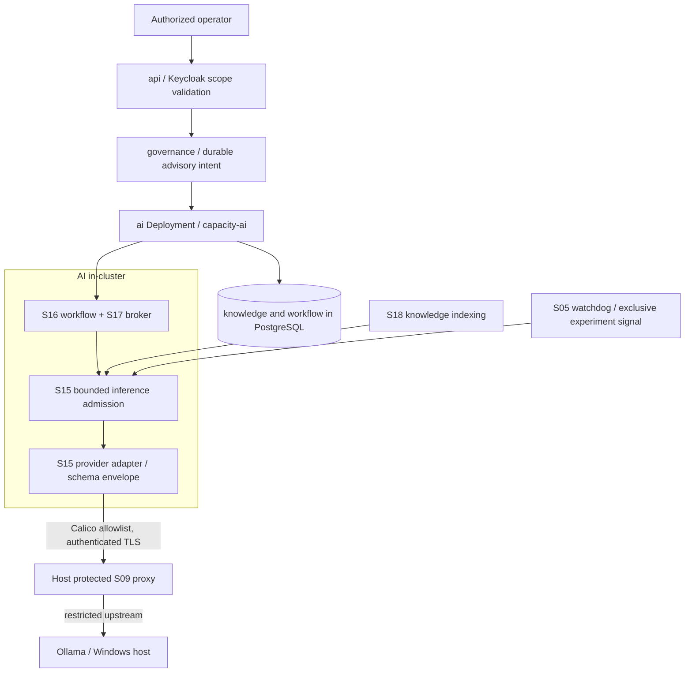

# S15 — Local LLM Inference & AI Runtime

> **Approval record — 2026-11-19.** The project owner explicitly approved **S15-01–S15-06**: Windows-host Ollama through the already accepted S09 protected host gateway; a compact quantized instruction model selected and pinned after qualification; a separately versioned compact embedding model on that host runtime; single active generative inference with coordinated resource admission; schema-constrained generation plus independent trusted validation; and pinned inference provenance, observability and **no remote fallback**. These are **architectural decisions only**. No benchmark, model choice, GPU compatibility, installed gateway, runtime SLO, or live isolation is claimed. All example token/timeout/resource numbers are provisional.

## 0. Authority and dependency reconciliation

| Upstream | Binding implication for S15 |
|---|---|
| Master/S01 | Fully local AIOps, Observe/Advisory/Governed and L0–L2; AI explains evidence but cannot authorize or perform cluster mutations; current/1h/conditional 24h horizons |
| S02 | Exactly six custom persistent Deployments: `api`, `observer`, `capacity`, `ai`, `governance`, `executor`. Generation client, runtime adapter, and inference scheduler are **modules of `ai`**, not separate deployments; PostgreSQL jobs/outbox without required broker |
| S03 | kind 1 control plane + 3 workers, 1 tainted platform worker and 2 experiment workers, Windows 11/Docker Desktop/WSL2, 20-GB RAM/Ryzen 5 3600 and host Ollama; candidate 12-GiB WSL2 ceiling and all resource requests provisional; host is a shared physical contention/failure domain |
| S04–S05 | Six workload profiles; host Python/Typer experiment runner plus independent watchdog; AI cannot start/fault/cancel experiments; model work must defer to exclusive experiments and host-pressure protection |
| S06–S08 | Keycloak/OIDC scope, dedicated workload identities and scoped TLS/selective mTLS, Calico default deny; Vault/ESO and offline-root/cert-manager PKI; no secrets in prompts, telemetry or artifacts |
| S09 | In-process Tool Authorization Broker, **minimal authenticated bounded host Ollama reverse proxy already accepted**, strict caller identity, model restrictions, tool isolation, context distrust and no direct Ollama bypass |
| S10 | Local artifact provenance/signing architecture accepted, implementation P1; S15 must capture model/adapter/dependency identity without pretending that all model weights are covered by S10 image signing |
| S11–S14 | Current Kubernetes state, qualified telemetry and numerical forecasts come from deterministic owners; S15 is **not** a forecasting engine, simulator or policy engine |
| S13 | `knowledge` stores AI advisory records and S18 knowledge; `workflow` stores durable job state; `capacity` alone writes deterministic numerical evidence |

**Precedence.** Approved upstream ADRs prevail. S15 concretizes runtime behavior without changing cluster topology, agent privileges, schema ownership, or deterministic analysis. Exact model and gateway implementation parameters require measured S28/S29/S30 evidence. The master catalog's older `Proposed` status does not override the owner's later approval in this document.

## 1. Mission, functional boundaries and outcomes

**Mission:** Serve model reasoning and local embeddings predictably, securely and reproducibly under shared-host resource constraints, so advisory AIOps remains useful without interfering with deterministic capacity operations.

**Required outcomes:**

- `S15-FR-001` The AI process can request generated structured responses only through an authenticated S09-gated provider adapter; no user/model chooses raw host/URL.
- `S15-FR-002` Generation model, prompt template, tokenizer context assumptions, inference parameters, gateway and adapter revisions are pinned to an auditable profile.
- `S15-FR-003` A separate embedding model/profile produces fixed-dimension embeddings with stable provenance, used only by S18 authorized ingestion/query.
- `S15-FR-004` All model invocations have bounded queue, concurrency, context, output, deadline, total workflow token and host-pressure budgets.
- `S15-FR-005` Schema-constrained model output is parsed and independently validated by trusted S16/S17 code; invalid data never reaches authoritative plan/approval records.
- `S15-FR-006` AI inference can be cancelled/deferred when host watchdog, S05 experimental exclusivity, or resource admission requires; capacity data collection and S14 forecasting continue independently.
- `S15-FR-007` Runtime traces distinguish queue, model-load, prefill, generation, and total times **where measurements are actually available**, and record failures without raw sensitive payloads.
- `S15-FR-008` No external inference/embedding provider, anonymous LAN model endpoint, or remote model pull during an agent job.

**Non-goals:** cloud LLMs; training/fine-tuning; required GPU; Ollama running in kind; model-per-agent deployment; custom general-purpose AI Gateway; model generated resource forecasts; required external MCP; public chat interface; runtime self-approval or Kubernetes mutations; strict host isolation guaranteed by kind nodes.

## 2. Accepted topology



The Ollama gateway is a host supporting component, **not** a seventh custom business Deployment or a second enterprise gateway. The `ai` Pod belongs to `capacity-ai` with `capacity-ai-sa`, no Kubernetes mutation token and no direct Executor access. The gateway must authenticate expected peer identity and enforce a destination/model allowlist. Direct Pod-to-Ollama bypass must fail in tested Windows/WSL2/Docker Desktop routing; a Calico rule alone is not proof of host firewall isolation. The proxy is not the final source of operator authorization: S06/S09/S17 enforce delegated scope before tool/data disclosure.

## 3. Model and artifact lifecycle

### 3.1 Selected two-profile design

| Profile | Purpose | Initial choice | Qualification gate |
|---|---|---|---|
| `generation` | Analyst/Planner/Reviewer structured reasoning | A compact quantized instruction/tool-capable model, **roughly 3B–4B as a test candidate** | Strict JSON schema adherence, model-tool interaction, groundedness, prompt-injection security, latency, resident memory, host pressure |
| `embedding` | S18 chunk/query embedding | Small dedicated embedding model; separate tokenizer/dimension | Stable vectors/dimension, multilingual/domain relevance as corpus demands, search metrics, memory/coexistence, reproducible batch behavior |

No exact model name/version/digest or quantization is approved yet. A host GPU (GTX 1060, 6 GB VRAM in the user environment) is **an optional accelerator**, never a guaranteed fit or mandatory prerequisite. GPU-offload level, actual free VRAM and Windows/Ollama compatibility require a live benchmark. CPU-only remains a supported but separately budgeted degradation profile if qualified. An unbenchmarked secondary model is **not** an automatic fallback.

**Model promotion:** locally acquire candidate using an explicitly authorized operator operation; resolve available model manifest/weight and template identity; record license/source, digest or cryptographic hash of locally verified artifacts, quantization, context settings and upstream provenance; freeze config and dependency/adapter versions; run format, security, groundedness and local performance suites; publish a versioned active profile only after gates pass. `latest`/mutable alias alone is never a reproducible identity. Distinguish reproducible *record of model bits* from a cryptographic assertion about origin that has not been verified.

**Upgrades:** roll generation model only after S16/S17 compatibility evaluations; re-evaluate agent output quality and token budget. Embedding changes create a distinct embedding revision/vector dimension and require staged S18 re-embedding/reindexing before read cutover. Never compare different embedding spaces as if the vectors were compatible. Keep prior active revision during staged build subject to storage budgets.

### 3.2 `InferenceProfile v1alpha1` logical contract

```yaml
schemaVersion: inference-profile/v1alpha1
profileId: domain-d-generation
profileRevision: 1
purpose: generation
provider: ollama-local
providerEndpointRef: protected-s09-gateway # not model-supplied URL
model:
  logicalId: selected-after-qualification
  resolvedDigestRef: sha256:resolved-at-install
  quantization: qualified-after-benchmark
  promptTemplateDigest: sha256:resolved-at-build
adapterRevision: provider-adapter-revision
parameters:
  temperature: 0  # candidate: deterministic intent, not output guarantee
  seed: 42        # candidate: only if supported by pinned runtime
  contextTokens: 4096 # provisional
  outputTokens: 768  # provisional
  schemaRef: agent-role-output/v1alpha1
limits:
  maxConcurrentGenerations: 1
  requestDeadlineSeconds: 90  # provisional
  maxQueuedRequests: 2        # provisional
  maxPromptBytes: 65536        # provisional
  allowRemoteFallback: false
hostAdmissionPolicyRef: local-ai-pressure-policy-v1
```

Embedding profile has `purpose: embedding`, a concrete `dimensions`, `normalization` semantics, model digest, model-specific text preprocessing and `maxBatchItems`; `schemaRef` and generation-only parameters are inapplicable. Persist the *actual applied* parameters from the model/provider response where obtainable. A seed or temperature zero does not prove byte-identical generations across versions, hardware or floating-point runtimes.

## 4. Inference API and security envelope

### 4.1 `ModelInvocationRequest v1alpha1`

```json
{
  "schemaVersion":"model-invocation/v1alpha1",
  "workflowRunRef":"workflow-run-ref",
  "stageRef":"analyst-stage-ref",
  "role":"CapacityAnalyst",
  "trustedContextRef":"opaque-trusted-context-ref",
  "profileId":"domain-d-generation",
  "profileRevision":1,
  "contextManifestDigest":"sha256:resolved-context-digest",
  "outputSchemaId":"capacity-assessment/v1alpha1",
  "deadlineAtUtc":"trusted-UTC-deadline",
  "idempotencyRef":"orchestrator-generated"
}
```

`role`, `trustedContextRef`, deadlines and allowed schema are generated and bound by S16/S17 trusted code, **never accepted from model output**. Invocation object is an internal typed contract, not a public API or authorization credential. The actual model prompt is composed within a secure, bounded transient buffer; secrets cannot enter the buffer. Avoid persisting all prompt messages in ordinary workflow rows.

### 4.2 `ModelInvocationResult v1alpha1`

| Field | Meaning and constraint |
|---|---|
| `invocationId`, `workflowRunRef`, `stageRef` | trusted correlation and immutable IDs |
| `profileRevision`, `modelResolvedDigest`, `adapterRevision` | actual execution identity; no unverifiable model label substitution |
| `startedAtUtc`, `completedAtUtc`, `latencyBreakdown` | monotonic elapsed duration, UTC timestamps; unavailable subcomponents explicitly null |
| `tokenUsage` | input/output tokens where reported; else `unknown`, not invented |
| `structuredOutput` | untrusted JSON pending schema, scope and evidence validation; never raw authority |
| `validationStatus` | `valid`, `invalid_schema`, `invalid_semantics`, `invalid_evidence`, `invalid_scope`, etc. from trusted code |
| `outcome` | `completed`, `cancelled`, `deadline_exceeded`, `provider_unavailable`, `admission_denied`, `over_budget`, `invalid_output` |
| `traceDigest` | audit-safe metadata digest; not proof of factual correctness |

Provider errors must not echo raw prompt content, credentials, internal host paths or proxy keys. Trusted adapter MUST prohibit options such as model pulls, arbitrary filesystem paths, dynamically chosen endpoints and client-specified model identities outside the active allowlist. Avoid forwarding generic Ollama administrative endpoints to agents.

## 5. Resource admission, fairness and performance

| Parameter | Initial candidate, **unverified** | Evaluation/owner |
|---|---|---|
| Generation concurrency | 1 in-flight | S15/S28 load and fairness tests |
| Embedding concurrency | 1; shared admission coordinator | S15/S18 pressure tests |
| Context | 4,096 to 8,192 tokens if qualified | S15/S17 tokenizer, schema and VRAM tests |
| Per-stage output | 512–1,024 tokens | S16 format/citation completeness test |
| Per-call timeout | 60–120 s by role/profile | S28 measured p95/p99 and timeout budget |
| Queue cap | 2 waiting per host/model as candidate | S28 starvation/pressure tests |
| Model keep-alive | bounded; no unlimited residency | S03/S28 host/GPU budget |
| Host threshold | policy reference; **no numeric limit approved** | S03 watchdog, S05 exclusivity |

Admission priority: host safety/experiment exclusivity > deterministic core protection > cancellation/deadlines > advisory work > optional reindex or batch embeddings. If a generator call and index embedding compete for VRAM, do not simultaneously load both models unless measured safe. Use a single shared admission controller/queue, potentially serializing generation and embedding jobs. Coordinate with S05 host watchdog by a **validated read-only operational signal**, not by granting AI experiment mutation. The precise cross-host signaling contract remains an S05/S28/S29 integration gate.

Per-call deadline and entire S16 workflow deadline are different limits. A call returning before 90 seconds is not evidence a three-agent workflow meets any end-to-end SLO. Queue wait and retries consume the overall deadline. Cancellation must close client stream, mark durable workflow state, and not leave uncontrolled retry loops.

## 6. Failure, isolation and recovery contract

| Condition | Required behavior |
|---|---|
| Model or gateway unavailable | `provider_unavailable`; advisory ends or is rescheduled under bounded durable policy; no remote model, no silent substitute |
| Gateway authentication/TLS error | `security_dependency_unavailable`, fail closed; no insecure fallback |
| Schema failure | reject; at most one controlled S16 repair attempt if remaining budget permits; deterministic safety failures are not repaired by regeneration |
| Unknown model digest | reject profile until exact identity established; never silently use another tag |
| Context overflow | S17 safe truncation only of eligible optional information; otherwise `context_budget_insufficient` |
| Host/WSL pressure | defer/cancel inference, release model if supported; S11/S12/S14 unaffected |
| Embedding runtime down | pause new embedding jobs; S18 lexical-only retrieval permitted with labeled degradation and qualifying policy |
| Agent worker crash | S16/S02 durable lease/fencing recovery, no unbounded inference repetition; no claim of exactly-once external inference |
| Direct network bypass | S07/S09 host isolation test must deny; treat discovered bypass as security failure |

Only inference adapters contact the host gateway. The AI workload must never acquire Kubernetes mutating ServiceAccount tokens, S25 execution certificates or privileged Vault material. Agent role isolation exists at the trusted orchestration/broker layer, not as three separate OS security principals; defense against full `ai` process compromise relies on backend authorization, network and privilege boundaries.

## 7. Observability, provenance and audit

**Metric names (illustrative, to be finalized by S28):** `ai_inference_requests_total{profile,outcome}`, `ai_inference_queue_seconds`, `ai_inference_total_seconds`, `ai_inference_generation_seconds`, `ai_inference_tokens_total{direction}`, `ai_inference_schema_failures_total`, `ai_inference_admission_denied_total{reason}`, `ai_model_loaded_bytes` if objectively measurable; S18 `ai_embedding_jobs_total`. Labels MUST NOT include run IDs, prompts, user IDs, text fragments, arbitrary model path or raw evidence digests. Put run-specific metadata in controlled traces/advisory evidence with protected retention, never high-cardinality Prometheus labels.

Record immutable safe manifest: model profile ID/revision and resolved bits, adapter/build revisions, context manifest digest, schema/prompt-template revision, inference parameters, tool-result reference digests, elapsed timings, outcome/quality and correlation. Contents of raw prompts and tool responses are **not** stored by default. Capture explicit prompt audit exceptions only under S08 classification and retention rules; never collect secrets.

## 8. Tests and acceptance criteria

| ID | Scenario | Required assertion |
|---|---|---|
| S15-TEST-001 | Wrong model/profile or unrecognized digest | Refuse, no implicit model download or substitution |
| S15-TEST-002 | Provider returns syntactically valid but wrong schema | Trusted validation blocks stage completion |
| S15-TEST-003 | Ollama stopped during S14 compute | S14 forecasting and S11/S12 evidence continue unaffected |
| S15-TEST-004 | Concurrent generation and embeddings | Never exceed admitted host/model concurrency or memory guard |
| S15-TEST-005 | S05 exclusive experiment begins | New AI work defers; active work cancels under policy; experiment not driven by AI |
| S15-TEST-006 | Host proxy bypass attempts from `ai` and demo/driver Pods | Direct endpoint access denied; authorized path only from expected `ai` identity |
| S15-TEST-007 | Proxy certificate/key expiry | Fail closed, no anonymous/Ollama direct fallback |
| S15-TEST-008 | Context over budget | Optional context truncated explicitly or typed refusal; no loss of required safety evidence |
| S15-TEST-009 | Model upgrade | Model, template and adapter revisions recorded; S16/S17 regression gates rerun |
| S15-TEST-010 | Retry/cancel and provider disconnect | Bounded retry, no duplicate authoritative advisory completion |
| S15-TEST-011 | Token metrics unreported | Report `unknown`, never fabricated values |
| S15-TEST-012 | Runtime footprint study | Record RAM/VRAM, queue/latency/context, host pressure, CPU-only alternate when supported |

**Security negative tests** cover localhost/LAN exposure, cross-namespace egress, arbitrary model URL, model administrative endpoint access, dynamic model pull, credentials in logs and prompt/trace canaries. **Acceptance requires actual results**, pinned fixture versions and host conditions; this architecture file records no passing measurements.

## 9. ADR register (all owner-approved on 2026-11-19)

| ADR | Status | Decision | Consequence |
|---|---|---|---|
| S15-01 | **Accepted** | Host Ollama via S09 authenticated bounded gateway | No direct inference exposure; no new custom Deployment |
| S15-02 | **Accepted** | Small quantized instruction model, exact model pinned after qualification | Model identity currently **open implementation selection** |
| S15-03 | **Accepted** | Separately versioned compact local embedding model on same runtime | Re-embedding/version migration required for model changes |
| S15-04 | **Accepted** | One active generation, coordinated host/resource admission | Predictable pressure; potential advisory queuing |
| S15-05 | **Accepted** | Schema-constrained generation plus trusted independent validation | Model JSON alone never an authority |
| S15-06 | **Accepted** | Digest-pinned profiles, runtime telemetry, no remote fallback | Fail-closed bounded advisory degradation |

## 10. Requirement-to-source traceability and downstream handoff

| Source and responsibility | Implemented S15 contract | Tests / consumer |
|---|---|---|
| S01/S02 AI independence, L0–L2, six deployments | §§1–2,6 | TEST-003; S16/S24 |
| S03/S05 shared host, experiment watchdog | §§2,5–6 | TEST-004/005/012; S28/S29 |
| S06–S09 identity, secrets, broker and host proxy | §§2,4,6–7 | TEST-006/007; S17 |
| S10 provenance | §3,7 | TEST-001/009; S29 |
| S11–S14 evidence only, no invented forecasts | §§1,4,6 | TEST-002/003; S16/S17 |
| S13 `knowledge`/`workflow` ownership | §§4,6–7 | TEST-010; S16/S18 |
| S18 model embedding lifecycle | §§3,5–6 | TEST-004/009; S18 |
| S30/S31 adversarial/retrieval evaluation | §§3,8 | all tests; S32 release evidence |

**Named open implementation gates:** model names/digests/quantizations/licenses; pinned Ollama and Agent Framework adapter versions; Windows host networking/firewall/TLS endpoint; explicit gateway identity; physical memory/VRAM loading; scheduler-to-S05 watchdog interface; concrete token caps/latency/SLO; S18 embedding dimensions and index migration; S28/S29 benchmark and recovery procedures. They are **not new undecided architectural ADRs**.

## 11. Definition of completion

Architecture accepted by owner **2026-11-19**. Implementation completion requires pinned working artifacts, negative network tests, API/schema tests, measured simultaneous runtime footprint, failure/fallback behavior, S16/S17 model compatibility, operational rollback and S32 evidence. **No deployment or measured result is represented by this document.**
