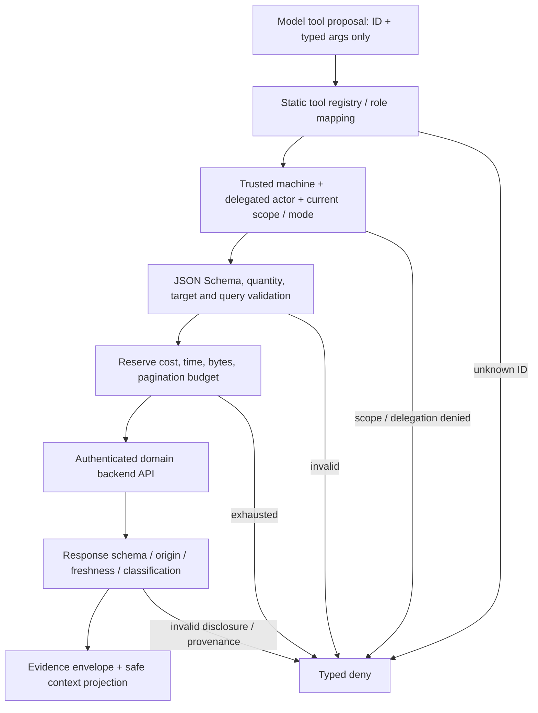

# S17 — Agent Tools & Context Engineering

> **Approval record — 2026-11-19.** The owner approved **S17-01–S17-06**: reuse the accepted S09 in-process deterministic Tool Authorization Broker plus independent backend enforcement; finite typed versioned role-specific tools; scoped quality-aware context assembly; immutable validated citations and preservation of deterministic numeric semantics; bounded tool/query/token budgets and typed failures; and **MCP optional/deferred** rather than P0 dependency. Approval concerns architecture, not an installed tool endpoint, tested auth policy, actual latency or measured model quality. This document defines contracts for the already accepted boundaries, without asserting that S19–S22 exist yet.

## 0. Reconciliation and authority

| Source | S17 binding |
|---|---|
| S01/S02 | L0–L2 only, advisory vs governed, six custom Deployments, `ai` in-process broker, REST + PostgreSQL durable jobs/outbox, no mandatory broker |
| S03/S04/S05 | One shared local host; W01–W06 and deterministic experiments; agents **never** run scenarios/faults or mutate W01–W06 |
| S06 | Keycloak human identity, role + scope + conditions, nonhierarchical Admin, machine actor cannot mint human approval; deny cross-namespace disclosure |
| S07 | `capacity-ai-sa` has no K8s mutation token, Calico default deny, authenticated TLS/selective mTLS where designated, backend independently verifies machine and actor delegation |
| S08 | Secrets/Restricted classification and redaction, audit integrity; no raw credentials in tools/prompts/embeddings/citations |
| **S09** | Already accepted broker, logical role capability matrix, strict allowlist, hostile tool results, poisoned RAG, authorization-aware retrieval, Ollama proxy |
| S10–S13 | Provenance, S11 immutable inventory/UID snapshots, S12 registered PromQL, S13 versioned evidence/storage and owner-only writes |
| S14/companion | No model forecast values, correct current/1h/24h semantics, explicit forecast rejection/quality/uncertainty, separate requests/usage/fit |
| S15/S16 | Bounded local generation, trusted workflow-owned role, validated stages and checkpoints; context not a privilege credential |
| S18 | Filtered historical evidence, not live-state authority; retrieval ranking and sources owned by `knowledge` |
| S19–S22 | **Future** deterministic generator, policy, scheduling simulator contracts; no claim of existing endpoints or eligibility |
| S24–S27 | Governance authority and exact approval; S27 owns final public OpenAPI/CLI paths, not S17 |

## 1. Goals and design boundaries

**Mission:** expose controlled, deterministic, evidence-rich analytical capabilities to untrusted LLM reasoning while separating authorization, source truth, numerical meaning and model text.

- `S17-FR-001` Tools registered statically with ID/version, backend owner, JSON Schema, role allowlist, scope, unit, cost, timeout and disclosure rules.
- `S17-FR-002` Trusted S16 code binds machine, actor delegation, mode, role, target and run budgets; no model-supplied role, actor or authorization fields.
- `S17-FR-003` Broker validates identity and policy, canonicalizes IDs and units, reserves budget, invokes authenticated allowlisted backend; backend independently checks current actor/scope.
- `S17-FR-004` The model can never choose arbitrary PromQL, SQL, URLs, shell commands, Kubernetes API, namespace lists, Kubernetes patch manifests or file paths.
- `S17-FR-005` Returned source values carry identity/time/origin/unit/quality/immutable digest and are checked for schema, scope, freshness and classification before prompting.
- `S17-FR-006` Context assembler composes trusted instructions, trusted scope, deterministic evidence, untrusted RAG and validated prior stage outputs with source and instruction separation.
- `S17-FR-007` Numerical facts must be exact verified backend values with field paths/units; agent-generated numbers cannot become resource proposals, forecasts, eligibility or approvals.
- `S17-FR-008` Context overflow must not silently drop hard safety criteria, authorization/scope or evidence warnings; optional historical context may be truncated with quality flag.
- `S17-FR-009` Every decision-relevant citation is dereferenced and validated for source identity, scope, time, integrity and compatible semantics; missing evidence causes inconclusive outcome.
- `S17-FR-010` Tool budget, failures, retries, pagination and trace metadata are bounded and auditable, with no raw sensitive inputs in telemetry.

**Non-goals:** general MCP gateway, universal agent tools, chat-based kubectl, agents writing SQL, unrestricted web browsing, dynamic tool registration from documents/models, model-owned authorization, new K8s watcher, knowledge store bypassing S18, executing resource changes, independent numeric optimizer, full custom UI.

## 2. Tool authorization broker architecture



Broker is a **module inside `ai`**, not a seventh persistent service. It is a reference monitor for normal tool dispatch, **not process-isolation protection** if `ai` executable code is compromised. Domain backends MUST independently authenticate trusted peer, validate signed/bound delegation or equivalent trusted lookup, enforce current grants/action/resource and sanitize responses. A caller in the internal network or possession of a `capacity-ai-sa` identity alone is insufficient. Do not accept `X-User`/`role` text headers as proof. S07/S08 specify cryptographic binding and token life cycles.

**Reference authorization rule:**

```text
ALLOW iff authenticated_machine
  AND bound_valid_actor_or_explicit_service_purpose
  AND active_workflow AND trusted_role_mapping
  AND tool_id_and_version_allowlisted_for_role
  AND action/resource/mode/policy/grant_current
  AND canonical_target_within_scope
  AND request_schema_and_budget_valid
  AND backend_independently_authorizes
  AND output_disclosure_valid
else DENY (bounded error; no foreign object existence leak)
```

Budget reservation must be atomic per workflow+stage/tool context so repeated calls and tool retries cannot bypass usage caps. Use monotonic timeout accounting, cancellation and idempotency for deterministic candidate requests; the owner service remains authoritative for stored candidate results.

## 3. Versioned catalog (reference IDs)

To avoid name drift with **S09 accepted illustration**, S17 shall retain the S09 naming family where the underlying capability is identical; if clearer names are introduced, define explicit alias/migration compatibility, never both independently authorized hidden tools.

| Tool ID (canonical proposal) | Authoritative backend | Analyst | Planner | Reviewer | Important limits |
|---|---|:---:|:---:|:---:|---|
| `cluster.get_workload_state.v1` | S11 `observer` | Read | Read | Read | exact workload/namespace/snapshot; UID lineage, inventory quality |
| `cluster.get_node_fit_inputs.v1` | S11 `observer` | Read | Read | Read | bounded allowed node selection; scheduler inputs, no placement verdict |
| `metrics.get_approved_window.v1` | S12 `capacity` | Read | Read | Read | allowlisted registered PromQL ID only; time/step/series limit |
| `forecast.get_capacity_estimate.v1` | S14 `capacity` | Read | Read | Read | current/1h/24h typed forecast/refusal, no invented numeric values |
| `knowledge.search_authorized.v1` | S18 `knowledge` | Read | Read | Read | scope/class/time prefilter, topK, bytes, quality, provenance |
| `knowledge.get_cited_source.v1` | S18 `knowledge` | Read | Read | Read | exact authorized document/chunk revision + digest; bounded excerpt |
| `candidate.generate_bounded.v1` | S19/S20 `capacity` | Deny | **Invoke** | Deny | future backend only; deterministic resource values, hard constraints |
| `candidate.list_eligible.v1` | S19/S20 `capacity` | Read | Read | Read | authored exact qualified immutable candidates only |
| `simulation.evaluate_candidate.v1` | S21/S22 `capacity` | Read-only result | **Invoke** | Read-only result/review | future typed candidate, snapshot/policy refs; simulation is hypothetical |
| `policy.inspect_constraints.v1` | S19 policy / S24 `governance` read | Read | Read | Read | current applicable immutable policy, final authoritativeness in domain owner |
| `risk.get_deterministic_findings.v1` | S19–S22 or Governance read | Read | Read | Read | authoritative findings; no LLM-selected pass/fail |

**Capability implementation caveat:** S19–S22 tool contracts are **integration stubs/specifications**, not callable until Domain E owner APIs actually pass contract/safety tests. For `simulation.evaluate_candidate.v1`, the Analyst and Reviewer may inspect **existing evaluation records**, not synthesize new evaluations unless their fixed role allowlist explicitly grants an identical, read-only evaluation operation. Prefer separate `simulation.get_result.v1` as S21 owner-approved future revision if this ambiguity cannot be implemented without accidental authority. The Planner may request evaluation only of previously generated/validated deterministic candidate refs, not model-proposed patch bodies.

**P0 prohibited tools:** `kubectl`, K8s API mutating adapter, arbitrary HTTP/fetch, arbitrary filesystem read/write, SQL console, raw PromQL, shell, code interpreter, secret inspection, Vault admin, GitOps writes, experiment run/fault/stop, plan approve, execution request, generic MCP server provisioning, dynamically loaded plugins.

## 4. Trusted context and tool wire formats

### 4.1 `ToolAuthorizationContext v1alpha1`

```json
{
 "schemaVersion":"tool-auth-context/v1alpha1",
 "workflowRunRef":"trusted-active-run",
 "invocationRef":"trusted-broker-generated-id",
 "callerMachine":"capacity-ai-sa",
 "logicalRole":"RiskReviewer",
 "actorRef":"trusted-current-actor-or-service-purpose-ref",
 "delegationRef":"bound-short-lived-delegation",
 "resourceScope":{"clusterIncarnationRef":"exact-cluster-ref","namespaces":["workloads-standard"]},
 "action":"knowledge.search_authorized.v1",
 "policyRevisionRef":"trusted-policy-ref",
 "expiresAtUtc":"trusted-UTC-expiry"
}
```

All fields are **trusted caller/dispatcher assertions**, not fields emitted or selected by LLM text. This JSON example itself is **not** a credential; a cross-service context MUST be authenticated, integrity-bound/fresh/replay-safe under S06–S09 before the backend trusts it. The backend may reconstruct current authorization from a trusted reference rather than accept serialized privilege claims.

### 4.2 `ToolCall v1alpha1` model-controlled fragment

```json
{
 "schemaVersion":"tool-call/v1alpha1",
 "toolId":"metrics.get_approved_window.v1",
 "arguments":{
   "namespace":"workloads-critical",
   "logicalWorkloadRef":"w01-latency-api",
   "queryDefinitionId":"container.cpu.rate.millicores",
   "observationWindowRef":"immutable-qualified-window-ref"
 }
}
```

The model **cannot** set `actorRef`, `role`, `invocationRef`, arbitrary `promql`, `url`, `sql`, `execute`, future timestamp or policy revision. Strict schemas reject unknown keys (`additionalProperties:false`), non-finite/malformed numbers, oversized fields, unexpected UID forms, foreign scope, hidden namespace aggregation and unbounded time ranges. Canonical resource IDs and field units validated against S11/S13 registries; no raw model string is passed to SQL `ORDER BY` or shell.

### 4.3 `ToolEvidenceResult v1alpha1`

```yaml
schemaVersion: tool-evidence-result/v1alpha1
toolId: forecast.get_capacity_estimate.v1
invocationRef: trusted-tool-invocation
sourceOwner: capacity
sourceKind: deterministic_forecast
clusterIncarnationRef: exact-cluster-ref
targetRef: w01-latency-api
artifactRef: immutable-s14-forecast-ref
sourceDigest: sha256:verified-digest
observedOrValidTime:
  asOfUtc: "2026-11-19T06:00:00Z"
quality:
  disposition: qualified # or degraded / refused
  flags: []
numericalFields:
  - sourceFieldPath: predictions[0].cpu_consumption_millicores
    unit: millicores
    statisticKind: bucket_mean
    valueRef: exact-field-in-source # no model-generated arithmetic
classification: Internal
truncated: false
```

This is a logical envelope; actual values above are representative IDs, not real measurements. A returned forecast `refused` is an authoritative refusal, not a usable numeric result. Use S14 `current_assessment` vs future forecast distinctions, W05/W06 conditional run semantics and S11 effective requests. Never map observed CPU usage to scheduler allocatable/headroom or memory sampled maximum to true peak. A `sourceDigest` only becomes verified after server-side dereference/integrity checking; no self-declared digest is proof.

### 4.4 Error envelope

| Error | HTTP mapping guideline / broker result | Semantics |
|---|---|---|
| `unauthenticated` | 401 at authenticated API | Invalid machine/actor credential |
| `scope_denied` | 403 or opaque 404 where justified by S06 | Never expose unauthorized object existence |
| `unknown_tool` | `tool_not_allowlisted` | No registration or dynamic fallback |
| `invalid_arguments` | 422 | Strict schema/units/target rejected |
| `budget_exceeded` | 429/typed resource denial | Tool count/bytes/cost/time exhausted |
| `evidence_not_found` | 404 if authorized, no cross-scope leak | No matching authorized ref |
| `evidence_ineligible` | 422/typed domain response | Stale/partial/unsupported evidence |
| `upstream_unavailable` | 503, bounded retry only | Owner backend or network unavailable |
| `capability_unavailable` | 501/503 as appropriate | Domain E contract not installed/qualified |
| `deadline_exceeded` | 504/typed cancellation | No ambiguous completed result assumption |
| `invalid_result` | internal typed failure | Backend result inconsistent/unsafe to disclose |

S27 owns final external OpenAPI/errors; internal mappings above are proposals. Redacted error messages must not leak foreign namespace names or source classification.

## 5. Context Engineering policy

Context is composed in **five separated trust strata** (not simply one long transcript):

1. **Trusted system/role instructions:** fixed per S16 agent; no document/model may alter them.
2. **Trusted workflow/actor boundary:** exact scope, target, autonomy/operating mode, permitted tools, task, budget and deadline (policy-driven, noneditable by model).
3. **Deterministic evidence bundle:** S11 current/applied config, S12 qualified observed usage/SLO, S14 forecasts and S19–S22 when available; typed fields/units/source citations/quality.
4. **Historical operational RAG:** S18 scoped snippets clearly marked `untrusted_document_content`, with source revision, timestamp, classification, relevance and validity; imperative instructions within are quoted data only.
5. **Prior validated stage results:** S16 stage artifact and cited claims; agent interpretation distinct from original measurement.

**Selection algorithm:** resolve authorized task and mandatory typed context → fetch only evidence relevant to target/horizon/operation → honor quality/no-evidence flags → optionally retrieve topK historically relevant sources → include validated prior stage artifact → estimate model-specific tokens → prioritize mandatory policy, limitations and numeric source fields → truncate optional historical snippets with explicit `truncated` marker or refuse if still oversized → emit immutable manifest/digest. Never silently omit refusal reasons, hard policy or scope constraints to make context fit.

### 5.1 Budget plan (illustrative, **not approved numerical limit**)

| Content | Example tokens for 8192 context |
|---|---:|
| Trusted instructions/role | 1024 |
| Workflow scope/operation | 1024 |
| Structured deterministic evidence | 2048 |
| Historical RAG | 1536 |
| Prior validated stage | 1024 |
| Output reservation / safety margin | 1536 |

The sum is 8192; count real tokenizer/schema overhead, never assume table equals exact provider token use. On a 4096-token qualified model, profile must define a separate measured compression recipe and explicitly refuse if essential evidence cannot fit. Compaction may summarize **optional** historical prose into an explicitly derived, source-cited text, not replace mandatory policy or exact numerical evidence. Truncation does not turn invalid evidence into valid evidence.

### 5.2 `ContextManifest v1alpha1`

```yaml
schemaVersion: context-manifest/v1alpha1
workflowRunRef: trusted-run-ref
stageRole: RiskReviewer
modelProfileRef: pinned-s15-profile
scopeDigest: sha256:trusted-scope-digest
trustedInstructionRevision: risk-reviewer-prompt-revision
evidence:
  - ref: immutable-s14-forecast-ref
    kind: deterministic_forecast
    quality: qualified
    required: true
  - ref: allowed-incident-revision-ref
    kind: retrieved_document
    quality: historical_context
    required: false
sourceFilter:
  clusterIncarnationRef: exact-cluster-ref
  namespaces: [workloads-standard]
  asOfUtc: "2026-11-19T06:00:00Z"
truncation: {occurred: false, omittedOptionalRefs: []}
tokenBudget: {profileLimit: 8192, measuredInput: null, reservedOutput: 1536}
manifestDigest: sha256:trusted-canonical-digest
```

Metadata must not disclose foreign scopes or existence. `manifestDigest` is computed from canonical material by trusted code, not echoed from the model. The as-of cutoff is not permission to access future-observed evidence; S14 point-in-time rules apply. Prevent accidental inclusion of raw user token, Pod environment, YAML Secret, Vault path/value and arbitrary Kubernetes Event text with credentials.

## 6. Evidence/citation and numeric validator

For every decision-relevant claim: resolve cited artifact through authoritative service or authorized read projection; verify class/access, exact cluster-incarnation/namespace/workload/UID and valid-time constraints; verify immutable digest/schema/producer, appropriate origin (historical_observed, deterministic_forecast, analytical_simulation, verified outcome, etc.), units, statistic, quality and policy-version applicability. A source citation to a *genuine* document does not prove its advice true or policy current. Confirm numerically stated measurements and resource quantities by typed match to source fields; if model adds untraceable CPU, bytes, probabilities or expected savings, mark unsupported and reject or safely rephrase only by trusted deterministic renderer.

**Citation statuses:** `verified`, `out_of_scope`, `wrong_incarnation`, `stale_or_superseded`, `source_missing`, `quality_ineligible`, `semantic_mismatch`, `unsupported_claim`. Never silently replace a bad citation with an unrelated one. For stale knowledge, show it as historical context, not current policy. A case in which a raw event is not reliably persisted requires an explicit unavailable/low-quality tag, not a clean measurement claim. Advisory acceptance may include cited *interpretive* narrative with labeled uncertainty, but numeric policy-critical claims require exact source match.

## 7. Cost, limits, fault handling and observability

- Per-workflow cumulative tool-call, bytes returned, query time, source count, per-tool concurrency and latency quotas; per-stage lower caps; exact values calibrated S28/S30.
- `metrics` tool uses fixed registered S12 query IDs, bounded range/step/series count; preserve sample missingness.
- `knowledge` tool uses current ACL prefilter, bounded source types/classification/as-of, topK and byte/token caps; no raw DB access.
- `candidate/simulation` tools require explicit current evidence and policy revision; calls require same target/revision and idempotency policy; no K8s mutation.
- Retry only idempotent transient read failures within original identity/target/budget; don't retry `scope_denied` with larger scope or degraded policy.
- Log tool ID, caller role code, decision reason, duration/budget, source-owner/revision and safe correlation; never log token/prompt/raw SQL/text or per-run ID as metric label.
- Audit deny/allow in S08-controlled integrity-preserving audit pipeline; keep model text out of tool authorization records.

## 8. Security, contract, evaluation tests

| ID | Test | Expected |
|---|---|---|
| S17-TEST-001 | Model asks unknown tool or generic `kubectl` | Broker denies; no fallback |
| S17-TEST-002 | Forged logical role/actor/delegation in tool args | Ignored/rejected; fixed trusted context remains |
| S17-TEST-003 | Foreign namespace, aggregate query or page count | Deny before retrieval; no count/metadata leakage |
| S17-TEST-004 | Agent injects raw PromQL/SQL/URL or shell arguments | Strict schema rejects unknown fields |
| S17-TEST-005 | Broker bypass, direct backend RPC using AI SA | Backend independently denies absent valid delegation/scope |
| S17-TEST-006 | Expired grant or role change after job queued | Reauthorize and deny if revoked |
| S17-TEST-007 | Unsigned/poisoned RAG content requests execution | Treated as data; no executable command or tool grant |
| S17-TEST-008 | Forecast source says refused; agent invents numeric value | Reject unsupported value, preserve refusal |
| S17-TEST-009 | CPU consumption misread as scheduler request or MiB as bytes | Unit/semantic validator rejects claim |
| S17-TEST-010 | Source digest forged, UID mismatch, wrong incarnation | Citation invalid; cannot enter review-ready |
| S17-TEST-011 | S18 superseded policy and old document | Current authority not overridden; valid-time labeling |
| S17-TEST-012 | Context exceeds model budget | Safe optional truncation or refusal with explicit flags |
| S17-TEST-013 | Repeated tool retry/page iteration | Atomic per-run cumulative budget enforced |
| S17-TEST-014 | Backend returns secrets, nonconforming schema or huge result | Classification/schema/size gate prevents disclosure |
| S17-TEST-015 | Domain E tool backend absent | Typed capability unavailable; no dummy candidate |
| S17-TEST-016 | W05 short Job lacking samples | No synthetic zero, run-envelope source fidelity retained |
| S17-TEST-017 | Evidence citations from legitimate authorized sources | Exact dereference/quality/time identity and bounded rendered response |

Tests require both malicious model/tool-result payloads and deliberate **direct backend** requests. Evaluate end-to-end forbidden mutation count = zero; cross-scope disclosures = zero; citation correctness/unsupported-numeric rate with labeled fixtures; tool latency and limit enforcement. No fixture/test passing claimed by this specification.

## 9. ADR register — accepted 2026-11-19

| ADR | Status | Choice | Consequence |
|---|---|---|---|
| S17-01 | **Accepted** | S09 in-process deterministic broker plus independently enforcing backend | One AI Deployment, no central privilege monopoly |
| S17-02 | **Accepted** | Finite typed versioned role-specific tool registry | No dynamic tool authority or arbitrary scripts |
| S17-03 | **Accepted** | Scope-limited quality-aware context assembly | No silent deletion of safety/uncertainty |
| S17-04 | **Accepted** | Immutable citations, validation and numeric semantics preservation | Model cannot invent measurements or candidate values |
| S17-05 | **Accepted** | Strict bounded budgets and typed failure semantics | Resilience and cost controllability |
| S17-06 | **Accepted** | MCP optional/deferred P0 | Can add adapter later without changing auth truth |

## 10. Traceability, downstream integration and unresolved gates

| Upstream/downstream | S17 boundary | Evidence/test |
|---|---|---|
| S01/S02/S06 | Operation/mode/role/scope, trusted workflow | TEST-002/003/006 |
| S07/S08/S09 | SA/TLS/PKI/redaction/broker/no agent authority | TEST-001/005/007/014 |
| S11/S12/S13 | Identity/PromQL/evidence provenance | TEST-004/009/010/016 |
| S14 | Exact forecasts/refusals/quality | TEST-008/009/017 |
| S15/S16 | Schema context, role assignment, job budgets | TEST-012/013; S16 handoff |
| S18 | Authorized hybrid retrieval, temporal validity | TEST-003/007/011/014 |
| S19–S22 | Exact deterministic candidate/constraints/simulator contracts | TEST-015; owner must finalize schemas |
| S24–S27 | Final Governance decision, external APIs | Never grant approval/execution |
| S28–S32 | Measured performance, security, evaluation and release | Complete tests and rate/size thresholds |

**Open implementation detail:** concrete tool schema/JSON Schema versions and SDK bindings, S07 delegation token binding/TTL, backend endpoint paths (S27), pagination cursor encoding, numerical exact-field projection and canonical serializer, latency/token/byte caps, authoritative read projections, Domain E candidate/simulation API semantics and test fixtures. These do not undo the six accepted S17 ADRs.

## 11. Completion

Owner-approved architecture 2026-11-19, **not deployed, audited or security-verified**. Implementation completion requires source DTOs, validated API contracts, adversarial broker-bypass tests, measured limits, citation fixtures and cross-domain reconciliation evidence.
