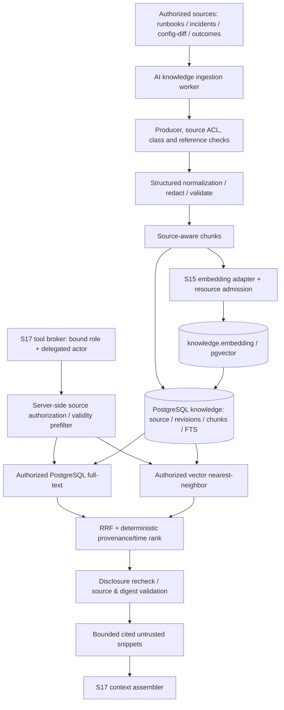
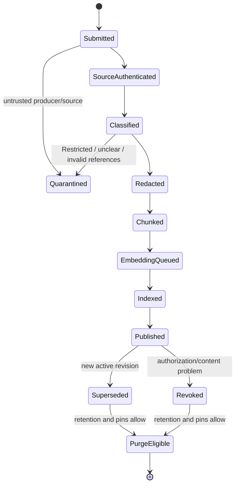
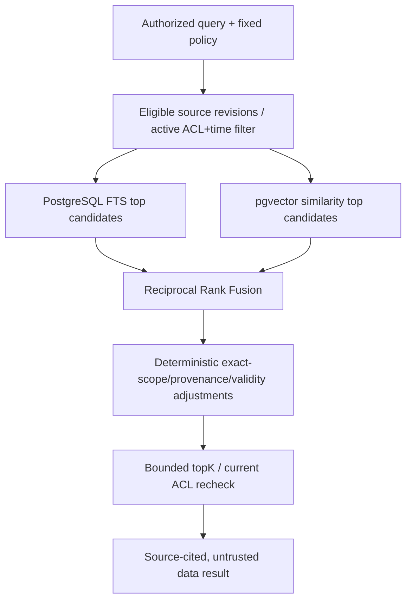

# S18 — Operational Knowledge Base & RAG Architecture

> **Approval record — 2026-11-19.** The owner approved **S18-01–S18-07**: use the existing PostgreSQL `knowledge` schema with `pgvector` + native full-text search; four core operational collections; versioned source-authenticated ingestion and **redaction before embedding**; source-aware chunking with independently pinned local embedding revisions; authorization-prefiltered hybrid retrieval and Reciprocal Rank Fusion; deterministic provenance/time-sensitive reranking as P0 baseline (neural reranking deferred); and revision/revocation, recovery and measurable retrieval evaluation. This is **accepted architecture only**. No extension/version, migration, model, indexed corpus, query result, data-retention threshold, or benchmark is claimed implemented or verified.

## 0. Source hierarchy, ownership and reconciliation

| Accepted source | Binding effect on S18 |
|---|---|
| Master/S01 | Operational RAG is evidence for AIOps, not instruction; L0–L2, all-local; current/1h/24h; exact human-approved changes |
| S02 | Exactly six custom Deployments; **S18 ingestion/search libraries and bounded background worker live inside `ai`**, no seventh service; one PostgreSQL server with `knowledge`, `inventory`, `capacity`, `governance`, `execution`, `audit`, `workflow` ownership; outbox/jobs, no required broker |
| S03 | Single local host, 1+3 kind nodes, Calico/default-deny, local PVC + independent backup, provisional memory/PVC budgets, host Ollama |
| S04/S05 | W01–W06 workload identity/classification and reproducible scenarios; synthetic workload origin ≠ synthetic measurement; SQLite runner evidence is separate authority, S13 only registers imports |
| S06/S07 | Human Keycloak scopes plus machine identity, current grants/delegation and network auth; namespace/cluster-incarnation confidentiality; no authorization by model prompt |
| S08 | `Public`/`Internal`/`Confidential`/`Restricted` classes, Vault/ESO, no secrets in prompts/chunks/embeddings/traces, protected backup and audit; source/field allowlist + redaction before embedding |
| S09 | Knowledge poisoning defense, source provenance, pre-retrieval authorized scope filtering, hostile retrieved content treated as data, in-process broker as exclusive agent tool entry |
| S10 | Source/build provenance and digest identity; signed origin does not guarantee runbook factual correctness; supply-chain live implementation P1 |
| S11 | Kubernetes API and Observer inventory are current/configuration truth; exact cluster incarnation and controller/Pod UID lineage; never infer same live object from name alone |
| S12 | Prometheus authoritative raw sampled telemetry; absence not zero, sampling does not prove unseen peaks; RAG summaries are not copied raw TSDB |
| S13 | PostgreSQL `knowledge` writer AI/knowledge; S13 `capacity` and `inventory` cross-domain references via owned APIs/authorized projections, not arbitrary DB writes; immutable evidence digests/quality and reference-aware retention |
| S14 | S14 owns numerical forecasts/refusals; 24h conditional and W05/W06 future Job envelopes conditional; retrieved past outcome cannot replace current qualified forecast |
| S15 | Separate pinned local embedding model on host Ollama through S09 gateway; reindex on incompatible change and respect pressure admission |
| S16/S17 | Three agent roles, typed citations, broker-enforced search; workflow memory separate from operational knowledge; no retrieval text as tool or system instruction |
| S19–S26 | Later deterministic candidates/policies, plan approval, executor and verified outcomes are source owners; S18 can index **authorized derived narratives and immutable references**, not write their authoritative statuses |
| S31/S32 | Labeled relevance/poisoning/evaluation fixtures and comparative evidence; do not claim measured retrieval value without experiments |

## 1. Mission, outcomes and non-goals

**Mission:** build a protected, temporally correct, reference-backed operational memory that makes incidents, historical configuration and verified results retrievable to the Capacity Analyst, Optimization Planner and Risk Reviewer, without becoming a competing live-state or policy authority.

- `S18-FR-001` Maintain four logical collections with source owner, classification, scope, temporal validity, provenance and evidence references.
- `S18-FR-002` Ingest only authorized/allowlisted source types via authenticated producers or controlled imports; verify source revision, content hash, cross-domain references, schema and classification before indexing.
- `S18-FR-003` Redact/exclude Restricted fields and secrets **before** chunking/embedding; reject uncertain unclassifiable material instead of indexing and cleaning it later.
- `S18-FR-004` Persist immutable document revision/chunks and embedding metadata, separate active/revoked/superseded indexes, content-addressed IDs and lifecycle/audit.
- `S18-FR-005` Use source-aware chunking preserving headings, structured incidents, exact configuration/outcome boundaries and source offsets.
- `S18-FR-006` Provide scoped PostgreSQL FTS and pgvector hybrid retrieval against only currently eligible source revisions, with RRF and deterministic metadata/temporal reranking.
- `S18-FR-007` Prevent leakage through result IDs/counts, search ranking, cursor pages, errors or embedding/FTS index bypass across namespaces and classifications.
- `S18-FR-008` Return bounded cited evidence with source revision, type, time validity, synthetic/observed origin, quality, embedding/index revision and explicit retrieval degradation.
- `S18-FR-009` Revoke access immediately at query authorization/status filter, with asynchronous physical index purge and controlled cache/context invalidation; retention respects S13/S08 pins.
- `S18-FR-010` Measure lexical vs semantic vs hybrid relevance and safe retrieval; record thresholds after labeled fixtures rather than claiming perfect performance.
- `S18-FR-011` Continue lexical-only search when embedding model offline, only if policy qualifies that degraded retrieval; no cloud fallback, external embeddings or covert vector regeneration.
- `S18-FR-012` Run ingestion/backfill in bounded PostgreSQL durable worker jobs within `ai`, sharing S15 admission so bulk index work does not perturb exclusive S05 lab experiments.

**Non-goals:** public ChatGPT-style knowledge assistant; unrestricted internet crawling; arbitrary Pod log ingestion; vectorizing Kubernetes Secrets; agents directly querying SQL; indexing full Prometheus TSDB; large data lake or Elasticsearch/OpenSearch; dedicated Qdrant/Milvus/Redis services; automatic model-training; LLM-driven current Kubernetes claims or policy edits; mandatory neural reranker; historical source documents becoming instructions.

## 2. Selected component topology



S18-owned `knowledge` schema is within the **same S13 PostgreSQL instance**. `ai` owns scoped write of that schema and advisory artifacts; no direct writes to `capacity`, `inventory`, `governance`, `execution` or `audit`. Authorized imports use owner API/evidence refs or reviewed read-only projections with proper access, rather than cross-schema writable ORM. Both ingest and query are independently bounded. Prometheus, Observer and S14 remain authoritative for current facts.

## 3. Source collections and trust semantics

| Collection | Allowed source example | Required metadata | Caveat |
|---|---|---|---|
| `incidents` | Reviewed OOM, CPU throttling, Pending, latency, queue backlog incident report | event/availability time, target UID/cluster, incident severity, investigation stage, resolution status, evidenceRefs | incident narrative can be wrong even when authentic; no assumption of root cause certainty |
| `configuration_history` | S11 evidence-backed Deployment/Job resources/limits and scheduling change *summaries* | exact kind/UID/generation, config interval, before/after refs, observer quality, source owner | never treat historical object by name as current applied state |
| `runbooks_policies` | Reviewed Markdown troubleshooting procedure and versioned operational policies | document owner, authority level, effective/superseded timestamps, approved revision, scope, signature/origin where present | a runbook is guidance, not authorization; current S19/S24 policy takes precedence |
| `decisions_outcomes` | S24 proposal/approval status and S25/S26 actual verification/rollback summaries | exact plan revision/digest, human approval ref if applicable, executed vs merely proposed distinction, before/after qualified evidence | proposed or applied is **not** verified benefit; source status authority stays with S24–S26 |

Optional `experiment_findings` are *derived registered references* to S05/S13 evidence, not a fifth mandatory collection and not copies of all measurements. Index only results actually available, with `workloadOrigin` and `measurementOrigin` distinct and B0–B3 comparisons clearly labeled. For W05/W06 inactive periods use `not_applicable` rather than representing missing scraped metrics as zero.

**Trust axes are independent:** `authenticOrigin` (who produced it), `integrity` (bytes match revision), `classification` (who may see it), `temporalApplicability` (when applicable), `evidenceQuality` (how complete), `factualAuthority` (whether currently authoritative), `instructionTrust` (**always untrusted for retrieved text**). A signed obsolete runbook is authentic but not currently applicable. A correct-looking historical record cannot supersede current Kubernetes state or governance. The system must not flatten these into a single unconstrained “confidence” score.

## 4. Logical persistence schema and indexing

**Naming proposal:** S13 owns cross-domain identity conventions; S18 owns `knowledge` migrations and write models. The following is a logical schema, **not executed DDL**.

| Table | Key and important columns | Constraints/index intent |
|---|---|---|
| `knowledge.source` | `source_id`, kind, producer principal/source-system, owner, logical scope, allowed classification, source locator, trust profile | no arbitrary remote URI fetching; source IDs immutable |
| `knowledge.document_revision` | `revision_id`, `source_id`, revision, content digest, effective/observed/available times, cluster incarnation, namespace/workload, classification, redaction revision, status, supersededBy | unique source+revision, append-only revision payload; status projection revocable |
| `knowledge.chunk` | `chunk_id`, revision ID, ordinal, redacted text, text digest, section/offset, `tsvector`, estimated tokens, source kind | unique revision+ordinal, constrained text size; FTS GIN on eligible projection |
| `knowledge.embedding` | chunk ID, embedding-profile/model digest/dimension, vector, preprocess revision, vector digest, index revision | one vector per chunk+model rev; pgvector index per compatible dimensional family |
| `knowledge.source_reference` | revision, evidenceRef, verified owner/digest, cluster/workload/UID, temporal validity, origin/quality | bounded typed refs; no unreviewed cross-schema mutable FK |
| `knowledge.ingestion_job` | input ref/hash, owner, state, attempt/lease, reason, source revision, timestamps | idempotent unique input identity; bounded retries and explicit quarantine |
| `knowledge.active_revision` | source ID, active document revision, generation/epoch, revocation status | revocation immediately affects every authorized query |
| `knowledge.retrieval_audit` | safe actor/role ref, filter digest, retrieval profile, result ID/digest refs, timing, degradation, policy revision | no raw prompts, secrets or per-query payload logging by default |
| `knowledge.advisory_artifact` | immutable S16 stage/final advisory metadata/digests, role, evidence refs, status | separate AI interpretations from source facts and Governance plans |

**DDL/reference characteristics:** `pgvector` extension installed within accepted one PG server; `vector(n)` fixed dimension by pinned embedding revision; `tsvector` based on normalized redacted content with appropriate locale/text-search configuration; GIN lexical index, pgvector nearest-neighbor index where measured need supports it; B-tree on `(classification, namespace, source_kind, status, valid_from)` and exact cluster/target scopes; deterministic dedup by content digest **without sharing unauthorized visibility**. PostgreSQL ANN indexes do not guarantee filter selectivity/perfect recall; evaluate exact filter-first and ANN candidate approaches against unauthorized candidate leakage/underfilled result sets. With a small lab corpus exact vector search may be safer/cheaper than approximate indexing. No guaranteed performance targets before measurement.

**Data integrity:** immutable document/chunk content after commit, revision status can change in separately owned active/revocation projection. Backups preserve owner encryption and reference-aware retention, especially when S13/S24 pins historical evidence. Every persisted embedding has producing model+preprocess+chunk identity; prohibit mixing versions in distance computation.

## 5. `KnowledgeRecord v1alpha1` logical DTO

```yaml
schemaVersion: knowledge-record/v1alpha1
source:
  sourceId: incident-w03-memory-spike
  kind: incidents
  owner: authorized-incident-producer
  sourceRevision: 2
  contentDigest: sha256:resolved-content-digest
scope:
  clusterIncarnationRef: exact-cluster-ref
  namespace: workloads-standard
  logicalWorkloadRef: w03-memory-profile
  podUidRefs: [resolved-historical-uid-ref]
classification: Internal
validity:
  observedAtUtc: "2026-11-18T12:00:00Z" # example only
  availableAtUtc: "2026-11-18T12:15:00Z"
  validFromUtc: "2026-11-18T12:00:00Z"
  validToUtc: null
  supersededBy: null
provenance:
  evidenceRefs: [qualified-immutable-observation-ref]
  workloadOrigin: baseline_lab
  measurementOrigin: historical_observed
  qualityStatus: qualified_with_caveats
  redactionRevision: redaction-policy-v1
index:
  chunkerRevision: incident-structure-v1
  embeddingProfileRef: pinned-s15-embedding-profile
  embeddingDimension: configured-after-model-selection
  indexRevision: retrieval-index-rev-1
```

Data above is illustrative, not actual recorded incident. Cross-domain references are verified by owning services under scope and source digest, never accepted as a self-signed document truth. A relevant source may be historically observed but *not* eligible for S14 point-in-time features at an earlier as-of cutoff if it only became available later.

## 6. Source ingestion, quarantine and revision state machine



1. **Allowlisted submit:** enforce producer machine/auth and authorized input source kind, declared scope, source revision identity and bounded payload; never retrieve arbitrary external URLs provided by an incident.
2. **Verify:** source hash/signature where available, content parser/type allowlist, classification, effective/available times, cluster incarnation/UID refs, source history, duplicates and supersession; invalid references enter quarantine, not index.
3. **Sensitive-data gate:** source/field allowlist and structured parser exclude Kubernetes Secrets, raw Pod environment, projected tokens, API keys, private keys, Vault values, arbitrary raw logs and unreviewed custom annotations. Redact **before content is chunked or embedded**; a regex is only an auxiliary detector and cannot substitute allowlist-based exclusion.
4. **Normalize:** canonical UTF-8/plain-text/Markdown extraction, bounded encoding and size; reject unsupported rich-content handlers or external entity loading; never evaluate scripts/HTML/Markdown links as code.
5. **Chunk:** source-aware section and stable offsets; separately record redacted text digest and original protected source digest when lawfully available, without persisting Restricted raw bytes in `knowledge`.
6. **Embed:** queue bounded deduplicated embedding jobs under S15 local admission; produce vector with exact model digest, dimension, normalization and text preprocessing revision. No external embedding endpoint.
7. **Commit:** write redacted chunks, FTS representations, embedding(s), evidence refs and immutable published document revision transactionally where feasible; publish indexed/active projection only after integrity and authorized visibility gates. Partial workers cannot expose half-indexed unauthorized records.
8. **Supersede/revoke:** source-owner change propagates to current `active_revision`/revocation projection under transactional access gate; query rejects revoked revision immediately; asynchronously purge embeddings/FTS/cache and log completion/retention exceptions.

Ingestion is at-least-once with stable input digest and idempotent upsert/revision conflict behavior. Job failures must not cause duplicate active results or orphan cross-scope chunks. Source deleted externally does not automatically prove historical evidence may be destroyed when a governed plan references it; follow S08/S13 retention/pin and revocation policy, preventing access while preservation obligations are reconciled.

### 6.1 Source-aware chunking contracts

| Source | Atomic segment | Metadata maintained | Anti-pattern |
|---|---|---|---|
| Runbook | heading + coherent operation/troubleshooting subsection | document/heading path, version, effective time, controlled policy authority | mid-sentence chunks crossing unrelated procedures |
| Incident | symptoms, evidence timeline, confirmed/unconfirmed cause, mitigation, verified resolution | incident phase, event time, target, evidence quality | treating hypothesis as verified root cause |
| Config history | bounded logical config diff and valid-time interval | exact UID/generation, current-vs-historical flag, before/after refs | mixing Pods from different incarnations by name |
| Decision/outcome | candidate, policy/approval, applied change, outcome window, verification status | exact S24/S25/S26 refs and final status | equating candidate proposed with realized benefit |

A provisional **300–600 tokens** can be trialed for longer runbooks; structured records are sized by semantic boundary, not blindly forced to 500 tokens. Overlap only when evaluated to improve recall without duplicated contradictory evidence. Canonical chunks are stable across index refreshes of the same source/chunker revision. Keep model token measurement separate from simplistic whitespace counts.

## 7. Retrieval contract and authorization

**Access first:** query source eligibility against *current trusted actor/machine scope and policy, classification, cluster incarnation, namespace/workload, source validity/availability, active revision and revocation*. Apply this predicate **in both lexical and vector candidate generation**, before ranking, counts, pagination, snippets or model context assembly. Recheck disclosure just before response. No `namespace=*` from an untrusted query; aggregates across namespaces only if explicit grant and safe policy. A search returning zero may not reveal whether unauthorized records exist. Prefer an S18 query API enforcing current grants over a broad AI SQL user; if same-process SQL exists, force authorized repository functions with restricted DB role/RLS where proven. Avoid security-by-filter-after-search.

### 7.1 `KnowledgeSearchRequest v1alpha1`

```json
{
 "schemaVersion":"knowledge-search/v1alpha1",
 "queryPurpose":"historical_memory_risk_review",
 "question":"Is there documented past evidence of W03 retained memory spikes?",
 "target":{"clusterIncarnationRef":"exact-cluster-ref","namespace":"workloads-standard","logicalWorkloadRef":"w03-memory-profile"},
 "sourceKinds":["incidents","decisions_outcomes"],
 "asOfUtc":"2026-11-19T06:00:00Z",
 "temporalPreference":"relevant_prior_history",
 "topK":5,
 "maxResponseBytes":8192
}
```

Trusted broker attaches authorized scope and caller identity separately; model cannot override that scope, request Restricted class, access another cluster silently, or select SQL/filter expression. Distinguish: (a) **source event time**, (b) **record availability time**, (c) **document effective/valid period**, and (d) **query as-of time**. For point-in-time advisory replay, material first known after `asOf` is ineligible even if incident occurred earlier. For present-day diagnosis, older material may be included if currently permitted and labeled historical/not authoritative.

### 7.2 Hybrid retrieval algorithm



`rank_RRF(d) = Σ_{branch ∈ {lexical,semantic}} 1 / (k + rank_branch(d))` for documents present in a branch; `k=60` is an **illustrative starting parameter** to calibrate, not accepted measurement. Fuse only same authorized corpus and compatible source revisions; duplicate chunks from one document should not monopolize topK (apply document diversity cap where evaluated). Deterministic metadata ranking can favor exact workload/UID match, currently valid runbook policy and stronger evidence provenance, but MUST NOT boost an unauthorized/expired source back into the results. Always return retrieval strategy (`hybrid`, `lexical_only`, `semantic_only`) and quality/refusal. Rerankers are optional later after relevance and host budget improvement are demonstrated.

**Important PostgreSQL caveat:** vector ANN filtered retrieval may return fewer authorized candidates than requested and can produce different recall than exact nearest-neighbor. Test filter-pushdown and query plan; for modest local corpus consider exact distance ordering within eligible filtered IDs. Never use unfiltered candidate count or result ordering to disclose private data. FTS language/tokenization configuration, stemming and incident technical vocabulary should be separately evaluated rather than assumed adequate for multilingual texts or Kubernetes identifiers.

### 7.3 `KnowledgeSearchResult v1alpha1`

```yaml
schemaVersion: knowledge-search-result/v1alpha1
retrievalProfileRef: hybrid-rrf-profile-revision
strategyUsed: hybrid
queryStatus: completed # lexical_only_degraded / no_eligible_sources / denied / unavailable
scopeDigest: sha256:trusted-current-scope-digest
items:
  - documentRevisionRef: allowed-immutable-doc-revision
    chunkRef: allowed-immutable-chunk
    sourceKind: incidents
    sourceDigest: sha256:verified-source-digest
    chunkDigest: sha256:verified-chunk-digest
    namespace: workloads-standard
    clusterIncarnationRef: exact-cluster-ref
    sourceValidity: historical
    authoritativeForCurrentPolicy: false
    qualityFlags: [sampled_peak_not_true_peak]
    snippet: "A bounded, redacted historical finding, not instructions"
    ranking:
      fusedRank: 1
      scoreInterpretation: retrieval_rank_not_probability
    citationRef: trusted-resolvable-source-reference
truncated: false
```

The trusted result has citation refs, version/digests, classification/access status, event/available/effective times and embedding/index revision in the actual contract. Numerical ranking scores are **not** evidence confidence or probability of fact correctness. Historical text returned as data must be clearly separated from system instructions. Any cited document can include harmful instructions; S09/S17 deny treating such content as tool or policy instructions.

## 8. Temporal authority, policy and verified outcomes

### 8.1 Historical versus current source precedence

1. **Live applied configuration:** Kubernetes API via S11 committed current snapshot, not cached incident or configuration history.
2. **Observed telemetry:** S12 qualified Prometheus evidence; retrieval can locate incident notes but not create a missing CPU sample.
3. **Numerical forecast:** S14 immutable valid model evidence, never RAG-synthesized prediction.
4. **Scheduler/optimization verdict:** S19–S22 deterministic policies/simulation, not model opinion or runbook advice.
5. **Plan approval and execution:** S24/S25 canonical decision, and S26 actual verified outcome; an older advisory cannot mark something applied or verified.
6. **Operational documents:** helpful human-authored context, classified by provenance and time, not executable authority.

A historical incident associated with a prior cluster incarnation should not be silently joined to current Pod UID. It may still be relevant as a **pattern** for the same logical workload/profile, but only labeled as cross-incarnation contextual evidence with no implied UID continuity. Runbooks with superseded policy may be retrievable for historical explanation only under authorized request, never as current policy for the Reviewer.

### 8.2 Realized outcome ingestion

Index summaries only after verifying owner status (`proposed`, `rejected`, `approved`, `applied`, `verified`, `rolled_back`, `unknown`) with authoritative S24–S26 evidence. A proposal's expected savings must never be indexed as actual savings. The `decisions_outcomes` record may reference a measured, verified before/after window only if S26 marked it verified and S13 evidence provenance passes. A rolled-back change remains historical knowledge with explicit negative outcome, not success. If source state later transitions, create a new document revision or status projection, not rewrite past historical facts.

## 9. Embedding/index lifecycle and graceful degradation

Separate `EmbeddingProfile` from S15 generation model: dimensionality, normalization, distance metric, maximum input tokens, preprocessing, multilingual coverage, model digest, quantization if applicable and exact inference-admission profile. On model change: stage new embedding records and parallel index, backfill bounded batches, check vector dimension and source digest coverage, compare retrieval metrics and auth negatives, atomically switch active retrieval profile; do not mix vectors from distinct embeddings in one similarity calculation. If model cannot coexist in 20-GB shared host resource envelope, schedule offline maintenance when no exclusive S05 load is active. Abort safely on host pressure.

**Fallback:** when embedding inference unavailable but an existing index is healthy, searches using existing vectors may continue with current authorized inputs if query embeddings can be generated or a compatible cache is lawful/valid. If query embedding is unavailable, lexical-only FTS may continue **labeled `lexical_only_degraded`**, with context quality policy determining whether a given advisory can proceed. No remote embedding service or anonymous Ollama route. If PostgreSQL unavailable, `retrieval_unavailable`; S11–S14 deterministic operations continue. A knowledge outage cannot erase S14 forecasts or turn a refusal into a safe proposal.

**Revocation:** authorization gate must reject revoked source immediately, including cached results and previously built context manifests when reused; the worker then invalidates FTS/vector/caches and schedules physical purge according to retention/pins. If immutable audit retention requires preserving source bytes, restrict access in separate protected retained storage with explicit access policy; do **not** claim physical delete occurred until proven. Reindex/recovery must not resurrect revoked records.

## 10. Security and privacy threat controls

| Threat | Control | Negative fixture |
|---|---|---|
| Poisoned runbook says to patch W03 to 64Mi | instructions/data separation, S17 tool allowlist, S19 hard gate, no AI K8s SA | prompt-injection runbook |
| Incident contains a projected service token | upstream source/field exclusion and pre-embedding redaction; quarantine | planted credential canary |
| Cross-namespace query uses `topK`/pagination to infer foreign data | eligibility filter before ranking/count, restricted role and opaque errors | foreign source cardinality probe |
| Valid but obsolete policy doc | effective/supersession fields and owner policy precedence | superseded runbook fixture |
| Forged source signature/digest | controlled producer, exact verification, quarantine | wrong hash / fake approval doc |
| Revoke sensitive source after embedding | current ACL/status gate, cache purge, tombstones across restoration | revoked document returns zero across paths |
| Arbitrary ingest URL/HTML parser exploit | allowlisted local sources, content-type/size parser, no external entity/remote fetch | malicious HTML/URL payload |
| Vector index/ANN filter bypass | authorized candidate generation and final disclosure, DB role restrictions | unauthorized nearest neighbor |
| Incorrect cluster identity | strict cluster incarnation and time lineage, contextual cross-cluster label | same workload name after kind recreation |
| LLM claims RAG context authorizes execute | immutable evidence refs, no agent approval fields or executor route | fake governance instruction |

S18 must honor S08 data-class protection, backup encryption, credential separation and audit. Stored vector values may encode sensitive semantic information, so embeddings inherit the source's allowed classification rather than being treated as public or irreversibly anonymized. No secret in raw text, redacted text, vector query or diagnostic log.

## 11. Retrieval evaluation and operational measurements

Build a **versioned offline relevance fixture** with namespace-scope, time cutoff, exact-workload vs cross-workload relevance, incident severity, policy supersession, observed-vs-synthetic, multiple cluster incarnations, misleading historical advice, outcome success/rollback and no-answer queries. Separate training/tuning vs held-out fixture questions. Compare three retrievers: FTS-only, vector-only, authorized hybrid/RRF + deterministic reranking.

| Metric | Meaning / validation |
|---|---|
| Recall@K | Fraction of known relevant permitted source IDs recovered within topK |
| Precision@K | Share of retrieved topK source IDs judged relevant by fixed labels |
| MRR | Reciprocal rank of first relevant answer-bearing document, averaged over answerable queries |
| nDCG@K | Rewards relevant/high-grade documents near top; use graded fixture labels |
| Citation accuracy | Source/revision/offset/digest resolve to same authorized content |
| Temporal validity | Correct active/superseded/as-of selection; avoid hindsight |
| Scope leakage | Zero unauthorized record snippets/counts/IDs under adversarial queries |
| Poisoning resistance | Zero successful unauthorized instruction/tool escalation; false attribution reported |
| Ingest correctness | Idempotent import, no index of Restricted/invalid source, revocation visibility |
| Latency/cost | P50/P95 query time, rows scanned, embedding queue/CPU/RAM, index bytes and DB pressure |

Targets and K settings are **provisional pending fixture/calibration**. Retrieval quality cannot be asserted solely by anecdotal prompts; evaluate relevance labels with reviewer agreement, sample-support and false-negative analysis. Report direct owner source completeness: an empty retrieval may mean no eligible source, missing ingestion, outage or restricted scope—do not claim “no incident ever occurred.”

## 12. Test plan and acceptance criteria

| ID | Test | Required outcome |
|---|---|---|
| S18-TEST-001 | Valid reviewed Markdown runbook with version and scope | Authenticated normalized redacted chunks and exact source offsets |
| S18-TEST-002 | W03 documented memory spike, qualified source | Relevant authorized results with historical/peak-fidelity labels |
| S18-TEST-003 | Token embedded in incoming document | Excluded/quarantined before embedding and logging; canary absent from vector source data |
| S18-TEST-004 | Foreign namespace or classification | No retrieval, count, rank or cursor existence leakage |
| S18-TEST-005 | Same workload name after cluster recreation | Exact incarnation respected; cross-incarnation is labeled contextual only |
| S18-TEST-006 | Superseded policy with newer revision | Only current authority for current policy; historical visible only when authorized and labeled |
| S18-TEST-007 | Revoked document in vector, FTS and cache | Immediately inaccessible; purge eventually verified; no restore resurrection |
| S18-TEST-008 | Model embedding dimension/revision changes | Staged compatible index, no mixed-space similarity and tested migration/cutover |
| S18-TEST-009 | Crash mid-ingest or duplicate outbox/job | Idempotent; no half-published or duplicate active revision |
| S18-TEST-010 | Embedding model stopped | Explicit lexical-only degradation or typed unavailable, no remote fallback |
| S18-TEST-011 | PostgreSQL down | Retrieval unavailable, S14 unaffected; recover safely |
| S18-TEST-012 | Malicious document calls for `kubectl` or `plan.approve` | Data-only; S17 broker and S09 boundaries prevent action |
| S18-TEST-013 | Job outcome only `applied`, not verified | No derived verified savings assertion |
| S18-TEST-014 | Short W05 Job has no Prometheus scrape | No zero-usage fabrications; metadata evidence retains quality |
| S18-TEST-015 | Filtered ANN/topK vs exact authorized baseline | Disclosure safe and recall limitations measured |
| S18-TEST-016 | Labeled FTS/vector/hybrid relevance fixture | Complete Recall@K/Precision@K/MRR/nDCG/time comparison, no unsupported win claim |
| S18-TEST-017 | S05 exclusive load and large re-embedding job | Ingestion defers under S15 admission; experiment host pressure protected |
| S18-TEST-018 | Backup/restore, source revoke and retention pin | Referential integrity and deny-by-default restored before visibility |

**Testing layers:** pure unit parsers/chunkers/rank fusion/filters; integration using PostgreSQL+pgvector/Testcontainers with authorization; contract fixtures against S13 source owner APIs; limited kind E2E incident→retrieval→S16 review; operational pressure/recovery; adversarial poisoned source/credential cases. Security outcomes must be measured at both query service and direct authorized/nonauthorized DB roles, not inferred from prompt compliance.

## 13. ADR register — all owner-approved

| ADR | Status | Chosen architecture | Tradeoff / consequence |
|---|---|---|---|
| S18-01 | **Accepted** | Existing PostgreSQL `knowledge` with pgvector and FTS | Low footprint, extension/version/index qualification necessary |
| S18-02 | **Accepted** | Four primary collections: incidents, config history, runbooks/policies, decisions/outcomes | Structured operational scope; no generic web crawler |
| S18-03 | **Accepted** | Authenticated versioned ingestion and pre-embedding redaction | Stronger pipeline, rejects ambiguous sources |
| S18-04 | **Accepted** | Source-aware chunks and pinned separate embedding versions | Better references; reindex on model change |
| S18-05 | **Accepted** | Authorization-prefiltered hybrid FTS/vector RRF | Safe scope filtering and measured ranking |
| S18-06 | **Accepted** | Deterministic provenance/temporal rerank P0; neural rerank deferred | Low host footprint, avoids extra model runtime dependency |
| S18-07 | **Accepted** | Revocation/recovery/index lifecycle and evaluation | More retention/version controls, auditable relevance/denials |

## 14. Cross-slice traceability / handoffs

| Accepted owner | S18 contract | Tests / downstream owner |
|---|---|---|
| S01/S02/S03 | Fully local, 6 Deployments, bounded storage/host | TEST-011/017; S28/S29 |
| S04/S05 | W01–W06, scenario evidence and source/measurement origin | TEST-002/014; S31 |
| S06–S09 | Current scope, transport, class, pre-embedding redaction, untrusted docs | TEST-003/004/007/012; S17 |
| S10 | Provenance of imported artifacts | TEST-001/009; S29 |
| S11/S12 | UID/history and quality-qualified observations | TEST-005/014; S17 |
| S13 | `knowledge` owner, immutable refs, retention and imports | TEST-007/009/018; S24 |
| S14 | Valid point-in-time/forecast source, no numerical replacement | TEST-002/013; S16 |
| S15 | Pinned embedding model, host resource admission | TEST-008/010/017 |
| S16/S17 | Bounded trusted retrieval/citations; no tool privilege | TEST-004/012/016 |
| S19–S26 | Current policy, exact candidate/approval/actual outcomes | TEST-006/013; Domains E/F |
| S27–S32 | Interface versions, reliability, security, quality evaluations | TEST-011/015/016/018 |

**Named open implementation gates:** exact PostgreSQL/pgvector extension versions and feasible ANN-vs-exact index plan; embedding model/dimension/tokenizer/quantization; multilingual FTS configuration; source import/owner API transport; content parser/normalizer and structured redaction revision; classification and revocation latency SLOs; actual chunk-size tuning; ranking fusion `k` and relevance thresholds; read-role/RLS vs API policy implementation; index/backup capacity; encrypted restore/purge verification. These are downstream configuration or calibration details and do not change the seven accepted ADRs.

## 15. Completion

All seven architectural ADRs accepted by owner **2026-11-19**. No live knowledge corpus, populated vector index, source revocation performance, ranking improvement or security-test result is claimed. Implementation completion requires migrations, source contracts, pinned local embedding runtime, measured retrieval quality, verified scope and redaction gates, backup/reindex drills, and S32 release proof.
