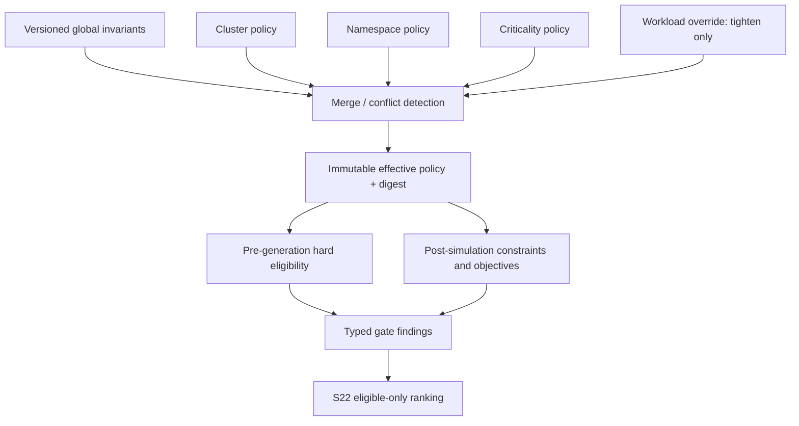
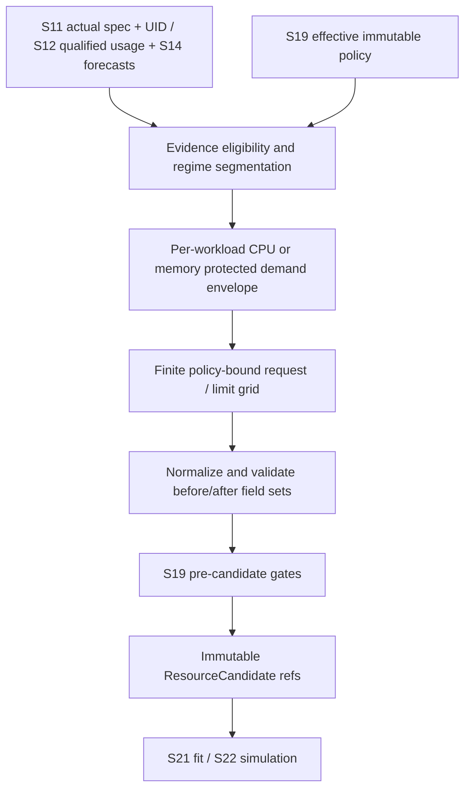
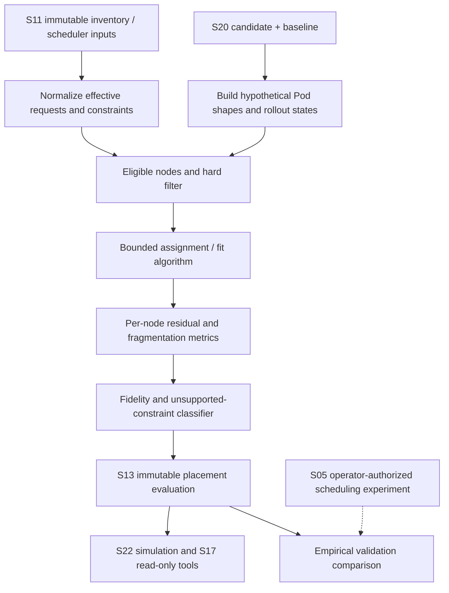
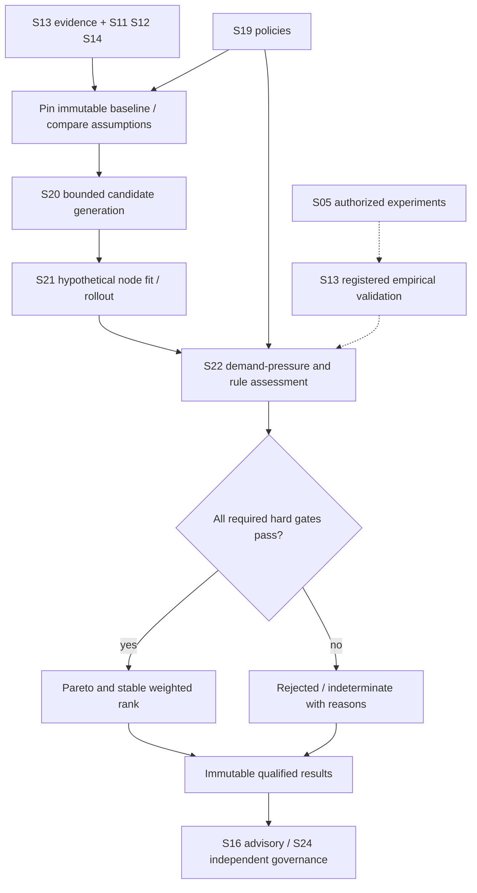
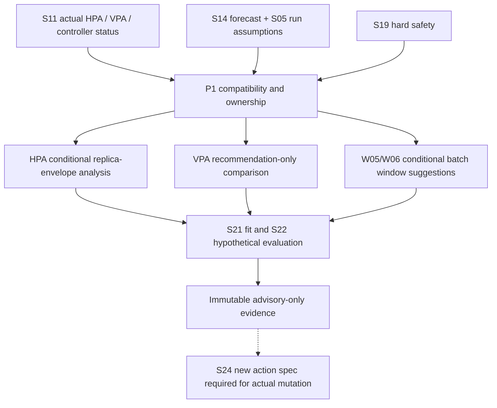

# S19 — Optimization Objectives & Workload Policies

> **Approval record — 2026-11-19.** The owner approved Domain E's seven recommended decisions, including optimization objectives & workload policies as defined in the domain review. The ADRs below make those approvals implementable without claiming live verification. Exact algorithms/thresholds are specified as reproducible reference contracts or explicitly provisional where calibration has not occurred.


## 0. Authority, architectural precedence and interpretation

**Approved project baseline (normative):** Master Catalog v1.0.0 and accepted S01–S18, including the S14 numerical companion. Owner approval on **2026-11-19** covers the seven Domain E selections and their coherent implications. This file is an **accepted architecture / not-yet-implemented** specification, not evidence of an installed cluster, qualified simulator, tested algorithm, calibrated numerical threshold, or safe production change. `MUST` is binding at this architecture level; numerical targets labeled *provisional* require calibration. Superseding any accepted upstream ADR requires an explicit revision.

| Upstream owner | Preserved contract / concrete Domain E implication |
|---|---|
| Master/S01 | Fully local AIOps, Observe/Advisory/Governed, L0–L2 only, human-approved changes, current/1h/conditional 24h, Critical/Standard/Flexible/Opportunistic, hard gates before efficiency, B0/B1/B2/B3 |
| S02 | Exactly six custom persistent Deployments: `api`, `observer`, `capacity`, `ai`, `governance`, `executor`; optimizer lives in existing `capacity`; typed REST and PostgreSQL durable workflow/outbox; no mandatory broker |
| S03 | Single kind cluster: 1 control plane, 1 tainted platform worker, 2 experiment workers on shared Windows 11/Docker Desktop/WSL2 host (20 GB RAM/Ryzen 5 3600); Calico default-deny; measured allocatable/host pressure, provisional resource envelope |
| S04 | W01 latency-api Critical; W02 burst-api Standard; W03 memory-profile Standard; W04 cpu-worker Flexible; W05 analytics-processor Flexible; W06 opportunistic-batch Opportunistic; four Deployments, suspended W05 CronJob and scenario-created W06 Job; HPA off in reference baseline |
| S05 | Host-side Python/Typer scenario coordinator + independent watchdog, SQLite run journal, ephemeral tokenless Jobs in approved `capacity-experiments` namespace; scenario authority never equals S25 optimized mutation authority; S03 namespace-map addendum remains outstanding |
| S06–S08 | Keycloak/OIDC, scoped RBAC and conditions, human author/approver separation, service authentication/TLS/selective mTLS, Vault+ESO, offline CA/cert-manager, PSA Restricted + native CEL policy and protected evidence/audit |
| S09–S10 | In-process `ai` Tool Authorization Broker; no AI Kubernetes write, approval, arbitrary SQL/PromQL or experiment control; local signed artifact trust is approved P1 supply-chain architecture |
| S11 | `observer` exclusively owns Kubernetes LIST/WATCH/reconciliation, time-valid UID/owner lineage, effective Pod requests, node allocatable, immutable quality-classified snapshots; `resourceVersion` is opaque, not a global timestamp |
| S12 | Prometheus owns sampled telemetry; registered versioned queries and quality flags; gaps are not zeros, sampled max is not guaranteed true peak, SLO evidence has sampling/coverage limits |
| S13 | One PostgreSQL instance with `inventory`, `capacity`, `knowledge`, `governance`, `execution`, `audit`, `workflow`; `capacity` alone writes analytical candidate/simulation evidence, immutable ref/digest, temporal evidence and outbox; no cross-schema writable shared ORM; 90-day analytical retention is provisional and pins override purge |
| S14 + companion | Statistical-first deterministic CPU/memory forecast; typed demand semantics and intervals/refusals; current assessment ≠ 1h/conditional 24h; W05/W06 demand is execution-conditional; model output cannot provide request changes directly |
| S15–S18 | Local Ollama on host behind authenticated proxy; Microsoft Agent Framework fixed Analyst→Planner→Reviewer, schema-bound tools/context/RAG; agents interpret exact deterministic evidence only; `ai` retains separate `knowledge` ownership |

**Downstream ownership:** S24 owns authoritative plan/risk governance and exact approval; S25 owns authorized direct/GitOps operation and fresh-state revalidation; S26 owns realized verification/rollback; S27 owns public API/CLI paths; S28 platform operations; S29 deployment automation; S30–S32 testing, comparative evaluation and release readiness.

**Status labels:** `Accepted` architecture; `Provisional` numeric/technical calibration; `Open downstream` assigned to another owner; `Verified` only after implementation and measured evidence. These files do **not** claim that the earlier slices or current slice are deployed.

## Shared safety invariants

1. **Never equate** `requested`, `limited`, `allocatable`, `observed`, `forecasted`, `simulated`, `realized` or `configured desired` capacity. Every quantity has dimension, basis, unit, identity, time and provenance.
2. **Candidate ≠ plan ≠ approval ≠ execution ≠ verified benefit.** Only S24/S25/S26 establish these subsequent states. No AI agent can turn a candidate into a mutation.
3. Fail closed for authorization, critical policy, stale state, unresolved controller/Pod identity, missing safety-critical telemetry, unsupported scheduler constraints, forged evidence or ambiguous GitOps ownership.
4. Origin classifications distinguish synthetic S05 *workload origin* from actual measured cgroup *measurement origin*. Time-compressed tests never become 24h historical evidence.
5. Current Kubernetes API state may change after snapshot; S25 independently revalidates exact target UID/spec/resourceVersion or equivalent safe compare-and-set before any bounded mutation.
6. Platform services, identity, observability and security infrastructure are not optimizer targets. S05 experimental resource authority is never reused to mutate baseline resources.
7. No new persistent custom Deployment, message broker, Kubernetes scheduler, agent model, ML platform, or cloud service is introduced by Domain E.

## Shared engineering implementation profile

- Python 3 typed modules inside `capacity`; deterministic pure functions isolated from I/O; Pydantic/JSON Schema and safe YAML parsers for configuration; actual dependency versions pinned by S29.
- Canonical CPU in **integer millicores**, memory in **integer bytes**, UTC `[start,end)` intervals, explicit `null`+reason for missing values, deterministic sorting and decimal/rational handling where arithmetic could round incorrectly.
- Registered internal authenticated typed interfaces; S27 chooses external routes. Actor/resource-scoped requests require S06 authorization even when called by `ai`; the backend independently checks S09 delegated capability.
- S13 immutable finalized evidence with canonical digest, owner-only database writes, scoped references, transactional outbox, durable jobs with at-least-once retry, lease/fencing, idempotency and bounded time/concurrency/memory budget.
- Integrate S05 empirical validation through separately authorized operator workflow and immutable evidence registration; `capacity` has **no experiment mutation authority**.


## 1. Mission, scope, requirements

**Mission:** Decide which candidate changes are *eligible to evaluate*, which analytical outcomes count as acceptable, and how to compare qualified improvements without ever relaxing mandatory safety.

**P0 requirements:**
- `S19-FR-001`: Evaluate cluster/namespace/criticality/workload rule hierarchy with versioned declarative policy (not arbitrary user-supplied executable code).
- `S19-FR-002`: Separate non-overridable security/identity/scope/validity invariants, hard operational constraints, and soft preference objectives.
- `S19-FR-003`: Implement typed four-way rule outcome `pass | fail | unknown | not_applicable`; `unknown` in a required hard gate cannot qualify execution eligibility.
- `S19-FR-004`: Protect S04 class-specific SLOs and memory/CPU reliability evidence, including missingness, changing replicas, OOM censoring and unsupported history.
- `S19-FR-005`: Prohibit system/identity/observability/AI/executor resource targets; restrict P0 target to single approved demo controller and exact CPU/memory request/limit fields.
- `S19-FR-006`: Bind policy identity/revision/digest, evidence refs, evaluated scope and reason codes to every decision; do not translate analytical pass into S24 approval.
- `S19-FR-007`: Support current, 1h and conditional 24h forecast evidence with the intended-use gate; poor forecast evidence cannot become a hidden quantitative confidence bonus.
- `S19-FR-008`: Enforce safe host pressure/exclusive S05 scenario constraints before expensive analysis or live verification.

**P0 non-goals:** standalone OPA/policy microservice; policy authored by AI, mutable floating policy defaults, Kubernetes admission replacement, automatic approval, generalized cost-of-cloud pricing, P1 HPA optimization, eviction or affinity mutation.

## 2. Policy boundary and effective rule resolution



**Hierarchy semantics:** Global immutable invariants cannot be overridden. More-specific policy rules may raise resource floors, tighten SLOs or narrow permitted actions. For other parameters with explicitly delegable override semantics, override precedence is global→cluster→namespace→criticality→workload and MUST be reflected in the effective-policy manifest; conflicts that cannot be proven safe yield `policy_conflict`. Admission rules in S08 and final S24 rules may be more restrictive. Criticality is S04 assigned product policy, not inferred merely from namespace or a user-editable Pod label.

**Rule phases:** `pre_candidate` (principal, target allowlist, provenance, policy validity), `candidate` (quantity floors/caps, change magnitude, request≤limit where limit exists), `post_fit` (S21 feasibility, quotas, unsupported topology), `post_simulation` (forecast, SLO, disruption, headroom, host pressure), `governance_revalidation` (S24 independent authoritative check). No score computed until required rule phases pass.

## 3. Hard rules catalog (reference)

| Rule ID | Scope | Pass requirements | Failure/unknown codes |
|---|---|---|---|
| `identity.scope` | All | Trusted actor/machine, S06 current grants, exact target within scope | `scope_denied` opaque; no foreign-object disclosure |
| `target.allowlist` | All | In-scope W01–W06 controller identity, non-platform namespace, verified UID | `target_disallowed`, `target_identity_ambiguous` |
| `evidence.integrity` | All | S13 digest, S11 snapshot, S12 quality, S14 applicable forecast | `evidence_tampered`, `inventory_stale`, `coverage_insufficient` |
| `action.supported` | All | Single controller; allowlisted requests/limits CPU/memory; owner compatibility | `action_unsupported`, `gitops_owner_unknown` |
| `resources.valid` | All | Finite positive request values, canonical units, limit/request coherence, namespace policy | `quantity_invalid`, `floor_violation`, `quota_exceeded` |
| `slo.latency_errors` | W01/W02 | Qualified p95/error guardrails and sample/traffic adequacy for a risk-sensitive downsize | `slo_violation`, `slo_evidence_unknown` |
| `slo.queue_completion` | W04/W05/W06 | Queue/throughput/Job deadline semantics qualified as applicable | `batch_deadline_risk`, `queue_evidence_unknown` |
| `memory.oom_spike` | W03 and others | Safe upper-demand envelope, known/unknown peak fidelity, OOM and restarts assessed | `memory_tail_unqualified`, `oom_risk` |
| `scheduler.fit` | All applicable | S21 supported placement and constraint verification | `node_fit_failure`, `scheduler_unsupported` |
| `hpa.compatibility` | W02 or any HPA target | No unmodeled active CPU-utilization HPA feedback from request edits | `hpa_request_coupling_unmodeled` |
| `host.safety` | All | S03/S05 pressure/admission measured and fresh | `host_pressure`, `exclusive_experiment` |
| `change.disruption` | All | Expected rollout/Job impact and PDB/availability limitations within allowed policy | `disruption_risk`, `pdb_unsupported` |

**Do not** make actual observed SLO improvements a P0 analytical guarantee. For cases lacking validated causal performance modeling, the gate indicates `requires_empirical_validation` or `unknown`, rather than fabricating post-change latency or OOM probability. A policy MAY permit advisory-only presentation of indeterminate candidates but never mark them governed execution-eligible.

## 4. Soft objectives and class protection

Optimization objectives: (a) requested CPU and memory reduction *as separate unit-safe components*; (b) context-specific node fit/headroom and fragmentation reduction; (c) modeled risk or uncertainty; (d) disruption/rollout cost and change magnitude; (e) stability and simplicity. Do not add millicores directly to bytes. Use versioned policy normalization and rational weight calculations after Pareto filtering. Always preserve component values and rationale.

| Criticality | Reference policy behavior (numerical values provisional) |
|---|---|
| Critical/W01 | Strict p95/errors, throttle and demand-tail protection; conservative downsize; explicit human review later |
| Standard/W02,W03 | Burst and memory spike evidence needed; active HPA edits blocked if P1 model absent |
| Flexible/W04,W05 | Queue/completion and schedule-conditional demand guardrails; moderate right-sizing latitude |
| Opportunistic/W06 | More permissive delay within explicit Job deadline; minimum execution feasibility and host protections remain mandatory |

Limits and requests have distinct guardrails. A CPU request decrease does not cap CPU, but can change CPU sharing and HPA target utilization. A memory request decrease does not change its limit, yet can alter scheduling/QoS and eviction vulnerability. For Critical service, `no numeric causal model` is not permission to ignore latency risk.

## 5. Logical policy contract

```yaml
schemaVersion: optimization-policy/v1alpha1
policyId: demo-resource-governance
revision: 1
classification: Internal
scope: {clusterIncarnationRef: exact-ref, namespaces: [workloads-critical, workloads-standard, workloads-batch]}
nonOverridable: [identity.scope, target.allowlist, evidence.integrity, action.supported]
allowedActions: [cpu_request, memory_request, cpu_limit, memory_limit]
allowedMutationUnit: single_controller
rules:
  - {ruleId: memory.oom_spike, phase: candidate, targetClasses: [Critical, Standard], outcomeOnMissing: unknown}
  - {ruleId: scheduler.fit, phase: post_fit, outcomeOnUnsupported: unknown}
objectives:
  strategy: pareto_then_weighted
  dimensions: [request_efficiency, placement_benefit, modeled_risk, change_cost]
  weightProfileRef: versioned-and-calibrated
hardPolicyDigest: sha256:resolved-from-canonical-content
```

This is a **logical** illustration, not a persisted complete policy instance. `governance` is authoritative for approved operational policy administration and its current effective revision; `capacity` uses authenticated, immutable read-only policy snapshots for deterministic analysis. Neither YAML in the repository nor an AI-generated rule overrides S24 authority. S19 rule definitions/engine are in `capacity`; S24 owns protected policy lifecycle/authority.

## 6. Interfaces, persistence, state and failures

- `policy.resolve_effective.v1` (authenticated internal): `targetRef, actionSet, policyRefOrCurrent, intendedUse, actorDelegationRef` → resolved immutable policy/ref/digest + allowed hard/soft rule registry, no secrets.
- `policy.evaluate_gates.v1` (internal owner function): `candidateRef?, stage, evidenceManifestRef, effectivePolicyDigest` → typed per-rule findings with eligibility `qualified | rejected | indeterminate` and exact references. P0 does not expose arbitrary policy expressions.
- `policy.inspect_constraints.v1` (S17 read): allowlisted bounded published rules/explanations, current scope checks, never unredacted other namespaces or editable policy.
- At creation pin policy ID/revision/digest and source times; at consumption revalidate policy availability and status. Superseding revision yields a **new** evaluation, not mutation of old records.
- If policy store/grant lookup fails, fail closed for governed eligibility; background analytics may return signed/refined diagnostic insufficiency only. Unknown flags default to unclassified/unsafe; conflicts cannot fall through as pass.

## 7. Security threat model and test/acceptance matrix

| Threat or test | Required observable result |
|---|---|
| Workload-specific policy relaxes global floor | Conflict/deny; rule merge never weakens invariant |
| Agent requests policy override | No policy-writing tool; backend rejects forged role/actor |
| Missing memory peak with optimistic average | `unknown` on required memory-tail protection |
| Cross-namespace target via ID or aggregate | Opaque denial; no metadata/count leakage |
| Policy revision changed after analysis | Old evaluation immutable; governance requires fresh check |
| Unauthorized platform Deployments listed as candidates | `target_disallowed` before ranking |
| Hard failure plus high savings score | Rejected; score cannot resurrect candidate |
| Duplicate rule IDs, non-finite/misunit thresholds | Schema error and fail-closed parsing |
| Actual HPA active but baseline says disabled | Current S11 state controls; unmodeled coupling blocks request edit |

**P0 acceptance:** policy merge and conflict property tests; four-state hard-gate tables; class-specific W01–W06 tests; scope/authorization adversarial tests; canonical digest reproducibility; S22 gating integration; persistence/freshness/crash tests; operator-visible exact rejection reasons with sensitive text sanitized.


## Accepted architecture decision records

| ADR | State | Decision | Rationale / consequence |
|---|---|---|---|
| **S19-ADR-001** | **Accepted** | Hierarchical declarative versioned optimization policy | Safe narrowing of global invariants, transparent effective-rule digest |
| **S19-ADR-002** | **Accepted** | Four-way hard-gate evaluation precedes scoring | Unknown evidence never becomes a hard safety pass |
| **S19-ADR-003** | **Accepted** | Criticality and workload-specific SLO/CPU/memory guardrails | W01–W06 protection aligned with S04/S14 |
| **S19-ADR-004** | **Accepted** | Unit-safe multi-objective preferences and Pareto-ready measures | Efficiency cannot purchase violation of mandatory safety |
| **S19-ADR-005** | **Accepted** | Exact policy/evidence provenance with fail-closed freshness | Analysis always reproducible and scoped |
| **S19-ADR-006** | **Accepted** | S19 analytics distinct from S24 authoritative governance | Policy inspection does not equal approval or execution |

## Non-implementation and follow-on register

- No real-world risk rate, simulator accuracy, SLO margin or candidate savings has been benchmarked yet. S30/S31 fixtures and live validation must establish those results before production-like claims.
- S03 `capacity-experiments` namespace-map addendum and S03 full supporting-infrastructure memory recalibration remain open documentation/measurement work.
- Exact HTTP paths, DB migrations, Helm/CI and final retention/SLO thresholds remain assigned to S27/S13/S29/S28 and cannot be silently fixed here.
- Any addition of a new mutation kind, multi-target plan, forced placement, HPA edit or autonomous change requires an explicit superseding scope/security ADR and S24/S25 grant/admission redesign.

---
title: "S20 — Resource Right-Sizing Engine"
project: "Autonomous Kubernetes Capacity Planning"
artifact_type: "accepted-slice-specification"
slice_id: "S20"
domain: "E — Optimization, Simulation & Decisions"
priority: "P0"
version: "1.0.0"
status: "accepted-architecture / not-yet-implemented"
approved_on: "2026-11-19"
source_of_truth_scope: "Resource Right-Sizing Engine; requirements, contracts, safety, tests and accepted ADRs"
prerequisites: "Master catalog; accepted S01–S18; S14 companion"
companion_artifact: "Domain_E_Optimization_Numerical_Simulation_Contracts.md"
---

# S20 — Resource Right-Sizing Engine

> **Approval record — 2026-11-19.** The owner approved Domain E's seven recommended decisions, including resource right-sizing engine as defined in the domain review. The ADRs below make those approvals implementable without claiming live verification. Exact algorithms/thresholds are specified as reproducible reference contracts or explicitly provisional where calibration has not occurred.


## 0. Authority, architectural precedence and interpretation

**Approved project baseline (normative):** Master Catalog v1.0.0 and accepted S01–S18, including the S14 numerical companion. Owner approval on **2026-11-19** covers the seven Domain E selections and their coherent implications. This file is an **accepted architecture / not-yet-implemented** specification, not evidence of an installed cluster, qualified simulator, tested algorithm, calibrated numerical threshold, or safe production change. `MUST` is binding at this architecture level; numerical targets labeled *provisional* require calibration. Superseding any accepted upstream ADR requires an explicit revision.

| Upstream owner | Preserved contract / concrete Domain E implication |
|---|---|
| Master/S01 | Fully local AIOps, Observe/Advisory/Governed, L0–L2 only, human-approved changes, current/1h/conditional 24h, Critical/Standard/Flexible/Opportunistic, hard gates before efficiency, B0/B1/B2/B3 |
| S02 | Exactly six custom persistent Deployments: `api`, `observer`, `capacity`, `ai`, `governance`, `executor`; optimizer lives in existing `capacity`; typed REST and PostgreSQL durable workflow/outbox; no mandatory broker |
| S03 | Single kind cluster: 1 control plane, 1 tainted platform worker, 2 experiment workers on shared Windows 11/Docker Desktop/WSL2 host (20 GB RAM/Ryzen 5 3600); Calico default-deny; measured allocatable/host pressure, provisional resource envelope |
| S04 | W01 latency-api Critical; W02 burst-api Standard; W03 memory-profile Standard; W04 cpu-worker Flexible; W05 analytics-processor Flexible; W06 opportunistic-batch Opportunistic; four Deployments, suspended W05 CronJob and scenario-created W06 Job; HPA off in reference baseline |
| S05 | Host-side Python/Typer scenario coordinator + independent watchdog, SQLite run journal, ephemeral tokenless Jobs in approved `capacity-experiments` namespace; scenario authority never equals S25 optimized mutation authority; S03 namespace-map addendum remains outstanding |
| S06–S08 | Keycloak/OIDC, scoped RBAC and conditions, human author/approver separation, service authentication/TLS/selective mTLS, Vault+ESO, offline CA/cert-manager, PSA Restricted + native CEL policy and protected evidence/audit |
| S09–S10 | In-process `ai` Tool Authorization Broker; no AI Kubernetes write, approval, arbitrary SQL/PromQL or experiment control; local signed artifact trust is approved P1 supply-chain architecture |
| S11 | `observer` exclusively owns Kubernetes LIST/WATCH/reconciliation, time-valid UID/owner lineage, effective Pod requests, node allocatable, immutable quality-classified snapshots; `resourceVersion` is opaque, not a global timestamp |
| S12 | Prometheus owns sampled telemetry; registered versioned queries and quality flags; gaps are not zeros, sampled max is not guaranteed true peak, SLO evidence has sampling/coverage limits |
| S13 | One PostgreSQL instance with `inventory`, `capacity`, `knowledge`, `governance`, `execution`, `audit`, `workflow`; `capacity` alone writes analytical candidate/simulation evidence, immutable ref/digest, temporal evidence and outbox; no cross-schema writable shared ORM; 90-day analytical retention is provisional and pins override purge |
| S14 + companion | Statistical-first deterministic CPU/memory forecast; typed demand semantics and intervals/refusals; current assessment ≠ 1h/conditional 24h; W05/W06 demand is execution-conditional; model output cannot provide request changes directly |
| S15–S18 | Local Ollama on host behind authenticated proxy; Microsoft Agent Framework fixed Analyst→Planner→Reviewer, schema-bound tools/context/RAG; agents interpret exact deterministic evidence only; `ai` retains separate `knowledge` ownership |

**Downstream ownership:** S24 owns authoritative plan/risk governance and exact approval; S25 owns authorized direct/GitOps operation and fresh-state revalidation; S26 owns realized verification/rollback; S27 owns public API/CLI paths; S28 platform operations; S29 deployment automation; S30–S32 testing, comparative evaluation and release readiness.

**Status labels:** `Accepted` architecture; `Provisional` numeric/technical calibration; `Open downstream` assigned to another owner; `Verified` only after implementation and measured evidence. These files do **not** claim that the earlier slices or current slice are deployed.

## Shared safety invariants

1. **Never equate** `requested`, `limited`, `allocatable`, `observed`, `forecasted`, `simulated`, `realized` or `configured desired` capacity. Every quantity has dimension, basis, unit, identity, time and provenance.
2. **Candidate ≠ plan ≠ approval ≠ execution ≠ verified benefit.** Only S24/S25/S26 establish these subsequent states. No AI agent can turn a candidate into a mutation.
3. Fail closed for authorization, critical policy, stale state, unresolved controller/Pod identity, missing safety-critical telemetry, unsupported scheduler constraints, forged evidence or ambiguous GitOps ownership.
4. Origin classifications distinguish synthetic S05 *workload origin* from actual measured cgroup *measurement origin*. Time-compressed tests never become 24h historical evidence.
5. Current Kubernetes API state may change after snapshot; S25 independently revalidates exact target UID/spec/resourceVersion or equivalent safe compare-and-set before any bounded mutation.
6. Platform services, identity, observability and security infrastructure are not optimizer targets. S05 experimental resource authority is never reused to mutate baseline resources.
7. No new persistent custom Deployment, message broker, Kubernetes scheduler, agent model, ML platform, or cloud service is introduced by Domain E.

## Shared engineering implementation profile

- Python 3 typed modules inside `capacity`; deterministic pure functions isolated from I/O; Pydantic/JSON Schema and safe YAML parsers for configuration; actual dependency versions pinned by S29.
- Canonical CPU in **integer millicores**, memory in **integer bytes**, UTC `[start,end)` intervals, explicit `null`+reason for missing values, deterministic sorting and decimal/rational handling where arithmetic could round incorrectly.
- Registered internal authenticated typed interfaces; S27 chooses external routes. Actor/resource-scoped requests require S06 authorization even when called by `ai`; the backend independently checks S09 delegated capability.
- S13 immutable finalized evidence with canonical digest, owner-only database writes, scoped references, transactional outbox, durable jobs with at-least-once retry, lease/fencing, idempotency and bounded time/concurrency/memory budget.
- Integrate S05 empirical validation through separately authorized operator workflow and immutable evidence registration; `capacity` has **no experiment mutation authority**.


## 1. Mission, explicit requirements and bounded action catalog

**Mission:** Build reproducible candidate CPU/memory configurations from qualified S11/S12/S14 evidence while honoring S19 floors, workload criticality, forecast uncertainty and permitted mutations.

- `S20-FR-001`: Generate deterministic **single-controller** bounded alternatives for `cpu_request`, `memory_request`, `cpu_limit`, `memory_limit`, individually and approved compatible combinations.
- `S20-FR-002`: Resolve current applied controller template and exact owner UID via S11, not Git profile or workload name alone; immutable before/after and field paths.
- `S20-FR-003`: Use statistical demand/quantiles/qualified S14 uncertainty only at their supported horizons and metric/statistic kinds; no LLM numbers.
- `S20-FR-004`: Produce **increases and decreases**; efficiency is secondary to resolving under-reservation or reliability risk.
- `S20-FR-005`: Separate CPU from memory, request from limit, and per-container resource from effective Pod scheduler request; preserve init/overhead effects through S11.
- `S20-FR-006`: Enforce immutable candidate count, grid, delta/floor/cap, time/CPU/RAM limits; deterministic ordering and tie-break.
- `S20-FR-007`: Explain candidate basis, assumptions, rejection and forecast missingness; never state risk-free latency/OOM improvements from unvalidated causal extrapolation.
- `S20-FR-008`: Detect HPA CPU-utilization coupling and GitOps ownership; unsupported active-HPA resource request changes remain advisory-only/ineligible.

**Non-goals:** reinforcement learning/genetic tuning, LLM authored YAML patches, unconstrained workload reconfiguration, guaranteed CPU latency predictor, VPA update-mode, new autoscaler, multi-controller coordinated plans, Pod/node/priority mutation, direct cluster patch.

## 2. Algorithm architecture



### 2.1 Demand sizing semantics

For *supported* workload/resource/horizon/statistic, define a protected envelope `E` from eligible high-tail observation **and** applicable predictive upper bound/interval, plus policy-owned margin. Exact choice of quantile/interval must be revisioned and verified for sufficient tail support; no global `mean×1.2` shortcut. Censored/OOM/unsampled burst windows may force refusal. For W05/W06 use explicit **run-conditional** resource envelope and time window (never infer from suspended inactivity).

Reference lower bound for a proposed request `R`:

`R >= max(policy_floor, protected_envelope_if_applicable, workload_minimum)` **only if** the definition of `protected_envelope` is appropriate as a request-sizing input. CPU requests do not have to exceed all instantaneous CPU use by Kubernetes semantics; policy calibrates the conservative service-protection margin rather than claiming a universal inequality. Memory request floors are policy/scheduling/eviction decisions; the memory **limit** separately needs adequate evidence about tail and OOM risk. A CPU limit may be absent/unlimited if allowed by S08/namespace security and S19 policy; never assume one must exist. Adjusting limits can change observed workload behavior, therefore independent guardrails apply.

**Candidate enumeration:** Generate bounded discrete values from (a) current, (b) policy minimum/maximum within change budget, (c) rounded protected-envelope levels (floor/nominal/conservative), (d) safe upsize response, and (e) compatible request/limit pairs. Deduplicate by canonical exact before/after patch fields and policy+manifest refs, sort by resource/field/value/digest. Do **not** fabricate a candidate when demand evidence is not qualified for intended action.

### 2.2 Example only — no measured evidence

Current W01 CPU request 300m; hypothetical qualified reference upper-demand evidence 135m; 200m proposed conservative request. Reservation delta = 100m (33.3%), *not* 33.3% actual CPU saved and *not* guaranteed safe. S19 p95/errors/throttling gate, S21 fit and S22 pressure/uncertainty still required. Keep existing CPU limit unchanged unless a separately generated limit action is qualified.

## 3. Workload-specific strategies

| ID | Candidate policy focus | Required protection and refusal |
|---|---|---|
| W01 `latency-api` Critical | CPU request and cautious limit proposals | Qualified actual p95/errors, throttling, arrival/response rates; do not infer response time from CPU-only model |
| W02 `burst-api` Standard | Burst tail aware CPU/memory; HPA-off baseline | Verify S11 **actual** HPA status; HPA CPU request coupling gate if active; under-sampled bursts → `indeterminate` |
| W03 `memory-profile` Standard | Retained working-set and sampled tail envelope | OOM/restarts, short spikes, memory limit bound; unobserved physical peak cannot be guaranteed |
| W04 `cpu-worker` Flexible | CPU utilization plus queue/task service-level | Queue/backlog, accepted/completed/rejected counts, deadline; low CPU alone not sufficient |
| W05 `analytics-processor` Flexible | Job-template resources for explicitly declared next run | Suspended CronJob ≠ true idle; conditional duration and run-profile evidence; no automatic template mutation |
| W06 `opportunistic-batch` Opportunistic | Job-template CPU/memory feasibility | Execution window and minimum task requirements; low priority does not imply preemption permitted |

**Kubernetes QoS consequence:** Request/limit edits can change QoS class and eviction behavior. Explicitly track class transition and evaluate S19 guardrail; never inadvertently change guaranteed/burstable properties without a qualified scenario. `LimitRange` defaults/mutations and admission side effects must be detected from S11 and, if ambiguous, reported as unknown. Distinguish controller template fields from observed current Pod resources, because rollouts create mixed old/new ReplicaSets.

## 4. Logical ResourceCandidate v1alpha1

```yaml
schemaVersion: resource-candidate/v1alpha1
candidateRef: content-addressed-after-persistence
target:
  clusterIncarnationRef: exact-ref
  namespace: workloads-critical
  logicalWorkloadRef: w01-latency-api
  controller: {apiVersion: apps/v1, kind: Deployment, name: latency-api, uid: exact-k8s-uid}
  containerName: app
  observedGeneration: 9  # illustrative
  resourceVersion: opaque-s11-recorded-string
mutationUnit: single_controller
fields:
  - path: spec.template.spec.containers[name=app].resources.requests.cpu
    before: {value: 300, unit: millicores}
    after: {value: 200, unit: millicores}
source:
  inventorySnapshotRef: exact-s11-ref
  observationManifestRefs: [qualified-s12-ref]
  forecastRefs: [eligible-s14-ref]
  effectivePolicyRef: exact-s19-ref
  evidenceManifestDigest: sha256:resolved
  workloadProfileRevisionRef: optional-s04-profile-ref
horizon: 1h
eligibility: pending_s21_s22
assumptions: [forecast-horizon-condition]
```

The controller must actually be the S11-discovered current target, not blindly matched by illustrative names. Logical `fields.path` is an abstract allowlisted selector, **not** user-submitted arbitrary JSONPatch. Final canonical patch construction belongs to S25 for an exact approved plan, with field allowlist and optimistic concurrency. S20 output is not directly executable.

## 5. VPA baseline and comparability

S20's own engine is primary. **B1** can use simple deterministic rules and/or VPA recommendation-only baseline, pinned to version/target/config/available historical evidence. Never run VPA in `Auto`/`Recreate`/`InPlaceOrRecreate` update posture as part of baseline and never double-own Pod resources. Missing VPA recommendation is reported as unavailable, not invented. Baselines must be compared in S31 using equivalent scenario windows and measured outcomes, not raw estimated saving alone.

## 6. Persistence, APIs and failure controls

- `candidate.generate_bounded.v1`: Planner-only via S17 broker, and separately authorized deterministic API for B2; inputs are scope, target, immutable manifest, policy ref, action family, horizon and bounded `maxCandidates`. Caller cannot supply arbitrary CPU/memory values as an authority.
- `candidate.list_eligible.v1`: read-only authorized scoped retrieval; strictly list qualified candidates and any requested exclusions as explicit separate filtered category. Never expose foreign namespace counts.
- `candidate.get.v1`: exact immutable candidate with status, digest and reason codes; target identity/privacy checks on read.
- Writes to S13 `capacity` candidate/evaluation tables; durable worker job idempotency derived from trusted canonical inputs. At-least-once delivery should yield one finalized candidate per immutable digest. Missing input yields typed refusal and no fabricated zero usage.
- Static safety prechecks are not a promise that a candidate will fit or pass simulation; `eligibility` remains pending until S21/S22 finish. If GitOps-managed, capture ownership and defer exact adapter selection to S25.

## 7. Tests and acceptance

| Fixture | Expected |
|---|---|
| Zero usage during known scrape gap | No zero-as-observed downsize |
| W03 memory spike absent from sampling | Downsize refused/indeterminate under memory-tail policy |
| W01 low average CPU but high p95 errors | Not safe merely due to average CPU |
| W04 low CPU but queue grows | Not a qualified reduction without throughput/deadline guardrail |
| W02 HPA active at S11 snapshot | CPU request edits blocked from execution eligibility until P1 capability qualified |
| Missing W05/W06 Job run | No unconditional demand forecast; conditional only |
| Different input ordering/same canonical refs | Stable candidate digests and ordering |
| Multi-controller request or arbitrary patch path | Validation refusal |
| Candidate violates quota/floor or alters QoS unexpectedly | Explicit reject/unknown with reason |
| VPA auto-update requested | Not supported; no mutation |

**P0 gate:** pure numerical property tests, boundary/unit/rounding tests, deterministic replay, API authorization and provenance tests, S19/S21/S22 contract integration, limited real kind scenario reconciliation and recorded resource overhead.


## Accepted architecture decision records

| ADR | State | Decision | Rationale / consequence |
|---|---|---|---|
| **S20-ADR-001** | **Accepted** | Forecast-aware workload-specific deterministic sizing | Evidence envelopes plus criticality rules, not model-authored patch |
| **S20-ADR-002** | **Accepted** | Separate CPU vs memory and requests vs limits | Correct Kubernetes resource and failure semantics |
| **S20-ADR-003** | **Accepted** | W01–W06 strategies with refusal on insufficient evidence | Scenario and runtime heterogeneity preserved |
| **S20-ADR-004** | **Accepted** | Bounded discrete candidates and stable digests | Predictable local compute and reproducible alternatives |
| **S20-ADR-005** | **Accepted** | Immutable source/version/target provenance | Candidates can be independently assessed and audited |
| **S20-ADR-006** | **Accepted** | VPA recommendation-only comparative baseline | No competing mutation controller in P0 |
| **S20-ADR-007** | **Accepted** | Single-target allowlisted CPU/memory action catalog | No implicit multi-target or placement authority |

## Non-implementation and follow-on register

- No real-world risk rate, simulator accuracy, SLO margin or candidate savings has been benchmarked yet. S30/S31 fixtures and live validation must establish those results before production-like claims.
- S03 `capacity-experiments` namespace-map addendum and S03 full supporting-infrastructure memory recalibration remain open documentation/measurement work.
- Exact HTTP paths, DB migrations, Helm/CI and final retention/SLO thresholds remain assigned to S27/S13/S29/S28 and cannot be silently fixed here.
- Any addition of a new mutation kind, multi-target plan, forced placement, HPA edit or autonomous change requires an explicit superseding scope/security ADR and S24/S25 grant/admission redesign.

---
title: "S21 — Placement, Scheduling & Fragmentation Analysis"
project: "Autonomous Kubernetes Capacity Planning"
artifact_type: "accepted-slice-specification"
slice_id: "S21"
domain: "E — Optimization, Simulation & Decisions"
priority: "P0"
version: "1.0.0"
status: "accepted-architecture / not-yet-implemented"
approved_on: "2026-11-19"
source_of_truth_scope: "Placement, Scheduling & Fragmentation Analysis; requirements, contracts, safety, tests and accepted ADRs"
prerequisites: "Master catalog; accepted S01–S18; S14 companion"
companion_artifact: "Domain_E_Optimization_Numerical_Simulation_Contracts.md"
---

# S21 — Placement, Scheduling & Fragmentation Analysis

> **Approval record — 2026-11-19.** The owner approved Domain E's seven recommended decisions, including placement, scheduling & fragmentation analysis as defined in the domain review. The ADRs below make those approvals implementable without claiming live verification. Exact algorithms/thresholds are specified as reproducible reference contracts or explicitly provisional where calibration has not occurred.


## 0. Authority, architectural precedence and interpretation

**Approved project baseline (normative):** Master Catalog v1.0.0 and accepted S01–S18, including the S14 numerical companion. Owner approval on **2026-11-19** covers the seven Domain E selections and their coherent implications. This file is an **accepted architecture / not-yet-implemented** specification, not evidence of an installed cluster, qualified simulator, tested algorithm, calibrated numerical threshold, or safe production change. `MUST` is binding at this architecture level; numerical targets labeled *provisional* require calibration. Superseding any accepted upstream ADR requires an explicit revision.

| Upstream owner | Preserved contract / concrete Domain E implication |
|---|---|
| Master/S01 | Fully local AIOps, Observe/Advisory/Governed, L0–L2 only, human-approved changes, current/1h/conditional 24h, Critical/Standard/Flexible/Opportunistic, hard gates before efficiency, B0/B1/B2/B3 |
| S02 | Exactly six custom persistent Deployments: `api`, `observer`, `capacity`, `ai`, `governance`, `executor`; optimizer lives in existing `capacity`; typed REST and PostgreSQL durable workflow/outbox; no mandatory broker |
| S03 | Single kind cluster: 1 control plane, 1 tainted platform worker, 2 experiment workers on shared Windows 11/Docker Desktop/WSL2 host (20 GB RAM/Ryzen 5 3600); Calico default-deny; measured allocatable/host pressure, provisional resource envelope |
| S04 | W01 latency-api Critical; W02 burst-api Standard; W03 memory-profile Standard; W04 cpu-worker Flexible; W05 analytics-processor Flexible; W06 opportunistic-batch Opportunistic; four Deployments, suspended W05 CronJob and scenario-created W06 Job; HPA off in reference baseline |
| S05 | Host-side Python/Typer scenario coordinator + independent watchdog, SQLite run journal, ephemeral tokenless Jobs in approved `capacity-experiments` namespace; scenario authority never equals S25 optimized mutation authority; S03 namespace-map addendum remains outstanding |
| S06–S08 | Keycloak/OIDC, scoped RBAC and conditions, human author/approver separation, service authentication/TLS/selective mTLS, Vault+ESO, offline CA/cert-manager, PSA Restricted + native CEL policy and protected evidence/audit |
| S09–S10 | In-process `ai` Tool Authorization Broker; no AI Kubernetes write, approval, arbitrary SQL/PromQL or experiment control; local signed artifact trust is approved P1 supply-chain architecture |
| S11 | `observer` exclusively owns Kubernetes LIST/WATCH/reconciliation, time-valid UID/owner lineage, effective Pod requests, node allocatable, immutable quality-classified snapshots; `resourceVersion` is opaque, not a global timestamp |
| S12 | Prometheus owns sampled telemetry; registered versioned queries and quality flags; gaps are not zeros, sampled max is not guaranteed true peak, SLO evidence has sampling/coverage limits |
| S13 | One PostgreSQL instance with `inventory`, `capacity`, `knowledge`, `governance`, `execution`, `audit`, `workflow`; `capacity` alone writes analytical candidate/simulation evidence, immutable ref/digest, temporal evidence and outbox; no cross-schema writable shared ORM; 90-day analytical retention is provisional and pins override purge |
| S14 + companion | Statistical-first deterministic CPU/memory forecast; typed demand semantics and intervals/refusals; current assessment ≠ 1h/conditional 24h; W05/W06 demand is execution-conditional; model output cannot provide request changes directly |
| S15–S18 | Local Ollama on host behind authenticated proxy; Microsoft Agent Framework fixed Analyst→Planner→Reviewer, schema-bound tools/context/RAG; agents interpret exact deterministic evidence only; `ai` retains separate `knowledge` ownership |

**Downstream ownership:** S24 owns authoritative plan/risk governance and exact approval; S25 owns authorized direct/GitOps operation and fresh-state revalidation; S26 owns realized verification/rollback; S27 owns public API/CLI paths; S28 platform operations; S29 deployment automation; S30–S32 testing, comparative evaluation and release readiness.

**Status labels:** `Accepted` architecture; `Provisional` numeric/technical calibration; `Open downstream` assigned to another owner; `Verified` only after implementation and measured evidence. These files do **not** claim that the earlier slices or current slice are deployed.

## Shared safety invariants

1. **Never equate** `requested`, `limited`, `allocatable`, `observed`, `forecasted`, `simulated`, `realized` or `configured desired` capacity. Every quantity has dimension, basis, unit, identity, time and provenance.
2. **Candidate ≠ plan ≠ approval ≠ execution ≠ verified benefit.** Only S24/S25/S26 establish these subsequent states. No AI agent can turn a candidate into a mutation.
3. Fail closed for authorization, critical policy, stale state, unresolved controller/Pod identity, missing safety-critical telemetry, unsupported scheduler constraints, forged evidence or ambiguous GitOps ownership.
4. Origin classifications distinguish synthetic S05 *workload origin* from actual measured cgroup *measurement origin*. Time-compressed tests never become 24h historical evidence.
5. Current Kubernetes API state may change after snapshot; S25 independently revalidates exact target UID/spec/resourceVersion or equivalent safe compare-and-set before any bounded mutation.
6. Platform services, identity, observability and security infrastructure are not optimizer targets. S05 experimental resource authority is never reused to mutate baseline resources.
7. No new persistent custom Deployment, message broker, Kubernetes scheduler, agent model, ML platform, or cloud service is introduced by Domain E.

## Shared engineering implementation profile

- Python 3 typed modules inside `capacity`; deterministic pure functions isolated from I/O; Pydantic/JSON Schema and safe YAML parsers for configuration; actual dependency versions pinned by S29.
- Canonical CPU in **integer millicores**, memory in **integer bytes**, UTC `[start,end)` intervals, explicit `null`+reason for missing values, deterministic sorting and decimal/rational handling where arithmetic could round incorrectly.
- Registered internal authenticated typed interfaces; S27 chooses external routes. Actor/resource-scoped requests require S06 authorization even when called by `ai`; the backend independently checks S09 delegated capability.
- S13 immutable finalized evidence with canonical digest, owner-only database writes, scoped references, transactional outbox, durable jobs with at-least-once retry, lease/fencing, idempotency and bounded time/concurrency/memory budget.
- Integrate S05 empirical validation through separately authorized operator workflow and immutable evidence registration; `capacity` has **no experiment mutation authority**.


## 1. Scope, guarantees and explicit simulator limits

**Mission:** Compute transparent hypothetical placement feasibility and multi-resource fragmentation against the same immutable S11 scheduling state that informed optimization, without pretending to be Kubernetes Scheduler or mutating Pods.

- `S21-FR-001`: Consume S11 authoritative effective Pod CPU/memory request, node allocatable, current assigned reservations, current Pending demand, quotas, taints/labels, priority and applicable placement constraints.
- `S21-FR-002`: Evaluate a proposed single-controller resource change against all **eligible** experiment nodes, not cluster totals; preserve platform worker taint/node-pool restriction.
- `S21-FR-003`: Model controller replica and pending counts with identity-time validity; do not double count controller desired replicas and already bound Pods; for rolling update, represent surge/old-new overlap where reliably available.
- `S21-FR-004`: Provide reason-coded per-node exclusion for requests, pod slots, readiness/cordon, labels, taints/tolerations, supported hard affinity, topology rules, quotas and unsupported features.
- `S21-FR-005`: Produce separate `feasibility` and workload-shape-dependent `fragmentation` reports; never use one aggregate utilization score as placement truth.
- `S21-FR-006`: Compare supported simulator predictions with controlled S05 kind scheduling results; persist disagreement/fidelity evidence.
- `S21-FR-007`: Disclose unsupported Kubernetes scheduler plugin/feature behavior and return indeterminate where it may affect safety.

**P0 non-goals:** custom scheduler/extension, Pod binding/eviction/preemption, Node taint modification, topology migration, PV topology optimization, GPUs, multi-cluster, absolute scheduler fidelity, relaxing admission/NetworkPolicy, arbitrary Pod template rewriting.

## 2. Canonical scheduling input and accounting

The source of truth is S11's **effective Pod scheduling request** calculation, not a simple sum of all `resources.requests`: include version-supported init-container max semantics, restartable sidecars/init behavior, Pod overhead and pod-level resources where applicable. S11 maintains actual assigned Pod-to-Node reservation and infrastructure/DaemonSet Pod accounting. Use S11 snapshot validity and per-kind quality; do not reconstruct stale objects from display names.

Per-node residual for resource `r` is `allocatable(node,r) - effectiveRequestsOfAssignedPods(node,r)`; retain signed accounting deficits for diagnosis rather than clamping to an unrealistically comfortable zero. CPU memory and Pod slots need independent simultaneous fit; quotas are additional constraints, not extra physical capacity. There is **no** inference that high observed CPU consumption decreases schedulable request budget.

For a change to a bound Deployment Pod template, the current running Pods do **not** instantly change requests. Simulate separately: (a) steady-state replacement Pods, (b) conservative rollout overlap where `maxSurge/maxUnavailable`, PDB and actual controller strategy are modeled; (c) current state before any change. If rollout/disruption cannot be modeled faithfully, the candidate can only receive advisory feasibility, not an execution-ready safety assertion.

### 2.1 Supported constraint fidelity catalog

| Constraint | P0 fidelity | Fail-closed condition |
|---|---|---|
| Node ready, schedulable, allocatable/requested/pod count | Deterministic from S11 time-valid snapshot | Missing Node state or stale allocation |
| NodeSelector / required node affinity | Deterministic for supported expressions/operators | Unknown operator/version |
| Taints and Pod tolerations | Supported scheduler-relevant effects | Unsupported special effect |
| Required Pod anti-affinity / affinity | Supported bounded subset using known label/namespace/UID snapshots | Incomplete selector/owner namespace/required affinity |
| TopologySpreadConstraints | Supported explicitly scoped hard `DoNotSchedule` subset | Unmodeled domains, selector semantics, feature gates |
| PodDisruptionBudget and rollout maxSurge/unavailable | Disruption-risk and overlap prechecks | Unqualified current availability or unsupported controller |
| Priority/preemption | Read actual priority; S03 `preemptionPolicy: Never` respected | Do not simulate positive fit through unsupported preemption |
| Quota/LimitRange/admission | Static checks and S08 policy reference | Admission defaults/mutations ambiguous |
| Storage/volumes/extended resources/scheduler plugins | Detect and report only unless explicitly implemented/tested | Required unsupported constraint makes fit indeterminate |

No simulator result can bypass native admission, Pod scheduling timing, Kubernetes API state changes, or S25 final validation.

## 3. Workload-shape fit and fragmentation

A Pod shape `p=(cpu_m, memory_bytes, pod_slots, selectors, tolerations,...)` fits node `n` only if **every** required resource and supported hard constraint passes. A node cannot donate its unused CPU to cover another node's memory shortage.

Illustrative example: worker A has 600m/300Mi free, worker B 200m/900Mi; aggregate 800m/1200Mi. Pod needs 400m/500Mi: **no node fits**. The units are examples, not S03 actual capacity.

Report at minimum:

1. `eligibleNodeCount` and per-node `reasonCodes`.
2. `fitCapableNodeCount` for one Pod and `placedCount/unplacedCount` for a bounded multi-replica *hypothetical* set.
3. Residual vector before/after by node, and resource dimension; request headroom may be positive even if no eligible placement.
4. `stranded_for_shape` resource dimensions conditioned on a specified Pod shape; avoid declaring universal stranded capacity.
5. Baseline versus candidate fit difference, with algorithm/order/revision identity and indeterminate flags.

For multiple hypothetical replicas, use a documented stable deterministic heuristic (e.g. constrained-first ordering and stable node tie-break); its answer is **feasible under heuristic** or `not_found_under_heuristic`, not mathematical proof of impossibility unless a definitive constraint establishes impossibility. A failed greedy placement is **not** automatically a hard `infeasible` verdict. Optional bounded exhaustive/backtracking search can prove certain small cases if time/branch budgets permit; report cutoff.

## 4. Component graph and logical placement contract



```yaml
schemaVersion: placement-evaluation/v1alpha1
candidateRef: exact-immutable-resource-candidate-ref
inventorySnapshotRef: exact-S11-ref
constraintProfileRevision: scheduler-subset-1
baseline: {fitCapableNodes: 1, unplacedPods: 0} # illustrative
candidate: {fitCapableNodes: 2, unplacedPods: 0} # illustrative
perNode:
  - {nodeUid: exact-node-uid, eligible: false, reasons: [insufficient_memory]}
feasibility: feasible_under_supported_model
unknownConstraints: []
algorithm: {id: bounded-deterministic-fit, revision: 1, exhaustiveProof: false}
validation: {status: not_empirically_validated}
provenance: {policyRef: exact-S19-ref, sourceDigest: sha256:resolved}
```

These are logical fields, not a deployed API or measured placement result.

## 5. API, persistence and concurrency

- `placement.evaluate.v1`: exact candidate ref or authorized current baseline + S11 inventory snapshot and policy; return immutable evaluation ID or durable bounded job ref. No arbitrary Pod YAML from a tool caller.
- `placement.get_result.v1`: read-only bounded authorized per-node reasons; hide other namespace Pod identities/aggregate cross-scope counts unless separately authorized S06 policy permits.
- `cluster.get_node_fit_inputs.v1` in S17 remains a **read** input tool, not an authoritative placement verdict. Domain backend owns evaluation and independent authorization.
- A scheduler evaluation uses immutable cache-free snapshot refs (or validated content digests), not a live uncontrolled Kubernetes GET from `capacity`; only S11 Observer can watch; S25 Executor reads live later.
- Persist in S13 `capacity`; include host-sharing caveat and `asOf` validity, digest, algorithm revision, field completeness, rollout scenario, exclusions and timeout flags. Retry is deduped; unknown due to timeout cannot become infeasible proof.

## 6. Validation and test protocol

| Test | Required outcome |
|---|---|
| Two-node aggregate sufficient but split CPU/memory | No-fit even though totals positive |
| Platform tainted worker has free RAM | Not eligible for W01–W06 without toleration |
| PodSelector / required node affinity fails | Reason-coded no-fit |
| Unsupported scheduler constraint present | Indeterminate, not confident feasible |
| Busy namespace quota but free node resources | Policy/quota rejection |
| PodCount capacity exhausted | Fit fails even when CPU/RAM available |
| 2 replicas, greedy heuristic fails but alternative valid | No false proof of infeasibility; bounded search/fidelity note |
| Pod snapshot includes init/sidecar/overhead | S11 effective request parity test |
| Rollout surge would temporarily exceed fit | Separate rollout-risk rejection/unknown |
| Node becomes not-ready between evidence and execution | S25 fresh revalidation blocks unsafe apply |
| S05 empirical scheduler placement disagrees with prediction | Persist fidelity mismatch; fix/qualify model before new claim |

**Test levels:** pure node-fit/property fixtures; Kubernetes version-pinned compatibility tests; S05 controlled run comparisons covering feasible, infeasible and indeterminate cases; regression corpus of real scheduler Events; S31 confusion matrix/false-feasibility analysis, scoped auth and perf budgets.


## Accepted architecture decision records

| ADR | State | Decision | Rationale / consequence |
|---|---|---|---|
| **S21-ADR-001** | **Accepted** | Bounded scheduler-aware approximation, no custom scheduler | Correctly labels what is and is not modeled |
| **S21-ADR-002** | **Accepted** | Reuse S11 effective Pod requests and time-valid node state | Scheduling reservations distinct from Prometheus consumption |
| **S21-ADR-003** | **Accepted** | Explicit constraint support and indeterminate findings | Unknown scheduler features never default to safe |
| **S21-ADR-004** | **Accepted** | Node-fit and multidimensional workload-shape fragmentation | Expose aggregate-capacity illusions and inspectable reasons |
| **S21-ADR-005** | **Accepted** | Analytical-only placement in P0 | No eviction, preemption, forced binding or affinity edits |
| **S21-ADR-006** | **Accepted** | Kubernetes-backed empirical fidelity tests via S05 | Quantify false-feasibility instead of assuming scheduler parity |

## Non-implementation and follow-on register

- No real-world risk rate, simulator accuracy, SLO margin or candidate savings has been benchmarked yet. S30/S31 fixtures and live validation must establish those results before production-like claims.
- S03 `capacity-experiments` namespace-map addendum and S03 full supporting-infrastructure memory recalibration remain open documentation/measurement work.
- Exact HTTP paths, DB migrations, Helm/CI and final retention/SLO thresholds remain assigned to S27/S13/S29/S28 and cannot be silently fixed here.
- Any addition of a new mutation kind, multi-target plan, forced placement, HPA edit or autonomous change requires an explicit superseding scope/security ADR and S24/S25 grant/admission redesign.

---
title: "S22 — Optimization Simulation & Scenario Evaluation"
project: "Autonomous Kubernetes Capacity Planning"
artifact_type: "accepted-slice-specification"
slice_id: "S22"
domain: "E — Optimization, Simulation & Decisions"
priority: "P0"
version: "1.0.0"
status: "accepted-architecture / not-yet-implemented"
approved_on: "2026-11-19"
source_of_truth_scope: "Optimization Simulation & Scenario Evaluation; requirements, contracts, safety, tests and accepted ADRs"
prerequisites: "Master catalog; accepted S01–S18; S14 companion"
companion_artifact: "Domain_E_Optimization_Numerical_Simulation_Contracts.md"
---

# S22 — Optimization Simulation & Scenario Evaluation

> **Approval record — 2026-11-19.** The owner approved Domain E's seven recommended decisions, including optimization simulation & scenario evaluation as defined in the domain review. The ADRs below make those approvals implementable without claiming live verification. Exact algorithms/thresholds are specified as reproducible reference contracts or explicitly provisional where calibration has not occurred.


## 0. Authority, architectural precedence and interpretation

**Approved project baseline (normative):** Master Catalog v1.0.0 and accepted S01–S18, including the S14 numerical companion. Owner approval on **2026-11-19** covers the seven Domain E selections and their coherent implications. This file is an **accepted architecture / not-yet-implemented** specification, not evidence of an installed cluster, qualified simulator, tested algorithm, calibrated numerical threshold, or safe production change. `MUST` is binding at this architecture level; numerical targets labeled *provisional* require calibration. Superseding any accepted upstream ADR requires an explicit revision.

| Upstream owner | Preserved contract / concrete Domain E implication |
|---|---|
| Master/S01 | Fully local AIOps, Observe/Advisory/Governed, L0–L2 only, human-approved changes, current/1h/conditional 24h, Critical/Standard/Flexible/Opportunistic, hard gates before efficiency, B0/B1/B2/B3 |
| S02 | Exactly six custom persistent Deployments: `api`, `observer`, `capacity`, `ai`, `governance`, `executor`; optimizer lives in existing `capacity`; typed REST and PostgreSQL durable workflow/outbox; no mandatory broker |
| S03 | Single kind cluster: 1 control plane, 1 tainted platform worker, 2 experiment workers on shared Windows 11/Docker Desktop/WSL2 host (20 GB RAM/Ryzen 5 3600); Calico default-deny; measured allocatable/host pressure, provisional resource envelope |
| S04 | W01 latency-api Critical; W02 burst-api Standard; W03 memory-profile Standard; W04 cpu-worker Flexible; W05 analytics-processor Flexible; W06 opportunistic-batch Opportunistic; four Deployments, suspended W05 CronJob and scenario-created W06 Job; HPA off in reference baseline |
| S05 | Host-side Python/Typer scenario coordinator + independent watchdog, SQLite run journal, ephemeral tokenless Jobs in approved `capacity-experiments` namespace; scenario authority never equals S25 optimized mutation authority; S03 namespace-map addendum remains outstanding |
| S06–S08 | Keycloak/OIDC, scoped RBAC and conditions, human author/approver separation, service authentication/TLS/selective mTLS, Vault+ESO, offline CA/cert-manager, PSA Restricted + native CEL policy and protected evidence/audit |
| S09–S10 | In-process `ai` Tool Authorization Broker; no AI Kubernetes write, approval, arbitrary SQL/PromQL or experiment control; local signed artifact trust is approved P1 supply-chain architecture |
| S11 | `observer` exclusively owns Kubernetes LIST/WATCH/reconciliation, time-valid UID/owner lineage, effective Pod requests, node allocatable, immutable quality-classified snapshots; `resourceVersion` is opaque, not a global timestamp |
| S12 | Prometheus owns sampled telemetry; registered versioned queries and quality flags; gaps are not zeros, sampled max is not guaranteed true peak, SLO evidence has sampling/coverage limits |
| S13 | One PostgreSQL instance with `inventory`, `capacity`, `knowledge`, `governance`, `execution`, `audit`, `workflow`; `capacity` alone writes analytical candidate/simulation evidence, immutable ref/digest, temporal evidence and outbox; no cross-schema writable shared ORM; 90-day analytical retention is provisional and pins override purge |
| S14 + companion | Statistical-first deterministic CPU/memory forecast; typed demand semantics and intervals/refusals; current assessment ≠ 1h/conditional 24h; W05/W06 demand is execution-conditional; model output cannot provide request changes directly |
| S15–S18 | Local Ollama on host behind authenticated proxy; Microsoft Agent Framework fixed Analyst→Planner→Reviewer, schema-bound tools/context/RAG; agents interpret exact deterministic evidence only; `ai` retains separate `knowledge` ownership |

**Downstream ownership:** S24 owns authoritative plan/risk governance and exact approval; S25 owns authorized direct/GitOps operation and fresh-state revalidation; S26 owns realized verification/rollback; S27 owns public API/CLI paths; S28 platform operations; S29 deployment automation; S30–S32 testing, comparative evaluation and release readiness.

**Status labels:** `Accepted` architecture; `Provisional` numeric/technical calibration; `Open downstream` assigned to another owner; `Verified` only after implementation and measured evidence. These files do **not** claim that the earlier slices or current slice are deployed.

## Shared safety invariants

1. **Never equate** `requested`, `limited`, `allocatable`, `observed`, `forecasted`, `simulated`, `realized` or `configured desired` capacity. Every quantity has dimension, basis, unit, identity, time and provenance.
2. **Candidate ≠ plan ≠ approval ≠ execution ≠ verified benefit.** Only S24/S25/S26 establish these subsequent states. No AI agent can turn a candidate into a mutation.
3. Fail closed for authorization, critical policy, stale state, unresolved controller/Pod identity, missing safety-critical telemetry, unsupported scheduler constraints, forged evidence or ambiguous GitOps ownership.
4. Origin classifications distinguish synthetic S05 *workload origin* from actual measured cgroup *measurement origin*. Time-compressed tests never become 24h historical evidence.
5. Current Kubernetes API state may change after snapshot; S25 independently revalidates exact target UID/spec/resourceVersion or equivalent safe compare-and-set before any bounded mutation.
6. Platform services, identity, observability and security infrastructure are not optimizer targets. S05 experimental resource authority is never reused to mutate baseline resources.
7. No new persistent custom Deployment, message broker, Kubernetes scheduler, agent model, ML platform, or cloud service is introduced by Domain E.

## Shared engineering implementation profile

- Python 3 typed modules inside `capacity`; deterministic pure functions isolated from I/O; Pydantic/JSON Schema and safe YAML parsers for configuration; actual dependency versions pinned by S29.
- Canonical CPU in **integer millicores**, memory in **integer bytes**, UTC `[start,end)` intervals, explicit `null`+reason for missing values, deterministic sorting and decimal/rational handling where arithmetic could round incorrectly.
- Registered internal authenticated typed interfaces; S27 chooses external routes. Actor/resource-scoped requests require S06 authorization even when called by `ai`; the backend independently checks S09 delegated capability.
- S13 immutable finalized evidence with canonical digest, owner-only database writes, scoped references, transactional outbox, durable jobs with at-least-once retry, lease/fencing, idempotency and bounded time/concurrency/memory budget.
- Integrate S05 empirical validation through separately authorized operator workflow and immutable evidence registration; `capacity` has **no experiment mutation authority**.


## 1. Mission, requirements, scope

**Mission:** Evaluate hypothetical S20 resource candidates against an immutable baseline, S19 policy, S21 node fit and S14 forecast/uncertainty; preserve distinct analytical and empirical evidence; rank only qualified alternatives.

- `S22-FR-001`: Pin complete analysis manifest: target/UID, S11 snapshot, S12 quality observations, S14 forecast/evaluation/refusal, S19 policy, S20 candidate, scenario/horizon/versions.
- `S22-FR-002`: Evaluate `unchanged baseline` before each candidate and compare **same target, valid time, demand assumptions and unit semantics**.
- `S22-FR-003`: Apply candidate to *copy* of hypothetical scheduler/configuration state, never Kubernetes API; include per-controller rollout overlap uncertainty.
- `S22-FR-004`: Call S19 pre/post gates, S21 fit, reliability guardrails and quantify resource request change separately from speculative consumption effects.
- `S22-FR-005`: Explicitly classify `qualified | rejected | indeterminate` and keep refused/incompatible candidates visible by reason without ranking as executable.
- `S22-FR-006`: Pareto-filter qualified candidates on normalized risk/benefit/change-cost dimensions; then deterministic versioned weighted rank; preserve nondominated alternatives and stable tie-break.
- `S22-FR-007`: Offer S05 live Kubernetes validation as separately authorized experiment; never imply experimental setup is an S25 optimized mutation.
- `S22-FR-008`: Output immutable typed evaluation, quality limitations, input digests and causality caveats; simulation is not S26 verification.
- `S22-FR-009`: Operate without `ai`, Ollama, RAG, VPA or external cloud; B2 remains available when B3 cannot complete.

**P0 non-goals:** actual rollout/provisioning/eviction, arbitrary user scripts/patch bodies, complex dynamic HPA control or full multivariate workload stochastic models, guaranteed end-to-end SLO predictions, AI-created numbers, mandatory live experiment for each candidate, automatic plan or approval.

## 2. Deterministic flow and circular-dependency resolution



S20 and S21 are pure or bounded library APIs; **S22 orchestrates them**. Master catalog reverse references of S20/S21→S22 are integration/evaluation dependencies, **not** cyclic invocation. An internal `simulation` module may provide shared DTOs, but may not make S20 recursively call the S22 coordinator.

**Stages:** (1) authorize and pin input; (2) baseline; (3) candidate generation; (4) static policy; (5) hypothetical spec / placement; (6) forecast-conditioned pressure + SLO/risk evidence; (7) hard gate summary; (8) Pareto; (9) objective ranking; (10) immutable finalize+outbox. Terminal errors and exhausted budget are distinct from a scientifically supported `rejected` finding.

## 3. Analytical versus empirical validation

**Analytical counterfactual:** Known request/limit delta and S11 allocatable translate into requested resource reservations and scheduler-fit hypotheses. Predictions rely on S14's valid forecast targets/statistic/uncertainty and unchanged or explicitly modified workload demand assumptions. The simulator must NOT promise exact latency changes, workload CPU consumption savings, OOM probabilities or future scheduler scheduling order from the absence of a validated model.

**S05 empirical validation:** Operators intentionally run separately scoped reproducible experiments, with independent scenario credentials, watchdog, seed/phase/runner provenance, measured actual outcomes, aborted-run flags and physical-host contamination. S13 can reference imported measurements; S22 can compare hypothesis to measured observations once provenance/quality are checked. It cannot launch S05 or silently reset live state.

| Scenario | P0 analytical claim allowed | Caveat |
|---|---|---|
| Unchanged B0 | Request/fit baseline and qualified observed history | A baseline is reference, not proof of future steady performance |
| CPU or memory request change | Exact reservation delta and hypothetical node fit | CPU request may change contention/HPA; memory request may affect eviction/QoS |
| CPU limit change | Exact limit change and throttling/CPU risk flags | No invented latency response curve |
| Memory limit change | Limit-to-tail envelope margin/risk finding | Sampled peak not absolute maximum; OOM may be censored |
| 1h forecast | Qualified forecast-conditioned pressure | Respect interval coverage and target statistic |
| 24h forecast | Only S14-qualified 24h data | No implicit approval from short synthetic runs |
| W05/W06 | Explicit assumed run window/profile | Suspended/inactive != zero future work |
| S21 fragmentation | Shape-specific fit/headroom under assumption | Not guaranteed actual placement or independent kind host fault-domain |

## 4. Risk and objective ranking

Eligibility rule: `eligible(c) = all(requiredHardGates(c) == pass)`; `not_applicable` permitted only for explicitly inapplicable rule; missing/unsupported hard gate is `indeterminate`, not `pass`. Candidate with a genuine fail is `rejected` even if another part is unknown. Store full per-rule findings.

For an eligible candidate, define a multidimensional objective vector `z(c)` with **explicitly normalized** request efficiency, scheduling/fragmentation gain, modeled risk/uncertainty and change cost. Do **not** sum raw millicores and bytes. Perform Pareto nondominance using policy-declared directions/tolerance; report nondominated alternatives. For tie-breaking (not safety) use `score = wE*E + wF*F - wR*R - wC*C` with finite nonnegative revisioned weights and bounded normalization; exact weights *provisional until S31 calibration*. Stable final tie-break is canonical candidate digest/field ordering.

**Benefit classification:** `calculated_reservation_delta`, `modeled_scheduler_fit_delta`, `forecast_conditioned_pressure_delta`, `empirical_observation_delta`, `verified_realized_delta`. This slice produces only the first four where supported; **S26 alone produces realized verified effect**. Distinguish negative net change and no-change candidate; sometimes safest recommendation is no eligible change.

## 5. Logical OptimizationEvaluation v1alpha1

```yaml
schemaVersion: optimization-evaluation/v1alpha1
evaluationRef: immutable-content-addressed-ref
targetRef: exact-cluster-namespace-controller-uid
baseline:
  inventorySnapshotRef: exact-s11-ref
  observationRefs: [qualified-s12-ref]
  currentResourceManifestRef: immutable-s11-spec-ref
candidateRef: exact-s20-ref
policyRef: exact-effective-s19-ref
forecastRefs: [exact-applicable-s14-ref]
assumptions:
  horizon: 1h
  scenarioRef: optional-pinned-s05-scenario
  rolloutMode: supported-steady-state-and-overlap
  workloadOrigin: baseline_lab
simulation:
  schedulerEvaluationRef: exact-s21-ref
  modelRevision: counterfactual-v1
  benefitKinds: [calculated_reservation_delta, modeled_scheduler_fit_delta]
  uncertaintyFlags: []
hardGates:
  - {ruleId: scheduler.fit, status: pass, evidenceRef: exact-s21-ref}
status: qualified
ranking:
  paretoFront: 1
  scoreProfileRef: policy-weight-v1
empiricalValidation: not_performed
integrityDigest: sha256:computed-after-normalization
```

The example is illustrative only, not a completed evaluation. `qualified` means fit under the supported analytical model and required hard-gate evidence, not human approval, execution eligibility across a later time gap, measured safety or realized savings.

## 6. APIs, tool ownership, workflows, storage

- `simulation.evaluate_candidate.v1`: bounded computation for **Planner** or authorized B2 service/operator; input only existing S20 immutable candidate ref, S11 snapshot, S19 policy and S13 evidence manifest; never arbitrary patch.
- `simulation.get_result.v1`: **read-only** for Analyst, Planner and Risk Reviewer under S17, resolving exact scoped immutable result. This avoids S17's prior ambiguous combined invoke/get semantics. Add to S17 versioned tool registry by explicit integration addendum; do not silently change existing accepted tool rights.
- `risk.get_deterministic_findings.v1`: bounded read-only S19–S22 finding projection, source refs and reasons; risk score cannot replace hard gates.
- `simulation.run_bounded.v1`: authenticated owner-side durable B2 orchestration returning job/status/result refs; S27 owns final public route and user experience.
- Workflow runs use S02/S13 PostgreSQL lease/outbox and owner-scoped roles, not a new queue or Redis. Idempotent retry must produce same finalized digest for same canonical inputs, while marking timeout/cancel separately; partial results are not finalized as safe.
- Persist finalized `capacity` analysis evidence and approved read models; S24 may reference it to draft but writes its **own** authoritative plan/revision and applies current policy rechecks. Outbox fact means evaluation completed, not plan approved.

## 7. Test/benchmark acceptance

| Case | Expected |
|---|---|
| C1 +15% reservation savings, qualified safety/fit | Eligible alternative, not approved plan |
| C2 +35% savings, insufficient latency/memory evidence | Indeterminate, not ranked ahead of C1 |
| C3 +25% savings, no eligible node fit | Rejected, cannot rank |
| One objective better, another worse | Nondominated Pareto alternatives preserved |
| Same canonical inputs re-run | Deterministic classification/order/digest |
| Policy changed or missing S14 interval | New revision/evaluation or typed inconclusive |
| S21 supports only subset of affinity | Explicit fidelity/unknown, no false feasible guarantee |
| S05 abort or host pressure | Flag contaminated/invalid comparison; no verified gains |
| Ollama outage | B2 deterministic operation continues; B3 may be incomplete |
| Agent-generated numeric patch or forged simulator result | Backend rejects / trusted refs only |
| Interrupted durable job | Fenced retry/reconciliation, no duplicate finalized result |
| Direct attempted K8s mutation from `capacity` | Lacks ServiceAccount permission; negative security test |

S31 assesses outcome deltas across fair B0–B3 run windows and false-feasibility/misclassification rate, not assumed exact improvements. S30 validates pure, integration, local-kind and security layers. Measure S22 CPU/RAM/DB time under S03/S15 co-scheduling pressure before claiming resource bounds.


## Accepted architecture decision records

| ADR | State | Decision | Rationale / consequence |
|---|---|---|---|
| **S22-ADR-001** | **Accepted** | Analytical counterfactual simulator primary; targeted S05 experiments complementary | Low overhead, falsifiable what-if analyses without automatic mutations |
| **S22-ADR-002** | **Accepted** | Pinned unchanged baseline and immutable candidate assumptions | Fair reproducible comparison and temporal integrity |
| **S22-ADR-003** | **Accepted** | Hard-gate classification before ranking | Rejected/indeterminate alternatives cannot win via savings |
| **S22-ADR-004** | **Accepted** | Pareto filtering followed by explainable deterministic weighted ordering | Preserves tradeoffs while maintaining bounded stable choice |
| **S22-ADR-005** | **Accepted** | Explicit uncertainty and noncausal performance limits | No invented latency/OOM/actual consumption savings |
| **S22-ADR-006** | **Accepted** | Async owner workflow with S13 immutable evidence/outbox | Crash recovery and domain ownership preserved |
| **S22-ADR-007** | **Accepted** | Simulation outcomes never equal S26 post-change verification | Separate hypothetical prediction from measured realized outcomes |

## Non-implementation and follow-on register

- No real-world risk rate, simulator accuracy, SLO margin or candidate savings has been benchmarked yet. S30/S31 fixtures and live validation must establish those results before production-like claims.
- S03 `capacity-experiments` namespace-map addendum and S03 full supporting-infrastructure memory recalibration remain open documentation/measurement work.
- Exact HTTP paths, DB migrations, Helm/CI and final retention/SLO thresholds remain assigned to S27/S13/S29/S28 and cannot be silently fixed here.
- Any addition of a new mutation kind, multi-target plan, forced placement, HPA edit or autonomous change requires an explicit superseding scope/security ADR and S24/S25 grant/admission redesign.

---
title: "S23 — Autoscaling & Advanced Workload Optimization"
project: "Autonomous Kubernetes Capacity Planning"
artifact_type: "accepted-slice-specification"
slice_id: "S23"
domain: "E — Optimization, Simulation & Decisions"
priority: "P1"
version: "1.0.0"
status: "accepted-architecture / not-yet-implemented"
approved_on: "2026-11-19"
source_of_truth_scope: "Autoscaling & Advanced Workload Optimization; requirements, contracts, safety, tests and accepted ADRs"
prerequisites: "Master catalog; accepted S01–S18; S14 companion"
companion_artifact: "Domain_E_Optimization_Numerical_Simulation_Contracts.md"
---

# S23 — Autoscaling & Advanced Workload Optimization

> **Approval record — 2026-11-19.** The owner approved Domain E's seven recommended decisions, including autoscaling & advanced workload optimization as defined in the domain review. The ADRs below make those approvals implementable without claiming live verification. Exact algorithms/thresholds are specified as reproducible reference contracts or explicitly provisional where calibration has not occurred.


## 0. Authority, architectural precedence and interpretation

**Approved project baseline (normative):** Master Catalog v1.0.0 and accepted S01–S18, including the S14 numerical companion. Owner approval on **2026-11-19** covers the seven Domain E selections and their coherent implications. This file is an **accepted architecture / not-yet-implemented** specification, not evidence of an installed cluster, qualified simulator, tested algorithm, calibrated numerical threshold, or safe production change. `MUST` is binding at this architecture level; numerical targets labeled *provisional* require calibration. Superseding any accepted upstream ADR requires an explicit revision.

| Upstream owner | Preserved contract / concrete Domain E implication |
|---|---|
| Master/S01 | Fully local AIOps, Observe/Advisory/Governed, L0–L2 only, human-approved changes, current/1h/conditional 24h, Critical/Standard/Flexible/Opportunistic, hard gates before efficiency, B0/B1/B2/B3 |
| S02 | Exactly six custom persistent Deployments: `api`, `observer`, `capacity`, `ai`, `governance`, `executor`; optimizer lives in existing `capacity`; typed REST and PostgreSQL durable workflow/outbox; no mandatory broker |
| S03 | Single kind cluster: 1 control plane, 1 tainted platform worker, 2 experiment workers on shared Windows 11/Docker Desktop/WSL2 host (20 GB RAM/Ryzen 5 3600); Calico default-deny; measured allocatable/host pressure, provisional resource envelope |
| S04 | W01 latency-api Critical; W02 burst-api Standard; W03 memory-profile Standard; W04 cpu-worker Flexible; W05 analytics-processor Flexible; W06 opportunistic-batch Opportunistic; four Deployments, suspended W05 CronJob and scenario-created W06 Job; HPA off in reference baseline |
| S05 | Host-side Python/Typer scenario coordinator + independent watchdog, SQLite run journal, ephemeral tokenless Jobs in approved `capacity-experiments` namespace; scenario authority never equals S25 optimized mutation authority; S03 namespace-map addendum remains outstanding |
| S06–S08 | Keycloak/OIDC, scoped RBAC and conditions, human author/approver separation, service authentication/TLS/selective mTLS, Vault+ESO, offline CA/cert-manager, PSA Restricted + native CEL policy and protected evidence/audit |
| S09–S10 | In-process `ai` Tool Authorization Broker; no AI Kubernetes write, approval, arbitrary SQL/PromQL or experiment control; local signed artifact trust is approved P1 supply-chain architecture |
| S11 | `observer` exclusively owns Kubernetes LIST/WATCH/reconciliation, time-valid UID/owner lineage, effective Pod requests, node allocatable, immutable quality-classified snapshots; `resourceVersion` is opaque, not a global timestamp |
| S12 | Prometheus owns sampled telemetry; registered versioned queries and quality flags; gaps are not zeros, sampled max is not guaranteed true peak, SLO evidence has sampling/coverage limits |
| S13 | One PostgreSQL instance with `inventory`, `capacity`, `knowledge`, `governance`, `execution`, `audit`, `workflow`; `capacity` alone writes analytical candidate/simulation evidence, immutable ref/digest, temporal evidence and outbox; no cross-schema writable shared ORM; 90-day analytical retention is provisional and pins override purge |
| S14 + companion | Statistical-first deterministic CPU/memory forecast; typed demand semantics and intervals/refusals; current assessment ≠ 1h/conditional 24h; W05/W06 demand is execution-conditional; model output cannot provide request changes directly |
| S15–S18 | Local Ollama on host behind authenticated proxy; Microsoft Agent Framework fixed Analyst→Planner→Reviewer, schema-bound tools/context/RAG; agents interpret exact deterministic evidence only; `ai` retains separate `knowledge` ownership |

**Downstream ownership:** S24 owns authoritative plan/risk governance and exact approval; S25 owns authorized direct/GitOps operation and fresh-state revalidation; S26 owns realized verification/rollback; S27 owns public API/CLI paths; S28 platform operations; S29 deployment automation; S30–S32 testing, comparative evaluation and release readiness.

**Status labels:** `Accepted` architecture; `Provisional` numeric/technical calibration; `Open downstream` assigned to another owner; `Verified` only after implementation and measured evidence. These files do **not** claim that the earlier slices or current slice are deployed.

## Shared safety invariants

1. **Never equate** `requested`, `limited`, `allocatable`, `observed`, `forecasted`, `simulated`, `realized` or `configured desired` capacity. Every quantity has dimension, basis, unit, identity, time and provenance.
2. **Candidate ≠ plan ≠ approval ≠ execution ≠ verified benefit.** Only S24/S25/S26 establish these subsequent states. No AI agent can turn a candidate into a mutation.
3. Fail closed for authorization, critical policy, stale state, unresolved controller/Pod identity, missing safety-critical telemetry, unsupported scheduler constraints, forged evidence or ambiguous GitOps ownership.
4. Origin classifications distinguish synthetic S05 *workload origin* from actual measured cgroup *measurement origin*. Time-compressed tests never become 24h historical evidence.
5. Current Kubernetes API state may change after snapshot; S25 independently revalidates exact target UID/spec/resourceVersion or equivalent safe compare-and-set before any bounded mutation.
6. Platform services, identity, observability and security infrastructure are not optimizer targets. S05 experimental resource authority is never reused to mutate baseline resources.
7. No new persistent custom Deployment, message broker, Kubernetes scheduler, agent model, ML platform, or cloud service is introduced by Domain E.

## Shared engineering implementation profile

- Python 3 typed modules inside `capacity`; deterministic pure functions isolated from I/O; Pydantic/JSON Schema and safe YAML parsers for configuration; actual dependency versions pinned by S29.
- Canonical CPU in **integer millicores**, memory in **integer bytes**, UTC `[start,end)` intervals, explicit `null`+reason for missing values, deterministic sorting and decimal/rational handling where arithmetic could round incorrectly.
- Registered internal authenticated typed interfaces; S27 chooses external routes. Actor/resource-scoped requests require S06 authorization even when called by `ai`; the backend independently checks S09 delegated capability.
- S13 immutable finalized evidence with canonical digest, owner-only database writes, scoped references, transactional outbox, durable jobs with at-least-once retry, lease/fencing, idempotency and bounded time/concurrency/memory budget.
- Integrate S05 empirical validation through separately authorized operator workflow and immutable evidence registration; `capacity` has **no experiment mutation authority**.


## 1. Priority, scope and dependencies

**S23 remains P1** by explicit owner approval. The P0 platform **must** detect unmodeled active HPA/VPA interactions and prevent relevant resource-request changes from becoming governed-execution eligible. P1 adds advisory-only autoscaling and batch strategies first, without extending the P0 executor mutation set.

- `S23-FR-001`: Discover actual HPA state/config/status from S11 for W02 and any configured eligible target; distinguish desired/current/ready replicas, HPA conditions and missing metrics.
- `S23-FR-002`: Model requests' effect on CPU-utilization-based HPA percentages and conditional replica demand; state assumptions on controller timing, stabilization, scaling policies, missing signals.
- `S23-FR-003`: Compare recommendation-only VPA request/limit advice against S20 recommendations without VPA owning live updates.
- `S23-FR-004`: Produce bounded future replica and batch scheduling *advisory* candidates, linked to S14 forecast and S19/S21/S22 constraints.
- `S23-FR-005`: Protect Critical/Standard workload availability, PDB, quota, topology, PriorityClass, no-preemption and host physical pressure.
- `S23-FR-006`: Label HPA/VPA/autoscaling simulators by fidelity, observed/controller effects and conditions needing empirical S05 validation; no guaranteed reactive scheduler dynamics.
- `S23-FR-007`: Keep optimization of W05 suspended CronJob and W06 scenario Job separate from experiment authority; advisory batch start windows are not permission to launch Jobs.

**P1 non-goals:** independent autoscaler controller, live HPA/VPA resource patch as default, generalized descheduling, cluster autoscaler/cloud node scaling, KEDA prerequisite, scheduler plugin, automated Pod eviction, capacity purchases, feedback-controlled closed-loop L3 autonomy.

## 2. HPA/request coupling safety

For CPU-utilization HPA, current utilization approximates `observedCPU / requestedCPU` per applicable Pods. Example: 140m/200m = 70%; reducing request to 100m gives 140% at unchanged usage. This may change desired replicas; the HPA's actual formula, missing metrics, tolerance, readiness windows, policy and stabilization determine real response. This arithmetic is **illustrative**, not a complete HPA simulator or a production observation.

**P0 compatibility gate (binding before S23 implementation):** If S11 shows an active CPU-utilization HPA for a target and the current S20 action changes that target's CPU request, and S23 model is unqualified, return `hpa_request_coupling_unmodeled` / `indeterminate_for_governed_execution`. This applies even if the S04 baseline file has HPA off. If the HPA status/metrics are unknown, fail closed. Other autoscaler owners or managedFields drift should be flagged and handled through S25 exact ownership checks. Memory-utilization HPA and other metric modes also require explicit compatibility qualification rather than broad allow.

## 3. Advanced advisory model



| Capability | Input | P1 advisory result | Must avoid |
|---|---|---|---|
| Replica envelope | Qualified forecast plus current HPA status and policy | Conditional minimum/maximum/expected requests and fit range | Assuming HPA scales instantly or exactly |
| HPA compatibility | Requested CPU/memory + HPA metrics/behavior | Interaction flags, conservative scenario variants | Treating request as fixed without changing utilization denominator |
| VPA compare | Pinned recommendation-only VPA ref | Divergence, evidence revision and ownership conflict | Enabling updating/eviction automatically |
| Batch timing | W05/W06 exact requested resources, deadlines, run profile and future known window | Bounded scheduling-window choices and pressure comparison | Running Job / un-suspending CronJob automatically |
| Disruption/overcommit | S11 PDB, quotas and node constraints | Risk/unknown report | Pretending PodDisruptionBudget guarantees controller rollout success |

For predictions involving HPA, calculate upper and lower *conditional* replica envelopes, then pass the resulting Pod-request shapes to S21; do not give S21 historical current replicas as if they were always the future replicas. Forecasting resource demand per Pod vs aggregate over replicas must not be conflated; S14 applies and if target level cannot be transformed accurately, refuse. For VPA, actual install is optional P1; if not installed, record baseline as unavailable without pretending a recommendation exists.

## 4. P1 logical AutoscalingAdvisory v1alpha1

```yaml
schemaVersion: autoscaling-advisory/v1alpha1
advisoryRef: content-addressed-only-on-persistence
targetRef: exact-s11-controller-uid
autonomy: advisory_only
recommendationType: hpa_replica_envelope
hpaStateRef: exact-s11-hpa-snapshot
forecastRef: exact-s14-conditional-ref
policyRef: exact-s19-effective-ref
assumptions: [cpu-utilization-target-qualified, bounded-replica-policy]
replicaBounds: {min: 1, max: 3} # illustrative only
fitEvaluationRefs: [exact-s21-ref]
limitations: [controller-response-not-empirically-proven]
executionEligibility: not_supported_in_P1_advisory
```

### P1 interface separation

`autoscaling.inspect_compatibility.v1` permits safe read-only capability in existing `capacity`; `autoscaling.evaluate_replica_scenario.v1` may be called only via approved B2 work/Planner tool registry with strict integer bounds and authoritative HPA references. `batch.evaluate_window.v1` takes explicit feasible run windows/profile refs; never general CRON expression execution. Neither tool creates `ExecutionIntent` or calls S05. AI may explain immutable advisory result via its S17 broker; adding new tool names requires a versioned S17 registry addendum.

## 5. Authorization and mutation expansion policy

Any actual `spec.replicas` or HPA `spec`/VPA update, Job start, CronJob un-suspension, PDB change or placement constraint edit is **outside the approved P0 action catalog**. It needs a separately approved S24 plan-action kind; S25 field/target/owner allowlist, constrained Kubernetes RBAC/admission, rollout/rollback and GitOps ownership proof; S06 authorization; S08 security admission and S26 verification. This specification does not authorize those operations by implication.

## 6. Priority plan and tests

**P0 prerequisite tests (regardless of S23 implementation):** Active HPA detection by S11; W02 CPU request change blocked when HPA model missing; current HPA status supersedes S04 baseline desired manifest; no direct VPA/HPA mutations by AI or `capacity`.

**P1 integration order:** (1) HPA observation and stable context; (2) rule-based compatibility/read-only; (3) conditional replica envelope and fit; (4) VPA recommendation-only comparison; (5) W05/W06 batch-window advisory; (6) S05 realistic burst/scale experiment; (7) S31 effectiveness analysis before any consideration of new action kinds.

| Validation | Expectation |
|---|---|
| Request 200m→100m at constant usage 140m | Utilization denominator doubles, replica analysis reevaluated |
| HPA target missing/unrecognized metric | Unknown and governed request action blocked |
| HPA scale-down stabilization active | No instantaneous scale-down assumption |
| HPA replica range too large for any eligible node | S21 fit risk, not blind recommendation |
| VPA in update mode | Conflict; baseline cannot modify Pods |
| W05 run outside allowed window / W06 deadline miss | Reject or mark indeterminate |
| Opportunistic priority lacks preemption | No fabricated ability to displace Critical Pods |
| Agent asks to patch HPA spec | No registered mutation tool; backend denied |
| S05 empirical HPA response differs from prediction | Flag fidelity gap and revise qualification |

Measure request utilization and actual achieved workload SLOs across the S05 phased sequence; do not claim HPA effect from one steady-state snapshot. HPA metrics source/readiness and intermittent-scrape uncertainty must be included.


## Accepted architecture decision records

| ADR | State | Decision | Rationale / consequence |
|---|---|---|---|
| **S23-ADR-001** | **Accepted** | Keep full autoscaling and batch optimization P1 | P0 deterministic right-sizing remains independently usable |
| **S23-ADR-002** | **Accepted** | HPA-aware request utilization/replica modeling advisory first | Protect request-denominator and autoscaler feedback interaction |
| **S23-ADR-003** | **Accepted** | VPA recommendation-only comparison and ownership checks | Avoid conflicting live vertical controllers |
| **S23-ADR-004** | **Accepted** | Conditional batch timing/priority advisory | No hidden Job launch or policy-changing authority |
| **S23-ADR-005** | **Accepted** | Disruption, quota, overcommit and scaling-oscillation safeguards | Evidence and feasibility before any advanced recommendation |
| **S23-ADR-006** | **Accepted** | New action kinds require fresh S24/S25/S06/S08 approval and enforcement | No implicit expansion of resource action allowlist |

## Non-implementation and follow-on register

- No real-world risk rate, simulator accuracy, SLO margin or candidate savings has been benchmarked yet. S30/S31 fixtures and live validation must establish those results before production-like claims.
- S03 `capacity-experiments` namespace-map addendum and S03 full supporting-infrastructure memory recalibration remain open documentation/measurement work.
- Exact HTTP paths, DB migrations, Helm/CI and final retention/SLO thresholds remain assigned to S27/S13/S29/S28 and cannot be silently fixed here.
- Any addition of a new mutation kind, multi-target plan, forced placement, HPA edit or autonomous change requires an explicit superseding scope/security ADR and S24/S25 grant/admission redesign.

# Domain E — Approved Project Source Package

**Approval:** 2026-11-19. **Status:** architecture accepted; implementation, cluster experiments, quantitative calibration and runtime validation not yet completed.

This package contains the authoritative **five** Domain E architectural slice specifications and one numerical/simulation companion. It preserves the source-of-truth hierarchy of the master catalog and accepted S01–S18; it does not overwrite the upstream documents.

## Files

1. `S19_Optimization_Objectives_Workload_Policies.md` — P0 hierarchical hard-first optimization policies.
2. `S20_Resource_Right_Sizing_Engine.md` — P0 deterministic CPU/memory candidate generation.
3. `S21_Placement_Scheduling_Fragmentation_Analysis.md` — P0 scheduler approximation and fit/fidelity.
4. `S22_Optimization_Simulation_Scenario_Evaluation.md` — P0 analytical counterfactual + targeted S05 empirical validation; Pareto and weighted ranking.
5. `S23_Autoscaling_Advanced_Workload_Optimization.md` — P1 HPA/VPA/batch advisory and P0 compatibility gates.
6. `Domain_E_Optimization_Numerical_Simulation_Contracts.md` — shared canonical types, pseudocode, golden fixtures and handoff rules.

## Approved owner decision summary

- Hierarchical declarative policies; hard constraints before ranking; unknown safety evidence cannot pass.
- Forecast-aware, workload-specific, bounded deterministic single-controller right-sizing; CPU/memory requests/limits distinct.
- Bounded scheduler-aware fit and fragmentation with explicit fidelity limits and controlled Kubernetes validation.
- Analytical counterfactual simulation with separately authorized targeted live experiments.
- Hard gates → Pareto filtering → explainable versioned weighted ranking.
- Full HPA/VPA/batch optimization P1, initially advisory-only; active HPA compatibility safety already P0.
- No new persistent custom Deployment, no optimizer mutation authority, no AI approval, no claim of verified outcome until S26.

## Integration/addendum obligations

- S03 namespace-map addendum for S05-approved `capacity-experiments` and aggregate host resource remeasurement.
- S17 tool registry addendum: separate Planner `simulation.evaluate_candidate.v1` from read-only `simulation.get_result.v1` for authorized roles.
- S24/S25 field-level canonical mutation actions and policy/revision bindings; S27 final external API routes; S29 installation; S30/S31 empirical qualification; S26 post-change verification.
- Master catalog remains roadmap, and accepted newer slice documents govern their own details. If integrating these files into a project knowledge base, label them `accepted architecture`, **never** `implemented` or `verified`.

---
title: "Domain E — Optimization Numerical, Placement & Simulation Contracts"
project: "Autonomous Kubernetes Capacity Planning"
artifact_type: "accepted-companion-contract / implementation-reference"
domain: "E — Optimization, Simulation & Decisions"
version: "1.0.0"
status: "accepted-architecture / numeric-policies-provisional / not-yet-implemented"
approved_on: "2026-11-19"
normative_parents: [S19, S20, S21, S22, S23]
source_of_truth_scope: "Canonical numerical and safety semantics, deterministic algorithms, wire shapes, fixture oracle, model validation and governance handoffs"
---

# Domain E — Optimization Numerical, Placement & Simulation Contracts

> **Purpose:** Shared implementation reference for the five accepted Domain E slices. It is not an executed migration, calibrated safety model, benchmark result or source of human approvals. Preserve all accepted S01–S18 and S14 companion boundaries. Exact threshold/weights are provisional unless formally set by effective S19/S24 policy.

## 1. Data semantics and type-system constraints

| Concept | Recommended representation | Forbidden conflation |
|---|---|---|
| Request CPU | integer `millicores` for container and S11 effective Pod scheduling quantity | observed CPU rate / CPU limit |
| Request memory | integer `bytes` with validated Ki/Mi/Gi parser | memory working-set samples or true peak |
| CPU limit | nullable bounded integer millicores / explicit absence | CPU scheduling reservation |
| Memory limit | nullable bytes / explicit absence | memory request or guaranteed OOM-free threshold |
| Node allocatable | time-valid S11 UID/snapshot quantity | raw Node capacity or independently imagined kind host RAM |
| CPU demand forecast | S14 statistic/interval and UTC bucket grid | Kubernetes scheduling request or admission |
| Memory predicted demand | S14 sampled statistic/conditional interval | guaranteed physical max/OOM probability |
| Fit outcome | supported scheduler model + per-node reasons | real future placement certainty |
| Benefit | reservation or modeled fit delta, typed unit and source | post-change verified S26 outcomes |
| Unknown | tagged reason, no numeric `0` substitute | hard-pass or candidate-friendly score |

All numeric quantities require finite values; preserve decimal arithmetic at policy step boundaries. Candidate rounding is explicit (`round_up_to_resource_grid` for protected floors, canonical conversion only after sign/overflow validation). No floating NaN/Inf. No absolute monetary cloud savings from a local kind lab.

## 2. Stable identity and provenance template

Required canonical refs: `clusterIncarnationRef`, namespace, `logicalWorkloadRef`, exact controller `apiVersion/kind/name/uid`, container name, relevant pod identities/UID lineage, S11 snapshot ID + capture uncertainty, S12 approved query and observation-window refs, S14 prediction/evaluation/interval/run ref (or explicit not-applicable/refusal), S19 effective policy id/revision/digest, S20 candidate digest, S21 placement digest, S22 evaluation digest, source availability times, versioned code/algorithm and optional S05 run/phase/seed + origin classification. Current spec `resourceVersion` is an **opaque string**; cannot sort snapshots globally using it. Use UTC `[start,end)` time semantics with event and available timestamps where possible.

Canonical digest: serialize versioned typed projection with stable key ordering, normalized quantities and explicit null semantics, excluding the digest field itself and ephemeral worker timestamps; SHA-256. Domain owner persists one finalized record per exact canonical digest and status revision; corrections create superseding immutable artifacts. Cryptographic checksum is integrity detection, not signature/authority by itself.

## 3. Resource-candidate generation reference algorithm

```python
# Illustrative pseudocode, not installed implementation.
def generate_candidates(manifest, target, effective_policy):
    validate_actor_scope_and_refs(manifest, target)
    require_time_valid_s11_identity(target, manifest)
    require_s19_pre_gates(effective_policy, manifest)
    evidence = resolve_s12_s14_qualified_sources(manifest)
    profiles = select_W01_W06_resource_strategy(target)
    envelopes = profiles.protected_envelopes(evidence, effective_policy)
    if not envelopes.qualified_for_intended_action:
        return Refusal(envelopes.reason_codes)
    grid = bounded_resource_value_grid(envelopes, target.current_resources,
                                       effective_policy.change_bounds)
    candidates = []
    for delta in stable_sorted(grid):
        proposed = apply_allowlisted_field_delta_to_copy(target, delta)
        findings = check_static_request_limit_qos_and_policy(proposed)
        candidates.append(immutable_candidate(proposed, findings, manifest))
    return stable_sorted(unique_by_canonical_digest(candidates))[:effective_policy.max_candidates]
```

**Caveats:** Do not treat CPU consumption upper interval as a universal request minimum; policy must qualify it as a sizing input. Memory tail sampling cannot certify unseen burst peak. Candidate numerical generation is independent of S21/S22 invocation. Single target and only bounded CPU/memory fields; no caller-provided arbitrary JSONPatch. Preserve `limit absent` distinctly from numeric zero.

## 4. Scheduler-aware accounting and fit reference

For node `n` and resource `r ∈ {cpu_m, memory_bytes, pods}`:

`residual[n,r] = allocatable_S11[n,r] - sum(effective_pod_request_S11[p,r] for p currently assigned to n)`.

A hypothetical Pod can fit a node only when all dimensions and all applicable supported hard constraints pass. Incorporate Pod init/sidecar/overhead, Node ready/schedulable, label/node affinity, taint/toleration, required Pod affinity and topology features that are explicitly supported, quota/admission limits, rollout overlap. Never promise live scheduler exactness.

```python
def evaluate_node_fit(snapshot, hypothetical_pod, effective_policy):
    verify_snapshot_quality(snapshot)
    results = []
    for node in stable_order(snapshot.eligible_experiment_nodes):
        flags = hard_filter_reasons(node, hypothetical_pod, snapshot, effective_policy)
        unknown = unsupported_constraint_reasons(node, hypothetical_pod, snapshot)
        results.append(NodeFit(node.uid, flags, unknown, node.residual_vector))
    if any_required_constraint_unknown(results):
        return Indeterminate(results)
    if any(node.can_fit_for_supported_model for node in results):
        return FeasibleUnderSupportedModel(results)
    return InfeasibleOrHeuristicNotFoundWithProofStatus(results)
```

If a bounded placement heuristic fails for **multiple** Pods, `not_found_under_heuristic` is not proof no arrangement exists. Use deterministic small-instance exhaustive/backtracking confirmation if feasible, or label as indeterminate. Fragmentation is **shape-specific**: do not use a universal percentage detached from workload requests and scheduling constraints.

## 5. Gate and ranking oracle

```python
def classify_gate_results(results):
    mandatory = [r for r in results if r.required and r.applicable]
    if any(r.status == 'fail' for r in mandatory):
        return 'rejected'
    if any(r.status != 'pass' for r in mandatory):
        return 'indeterminate'
    return 'qualified'

def rank_only_qualified(candidates, policy):
    eligible = [c for c in candidates if c.status == 'qualified']
    # Normalize each dimension using the SAME policy reference and baseline.
    # Do not sum raw millicores and bytes.
    frontiers = pareto_fronts(eligible, policy.objective_profile)
    return stable_sort(frontiers, key=(frontier_index,
             negative_policy_weighted_score, canonical_candidate_digest))
```

Pareto condition for objective maximization: `a` dominates `b` if `a` is no worse on every policy-designated dimension (with versioned tolerance) and strictly better in at least one. Compare only compatible target, horizon, evidence regime and scenario; otherwise evaluation is incomparable, not an automatic rank. Weighted score `wE*efficiency + wF*fit_benefit - wR*risk - wC*change_cost` is allowed **only after hard gates**, with normalized finite components and weights tied to S19 policy revision. Provisional weights are not tuned measurement.

## 6. Intended-use and quality gates

| Input quality flag | Mandatory treatment |
|---|---|
| `scrape_gap`, `coverage_below_policy`, `target_missing` | Missing values, never zero; reject/unknown risk-sensitive sizing |
| `peak_not_guaranteed`, `short_job_unsampled` | Sampled maximum cannot prove tail safety; conditional job evidence only |
| `counter_reset`, `insufficient_rate_samples` | Only S12-approved corrected rates; otherwise unknown |
| `owner_unresolved`, `uid_mapping_ambiguous` | No incorrect join by workload name |
| `spec_changed_mid_window`, `snapshot_skew` | Segment or refuse snapshot/metric attribution |
| `hpa_confounded` / actual HPA active | Require S23-qualified interaction; default request-change execution block |
| `generator_overloaded`, `host_pressure` | Mark experiment contamination; no performance benefit claim |
| `forecast_refused`, `interval_uncalibrated` | No fake forecast/higher-confidence invented values |
| `policy_unavailable`, `scope_denied` | Fail closed; no foreign existence leak |
| Unsupported scheduler policy/plugin | Indeterminate unless proven irrelevant for target |

## 7. Simulation outcomes, lifecycle and S24/S25 handoff

```mermaid
flowchart LR
 A[S11/S12/S14 immutable refs] --> B[S19 constraints]
 B --> C[S20 exact resource candidate]
 C --> D[S21 supported-model feasibility]
 D --> E[S22 baseline and counterfactual]
 E --> F{Required hard gates}
 F -->|qualified| G[Rank/Pareto / immutable S13 evidence]
 F -->|fail/unknown| H[Reject/indeterminate S13 evidence]
 G --> I[S16 agent review / B2 direct]
 I --> J[S24 new authoritative plan revision]
 J --> K[Human exact approval]
 K --> L[S25 revalidate UID/spec/policy/owner]
 L --> M[Bounded direct/GitOps mutation]
 M --> N[S26 measured verification/rollback]
```



`ResourceCandidate` is capacity-owned numerical proposal, `PlacementEvaluation` is capacity-owned solver output, `OptimizationEvaluation` is hypothetical capacity-owned artifact. `PlanRevision` is governance-owned exact action, `ExecutionAttempt` is executor-owned outcome, `VerifiedOutcome` is S26-owned evidence. No implicit cross-schema authoritative writes. Approval binds exact plan digest, policy, target, allowed action, before/after, expiry and actor; an S22 evaluation cannot mint these fields. GitOps desired-state ownership must be resolved by S25; no silent direct patch if Git-managed.

## 8. Tool API integration and capability modes

| Tool / service operation | Allowed agent role | Owner | Semantics |
|---|---|---|---|
| `candidate.generate_bounded.v1` | Planner invoke | Capacity S20 | Trust-bound candidate generation; immutable refs only |
| `candidate.list_eligible.v1` | Analyst/Planner/Reviewer read | Capacity S20 | Scoped exact candidate retrieval |
| `simulation.evaluate_candidate.v1` | Planner invoke only | Capacity S22 | Bounded evaluation of already generated candidate |
| `simulation.get_result.v1` | Analyst/Planner/Reviewer read | Capacity S22 | New explicit read tool; S17 addendum required |
| `policy.inspect_constraints.v1` | Analyst/Planner/Reviewer read | S19/S24 read | Current scoped rules and effective revision |
| `risk.get_deterministic_findings.v1` | Analyst/Planner/Reviewer read | Capacity/S24 | Exact typed deterministic findings |
| `autoscaling.inspect_compatibility.v1` | P1 optional read | Capacity S23 | P1 independent capability gate |

S16 `diagnostic` can remain Analyst-only; `optimization_review` requires S19–S22 qualified capabilities and fixed Analyst→Planner→Reviewer chain. Risk Reviewer has no permission to invoke new simulation; no model-supplied scalar/resource value becomes authoritative. No unrestricted MCP/raw SQL/PromQL/HTTP/Kubernetes tool.

## 9. Contract, property and golden fixture catalog

| Fixture | Inputs | Required oracle |
|---|---|---|
| `F01_split_fit` | Node A free 600m/300Mi, B 200m/900Mi, Pod 400m/500Mi | Aggregate sufficient, per-node fit **false** |
| `F02_incomplete_memory` | W03 gaps across memory burst | No safe automatic memory downsize |
| `F03_latency_guard` | W01 low avg CPU, p95 regression | Hard fail or insufficient evidence, no rank |
| `F04_queue_guard` | W04 low CPU, queue growing | Not qualify solely on CPU mean |
| `F05_conditional_job` | W05 suspended, W06 unscheduled | Future envelopes only with explicit run/profile |
| `F06_hpa_denominator` | W02 140m usage; 200m request→100m | 70%→140% utilization, block unmodeled coupled change |
| `F07_priority` | Opportunistic Pod on platform-tainted node / preemptionPolicy Never | No fit via forbidden node or preemption |
| `F08_rank_safety` | C1 15% saving/pass; C2 35%/unknown; C3 25%/fail | Only C1 eligible to rank |
| `F09_stale_uid` | Controller recreated same name, new UID | Prior evaluation not current authority |
| `F10_unsupported_topology` | Unsupported scheduler plugin constraint | Unknown, not guaranteed feasible |
| `F11_same_inputs` | Same canonical inputs, different ingestion order | Same digest and ordering |
| `F12_race` | Policy changed after simulation, before S25 | Execution blocked/new validation |
| `F13_agent_injection` | Model asks arbitrary numeric patch/forged role | Broker/backend deny |
| `F14_host_pressure` | S05 exclusive run and Ollama memory load | Defer heavy evaluations, no contaminated benchmark claim |
| `F15_oom_limit` | Sampled mem below limit but OOM occurred in gap | No false safe downsize or OOM-free claim |

**Acceptance protocol:** Fixtures prove implementation invariants, **not** actual simulator accuracy. S30 runs pure property tests, integration with PostgreSQL/S11/S12, negative security tests and limited kind scheduling checks. S31 measures false-feasibility, acceptance/refusal quality, SLO, resource reservation changes, actual utilization, Pending/delay and independent B0–B3 comparison under identical workload scenarios. Maintain separate `experimental_measurement` vs `simulation_projection` labels; only S26 post-change verified comparisons establish realized benefits.

## 10. Unresolved calibration and change control

Exact floor/margin/quantile thresholds, confidence/coverage limits, objective normalization and weights, max candidate count, solver step/branch budget, HPA modeling tolerance, SLO confidence, scenario duration, DB retention days, actual API paths and version-specific scheduler support must be measured/set by their authoritative slice owners. Numeric examples above are illustrative. Any new hard rule or new action type is a new explicit policy/ADR revision, not hidden configuration drift.
