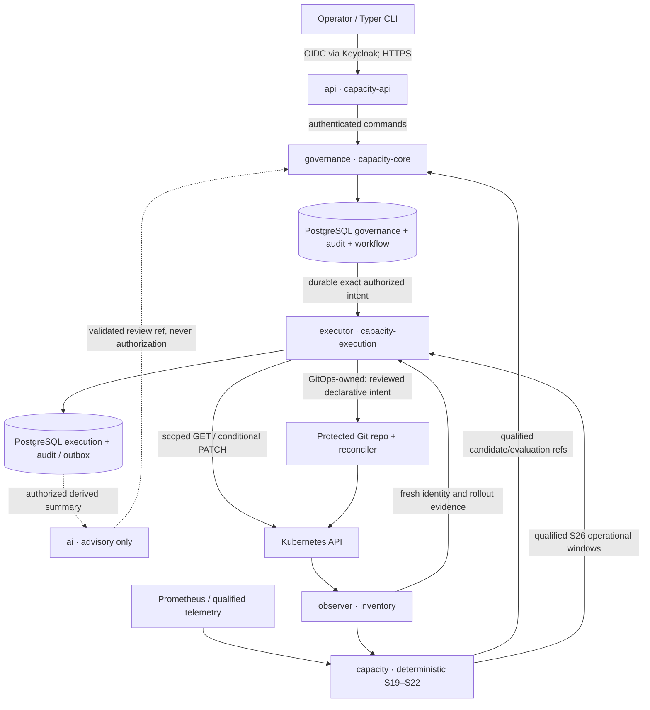
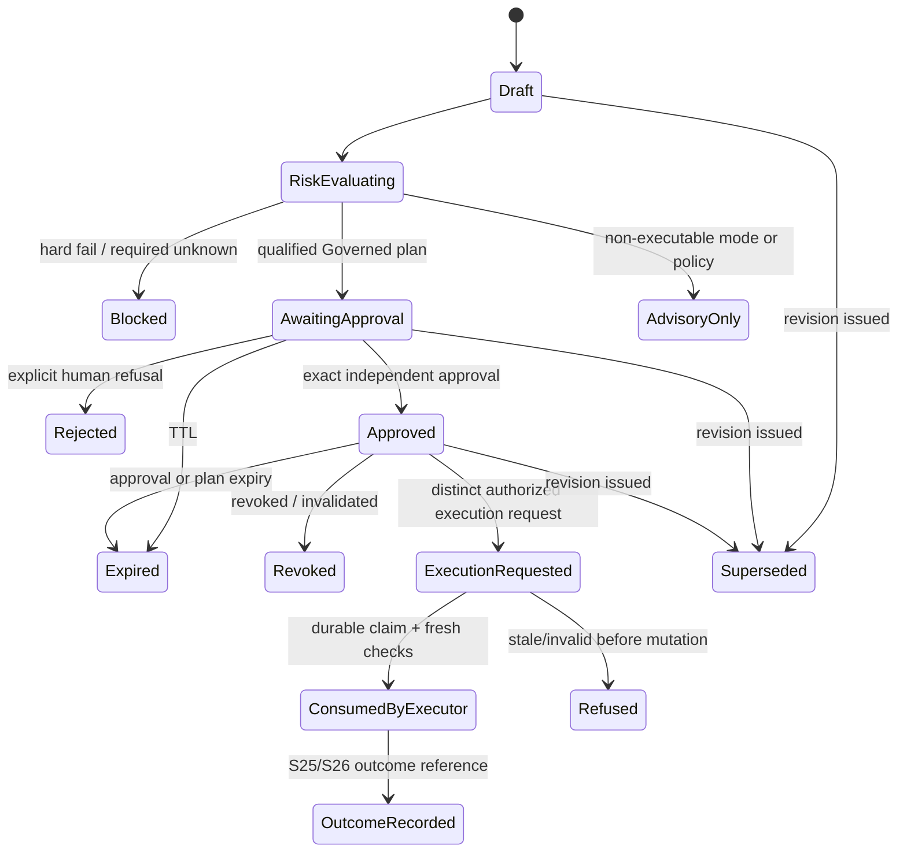
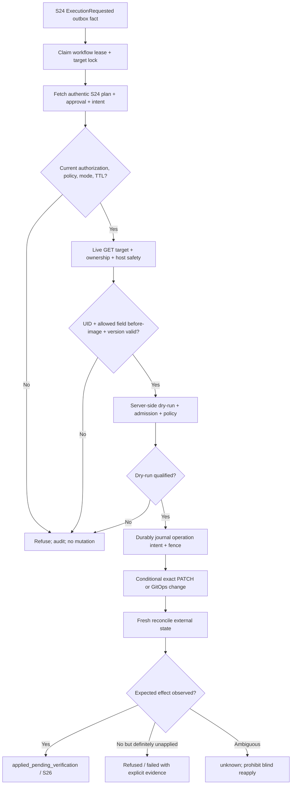
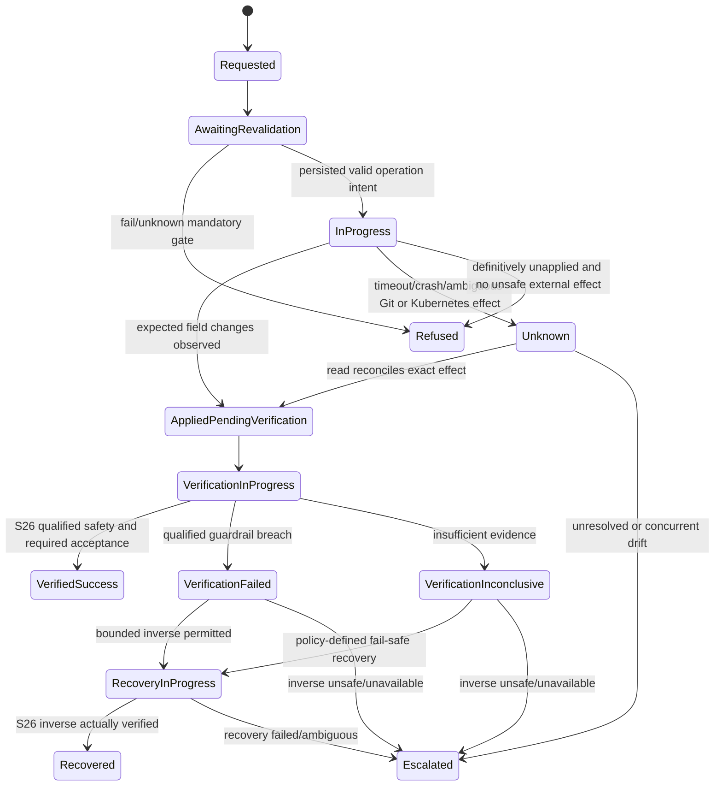
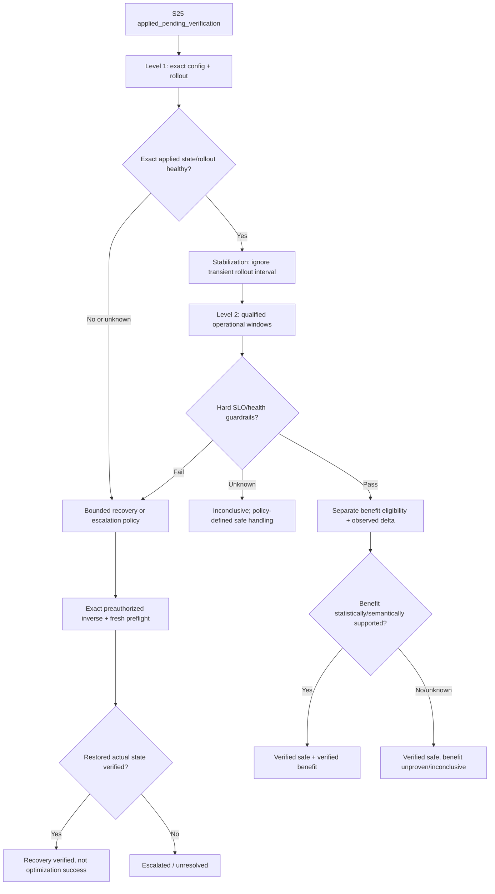

# Domain F — Decision Governance & Execution
## Consolidated accepted architecture: S24 + S25 + S26

> **Owner approval record — 2026-11-19.** The project owner approved all eight Domain F architectural decisions: **F01** immutable plan revisions/deterministic governance; **F02** one independent authorized human approver with author–approver separation; **F03** layered fail-closed risk gates; **F04** durable reconciliation-based Executor; **F05** direct Kubernetes primary P0 path with ownership-aware GitOps adapter; **F06** separate configuration/rollout and operational verification; **F07** preauthorized bounded inverse recovery; **F08** immutable outcome evidence and controlled historical learning. The architectural requirements below give these decisions implementable meaning without claiming live deployment, tests, calibrated thresholds, actual GitOps controller, cryptographic signing service, cluster status, realized savings, or safe rollback. Explicitly provisional values remain provisional.

> **Authority/precedence.** The master catalog and previously accepted S01–S23 ADRs take precedence. No accepted upstream architectural decision is silently revised here. When this consolidated document adds logical schemas or proposed implementation details, they must be reconciled with owning S02/S06–S13/S19–S23 contracts. `MUST` identifies an architecture requirement; `SHOULD` is a preferred implementation; `MAY` is optional. `Accepted architecture` does **not** mean `implemented` or `verified`.

## 0. Executive contract and architectural invariants

**Purpose:** Convert *qualified deterministic analytical candidates* into *exact human-authorized decisions*, apply *only the bounded verified operation*, determine *actual safety and empirical benefits* from qualified observations, and execute *only the already-authorized inverse recovery* when safe. Preserve irreducible distinctions:

`ResourceCandidate != OptimizationEvaluation != ExecutionPlan != ApprovalRecord != ExecutionIntent != AppliedChange != VerifiedOutcome`.

1. AI models, RAG documents and logical agents have **no approval, Kubernetes-mutation, experiment-control or recovery-authorization authority**; the Risk Reviewer is advisory, not a human approver.
2. The platform permits Observe/Advisory/Governed modes and L0–L2 only; only **Governed** with current exact human authorization may create a live optimized mutation. Mode changes revoke ability to start new changes; execution/recovery handling of an already-started hazardous change is governed by bounded safety policy, not a mode bypass.
3. S19 hard constraints are non-negotiable and are re-evaluated on plan creation, approval and immediately before attempted execution. Unknown mandatory evidence is **not pass**. S24 may be more restrictive than S19, not weaker.
4. **P0 mutation boundary:** one allowlisted demo controller at a time; exact selected container CPU/memory request/limit fields (single or explicitly compatible combinations), per S20. No arbitrary JSON/YAML, shell, Pod eviction, node updates, replica changes, affinity/taint/priority mutations, HPA edits, secret/RBAC mutations, broad reset, or platform/identity/security/observability targets.
5. `requested`, `limited`, `allocatable`, `observed`, `forecasted`, `simulated`, `applied` and `realized` metrics remain separately typed, with units, time, workload incarnation and provenance. A 100m request decrease means 100m reservation reduction per matching Pod at steady state, **not** 100m measured CPU savings.
6. Plan/approval authorization binds exact canonical payload, target cluster incarnation/namespace/controller UID/container, before/after fields, policy and evidence references, adapter, expected preconditions, recovery envelope and validity. Any content change requires a new plan revision and new authorization.
7. The trusted `executor` independently validates the authoritative approval and live Kubernetes/Git ownership/preconditions. A durable event/HTTP response and a resourceVersion from an old inventory snapshot are insufficient.
8. PostgreSQL workflow is **at-least-once**, Kubernetes/Git changes are external effects and are not atomically committed with SQL. Intent-before-write, safe fencing and observation-before-retry are mandatory. Neither an expired lease nor an API timeout is proof that a change did not apply.
9. `applied_pending_verification` means only that intended configuration was seen. `verified_safe`, `benefit_verified`, `verification_inconclusive`, `recovery_verified` and `escalated` are distinct adjudications supported by evidence.
10. A rollback is a **new external mutation** within an **exact preauthorized inverse envelope**; current identity, field state and ownership still require independent validation. Otherwise suspend and escalate; never blindly restore from a stale baseline.
11. Fully local, one kind control plane plus three workers on a shared Windows 11/Docker Desktop/WSL2 host, with host pressure and scenario exclusivity enforced. Kind workers are not independent physical host failure domains.
12. Preserve exactly six custom persistent platform Deployments: `api`, `observer`, `capacity`, `ai`, `governance`, `executor`; one PostgreSQL with seven domain schemas, existing jobs/outbox, no mandatory message broker or seventh custom runtime.
13. Experimental S05 runner/watchdog use **different narrowly scoped authority** from optimized Executor changes. No S05 cleanup may inadvertently revert S25's authorized change. Experimental data origins/measurements and B0–B3 studies are explicitly tagged.
14. Cryptographic signing, admission and audit integrity support truthful provenance, but a signature, Git merge, deployment admission or Risk Reviewer opinion is never human execution approval.

### 0.1 Dependency/authority reconciliation matrix

| Source | Previously accepted decision | Binding Domain F result |
|---|---|---|
| Master / S01 | Local AIOps; Observe/Advisory/Governed, L0–L2; human-governed operations; four criticality classes; current/1h/conditional 24h; B0–B3 | Deny mutations outside Governed, treat simulation separately from empirical results; no L3 |
| S02 | Six Deployments; bounded authenticated REST; PostgreSQL durable jobs/outbox; `governance`, `execution`, `audit`, `workflow` separate owners | No separate approval engine/controller/queue; single writer per authoritative aggregate |
| S03 | 1+3 kind, platform-tainted worker and two experiment workers, Calico default-deny, host budgets, local HTTPS and independent backups | Enforce physical host pressure; only allowlisted experiment workload namespaces; actual resource envelopes provisional |
| S04 | W01 Critical; W02/W03 Standard; W04/W05 Flexible; W06 Opportunistic; four baseline Deployments, W05 suspended CronJob, W06 on-demand Job; W02 HPA off baseline | Controller and class-specific verification; no accidental Job-template/HPA execution support expansion |
| S05 | Host Typer experiment orchestrator, SQLite journal, separate watchdog, ephemeral `capacity-experiments` driver Jobs, scoped cleanup | Experiment authority distinct; serialization/exclusivity with S25 and evidence-compatible S26 windows; S03 namespace addendum still required |
| S06 | Keycloak/OIDC; action + role + resource scope + conditions; nonhierarchical Admin; author–approver separation | Check current roles/scopes on approval, execute-request and Executor claim; no token reuse as background credential |
| S07 | Dedicated SAs; `capacity-executor-sa` with least-privilege write; `observer` read-only; Calico; TLS/selective mTLS | Only Executor writes optimized Kubernetes resources; no Kubernetes credentials in `ai` or drivers |
| S08 | Vault+ESO; offline root/cert-manager intermediate; PSA Restricted+native CEL; classified data; protected independent audit/backup | Separate signing/key custody, no secrets in evidence, admission defense-in-depth, audited lifecycle |
| S09 | Trusted in-process AI Tool Authorization Broker, read-only agents, authorized RAG and host Ollama gateway | No AI-provided plan contents or approval accepted as trusted execution authority |
| S10 | P1 OCI Distribution Registry, Syft/Trivy, Cosign, Sigstore Policy Controller, runtime conformance | Evidence may cite trust verdict; P1 live installation is not falsely claimed P0 precondition where not yet deployed |
| S11 | `observer` LIST/WATCH/reconcile; UID lineage, scheduler effective requests, snapshot quality | Target state from fresh K8s GET; immutable S11 ref for historical before/after; `resourceVersion` opaque |
| S12 | Prometheus quality-qualified registered queries, no missing-as-zero, sampled peak limitations | S26 metrics from approved query IDs and adequate windows, not raw unrestricted PromQL |
| S13 | One PostgreSQL; `inventory`,`capacity`,`knowledge`,`governance`,`execution`,`audit`,`workflow`; owned records and immutable evidence | S24 owns plans/approvals; S25–S26 `execution` attempts/outcomes; immutable refs/pinning and outbox |
| S14 + companion | Deterministic statistical-first forecasts, uncertainty/quality/refusals, conditional Job demand | Only deterministic numeric values; no invented outcome probability; retrospective observations separate |
| S15–S18 | Host Ollama, fixed Analyst→Planner→Reviewer Microsoft Agent Framework flow, typed tools, pgvector+FTS RAG | Validated advisory can inform review but cannot overwrite deterministic safety/approval; index derived outcome summaries only |
| S19 | Effective hierarchical policy, hard gates, `pass/fail/unknown/not_applicable`, governance owns policy lifecycle | Re-resolve current effective policy; unknown required gate refuses approval/execution |
| S20 | Bounded deterministic single-controller CPU/memory request/limit candidate, HPA coupling and QoS safeguards | Exact supported field-set, per-container mutation, no unbounded manifest mutations |
| S21 | Supported/unsupported scheduler feasibility and fragmentation fidelity | Qualified simulation does not prove future scheduler success; live preflight and rollout observation required |
| S22 | Deterministic qualified hypothetical evaluation/ranking; B0–B3 distinction | `qualified` is not approved/applied/benefit; exact evaluation reference required |
| S23 | P1 autoscaling advanced advisory, active HPA interaction | No silent P0 HPA scale/update authorization or mutation-field expansion |

### 0.2 Trust, deployment and data topology



| Runtime / role | May write | Must not write |
|---|---|---|
| `governance` | `governance` plans, approvals, final policy, intents; owner-controlled outbox/audit append | Kubernetes, `execution` authoritative outcomes, AI knowledge |
| `executor` | `execution` attempts, reconciliation, verification and recovery outcomes; scoped Kubernetes P0 target fields or authorized GitOps adapter | Approval/policy creation, `capacity` forecasts/candidates, AI knowledge, broad cluster admin |
| `capacity` | `capacity` deterministic analysis, S26 qualified metrics/results per owner contract | `governance` approvals, `execution` state, Kubernetes optimized writes |
| `observer` | `inventory` snapshots | Kubernetes mutations, approval/execution facts |
| `ai` | `knowledge` advisory and authorized derived outcome descriptions | `governance`, `execution`, Kubernetes, GitOps credentials |
| `api` | no independent authority; authenticated command routing | mutation via direct kubeconfig or SQL bypass |
| Audit append path | integrity-protected `audit` facts under S08 mechanisms | historic record rewriting/erasure |

**DB nuance:** Transactional domain writes/outbox are within the same service's permitted transaction. Cross-domain references are IDs and bounded authorized APIs/read projections; do not introduce a shared multi-schema write ORM. Executor reads authentic Governance plan/approval/intents through a narrow verified read interface or strictly scoped read-only projection, not mutable copies issued by AI or HTTP headers. Ownership of audit append/anchor mechanism is shared S08/S13/S28 and is an integration gate, not an excuse to grant all services a broad audit DBA role.

### 0.3 Mode vs workflow permission

| Mode | Analyze/simulate | Draft/inspect plan | Approve an exact plan | Submit live intent | Apply/recover |
|---|---|---|---|---|---|
| Observe (L0) | Authorized read | Not actionable; read-only historical view | No live authorization | No | No new optimized mutation |
| Advisory (L1) | Yes | Yes (non-executable) | No live execution authorization | No | No new optimized mutation |
| Governed (L2 maximum) | Yes | Yes | Yes, with human + policy checks | Yes, distinct Executor/submit permission | Trusted executor only, bounded scope |

An approval recorded in Governed mode does **not** remain executable after global mode changes to Advisory/Observe. Re-enabling Governed requires current authorization and policy revalidation; a previously canceled/expired/revoked intent is not silently reactivated. In-flight safety recovery must follow its preauthorized safety envelope and explicit S28 policy (not start an unrelated optimized change).

---

# S24 — Recommendation Lifecycle & Risk Governance [P0]

## S24.1 Mission, requirements and excluded capabilities

**Mission:** Turn immutable S20/S22 deterministic analysis, current S19 policy and optional S16 advisory into a clear, scoped, integrity-bound, human-approvable exact plan, while maintaining durable approvals, denial reasons, current mode and independent execution intent authorization.

| ID | Functional requirement | Essential acceptance |
|---|---|---|
| S24-FR-001 | Resolve immutable S20 candidate and S22 evaluation with exact digests and target lineage | Non-existent/mismatched/conflicting ref denied |
| S24-FR-002 | Resolve effective S19 policy, required gates and current S24 governance restrictions | Hard failed/unknown gates cannot be qualified |
| S24-FR-003 | Create revisioned immutable `ExecutionPlan` with canonical typed bounded mutation and inverse | Edited values create a new revision/digest |
| S24-FR-004 | Validate mode and workload/controller/action allowlists, supported adapter ownership | Outside Governed cannot issue executable approval |
| S24-FR-005 | Distinguish deterministic-only, degraded advisory, and complete three-agent review | Incomplete B3 review not called B3 complete |
| S24-FR-006 | Authenticate human approver, enforce current action/scope and author–approver separation | Plan author/self-approval and Admin bypass denied |
| S24-FR-007 | Bind approval to exact plan digest/target/action/policy/evidence/validity | A changed field invalidates prior approval for new revision |
| S24-FR-008 | Allow reject, revoke, expire, supersede and record reason without deleting history | Every decision attributed and append-audited |
| S24-FR-009 | Admit execution request only under Governed, with distinct `execute_request` permission | Approver role alone does not imply Executor authority |
| S24-FR-010 | Durably persist exact ExecutionIntent and outbox transactionally | Replay deduplication never produces additional authority |
| S24-FR-011 | Query scoped plan/approval/risk status and policy reason codes | Cross-namespace ID probing is nondisclosing |
| S24-FR-012 | Pin evidence/plan dependencies for S13 retention and S26 recovery | Missing pinned critical before-image blocks execution |
| S24-FR-013 | Reject stale cluster incarnation/current policy revocation/plan expiry | No stale approval bypass through job queue |
| S24-FR-014 | Record immutable audit of decisions/attempts, no access tokens or secret values | Tamper/backdating test detects discrepancy |

**Non-goals:** LLM making approval decisions, multi-person quorum in P0, static admin superuser, arbitrary operator-authored patch JSON, agent-created numeric resource values, new policy microservice, cross-controller atomic plans, generic runtime remediation, automatic experiment orchestration, automatic execution from S22 ranking.

## S24.2 Decision F01 — Immutable plans and deterministic plan issuance

S24 only promotes a candidate if: (a) a qualified S20 resource candidate exists; (b) the S22 evaluation is consistent with the candidate, policy and snapshot, with required S19/S21 findings `pass` or justified `not_applicable`; (c) S24 checks complete the governance-specific authority/approval/ownership/reversibility envelope; and (d) immutable evidence digests can be dereferenced with the invoking actor's scope. The precise eligibility designation is **S24-governance-qualified**, different from S22's **analytically-qualified**.

**Revision policy:** `planId` is stable logical identity; `revision` monotonically increases; `(planId,revision)` is immutable. Candidate change, policy digest change, action/target change, recovery scope change, material evidence revision, adapter or target precondition update produces a new revision and requires independent fresh review. An old revision's approval is not transferred. Historical decisions remain visible to authorized auditors. Canonical digest uses a documented deterministic canonical JSON profile, normalized key ordering, number/units and timestamps. Exclude non-semantic display fields from the authorized canonical payload only through a versioned schema; never accidentally omit a safety-relevant field. SHA-256 content integrity must be verified by an independently trusted writer, with signed/externally anchored audit lineage under S08. A digest alone is not an identity signature.

### S24.2.1 ExecutionPlan v1alpha1 (logical contract)

```yaml
schemaVersion: execution-plan/v1alpha1
planId: plan-example-001
revision: 1
planDigest: sha256:resolved-from-canonical-payload # illustrative
createdAtUtc: "2026-11-19T08:00:00Z" # illustrative
expiresAtUtc: "2026-11-19T08:15:00Z" # provisional policy example
createdBy:
  oidcIssuerRef: trusted-keycloak-issuer
  subjectRef: stable-author-subject
  actorAuthorizationRef: current-grant-decision
modeAtCreation: Governed
intendedUse: governed_execution
target:
  clusterIncarnationRef: exact-s11-cluster-ref
  namespace: workloads-critical
  logicalWorkloadRef: w01-latency-api
  controller:
    apiVersion: apps/v1
    kind: Deployment
    name: latency-api
    uid: exact-kubernetes-uid
    generationAtAnalysis: 9 # illustrative
    resourceVersionAtAnalysis: opaque-string # not a future CAS substitute
  containerName: app
  workloadCriticality: Critical
operation:
  actionSet: [cpu_request]
  patchFormat: typed-resource-field-set/v1alpha1
  approvedFieldChanges:
    - {field: cpu_request, beforeMillicores: 300, afterMillicores: 200}
  expectedBeforeImageRef: immutable-s11-before-image
  requestedOnlyNoReplicaChange: true
provenance:
  candidateRef: exact-s20-resource-candidate-ref
  evaluationRef: exact-s22-optimization-evaluation-ref
  policyRef: immutable-s19-effective-policy-ref
  policyDigest: sha256:exact-effective-policy
  inventorySnapshotRef: exact-s11-ref
  observationRefs: [qualified-s12-evidence-ref]
  forecastRefs: [exact-s14-ref-if-applicable]
  simulationRefs: [exact-s21-s22-refs]
  advisoryReviewRef: optional-validated-s16-ref
  advisoryReviewStatus: complete_or_deterministic_only_or_incomplete
risk:
  findingsRef: immutable-s24-findings-ref
  allRequiredHardGatesPassed: true # independently derived, never caller-supplied
execution:
  adapter: direct_kubernetes
  preconditionsRef: exact-target-preconditions-ref
  protectedChangeWindowRef: versioned-window-policy
  maxOperationScope: single_controller
  idempotencyDomain: plan-revision-target
  requiredLiveMode: Governed
recovery:
  type: preauthorized_exact_inverse
  inverseFieldChanges:
    - {field: cpu_request, beforeMillicores: 200, afterMillicores: 300}
  recoveryPolicyRef: exact-recovery-policy-ref
  expectedPostApplyRef: exact-approved-after-image
  maxInverseAttempts: 1 # proposed, provisional
verification:
  policyRef: workload-class-verification-policy
  baselineEvidenceRef: qualified-baseline-ref
  observationProfileRef: registered-s12-query-profile
classification: Confidential
```

**Important:** All example refs, timestamps, numbers and success booleans are *synthetic structural examples*. A real plan's `allRequiredHardGatesPassed` is populated **only** by trusted Governance computation; clients cannot assert it. `resourceVersionAtAnalysis` is retained for provenance and diagnostic drift detection but must not be mistaken for the value used in the final live compare-and-set. The before-image is exact per-container resource fields plus any dependencies necessary to confirm no unauthorized mutation, not a secret-bearing full Kubernetes object.

### S24.2.2 Plan consistency and deterministic issuance pseudocode

```python
def issue_plan(actor, candidate_ref, evaluation_ref, policy_ref):
    require_authorized(actor, "plan:create", scope_from_refs())
    candidate = resolve_and_verify_s20(candidate_ref)
    evaluation = resolve_and_verify_s22(evaluation_ref)
    policy = resolve_current_effective_policy(policy_ref, candidate.target)
    require_consistent(candidate, evaluation, policy)  # same cluster, UID, action and evidence
    require_qualified_required_gates(evaluation, policy)  # unknown mandatory => deny
    require_supported_single_controller_resource_fields(candidate)
    require_no_active_unsupported_hpa_or_vpa_interaction(candidate)
    require_ownership_and_recovery_contract(candidate)
    require_mode_allows_plan_state(current_mode())
    return persist_immutable_plan_and_risk_in_one_governance_transaction()
```

## S24.3 Decision F03 — Layered risk and fail-closed policy

| Gate layer | Checks | Required failure semantics |
|---|---|---|
| A. Identity and scope | Authenticated OIDC author/approver, allowed namespace/action, current grants, author separation | `authorization_denied` without disclosing foreign existence |
| B. Product/mode | Governed, L2 only; workload criticality class, single-controller P0 catalog | `mode_not_governed`, `unsupported_action` |
| C. S19 optimization | Current effective policy digest, hard gates/quality and supported S21 fit | `hard_gate_failed`, `hard_gate_unknown`, `policy_superseded` |
| D. Evidence integrity/temporal | S11 UID lineage, S12 coverage/freshness, S14 qualifiers and S13 digest/pin | `evidence_invalid`, `evidence_stale`, `identity_ambiguous` |
| E. Workload operational | W01 p95/errors/throttling, W02 bursts/HPA, W03 memory/OOM, W04 queue/completion, relevant batch temporal caveats | fail or unknown, not score bonus |
| F. Mutation compatibility | Safe request/limit relation, QoS/limit default behavior, permitted delta, rollout and host capacity, unsupported concurrent controllers | `mutation_incompatible`, `host_pressure`, `scenario_exclusive` |
| G. Execution/recovery readiness | exact field before/after, verified direct/GitOps owner, safe inverse, current admission capability/required trust | `adapter_unqualified`, `recovery_unavailable`, `ownership_ambiguous` |
| H. Advisory | S16 review ref and provenance, contradictions, missing or poisoned RAG data | `review_incomplete` for required B3 path; deterministic-only alternative distinctly labeled |

Rule result: `{ruleId, phase, status: pass|fail|unknown|not_applicable, reasonCode, severity, sourceEvidenceRefs, evaluatorRevision, policyDigest, evaluatedAtUtc}`. `not_applicable` only if the versioned rule itself establishes no applicability; an absent signal cannot be relabeled `not_applicable`. Mandatory `fail` or `unknown` blocks live approval/execution. Soft risk dimensions can rank/report only after all mandatory gates clear. No model-generated risk probability without calibrated causal evidence. S19 remains owner of deterministic optimization rule semantics; S24 adds current human authorization, approval, temporal and execution readiness.

**Agent review modes:** A *deterministic-only* review may be made available and labeled (B2), provided its S19/S22 and S24 risk gates are complete. If the operator selects the full S16 B3 `optimization_review` workflow, the exact Analyst→Planner→Reviewer validated stages are required; incomplete/failed B3 cannot silently fall back to `complete`. Whether a deterministic-only P0 plan can execute depends on an explicit current S24 policy that states advisory evidence is optional, while no hard-gate evidence may be optionalized. If that policy is unset/ambiguous, block execution and allow only advisory inspection.

## S24.4 Decision F02 — Human approval and separation of duties

**Identity:** Keycloak access token at the API; independently verified delegated attribution for Governance; current user/group/grants from S06 authority and governance resource scopes. A valid token alone is insufficient after permission revocation. Human `sub` identity used for separation (not display name/email). Require MFA/recent authentication for approval-capable accounts if S06/S08 policy qualifies it; exact `auth_time` window is provisional pending S27.

**P0 approval rule:** exactly one independent authorized human approver; author != approver, with no Admin override. Approval is an explicit authenticated command, not a checkbox state in an AI document, no agent function call and no inferred consent. An `Executor` platform role (human privilege) may submit an `execute_request` but does not obtain the Executor service's Kubernetes mutation credential. A plan Approver alone does not automatically get `execute_request`.

| Permission / operation | Viewer | Analyst | Planner | Approver | Executor-role human | Administrator |
|---|:---:|:---:|:---:|:---:|:---:|:---:|
| Scope-bounded read/status | Y | Y | Y | Y | Y | Y, scoped |
| Request deterministic analysis | N | Y | Y | N | N | only if separately granted |
| Create plan revision | N | N | Y | N | N | only if separately granted |
| Approve/reject plan | N | N | N | Y | N | only if separately granted Approver permission **and not author** |
| Revoke own/admin-authorized approval | N | N | N | Y, scoped | N | delegated scope only |
| Request approved execution | N | N | N | N | Y | only if separately granted |
| Execute direct API or Git mutation | N | N | N | N | N | N — `executor` machine SA only |
| Request exceptional recovery | N | N | N | policy-defined | policy-defined | no bypass; fresh separate authorization |

*Roles are an initial permission mapping, not universal hierarchical inheritance. Current action+scope+conditions and separation of duties remain authoritative. Operators may possess multiple role labels; the author–approver separation still denies self-approval.*

### ApprovalRecord v1alpha1

```yaml
schemaVersion: approval-record/v1alpha1
approvalId: immutable-id
planRef: {planId: exact-id, revision: 1, planDigest: sha256:exact}
decision: approved # or rejected, revoked, expired (as lifecycle facts)
approver:
  issuerRef: Keycloak-issuer-ref
  humanSubjectRef: exact-oidc-sub
  currentGrantDecisionRef: verified-authorize-s24-approval
  authenticationFreshnessRef: policy-qualified-auth-context
binding:
  clusterIncarnationRef: exact-ref
  namespace: workloads-critical
  controllerUid: exact-uid
  actionSet: [cpu_request]
  approvedChangeDigest: sha256:exact-fieldset
  evidenceManifestDigest: sha256:exact-evidence
  effectivePolicyDigest: sha256:exact-policy
  adapter: direct_kubernetes
  recoveryEnvelopeDigest: sha256:exact-inverse
  verificationPolicyDigest: sha256:exact-verification
issuedAtUtc: "2026-11-19T08:01:00Z" # illustrative
expiresAtUtc: "2026-11-19T08:16:00Z" # illustrative; time-bound
reasonCode: explicitly_approved
approvalPayloadDigest: sha256:canonical-record-content
auditRef: protected-audit-event-ref
```

**Revocation and expiry:** Store explicit append-only facts; effective approval is derived from the authoritative current record plus any revocations, plan revision, policy/mode and time. Do not rely on cache, token TTL or precomputed `approved=true` in an outbox message. Default example approval TTL **15 min is provisional**; pin via versioned policy after testing turnaround and host limits. Expiry ends authority to initiate the change; once an external operation is in progress, S25/S26 must reconcile actual effect and use preauthorized safety recovery or escalation, not assume automatic undo.

## S24.5 State machines and legal transitions



Use **separate aggregate state** for plan revision, approval lifecycle, ExecutionIntent and Executor operation. `Approved` is not `Executed`. S24 records immutable transitions with an expected aggregate version (`compare-and-swap` in SQL) and an outbox fact atomically. One plan revision has a maximum of one *live* execution intent unless an explicit revised authorization workflow creates a distinct retry policy; duplicate command idempotency keys return the same intent rather than opening a parallel attempt.

**ExecutionIntent v1alpha1:** `{intentId, planId, planRevision, planDigest, approvalId, approvalDigest, requesterSubjectRef, requesterGrantRef, creationTime, expiry, currentModeRef, targetKey, operationDigest, adapter, recoveryDigest, maxAttemptsPolicyRef, intentDigest, state, outboxEventId}`. Do not persist raw OIDC bearer tokens. The machine-only durable handoff is not a mutation bearer credential; Executor independently queries authoritative state and policy.

## S24.6 S24 interfaces, permissions and persistence

| Logical authenticated operation | Writer/reader | Contract and authorization |
|---|---|---|
| `governance.create_plan_revision.v1` | Governance writes | Planner `plan:create`, exact eligible S20/S22 refs, scope, policy; immutable plan ID+revision |
| `governance.get_plan.v1` | Governance reads | scoped plan+evidence disclosure; no raw Restricted data |
| `governance.evaluate_plan_risk.v1` | Governance writes | versioned current policy, typed findings; bounded re-evaluation job |
| `governance.submit_approval.v1` | Governance writes | Approver permission, fresh current scope, author != approver, canonical binding |
| `governance.reject_or_revoke.v1` | Governance writes | authorized action, append historical fact, reason |
| `governance.request_execution.v1` | Governance writes | `execute_request` permission, Governed mode, currently effective approval, one live intent |
| `governance.get_execution_authority.v1` | Governance authoritative read | only trusted Executor machine; immutable plan+approval and current validity; independent verification |
| `governance.inspect_policy.v1` | Governance reads | allowlisted scoped effective policy without secret data |

S27 owns eventual public URLs/OpenAPI/Typer names and error envelopes. REST for synchronous user commands; long checks/jobs via S02 `workflow`. `governance` stores plan revisions, findings, approvals and intents; write its own outbox in the same transaction. Audit facts have correlation/causation/event time and independently verifiable integrity; precise retention/pins under S08/S13/S28. No cross-schema write to `execution` to mark successful execution.

**Failure rules:** Keycloak/JWKS unavailable for privileged action → deny newly created approval; DB unreachable → no authorization; policy cannot be resolved → no live plan authorization; S13 critical evidence lost/retention purge → deny and record missing ref; advisory inference unavailable → only explicitly policy-qualified deterministic path, never fabricated B3. Plan deletion is logical tombstone only with protected audit retention, not erasure of approved history.

## S24.7 Threats, negative tests and acceptance

| Test | Expected proof |
|---|---|
| S24-T01 Approve a plan authored by same `sub` (including two role labels) | Reject; no approval fact |
| S24-T02 Admin with no explicit Approver permission | Reject; Admin not bypass |
| S24-T03 Change 200m after approval to 180m / patch container name | Digest mismatch, approval nontransferable |
| S24-T04 Revoke grant after token issuance, reuse old token | Current authorization denies |
| S24-T05 Expired/revoked/superseded plan replay | No new execution intent |
| S24-T06 Candidate qualified by S22 with unknown mandatory S19 gate | Not live-approvable |
| S24-T07 AI sends forged approval JSON or advisory with `approved:true` | No approval authority; untrusted field ignored |
| S24-T08 OIDC cross-namespace guessing on plan ID | No foreign object metadata disclosure |
| S24-T09 Concurrent approval/revocation/intent requests | Durable serializable/CAS state and no parallel live intents |
| S24-T10 Advisory/Observe toggled after approval | No new external mutation |
| S24-T11 Missing required B3 Reviewer stage | Cannot claim completed B3; B2 only if explicit policy allows |
| S24-T12 Tampered signed audit or canonical payload | Integrity verification fails; audited incident |

### S24 accepted ADRs

- **F01 — Accepted:** Exact revisioned immutable plan, typed canonical change and digest, deterministic issuance and final governance independent of AI.
- **F02 — Accepted:** Single independent current-authorized human approver; author/approver separation, no Administrator bypass, exact time-bound plan binding.
- **F03 — Accepted:** Layered deterministic fail-closed gates; S19 non-negotiable constraints preserved; required `unknown` is not approval-eligible.

---

# S25 — Controlled Execution & GitOps Integration [P0]

## S25.1 Mission, requirements and non-goals

**Mission:** Consume only durable authentic S24 approved execution intents, revalidate all privilege and live resource conditions, apply the precise permitted CPU/memory change to a directly-managed workload or qualified GitOps desired-state source, then reconcile external effects after success, ambiguity, crash or timeout.

| ID | Requirement | Acceptance criterion |
|---|---|---|
| S25-FR-001 | Executor authenticates to Governance, verifies plan/approval/intent independently | No mutation with forged event/approval cache |
| S25-FR-002 | Recheck Governed mode, current policy/subject grant, expiry and exact target/action/adapter | Revoked/expired authority is denied before new write |
| S25-FR-003 | Limit P0 to single supported demo Deployment controller and approved CPU/memory fields | Cannot alter replica count, labels, image, SA, platform workloads |
| S25-FR-004 | Live Kubernetes GET, UID/incarnation and field before-image validation immediately before operation | Stale UID, changed field or unsupported HPA denies |
| S25-FR-005 | Verify ownership; direct vs GitOps routing; ambiguous ownership fails closed | Never direct-patch active Git-owned desired state |
| S25-FR-006 | Server dry-run/admission and latest versioned S19/S24 safety checks before apply | Dry-run passing does not imply eventual success |
| S25-FR-007 | Durable attempt intent, target lock/lease/fence, idempotency/retry budgets | No duplicate unauthorized effect under at-least-once dispatch |
| S25-FR-008 | Compare-and-set exact Kubernetes resource version with approved field scope | Mid-flight conflict never blind-overwrites another actor |
| S25-FR-009 | Reconcile ambiguous external effects with actual K8s/Git desired state | API timeout not assumed failure |
| S25-FR-010 | Distinguish accepted request, Git proposal, Git merge, observed apply and S26 verified result | No false execution-success events |
| S25-FR-011 | Only independent `capacity-executor-sa` holds bounded Kubernetes mutation privileges | No K8s token via AI/runner/API/governance |
| S25-FR-012 | Support exclusively preauthorized, independently checked S26 inverse recovery | Recovery cannot mutate unrelated/changed fields |
| S25-FR-013 | Propagate structured audit and health metrics with no secrets | Restart/crash leaves recoverable journal |
| S25-FR-014 | Preserve S05 scenario and host safety serialization/blackout | Unsafe experiment concurrency blocks initiation |
| S25-FR-015 | Deny unsupported P1 S23 HPA / Job / multi-controller mutation | Explicit `unsupported_action` |

**Non-goals:** generic GitOps platform, installing mandatory Argo CD/Flux in this slice, unrestricted `kubectl`, custom Kubernetes Operator/CRD, API server admin access, Pod deletion/eviction, use of HPA scale subresource, changes to external cloud node capacity, node autoscaler, multi-target transactional orchestration, AI/LLM-generated patches, bypassing Vault/PSA/CEL/admission, guaranteed atomicity between DB and cluster/Git.

## S25.2 Decision F04 — Durable reconcile-first Executor

The Executor is a **separate existing custom Deployment**, `executor`, in `capacity-execution`, running under `capacity-executor-sa`. It owns all attempted optimized mutations, verification coordination and recovery. It is not a general automation shell and has no approval writer rights. The target-sensitive action mutex uses a durable target key `(clusterIncarnationRef, namespace, controller UID, container name)`; because request/limit combinations share rollout effects, serialize by controller rather than only by field. Include policy conflict with active S05 exclusive runs and any recovery-in-progress operations.



### S25.2.1 Ordered live preflight

1. Claim versioned workflow lease with per-controller mutex and fencing epoch; verify database and audit append availability. If unable to obtain an exclusive bounded lease, do not start mutation.
2. Dereference plan/approval/intent directly from Governance-authoritative interface; validate signature/digest/ref lineage and current revocations. Deny stale/canceled/expired/new-mode-ineligible state.
3. Authenticate Executor machine identity; enforce expected caller machine purpose and separate human `execute_request` subject; verify current resource/action grants via S06/Governance, not an outbox copy of a JWT.
4. Verify cluster incarnation/identity matches S11, selected kubeconfig context, namespace allowlist and exact live controller UID/container. Fresh Kubernetes `GET` is mandatory. `metadata.resourceVersion` is opaque and resource-scoped.
5. Re-check S19 current effective hard constraints and S24 governance restrictions with pinned policy compatibility; changed hard policy triggers refusal/refresh, not silent adoption of weaker rules.
6. Check state-changing controllers: HPA target current status (especially W02), VPA/update mode, owners, admission defaulting, LimitRange/resource quota, controller rollout health, high-priority workload protections and absence of unsafe concurrent work; fail on unknown safety-relevant interaction.
7. Verify S03 host pressure, S05 scenario exclusivity, S28 platform health, and change window. A running S05 exclusive experiment means no optimized mutation start unless explicitly controlled by a jointly approved study workflow without authority overlap.
8. Resolve GitOps ownership from a versioned registered ownership inventory **plus** live controller/field metadata and source revision/controller status. An annotation alone is not proof of ownership; unknown or dual ownership fails closed.
9. Match actual **before** CPU/memory values (including absent vs present limits) with approved exact per-container before-image, and ensure request/limit/QoS invariants. Drift in safety-dependent fields even outside changed paths may invalidate preflight.
10. Construct typed patch in trusted code from the approved field set; reject JSON pointer/path values from caller text. Verify server-side dry-run and admission effective outcome, including unexpectedly defaulted fields. Recompute exact permitted patch scope.
11. Persist operation-intent journal, payload digest, selected observed live UID/resourceVersion, fence and idempotency key **before** first external write.
12. Re-check bounded approval/policy/mode before write after meaningful wait. If authority expired while preflighting, do not initiate the mutation.

### S25.2.2 Direct Kubernetes adapter contract

**P0 direct operation:** `apps/v1` Deployment `spec.template.spec.containers[containerName].resources.requests/limits` exact subset of `cpu` and `memory` in permitted namespaces and only for eligible demonstrated controller (typically W01–W04). The accepted S20 action catalog also analyzes W05/W06 batch templates but does **not** automatically authorize editing CronJob/Job templates in P0; treat as advisory-only unless a separately approved bounded action expansion occurs.

**Implementation recommendation:** narrow typed JSON Patch with `test` preconditions for expected `metadata.uid` and `metadata.resourceVersion`, and exact before-value or existence checks on affected resource paths, followed by only approved `replace/add/remove`. Kubernetes JSON Patch `test` may compare object values; for presence/absence, explicitly handle canonical patch generation so an absent limit is not accidentally converted into a new, unapproved value. Index-based container path must be resolved from the latest GET and tested for exact container name/position; concurrent container reorder must fail preconditions. Do not merge or overwrite unknown fields. Use server-side dry-run with the same field set, then live conditional patch using the current (not historical) version; use the Kubernetes API's verified semantics, including admission behavior. Alternatively a Kubernetes-supported merge/strategic patch with strong explicit CAS is permitted only after proving **equivalent atomic checks**; do not blindly rely on a stale read plus merge patch.

**Field-management caveat:** server-side apply ownership, GitOps field manager and admissions may differ from JSON Patch semantics. Do not claim managedFields field ownership gives transaction isolation. Inspect actual object after operation, compare allowed field set, detect unexpected mutations/defaulting, and escalate/refuse unknown effects.

**Kubernetes RBAC:** exact namespace Role/RoleBinding, read/get and only required `patch` on Deployments for P0, plus narrowly justified event/rollout observation. Kubernetes RBAC `patch` permission alone cannot constrain field paths; CEL/admission and trusted typed adapter must reject unsupported fields/targets. No `roles`, `clusterroles`, `secrets`, `serviceaccounts`, `nodes`, `pods/exec`, `pods/eviction`, `deployments/scale` or platform-namespace writes. `resourceNames` may help when fixed but may not generalize; actual least-privilege roles and controls are pinned/tested in S07/S08/S29.

### S25.2.3 ExecutionOperation v1alpha1

```yaml
schemaVersion: execution-operation/v1alpha1
operationId: stable-idempotent-operation-ref
intentRef: immutable-s24-execution-intent-ref
planRef: {planId: plan-example-001, revision: 1, digest: sha256:exact}
attemptId: immutable-attempt-001
attemptOrdinal: 1
fencingEpoch: 3 # illustrative
claimedBy: capacity-executor-sa
preflight:
  observedAtUtc: "2026-11-19T08:02:00Z" # illustrative
  clusterIncarnationRef: exact-ref
  namespace: workloads-critical
  controllerUid: exact-k8s-uid
  controllerResourceVersion: opaque-live-get-value
  beforeFieldSetDigest: sha256:exact-current-approved-before
  effectivePolicyDigest: sha256:exact-policy
  approvalDecisionRef: current-authoritative-validity-proof
  ownershipRef: exact-verified-direct-ownership-proof
  hostSafetyRef: fresh-pressure-and-experiment-gate-ref
adapter: direct_kubernetes
operationFieldSetRef: immutable-approved-typed-patch
operationDigest: sha256:canonical-proposed-operation
intentPersistedAtUtc: "2026-11-19T08:02:01Z"
externalResponse:
  accepted: null # null until actually known
  responseResourceVersion: null
reconciliation:
  state: not_yet_observed
  observedTargetRef: null
  observedFieldsDigest: null
  uncertaintyReason: null
status: in_progress
```

Provenance timestamps and references above are illustrative. The state journal records intent before external effects, separate from attempts/results. Use unique SQL constraint keyed by plan revision + target + approved operation domain, and lock to avoid competing operations; each retry attempt has a distinct attempt ID but belongs to **the same** authorized operation. Initial max attempts/TTL are policy-provisional; safety and evidence, not a blind counter, govern retry eligibility.

## S25.3 State machine, SQL workflow and unknown effects



**Important:** This displays the combined S25/S26 workflow lifecycle for orientation; the `execution` domain stores an operation state plus independent S26 verification dimensions; don't collapse a verdict into a mutable `plan.approved` flag. `Partial` is a **reported reconciliation classification**, not permission to commit remaining mutations. Unknown/partial effects require observation and possibly escalation. Git proposal/merge states are recorded as substates, not `AppliedPendingVerification` until the cluster reflects exact intended live configuration.

**SQL transaction and outbound boundary:** `workflow` worker claims via `FOR UPDATE SKIP LOCKED` or equivalent bounded lease; `execution` journal records `intent_created`, fence, target mutex and outbox; commit transaction; then call external adapter. One writer per `execution` aggregate. If process dies after remote mutation but before SQL ack, the next worker GETs live target/Git state and reconciles; **never reissues patch just because lease expired**. Fencing epoch prevents an old worker committing stale SQL state, but cannot retroactively fence Kubernetes API calls already in flight. Therefore live target CAS, short bounded operation deadlines and no unchecked overlapping workers are essential. If the old external call's effect is uncertain, freeze target until reconciliation.

### S25.3.1 Failure matrix

| Failure | Required state and action |
|---|---|
| Governance plan or approval read unavailable | No new write; `awaiting_revalidation` / refused after bounded retries |
| Policy/mode revoked after intent | Before external write → refuse; after possible effect → reconcile and invoke only approved safety treatment |
| `409 Conflict` from concurrent Kubernetes edit | Re-GET, do not silently rewrite; new plan/reapproval if content/preconditions differ |
| Target UID or cluster incarnation changed | Refuse and escalate, never repurpose name to new UID |
| API request timeout/network break | `unknown`; observe actual object before reattempt; no assumption of failure |
| SQL commit fails before adapter call | No external write permitted; recover journal |
| DB fails after external call | Stop further writes; reconcile from journal/actual object when DB recovers; make uncertainty visible |
| Executor Pod killed mid-operation | New worker uses fence + external-state reconciliation; no blind replay |
| Active HPA/VPA or unexpected owner appears | Block new write or classify drift; never fight autoscaler |
| Rollout resource pressure / unschedulable | S26 guardrail failure/unknown and bounded recovery/escalation |
| Host pressure or exclusive S05 | Do not start new optimized change; in-flight operation follows S28/S26 safety policy |
| Git desired revision changed | Rebase/change only under newly authorized exact semantic content; otherwise reject/renew plan |
| Git push/PR succeeds but merge denied | Not applied; show pending/refused, never mark success |
| Git merge succeeds but controller sync fails | Pending/unknown; qualified remediation/escalation, not direct cluster override |
| Audit persistence/anchor unavailable for a new privileged operation | Fail closed if required protected audit cannot be assured |

## S25.4 Decision F05 — Verified ownership and two adapters

### S25.4.1 Ownership contract

`direct_managed | gitops_managed | ambiguous | unsupported`. Ownership proof should combine registered namespace/workload GitOps mapping, versioned repo/path/kustomization/Helm release (if relevant), live controller annotations, installed controller status, `managedFields` and actual desired revision/source evidence. No individual signal is sufficient where others conflict. An immutable exact ownership snapshot/ref belongs in plan. At execution time the Executor independently refreshes it. `ambiguous` and `unsupported` are hard refusals.

**No silent ownership switch:** A GitOps-managed candidate is not converted to direct patch on controller downtime. Direct-managed resources with unexpected reconciler ownership become blocked until human resolves provenance and reissues an authorized plan.

### S25.4.2 Direct API reference adapter

| Input | Result | Invariant |
|---|---|---|
| `ApprovedOperation` + `LivePreflight` + `DirectOwnershipProof` | `PreparedKubernetesPatch` | allowlisted exact fields, expected UID/version, no unapproved defaults |
| `PreparedKubernetesPatch` | `DryRunVerdict` | same patch semantics and admission as live; no success guarantee |
| `PreparedKubernetesPatch` + durable intent ref | `MutationSubmissionRef` | only Executor identity, current valid authority |
| `MutationSubmissionRef` | `ReconciliationEvidenceRef` | actual UID/resourceVersion/fieldset, no missing-as-success |

**Update ripple:** A Deployment template change creates new ReplicaSet/Pods, so compare live controller spec, `status.observedGeneration`, updated/available replicas, selectors, rollout trajectory and identity/age of new Pods. This is **not** immediate Pod resource modification. The baseline S04 four Deployments generally have one replica, but actual live status is authoritative.

### S25.4.3 GitOps conceptual adapter (deferred installation qualification)

**Accepted architecture:** an ownership-aware GitOps adapter exists in the S25 contract. **P0 reference operational path is direct Kubernetes**. Executable GitOps path is disabled (`adapter_unqualified`) until S29 chooses/builds a supported local GitOps repository/controller, restricted credentials, protected review/merge path, exact YAML/Helm/Kustomize field mapping, trustworthy source identity and integration tests. It is wrong to invent an accepted Argo CD vs Flux choice. No seventh custom business service is introduced.

1. Resolve approved ownership `repo identity + branch/ref + target file/path/overlay/release + controller/source revision + rendered target`. Never accept arbitrary user-supplied repository/URL/path at Executor time.
2. Verify expected Git source revision and canonical rendered Kubernetes resource identity before composing change. Derive exact resource fields from approved immutable plan; use parser/AST-aware edit or controlled values patch. A textual search-and-replace that edits multiple objects is forbidden.
3. Stage change in protected branch/commit with stable operation marker, exact source parent commit, rendered diff digest and provenance; no broad push token, no unsigned arbitrary script.
4. Require repo/branch protection and independent review/merge authorization as defined by GitOps owner policy; **S24 approval does not silently constitute Git merge permission**. Commit signature/release policy is independent of S24 human decision.
5. Observe PR/merge/revision and GitOps controller reconciliation. Record `proposed`, `review_pending`, `merged`, `controller_sync_pending`, `controller_applied`, `reconciliation_failed` separately.
6. `applied_pending_verification` requires live K8s state to match the approved desired resource and observed controller/reconciler identity. A successful Git commit alone is not applied.
7. Conflicting upstream Git changes, drift, controller errors or unexpected generated output stop the automatic operation. Do not force-push/rebase without fresh validated equivalence, never direct-patch to fight the reconciler.
8. For approved inverse recovery, author an inverse desired-state change with exact parent/expected post-apply content checks and protected merge, then observe restored live state. If approval/repo protocol cannot guarantee timely recovery, mark policy risk and restrict GitOps path until qualified.

**GitOps boundary decisions still open to S29:** Git provider (local Gitea or other), controller (Argo CD/Flux or equivalent), repository bootstrap, branch policy, API/client library, signing, semantic YAML renderer, credential rotation, webhook/polling, controller sync budget and release gates. The original project preference for local tooling is compatible but is not itself an approved choice of provider.

## S25.5 Concurrency, replay and fencing details

- **Target lock:** key on cluster incarnation+namespace+controller UID, unique current operation; `recovery_in_progress` holds the lock over new optimization attempts. A Kubernetes admission guard or explicit operator procedure is required to limit *out-of-band* writes; SQL locks cannot stop other Kubernetes clients.
- **Lease:** monotonic epoch in SQL; persistent lock expiry and heartbeat. Old worker cannot finalize new DB states after lease turnover. During ambiguous external effects, do not hand lock to new mutation; hand to a reconciler with read-only inspect permissions until resolved.
- **Idempotency:** `OperationKey = SHA256(planId|revision|planDigest|targetUID|operationDigest|adapter)` plus unique intent ID. Duplicate external events may create processing attempts, not another authorized operation. API retries without confirmation first reconcile.
- **Optimistic concurrency:** use live Kubernetes resourceVersion + UID + expected field checks on exact patch; for Git use exact commit/branch compare-and-swap (fast-forward/conditional ref update) and rendered field check.
- **Deadlines and retries:** total execution deadline, operation timeout and bounded retry budgets are policy/config versions. No arbitrary exponential retry for safety conflicts. All numeric ceilings provisional pending local S28/S30 measurements.
- **Timeout at the adapter:** means *unknown effect* until reconciled. Never mark failed solely from timeout; never mark success from ACK alone.
- **Restricted dry-run:** admission/server validation is a precondition, not a test that rollout, application behavior or scheduler placement will succeed. Failures in S10 P1 verifier cannot be silently waived if current installed/required policy demands that verifier.
- **Audit:** record job claim, authority proof, preflight state (sanitized), patch digest, dry-run verdict, submission, response and exact observed reconciliation with trace/correlation IDs.

## S25.6 S25 logical interfaces and testing

| Operation | Trusted caller / scope | Result |
|---|---|---|
| `execution.claim_intent.v1` | Executor worker, workflow ACL | leased exact intent or none |
| `execution.resolve_authority.v1` | Executor to Governance | current plan/approval/intent and policy validity |
| `execution.preflight.v1` | Executor only | typed immutable live preflight or refusal |
| `execution.prepare_direct_patch.v1` | internal Executor | typed patch + expected CAS + digest |
| `execution.prepare_gitops_change.v1` | internal qualified adapter | exact repo change and parent revision |
| `execution.submit_operation.v1` | Executor fenced owner | durable operation reference; not proof of application |
| `execution.reconcile_operation.v1` | Executor | applied/unapplied/unknown/partial, exact evidence |
| `execution.get_status.v1` | authenticated scoped read | operation and verification metadata; no credentials |

S27 owns operator-visible route spelling and CLI names. No direct externally exposed `execute_any_patch` endpoint.

| Test ID | Scenario | Mandatory outcome |
|---|---|---|
| S25-T01 | Forged `ExecutionRequested` event without current S24 approval | No mutation |
| S25-T02 | Approved plan, target UID recreated under same name | Refuse |
| S25-T03 | ResourceVersion changes between GET and PATCH | Conflict, no overwrite |
| S25-T04 | Patch attempts `replicas`, image, labels or privileged namespace | Type/admission reject |
| S25-T05 | Active W02 HPA unqualified | Refuse |
| S25-T06 | GitOps owner present; direct adapter forced | Refuse |
| S25-T07 | Git PR committed but not merged | Not applied |
| S25-T08 | Git merged but cluster not reconciled | Not applied/verified |
| S25-T09 | HTTP response lost after successful PATCH | Reconcile actual state, no duplicate effect |
| S25-T10 | Crash after operation intent before PATCH | Safe recovery with authority revalidation |
| S25-T11 | Crash after PATCH before SQL ack | Reconcile and no blind re-PATCH |
| S25-T12 | Lease expires while old worker request in flight | Fence SQL outcome, freeze target until read reconciliation |
| S25-T13 | Concurrent external editor modifies resource | Detect conflict/drift, no overwriting |
| S25-T14 | S05 exclusive scenario starts or host goes unhealthy | No new optimized mutation, audited status |
| S25-T15 | Keycloak/DB/audit required service down before new operation | Fail closed |
| S25-T16 | Cross-namespace actor queries operation by guessed ID | Nondisclosing deny |
| S25-T17 | Missing/ambiguous LimitRange default changes effective request or QoS | Refuse unsupported effects |
| S25-T18 | GitOps repository changes after approved plan | Reject or produce new authorized revision; never silently rebase |

### S25 accepted ADRs

- **F04 — Accepted:** Durable, fenced, reconcile-first Executor with separate machine rights and exact live-state revalidation; SQL at-least-once does not guarantee exactly-once external effect.
- **F05 — Accepted:** Verified ownership routing; direct Kubernetes reference P0 executable path; GitOps logical adapter with protected declarative review/reconcile and explicit operational qualification gate.

---

# S26 — Post-Change Verification, Rollback & Outcome Learning [P0]

## S26.1 Mission, functional requirements and non-goals

**Mission:** Determine whether S25 produced the exact intended configuration, whether the workload/cluster remains safe, whether any meaningful capacity benefit is supported by **qualified comparable observed evidence**, and whether an unsafe or inconclusive operation can be safely recovered within its preauthorized inverse envelope.

| ID | Requirement | Measurable/testable outcome |
|---|---|---|
| S26-FR-001 | Baseline evidence captured and pinned before S25 mutation | No post hoc invented baseline |
| S26-FR-002 | Separate configuration/rollout checks from application/cluster operational checks | Kubernetes ACK never implies improvement |
| S26-FR-003 | Apply workload-class-specific SLO/CPU/memory/scheduler guardrails | W01/W02/W03/W04 protection preserved |
| S26-FR-004 | Use qualified S12 registered query evidence, S11 UID/config and S13 manifests | Missing/unknown stays explicit |
| S26-FR-005 | Account for rollout transients, low sample coverage, changing load/replicas and S05 contamination | Confounded evidence cannot claim verified benefit |
| S26-FR-006 | Compare request reservations, scheduler fit and observed consumption as separate measures | No conflated percent-saved statement |
| S26-FR-007 | Recover only exact approved inverse after fresh ownership/UID/field safety validation | No arbitrary rollback or overwriting concurrent edits |
| S26-FR-008 | Verify recovery using actual Kubernetes/Git reconciliation and qualified operational evidence | Attempted rollback != recovered |
| S26-FR-009 | Handle verification unavailable, inconclusive, partial and unknown deterministically | No false verified-success terminal |
| S26-FR-010 | Persist immutable outcome/evidence with audit and S13 reference pins | Outcome query reproducible within retention contract |
| S26-FR-011 | Emit authorized derived S18 knowledge summary after verified owner state | RAG cannot rewrite authoritative outcome |
| S26-FR-012 | Export S31 B0–B3 compatible labeled evidence without causal overclaim | Before/after != formal randomized benchmark |
| S26-FR-013 | Respect S05 experiment ownership and host watchdog exclusivity | No experiment cleanup mistaken for rollback |
| S26-FR-014 | Degrade safely under Prometheus, S11, Postgres, GitOps or Kubernetes outages | Refuse unsupported safety claim / escalate |

**Non-goals:** new AI feedback control loop, self-tuning policy/model from outcomes, universal chaos recovery, data science proof of causality from one before/after run, auto-deletion/eviction of Pods, broad rollback of unrelated Git changes, complex multi-workload saga, separate verification microservice, assuming stable traffic or complete sampling without evidence.

## S26.2 Decision F06 — Two-level verification and temporal phases

**Level 1: Configuration and rollout** — Verify target cluster incarnation/UID, exact controller spec/template field values, new generation, rollout progression, ReplicaSet/Pod lineage, healthy ready/available replicas, no unexpected admission/defaulting/limit/QoS effects and no concurrent policy drift. A Deployment patch does not retroactively edit existing Pods; mixed-generation overlap must be recorded. For GitOps, confirm desired repo revision, reconciler sync/health and actual live Kubernetes field state. A rollout not complete by policy deadline is a failure/unknown; never infer from API ACK.

**Level 2: Operational safety and measured benefit** — Query registered S12 metrics over qualified baseline, rollout-transition and post-change evaluation windows. Verify critical service guardrails, throttling/OOM/restart signals, app latency/error/queue and load context. Compute separate reservation and optional scheduler-fit deltas (from actual S11 post-state) and observed consumption/SLO comparisons only where admissible. A model's S22 predicted improvement is a hypothesis/expectation, not realized empirical benefit.



**Three time phases:** baseline `[t_baseline_start,t_change_start)`, transition/stabilization `[t_change_start,t_stable)`, qualified post-change `[t_stable,t_post_end)` in UTC, with explicit source availability time and when possible monotonic elapsed clock for deadlines. Never compare different workload origin/mode, active HPA, scenario seed, phase, replica count or significant traffic profile as if identical. Window lengths are **provisional**, per class, sampling frequency and S31 evaluation protocol. 15s Prometheus scrape cannot guarantee every spike; true physical memory peak cannot be inferred from sampled working-set max.

### S26.2.1 Verification profile and source semantics

| Check group | Required inputs | Interpretation/caveat |
|---|---|---|
| Live configured requests/limits | S11 current/committed snapshot + fresh Kubernetes GET, controller/Pod UID lineage | Controller desired template is not per-Pod effective request until rollout |
| Pod readiness and generation | K8s Deployment status, ReplicaSets/Pods; S11 owner graph | `observedGeneration`, ready/available and updated replicas are distinct |
| Requested reservation delta | Before/after exact requests, replica state and S11 effective Pod accounting | Per-container/per-replica reservation; track transition overlap; not observed CPU saved |
| Scheduler fit/fragmentation | S11 actual allocatable/assigned requests; optionally fresh supported S21 result | Simulator estimate not actual scheduling outcome; Pending/placements measured |
| CPU | S12 cAdvisor approved rate query, exact Pod/container lineage | CPU consumption and CFS throttle-period ratio distinct; no causality from lower CPU alone |
| Memory | S12 working set, restarts/OOM, qualified observation | Sampled max not actual instantaneous peak; OOM censoring can invalidate safe claims |
| W01 Critical | .NET API p95/errors/throughput/availability/throttling | hard latency/error checks under comparable traffic; missing latency blocks safety proof |
| W02 Standard | bursts, p95/errors, concurrency/traffic and HPA state | active HPA request/replica coupling must be modeled or ineligible |
| W03 Standard | memory spikes, OOM/restarts, working set | no downsize-grade confidence from missing peak evidence |
| W04 Flexible | accepted/completed/rejected jobs, queue/backlog/latency | low CPU with growing queue is not a verified win |
| W05/W06 | conditional Job executions, completion/deadlines, relevant Pod samples | absence of suspended Job != observed zero; P0 live mutation not assumed supported |
| Host experiment safety | S03 host signals, S05 exclusive/seed/phase/generator metrics | host/generator overload contaminates comparison and may force stop |
| Admission/runtime | S08 admitted Pod template, S10 optional installed P1 trust | security verification distinct from S24 human approval |

**Safety versus benefit:** `configuration_verified=true` and `rollout_healthy=true` are Level-1 checks. `guardrails_passed` is Level-2 safety. `benefit_verified` requires a policy-defined, semantically valid improvement metric, adequate comparability and uncertainty characterization. P0 safe outcomes may be `benefit_inconclusive` without falsely claiming a win. Missing data must never be turned into zero or `pass`. A qualified guardrail breach can trigger preauthorized recovery even if the reservation decreased.

## S26.3 VerificationPolicy v1alpha1

```yaml
schemaVersion: verification-policy/v1alpha1
policyId: critical-demo-resource-verification
revision: 1
targetClasses: [Critical]
verificationStages:
  - name: configuration
    requireExactControllerUid: true
    requireApprovedTemplateFieldSet: true
    requireObservedGeneration: true
    requireRolloutHealth: true
  - name: operational
    baselineProfileRef: registered-qualified-baseline-profile
    postProfileRef: registered-qualified-post-profile
    excludeRolloutStabilization: true
    requireComparableLoad: true
    requireQualifiedMetricCoverage: true
requiredGuardrails: [app.p95_latency, app.error_rate, pod.oom_restarts, app.availability]
benefitMeasures:
  - kind: scheduler_request_reservation_delta
    unit: millicores_or_bytes_as_separate_dimensions
  - kind: comparable_observed_utilization
    qualityRequired: true
unknownHandling: bounded_observe_then_recover_or_escalate
recovery:
  allowPreauthorizedExactInverse: true
  requireLiveExpectedPostState: true
  permitBlindRollback: false
  maxInverseAttempts: 1 # provisional
windows:
  baselineSeconds: determined_after_s12_s31_calibration
  stabilizationSeconds: determined_after_rollout_measurement
  evaluationSeconds: determined_after_slo_sampling_qualification
integrityDigest: sha256:computed-from-versioned-policy
```

**Calibration:** Hard SLO thresholds and windows belong to S04/S19 and S28/S31 where appropriate. We do not impose fabricated p95, coverage or monitoring limits in S26. If a threshold cannot be calibrated/validated, record `unknown` and enforce its policy-defined safe disposition. Under single-host experiment constraints a long observation may not be feasible; that limitation must remain explicit rather than compressing wall-time into a 24h claim.

## S26.4 Decision F07 — Bounded preauthorized recovery

**Recovery contract:** Every executable P0 plan must contain an exact typed inverse, maximum recovery scope, required triggers and fresh-state/ownership preconditions. The inverse was explicitly included in the human approval digest. Auto-recovery is **not** blanket permission for arbitrary restoration. If restoration is not reversible without violating a new policy, its feasibility must be blocked at S24 or require manual exceptional process; any exception needs a separately approved revision/new authorization.

**Recovery must pass:**

1. Confirm there is evidence the forward operation may have changed the target; if no effect, do not issue an unnecessary inverse. Record `not_required`.
2. Confirm actual cluster incarnation, controller UID, container identity and adapter unchanged; no new conflicting author/edit/owner. A controller recreated with identical name is a **different target**, and cannot be rolled back with old approval.
3. Verify **current changed fields equal the approved after-image**, plus required safety-related adjacent spec and policy context. Refuse if unrelated concurrent edits make inverse unsafe; do not `replace` whole Deployment manifests or force Git reset.
4. Recheck recovery-specific policy/host safety and operation privileges; the exact authorization remains valid for this **preapproved recovery envelope** even if ordinary new optimization approval is now unavailable, only under S28's explicit incident-safety rule. No general mode bypass.
5. For direct API: construct conditional inverse resource-field patch with live UID/resourceVersion checks, server dry-run and admission; journal before-write intent; submit once; reconcile actual restored template and rollout behavior.
6. For GitOps: construct exact inverse desired-state change against expected applied source revision, require protected review/merge rules and observe reconciler/cluster restoration. If repository credentials/controller unavailable, do **not** patch live state against GitOps. Escalate as unresolved.
7. Verify recovery achieved expected configuration and acceptable workload safety using Level-1 and policy-required Level-2 evidence. Record `recovery_verified` only when observed. If incomplete, `recovery_failed`/`escalated` with evidence.

**Protection from recovery loops:** Record `forward_operation_id`, `recovery_operation_id`, `recoveryAttemptOrdinal`, `maxInverseAttempts`, required inverse/current-state digests. Only one in-flight inverse per original operation. Never alternate apply/revert automatically based on noisy metrics. Further corrections require new human-authorized plan.

### S26.4.1 Recovery decision matrix

| Trigger / condition | Proposed controlled response |
|---|---|
| Qualified post-change hard SLO breach | Immediate bounded inverse if approved and safe; else escalate |
| Exact applied configuration not present | Reconcile; if definitely unapplied, no inverse; if drift unknown, stop/escalate |
| Health checks fail during rollout | Early bounded inverse when post-image and current-state validation allow |
| Telemetry unavailable or below required coverage | Bounded observation then policy-directed inverse **if current state and inverse can be safely verified**; else escalate |
| Host pressure / exclusive S05 interference | Suspend new changes; protect host and workload; recovery only if safe and authorized, coordinate watchdog |
| Concurrent legitimate workload update | Refuse blind inverse; escalate/new approval |
| GitOps source revision drifted | No force push or direct patch; request protected corrective action |
| Executor restarted after inverse timeout | Reconcile actual state before any retry; never assume unsuccessful inverse |
| Original controller deleted/recreated | No prior-UID inverse; escalate with owner evidence |
| Recovery fields restored but health evidence missing | Configuration recovery observed, full recovery not yet verified; leave inconclusive/escalated per policy |

### S26.4.2 Recovery sequence

```mermaid
sequenceDiagram
  participant E as Executor/S26 coordinator
  participant G as Governance (read-only authority)
  participant DB as PostgreSQL execution/audit
  participant K as Kubernetes or GitOps adapter
  participant O as Observer/Capacity evidence
  E->>O: Get qualified guardrail verdict
  O-->>E: Failed / unknown + evidenceRefs
  E->>G: Validate exact preapproved inverse + current policy
  G-->>E: Valid scope-bound recovery envelope
  E->>K: Read current UID, owner and exact fields
  K-->>E: Live state + revision
  alt Current state exactly matches approved postimage
    E->>DB: Persist inverse intent + CAS preconditions
    E->>K: Conditional exact inverse action
    K-->>E: Response (may be ambiguous)
    E->>K: Reconcile restored actual configuration
    E->>O: Validate restored rollout and safety
    O-->>E: Qualified recovery evidence / unknown
    E->>DB: Append verified recovery or escalation outcome
  else Unsafe or unclear preconditions
    E->>DB: Append refusal/escalation; no blind inverse
  end
```

## S26.5 Decision F08 — Immutable operational outcome, controlled learning

**Canonical outcome taxonomy is multidimensional.** Do not collapse `configuration_verified`, `rollout_healthy`, `guardrails_passed`, `benefit_verified`, `recovery_verified` into a single ambiguous boolean. Every field has a result (`pass|fail|unknown|not_applicable` or separately `supported|inconclusive`) and qualified immutable evidence. Authorized human-readable status is derived, not the source of truth.

### S26.5.1 OptimizationOutcome v1alpha1

```yaml
schemaVersion: optimization-outcome/v1alpha1
outcomeId: immutable-outcome-ref
planRef: {planId: plan-example-001, revision: 1, digest: sha256:exact}
approvalRef: immutable-s24-approval-ref
executionIntentRef: immutable-s24-intent-ref
forwardOperationRef: immutable-s25-operation-ref
recoveryOperationRef: null
clusterIncarnationRef: exact-ref
target: {namespace: workloads-critical, controllerUid: exact-uid, containerName: app}
requestedChange:
  approvedFieldSetRef: immutable-typed-patch-ref
  beforeImageRef: exact-before-image-ref
  expectedAfterImageRef: exact-after-image-ref
actualApplication:
  adapter: direct_kubernetes
  observedAppliedAtUtc: "2026-11-19T08:03:00Z" # illustrative
  observedConfigurationRef: exact-s11-live-state-ref
  state: applied_pending_verification
verification:
  configuration: {status: pass, evidenceRef: immutable-config-verification-ref}
  rollout: {status: pass, evidenceRef: immutable-rollout-ref}
  safetyGuardrails: {status: pass, evidenceRef: immutable-s12-slo-guardrails-ref}
  benefit: {status: inconclusive, reasonCode: incomparable_load}
  operationalDisposition: verified_safe_benefit_unproven
measurement:
  baselineWindowRef: immutable-qualified-s12-baseline-ref
  postWindowRef: immutable-qualified-s12-post-ref
  workloadOrigin: baseline_lab
  measurementOrigin: historical_observed
  loadComparability: insufficient
  hostPressureContamination: false
  requestReservationDelta:
    cpuMillicoresPerPod: 100
    memoryBytesPerPod: 0
    basis: applied_template_config_not_measured_cpu_saving
  observedCpuDeltaMillicores: null
  observedCpuDeltaReason: incomparable_load
  forecastComparisonRef: optional-s14-s22-reference
policy:
  optimizationPolicyDigest: sha256:exact-s19
  governancePolicyDigest: sha256:exact-s24
  verificationPolicyDigest: sha256:exact-s26
  verifierCodeRevision: pinned-deterministic-revision
provenance:
  observerSnapshotRefs: [exact-s11-before-after]
  observationRefs: [exact-s12]
  scenarioRunRef: null
  auditRefs: [protected-audit-ref]
  classification: Confidential
finishedAtUtc: "2026-11-19T08:40:00Z" # illustrative
outcomeDigest: sha256:canonical-outcome
```

Example `100m` is arithmetic from a hypothetical template reservation change; **not a measurement of CPU consumed or a verified improvement in cost**. In a real rollout with multiple Pods the total reservation change must be calculated from actual effective Pod requests/replica membership and temporal phase; never just multiply by expected replicas when they did not actually exist.

### S26.5.2 Outcome status/reference semantics

| Dimension | Allowed interpretations |
|---|---|
| `configuration` | Exact target field set applied/reverted/unknown, with current live UID and controller ref |
| `rollout` | healthy / failed / incomplete / unknown; deployment observedGeneration and Pod lineage |
| `safetyGuardrails` | pass / fail / unknown / not applicable when policy says so |
| `benefit` | verified benefit / not demonstrated / inconclusive (separate from safety) |
| `recovery` | not required / authorized / attempted / configuration restored / fully verified / failed / escalated |
| `operationalDisposition` | `verified_safe_benefit_verified`, `verified_safe_benefit_unproven`, `verification_failed`, `verification_inconclusive`, `recovered`, `escalated` |

**Causal modesty:** S26 can establish precisely measured within-window resource/request or SLO differences; it cannot infer a causal cost/savings guarantee from one nonrandom before/after interval. Record traffic/phase/replica confounders and confidence/uncertainty where qualified. S31 alone governs B0–B3 fair comparative protocol, statistical summaries, matched seeds and controlled experiment claims. Simulated forecast comparison does not magically become realized ground truth.

**Historical learning contract:** S26 writes immutable outcome facts to the existing `execution` schema; publishes a typed `OutcomeFinalized`/`RecoveryFinalized` outbox event with digest and authorized disclosure metadata. The `ai` S18 ingestion worker may create redacted derived entries in `knowledge.decisions_outcomes` only after authenticated owner ref resolution, source classification and pre-index redaction. These entries are *retrievable historical evidence*, never current policy, plan or live state authority. No automatic change to S14 model parameters, S19 floors, S24 approvals or S25 allowlist; later improvements require separate owner-governed revisions and S30/S31 evaluation.

## S26.6 Monitoring, errors, retention and recovery operations

- **S26 service metrics:** ongoing verification count/duration by stage, inconclusive coverage/reasons, rollout failures, drift, recovery attempt/result counts, stale evidence, denied inverse counts, event backlog and plan-to-final-outcome latency; no high-cardinality raw UID/secret labels.
- **Audit events:** `VerificationStarted`, `ConfigurationObserved`, `GuardrailEvaluated`, `BenefitEvaluated`, `RecoveryAuthorized`, `RecoveryAttempted`, `RecoveryVerified`, `RecoveryEscalated`, `OutcomeFinalized`. Append with aggregate revision, causation/correlation, stable plan/operation refs and protected digest. An event is **a recorded fact**, not another executable command without current authority.
- **Storage:** immutably finalize snapshots/quality manifests/outcome refs in S13 format; `execution` authoritative rows and `audit` protected record path. S13 reference-aware retention pins keep required before-image, policy, source evidence, operation proof and recovery facts together. Exact retention durations provisional pending S28 legal/operational choices; backing up PostgreSQL without independent verified backups and keys is insufficient.
- **Error handling:** Prometheus temporarily unavailable → observation `unknown`, not safe; Observer snapshot stale → no false UID assurance; GitOps controller unavailable → not applied/verified; local host disk pressure → suspend new analysis and optimize safety; DB/audit outage → no further unauthorized execution; incomplete RAG/Ollama → does not block deterministic S26 measurement unless specific approved workflow policy explicitly requires advisory narrative.
- **Disaster recovery:** restore authoritative DB/backup plus integrity anchor, then reconcile *every* in-flight execution against current Kubernetes/Git state and cluster incarnation. Never simply replay all outbox mutation events after backup restore. Restore may be to a newly created kind cluster with different UIDs; old approvals are non-transferable to the new incarnation. S28 owns full drills/runbooks.

## S26.7 S26 acceptance and adversarial tests

| Test | Expected result |
|---|---|
| S26-T01 Kubernetes patch ACK but rollout not observed | Not verified success |
| S26-T02 Deployment template updated but old Pods still running | Config stage/transition tracked separately; no false steady-state request delta |
| S26-T03 W01 p95 error/latency breach after CPU downsize | Guardrail fail and only safe preauthorized inverse |
| S26-T04 W03 memory RSS/working-set incomplete with OOM risk | `unknown`, no safe-benefit claim |
| S26-T05 W04 CPU falls but queue grows | Not benefit success; SLO breach/risk disposition |
| S26-T06 Post-change traffic significantly lower than baseline | Observed CPU reduction confounded; `benefit_inconclusive` |
| S26-T07 Prometheus missing post window / no scrapes | Missingness is not zero or pass; bounded inconclusive/recovery policy |
| S26-T08 Sampled memory max lower after restart | No assertion of true physical peak or causal improvement |
| S26-T09 Restore exact approved before-image, same UID, unchanged approved postimage | Inverse may execute; record and verify observed restoration |
| S26-T10 Concurrent user changed resource after S25 forward patch | Do not overwrite; escalate |
| S26-T11 Target UID recreated before rollback | No inverse; escalate |
| S26-T12 GitOps desired state changed / reconciler unavailable | No direct emergency patch against GitOps owner; escalation |
| S26-T13 Recovery response lost after inverse applied | Reconcile; no blind second inverse |
| S26-T14 Recovered configuration but SLO telemetry unavailable | Recovery not falsely fully verified |
| S26-T15 Before/after phase contains exclusive S05 generator overload | Mark contaminated; no comparable benefit |
| S26-T16 Outcome forged by AI RAG text | Authoritative execution outcome unchanged |
| S26-T17 Backups restored to new kind cluster UID/incarnation | Do not replay old approval/patch |
| S26-T18 Repeated safety oscillations | Bounded one inverse, no automated flip-flop |
| S26-T19 `OutcomeFinalized` delivered twice | Dedupe derived RAG index, preserve one authoritative outcome |
| S26-T20 Purge attempts to remove pinned pre-change/recovery evidence | Reference-aware retention denies unsafe deletion |

### S26 accepted ADRs

- **F06 — Accepted:** Configuration/rollout verification separate from operational guardrails and qualified empirical benefit, with class-specific metrics and explicit unknowns.
- **F07 — Accepted:** Exact preauthorized inverse, independently revalidated current UID/ownership/expected post-image, controlled GitOps revert and observed recovery outcome; unsafe rollback escalates.
- **F08 — Accepted:** Immutable quality/provenance-linked outcomes, separation of safety and benefit, controlled redacted S18 historical learning, no automatic policy/model/permission mutation.

---

# Domain F shared implementable contracts

## D1. Cross-domain events and authoritative ownership

| Versioned event (logical) | Producer / owner | Consumer | Semantics |
|---|---|---|---|
| `PlanRevisionIssued.v1` | S24 Governance | audit/API | Immutable plan issued, not approved |
| `PlanRiskAssessed.v1` | S24 Governance | API/audit | Required/unknown findings recorded |
| `PlanApproved.v1` | S24 Governance | API/audit | Historic exact human approval, not mutation command |
| `PlanRejectedOrRevoked.v1` | S24 Governance | API/Executor read model | New execution initiation invalidated |
| `ExecutionRequested.v1` | S24 Governance | S25 Executor | Wake-up only; Executor independently rechecks source |
| `ExecutionRefused.v1` | S25 Executor | Governance/API | No permitted new mutation; include reason |
| `ExecutionOperationSubmitted.v1` | S25 Executor | audit/S26 worker | External request may be in flight, no claim of apply |
| `ExecutionApplied.v1` | S25 Executor | S26 | Actual exact change observed; no verified benefit |
| `ExecutionUnknown.v1` | S25 Executor | operator/S28 | Reconciliation needed; no blind retry |
| `VerificationCompleted.v1` | S26 via Executor | Governance/API | Distinct config/rollout/safety/benefit verdicts |
| `RecoveryAttempted.v1` | S26 via Executor | audit/operator | Inverse attempted, not necessarily restored |
| `RecoveryVerified.v1` | S26 via Executor | Governance/operator/S18 | Actual restoration and required safety verified |
| `RecoveryEscalated.v1` | S26 via Executor | operator/S28 | Unresolved, needs human action |
| `OutcomeFinalized.v1` | S26 via Executor | S18 derived ingestion/S31 export | Immutable outcome reference; historical fact |

Event envelope `{schemaVersion,eventId,producer,aggregateId,aggregateRevision,occurredAtUtc,correlationId,causationId,principalRef,resourceScopeRef,payloadDigest,refIds}`. Transactional outbox per owning write, dedupe/inbox per consumer. No cross-aggregate globally ordered event claims. OIDC tokens, kubeconfigs, Secret values, unrestricted SQL/PromQL and raw model prompts forbidden in events. The ExecutionRequested payload grants **zero standalone mutation authority**.

## D2. End-to-end walkthrough: W01 CPU request reduction (illustrative)

1. S11 observes W01 `latency-api` live Deployment UID, one-replica baseline configuration, scheduling context, current QoS and request; S12 retrieves sufficiently qualified CPU, latency/error and throttle windows; S14 provides a supported current/1h numerical forecast or explicitly refuses unsuitable forecast evidence.
2. S20 generates **illustrative** 300m→200m CPU request candidate in `workloads-critical`. S19 protects Critical class floors and p95/error/availability; S21 confirms supported scheduling fit; S22 stores a deterministic qualified **hypothetical** evaluation. No observed CPU savings claimed.
3. S16 B3 advisory optionally reads exact candidate, simulation and S18 historical incident through S17 authorized tools; Reviewer may criticize but cannot set approval. S24 independently verifies S19/S22 and current evidence, mode, ownership, recovery and actor scope.
4. S24 issues immutable plan revision/digest, exactly approved field change and inverse 200m→300m, before-image, W01 verification profile, scope and time bounds. Planner/author cannot approve; independent Keycloak Approver authorizes the exact revision; an authorized human with separate `execute_request` permission submits it.
5. S25 acquires target lock, resolves authentic approval, reads fresh Kubernetes Deployment UID/version, checks no intervening HPA/VPA/owner/field changes and safe experiment/host state; dry-run then journals intended patch and performs conditional direct PATCH using dedicated SA.
6. An HTTP timeout occurs. S25 marks `unknown` and GETs live object; if 200m is present on correct UID with exact expected changes, it records `applied_pending_verification` **without re-patching**. If conflict, it blocks/resolves rather than overwriting.
7. S26 observes rollout generation and new Pods, excludes transition window, then evaluates qualified W01 p95/errors/throttle, host/traffic and resource reservations. If p95 fails a mandatory SLO and inverse preconditions still hold, it journals and performs exact 200m→300m recovery, then verifies actual restoration and health.
8. The final outcome is `recovered` with verified inverse state and **no claimed optimization win**. An S18 redacted historical incident/outcome summary may later teach the Risk Reviewer that similar CPU changes under qualified traffic had unacceptable effects; it never directly modifies policy.

### D2.1 Contrasting W02 GitOps example

With W02 in an explicitly qualified GitOps-managed repository, S25 produces a protected exact source change rather than directly patching Deployment. The plan binds source revision and rendered field change. PR opened ≠ merged; merged ≠ synced; synced ≠ S26 verified SLO. A failed W02 rollout uses an inverse *Git desired-state change* subject to the repository's protected review and current source preconditions. If controller unavailable or repository has diverged, no blind direct-patch fallback. Until S29 qualifies this path, return `adapter_unqualified`; do not claim installed GitOps support.

## D3. Cross-slice safety gate matrix

| Stage | Permission/mode | Policy/evidence | Actual state | Can perform mutation? |
|---|---|---|---|---|
| S20 candidate generation | authorized analysis | required S19 candidate checks | S11 snapshot | No |
| S22 analytical evaluation | authorized analysis | S19/S21 gates, forecast/quality | historical inventory/simulation | No |
| S16 agent review | authorized advisory | S17 cited result validation | scoped read-only backend | No |
| S24 plan issue | Planner/scope/mode | required S19 + S24 governance gates | bound before-image/ownership | No |
| S24 human approval | independent Approver | exact immutable plan/digest + effective policy | latest eligibility + validity | No |
| S24 execution request | distinct Executor-role human, Governed | current approval + policy/mode | pending exact intent | No |
| S25 preflight | dedicated Executor identity | revalidate ALL hard checks | fresh K8s/Git exact GET/CAS | Not yet |
| S25 adapter | valid fenced intent | pinned allowed fields + admission | conditional external operation | **Yes, narrowly** |
| S26 verification | Executor coordinator / read owner APIs | SLO/quality/phase comparison | actual status + observations | No new optimization mutation |
| S26 recovery | exact preauthorized inverse | recovery gates + current ownership/safety | fresh live post-image precondition | **Yes, inverse only** |

## D4. Security threat model and invariants

| Threat | Defense | Negative evidence to collect |
|---|---|---|
| Prompt injection directs agent to approve or roll back | Agent has no approval/write credentials; S09 broker and domain API deny | forged model/tool payload cannot reach mutation |
| Malicious or stale plan serialization | canonical typed schema, immutable digest, authoritative Governance read | altered field/UID/policy rejected |
| Approver impersonation or self-approval | OIDC current authorization + `sub` separation, MFA policy | same subject under two roles rejected |
| Replay of approvals/outbox messages | expiry, revoke/supersede, current authority lookup, idempotent intent | replay after expiry has no effect |
| TOCTOU controller edits | fresh target GET, UID/version/field CAS, before-image tests | 409/UID mismatch refuses |
| Compromised lower-privileged service | Calico default deny, dedicated SAs, schema ACLs, mTLS/selective peer auth | AI/observer/API cannot patch or write approvals |
| Executor compromised | RBAC narrow verbs/namespaces, S08 CEL/admission immutable constraints and protected audit | unsupported fields/admin resources denied by server |
| GitOps ownership spoofing | multiple independent owner signals + actual Git/controller revision | label/annotation alone cannot redirect patch |
| SQL lease stolen/expired | target lock, fencing epoch, reconcile-first, K8s CAS | no double application after worker crash |
| Audit tampering | append-oriented records + independent S08 integrity anchor and backups | verify chain/anchor from separate trust boundary |
| False savings from changed traffic | S12 quality, S05 phase/seed, load comparison and S31 labeling | benefit marked inconclusive |
| Blind rollback overwrites new intent | exact preauthorized inverse, post-image/current UID validation | concurrent drift yields escalation |
| Retention destroys approved evidence | S13 reference pins/retention, S08 protected backups | purge of pinned manifest prevented |

## D5. Testing strategy (S30), evaluation (S31) and release readiness (S32)

**Unit/property tests (many):** canonical serialization/digest, quantity parse (millicores/bytes), exact patch paths, field before/after inverse, `not_applicable` semantics, state machine legal transitions, author–approver separation, approval TTL, deduplication, workload criticality rules, S24 risk conflict resolution, S26 no missing-to-zero, safe arithmetic for request deltas, S31 provenance labels.

**Integration tests (moderate):** PostgreSQL row-level locking and outbox replay with Testcontainers; Keycloak/OIDC current authorization/revocation; Kubernetes kind API with controlled Deployment fixture; S08 admission dry-run negative cases; Prometheus registered query quality; GitOps adapter fixture with mock protected Git+reconciler and conditional ref updates. Python/pytest and version-pinned project dependencies per S29; tests must not require cloud.

**Component/API tests (small):** scoped authentication, plan serialization and lifecycle, approval/intent separation, trust boundary and nondisclosure errors, Executor direct-adapter logic, verdict/read API consistency under eventual projections.

**E2E (few critical paths):** (1) W01 healthy, approved direct change, qualified safe outcome; (2) W01 failed guardrail and exact inverse; (3) revoke approval after request but before preflight → no mutation; (4) unknown/out-of-order effect under Executor restart; (5) GitOps owned target refuses direct mutation, qualified adapter scenario if installed; (6) S05 concurrent exclusive run denies unsafe start.

**Operational/recovery checks:** DB unavailable before/after external request, Kubernetes API timeout, host/watchdog pressure, Prometheus gap, clock skew, root/CA/cert loss, revoked privilege, stale inventory, GitOps controller unavailable, restore to new cluster incarnation, audit anchor verification, recovery false success and physical host disk exhaustion.

**Property-based temporal test:** randomly interleave `approve`, `revoke`, `request`, `claim`, `dry-run`, `patch`, `timeout`, `external-edit`, `restart`, `observe`, `recover`; assert never an unapproved field mutation, never self-approval, no verified benefit without qualified post observation, no inverse outside the exact preauthorized recovery envelope. Evidence-rich invariants are stronger than merely checking API HTTP 200.

**Release gates:** evidence of strict least-privileged execution account and admission rejection, replay-safe operations, qualified S26 outcomes, S05 concurrency protection, backup/audit recoverability, full traceability S20→S26, audited operator command flow and security negative cases. Gate actual policy thresholds/SLIs with measured S28/S30/S31 data. Do not claim success before execution.

## D6. Observability and operational indicators (S28)

- Governance: total eligible/blocked/superseded/rejected/approved plans by policy and reason; approval age; cross-scope denials, expired approvals; risk evaluation duration and integrity failures.
- Execution: queue age, lock wait, lease contention, preflight denials, API conflicts, unknown external effects, GitOps delay and drift, operation duration, active vs max permitted change, host pressure cancellations; no raw UID as Prometheus label where unbounded.
- Verification: rollout convergence, guardrail coverage, inconclusive proportion, recovery triggers/success vs failed/escalated, time-to-recovery, verified reservation delta **by dimension**, empirical benefit evidence coverage and source quality.
- Audit and security: attestation/anchor validation failures, revoked grant denies, attempt replay detection, out-of-band drift, Controller UID mismatches. Alert escalation and operator runbooks owned by S28.
- Graceful degradation: AI/RAG down does not disable deterministic monitoring, S24 hard gates or S25/S26 safety; executor cannot proceed when its own critical authorization/state/audit dependencies fail.

## D7. Implementation package boundaries and suggested repository layout

This is a logical proposed layout, not new service count:

```text
services/
  governance/
    plans/              # canonical contracts, revision/persistence
    risk/               # S19 integration + S24 final policy
    approvals/          # OIDC subject/scope separation/expiry/revoke
    execution_intents/  # immutable handoff, outbox
  executor/
    authority/          # independent current S24 validation
    preflight/          # fresh K8s/Git owner/policy/host gates
    adapters/
      kubernetes_direct/
      gitops/           # contract; disabled until qualified
    reconciliation/     # intent-before-write + safe unknown handling
    verification/       # S26 two-level checks and qualified query clients
    recovery/           # preauthorized exact inverse + escalation
    outcomes/           # immutable facts, publication
contracts/
  domain_f/             # versioned typed DTOs and generated JSON Schemas
policies/
  governance/           # approved versioned policy, no AI edits
  verification/         # class-specific qualified guardrails
  recovery/             # bounded inverse policy
infra/
  security/             # S07 RBAC, S08 admission and network trust
  deployment/           # S29 Helm/Kustomize and local CI
scripts/
  python/               # safe setup, contract and fault-test automation
tests/
  unit/ integration/ component/ e2e/ operational/
```

**Implementation choice:** typed Python/Pydantic DTO and validators, PostgreSQL SQL transactions and deterministic isolated pure logic inside existing `governance`/`executor`; S27 public API/CLI exposed through FastAPI/Typer only after routes finalized. A local Git repo and CI may host policies, but current effective policy is versioned and approved by Governance; repository edits do not auto-bypass authorizations. Version pins and exact JSON Schemas follow implementation tests.

## D8. Outstanding integration, calibration and documentation register

| Owner | Obligation | Status / priority |
|---|---|---|
| S03/S05/S07 | Apply approved `capacity-experiments` namespace map addendum, quota, PSA, network/RBAC and experiment/Executor mutual exclusion | **Outstanding documentation + deployment** |
| S06/S08/S27 | Pin MFA/recent-auth, approval TTL/revocation source, service delegation verification, signing and audit-anchor mechanisms | **Provisional/open implementation** |
| S07/S08/S29 | Implement and test executor SA narrowly scoped RBAC, CEL resource/field restrictions, TLS and admission failure handling | **Required before live P0 write** |
| S11/S12/S13 | Pin before/after UID/config observation DTO, registered verification query IDs, evidence window integrity, references and retention pins | **Required integration** |
| S19–S22 | Freeze executable subset and check all pass/unknown required rules; correct approved candidate/fit/evaluation contract versions | **Binding input; integration tests needed** |
| S23 | Keep advanced autoscaling P1 advisory and HPA interactions locked out of P0 unsupported changes | **No scope expansion** |
| S25/S29 | Choose real GitOps provider/repository, protected merge, ownership registry, exact diff renderer, controller status API | **Not selected; adapter disabled pending qualification** |
| S26/S28/S31 | Calibrate per-class baseline/stabilization/evaluation windows, telemetry/host pressure/latency thresholds and rollback deadlines | **Numeric thresholds provisional** |
| S28 | Validate worker crash/backup restore, cluster incarnation invalidation, lock/lease/drift safeguards and human escalation runbooks | **Operational acceptance gate** |
| S30–S32 | Verify all normal/negative/fault tests and B0–B3 claims, resource and local security readiness | **Not implemented/tested** |

## D9. Traceability and approval decision ledger

| Approved decision | Slice | Normative location | Validation focus |
|---|---|---|---|
| F01 Immutable plan revisions | S24 | S24.2, S24.5 | Digest/edit/invalidation and typed exact patch |
| F02 Independent human approval | S24 | S24.4 | `sub` separation, scoped grant, expiry/revoke |
| F03 Layered fail-closed governance | S24 | S24.3 | S19 unknown/fail, provenance/HPA/host safety |
| F04 Durable reconcile-first execution | S25 | S25.2–S25.3 | crash, timeout, event replay, CAS, fences |
| F05 Direct primary + GitOps adapter | S25 | S25.4 | ownership, exact patch, Git/cluster status distinction |
| F06 Two-level verification | S26 | S26.2–S26.3 | rollout vs SLO/benefit qualified evidence |
| F07 Preauthorized bounded inverse | S26 | S26.4 | same-UID exact post-image, no blind overwrite |
| F08 Immutable outcome and learning | S26 | S26.5–S26.6 | status/quality/provenance/pins and authorized RAG |

### Final architectural acceptance statement

**S24–S26 are architecturally accepted as one integrated Domain F P0 design as of 2026-11-19.** The approved decisions do not prove an executable system exists, that calibration values are correct, or that GitOps mode is installed. The platform may move into S27–S29 implementation integration only while preserving exact authority boundaries: **qualified analysis → immutable governance plan → independent human approval → trusted live-state-validated mutation → verified operational outcome or exact bounded recovery**. Every safety-critical uncertainty must be explicit; unsupported behavior cannot silently become an autonomous Kubernetes change.
