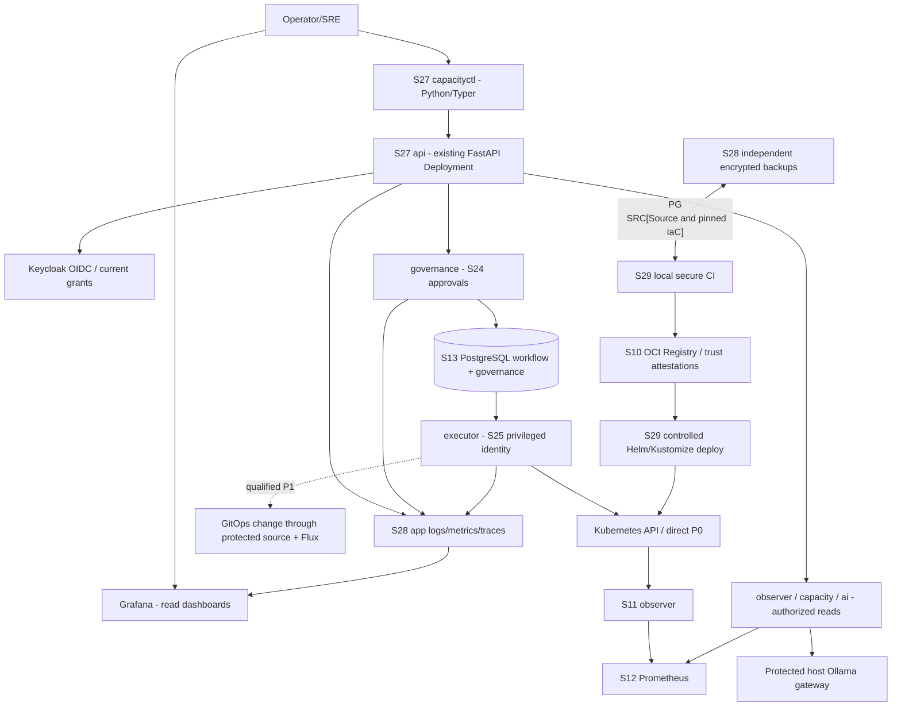
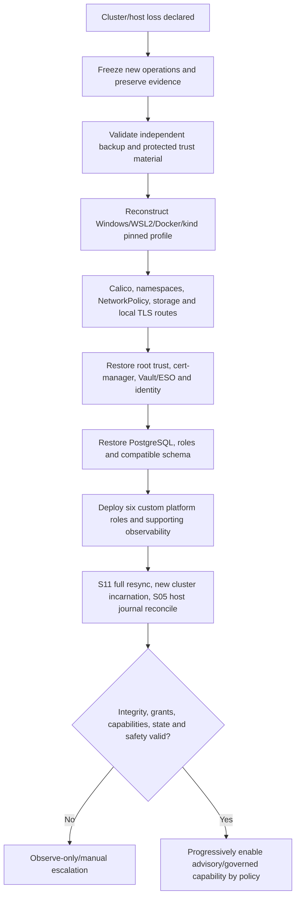
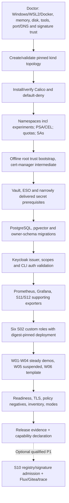
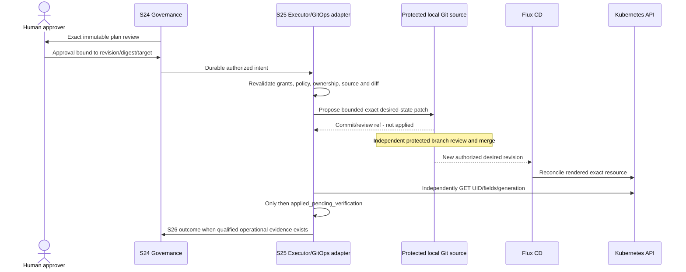
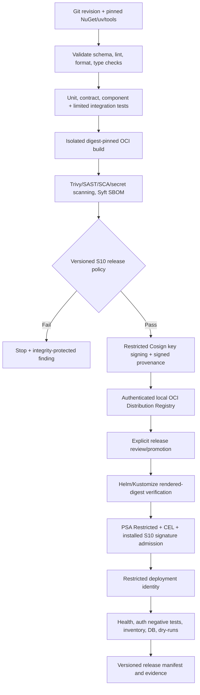
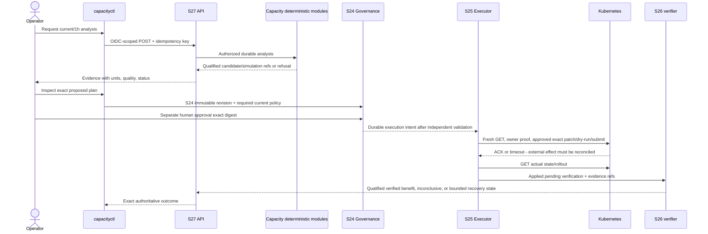

# Domain G — Product Operations & Delivery
## One consolidated accepted specification: S27 + S28 + S29

> **Owner architecture approval — 2026-11-19.** The project owner accepted all eight Domain G decisions: **G01** API-first operator experience; **G02** focused observability; **G03** capability-based reliability; **G04** rebuild-and-restore disaster recovery; **G05** Python plus Helm/Kustomize delivery; **G06** Flux CD **P1** integration; **G07** hybrid local CI and accepted supply-chain controls; **G08** controlled releases and environment profiles. This document defines architecture, interfaces, security boundaries, operational failure behavior and testable acceptance. **No implementation, cluster readiness, model qualification, installed Flux/Gitea/Jaeger/Loki, recovery drill, quantitative SLO achievement, signed OCI release or safe execution has been verified.** Any numerical threshold, resource budget, software version, hostname or exact implementation command marked provisional must be calibrated and pinned during implementation.

> **Precedence and interpretation.** The master 32-slice catalog and accepted S01–S26 architectural decisions take precedence. In particular, S02 owns deployment/service boundaries; S06–S10 own identity/trust/supply chain; S11–S14 own inventory/telemetry/forecast evidence; S19–S23 own deterministic optimization; S24–S26 own plan/approval/execution/verified outcome. Domain G must not silently change them. `MUST` = architectural requirement; `SHOULD` = preferred implementation; `MAY` = allowed option. `Accepted` means owner-approved architecture, **not** a verified implementation. `Provisional` means an unmeasured candidate. `Deferred` means explicitly not a P0 installation prerequisite.

## 0. Product boundary, authority and reconciliation

### 0.1 Purpose and non-goals

**Mission:** Make the local AIOps platform usable through a protected operator interface, observable and recoverable under partial failure, and reproducibly built, installed, upgraded and released without creating alternate routes around human governance or resource safety.

**P0 scope:** Operator HTTP API, Python/Typer product CLI, read-only Grafana experience; versioned typed contracts; authn/authz, request/operation correlation, durable async status; platform metrics/logs/traces and health models; bounded alerting; explicit dependency failure modes; independent encrypted backups and rebuild/restore exercises; Python-first kind lifecycle; Helm/Kustomize packaging and local CI; secure release manifests, migrations, smoke/security checks and recovery-aware rollback. P1 adds an executable, qualified Flux CD adapter and complete S10 signed-artifact/admission deployment where not already installed.

**Non-goals:** a custom SPA; a second operator public API gateway Deployment; an additional custom business Deployment; a second Kubernetes watcher; general APM/data lake; mandatory Loki, Jaeger or OpenTelemetry Collector on an unqualified host; production HA on one workstation; multi-cluster/cloud delivery; autonomous AI approval; CI cluster-admin; CI bypass of S24; platform release rollback masquerading as S26 recovery; a fully automated GitOps change route before S25 verification requirements are satisfied; declaring architecture approval to mean passing release gates.

### 0.2 Upstream reconciliation matrix — binding decisions

| Source | Accepted constraint | Binding Domain G consequence |
|---|---|---|
| Master/S01 | Fully local AIOps, Observe/Advisory/Governed, L0–L2, human approval; current/1h/conditional 24h; Critical/Standard/Flexible/Opportunistic; B0–B3 | Public operation modes and capabilities are explicit. Never report an experiment/simulation as verified realized benefit. |
| S02 | **Six** persistent custom Deployment roles `api`, `observer`, `capacity`, `ai`, `governance`, `executor`; modular monorepo; REST + PostgreSQL jobs/outbox; domain-owned schemas; no required broker | API facade lives in `api`; telemetry libraries in existing roles; supporting infrastructure may have its own pods but no seventh custom business service. |
| S03 | One kind control plane + three workers: one tainted platform worker, two experiment workers; Calico/default-deny; Windows 11/Docker Desktop/WSL2 on 20 GB host/Ryzen 5 3600; host Ollama; local HTTPS, local PVC and independent backups | Single cluster, measured node allocatable **and physical host** pressure, localhost ingress, resource reservations, calibrate optional operations components. No physical-host HA. |
| S04 | W01 `latency-api` Critical; W02 `burst-api` and W03 `memory-profile` Standard; W04 `cpu-worker` and W05 `analytics-processor` Flexible; W06 `opportunistic-batch` Opportunistic; 4 normal Deployments, suspended CronJob and on-demand Job | CLI lists actual controller state and workload profiles separately; releases preserve demo IDs, criticality, placement, bounded behavior and HPA-off baseline. |
| S05 | Host Python/Typer scenario orchestrator, separate watchdog, SQLite execution journal, tokenless ephemeral load drivers, owned-UID cleanup, B0–B3 evidence; separate experiment authority | Environment/experiment/product CLI responsibilities remain distinct. Runner cannot call the optimized Executor; CI cannot reset experiments with broad wildcard deletion. |
| S06 | Keycloak OIDC, RBAC+resource/action scope+conditions, six operator roles, author/approver separation, no Admin bypass | CLI PKCE and API bearer validation; Governance independently authorizes state changes; no persisted human bearer token in durable jobs. |
| S07 | Dedicated SAs, read-only Observer, narrowly mutating Executor, authenticated TLS/selective mTLS, Calico default-deny, tokenless drivers | API has **no** Kubernetes mutating credential. Git/CI/backup identities are independent and least-privileged; allowlist new operational flows. |
| S08 | Vault+ESO, offline protected root + cert-manager-managed intermediate, PSA Restricted+native CEL, classified data, encrypted independent backups, protected audit | Restore trust in deliberate order; no secrets in logs/captures/prompts/build evidence; no general fail-open for expired certificates, admission or secrets. |
| S09 | In-process deterministic AI Tool Authorization Broker, authorized RAG, host Ollama protected proxy, untrusted model output | CLI/API never offer unbounded tool/shell/PromQL/SQL entry; AI outage leaves deterministic paths available. |
| S10 | **P1** OCI Distribution Registry, Syft, Trivy, Cosign key signing, local provenance, Sigstore Policy Controller, periodic runtime conformance | S29 implements these exact decisions; does not substitute Harbor, Kyverno, Falco or public keyless infrastructure without new ADR. S10 P1 must not be falsely called installed P0. |
| S11 | Only `observer` LIST/WATCH/periodic reconcile; authoritative K8s live state; inventory quality/UID lineage | Operational health must distinguish stale/partial inventory; API cannot bypass Observer via its own broad kubeconfig. |
| S12 | One Prometheus for time-series, registered versioned PromQL, sampled-quality semantics; proposed 15s/30s scrapes and ~7d retention provisional | S28 reuses it and keeps operational metrics separate from demand-forecast measurements. No invented peak fidelity or missing-as-zero. |
| S13 | One PostgreSQL with seven logical schemas `inventory`, `capacity`, `knowledge`, `governance`, `execution`, `audit`, `workflow`; owner-only writes, immutable refs and pins | S27 is a facade, not an eighth authoritatively writable schema; S28 backups preserve refs/transactions; S29 migrations respect writer/schema ownership. |
| S14 + companion | Statistical-first deterministic numeric forecast, data eligibility/refusals, exact units, distinct current/1h/conditional 24h; W05/W06 run-conditional | CLI/API preserve horizons, uncertainty, evidence origin, refusal statuses and temporal cutoffs. |
| S15 | Host Ollama + protected gateway, separately versioned generation/embedding models, single bounded generative inference; no remote fallback | S28 exposes AI-only degraded health; S29 pins model identity/config, optional model qualification not cloud pull during jobs. |
| S16–S18 | Fixed Microsoft Agent Framework Analyst→Planner→Reviewer, typed broker tools and PostgreSQL pgvector/FTS; scope-aware provenance, no AI mutation | Long-running advisory status is durable and separate from approval; no unrestricted chat/admin CLI. |
| S19–S23 | Deterministic hard constraints before ranking, one-controller bounded CPU/memory field changes for P0, accurate scheduling feasibility; HPA advanced P1 | Expose candidate/rejection/simulation distinctions. Operator cannot supply arbitrary patch YAML as a plan. |
| S24 | Immutable plan revisions, exact human approver separate from author, fail-closed deterministic governance | S27 approval command references exact immutable plan digest/revision; `approved` is not `applied`. |
| S25 | Trusted durable Executor, intent-before-write, current K8s revalidation, direct P0 and ownership-aware GitOps adapter unqualified until installed/tested | S29 release identities **never** become Executor identity; Flux is P1 and GitOps plan execution requires the entire S25 evidence/merge/reconcile contract. |
| S26 | Configuration/rollout verification separate from actual qualified operational benefit; bounded preauthorized inverse recovery | S28 recovery monitors unknown effects; S29 image/release rollback is **not** an S26 workload inverse. No release tool automatically undoes optimized fields. |

### 0.3 Open upstream documentation and implementation addenda

1. **S03 namespace map:** S05 accepted `capacity-experiments`, but upstream S03 source still needs an explicit controlled addendum. S29 must install policy, network, quota, LimitRange, identity and workload placement for this namespace; do not claim the S03 file was already changed.
2. **Shared host budget:** S03 infrastructure envelopes are provisional and predate final acceptance of Vault/ESO/cert-manager/Sigstore, trace/logging and potentially GitOps/CI. S29 preflight MUST measure resources and select compact/balanced/verification profiles without removing security controls.
3. **Hostnames and trust:** S06 left local operator/browser/Windows/WSL/container DNS and trust equivalence open. S27/S29 must test the pinned issuer URL and HTTPS chain from *each* client context; a convenient hostname is not automatically resolvable in every zone.
4. **S10 vs S29 staging:** build/sign/admission is accepted **P1 architecture**; record `not_installed`, `installed_unqualified`, `enforced` explicitly. If verifier enforcement is enabled, its outage cannot trigger unsigned fallback.
5. **S25 GitOps ownership:** a GitOps source mapping, verified controller and secure repository process are mandatory before the adapter becomes executable; simply installing Flux does not qualify optimized change execution.
6. **S28 recovery:** backup procedures must preserve S13 evidence pins, S24/S25 state and S05 host artifacts; a newly created cluster incarnation invalidates old live-target assumptions and approvals.
7. **S30–S32:** implementation verification, empirical B0–B3 evaluation and final release readiness remain owned by Domain H; Domain G defines integration tests/gates, not claimed passing results.

### 0.4 Joint deployment and authority map



**Separated authority planes:** (A) operator actions: `capacityctl`→authenticated API→domain authorization; (B) platform installation and release: restricted S29 operator/CI deployment principal; (C) optimization: only S24-authorized S25 Executor; (D) experiments: only S05 restricted host coordinator/watchdog. A person with environment-admin privileges is not automatically a platform approver; platform RBAC never grants `cluster-admin`.

---

# S27 — Platform APIs, CLI & Operator Experience [P0]

## S27.1 Decision G01 and scope

**G01 Accepted:** The existing S02 `api` Deployment implements an operator-facing versioned FastAPI/HTTP interface, using Keycloak OIDC for human access, strong scoped authorization, typed JSON contracts, durable asynchronous operations and a Python/Typer `capacityctl`. Grafana is a read-oriented dashboard; a dedicated web SPA is not required. No duplicate business authority, direct Kubernetes mutation endpoint or privileged generic proxy is introduced.

**FRs:**

- `S27-FR-001` Expose versioned, documented, authenticated operator APIs for inventory, observations, current assessment, forecasting, optimization, AI advisory, plan/revision review, approval, execution status, verification and operational capability/readiness.
- `S27-FR-002` Enforce S06 role+action+exact target scope+conditions at API entry and independently at authoritative backends. Distinguish authentication, authorization, mode and evidence eligibility errors.
- `S27-FR-003` Use S02 immediate REST reads and durable PostgreSQL-backed workflow/jobs for long analyses; never hold an HTTP connection as the authoritative execution transaction.
- `S27-FR-004` Preserve units, identity/UID lineage, origin/quality/freshness and distinct current/forecast/simulated/realized semantics in response schemas.
- `S27-FR-005` Address immutable S24 plan revision/digest and current S25 execution state without rewriting or skipping owner-domain transitions.
- `S27-FR-006` Return bounded pagination/filtering, stable request/operation IDs, safe typed errors and idempotency semantics for side-effecting commands.
- `S27-FR-007` Provide secure `capacityctl` OIDC login, read/write operation flows, noninteractive machine-readable output, safe prompts and explicit no-bypass operator experience.
- `S27-FR-008` Expose capability-dependent health/degradation, including disabled/unqualified P1 features, without exposing credentials, unauthorized namespace existence or sensitive internals.
- `S27-FR-009` Support operator-safe cancellation of cancellable computation jobs only; cancellation of already-submitted external execution effects uses S25/S26 recovery state, never generic `DELETE` or reset.
- `S27-FR-010` Maintain public API compatibility and client/server release compatibility metadata; changes require contract tests and migration notes.

**NFR candidates (provisional until S28 measured):** p95 of a selected bounded read under 500ms on a healthy measured local profile; short admission responses bounded by API-specific deadlines; request/response size limits; bounded job-queue admission; no unbounded query/stream/LLM execution from API thread. Safety and exact authorization are invariants rather than percentage SLOs.

## S27.2 HTTP API ownership and surface

Base path: `/api/v1`. HTTP JSON by default; OpenAPI **3.1** with generated and frozen compatibility-tested clients/schemas. Concrete route and DTO names below are **approved design targets**; extensions must not change domain owners or S24–S26 semantics.

| Group | Proposed routes | Owner and safety |
|---|---|---|
| Context/capabilities | `GET /api/v1/capabilities`, `GET /api/v1/me/scopes` | `api` assembles authorized projection; `capabilities` describes disabled/degraded as such; avoid role enumeration |
| Cluster/workloads | `GET /api/v1/nodes`, `GET /api/v1/workloads`, `GET /api/v1/workloads/{logicalId}`, `GET /api/v1/inventory/snapshots/{id}` | S11 `observer` current/committed inventory, scope/freshness and stable identity |
| Evidence | `GET /api/v1/observations/{id}`, `GET /api/v1/evidence/{id}/metadata` | S12/S13 owner-projected immutable evidence; no arbitrary PromQL/download |
| Capacity | `POST /api/v1/forecasts`, `GET /api/v1/forecasts/{id}`, `POST /api/v1/analyses`, `GET /api/v1/analyses/{id}` | S14 and S19–S22 in `capacity`; `202` for queued jobs, refusal inside typed result |
| Candidates/simulations | `GET /api/v1/candidates/{id}`, `GET /api/v1/simulations/{id}` | `capacity` only; immutable computed facts, no direct patch |
| AI advisory | `POST /api/v1/advisories`, `GET /api/v1/advisories/{id}` | S16 orchestration, owned advisory and tool constraints; no model-embedded privileged command |
| Governance | `POST /api/v1/plans`, `GET /api/v1/plans/{id}`, `GET /api/v1/plans/{id}/revisions/{revision}` | `governance` S24 owns exact plan state and policy rechecks |
| Approval | `POST /api/v1/plans/{id}/approvals` | Exact digest/revision, independent approver, current mode/scope/SoD; never model-authored |
| Execution | `POST /api/v1/plans/{id}/execution-requests`, `GET /api/v1/executions/{id}` | Governance creates authorized durable intent, Executor decides independently; HTTP is not a Kubernetes mutation API |
| Outcomes | `GET /api/v1/executions/{id}/outcome`, `GET /api/v1/executions/{id}/attempts` | S25/S26 owned refs, status from actual evidence and verification |
| Job lifecycle | `GET /api/v1/operations/{id}`, `POST /api/v1/operations/{id}/cancel` | Only job types explicitly cancellable; returns not-cancellable on external/critical state |
| Health | `GET /health/live`, `GET /health/ready` and protected `/api/v1/platform/health` | Minimal liveness; readiness for API safe service; richer dependency/capability health protected |

**No external `/kubectl`, `/patch`, `/sql`, `/promql`, `/ollama`, `/run-shell`, `/secrets`, `/impersonate`, `/agent/tool/execute` or arbitrary endpoint relay.** S05 scenario runner is independently administered through its own host interface, not generalized through API. S29 releases are not allowed via ordinary platform resource-changing permissions.

## S27.3 Operation state and protocol contracts

S27 transport statuses are not new authoritative S24/S25/S26 states. Illustrative external job states: `queued | running | completed | refused | failed | cancel_requested | cancelled | unavailable`; execution response contains an **owner-supplied** S25 state, whose source is authoritative. Clients must not infer a completed/verified change from status `202`, `200`, `merged` or `advisory_completed`.

- **Read:** `200` with `data`, `sourceRef`, `quality`, `asOfUtc`, `clusterIncarnationRef`, `scope`, `correlationId`; `206`/partial representation only if explicitly designed and client understands it, otherwise typed partial-quality data in `200` and refusal for safety-sensitive use.
- **Async POST:** validate request syntax, caller/scope, request budget, canonicalize target, persist idempotent intent via owner; return `202 Accepted`, `operationId`, `statusUrl`, admittedAt and requestDigest. No claim of task completion.
- **Governed state change:** required plan revision/digest/target/policy precondition; S24 current state and author–approver separation independently verified; execution request is separate from approval.
- **Retries:** GET safe; command POST requires idempotency key scoped to principal + action + resource + request digest, durable owner result with TTL policy. Same key and different canonical payload returns `409`; same payload returns original operation ref; never duplicate an approved mutation.
- **Preconditions:** `If-Match`/typed expected revision if supported, but never replace S24 exact immutable digest or S25 live-GET revalidation. Stale expected revision returns `409`/`412` based on endpoint contract.
- **Pagination:** cursor bound to caller, normalized scope, filters, sort and data snapshot semantics with server max page size; error/cursor must not leak inaccessible record count or UUID existence.
- **Data validation:** Pydantic/JSON schema on ingress, explicit field allowlist, ISO UTC timestamps and half-open evidence windows, integer millicores and bytes, finite numeric, explicit null+refusal. For CPU/memory never silently convert `Mi` to decimal MB.

### S27.3.1 Reference response envelopes (illustrative)

```json
{
  "schemaVersion": "capacity-operation/v1alpha1",
  "operationId": "op-example-not-real",
  "operationType": "forecast",
  "state": "queued",
  "submittedAtUtc": "2026-11-19T08:00:00Z",
  "requestedScope": {"clusterIncarnationRef":"example", "namespace":"workloads-critical", "logicalWorkloadRef":"w01-latency-api"},
  "statusUrl": "/api/v1/operations/op-example-not-real",
  "requestDigest": "sha256:illustrative",
  "correlationId": "corr-illustrative"
}
```

```json
{
  "schemaVersion": "platform-error/v1alpha1",
  "error": {
    "code": "EVIDENCE_INSUFFICIENT",
    "category": "precondition",
    "message": "Required qualified observation window is unavailable",
    "retryable": false,
    "reasonRef": "qualified-refusal-ref",
    "correlationId": "corr-illustrative"
  }
}
```

The error example may be an analytical **result** rather than HTTP 4xx depending on whether the request itself was valid; never equate insufficient evidence with missing authorization. Unauthorized targets return an opaque response irrespective of existence. Exact known/unknown error codes should be centralized and versioned, with no unsanitized internal stack traces.

### S27.3.2 Error and conflict mapping

| Category | Suggested HTTP | Behavior |
|---|---|---|
| Missing/invalid OIDC credentials | `401` | Never accept ID token as access token; no identity leak |
| Authenticated but scope/action disallowed | `403` or opaque `404` per disclosure policy | Backend checks current grants and existence independently |
| Invalid typed request | `400`/`422` | Stable field-level codes, no raw YAML/SQL execution |
| Unsupported feature/profile/horizon | `422` or typed refusal | No invented P1 availability |
| Stale plan/ownership/conditional request | `409`/`412` | Do not auto-rebase or reapprove |
| Rate/work budget exceeded | `429` | Bounded retry-after, never privileged bypass |
| Dependency temporarily unavailable | `503` for needed service | Clear unavailable/degraded capability, never positive safety finding |
| Running operation not cancellable | `409` | Preserve S25 reconciliation and S26 recovery control |
| Internal error | `500` | Sanitized code + correlation ID, protected log with no sensitive payload |

## S27.4 Human identity, CLI and authorization

- Interactive `capacityctl auth login`: Keycloak Authorization Code + PKCE public client, state/nonce as applicable, loopback HTTPS/HTTP callback restricted to local interface under OAuth provider rules; device authorization fallback only after configured and tested. Never embed a client secret in the CLI.
- `capacityctl auth status/logout`: detect expiry and user-scope mismatch; use Windows OS-protected credential facility where supported; otherwise secure user-private storage with explicit warning and no hardcoded secret/token in config, git, history, output or core dumps. Do not persist credentials in cluster ConfigMaps.
- API verifies trusted JWKS/signature algorithm, issuer, audience, expiration/nbf, token type, subject and approved client. Keycloak role input never bypasses Governance current scope/policy.
- Protected API service calls require S07 authenticated peer identity and trusted bounded delegation; no `X-User`/role header as authentication proof. Durable jobs persist identity attribution/ref, **not** raw OIDC token. Sensitive domain workers re-authorize at execution/resume where required.
- Approver actor differs from author and has current exact scope; `Administrator` does not bypass SoD or policy. Executor owns only narrow K8s credentials, not accessible to API or CLI.
- CLI subcommands fail with stable meaningful exit codes, JSON output for automation and human output with distinction `proposed`, `approved`, `applied_pending_verification`, `benefit_verified`, `verification_inconclusive`, `recovery_verified`, `escalated` as returned by domain owner.

### S27.4.1 Command families and safe user journeys

```text
capacityctl auth login|status|logout
capacityctl cluster status
capacityctl workloads list|show
capacityctl inventory snapshots list|show
capacityctl metrics observation show <id>
capacityctl forecast create|show|watch
capacityctl analysis create|show|watch
capacityctl candidates show <id>
capacityctl advisory create|show|watch
capacityctl plans create|list|show|diff
capacityctl plans approve <id> --revision <rev> --digest <digest>
capacityctl plans execution-request <id> --revision <rev>
capacityctl executions show|watch <id>
capacityctl outcomes show <execution-id>
capacityctl operations show|cancel <id>
capacityctl platform health|capabilities
```

These are **logical reference command names**, not evidence of implemented CLI help or frozen flags. `approve` should show target namespace/controller UID, container, exact before/after fields, policy and expiration; explicit confirmation on interactive privileged commands, with structured no-prompt automation permitted only for specially authenticated **allowed** workflows (not an approver bypass). CLI must never auto-approve because the plan passed tests or the user is an administrator.

**Separate installed CLIs:** `capacityctl` = product operations via API; `capacity-lab` = S03/S29 host cluster bootstrap/installation/DR with dedicated host credentials; S05 scenario CLI = experiment run/abort/cleanup with separate authority. Optionally package in one Python monorepo, but preserve executable names, credential stores and permission boundaries.

### S27.4.2 Grafana experience

S27 offers provisioned, version-controlled Grafana dashboards: cluster node allocatable versus request commitments (different from usage); workload CPU/memory, throttling, SLOs and Pending; forecasts with confidence/evidence quality; candidate states and hard-gate outcomes; approved plans vs executed changes vs actual outcomes; platform component/dependency health; scenario B0–B3 experiment tags. Dashboards use scoped, sanitized metrics or authorized read projections. Grafana is **read-only** as a privileged-workflow surface: no approval/execute forms, no privileged API tokens in dashboard variables, no anonymous exposure of protected namespaces. Grafana panel absence does not imply zero load or success.

## S27.5 Threats, failure paths and tests

**Threats:** stolen cached tokens, confused-deputy API→Governance, cross-namespace cursor leaks, IDOR of evidence/plan IDs, CORS/CSRF/redirect abuse in local login, duplicate command submission, hidden 24h horizon downgrade, exposing restricted error traces, GUI/CLI accessibility to host-local services from untrusted LAN.

**Mitigations:** strict OIDC and origin/redirect allowlists, loopback restrictions, per-operation current scope, downstream independent auth, stable opaque errors, per-user+scope pagination, time-bound idempotency, HTTP body/query limits, safe stdout, no token in telemetry, explicit owner state machine. Protect `/docs` and schema detail as appropriate to disclosure policy; public liveness has minimal content.

| Test ID | Scenario | Expected outcome |
|---|---|---|
| S27-T01 | Valid Viewer queries owned namespace; cross-namespace query | Authorized projection; foreign query denied without existence leak |
| S27-T02 | Caller sends ID token, wrong `aud`, expired token, forged delegation | All denied; no backend mutation |
| S27-T03 | Plan author attempts own approval; Admin without grant attempts approval | Rejected by S24 current SoD/policy |
| S27-T04 | Two identical retries with idempotency key | One durable operation intent; same ref returned |
| S27-T05 | Same idempotency key, conflicting payload | Conflict and no second effect |
| S27-T06 | Approval request after plan payload/policy/revision changes | Rejected; no implicit edit/reapprove |
| S27-T07 | GET listing with cursor from different actor/scope | Invalid/opaque, no foreign count/id leak |
| S27-T08 | Client requests arbitrary PromQL/kubectl/manifest patch/model URL | No API support / allowlist validation rejects |
| S27-T09 | Ollama outage during deterministic forecast; metrics outage during risk-sensitive analysis | Forecast continues when evidence qualified; insufficient metrics refuses unsafe claim |
| S27-T10 | API timeout after durable execution intent accepted | Retry retrieves state, never dispatches duplicate mutation |
| S27-T11 | CLI token revoked/rotated and JWT/JWKS refreshed | Current scoped authorization enforced; no stale privileged action |
| S27-T12 | OpenAPI compatibility and generated client contract regression | Failing breaking change blocks release without explicit version migration |
| S27-T13 | S26 outcome inconclusive | UI cannot label it verified benefit |
| S27-T14 | CLI P1 Flux unqualified | Capability absent/unqualified; no false success |

## S27.6 ADR register

| ADR | Status | Decision / consequence |
|---|---|---|
| S27-ADR-001 (G01) | **Accepted** | API-first existing `api` FastAPI, Python `capacityctl`, no SPA or new business service |
| S27-ADR-002 | **Accepted consequence** | OIDC/PKCE and scope+condition checked at API and authoritative backend; no CLI secrets |
| S27-ADR-003 | **Accepted consequence** | Versioned typed OpenAPI, bounded reads, durable async command/status, idempotency |
| S27-ADR-004 | **Accepted consequence** | Distinct plan/candidate/approval/execution/outcome semantics; no generic K8s patch route |
| S27-ADR-005 | **Accepted consequence** | Grafana read-focused product visualization, no privileged approvals or execution |

---

# S28 — Platform Observability, Reliability & Failure Recovery [P0]

## S28.1 Decisions G02, G03 and G04

**G02 Accepted:** Reuse S12 Prometheus/Grafana. Instrument six existing Deployments with OpenTelemetry, structured JSON logs, trace/correlation propagation and operational counters/histograms. Deploy compact **Jaeger tracing** and **Loki centralized logs** only within measured local footprint and compatibility; Jaeger is the preferred tracing backend, Loki optional/qualified. No mandatory full Collector, service mesh, broad log scraping or big-data store in P0. If optional backend unavailable, protected structured local log output, metrics and authoritative event evidence remain; record tracing/logging degradation.

**G03 Accepted:** Capability-based, dependency-specific reliability and safe degradation. AI fails independently; data/authorization/approval/execution safety fails closed. Durable SQL intents, worker fencing, bounded retries and unknown-external-effect reconciliation are inherited from S02/S24–S26.

**G04 Accepted:** Rebuild-and-restore recovery with independently encrypted backups, recovery of identity/PKI/Vault/PostgreSQL and evidence, explicit cluster incarnation, validated workflow reconstitution and measured drills. No high-availability claim on one host.

## S28.2 Requirements and SLO classes

- `S28-FR-001` Every custom Deployment exports internal health/readiness, stable bounded service metrics, JSON structured logs, traceparent/correlation context and component version/revision data, with secrets scrubbed.
- `S28-FR-002` Correlate API request→Governance plan/approval→PostgreSQL intent→Executor submission/reconcile→S26 verification and optionally AI analysis, without treating telemetry spans as durable truth.
- `S28-FR-003` Define independent per-capability `healthy|degraded|unavailable|unknown` classifications, freshness/quality, dependency reason, policy/mode consequence and observation time.
- `S28-FR-004` Make liveness and readiness safe: service alive ≠ all capabilities available; dependencies (Ollama, Prometheus, Vault, K8s API, Postgres) affect relevant capability only unless critical to the process itself.
- `S28-FR-005` Enforce timeouts, constrained queue backpressure, lease/fencing, at-least-once replay safety, reconcile-before-retry and current authorization on resumption.
- `S28-FR-006` Provide alerts and actionable runbooks for stale inventory, missing telemetry, pending/ambiguous execution, external conflict, host pressure, disk capacity, credentials/certificate expiry, PKI, Vault, Postgres, ingress and CI trust failures.
- `S28-FR-007` Back up consistent authoritative DB state, protected trust and identity state, host scenario journal/artifacts and referenced evidence independently of ephemeral cluster PVCs, with integrity, encryption and restore test records.
- `S28-FR-008` Recreate cluster from pinned automation; reconcile restored durable state against live new incarnation and never resume an old authorization blindly.
- `S28-FR-009` Support measured and documented RPO/RTO/restore dependency order and declared loss boundaries; never claim genuine physical failure-domain HA.
- `S28-FR-010` Control retention and storage utilization for Prometheus, optional traces/logs, protected audit, DB evidence, backups and S05 artifacts; retention never removes pinned evidence.
- `S28-FR-011` Ensure operations telemetry/alerts preserve S08 classification and S09 untrusted-text controls; no embedding, prompt or signing material in logs.
- `S28-FR-012` Expose operational evidence to S18 only by authorized, redacted, reviewed source-derived summaries, not automatic vectorization of raw logs.

### S28.2.1 SLO and objective taxonomy

| Objective | Initial policy | Calibration/meaning |
|---|---|---|
| Bounded operator read response | Candidate p95 ≤500ms | Measured local workload/profile only; exclude queued long jobs, report method and sample size |
| Local authenticated API availability | Candidate ≥99% of **declared lab operating intervals** | Single-machine dev lab, not 24×7 contractual uptime |
| Usable inventory | Candidate ≥99% of *eligible healthy collection windows* | Requires S11 family quality/freshness, not merely API process alive |
| Qualified deterministic jobs | Candidate ≥95% within selected horizon-specific SLA under admitted loads | Must track queued, refused, degraded, timed-out separately |
| AI advisory | Separate latency/availability objective | Cannot reduce deterministic API availability due to Ollama failure |
| Privileged safety integrity | **100% of detected unknown external effects remain unverified until reconciled** | Safety invariant, never traded for availability target |
| Outcome truthfulness | **100% of claimed verified benefit has S26 qualified evidence** | Verifier invariant, not a latency metric |
| Backup/restore | Repeated successful restore with logged measured RPO/RTO | No numeric claim before actual drills |
| Physical host availability | No HA claim | All nodes and support services share physical host |

S28 implementation shall publish an `SLOProfile` version and measurement definition (eligible windows, numerator/denominator, exclusions, alert thresholds). Numbers above are **provisional** recommendations, not approved empirical guarantees. Refusals are not silently counted as successful analytical service outputs; they may be correct safe behavior under a separate safety metric.

## S28.3 Telemetry schema and instrumentation

### S28.3.1 Metrics

| Metric family (illustrative canonical names) | Type | Bounded labels | Purpose |
|---|---|---|---|
| `platform_http_requests_total` / `platform_http_request_duration_seconds` | counter/histogram | service, route template, method, status class | API response and errors; no raw resource id/path |
| `platform_capability_state` | gauge | service, capability, state | Dependency-driven capability health, not equivalent to forecast data |
| `platform_inventory_snapshot_age_seconds` | gauge | source family/quality class | S11 staleness, no fabricated current state |
| `platform_observation_quality_total` | counter | quality reason, source | S12 missing/invalid windows |
| `platform_forecast_jobs_total` / `platform_forecast_duration_seconds` | counter/histogram | horizon, outcome/refusal category | S14 background job progress and refusals |
| `platform_candidates_total` / `platform_simulation_rejections_total` | counter | policy class, reason, qualified | S19–S23 deterministic gates and fidelity |
| `platform_ai_workflows_total` / `platform_ai_inference_duration_seconds` | counter/histogram | role, outcome, revision class | S15/S16 bottlenecks; no raw prompt or model output labels |
| `platform_tool_authorization_denials_total` | counter | tool id, denial class | S09/S17 security; avoid leaked requested resource |
| `platform_governance_transitions_total` | counter | transition class, result | S24 plan/approval workflow |
| `platform_executor_reconciliation_total` / `platform_execution_unknown_effects` | counter/gauge | adapter, result class | S25 ambiguous effects, recovery urgency |
| `platform_outcomes_total` / `platform_verification_duration_seconds` | counter/histogram | outcome status, evidence quality | S26 actual verification/rollback |
| `platform_workflow_queue_age_seconds` | gauge/histogram | job class | Durable backlog detection |
| `platform_backup_last_success_timestamp_seconds` / `platform_restore_drill_result` | gauge | dataset class, success | DR readiness without secret naming |
| `platform_storage_free_bytes` / `platform_certificate_expiry_seconds` | gauge | storage class, certificate role | Disk/PKI early warning |

All series use bounded cardinality and allowlisted labels. **Do not label by plan ID, Pod UID, user/email, namespace name from arbitrary input, token, query, prompt, path or raw exception.** Use `correlationId`/`operationId` only in protected structured logs/records and sampled traces with redacted safe attributes. S12's workload measurement metrics and S28's operational metrics may share Prometheus storage, but must remain semantically distinct and have separate registered query definitions for safety-critical use.

### S28.3.2 Logging

Minimum structured fields: `timestampUtc`, `severity`, `service`, `component`, `eventCode`, `correlationId`, `traceId` when available, `operationType`, `domainStateClass`, `outcomeCode`, `durationMs` when meaningful, `serviceVersion`, `policyRef`/`planRef` only as non-sensitive approved internal references, `dataClass`, and optional `exceptionType` after redaction. Each event has a stable machine-readable event code. Logs are *diagnostic*, not an authoritative source for audit/approval. No secrets, access/refresh tokens, client assertions, kubeconfigs, private key contents, raw prompts, raw retrieved malicious texts or restricted material. Never indiscriminately log request/response bodies, env vars or Kubernetes Secrets.

### S28.3.3 Tracing and causal identity

Adopt W3C trace context where supported: HTTP inbound→authenticated internal REST→durable job creation→worker claim/resume→S25 adapter submission→reconciliation→S26 verification. A durable boundary stores safe `traceId`/`correlationId` in the command context or job metadata, **not** active parent span or raw authentication credentials. Retries and recreated processing are separate spans linked to the stable durable operation ID; no exactly-once trace claim. Sample successful paths at controlled rate; keep failure paths within storage and disclosure budget. Signing/evidence validation derives from S13/S24–S26, not trace ingestion.

### S28.3.4 Backend deployment and downgrade strategy

- P0 mandatory: S12 Prometheus, Grafana, structured service stdout/stderr logs, safe correlation and essential tracing **instrumentation**; metadata and authorized audit remain durable.
- P0 **resource-qualified optional**: compact Jaeger backend or equivalent local OTLP-compatible trace storage and limited Loki. Enable only if S03 host/worker envelopes, PSA/CEL, Calico flows, disk and CPU tests pass. A missing optional backend must not block Observer or Executor safety.
- No mandatory Collector, tracing mesh, unlimited OTLP export, host-level arbitrary log reader, remote telemetry sink or Grafana write/action plugin.
- Centralized log/trace retention candidates (e.g., short bounded days) are provisional; S08/S13 protected audit pin/retention is independent and cannot be shortened by diagnostic retention rules.

## S28.4 Health, readiness and capabilities

**Separate endpoints:** `/health/live` = process responsive, no deep dependency fan-out; `/health/ready` = can serve its essential owned function safely (not global all-green); protected `/api/v1/platform/health` = per-capability matrix, last-good/quality timestamp, cause and mode implication. Kubernetes probes use independent appropriate timeouts, failure thresholds and startup probes where slow initial migrations/embedding/model setup warrant them, without restarting a healthy deterministic engine merely because Ollama is down.

| Capability | Minimal positive basis | Degradation/refusal when missing |
|---|---|---|
| Inventory `current_inventory` | S11 synced families, scoped fresh committed snapshot | `stale/partial/unknown`; can display last-good **historical** only, no fresh-state authorization |
| Observations `qualified_window` | Registered S12 query + correct UID/time/source/quality | Historical display allowed with flag; risk-sensitive candidate blocked |
| Deterministic forecast | S14 data sufficiency, model/evaluation ref, supported horizon | Explicit typed refused/degraded job; no LLM fallback |
| Optimization candidate | S19–S22 hard gates and qualified inputs | Block/rank only eligible, no unsupported scheduler confidence |
| AI advisory | S15 gateway/model, S16 stage and S17 tool scope/quality | AI unavailable/partial; deterministic capacity path intact |
| Plan authorization | S24 current policy, actor grants, durable governance store, audit integrity | Refuse new approvals or transitions |
| Execution | S25 valid exact approval, target live state, ownership, Executor credential, policy/evidence, DB/audit | No new mutation; ambiguous effects reconcile read-only before any retry |
| Postchange verification | S26 rollout config + qualified metric windows | `inconclusive`/safe recovery decision, never benefit verified by absence |
| GitOps adapter | S25 exact owner mapping + installed qualified Flux/Git path | `adapter_unqualified`; direct patch **forbidden** when GitOps-owned |
| Artifact admission | S10 installed and enforce mode, signature validation | If enforcement required, fail closed on unavailable verifier |

Readiness depends on role: `api` does not need Ollama to serve inventory; `ai` may report itself unready for new inference while Governance/Capacity remain healthy. `executor` readiness for *new work* can fail while an already-written external effect still demands reconciliation; do not allow probe restarts to erase or bypass ongoing recovery.

## S28.5 Failure-state and recovery matrix

| Fault | Detect/mark | Safe behavior | Recovery and proof |
|---|---|---|---|
| Ollama/proxy offline or bad schema | AI capability degraded, queue/timeouts | Cancel/defer bounded advisory, no fabricated LLM result; S14 remains independent | Gateway route and model profile verified, safe stage resume with current scope |
| RAG/embedding broken | S18 query/index revision unavailable | Authorized lexical-only if qualified, or advisory inconclusive; no cross-index fallback | Index revision integrity and authorized search regression |
| Prometheus scrape/query unavailable | Missing target/coverage/freshness | No missing-as-zero; block risk-sensitive forecast/benefit decisions | Restore scrape and collect sufficient fresh qualified windows |
| Kubernetes API/watch outage | S11 family stale, live GET unavailable | No new Executor mutation; historical state labeled | Restore connectivity, relist/reconcile all families, exact live target preflight |
| PostgreSQL unavailable | Workflow and domain store unusable | Reject new approvals/intents, do not claim pending accepted durable work | Restore, recover owner schemas/leases/outbox, reconcile external K8s/Git effects before claims |
| Keycloak or token verification unavailable | Auth authority unavailable/stale | No fail-open login/approvals; existing valid token handling per security freshness rules | Restore IdP/JWKS and current grants; test revoked/expired identities |
| Vault/ESO/cert expiry | Secret issuance/rotation and mTLS compromised | Do not disable validation; already healthy components only within security policy; refuse sensitive new operations when authority stale | Restore trusted root/intermediate, Vault and narrow secrets, check issuance and revocation |
| Admission/Signature controller unavailable | Webhook/policy timeout/failure | Honor installed fail-closed policy; no blanket ignore | Restore verifier with trust bundle, prove invalid image blocked |
| Host Ollama consumes experiment budget | S05 watchdog/host pressure | Stop or defer inference per S15 admission; preserve lab safety | Reduce inference load; remeasure host headroom before resume |
| Full Prometheus/log/trace PVC | Disk budget alert | Pause heavy telemetry, preserve protected audit, stop unsafe experiments | Retention/space recovery by class with pinned ref checks |
| Executor Pod crashes after K8s timeout | Effect unknown; lease transfer not proof | No duplicate patch; no premature `failed` or `success` | Durable intent + live UID/field/generation + owner proof and S25 fencing |
| Git merge succeeds, Flux can't reconcile | `merged`, `controller_sync_pending` | Never mark applied; don't direct-patch GitOps-owned workload | Restore Flux and prove live rendered state equals approved digest |
| S26 safety violation after rollout | Rollout/operational evidence fails | Evaluate preauthorized inverse only with current identity and state; else escalate | Verify inverse actually restored config and qualified behavior; no unconditional rollback |
| Recreated kind cluster/restore | New cluster-incarnation identity | Old plan/approval may remain history, not live executable authority | Rebind inventory, invalidate stale live-target assumptions, explicit new S24 authorization |
| Windows/WSL2/Docker failure | Shared-host outage | No HA claim, no cross-node independent redundancy | Rebuild with pinned automation, restore independent backups and test integrity |
| Local registry or Gitea down | Release/GitOps availability degraded | No unsigned pull/bypass; no mixed-floating images | Restore registry/repo, verify digests/signatures, resume bounded deployment |
| Corrupted/partial backup | Integrity mismatch, restore failure | No declare recovery success; isolate suspect data | Choose verified point, record RPO loss and audit gap, run consistency/security checks |

**Fencing:** API, worker and internal leases are at-least-once. A lease expiry alone does not authorize another external mutation. SQL recovery must distinguish safe job retry from S25 `unknown_effect`, retain targeting locks and avoid concurrent S05 scenario/Executor interference. Recovery automation may execute only approved S26 inverse mutations or host infrastructure restore activities under *different* authority, not issue new optimization plans.

## S28.6 Alert and runbook catalog

| Alert ID | Condition (versioned threshold) | Priority | Runbook / safe operator action |
|---|---|---|---|
| `PLATFORM_INVENTORY_STALE` | S11 freshness/coverage below policy | High | Inspect per-family watch, K8s API, commit status; do not use stale state for execution |
| `PLATFORM_METRICS_GAP` | Required S12 scrape/query coverage poor | High | Check target auth, scrape capacity, labels and TSDB; stop unsupported outcomes |
| `PLATFORM_EXECUTION_UNKNOWN` | Unresolved S25 unknown effect older than configured grace | Critical | Inspect exact intent and live target; reconcile, never replay blind |
| `PLATFORM_VERIFICATION_INCONCLUSIVE` | S26 cannot qualify before deadline | High | Apply S26 risk policy, preauthorized inverse only if safe; escalate otherwise |
| `PLATFORM_WORKFLOW_STUCK` | Job lease/queue age exceeds threshold | Medium/High | Inspect ownership/fencing/outbox; retry safe calculation only |
| `PLATFORM_HOST_PRESSURE` | Shared host RAM/CPU/disk pressure | Critical | Stop new S05 load and S15 inference; preserve controller/DB priority |
| `PLATFORM_PVC_LOW_SPACE` | Prometheus/Postgres/Vault/backup capacity low | High | Reference-aware retention and backup validation, not delete pinned evidence |
| `PLATFORM_CERT_NEAR_EXPIRY` | Bounded days until intermediate/leaf expires | High | Plan cert-manager renewal/CA trust rotation, validate chain |
| `PLATFORM_VAULT_UNAVAILABLE` | Secret backend unavailable | High | Recovery/unseal per protected runbook; don't mount root token to Pods |
| `PLATFORM_BACKUP_MISSING` | Last verified independent backup beyond policy age | High | Backup integrity, storage and keys; backup != tested restore |
| `PLATFORM_AUDIT_ANCHOR_FAILURE` | Required audit integrity path unhealthy | Critical | Block new sensitive operations as S08/S24 require |
| `PLATFORM_ARTIFACT_TRUST_FAILURE` | Signature admission fails unexpectedly | High | Verify policy controller, trust roots, OCI digests; no unsigned fallback |
| `PLATFORM_AI_DEGRADED` | Ollama/proxy capacity or agent stage unavailable | Medium | Diagnose host pressure; no auto-escalation into deterministic unavailability |

Alerting is local: Grafana/Prometheus rule dashboards and optional local notification mechanisms; no external webhook or email service required for P0. Thresholds and escalation windows are provisional, documented by policy revision and validated through S30 fault injection. An alert rule does not grant automatic Kubernetes mutate privileges.

## S28.7 Backup, restore and independent trust

### S28.7.1 Backup set and dependencies

| Dataset | Authority / recovery artifact | Independent protection and caveats |
|---|---|---|
| PostgreSQL all seven domains | Consistent logical/physical database backup including roles, schema migrations and point consistency | Encrypted independent host path/off-cluster storage; restore and owner grants tested; S13 pinned refs preserved |
| Keycloak | DB/realm settings, client IDs, issuer and signing key dependencies | Restore in issuer-compatible way; invalidate stale/compromised sessions as needed |
| Vault | Encrypted storage snapshot + recovery/unseal materials stored **separately** | Never sole copy of its own recovery keys; rotate compromised credentials |
| PKI | Offline protected root, intermediate chain/key recovery, cert-manager issuer config | Offline root not copied to a Pod backup; audit trust rotation and leaf reissue |
| Artifact trust | Cosign public verification keys, protected private signing key recovery, release/policy manifests | Signing private key independent from CI runner and registry; controlled restore/rotation |
| OCI registry / Git | Digest-pinned images + signed attestations, Git source/desired-state history | Cannot rebuild from floating tags if registry lost; verify restored digest and signatures |
| S05 host experiment state | SQLite run journal + immutable evidence content | Remains separate from platform DB authority; incomplete cleanup explicitly reconciled |
| S13 pinned evidence / exports | Protected content-addressed artifacts and metadata refs | Reference-aware retention, no silent orphaned links; data classification preserved |
| Prometheus | TSDB snapshot or other supported backup **when explicitly required** | Raw-history loss reduces future forecast eligibility; cannot infer missing data from SQL |
| Ollama model profile | Pinned model identity/hash, source and local reproducible bits where licensed | No automatic remote fallback; model data may be reacquired only by explicit operator operation |
| Host/bootstrap | Python tooling lock, kind config, Helm/Kustomize manifests, DNS/trust setup, profile inventory | Restore instructions runnable without original cluster/Flux controller |

**Backup chain:** schedule with bounded resources and non-overlap with S05 exclusive experiments or safety-critical recovery; use consistent DB snapshots not blind live PVC copies; encrypt with independently retrievable key; sign/manifest digest, creation time, scope, backup schema and tested restore compatibility. Store at least one protected copy outside kind/WSL2 VHDX; an independent host directory on same physical disk **does not** protect from physical disk loss. Declare protected failure classes truthfully.

### S28.7.2 Rebuild-and-restore procedure



**Recovery invariants:** No runbook auto-replays old S24 approval, old S25 intent or S05 experimental cleanup into a new UID/cluster incarnation. The restored DB records the historical state; executor must independently compare current cluster identity, target UID, exact resource fields, policy/grants, ownership and execution/recovery authority. On uncertain state, mark and escalate. A failed recovery gate leaves the system in safe read-only/Observe posture; no force-upgrade/no insecure admission bypass. Operator `capacity-lab restore` invokes host restoration permissions and records an independent DR audit, not a new S24 resource optimization approval.

### S28.7.3 RPO/RTO methodology

For each backed-up dataset, record `lastConsistentBackupUtc`, `lastVerifiedRestoreUtc`, `failureStart`, `serviceRecoveredAt`, `dataLossLowerBound`, `dataLossUpperBound`, verified content digests, dependency versions, scope and failure scenario. RPO = possible loss since the last recoverable consistent point; RTO = measured interval until declared capability is safely restored. Different capabilities may recover at different times; do not advertise one unmeasured aggregate objective. S32 release readiness requires measured drill evidence and limitations.

## S28.8 DR/security/chaos acceptance tests

| ID | Injection / check | Required result |
|---|---|---|
| S28-T01 | Stop protected host Ollama while generating advisory | No new valid advisory result; S11/S12/S14 deterministic operation continues |
| S28-T02 | Disable Prometheus temporarily | Missing quality explicit; no unsafe candidate or benefit verification |
| S28-T03 | Restart observer and invalidate watch resourceVersion | LIST/WATCH resync and quality-gated recovery, no false current snapshot |
| S28-T04 | Kill Executor after an external patch while HTTP response lost | `unknown_effect` reconciled from live exact target; no duplicate patch or false failure |
| S28-T05 | Revoke approval/role after job enqueue | New high-risk step rechecks scope; no stale approval bypass |
| S28-T06 | Corrupt backup, supply wrong key, or restore incompatible schema | Integrity fails, no successful restore claim or protected operation |
| S28-T07 | Recreate kind from independent backups | New incarnation, old intents blocked, inventory rebuilt, evidence pinned where available |
| S28-T08 | Fill optional Loki/Jaeger storage | No required audit loss and deterministic services retain accepted safe posture |
| S28-T09 | Force Vault/PKI renewal failure | Sensitive operations fail closed; no disable-TLS fallback |
| S28-T10 | Tamper protected audit/evidence digest | Integrity failure detected, decision or outcome not accepted |
| S28-T11 | Trigger host physical pressure | S05/S15 admission defers/stops work within watchdog policy; no invented HA |
| S28-T12 | GitOps drift and controller outage | GitOps capability unqualified/failed, no direct fallback mutation |
| S28-T13 | Recovery inverse conflicts with live resource | No blind rollback; S26 escalated state maintained |
| S28-T14 | Inspect telemetry under token/prompt/secret fixtures | No sensitive content in metrics/logs/traces/backup manifests |
| S28-T15 | Restore tested backup with evidence pins and schema version | All owners' refs consistent or explicit gaps/loss report, no silent success |

## S28.9 ADR register

| ADR | Status | Decision |
|---|---|---|
| S28-ADR-001 (G02) | **Accepted** | Reuse Prometheus/Grafana; OTEL+structured log+correlation; resource-qualified local traces and optional Loki |
| S28-ADR-002 (G03) | **Accepted** | Capability-based health, independent deterministic/AI paths, safe fail-closed and unknown state |
| S28-ADR-003 (G04) | **Accepted** | Independent encrypted backup and measured rebuild-and-restore, not fictional HA |
| S28-ADR-004 | **Accepted consequence** | Keep durable S24–S26 audit/intent/outcome authoritative, traces/logs diagnostic |
| S28-ADR-005 | **Accepted consequence** | Reconcile external effects before retry; new kind incarnation invalidates old live-state assumptions |
| S28-ADR-006 | **Accepted consequence** | Bounded diagnostics/alerts with sensitive-data controls and retention/pins |

---

# S29 — Infrastructure Automation, GitOps & Secure CI/CD [P0; qualified S10/Flux features P1]

## S29.1 Decisions G05–G08 and requirements

**G05 Accepted:** Python-first `capacity-lab` host automation; Helm for suitable third-party packaged infra, Kustomize for platform/namespace/policy overlays; pinned bootstrap dependency graphs, checks, safe cleanup.

**G06 Accepted:** Flux CD as selected **P1** preferred GitOps controller, to be qualified by S25 before it performs optimized resource changes; P0 direct K8s S25 adapter remains authoritative for direct-managed demo controllers. Installing Flux alone does not confer ownership certainty or approval.

**G07 Accepted:** Hybrid local CI: self-hosted Gitea Actions preferred when resources are qualified, same pinned checks/builds callable using Python on host; no CI cluster-admin, signing root or unbounded runner authority. Implement S10 OCI Distribution Registry, Syft, Trivy, Cosign and Sigstore Policy Controller at correct P1 readiness stage.

**G08 Accepted:** One cluster, versioned `compact`, `balanced`, `verification` profiles, immutable release manifest, protected migrations, environment-aware tests, review/promotion, rollback and idempotent teardown.

**Requirements:**

- `S29-FR-001` One typed Python/Typer installer and environment manager provisions or validates WSL2/Docker/kind and pinned versions without hidden shell-driven policy or arbitrary YAML execution inputs.
- `S29-FR-002` Bootstrap S03 topology/Calico/network policies, namespace map including S05 addendum, PSS/PSA/CEL, ServiceAccounts, cert trust and least-privilege supporting services in dependency order.
- `S29-FR-003` Apply versioned Helm releases and Kustomize overlays with pinned images, chart versions and rendered YAML digests; do not use mutable `latest` for protected releases.
- `S29-FR-004` Enforce local host and node allocatable preflight, reserved system capacity, PV/disk policy and resource admission. `compact` does **not** disable security controls.
- `S29-FR-005` Build/scan/sign/publish through S10-approved stages where installed and enforce independent admission. Distinguish S10 P1 from minimal P0 release profile.
- `S29-FR-006` Keep build/release identity, CI identity, GitOps source updater, approver, experiment runner and S25 Executor independent; ensure no permission union grants unauthorized patches.
- `S29-FR-007` Build a P1 Flux integration only after source ownership mapping, restricted branch, rendered diff, signing, protected human review and S25 safety acceptance are proven.
- `S29-FR-008` Preserve schema owner migrations, backward compatibility, pre-upgrade backup proofs, negative-security smoke tests and explicit release/rollback state.
- `S29-FR-009` Make bootstrap repeatable and drift-aware; cleanup refuses wrong cluster identity, pinned evidence/backup destruction and broad resource deletion.
- `S29-FR-010` Publish reproducible release evidence: source/digest/locks, artifact signatures, manifest render, policy revision, migrations, deployments, tests, known gaps and operator sign-off.
- `S29-FR-011` Support offline-after-prestage operation; do not silently fetch cloud LLM, unsigned images or external scripts during experiment/agent job.
- `S29-FR-012` Publish interoperability matrix including kind/Kubernetes/Calico, CEL/ValidatingAdmissionPolicy, cert-manager, ESO/Vault, Sigstore Policy Controller, Flux, Keycloak, PostgreSQL+pgvector, Prometheus, Gitea runner and model/runtime; verify at actual pinned versions.

## S29.2 Runtime profiles and resource governance

| Profile | Intended footprint | Mandatory functions | Conditional functions |
|---|---|---|---|
| `compact` | Minimum **safe** footprint on one 20 GB host | Kind topology, Calico/default-deny, authentication, core six roles as required by chosen operational milestone, PostgreSQL, Prometheus, experiment safety, Vault/PKI where protected flows enabled; no insecure bypass | AI advisory disabled/deferred by capability if not qualified; central log/trace backend, Flux/Gitea not permanent |
| `balanced` | Full intended local operation once physical budgets measured | Six roles, required identity/trust, S11–S14, S19–S26 governance, bounded local Ollama, observability and scenarios as permitted | Compact Jaeger/Loki and limited CI/GitOps if qualified |
| `verification` | Temporary exclusive acceptance, security and recovery exercises | Exact identity, admission, drift/backup and S05/S30/S31 test entry points | Gitea runner/Flux/Jaeger intensive operations scheduled sequentially; never claim simultaneously runnable until measured |

**Profile rule:** A profile may reduce replica count, test duration, optional diagnostics and inference availability or choose a legitimate **Observe-only** capability mode; it may not turn off required authentication, mTLS verification where selected, default-deny, Pod/admission enforcement, approval/Executor protections or audit as a convenience. If core security components cannot fit, fail environment preflight and declare the profile unsupported rather than silently degrading security.

Physical capacity planning MUST inspect free host RAM and CPU, Windows/WSL2/Docker contention, WSL memory ceiling, disk bytes/inodes, actual per-node allocatable, Pod system/DaemonSet reservations, plus model host memory/VRAM. The candidate 12 GiB WSL2 cap, Prometheus 5–10 GiB PVC and default CPU requests are **provisional**; remeasure at installed versions and guard safety margins. Optional Gitea/Flux/tracing must not occupy experimental node pool without explicit pinned placement and footprint approval.

## S29.3 Repository and package architecture

**Reference layout (not already implemented):**

```text
repo/
  specs/                         # accepted S01-S32 sources, ADRs
  apps/                          # six S02 custom deployables, bounded demo apps
  packages/                      # versioned shared DTOs; no privileged shared ORM
  cli/capacityctl/               # S27 public operator client
  tools/capacity_lab/            # S03/S29 Python environment manager
  tools/scenario_runner/         # S05 independent runner/watchdog
  infra/kind/                    # pinned cluster and port mappings
  infra/calico/                  # default-deny/network isolation policies
  infra/helm/                    # pinned third-party chart values
  infra/kustomize/base/          # security, apps and demo manifests
  infra/kustomize/overlays/      # compact, balanced, verification
  infra/gitops/                  # Flux configuration, source mapping (P1)
  infra/security/                # CEL, PSA, image trust policies and public roots
  infra/database/migrations/     # owned, versioned migrations by schema
  policies/release/              # S10 signed artifact/promotion rules
  policies/operations/           # versioned S19/S24 safety policies
  pipelines/                     # CI definitions and Python stage entrypoints
  tests/                         # S30 layer-specific tests and fixtures
  evidence/releases/             # sanitized release manifest references only
  docs/runbooks/                 # S28 recovery, incident and installation guides
```

S02's monorepo and six deployments remain fixed. Separate **GitOps desired-state repository** is recommended for protected environments after Flux qualification; initial source/runtime repo configuration must distinguish application source and desired-state ownership with immutable cross-reference. A release policy may support one repo for compact bootstrap, but GitOps adapter cannot be qualified without trustworthy desired-state source identity and branch controls. Never grant source CI unrestricted write to protected GitOps main branch.

### S29.3.1 Python automation command surface

```text
capacity-lab doctor
capacity-lab plan --profile compact
capacity-lab bootstrap --profile compact
capacity-lab status
capacity-lab validate --profile compact
capacity-lab upgrade --release <signed-release-ref>
capacity-lab backup create|verify
capacity-lab restore plan|execute --backup-ref <verified-ref>
capacity-lab security verify-network|admission|identity|trust
capacity-lab destroy --cluster-incarnation <exact-id> --confirm
capacity-lab evidence release <release-ref>
```

Names and flags are illustrative contracts. `plan` must render a non-secret actionable diff and cost estimate, `bootstrap` creates only allowlisted objects with an independently versioned profile, `destroy` checks exact kind context/cluster UID and protected backups/evidence outside cleanup. Do not accept arbitrary template paths/URLs or arbitrary shell command injections from a release/config profile. Python may invoke pinned external tools as subprocesses with constant arguments, sanitized environment and explicit timeouts; “Python-first” does **not** mean reimplementing Kubernetes/Helm clients or bypassing OS process security.

## S29.4 Idempotent bootstrap dependency graph



**Dependency graph is logical, not exact tool install order**: e.g., the registry may need to be pre-staged on host before workloads can pull protected images, and admission policies must be bootstrapped in a safe trust/exception sequence. The S29 plan must explicitly split `bootstrap` (trusted infrastructure bootstrap admission) from `steady-state` (full enforcement) with the smallest audited exceptions. Never install a fail-closed verifier before making its controller/trust image bootstrappable unless verified exception logic prevents circular failure. Use dry-run, readiness, idempotent conditions, install journal and timeout; never infer `helm install` success from exit code alone without verifying resource readiness and policy.

**Security ordering:** CNI needs policy-enforcing capability before tenant apps are admitted; certificates/issuer/Keycloak endpoints must be resolvable from Windows, WSL2, Docker and Pod networks as required; ESO needs Vault auth before Secret sync; API/Executor cannot start privileged work with unavailable correct policy, DB and trust. Installer never hardcodes unseal keys or creates long-lived admin kubeconfig in Pods. Supporting infra is allowed to run as controllers/Jobs but does not add custom business deployment roles.

## S29.5 GitOps integration and direct-vs-GitOps authority

### S29.5.1 Selected controller and stages

**Flux CD is accepted as the chosen preferred P1 controller** replacing the open controller-choice variable in S25; all S25 change semantics remain authoritative. Reference stages:

1. `not_installed` — P0 direct-managed target changes only where S25 ownership proof declares direct; GitOps endpoints `adapter_unqualified`.
2. `controller_installed` — Flux source/Kustomization/Helm reconciliation possible, but no S25 optimization routing permission.
3. `integration_tested` — repo/branch protection, rendered exact resource validation, keys, drift detection, scoped network/auth and source revision proven.
4. `qualified_for_optimization` — all S25 F05/F07 positive/negative tests pass including commit/reconcile/verified inverse within policy, approval and separate review; only then enable P1 adapter for exact mapped targets.

A resource is one of `direct_managed | gitops_managed | ambiguous | unsupported` according to S25 actual live/source proof. If source mapping, owner, managed fields, source revision or controller status conflict, fail closed. A GitOps-managed target is **never** silently direct-patched when Flux fails. A direct-managed target with unexpected GitOps reconciler is blocked until corrected and reapproved.

### S29.5.2 Repository protections and exact change flow



S29 defines protected source repo/branch, exact target file/overlay/release path, source parent commit, rendered object digest, update identity and audit. Executor must generate a narrow AST/structured patch of approved CPU/memory request/limit fields only; no string replacement of arbitrary files, branch force-push or generic Git arbitrary repository URL. Separate Git review/merge authorization from S24 plan approval: both are required where repository policy says so. CI signature or Git merge is not human plan approval. Recovery of Git-managed desired state requires S26 preauthorized inverse and protected Git flow with live confirmation; an emergency direct edit is not an automatic fallback.

### S29.5.3 Flux resource/host footprint caveat

Flux controller installations add memory/CPU requests, CRDs/RBAC, reconciler network flows and a potentially privileged supply-chain surface. Add only with S03 capacity profile update and S07/S08 scoped identity/PSA policies. If Flux cannot fit or cannot meet S25 inverse-operation recovery time assumptions, keep P1 unqualified rather than weakening safety.

## S29.6 Local secure CI/CD and artifact trust

**Accepted local CI preference:** Gitea Actions with restricted self-hosted runner if measured resource budget permits; otherwise identical reproducible Python-invoked local stages. This is an operational selection, not a second authoritative branch review required if not deployed. Pre-stage Gitea/runner outside cluster if it helps protect the platform node resource envelope; isolate runner from Vault root, offline root CA, general kube-admin and Executor token.

### S29.6.1 Pipeline and promotion gates



**Two distinct gates:** (A) *Build/release trust* tests source, dependencies, SBOM, provenance, signature and deployability; (B) *S24 optimization authority* tests exact policy, human approval, live target and recovery envelope. Passing A **never** grants B. Delivery CI may install/update platform services and explicitly authorized demo release templates, but must not independently change governed optimizer-owned resource fields to simulate an optimization. CI and GitOps service identities cannot read Executor/approval keys or request privileged arbitrary patches.

### S29.6.2 Artifacts and policy details inherited from S10

- Pin .NET 10 SDK/runtime images and NuGet lock; Python `uv.lock` frozen sync and Python runtime; version/pin tooling + base image digests.
- Use Trivy for image/dependency vulnerability SCA, focused SAST and secret checks; Syft for SBOM (SPDX/CycloneDX as versioned format); Cosign for key-based image signing and provenance verification; OCI Distribution Registry authenticated local.
- Sigstore Policy Controller (P1) cryptographically checks the installed policies; S08 PSA/CEL remains a separate guard. If full enforcement configured, missing signature, invalid trust, policy controller unavailability or unsupported image must block rather than skip.
- Third-party image provenance may have vendor-specific pinned and exception policies; do not falsely claim we created their SBOM/provenance or that all third-party images are verified by local keys.
- Signing key custody is separate from untrusted runner and Vault root; never permit ordinary PR jobs to sign trusted releases merely through available secrets. Key rotation and revocation are audited and tested.
- Fully local means no external hosted CI or remote signing required; vulnerability database recency and offline scanner freshness must be explicit. Results cannot claim current CVE coverage when database is stale.
- P0 release profile and P1 full signed-artifact profile are separately declared and visibly show security capabilities. P0 cannot be marketed as S10 cryptographic integrity-compliant until its verifier/signing stack is installed and passing.

### S29.6.3 CI test stage separation

- Fast pull-request checks: format/lint/type, unit tests, contract schema checks and basic secrets/syntax scanning.
- Merge/release candidate: targeted integration via Testcontainers, API auth negative tests, database migration dry run, Helm/Kustomize render, artifact scans and signatures when P1 enabled.
- Controlled cluster validation: one ephemeral kind **or** exclusive existing-lab window, Calico/PSA/CEL/admission, service behavior, secure API and small S05 scenario; not every PR launches the entire project.
- Recovery/exclusive tests: S28 restore, S25 ambiguous-effect tests and S31 B0–B3 are scheduled serialized resource-heavy verification, not simultaneous with training/large Ollama or the normal scenario.
- Every skipped stage is explicit `not_run`/`not_applicable`, not green. S30 owns final test taxonomy and coverage. CI receipts include exact suite, fixtures, versions, run time, test environment and failure details.

## S29.7 Release, upgrade, restore-aware rollback and cleanup

### S29.7.1 Release manifest `PlatformReleaseManifest/v1alpha1` (logical)

```yaml
schemaVersion: platform-release-manifest/v1alpha1
releaseId: candidate-version-and-revision
source:
  gitRevision: pinned-commit
  sourceDigest: sha256:resolved-at-release
platform:
  profile: compact
  clusterConfigurationDigest: sha256:resolved
  componentImages:
    api: sha256:resolved
    observer: sha256:resolved
    capacity: sha256:resolved
    ai: sha256:resolved
    governance: sha256:resolved
    executor: sha256:resolved
  renderedManifestDigest: sha256:resolved
  databaseMigrationSetDigest: sha256:resolved
security:
  trustPolicyRef: s10-policy-revision
  artifactVerificationMode: not_installed # or installed_unqualified/enforced
  admissionPolicyDigest: sha256:resolved
  rootTrustBundleRef: protected-public-ref
operations:
  capabilityPolicyRef: accepted-capability-profile
  backupPreflightRef: verified-backup-evidence
  gitopsQualification: not_installed
  testedOnProfile: compact
validation:
  testsManifestRef: actual-verified-or-explicit-not-run
  operatorApprovalRef: operator-release-review-ref
```

This is a **sample schema**, not actual real digests. Secrets and private keys are referenced by protected aliases only. Release record should include platform chart versions, PSS/CEL/Calico signatures, runtime version, OS/WSL/Docker/kind compatibility, actual installed CRDs and rollback limitations. PostgreSQL schema hash and image signing metadata must not be faked with text placeholders at promotion.

### S29.7.2 Safe promotion/upgrade lifecycle

1. Resolve pinned Git revision, release profile, exact image digests, chart/tool/CRD versions and **actual** cluster incarnation.
2. Run host pressure, quotas, storage, DNS/HTTPS trust, S07 allowed flows and S08 secret availability preflight.
3. Acquire an exclusive environment maintenance lease that coordinates with S05 scenarios and S25 mutation/recovery; no forced interruption of unknown external effect.
4. Verify independent consistent protected backup and relevant restore compatibility; record verified backup ref.
5. Dry-run and diff Helm/Kustomize output, validate admission and overlay scope, never overwrite restricted fields outside release ownership.
6. Apply compatible expand/contract DB migrations **per owner schema**, explicitly versioned and idempotent; no universal cross-domain writable ORM.
7. Roll out infrastructure then custom services with guarded readiness, monitoring, API compatibility and feature flags; explicitly protect identity/audit/Executor continuity.
8. Run mandatory smoke and negative-security suites, confirm S11 inventory fresh and S12 quality; do not call release healthy merely because Pods are Running.
9. Publish release evidence and transition from maintenance/Observe into eligible operating capabilities only if all required gates pass.
10. On failure: stop further promotion, preserve evidence and previous desired state; roll back image/manifests only if schema/backward compatibility has been proven. Otherwise execute documented **platform restore** procedure; never blindly downgrade a mutated database.

**Rollback distinction:** S29 release rollback restores a *software/configuration release* under release authority; S26 bounded recovery applies an approved inverse *workload optimization change* under prior S24 exact authorization. Neither substitutes for the other. In particular, a release cannot “reset all workloads” to template baselines and accidentally undo an approved S25 resource update.

### S29.7.3 Teardown policy

`capacity-lab destroy` must verify exact kind cluster/incarnation/context, scope to created resources, refuse active S25 unknown/recovery state, warn about and preserve/protect independent backups and pinned evidence, and require explicit destructive confirmation. Namespace delete and PVC destruction are distinct audited steps. S05 temporary Jobs are cleaned by owned-UID reconciliation only; a general cleanup cannot delete work belonging to an accepted Executor change.

## S29.8 Threat model and negative paths

| Threat | Prevention and verifiable negative result |
|---|---|
| Compromised Gitea runner | Runner can't use Vault root, offline CA/signing key, unrestricted kubeconfig, S25 Executor SA or approval token; separate signing/promotion |
| CI pushes arbitrary cluster patch | Delivery role allowlist/admission and resource/field ownership prevent optimizer mutation |
| Malicious image tag substitution | Immutable digest + S10 signature/provenance policy blocks unauthorized artifact once enforced |
| Malicious Helm values/patch | Schema validation, input allowlist, rendered exact diff and signed release review; no arbitrary script/URL injection |
| Bootstrap bypass of admission | Exception only narrow audited bootstrap dependencies, expires/removed; steady-state negative admission rechecked |
| GitOps drift and privilege collision | S25 owner status `ambiguous/unsupported`, no direct fallback, controlled conflict resolution/new approval |
| Wrong local Kubernetes context | Exact cluster incarnation and context check; destructive command fails |
| Keycloak issuer DNS works only in Pod | Windows/WSL/host/browser/Pod trust/issuer validation gate fails until fixed |
| Offline scan misrepresented as fresh | Capture vulnerability DB timestamp/freshness; policy handles uncertainty explicitly |
| Migration/restore mismatch | Preflight schema compatibility and independent restore test; preserve durable workflow state |
| Optional Jaeger/Flux consumes system reservation | Preflight fails/enables lower-footprint qualified profile without dropping security controls |

## S29.9 Acceptance and fault tests

| ID | Setup/check | Expected result |
|---|---|---|
| S29-T01 | Bootstrap fresh kind from pinned compact profile | Reproducible declarations, bounded host pressure, correct roles/namespaces, health checks actually pass |
| S29-T02 | Re-run bootstrap with same revision | Idempotent/no broad duplicate resources or changed controlled fields |
| S29-T03 | Render incompatible Helm chart/CRD or unsupported CEL | Preflight blocks before partial unsafe rollout |
| S29-T04 | Wrong K8s context or cluster incarnation on cleanup | No deletion, clear refusal |
| S29-T05 | CI test attempts access to Executor key or approval DB write | Denied in network/RBAC/secret layer |
| S29-T06 | Build unsigned/tampered image when S10 enforcement enabled | Admission rejects; no fail-open |
| S29-T07 | New CVE DB stale and source scan result ambiguous | Provenance shows freshness; policy doesn't assert current clean result |
| S29-T08 | Flux P1 installed but not S25 qualified | `adapter_unqualified` and no optimization commit |
| S29-T09 | GitOps target conflict/live ownership ambiguity | Block direct and GitOps changes, require review/new plan |
| S29-T10 | Approved P1 GitOps resource commit merged but Flux stalled | Remains pending, not `applied`/`benefit_verified` |
| S29-T11 | Release tries to modify S25-optimized resources without S24 | Field ownership/authorization block; no silent reset |
| S29-T12 | Fail database migration partway through upgrade | Safe halt, durable backup, no automatic unsafe downgrade |
| S29-T13 | Restore from independently encrypted full snapshot | Recover credentials/DB/refs, new incarnation and no stale plan replay |
| S29-T14 | Disable optional Loki/Jaeger or AI in compact profile | Deterministic services and critical security remain available; capability marked degraded |
| S29-T15 | All source deps pre-staged, network unavailable during run | No unexpected online provider/remote model/unsigned install fallback |
| S29-T16 | Signed artifact build/promotion evidence tampered | Digest/attestation mismatch blocks release or is recorded unsuccessful |
| S29-T17 | Simultaneous S05 experiment and S29 disruptive upgrade | Exclusive activity policy refuses or safely defers upgrade |
| S29-T18 | Invalid Flux inverse recovery source state | Recovery operation blocked/escalated under S26, not force-pushed |
| S29-T19 | Local health/issuer from Windows, WSL, browser and Pods | Consistent trusted OIDC issuer/DNS/TLS where required |
| S29-T20 | Release manifest claims unrun tests or installed P1 policies | Verification detects unsupported claim; release not certified as passing |

## S29.10 ADR register

| ADR | Status | Decision |
|---|---|---|
| S29-ADR-001 (G05) | **Accepted** | Python-first `capacity-lab` + pinned Helm/Kustomize and explicit dependency graph |
| S29-ADR-002 (G06) | **Accepted** | Flux CD preferred selected P1 GitOps controller, unqualified until S25 safety tests; direct P0 preserved |
| S29-ADR-003 (G07) | **Accepted** | Resource-qualified Gitea Actions plus equivalent Python local stages, S10 local secure pipeline |
| S29-ADR-004 (G08) | **Accepted** | Single cluster; compact/balanced/verification configuration profiles, preflight and controlled release lifecycle |
| S29-ADR-005 | **Accepted consequence** | CI/release distinct from S24 human approval/S25 Executor and S05 experiment principal |
| S29-ADR-006 | **Accepted consequence** | Protected migrations/backups, immutable release manifest, smoke and negative tests, separate platform rollback |
| S29-ADR-007 | **Accepted consequence** | Security control bootstrap-to-steady-state staged with narrowly audited exceptions, no admission fail-open |

---

# D — Domain G cross-slice integration, tests and delivery roadmap

## D1. Cross-slice contract and ownership matrix

| Contract/event | Producer/authority | Consumer | Failure/data rule |
|---|---|---|---|
| `OperatorRequestContext` (principal/scope/trace/idempotency) | S27 trusted ingress, S06 auth | Governance and domain backend | No raw JWT persisted in jobs; backend independently checks |
| `CapabilitySnapshot` | S28 derived from actual owner health | S27 CLI/API/Grafana | Unknown != healthy; never policy/execution permission source |
| `InventorySnapshotCommitted` | S11 observer | S27/S28/Capacity | Immutable evidence ref, freshness and UID lineage |
| `QualifiedObservationManifest` | S12 capacity, S13 stored | API, forecast, S26, alerting | Missing != zero; approved PromQL only |
| `Forecast/Analysis/CandidateRef` | S14/S19–S22 capacity | API, AI and S24 | Numeric computation deterministic; no model-derived request values |
| `AdvisoryReviewRef` | S16/S18 AI knowledge | API and Governance | Advisory and citations never approval |
| `ExecutionPlan/ApprovalRecord` | S24 Governance | API, S25 Executor | Exact immutable authorization, human SoD, expiration and policy |
| `ExecutionIntent/Attempt` | S25 Executor + workflow | API/S28 | at-least-once and reconcile-before-retry, external effect uncertain until seen |
| `VerifiedOutcome/RecoveryRecord` | S26 Executor/outcome | API, S18 derived knowledge, S31 | Qualified measurements, no assumed savings from request reduction |
| `ExperimentRunEvidence` | S05 host runner/SQLite, S13 registered | S27 info projections/S31 | Separate experiment rights and source/measurement origin |
| `PlatformReleaseManifest` | S29 secure release process | S27 capability info, S28 restore, S32 | Actual signed refs, install modes, tests not fabricated |
| `Backup/RestoreDrillEvidence` | S28 protected operator process | S29 upgrade gate/S32 readiness | Restore success measured, referential consistency checked |
| `GitOpsOwnershipProof` | S25 live owner resolution + S29 versioned source config | S25 Executor, S27 display | `ambiguous` or unqualified = hard deny |

**Schema owners unchanged:** `inventory` Observer; `capacity` Capacity; `knowledge` AI; `governance` Governance; `execution` Executor; `audit` protected audit owner per S02/S08; `workflow` bounded owner-assigned durable jobs/outbox. S27 reads via authenticated owner interfaces rather than broad direct writes, S28 uses telemetry stores separately and S29 migration files remain owned by each schema.

## D2. Safety-critical operator journey



S28 traces and alerts monitor each step and S29 installs/updates the code, but neither may create a hidden parallel path to Kubernetes mutation.

## D3. Acceptance traceability (owner IDs)

| Domain G requirement / decision | Upstream authority | Downstream tests/readiness |
|---|---|---|
| S27 API/CLI G01 | S02, S06, S11–S26 | S27-T01…T14, S30 auth/contracts, S32 operator docs |
| S28 focused telemetry G02 | S12, S13, S08, S24–S26 | S28-T01/T04/T08/T14, S30 fault/secret tests, S32 ops dashboards |
| S28 capability reliability G03 | S11–S16, S24–S26 | S28-T01…T05/T11/T13, S30 restart+idempotency |
| S28 rebuild/restore G04 | S03, S05, S08, S13, S25–S26 | S28-T06/T07/T15, S29-T13, S32 DR evidence |
| S29 Python+Helm/Kustomize G05 | S02–S08, S03 profile | S29-T01…T04/T17/T19, S32 reproducible install |
| S29 Flux P1 G06 | S25 F05/F07, S06–S10 | S29-T08…T10/T18, S30 GitOps negative security |
| S29 CI/S10 G07 | S10 P1, S08 key custody | S29-T05…T07/T16/T20, S30 supply chain verification |
| S29 profiles/release G08 | S03, S05, S13, S28 | S29-T11…T15, S32 release checklist |
| Cross-cutting trust | X-SEC-01…08 | All S27/S28/S29 security tests |
| Cross-cutting failure and data | X-REL-01/02; X-DATA-01/02; X-OPT-01/02 | All fault/quality/inconclusive tests |
| Operational delivery and verification | X-OPS-01; X-DEL-01; X-TST-01 | S30 test suite, S31 formal empirical study, S32 final evidence |

## D4. Implementation order and gates

| Phase | Implementation | Gate to advance |
|---|---|---|
| 0 — Documentation reconciliation | S03 namespace addendum, S06 DNS/issuer, resource budget, release/owner matrix and accepted ADR index | No contradictory accepted mappings or missing authority owner |
| 1 — Safe bootstrap P0 | `capacity-lab doctor/plan/bootstrap`, pinned kind/Calico/PSA/CEL, trust/identity/DB/Prometheus, six custom Deployments | Measured host budget, least privilege, negative default-deny and TLS proof |
| 2 — S27 operator contract | Protected FastAPI, auth/scope, idempotent command/status, `capacityctl`, readonly Grafana | S27 negative/contract tests with safe immutable plan state |
| 3 — S28 operational reliability | Structured telemetry, capability matrix, alerts, durable recovery tests, independent backups and restore drills | Unknown effects never become success; measured DR and safe outage behavior |
| 4 — S29 repeatable release | CI Python stages/Gitea qualified, manifests, migrations, release metadata, review/promotion and rollback | Reproducible install/upgrade, protected credentials and evidence |
| 5 — P1 trust/GitOps completion | S10 signed registry/admission and Flux owner/source mapping integration, compact traces/logs where qualified | Signatures/admission and S25 GitOps forward/inverse negative tests pass |
| 6 — Domain H acceptance | S30 full targeted suite, S31 B0–B3 evaluation, S32 release readiness | Honest evidence-supported release determination |

**No phase implies that the approved earlier architecture is already installed.** P0 implementation may be incremental but cannot claim Governed capability until its S06–S09/S19–S26 hard controls actually pass. P1 components not installed are visibly marked unqualified and feature-disabled rather than pretending to pass.

## D5. Approved decision ledger

| Decision | Selected architecture | Approval | Outstanding implementation qualification |
|---|---|---|---|
| G01 | API-first FastAPI `api`, Typer `capacityctl`, OIDC and Grafana read-only | **Accepted** | Final OpenAPI/path schemas, measured latency, CLI OIDC compatibility |
| G02 | Prometheus/Grafana, OTel, structured JSON, qualified lightweight Jaeger and optional Loki | **Accepted** | Resource footprint, backend versions, network/auth, tracing samples |
| G03 | Capability-based health/degradation, safe fail-closed and durable reconciliation | **Accepted** | SLO calibration, safe restart/fencing/unknown-effect tests |
| G04 | Rebuild-and-restore DR from independently protected backups | **Accepted** | RPO/RTO measurement, key custody, recovery drills |
| G05 | Python automation and Helm/Kustomize declarative delivery | **Accepted** | Exact chart/tool/version pins and secure install ordering |
| G06 | Flux CD selected for **P1** ownership-aware GitOps | **Accepted** | Installed controller, source/review/merge policy, S25 adapter tests, resource fit |
| G07 | Local Gitea Actions preferred + identical Python stages; S10 trust architecture | **Accepted** | Runner isolation, scanner-db freshness, signing/admission enforcement P1 |
| G08 | One kind cluster, compact/balanced/verification profiles; governed upgrades/releases | **Accepted** | Resource/performance qualification, migration/rollback tests and release report |

## D6. Implementation-dependent values that MUST remain open until measured/pinned

- Versions: Windows/WSL2/Docker/kind/Kubernetes/Calico, PostgreSQL/pgvector, Keycloak, Vault/ESO/cert-manager, Sigstore Policy Controller, Flux, Gitea, Prometheus/Grafana, Jaeger/Loki, OTEL, .NET SDK/Python/FastAPI/Typer and Ollama models.
- DNS and TLS trust equivalence: Windows browser, Python CLI, WSL, Docker, Kubernetes Pods; issuer URL/audience/redirect exact allowlists.
- SLO profiles: API p95 and eligible availability intervals, inventory freshness, workflow queue deadlines, alert thresholds, recovery escalation windows and measured error budget.
- Host profile: worker allocatable and actual memory/CPU/disk/inode/VRAM envelopes, measured optional controller footprint, Prometheus/trace/log quotas and sampling/retention.
- Backup: per-domain frequency, encryption mode, independent storage medium, key custody, target RPO/RTO and validated restore compatibility.
- CI/GitOps: source namespace, Gitea runner placement, Flux installation/declaration versions, protected branches, merge authorization, source/field owner mapping and invertible diff qualification.
- Artifacts: S10 signing policy, evidence retention, third-party image trust exceptions, vulnerability DB freshness and policy/admission bootstrap exceptions.

These are **implementation gates**, not unanswered architectural alternatives. Any change to accepted upstream fundamental decisions requires a superseding ADR and impact review rather than a silent change in this project-source file.

## D7. Final acceptance statement

**Accepted architecture:** All eight Domain G decisions G01–G08 and their required consequences above were approved by the owner on 2026-11-19. This single source is the authoritative **Domain G** design for S27, S28 and S29, with S27 public experience, S28 platform resilience and recovery, and S29 reproducible delivery. It is not evidence that the system was built, tested, calibrated, recovered or released. The implementation and formal system-level verification handoff remains Domain H S30–S32.
