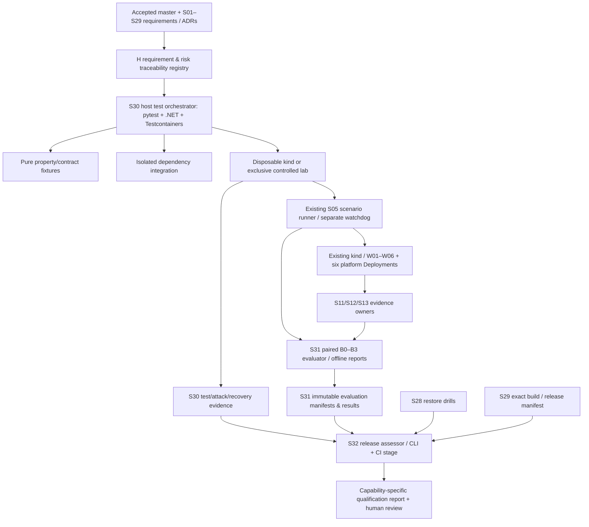
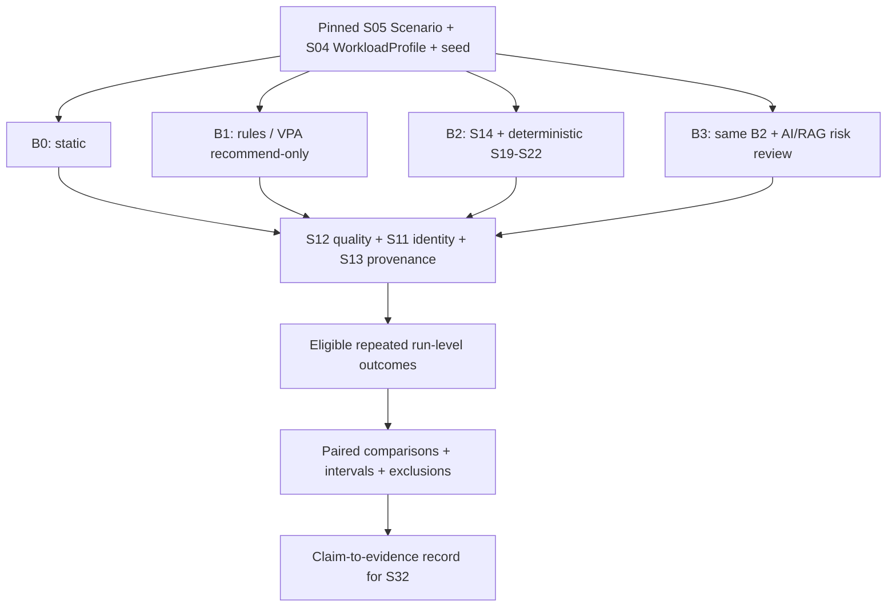
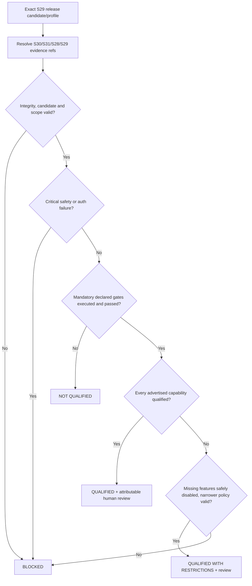
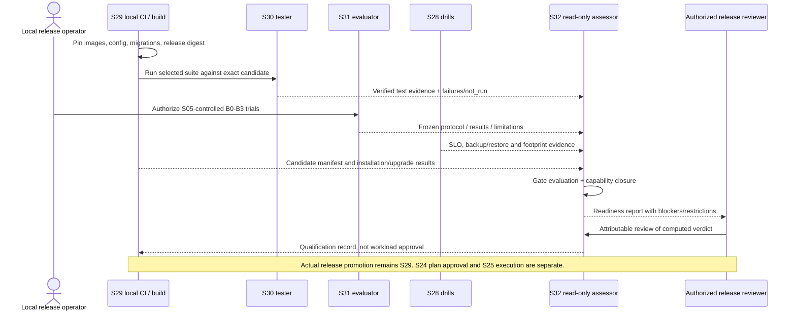
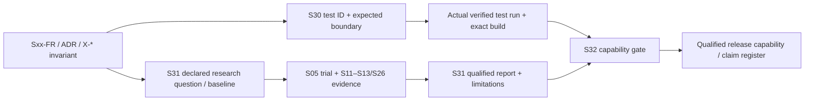

# Domain H — Testing, Evaluation & Product Readiness
## Consolidated accepted architecture: S30 + S31 + S32

> **Owner approval — 2026-11-19.** The owner approved ten Domain H decisions **H01–H10** together: H01 Python-centric pytest/.NET/Testcontainers/kind/S05 test toolkit; H02 risk-based fast/integration/full execution; H03 adversarial and invariant/stateful tests with isolated mutation scenarios; H04 the exact S01 B0–B3 comparison; H05 paired, serial, repeated and quality-qualified experiments; H06 independently evaluated RAG, grounded agents and marginal B3-versus-B2 value; H07 immutable, provenance-complete evaluation evidence; H08 capability-scoped release qualification; H09 six evidence-backed release gates and human release review; H10 reproducible release qualification bundles and documentation. This document specifies their technical implications and acceptance criteria. **Architecture approval is not implementation, a successful test, scientific finding, measured improvement, installed CI or release authorization.** Exact dependency versions, numerical thresholds, model qualification, runtime budgets and performance achievements remain unverified and must be pinned/calibrated before asserting measured success.

> **Normative precedence.** Master catalog v1.0.0 and owner-accepted S01–S29 specifications govern their respective domains. This file owns testing methods, experiments/evaluation and release qualification, not upstream runtime behavior. `MUST` is binding to this accepted architecture, `SHOULD` a preferred implementation, `MAY` an allowed alternative. `Accepted`, `provisional`, `reference`, `not_run`, `verified`, and `qualified` are distinct statuses; a release's `qualified` state requires actual artifacts and passing gates. A new decision altering previously accepted behavior requires an explicit superseding ADR.

## 0. Domain-wide contract and reconciliation

### 0.1 Mission, boundaries and success definition

Domain H validates the implemented system in three independent layers:

1. **S30 correctness and safety:** verify requirements, interfaces, domain calculations, attack boundaries, adverse conditions and recovery transitions against traceable evidence.
2. **S31 efficacy and scientific attribution:** test if forecasting, deterministic optimization, retrieval and AI reasoning provide the claimed improvements using fair B0–B3 controlled evaluations and explicit uncertainty.
3. **S32 product readiness:** decide what capabilities a particular reproducible software release may *truthfully advertise*, supported by S30/S31 evidence, S28 recovery results, and S29 delivery checks.

A successful S30 does **not** imply measured benefit; S31 improvement does **not** authorize an execution; S32 release qualification does **not** grant S24 approval. All H tools are offline/local. No persistent seventh custom business Deployment, broker, new optimizer, monitoring backend, test-data service, public cloud, paid API, external LLM or dedicated UI is required.

**Explicit non-goals:** certify real production-scale HA from one workstation; guarantee physical node independence among kind nodes; prove absolute security from a finite attack corpus; turn an agent into a testing controller; treat simulated savings as realized; manufacture 24h history via compressed scenarios; deploy an autonomous external Kubernetes patcher; create a second source of truth for Prometheus/Kubernetes/PostgreSQL/S05; require S10 and Flux P1 capabilities in every P0 release profile; infer model quality from training data or self-judging LLM output; make green CI substitute for plan approval.

### 0.2 Upstream reconciliation and why those decisions matter

| Accepted owner | Non-negotiable upstream architecture | Domain H requirement / test implication |
|---|---|---|
| Master / S01 | Fully local AIOps; Observe/Advisory/Governed, L0–L2; no L3; exact human approval; current, 1h, conditional 24h; workload/namespace/node-cluster; Critical/Standard/Flexible/Opportunistic; B0/B1/B2/B3 | Test capabilities independently and fail closed; four fixed comparisons, no invented 24h or autoapproval; evidence-based safety before savings. |
| S02 | Exactly six custom platform Deployments: `api`, `observer`, `capacity`, `ai`, `governance`, `executor`; single PostgreSQL, seven schemas `inventory`, `capacity`, `knowledge`, `governance`, `execution`, `audit`, `workflow`; typed REST, durable SQL jobs/outbox, no mandatory broker | H is CLI/CI/test libraries and ephemeral environments; validate domain ownership, at-least-once semantics, schema contracts and API boundary; no eighth schema or seventh Deployment. |
| S03 | One kind control plane + three workers (one tainted platform worker, two experiment workers) on Windows 11/Docker Desktop/WSL2; Ryzen 5 3600, 20 GB host; candidate 12 GiB WSL2 cap; Calico default deny; host Ollama; local PVC and protected separate backup | Local throughput/pressure results only; measure actual host and node budgets; ephemeral cluster tests or exclusive lab windows; do not claim real host HA. S05 `capacity-experiments` namespace addendum outstanding. |
| S04 | W01 .NET latency-api Critical; W02 .NET burst-api Standard; W03 Python memory-profile Standard; W04 CPU worker Flexible; W05 suspended analytics CronJob Flexible; W06 scenario-created opportunistic Job; HPA off baseline | Tests must cover six classes and precise Job/Deployment semantics, bounded app controls, latency/queue/Job SLIs, no permanently running W05/W06; HPA tests separately flagged opt-in/P1. |
| S05 | Host Python/Typer scenario orchestrator, SQLite journal, independent narrowly credentialed watchdog, ephemeral tokenless load-driver Jobs; versioned profiles, seeded demand, owned-UID cleanup, safe abort, exclusive tests, content-addressed evidence | Reuse S05 for all resource-driving experiments; no alternate privileged load-test service; deterministic planned traffic != deterministic actual measurements; S05 cannot reset S25 changes. |
| S06 | Keycloak OIDC human auth; platform roles and action/resource scope+conditions; author/approver separation; Admin non-bypass | Negative tests at public API and Governance, token freshness/revocation, cross-namespace data isolation and approval uniqueness; tester identity cannot grant itself approval. |
| S07 | Per-service SAs; Observer read, Executor narrow write, AI/demo/drivers no mutation K8s token; TLS/selective mTLS; Calico isolation | Test actual service tokens/network paths and backend authorization, not only middleware mocks or policy YAML. |
| S08 | Vault+ESO; offline root, cert-manager intermediate; PSA Restricted+native CEL; classifications, secrets/redaction, encrypted backups, protected audit | Secrets never in test artifacts or LLM context; admission negative fixtures, key rollover, cert expiry, tamper/restore and redact-before-embedding. |
| S09 | In-process AI Tool Authorization Broker, independently authorized backends, host Ollama proxy; untrusted RAG/tool text, model has no write privileges | Injection/poisoned retrieval/tool forgery tests; direct broker/backend bypass denied; model obedience cannot be sole security gate. |
| S10 | P1 local OCI Distribution Registry, Syft/Trivy, Cosign key signing, Sigstore Policy Controller, periodic conformance | P1 activation tests include invalid signature/provenance/policy; P0 releases must not claim this installed if absent; S29 retains tooling ownership. |
| S11 | Only Observer LIST/WATCH/reconcile, stable logical ID and UID incarnations, per-kind freshness, effective scheduling requests, immutable inventory | Watch/relist/failure/gap tests, UID reuse/rollout identities, node allocatable vs observed usage, no global ordering of resourceVersion. |
| S12 | Bounded Prometheus + cAdvisor/kube-state-metrics/app metrics; registered PromQL and query quality; provisional 15s/30s scrapes, ~7d retention; sampled maxima not true peaks | Missing-as-zero forbidden; scrape/counter-reset/mapping/quality/retention tests; sampling fidelity disclosed; Prometheus remains raw TSDB authority. |
| S13 | Seven domain-owned PostgreSQL schemas; immutable, time-correct evidence refs, classified provenance, idempotent import, reference-aware retention, transactional outbox; S05 SQLite remains runner journal | Tests for digest, owner-only writes, retention pins, idempotent import, transaction failure/replay and restore of references, no per-scrape TSDB duplication. |
| S14 + numerical companion | Statistical-first reproducible forecasts with walk-forward validation, quantile/interval calibration, refusals, as-of leakage prevention, conditional batch envelopes, no LLM numerical predictions | Independent numerical golden/property tests; blocked leakage/censoring; horizon-specific held-out skill/coverage and refusal reporting. |
| S15–S18 | Host Ollama via authenticated proxy, separate pinned generation/embedding profiles, Microsoft Agent Framework three-role Analyst→Planner→Reviewer, fixed scoped tools, pgvector+FTS/RRF authorized knowledge, redaction/revocation | Model-hash/context reproducibility; output schema/citation fidelity; retrieval accuracy+denial; failure-safe optional AI; B3 incremental value only. |
| S19–S23 | Hard gates before scoring, bounded deterministic single-controller CPU/memory changes; scheduler-fit simulator limits; HPA advanced P1 | Pure-function oracle tests, property-based constraints, real K8s scheduling cross-check and approximation catalog; HPA absent in B0 baseline and P1 capabilities excluded unless qualified. |
| S24–S26 | Plan≠approval≠execution≠verified outcome; distinct human approver; exact content/version/expiry; live revalidation; intent-before-write; unknown effect/reconciliation; constrained inverse recovery; qualified benefit | Security-critical E2E state machine and unknown-effect tests; no mistaken immediate success; recover only if exact preauthorized envelope and current ownership pass. |
| S27 | API-first operator HTTPS/Keycloak/Typer; Grafana read-only; exact typed states; no custom SPA | API/CLI error and mode semantics, protected endpoint tests, asynchronous states, no unrestricted K8s/SQL/PromQL. |
| S28 | Focused operational telemetry; capability-based degradation; independent encrypted backups; rebuild-and-restore; measured RPO/RTO | Failure injection, dependency health, host pressure, restore drill and no false HA assertions; verify deterministic core survives AI outage. |
| S29 | Python automation+Helm/Kustomize, local CI, release manifests/migrations; Flux P1; S10 chain P1; release rollback distinct from S26 | Render/pin/install/upgrade/rollback tests; CI authority separated from Executor; release compatibility gates, explicit P1 status, no unauthorized baseline reset. |

### 0.3 Cross-cutting invariants (normative test oracles)

- **Identity/authorization:** S06/S07 authenticate principal and independently authorize action, scope, target and current policy; no AI, S05 runner, CI, or test fixture is an S24 human approver.
- **Measurement semantics:** `requested`, `limited`, `allocatable`, `observed`, `forecasted`, `simulated`, `configured`, `applied`, and `realized` are separate, typed and unit-tagged. CPU request reduction is a scheduler reservation effect, **not** actual CPU consumption saving.
- **Data quality:** incomplete, missing, outdated, unauthorized, censored or incompatible evidence cannot become a successful safety gate. Sampled maximum is not guaranteed true peak. Short/compressed simulations are not 24h measured history.
- **Authority:** owner service+schema retains source truth. Reference/citation checks verify exact digest, scope, time, identity, and source lineage. H outputs refer to S05/S11–S13/S24–S26 rather than rewriting them.
- **Execution:** `ResourceCandidate != OptimizationEvaluation != ExecutionPlan != ApprovalRecord != ExecutionIntent != AppliedChange != VerifiedOutcome`. Lease expiration/API timeout is **not** proof of non-application.
- **Isolation:** destructive/security experiments run on disposable environments where feasible; controlled exclusive existing-cluster access otherwise. Only S05 experimental authorization is used for experiment-specific resources, S25 governs optimized changes.
- **Physical host:** kind nodes share a real physical failure domain; test host CPU/RAM/disk and signal safety. Avoid inference/model pressure during controlled capacity trials where it biases results.
- **Evidence truth:** unexecuted or invalid tests are `not_run`/`invalid`, never green; proposed targets and provisional values are not pass criteria until pinned; passing finite tests does not prove zero risk.
- **Priority:** S30, S31, S32 P0. S10 artifact-integrity installation, Flux adapter and S23 advanced HPA are P1 unless an explicit narrower profile claims a qualified feature.

### 0.4 Logical architecture / trust zones



**Trust map:** H host tooling may have *separately configured test-only, scoped* identities, never production-like unrestricted K8s admin as the path under test; release assessor is read-only with respect to workloads/plans. A human operator may initiate qualification, but qualifying a release is not permission to execute an optimization. Test-specific bootstrap admin permissions are recorded, segregated, and never used to produce a positive least-privilege result. Tests may use temporary namespace/cluster administration only in a disposable fixture, explicitly outside the tested application identity boundary.

### 0.5 Domain H ownership and final outputs

| Owner | Owns | Must not own |
|---|---|---|
| S30 | test suite schemas, orchestration profiles, security/state-machine threat fixtures, coverage and executed evidence | runtime business modules, production authorization, actual forecast labels/benefit claims |
| S31 | controlled protocols, B0–B3 comparisons, AI/ML/RAG quality labels, statistical analysis and scientific claims | source Prometheus history, S05 run journal, model training secrets, candidate or plan/approval execution |
| S32 | qualification criteria, cross-evidence validation, capability/release verdict, documentation/claim register | replacing S24 governance, S25 mutations, S26 rollbacks, S28 backup operation or S29 installation |
| Existing owners | K8s state, S05 scenario runs, source measurements, immutable analysis, approval/execution/outcomes, CI releases | delegated global pass/fail issuance for Domain H outside the defined qualification process |

---

# S30 — Testing Strategy & Security Verification [P0]

## S30.1 Mission, scope and acceptance responsibilities

**Mission:** create a risk-prioritized, executable, reproducible suite proving the implemented platform behaves per accepted requirements and fails safely at domain, security, persistence, workflow and Kubernetes boundaries. S30 does **not** establish the statistical superiority of an optimizer; S31 does that. S30 validates individual contracts and release-critical safety prerequisites consumed by S32.

**Functional requirements**

- `S30-FR-001` Every applicable accepted `Sxx-FR-*`, `X-SEC-*`, `X-REL-*`, `X-DATA-*`, `X-OPT-*`, `X-OPS-*`, `X-DEL-*`, `X-TST-*` and ADR critical invariant is mapped to an executable test and test owner, or explicit justified non-test evidence/release limitation.
- `S30-FR-002` Test suites use one Python orchestration CLI, with native pytest/Python and .NET runner commands; static/versioned configs, no arbitrary shell submitted through user-controlled YAML.
- `S30-FR-003` Test profiles have recorded environment identity, isolated resource namespace/cluster, dependency versions, images, seeds, deadlines, cleanup and retry rules.
- `S30-FR-004` Dedicated pure, contract, integration, component/API, E2E, security/adversarial, and operational suites; risk-based execution frequencies without asserting full coverage on fast PR runs.
- `S30-FR-005` Deterministic functions have golden/reference/property/stateful tests; network/K8s/DB effects have integration/negative tests using *real* identity enforcement when indicated.
- `S30-FR-006` A finite attack corpus covers real authz, network, admission, key/secret, supply chain (P1), broker/RAG, plan, Executor and recovery boundaries.
- `S30-FR-007` Destructive/fault tests obey S03 host pressure, S05 watchdog/exclusivity and S25 authorized execution ownership; no accidental mutation of live baseline or platform resources.
- `S30-FR-008` Tests emit machine-readable statuses `passed`, `failed`, `skipped`, `not_run`, `blocked`, `invalid` with reason, suite revision, time, input/env/evidence digests and original unfiltered failure context safely redacted.
- `S30-FR-009` Coverage is risk/requirement based: unit line coverage alone never qualifies an authorization or state-machine requirement; no hard-coded arbitrary global 90% gate.
- `S30-FR-010` Tests verify expected failure states, denial, recovery and no false success, not only happy paths.
- `S30-FR-011` The S30 result is integrity-checked against the exact release candidate digest; tests on another build are ineligible without an explicit equivalence/compatibility policy.
- `S30-FR-012` CI/test identities remain separate from S05 experimental identity and S25 Executor; runner cannot mint or impersonate an S24 human approval.
- `S30-FR-013` Repeated/resumed suites cannot silently replay destructive effects; failure leaves an ownership-scoped cleanup and escalation record.
- `S30-FR-014` Fast deterministic and security-negative suites can operate without Ollama; AI-required E2E tests have explicit blocked/degraded statuses.
- `S30-FR-015` Safety-critical testing validates S02 Postgres transaction/outbox and S25 reconcile-first idempotency through controlled process failure and state corruption fixtures.

**Non-goals:** exhaustive formal proof, full production-scale chaos grid, permanent integration-test Deployment, unbounded synthetic traffic, real cloud clusters, Kubernetes version support matrix beyond explicitly pinned images, production secret extraction, unapproved attack testing on arbitrary networks, replacing security policy/admission owners.

## S30.2 Accepted H01 — Tooling and deployment structure

- **Host orchestration:** version-pinned Python 3 environment, `pytest` with e.g. `pytest-xdist` only for safe isolated parallel unit tests, `hypothesis` for property/state-machine tests, `testcontainers-python` for service fixtures, `httpx` for HTTP, Kubernetes Python client for controlled scoped read/fixture operation, Typer command wrapper matching S27/S29 family. Actual package versions pinned by S29.
- **.NET tests:** native `dotnet test` using pinned .NET 10 SDK for W01/W02 and shared .NET libraries where present. Prefer xUnit or existing standard; choice of exact framework is an implementation detail. The host Python runner executes and imports JUnit/TRX results; it is not a replacement for .NET semantics.
- **Containerized dependencies:** Testcontainers PostgreSQL; optional Keycloak/Prometheus/compatible dependencies only when the fixture tests their actual contract. Mock adapters and recorded fixtures are permitted for fast tests, but cannot claim real TLS/OIDC/K8s correctness.
- **Kubernetes integration:** disposable kind topology for destructive cases where physically feasible. Reuse S03 Python bootstrap, manifests and Calico policies; image pins and node allocatable captured per run. If full twin cluster exceeds the shared-host RAM budget, serialize teardown/create, or run tests on an exclusive current lab after S05/S25 preflight and ownership controls; report which environment was used.
- **Experiment-driving tests:** use S05 host orchestrator + ephemeral in-cluster drivers; exact allowlisted S04 workload profiles. Never introduce standalone privileged load generator or have an AI agent launch stress/faults.
- **Evidence:** JUnit XML for interoperability, JSON result/coverage records, redacted logs with ref/digest, source and image revisions. All test artifacts written to bounded host/workspace paths; S13 records may be referenced/imported via owner contracts only where relevant.

### S30.2.1 Proposed repository structure (non-binding filenames)

```text
verification/
  policies/                 # Versioned risk, test selection, mandatory gate map
  contracts/                # OpenAPI, JSON Schemas, event/DTO compatibility fixtures
  fixtures/                 # Redacted golden inventory/metrics/state/attack examples
  unit/                     # Pure Python reference oracles
  property/                 # Hypothesis invariant/state machine tests
  integration/              # Testcontainers + service/adapters
  component/                # Protected backend and API checks
  kubernetes/               # Disposable-kind and admission/security checks
  adversarial/              # AI/RAG/tool/policy/plan negative cases
  operations/               # Stop/restart/rebuild/restore drills
  evaluation/               # S31 protocols/labels/scenario registration
  readiness/                # S32 policies/evidence and qualification CLI
  schemas/                  # H logical contract schemas
  reports/                  # Generated, not source-controlled secrets
apps/dotnet-tests/           # Native W01/W02 .NET test projects (illustrative)
```

**No new persistent Deployment or PostgreSQL schema.** The verification directory is logical and may be integrated into S29's accepted modular monorepo. Do not create duplicate copies of authoritative S04/S05 runtime profiles: reference approved source IDs and content hashes.

## S30.3 Accepted H02 — Risk-based execution profiles and scheduling

| Profile | Trigger / intent | Included evidence | Isolation and time policy |
|---|---|---|---|
| `fast` | Changes/PRs, developer pre-push | Ruff/Pyright/.NET compile/style, selected SAST, unit/property, schema, pure security denial, policy golden oracles | No kind cluster or model dependency; finite CPU/time; parallel only independent tests |
| `integration` | Merge/targeted dependency change | Relevant Testcontainers, Keycloak/OIDC paths, DB migrations/outbox/owner APIs, API auth, S14 numerical contracts, tool adapter, Helm render/admission dry-run as appropriate | Bounded containers; explicit service fixtures, no unreviewed cluster write |
| `full-qualification` | Controlled release candidate, critical change | Ephemeral/exclusive kind, full S05 safety and W01–W06, G/F full workflows, adverse security, backup/restore, S31 qualifying studies and S32 readiness | Serialized destructive/effect tests, host budget gate, audit trail and explicit operator authorization |

- Test selection derives from a versioned `RequirementCoverageMap` and changed component/API/schema; absence of related changes does **not** waive scheduled/release-critical suites.
- Security-critical code changes trigger at least the relevant attack subset even for `fast`. For shared auth/policy/evidence protocol changes, dependency impact analysis expands coverage.
- Each run records `suiteProfile`, `selectedTests`, `requiredTests`, `notExecuted`, `environmentKind`, `exclusiveLeaseRef`, `operatorScope`, `timeouts`, `testExecutionPolicyRef`, `candidateDigest` and any skipped tests.
- A test retry may identify flakiness but cannot erase initial failure. Track attempts and final adjudication; nondeterministic high-risk tests require root cause or documented uncertainty before release.
- `test_pass_rate = passed / eligible_executed` may be diagnostic, never hide unexecuted mandatory cases in denominator. Qualification requires *required test identities* pass.
- Global cancellation, safety abort, SIGTERM or host watchdog preemption must preserve test journal and safely reconcile only suite-owned resources. A failed cleanup is an explicit environment blocker.

## S30.4 Test pyramid and acceptance oracle catalog

| Level | Primary technique | Primary examples | Required distinction |
|---|---|---|---|
| Pure unit/golden | pytest/.NET native reference inputs | units, int/decimal, quantity basis, ADR policy merge, canonical hashes | Mock success not end-to-end authorization |
| Property/stateful | Hypothesis + S24/S25/S26 reference state machine | legal transitions, idempotency, hard gate monotonicity, no safe result from unknown | Generated test cases have reproducible seeds/shrunk input |
| Schema/contract | OpenAPI JSON Schema contract check, event DTO and fixture roundtrip | typed enum/status, version, null+reason, unauthorized problem response | API schema validity not proof of backend enforcement |
| Dependency integration | Testcontainers and controlled network/TLS | PostgreSQL isolation/outbox, Keycloak token, Vault delivery, certificate renewal | Stub fixture not proof of deployed integration |
| Component/API | Actual service with dependencies | scoped API, worker/plan lifecycle, read tool, validation | Actor vs machine and backend recheck |
| Kubernetes integration | Disposable kind / gated lab | LIST/WATCH, PSA/CEL, SA denies, Calico, pending/scheduler, patch precondition | kind worker != separate physical fault domain |
| E2E | Authorized human + six platform roles + S04 workloads | plan→approval→apply→verification/recovery, Observe read, AI diagnostic | Plan auth != execution, applied != realized benefit |
| Fault/reliability | Restart/loss/reconciliation and restore | DB disconnect, queue replay, Ollama down, short Job scrape gap, unknown effect | Fail-closed or labeled degraded, no fabricated success |
| Adversarial | Auth, broker, RAG/plan/evidence corruption | cross-namespace search, poisoned tool results, plan digest forgery | Model prompt adherence not independent security guarantee |

### S30.4.1 Formal property/invariant shortlist

| Invariant ID | Property and negative counterexample |
|---|---|
| `P-AUTH-01` | Authorized decision `ALLOW` requires authenticated machine, bound actor, valid scope/action/policy; remove any one ⇒ deny. |
| `P-PLAN-01` | Change canonical plan content, revision, target UID, before/after fields, policy or adapter ⇒ old approval invalid. |
| `P-PLAN-02` | Author cannot approve own plan; changing role to Administrator does not waive separation. |
| `P-GATE-01` | Hard gate `fail` or `unknown` never becomes executable via higher utility score, AI text, or risk score. |
| `P-UNITS-01` | CPU millicores and bytes preserve nonnegative exact semantics; requests not substituted for usage. |
| `P-TIME-01` | Point-in-time feature availability never exceeds cutoff; no future data, no fake 24h history. |
| `P-EVID-01` | Mismatched digest, UID, cluster incarnation, time, scope or quality prevents evidence eligibility. |
| `P-SIM-01` | Unsupported scheduling constraint ⇒ `unsupported`/`inconclusive`, not safe node fit. |
| `P-WRITE-01` | Expired lease, network timeout or restart cannot imply an external write definitely did/did not happen. |
| `P-RECOVER-01` | Inverse recovery requires bound preauthorization and fresh state/ownership; else suspend/escalate. |
| `P-SEC-01` | AI/driver/K8s SA with no mutation rights cannot write via direct/indirect path. |
| `P-RELEASE-01` | No passing S30 result from unrelated build, skipped critical suite or changed policy without eligibility check. |

### S30.4.2 Cross-domain runnable test matrix (minimum P0)

| Test ID family | Owner slices | P0 assertions |
|---|---|---|
| `T-A-001..` | S03–S05 | kind topology/taint/Calico, per-node/host budget, four steady Deployments, suspended Job templates, bounded drivers, seeded planned schedule, watchdog abort, UID-scoped cleanup |
| `T-B-001..` | S06–S09 | token signature/audience/expiry, role+scope, separate human approval, SA denies, Calico ingress+egress negative probes, TLS/mTLS, Vault/ESO/CA/PSA/CEL, redaction, agent tool/RAG boundaries |
| `T-B-P1-*` | S10 | signed digest/provenance/SBOM/admission and runtime drift only when P1 feature installed/advertised |
| `T-C-001..` | S11–S14 | list/watch/reconcile, deletion/UID lineage, request accounting, scrape/counter reset/missingness, reference/retention, forecast eligibility/backtest/interval/refusal |
| `T-D-001..` | S15–S18 | Ollama gateway isolation, model pin/schema, workflow checkpoint/lease, tool broker/backend denial, retrieval ACL/revocation/redaction/citation |
| `T-E-001..` | S19–S22 | hard constraints, candidate unit/field permissions, placement fit/fragmentation golden fixture, simulator quality, cross-check with Kubernetes |
| `T-E-P1-*` | S23 | enabled HPA/advanced advisory correctness; baseline explicitly disabled |
| `T-F-001..` | S24–S26 | plan digest + approver uniqueness + expiry, fresh K8s read, intent-before-write, partial external effect, reconciler restart, rollback preauthorization, SLO/evidence-qualified result |
| `T-G-001..` | S27–S29 | API error contracts, CLI PKCE/scopes, health/capability degrade, DR restore, migrations, install/upgrade/release rollback, no CI→S25 bypass |

## S30.5 Accepted H03 — Adversarial tests, identity isolation and controlled mutation

### S30.5.1 Threat actors and surfaces

- Anonymous/unprivileged HTTP caller; authenticated wrong-namespace Viewer/Analyst; revoked/expired human token; same human attempting to author+approve; compromised `ai`, `capacity`, `observer`, demo or driver Pod; scenario runner with experiment-only credentials; malicious runbook/evidence author; compromised or restarted worker/Executor; source/OCI artifact tamperer; GitOps/CI actor whose permissions must not imply approved execution.
- Surfaces: S27 public API/CLI, S06 governance policy, S07 SA/mTLS/Calico, S08 secrets+admission, S09/S17 tool broker and S18 SQL authorization prefilter, S24 plan persistence, S25 durable workflow and Kubernetes patch, S26 inverse recovery, S29 CI/registry/Flux.

### S30.5.2 Attack/negative case catalog

| Attack ID | Injection/action | Authoritative enforcement | Safe expected observation |
|---|---|---|---|
| `ATT-01` | Forged audience, issuer, expired/revoked OIDC token | S06 + API/Governance | Denied and no foreign metadata leak |
| `ATT-02` | Wrong namespace Viewer requests other workload or RAG document | S06/S11/S17/S18 owner | Denied including counts/cursors/errors |
| `ATT-03` | Plan author attempts own approval or Admin override | S24 current grants | No approval record issued |
| `ATT-04` | `ai` SA attempts K8s PATCH or Executor endpoint | S07 NetworkPolicy/RBAC + S25 auth | Denied at actual enforced boundary |
| `ATT-05` | Driver tries K8s token mount, arbitrary Job or host access | S05/S07/S08 PSA/CEL | No token/unauthorized Job, admission rejected |
| `ATT-06` | Pod attempts other namespace Secret, Vault path or signed key | S07/S08 | Denied; secret never recorded in artifacts |
| `ATT-07` | Prompt injection in incident/runbook asks to skip policy/run experiment | S09/S16/S17 | Untrusted data quarantined; no privileged tool/effect |
| `ATT-08` | Tool response injects forged caller role, URLs/SQL/PromQL | S09/S17 backend + schema | No privilege change or arbitrary query |
| `ATT-09` | Poisoned or revoked RAG chunk with fake citation | S18 prefilter+revision; S17 citation validator | No accepted cited claim or scope leak |
| `ATT-10` | Model invents CPU prediction/plan change or safety clearance | S14/S19 backend + S16 typed validation | Values rejected/unqualified; no action |
| `ATT-11` | Change any immutable plan detail after approval | S24/S25 canonical hash | Exact approval invalidated |
| `ATT-12` | Force stale UID/resourceVersion or Git owner change before patch | S25 fresh GET/ownership | Suspended/denied; no blind mutation |
| `ATT-13` | Simulate apply success followed by timeout and worker restart | S25 durable intent/reconcile | `unknown_effect` reconciled before retry |
| `ATT-14` | Tamper execution outcome/claimed benefit | S13/S26 audit/evidence integrity | Refused, no `benefit_verified` |
| `ATT-15` | Replay expired or nonmatching inverse recovery | S26 bounded inverse + fresh checks | Denied/escalated, no broad rollback |
| `ATT-16` | Change release artifact digest after test run | S29/S32 qualification | Prior test evidence ineligible |
| `ATT-17` | P1 wrong signer/unsigned OCI image/admission bypass | S10+S29 when feature qualified | Kubernetes admission denies |
| `ATT-18` | Unbounded query or RAG corpus/citation enumeration | S12/S17/S18 budgets/ACL | Budgeted denial, no protected metadata leak |
| `ATT-19` | Break PKI/Keycloak/Vault and ask privileged fail-open | S06–S08 owners | Explicit degraded/block; no unauthorized sensitive action |
| `ATT-20` | S05 cleanup clashes with previously approved S25 workload state | Separate S05/S25 authority and UID ownership | No optimized change overwritten |

**Pass rule:** no successful unauthorized mutation or forbidden disclosure in the defined cases. Count attempts, enforcement point and actual denied effect; a broker-level deny alone is not enough for tests requiring backend or Kubernetes enforcement. Record cases not run separately. Security policy tests are not conducted against external/shared networks without authorization.

### S30.5.3 Mutation and fault test isolation

1. Preflight physical host pressure and S05/S25 active leases; reject overlapping change/testing windows. Verify no unowned cluster resources will be modified.
2. Prefer a fresh disposable kind with exact pinned CNI and controls; if using a shared lab, use an exclusive lease, approved test-only target and operator approval requirements. Release identity remains separate.
3. Capture before state including cluster incarnation, controller UID, field values, evidence refs and test-specific owned objects. Do not assume `kubectl apply` is harmless under GitOps ownership.
4. Execute allowlisted actions using the correct actual machine/human identity. Observe through independent read path. Do not make a least-privilege test pass through a privileged fixture identity.
5. Failures and timeouts produce `unknown`/blocked until reconciliation. Abort new experimental load through S05 safety controls.
6. Cleanup solely resources identified by test owner UID/label and expected revision. If S25 created an optimized change, its inverse is controlled only by S26; do not reset from baseline YAML.
7. If cleanup cannot prove current identity/ownership, preserve state and escalate. Record unresolved resources and quarantine environment from further experiments.

## S30.6 Reliability / persistence / recovery cases

| Failure | Injection method | Pass criterion |
|---|---|---|
| Observer watch lost or resourceVersion expired | Controlled watch disconnect + relist | Per-kind stale/partial until resync; correct UID lineage on recovery |
| Prometheus scrape missing or reset | Test query fixture/target outage | Missingness and lower quality, not observed zeros; critical decisions refuse |
| PostgreSQL worker killed between SQL intent and external write | Forced process stop | Durable intent+lease records; safe recovery/recheck |
| Kubernetes write succeeds but response lost | Adapter fault injection | `unknown_effect` then live GET before any retry |
| Executor duplicate outbox delivery | Same intent twice | Idempotent, no duplicate distinct mutation |
| Actor approval role revoked before execution | Keycloak/Governance change | Fresh authorization denies new write |
| Ollama or gateway unavailable | Stop/proxy fail | AI diagnostic unavailable, deterministic core operational |
| Embedding revision incompatible | Stage reindex fixture | No mixed vector space retrieval; fallback lexical only if qualified |
| Vault locked/cert expired | Safe isolated outage | Privileged actions blocked, explicit readiness/alert |
| Partial DB/cluster restore | S28 controlled restore | Reference integrity and authority reconciliation before resumption |
| S05 watchdog/runner exits | Induce host process failure | Stop bounded load, scoped cleanup, journal evidence |
| Rollout safe but operational window insufficient | S26 observation under test | `verification_inconclusive` rather than savings or false rollback success |
| P1 Flux drift/ownership unclear | Controlled GitOps test | Direct path refused; GitOps result unqualified until adapter verified |

## S30.7 Logical test metadata contracts (reference schema)

```yaml
schemaVersion: requirement-test-map/v1alpha1
registryRevision: "pinned-at-build"
requirements:
  - requirementId: "X-SEC-06"
    owningSlice: "S25"
    risk: critical
    requiredProfiles: [integration, full-qualification]
    testIds: [T-F-EXEC-STALE, ATT-12]
    evidenceKinds: [junit, audit-observation, kubernetes-readback]
    releaseCapability: governed_execution
    waiverAllowed: false
```

```yaml
schemaVersion: verification-run/v1alpha1
runId: "uuid-example-only"
candidateDigest: "sha256:release-candidate-digest"
sourceRevision: "git-sha-placeholder"
suiteProfile: full-qualification
suiteRevision: "sha256:test-suite-digest"
requirementMapRevision: "sha256:map-digest"
clusterIncarnationRef: "lab-cluster-ref"
environmentKind: "disposable-kind" # or exclusive-existing-lab
hostBudgetProfileRef: "s03-calibrated-profile"
startedAtUtc: "ISO-8601-UTC"
finishedAtUtc: "ISO-8601-UTC"
tests:
  - testId: ATT-12
    status: passed # failed|skipped|not_run|blocked|invalid
    evidenceRefs: ["sha256:readback-evidence"]
    assertionOwner: S25
    attempt: 1
    reason: null
cleanup:
  status: verified # unresolved|blocked
  ownedResourceRefs: []
securityClassification: Internal
signatureOrIntegrityRef: "sha256:canonical-manifest"
```

The example statuses/strings are illustrative, not executed evidence. `skipped` means selected but explicitly skipped; `not_run` means never executed; neither is `passed`. The test suite and release assessor MUST not accept unknown enums as green. Redact classified data before publishing JUnit/logs. Immutable evidence uses content digest over canonicalized payload and protected index; a hash alone is not a trusted external signature.

## S30.8 Traceability and completion criteria

- All release-critical P0 upstream requirements and accepted invariants have test identities, owners, expected enforcement points, and acceptable result types; any non-automatable manual proof is explicit.
- Required suite tests pass against exact candidate and pinned environment; no unresolved critical security/correctness failure, non-reconciled external mutation, or mandatory environment cleanup failure.
- At least one actual denied authorization path is verified at each relevant backend/cluster boundary, with test identity proof; no reliance solely on mocked auth.
- Critical state-machine transitions and fault paths are tested with seeds/reference cases and effect readback; no false exactly-once assertion.
- S05 safety and isolation is operationally verified before any S31 stress experiment.
- S30 emits a complete signed or integrity-protected (as installed) evidence index and `not_run`/limitations. S32 decides the final release impact; S30 does not issue release authorization.

**S30 acceptance statement:** architectural contracts approved, tests **not yet implemented or run**. No 100% correctness/security claim. Implementation evidence required.

---

# S31 — Capacity Experiments & AI/ML Evaluation [P0]

## S31.1 Mission and scientific evaluation questions

**Mission:** quantify the operational and decision-quality value of static vs rule/VPA vs forecast-aware deterministic vs full AI-enhanced approaches under reproducible, safe, S05-governed load scenarios, without false attribution or misleading uncertainty.

**Key predeclared questions:**

1. Does B2 yield lower eligible CPU/memory **requests** or higher scheduler headroom than B0/B1 with no unacceptable SLO or policy regression?
2. Do S14 forecasts improve future risk estimation beyond qualifying statistical baselines on time-held-out windows, and how often does the model correctly refuse?
3. Does S21/S22 scheduling/fragmentation evaluation match supported real scheduling behavior sufficiently to qualify a given decision, and are unsupported constraints refused?
4. Does B3 improve evidence-grounded risk recognition, citations and safe selection/disposition relative to B2, beyond deterministic optimization's own savings?
5. Are observed changes **realized** in S26 qualified outcome windows or merely a simulation, recommendation, request delta or counterfactual?
6. How do host pressure, input quality, scraping gaps and model runtime alter validity and applicability of any conclusion?

**Non-goals:** training a state-of-the-art forecasting model or replacing S14 calibration; generic LLM benchmarking; GPU efficiency claims; CPU *consumption* cost reduction from request changes; cloud cost dollar estimates without actual priced infrastructure; a claim of universal optimality across all Kubernetes clusters; assuming a VPA recommendation is an applied mutation; silently ignoring rejected/invalid/inconclusive runs.

## S31.2 Accepted H04 — Four baseline definitions and comparability

| Arm | Canonical name | Components / algorithm | Change application semantics |
|---|---|---|---|
| `B0` | `static_config` | Exactly existing pinned S04 resource requests/limits; no optimization recommendation | Control/run on S04 baseline; no algorithm action |
| `B1` | `rules_vpa_recommendation` | Versioned static/rule percentile recommendations and VPA recommendation-only observations where supported; no autonomous VPA update | Convert eligible recommendation to fixed typed candidate and subject to **same** S19/S24/S25/S26 control as B2/B3 when studying outcomes; label VPA absence/qualification |
| `B2` | `forecast_aware_deterministic` | S14 model/refusal + S19–S22 candidate generation, hard gating, placement/simulation and deterministic selection | Only eligible exact plan and independently authorized S24/S25 human execution can change live state |
| `B3` | `ai_enhanced_governed` | **Same exact** B2 inputs/optimizer/policy plus S15–S18 Analyst→Planner→Reviewer, RAG/context | Agent may influence review/advisory disposition; never originate arbitrary numbers, relax gate, self-approve, invoke S05 or mutate |

**Fairness rules:** Common scenario family, pinned workload desired profile, equivalent host/environment class, demand schedule, metric definitions, SLO policy, eligible data and decision cutoff. B3's deterministic numeric outputs must be identical to B2's for identical immutable inputs unless the authorized deterministic engine was explicitly rerun under a *separately versioned* evidence change; otherwise report confounding. B1 VPA recommendation-only is an advisory baseline, not a live applied workload unless subsequently governed. Distinguish *algorithm output comparison* from *applied outcome comparison*. P1 HPA features must not enter P0 reference baseline inadvertently. Report no model-supported change as a legitimate `no_action/refused` result, not an experiment failure to discard.



## S31.3 Accepted H05 — Controlled experiment design and safety

### S31.3.1 Experimental units, pre-registration and serial execution

- A **trial** is one separately initiated S05 execution with a pinned scenario/profile/seed/baseline arm, run ID, host/node/environment identity, warm-up/measurement/cooldown windows and independently measured outcome evidence. Telemetry points within a trial are repeated measures and cannot be counted as independent experimental replicas.
- The `EvaluationProtocol` is frozen **before outcomes are inspected**, declaring primary and secondary endpoints, eligible scenarios, effect direction, decision/hold-out cutoffs, statistical estimator, planned repetitions, run-level comparison units, exclusions, guardrails and resource ceilings. Amendments produce a new protocol revision and do not retroactively relabel prior trials.
- Run arms **serially** due to single-host contention; counterbalance or randomize arm order within available trial blocks. If strictly sequential fixed order is used, explicitly report drift/time/order confounding.
- Pair trials by matched scenario family/profile/seed/intended demand and compatible environment, not by cherry-picking closest outputs. A repeated fixed seed guarantees reproducible *planned* workload but **not** identical actual CPU/memory, scheduling, network/HTTP latency or host state.
- Freeze equivalent image/config revisions and Kubernetes constraints; measure **actual** Node allocatable/request accounting and physical host CPU/RAM/disk, not nominal kind node limits alone.
- Before each run: S05 watchdog active, exclusive lease and no pending optimized S25 effect or S26 verification/recovery, host admission safe, Prometheus targets healthy, sufficient filesystem space and restricted network/identity paths.
- After each run: stop drivers and temporary Jobs, collect admitted evidence, reconcile S05-owned resources, verify that baseline reset does not overwrite an approved S25 change. Only restart comparable trials after documented cool-down and environmental eligibility.
- Hold out representative scenarios for final confirmatory evaluation, distinct from calibration and development. Do not iteratively tune model/thresholds on final held-out trials without reporting post-selection bias.

### S31.3.2 Validity flags and exclusions

| Quality flag | Consequence |
|---|---|
| `host_pressure`, `thermal_or_external_interference` | Exclude from primary causal comparison or stratify under predeclared sensitivity analysis; still report attempted run |
| `load_driver_overload`, `dispatch_deviation` | Invalid equivalent-demand claim unless within predeclared tolerance; retain evidence |
| `scrape_gap`, `query_missing`, `short_job_unsampled` | Metric/endpoint-specific ineligibility; never replace absence with 0 |
| `uid_mapping_ambiguous`, `spec_changed_mid_window`, `cluster_incarnation_changed` | Exclude affected matching period; no name-only join |
| `hpa_enabled_or_replica_changed` | Separate P1/replica-aware stratum; do not compare as fixed baseline |
| `unknown_execution_effect`, `unresolved_cleanup`, `pending_recovery` | Quarantine from next applied trial and label outcome inconclusive |
| `forecast_evidence_insufficient`, `model_refusal` | Count as refusal/no-decision outcomes, not discard to inflate success |
| `violated_safety_envelope` | Abort or stop load; preserve failure/guardrail evidence; prevent qualification of unsafe arm |
| `unqualified_24h_history` | No unconditional 24h accuracy/benefit claim; document unqualified horizon |

**Intention-to-evaluate reporting:** report all initiated runs with states `planned`, `admitted`, `completed`, `aborted`, `excluded`, `invalid`, `inconclusive`, `not_run` plus reasons. An excluded run is still part of denominator/attrition reporting, even when excluded from a primary estimate. Retain predeclared primary outcomes including unfavorable regressions; never suppress them for a higher improvement rate.

### S31.3.3 Windowing and seasonal semantics

- Time windows UTC `[start,end)` with source and availability times, source sampling step, actual forecast `asOf` and correct model/training cutoff. No compressed run may be interpreted as an observed 24-hour history.
- S14 1h bucket suggestions (5m) and 24h (1h) are **model profiles**, not a license to compare mismatched aggregation targets. Keep same target type (`bucket_mean`, `bucket_max_sampled`, quantified tail) across arms/models.
- S04 W05/W06 idle/not scheduled periods are not proof of zero *potential* future demand. Their future envelopes are conditional on declared run/profile/time.
- Warm-up and cooldown do not automatically count toward stable outcome; predefine them. Preserve true elapsed time and metadata around restarts and rollout transitions.

## S31.4 Benchmark catalog (normative scenarios; actual YAML belongs to S05)

| Scenario | Targets / criticality | Demand and controlled intervention | Evaluation concern |
|---|---|---|---|
| `E01-LATENCY` | W01, Critical | Stable then elevated latency-sensitive HTTP load | CPU downsize vs p95 latency, errors, throttling; safety blocks if risk |
| `E02-BURST` | W02, Standard | Idle + repeated CPU/HTTP bursts | Tail/peak protection, no false low-mean safety; HPA **off** P0 |
| `E03-MEMORY` | W03, Standard | Working-set steps/spikes with bounded cap | Sampled peak vs true peak unknown, limits/OOM/history censorship |
| `E04-QUEUE` | W04, Flexible | CPU processing, backlog/throughput transitions | Avoid treating idle CPU with rising queue as safe |
| `E05-ANALYTICS` | W05, Flexible | Controlled scheduled-type Job run | Conditional envelope, short-lived scrape gaps, completion deadline |
| `E06-PLACEMENT` | W06, Opportunistic | Placement/priority/Pending workload | Requests/allocatable/taints/affinity and nonpreempting priority semantics |
| `E07-MIXED` | W01–W06 permitted mix | Bounded concurrent demo resource pressure | Fragmentation, headroom, criticality class constraints and interference |
| `E08-FAULT-QUALITY` | mixed | Host pressure, telemetry gaps, API disconnect in controlled windows | Safety preflight, refusal, S12 quality and exclusion validity |
| `E09-RAG` | cross-domain incident memory | Pertinent old outcome vs unrelated/obsolete runbook | Grounded citations, relevance and temporal correctness |
| `E10-ADVERSARIAL` | B3 tool/RAG | Poisoned instructions/forged evidence/cross-scope prompt | Model-independent boundary denies, AI review accuracy |

Each scenario references S05's approved `ExperimentScenario` schema and WorkloadProfile hash; S31 does not fork or rewrite S05 scenario engine logic. Some cases are analytical/replay-only because deliberately injecting high-risk faults into the shared host is not always permitted; report the kind of evidence and its limitations.

## S31.5 Capacity, scheduling, SLO and outcome measurements

### S31.5.1 Canonical quantities and formulas

| Metric ID | Meaning / measurement | Cautions |
|---|---|---|
| `cpu_request_delta_m` | Σ configured effective CPU requests (m) **before − after** for comparable target controller/replica state | Per-Pod and replica count explicit; not consumption reduction |
| `memory_request_delta_bytes` | Σ comparable scheduled requested memory bytes before − after | Not proof memory consumption declines; OOM guardrails |
| `cpu_request_reduction_fraction` | `(baseline requests − trial requests)/baseline requests` for nonzero comparable baseline | Negative = increased requests; cannot claim financial savings |
| `scheduler_headroom_cpu_m` | eligible allocatable CPU minus effective assigned requests, scoped node/pool | Not a scheduling-fit guarantee |
| `scheduler_headroom_memory_bytes` | eligible allocatable memory minus assigned effective Pod requests | Multi-dimensional fit/constraints remain important |
| `fragmentation_unfit_fraction` | declared trial candidate shapes that cannot fit across tested nodes despite aggregate free resource | Shape/set and supported constraints must be pinned |
| `placement_match` | S21 simulator verdict vs qualified observed Kubernetes scheduler result for same constraints/snapshot | Scheduled Pod behavior can change with time; compare only eligible fixture |
| `pending_duration_seconds` | qualified Job/Pod first eligible creation/scheduling timestamps | Missing events and ephemeral Pods acknowledged |
| `cpu_throttling_fraction` | Prometheus approved rate/ratio over qualified window | Request ≠ CPU limit; metric family semantics/version |
| `memory_working_set_bytes` | observed sampled gauge distribution and max sample | No assertion of true instantaneous peak |
| `oom_event_count` | qualified container OOM/restart/events | Sampling/events incomplete; compare corroborated evidence |
| `http_p95_latency_seconds` | S04 app histogram-based p95 over sufficient observation window | Require volume/aggregation fidelity and SLO basis |
| `http_error_rate` | error count / qualified requests | Denominator and route matching recorded |
| `worker_completion_slo` | W04 throughput/backlog + W05/W06 completion/deadlines | No false steady-state metric on suspended Jobs |
| `applied_result_status` | S26 observed configuration/rollout state | `applied_pending_verification` is not benefit |
| `realized_benefit_status` | S26 `benefit_verified` or qualified safe/no-gain/inconclusive and evidence | No simulation-only result promoted to realized |

**Illustrative math only:** A 500m to 350m single-replica CPU *request* yields `(500-350)/500 = 0.30 = 30%` reservation reduction. Measured CPU consumption could remain identical or change for different reasons. S31 must not translate that into 30% node cost/CPU-use savings. For multi-replica workloads compare actual controller replication/rollout and effective Pod requests, not a static one-replica formula.

### S31.5.2 SLO safety and policy gate protocol

- Class-aware criticality: Critical W01 p95/errors/throttle; Standard W02 burst/error and W03 memory/OOM; Flexible W04/W05 throughput/deadlines; Opportunistic W06 scheduling delay/completion tolerance. Use S04/S19/S26 authoritative definitions, not a new S31 safety policy.
- Classify hard safety gate `pass|fail|unknown|not_applicable` and quality. Unknown required safety never counts as pass. A run showing improved resource efficiency but SLO regression must be reported as unsafe/unqualified, not a win.
- Outcome qualification uses S26 original verification policy/window plus independent S31 comparable study analysis. S31 may aggregate qualified S26 outcomes; it does not write `benefit_verified` itself.
- Material difference from controls: placement `simulated` vs actual observed schedule, favorable `forecast` vs realized demand, HPA-off fixed replicas vs scaled replicas.

## S31.6 Forecast evaluation, statistical validation and refusal

### S31.6.1 S14 numeric protocol reuse

- Forecast targets and intervals use exactly S14 companion: `cpu_consumption_millicores`, `memory_working_set_bytes`, `bucket_mean`, `bucket_max_sampled`, `upper_tail_quantile_estimate`, conditional `run_envelope`; current assessment is not a prediction.
- Evaluate persistence/robust rolling/exponential smoothing and seasonal-naïve only when seasonal evidence supports it; optional scikit-learn challenger cannot win without point-in-time held-out comparison. Preserve identity, source availability times and actual observed future outcomes.
- Split training, model selection/calibration and final held-out evaluation by chronological cutoff (walk-forward/rolling origin with appropriate gap/purge as dictated by feature leakage), not random mixing of adjacent samples. Refusal/insufficient evidence accounted for.
- Metrics (per resource/statistic/horizon/workload/quality stratum): **MAE**, **RMSE**, signed bias, tail underprediction, baseline skill with eligible denominator, interval empirical coverage versus nominal, mean interval width and pinball loss for quantiles. Point forecast error and safety/refusal are separate axes.

**Definitions for eligible paired predictions** (quantities in same units, `n` eligible observations):

```text
MAE   = sum_i abs(y_i - yhat_i) / n
RMSE  = sqrt(sum_i (y_i - yhat_i)^2 / n)
bias  = sum_i (yhat_i - y_i) / n
coverage = count_i(lower_i <= y_i <= upper_i) / count_i(eligible_intervals)
skill_vs_baseline = 1 - (candidate_error / baseline_error)
```

`n=0`, zero denominator baseline error, unavailable observed target, mismatched time/aggregation or invalid horizon ⇒ `undefined`+reason, never silent zero or infinite skill. A single 7-day TSDB and 24h future horizon do not guarantee enough independent history or interval calibration. Numeric goals are **provisional** until performance calibration and declared intended use.

### S31.6.2 Risk/refusal evaluations

- Measure `forecast_attempt_count`, `eligible_count`, `refused_count`, `invalid_evidence_count`, `unsupported_horizon_count`, `refusal_reason_distribution`, and *unsafe false-eligible* count on curated negative fixtures.
- Inadequate sampling, stale inventory, UID ambiguity, unqualified training window, future-availability leakage, HPA confounding and unknown peak fidelity require explicit condition/refusal.
- Assess prediction **coverage conditional on the cases where it issued predictions** *and* how representative/large that eligible subset is. An apparently accurate predictor that rejects nearly all hard cases must not masquerade as broadly successful.
- S14 algorithm can be deterministic but cgroup observation noise remains; record model and data revisions per fold and robust variance estimates.

## S31.7 Scheduling fit/fragmentation and deterministic optimizer evaluation

- Golden fixtures cover CPU/memory requests, effective Pod resource accounting (init container/overhead where S11 supports), allocatable, node selectors/taints/tolerations, affinity/anti-affinity constraints, priority/nonpreemption defaults, daemon overhead, Pending and disallowed cluster infrastructure targets.
- S21 simulator must return `feasible`, `infeasible`, or `unsupported/unknown` with reason/constraints; unknown or unmodeled plugin behavior cannot become a green feasibility claim. Node ordering, snapshot validity and optimistic race assumptions are versioned.
- Compare simulator with Kubernetes scheduler observations only for matched exact Pod shapes, node conditions and sufficient temporal stability; policy/admission and runtime failure are distinct from scheduler-fit failure. Analyze false positives (predicted fit but not schedule) more critically than false negatives for governed changes.
- Evaluate hard constraint rejections before ranking, candidate generation completeness for bounded search space, scoring objective consistency, inability to bypass gate by preference weights, and nonnegative/canonical units.
- B1's VPA data, if installed only as recommendation, has *no deployment effect* until the common S24/S25/S26 governed path runs. Record missing/unsupported VPA case rather than inventing an observation.

## S31.8 Accepted H06 — RAG, AI reasoning, security and incremental benefit

### S31.8.1 Labeled corpus design

- Separate labeled datasets: relevant runbooks/policies; validated incident outcomes; config history; verified optimization outcomes; obsolete/revoked docs; cross-namespace/confidential/Restricted negative content; adversarial instruction-bearing or forged snippets; ambiguous/contradictory evidence; tool result tampering; S16 role-specific reference answers.
- Every item has source owner, approved/reviewed status, classification, namespace, event/availability/effective dates, source revision, evidence refs, expected authorized visibility, and label provenance. If labels are disputed, record adjudicator and ambiguity, not silently use an LLM label.
- Split example selection into development, calibration and sequestered evaluation sets; report version/digest, document coverage and domain representativeness. Do not index Restricted data or secrets to fabricate denial tests; use safe canary/redacted negative fixtures where appropriate.
- Test retrieval FTS-only, vector-only and hybrid RRF under the same authorized eligible corpus and topK/budget; compare lexical-only degraded mode separately. Embedding change requires new model/index revision and re-evaluation.

### S31.8.2 Metric and oracle catalog

| Evaluation | Metrics / evidence | Required source |
|---|---|---|
| Retrieval relevance | Recall@K, MRR@K and nDCG@K where graded labels available | Human-reviewed/grounded relevance labels |
| Retrieval authorization | forbidden document/count/cursor leak rate; revocation freshness | Owner policy and synthetic protected canaries |
| Citation support | supported-claim precision, citation resolution rate and exact source/time/scope validity | S13/S18 immutable source refs + label adjudication |
| Groundedness | materially supported/unsupported statements; contradiction and missingness labeling | S11–S14/S19–S22 deterministic evidence |
| Numerical fidelity | equality of resource units, forecasts, candidate values and constraints to backend evidence | S14/S19–S22 trusted DTOs, not model judge |
| S16 stages | schema-conformant output, missing stages, bounded loop, checkpoint recovery, terminal state accuracy | Trusted workflow logs and validated artifacts |
| RAG poisoning/tool attacks | injection compliance *effects*, unauthorized tool/effect success count, cross-scope leak | S09/S17/backend and actual K8s audit/readback |
| Operational footprint | inference queue/latency, tokens, model memory, gateway failures, agent duration and pressure | S15/S28 qualified runtime telemetry |
| Incremental review | true-risk recognition, missed-risk/false-alarm rate, evidence usefulness against B2 without AI | Predeclared risk labels, same deterministic B2 evidence |

**LLM-as-judge restriction:** optional supporting annotator only, never sole authority for security, quantitative accuracy, cited evidence, safety or release. Report model-dependent variability, prompt/profile/model digest, inference parameters, structured output validator revision and retries. Repeated generation with fixed inference settings need not be bitwise deterministic.

### S31.8.3 B2 → B3 marginal attribution protocol

Two explicitly different experiments:

**(A) Decision-quality ablation:** With a frozen deterministic B2 proposal/evidence snapshot, compare a B2-only deterministic risk presentation versus B3's Risk Reviewer with S18 on/off as registered arms if feasible. Use same policies and labels, measure missed hazards, false positives, citation correctness, ability to recognize stale context, runtime/cost, and outcome disposition. Any AI-derived numeric values or unverified policy override must be counted as errors; no S05 experiment launched by AI.

**(B) Real-world outcome ablation:** Only where B3 causes a distinct *eligible*, independently authorized choice and the study safely permits applying it, compare matched realized S26 outcomes against B2. If both arms choose identical resource values, count **no incremental resource savings attributable to AI**. If B3 merely blocks an unsafe B2 recommendation, report value as risk/safety decision quality, not extra CPU capacity saved. If B3 rejects or is unavailable, that is a legitimate outcome.

No causal AI benefit claim without comparable conditions, enough eligible runs, no leakage from B3 inspecting evaluation labels, and appropriate uncertainty. Directly comparing B3 post-change results to B0 while crediting the LLM for B2's deterministic gain is prohibited.

## S31.9 Accepted H07 — Statistics, immutable evaluation evidence and claim policy

### S31.9.1 Analysis plan

- Primary comparisons predeclared e.g. B2−B0, B2−B1 for request-efficiency **conditional on SLO**, and B3−B2 for grounded risk identification and additional eligible realized benefit. Direction, eligible strata and null/undefined cases documented.
- Compute run-level paired differences, medians/distributions, effect sizes, stratification by workload/criticality/scenario/horizon. Favor paired bootstrap confidence intervals over naive per-sample independence assumptions when enough independent paired trial blocks exist; treat autocorrelation/clustered trials explicitly.
- Report actual sample sizes, excluded/aborted/inconclusive runs, uncertainty ranges and potential order/host confounding. Small `n` ⇒ descriptive exploratory findings, not fabricated significance. Statistical significance alone does not certify SLO safety; safety gate remains independent.
- If multiple families/endpoints are tested, disclose exploratory testing/multiple comparisons, use predeclared primary endpoints and appropriate adjustment/sensitivity analysis where claims are confirmatory.
- Performance thresholds are **not approved numeric facts** yet. Proposed thresholds for source quality, p95 guards, retrieval accuracy, meaningful benefit, sample count/power and timing budgets need empirical calibration, policy pin and S32 review before release qualification.

### S31.9.2 Logical `EvaluationProtocol/v1alpha1`

```yaml
schemaVersion: evaluation-protocol/v1alpha1
protocolId: capacity-b0-b3-local
revision: 1
status: proposed # frozen before execution
scenarios: [E01-LATENCY, E02-BURST, E03-MEMORY, E04-QUEUE, E05-ANALYTICS, E06-PLACEMENT, E07-MIXED]
arms: [B0, B1, B2, B3]
primaryComparisons:
  - comparisonId: b2-vs-b0-requests-with-guardrails
    primaryOutcomeId: cpu_request_reduction_fraction
    safetyGuardrailPolicyRef: s19-policy-digest
  - comparisonId: b3-vs-b2-risk-detection
    primaryOutcomeId: missed_labeled_risks
    evidenceGroundTruthRef: sha256:heldout-labels
pairing:
  keyFields: [scenarioRevision, workloadProfileRevision, demandSeed, environmentProfile]
  unitOfAnalysis: independent_trial_block
  armOrder: counterbalanced_serial
windows:
  warmupSeconds: null # set after calibration
  measureSeconds: null
  cooldownSeconds: null
statisticalPlanRef: sha256:versioned-statistics-plan
eligibilityPolicyRef: sha256:measurement-quality-policy
predeclaredExclusions: [host_pressure, generator_overloaded, uid_ambiguous, missing_critical_telemetry]
safetyPreflightRef: s05-plus-s19-policy
resourceBudgetRef: s03-calibrated-host-budget
frozenAtUtc: null
```

### S31.9.3 Logical `EvaluationRunManifest/v1alpha1`

```yaml
schemaVersion: evaluation-run/v1alpha1
protocolRef: sha256:frozen-protocol
studyId: uuid-placeholder
trialId: uuid-placeholder
arm: B2
scenarioRunRef: s05-experiment-run-ref
scenarioDigest: sha256:scenario
workloadProfileDigest: sha256:workloads
seed: 103
clusterIncarnationRef: cluster-ref
hostEnvironmentRef: sha256:host-profile
platformReleaseDigest: sha256:build
policyRevisionRef: sha256:policy
forecastProfileRef: sha256:forecast-profile
metricQueryRevisions: [container.cpu.rate.millicores@1]
inventorySnapshotRefs: [s11-immutable-ref]
observationEvidenceRefs: [s12-evidence-ref]
executionOutcomeRefs: [] # if actually applied through S24–S26
workloadOrigin: synthetic_controlled_s05
measurementOrigin: actual_observed # distinct from simulated
trialStatus: completed # excluded|aborted|invalid|inconclusive|not_run
qualityFlags: []
invalidOrExclusionReason: null
windowStartUtc: "ISO-8601-UTC"
windowEndUtc: "ISO-8601-UTC"
evidenceDigest: sha256:canonical-trial-result
```

### S31.9.4 Logical `EvaluationReport/v1alpha1`

```yaml
schemaVersion: evaluation-report/v1alpha1
reportId: uuid-placeholder
protocolRef: sha256:frozen-protocol
studyRevision: 1
status: inconclusive # qualified|qualified_with_limitations|invalid|not_run
trialManifestRefs: [sha256:trial-manifest]
trialCounts: {planned: 0, completed: 0, valid: 0, excluded: 0, aborted: 0, inconclusive: 0}
results:
  - comparisonId: b2-vs-b0-requests-with-guardrails
    eligiblePairedTrials: 0
    estimate: null
    unit: fraction
    uncertaintyInterval: null
    reason: insufficient_independent_trials
    safetyGuardrails: unknown
claims: []
limitations: ["illustrative unexecuted reference schema"]
sourceEvidenceIndexRef: sha256:evidence-index
statisticalPlanDigest: sha256:stat-plan
reportDigest: sha256:canonical-report
```

Reports MUST distinguish `raw actual observed`, `synthetic controlled demand origin`, `forecast`, `simulated`, `counterfactual`, and `S26 verified realized outcome`; chart legends, API labels and final conclusions may not conflate them. Retain immutable input refs, analysis code/hash, model and embedding revisions, declared missingness and exclusions. Apply S08/S13 classifications and retention pinning. S31 reports are **derived** from owners' evidence, never overwrite historical S05 SQLite or S13 rows. Evaluation re-runs produce new revision/digest, not mutable replacement.

### S31.9.5 Evidence-backed claim examples

| Candidate claim | Required evidence | Allowed wording |
|---|---|---|
| `30% reduced CPU requests` | Comparable qualified before/after controller requests, same replicas/intent and applied evidence | "CPU request reservations decreased 30% in qualifying W01 trials" |
| `30% reduced CPU usage` | Actual cgroup observed CPU measurement difference and qualified study design | Only if directly measured; request delta alone insufficient |
| `fewer Pending Pods` | Qualified scheduling timestamps and identical demand profile, matched runs | "Observed lower Pending duration under these trial conditions" |
| `forecast improved` | Held-out same-target baseline comparison with uncertainty | Metric/horizon/workload-specific statement |
| `AI improved safety` | Labeled B2/B3 risk errors, backend bypass tests, appropriate sample and limitations | "Improved risk recognition on specified corpus/trials" rather than zero-risk |
| `production-ready HA` | Independent production-grade failure domains and evidence | **Not supported** by single-host kind lab |

## S31.10 Security, failure and release acceptance

- Authorized study operator/scenario runner and read-only evaluator identities. Evaluation software cannot get Executor credentials or use AI to trigger experiments. S05 and S25 authority remain distinct.
- Failing test, unauthorized evidence source, mismatched query/policy/cluster/candidate, integrity error or insufficient trial count yields `invalid`, `inconclusive` or `blocked`, never favorable default.
- S31 outcome is eligible for S32 only if protocol was frozen before confirmatory results, exact candidate environment/evidence refs resolve, safety gates qualified, and analysis code/calibration/limits recorded.
- P0 must provide at least valid representative S04 workload scenario coverage, four baseline definitions with actual availability status, trustworthy scenario attempt accounting, S14 held-out/refusal measurement, S21 simulator cross-check, AI/RAG labeled evaluations and explicit B3-B2 marginal analysis.
- A particular baseline/model/feature that cannot be run is reported `not_run`/unqualified; this can restrict claims or release capability rather than fabricate comparative results. Whether complete B0–B3 *empirical* qualification is mandatory for a declared capability must be specified in S32 pinned profile. S01 comparative intent cannot be silently deleted.

**S31 acceptance statement:** scientific methodology approved, no trials, statistical findings, forecasting quality, RAG scores, or savings yet measured. Actual results determine qualification.

---

# S32 — Operational Readiness, Documentation & Release Governance [P0]

## S32.1 Mission, capability-scoped readiness and requirements

**Mission:** produce an inspectable, reproducible, truthful release verdict for the exact local software/environment profile using S30 executed tests, S31 appropriately qualified results, S28 recovery, S29 installation/manifests and complete operator documentation. S32 never approves an S24 resource plan or controls S25/S26 mutations.

**Requirements:**

- `S32-FR-001` Every release candidate is pinned to source/build artifacts/image digests, config/Helm/Kustomize versions, DB migrations, model/embedding profiles, security/release policies, S03 profile and declared optional P1 features.
- `S32-FR-002` A versioned `ReleaseQualificationPolicy` states P0 mandatory tests/evidence and each capability's dependencies, safety constraints, compatible modes and P1 conditions.
- `S32-FR-003` Qualification resolves and verifies S30/S31/S28/S29 evidence digests, source owners, timing/freshness, candidate identity, scope, classification, requirements and non-revocation.
- `S32-FR-004` Release results use `qualified`, `qualified_with_restrictions`, `not_qualified`, `blocked`; never equate unavailable feature with fully ready. The restrictions must actually be enforced/feature-disabled.
- `S32-FR-005` Critical authorization, safety, evidence integrity, migration or unknown external-effect failures block relevant capabilities, not converted into waivers by Admin/CI/release reviewer.
- `S32-FR-006` Release review is authenticated/attributable and independent from S24 plan approval; human signoff is necessary but cannot override hard gates.
- `S32-FR-007` Versioned guides and ADR/requirement indexes support install, operate, secure, debug, backup/rebuild/restore, upgrade/revert and test/evaluation reproduction in local host conditions.
- `S32-FR-008` Public README/CV/portfolio claims are mapped to qualifying empirical or architectural evidence; unverified or purely simulated claims visibly labeled.
- `S32-FR-009` Evidence bundle is redacted/classified, integrity-checked, reference-aware, bounded and exportable without giving audit/test artifacts implicit execution permissions.
- `S32-FR-010` Capability downgrade/upgrade across release profiles occurs via S29 deployment config, not an AI suggestion or bypass of S24/S25 governance.
- `S32-FR-011` Incomplete restore, unknown S25 external effect, missing required key/identity trust or unreconciled test cleanup prevents advertised Governed execution; Observe-only use requires separate passing gates.
- `S32-FR-012` A subsequent version that changes security policy, schemas, model, tool registry or optimizer invalidates affected previous S30/S31 qualification unless a versioned compatibility/equivalence rule is verified.
- `S32-FR-013` P0 can be released with S10 supply chain and Flux marked P1 unqualified only when exact P0 policy permits, deployment is secure under its own controls, claims do not imply P1 protection, and missing P1 effects are not in any mandatory declared capability.
- `S32-FR-014` Readiness documents maintain a known-issues/blockers/risk register, named owner, severity, mitigation, reproducible evidence and expiration for any allowed noncritical exception.

**Non-goals:** persistent release-governance service, new database schema, P1 enforcement by label only, public cloud release promotion, runtime S24 approver, automated unrestricted rollback to baseline YAML, pretending passing one test run means permanent readiness.

## S32.2 Accepted H08 — Capability-based release profiles and verdict semantics

### S32.2.1 Required capability matrix

| Capability ID | Mode/profile | Owner dependency | Qualification conditions |
|---|---|---|---|
| `observation` | Observe P0 | S06/S07/S11/S12/S13/S27/S28 | Authorized read, inventory/telemetry coverage, source-quality behavior, no scope leak, correct degraded status |
| `current_capacity_assessment` | Observe/Advisory P0 | S11/S12/S13/S14 | Current request/allocatable/observed semantics, quality/refusal |
| `forecast_1h` | Advisory P0 conditional on evidence | S14 + S30/S31 | Numerical/model/backtest/refusal quality gates; no AI-generated numbers |
| `forecast_24h` | Conditional/feature gated | S14 + history sufficiency | Must be unqualified/disabled when history & calibration absent; no compressed-history shortcut |
| `deterministic_optimization` | Advisory P0 | S19–S22 | Hard gates, bounded values, scheduler approximation evidence, quality/refusal |
| `ai_diagnostic` | Advisory P0 when installed | S09/S15–S18 | Authenticated host gateway, grounded citations, approved tools, inference limits, security + quality evaluation |
| `ai_optimization_review` | Advisory P0 only when optimizer qualified | S16–S22 | Full Analyst→Planner→Reviewer, exact deterministic refs, bounded retries, no mutation |
| `governed_execution_direct` | Governed P0 | S06–S09, S19–S22, S24–S26 | Exact human approval, live state revalidation, safe effect reconciliation and recovery; critical E2E/security gates |
| `realized_outcome_verification` | Governed P0 | S12/S13/S26/S31 | Evidence-qualified observation, safe/inconclusive states, verified benefit only from S26 |
| `local_operability` | P0 | S03/S27–S29 | Install/start/stop/health/upgrade, retention, backup/restore and measured footprint |
| `artifact_trust_p1` | P1 | S10/S29 | Cosign/SBOM/provenance/Signature verification/admission and conformance actually installed/tested |
| `gitops_execution_p1` | P1 | S25/S29 Flux | Exact ownership, Git PR/merge/ref, Flux reconciliation, authorization and rollback/recovery validated |
| `advanced_autoscaling_p1` | P1 | S23 | HPA interaction, replica-aware forecast/strategy qualification and additional safety gates |

**Dependency propagation:** a capability cannot be qualified when a safety-critical prerequisite is blocked. An optional AI outage is not grounds to falsely mark deterministic capacity unhealthy, but it blocks currently advertised AI inference until restored and requalified as needed. P1 absence does not auto-fail P0 if policy defines it as optional and no broader claims depend on it.

### S32.2.2 Verdict definitions

| Verdict | Meaning | Restrictions |
|---|---|---|
| `qualified` | Required gates passed on exact candidate/environment for all capabilities **declared** in profile | No hidden unqualified claimed features |
| `qualified_with_restrictions` | A narrower explicitly configured and tested capability set meets all its mandatory safety gates | Report exclusions; actual runtime feature disable; e.g. Observe-only if Governed unqualified |
| `not_qualified` | Missing, stale, unexecuted, inapplicable or insufficient mandatory evidence for proposed profile | Not permission to assume safe; remediation/retest |
| `blocked` | Explicit mandatory critical failure, tamper, unauthorized effect, unsafe rollback, unreconciled unknown effect, or incompatible artifacts | No qualifying affected capability; hard gate cannot be waived |

No separate generic boolean `ready` may conceal capability status. Environment must match the defined `PlatformReleaseManifest/v1alpha1` from S29 or an explicitly qualified subset/equivalence; every dynamic health check is point-in-time and does not guarantee future uptime.



## S32.3 Accepted H09 — Six release gates and evaluation order

| Gate | Normative release evidence | Fail/unknown behavior |
|---|---|---|
| `RG01-architecture-traceability` | S01–S32 accepted ADR/version index, implementation contract mappings, documented deviations and unresolved S03 namespace addendum | Unreconciled mandatory divergence ⇒ not qualified/blocked as relevant |
| `RG02-tests-security` | Exact S30 release-critical unit/contract/integration/E2E/security checks and negative evidence, no unowned test effect | Critical failed auth/safety/unknown effect ⇒ blocked; missing required tests ⇒ not qualified |
| `RG03-quantitative-evaluation` | S31 protocol, B0–B3 capability coverage, forecast/simulator/RAG/AI qualification and claim register | Unsupported performance claims withheld; needed capability marked unqualified |
| `RG04-operational-reliability` | S28 SLO/capability behavior, observability, bounded host footprint, backup and actual rebuild-and-restore drill with RPO/RTO measure | Failed restore/host safety/critical recovery ⇒ affected readiness blocked |
| `RG05-delivery-compatibility` | S29 source/image/config/migration pins, reproducible boot/install/upgrade, exact rollback, CI separations, P1 status declared | Migration conflict/tamper/incompatible image ⇒ blocked |
| `RG06-docs-handoff` | Operator/admin guides, API/CLI, threat model/runbooks, evaluations, limitations, ADR register, evidence integrity and human reviewer record | Missing critical recovery/security procedure ⇒ not qualified |

**Sequence:** Validate candidate/evidence integrity and critical auth/authority first; avoid expensive performance experiments on already invalid builds. For mixed profiles, qualification is calculated per feature with dependency closure and selected gate requirements. Release signoff is an attributable human review of the computed outcome; reviewers may refuse a technically passing candidate, but **may not override a failed hard gate**. S29 controls actual software promotion and release rollback. S24/S25/S26 retain separate plan execution and inverse recovery authority.

## S32.4 Accepted H10 — Documentation, evidence and claim-to-proof package

### S32.4.1 Mandatory handoff docs

| Deliverable | Minimum contents / owning source |
|---|---|
| `README`/product overview | problem, local-only nature, supported capabilities, limitations, honest measured/not-measured outcomes, no production HA assertion |
| Architecture/ADR index | diagrams, six Deployments and seven schemas, S01–S32 ADR links, deployment/trust boundaries and revisions |
| Installation guide | S03/S29 host prerequisites, WSL2/Docker/kind/Calico, bootstrap, version pins, footprint, local TLS/name resolution, secrets/identity |
| Operator API/CLI guide | S27 scope/auth, Observe/Advisory/Governed flows, exact approval, asynchronous states, refusal reason semantics |
| Security/admin guide | S06–S10 roles, certs/Vault/ESO, Calico/PSA/CEL, key backup and rotation, model gateway, CI/P1 status |
| Experiment/evaluation guide | S04/S05 profiles/seed/windows/watchdog/cleanup, B0–B3, invalid trial policy, statistical scripts, AI/RAG labels |
| Operations/SLO guide | S11/S12 freshness, S28 alerts/runbooks, degraded status, capacity/host pressure admission |
| Recovery/DR guide | independent protected backup, rebuild, trust dependency ordering, measured RPO/RTO, reconciliation of unknown external effects |
| Upgrade/release guide | S29 manifest/migrations/image pinning, preflight/rehearsal, feature compatibility, release rollback **vs** S26 inverse recovery |
| Tests and evidence index | S30 threat/test matrix, result/coverage summary, failed/not_run items, reproducibility instructions, classifications |
| Known limitations/risk register | single-host, not actual HA, workload simulation boundaries, sampled peaks, conditional 24h, P1 disabled, unsupported scheduler constraints |
| Claims register | each metric/statement mapped to S31 report evidence, units, horizon, sample size, limitations and publication wording |

### S32.4.2 Reference release bundle structure

```text
release-qualification/
  release-manifest.json                 # Points to S29 PlatformReleaseManifest
  qualification-policy.json             # Pinned S32 policy and capability closure
  architecture-traceability.json        # Requirement-to-test/evidence/ADR refs
  test-results/
    summary.json
    requirements-coverage.json
    adversarial-security-verdicts.json
    kubernetes-effect-observations.json
  evaluations/
    b0-b3-comparison.json
    forecasting.json
    scheduling-optimization.json
    rag-ai-ablation.json
  operations/
    service-capability-health.json
    local-host-budget.json
    backup-restore-drill.json
    upgrade-rollback-rehearsal.json
  docs/
    architecture-adr-index.md
    operator-and-recovery-index.md
  evidence-index.json
  exceptions-and-limitations.md
  claims-register.json
  release-readiness-report.md
```

These are illustrative filenames; no extra service or SQL schema. The file set may be manifested by SHA-256 digests, stored in a protected host release artifact directory or S29 local CI artifacts, and signed by qualified release custody if available. Source records stay with their authoritative owner; S32 stores **references**, minimal qualified projections and reviewer conclusions. Retention must be pinned and checked against S08/S13; inaccessible or expired evidence makes claim ineligible. `Restricted` secrets/material must not be included in portable bundles. Additional encryption/signature according to data class and S08 custody; a checksum is not by itself tamper-proof against an attacker who can rewrite index and content.

### S32.4.3 Logical `ReleaseQualificationPolicy/v1alpha1`

```yaml
schemaVersion: release-qualification-policy/v1alpha1
policyId: local-p0
revision: 1
releaseProfile: local-governed-p0
mandatoryCapabilities:
  - observation
  - current_capacity_assessment
  - deterministic_optimization
  - governed_execution_direct
  - realized_outcome_verification
  - local_operability
conditionalCapabilities:
  - forecast_1h
  - ai_diagnostic
  - ai_optimization_review
  - forecast_24h
p1Capabilities: [artifact_trust_p1, gitops_execution_p1, advanced_autoscaling_p1]
requiredGates: [RG01-architecture-traceability, RG02-tests-security, RG03-quantitative-evaluation, RG04-operational-reliability, RG05-delivery-compatibility, RG06-docs-handoff]
criticalTestIds: [ATT-03, ATT-04, ATT-11, ATT-12, ATT-13, ATT-15]
securityExceptionsAllowedForMandatory: false
revalidationRules:
  sourceRevisionMustMatch: true
  buildDigestMustMatch: true
  environmentProfileMustMatch: true
  changedPolicyInvalidatesAffectedEvidence: true
humanReleaseReviewRequired: true
```

Example profile is **reference**, not the only permitted P0 profile. If AI/forecast is advertised, it must be qualified, not simply listed as conditional. Actual profile requirements and numeric thresholds must be approved, pinned and confirmed before use. An Observe-only profile requires its own versioned set of mandatory gates; do not relabel the above Governed profile as Observe-only after a failed Governed test.

### S32.4.4 Logical `ReleaseReadinessReport/v1alpha1`

```yaml
schemaVersion: release-readiness-report/v1alpha1
reportId: uuid-placeholder
releaseManifestRef: sha256:s29-release-manifest
qualificationPolicyRef: sha256:s32-policy
environmentProfileRef: sha256:calibrated-local-env
assessedAtUtc: "ISO-8601-UTC"
overallVerdict: not_qualified # qualified|qualified_with_restrictions|blocked
capabilities:
  observation:
    verdict: not_qualified
    evidenceRefs: []
    reason: not_run
  governed_execution_direct:
    verdict: not_qualified
    evidenceRefs: []
    reason: not_run
  artifact_trust_p1:
    verdict: not_qualified
    evidenceRefs: []
    reason: not_installed_p1
gates:
  RG01-architecture-traceability:
    status: not_run
    evidenceRefs: []
mandatoryBlockingFindings: []
restrictions: []
knownLimitations: ["Architecture only; no implementation qualification"]
humanReview:
  status: pending
  actorSubjectRef: null
  reviewedAtUtc: null
  decision: null
evidenceIndexRef: sha256:bundle-index
reportDigest: sha256:canonical-report
```

`not_installed_p1` is *not* a hard P0 failure unless the profile advertises the P1 capability or makes it mandatory. `humanReview.decision` only certifies release review; it is never converted into S24 `ApprovalRecord` or an S25 execution intent.

## S32.5 Release verification and failure-state matrix

| Condition | S32 result / permitted behavior |
|---|---|
| S30 critical unauthorized mutation succeeded | Block affected Governed capability (and release profile that requires it); no human override |
| S31 B2 improvement not established | Do not publish quantified resource benefit; a safe advisory capability may still qualify per pinned scientific gate |
| S31 B3 no added value over B2 | No AI-added savings claim; B3 safety/quality capability may separately qualify if its gates pass |
| Ollama temporarily offline | Dynamic AI capability degraded; deterministic observations/forecasts/optimization can remain operative; no remote fallback |
| 24h history insufficient | `forecast_24h` unqualified/disabled; may preserve current/1h where eligible |
| S10 P1 not installed | Mark artifact trust unqualified; do not imply signed admission. P0 depends on its separate mandatory security controls |
| Flux GitOps P1 absent | No GitOps execution claim; direct P0 path allowed only if independently qualified and ownership-safe |
| S28 restore drill failed or inconsistent references | Block relevant release profile until recovery evidence passes; no "PVC exists therefore DR" claim |
| Unknown S25 external effect pending | Block new relevant governed execution and qualification; reconcile first |
| One failed optional noncritical doc/evaluation | Possible narrower `qualified_with_restrictions` only if all narrowed mandatory gates pass and feature is disabled |
| Evidence digest/actor/scope mismatch | Block corresponding claim, release may be blocked if trust compromise material |
| Host budget not calibrated/safety preflight fails | No full lab qualification; do not infer kind nodes imply sufficient physical RAM |
| Unexecuted required test | `not_qualified` regardless of green subset |

## S32.6 Operational release lifecycle, ownership and change impact



- **Change impact:** Changes to model/profile/embedding index may invalidate AI/RAG evaluation; changes to S14 features/models invalidate forecast backtests; changes to S19/S21 constraints invalidate optimizer/simulation oracles; changes to auth/tool schemas invalidate security tests; changes to S24–S26 require governed execution/recovery fault suite; version or migration changes need S29 compat/install/restore checks. Invalidation is at the affected capability gate, not always the whole release, unless global trust is compromised.
- **No waiver for hard controls:** High-risk security, human approver separation, exact target/approval, stale-state/unknown-effect handling, S05 safety and data integrity are mandatory for governed capabilities. Noncritical documentation or exploratory benchmark waivers, if any, require explicit risk-based policy with owner, expiry, narrowly scoped claim and disabled functions.
- **Distinguish two rollback authorities:** S29 release rollback reverts platform release/config after verified compatibility; S26 preauthorized inverse recovery is a *new Kubernetes workload optimization effect* and must pass its own state/ownership checks. A release pipeline must never reset W01–W06 to template baseline to make a benchmark or rollback appear successful.

## S32.7 Acceptance criteria

- Complete S01–S32 ADR/requirements coverage and named exceptions; no unreconciled accepted architectural conflict or undocumented environment drift.
- All mandatory S30 and S28 evidence for declared profile is executed and valid against exact release digest; no unresolved critical auth/effect safety issue.
- S31 reports support every quantitative or AI-effect claim; each report discloses scenario, data provenance, `n`, exclusions, uncertainty, safety, and observed vs simulated meaning.
- Capability matrix marks P1 disabled/not installed where applicable and confirms runtime feature flags actually prevent unqualified behavior.
- Local CI S29 manifests, migrations, idempotent install, upgrade/release rollback and S28 restore documented/tested; host pressure and single-host limitation prominently disclosed.
- Complete protected release qualification bundle and human review; report is attributable, versioned, integrity-checked and does not contain credentials.
- `qualified` or `qualified_with_restrictions` can be published **only after verified execution**. This architecture-only artifact itself cannot be used as a successful readiness result.

---

# D — Domain H shared contracts, risk governance and implementation handoff

## D1. Approved ADR ledger and alternatives

| Decision | Status | Selected approach and rationale | Explicit alternatives rejected/not required |
|---|---|---|---|
| **H01 — Tooling** | **Accepted** | Python/pytest orchestrator, native .NET 10 test tooling, Hypothesis, Testcontainers, ephemeral kind, existing S05; local/reproducible, minimal new infrastructure | New permanent test platform or seventh service; browser/UI-heavy test grid; mandatory cloud testing |
| **H02 — Risk-based profiles** | **Accepted** | Fast, integration, full qualification with test selection and explicit not-run evidence; prevents overloading host on every edit | Full K8s/E2E every commit; skipping critical tests silently |
| **H03 — Attack/invariant verification** | **Accepted** | Negative identity/network/policy/tool tests, property/stateful tests, disposable controlled mutations; actual enforcement proof | Pure mock tests as security proof, privileged test shortcut, unsafe shared-cluster chaos |
| **H04 — Comparison** | **Accepted** | Preserve four S01 B0/B1/B2/B3 arms and exact operational semantics | Two-way AI vs no-AI comparison; unsupported autopatch VPA or new baseline |
| **H05 — Experimental design** | **Accepted** | Predeclared paired serial repetitions, seeded demand and counterbalanced order, data-quality control | Per-scrape pseudoreplication; cherry-picked one-off successes; simultaneous host contention |
| **H06 — AI contribution** | **Accepted** | Separate RAG, citation, safety, groundedness, deterministic fidelity, B3–B2 review/realized benefit | LLM-as-sole-judge, token count as outcome, crediting B2 savings to B3 |
| **H07 — Evidence/statistics** | **Accepted** | Immutable manifests, attrition, uncertainty, origin/quality, qualified vs simulated vs realized | Unversioned screenshots, missing-excluded runs hidden, unqualified causal claims |
| **H08 — Capability readiness** | **Accepted** | `qualified`, `qualified_with_restrictions`, `not_qualified`, `blocked` with dependency closure and actual feature disable | Single global green readiness or false P1 installed claims |
| **H09 — Six release gates** | **Accepted** | RG01–RG06 automatic evidence checks, explicit human release review without gate override | CI success or human signature as blanket system safety certification |
| **H10 — Handoff package** | **Accepted** | Redacted reference-based qualification bundle, docs/ADR/claims register and recovery playbooks | Duplicate TSDB or S13 authority, storing credentials in portable artifacts |

All H01–H10 were expressly approved by the owner on **2026-11-19**. Specific filenames/illustrative schema revisions, numeric thresholds and runtime versions not selected upstream remain implementation parameters. The approval records acceptance of design boundaries, not automatic qualification of a software release.

## D2. Shared threat/failure model

| Threat / failure | Owner of prevention | H verification | Release consequence |
|---|---|---|---|
| Fake OIDC role / self approval | S06/S24 | S30 actual authorization negative test | Governed blocked |
| Tool/prompt/RAG instruction injection | S09/S17/S18 | S30 effect-deny; S31 groundedness and attack corpus | AI capability unqualified; backend effect compromised ⇒ blocked |
| Missing/stale inventory/metrics | S11/S12/S14 | S30 quality/refusal; S31 eligibility | Forecast/optimization ineligible |
| Invalid scheduler assumptions | S21/S22 | S30 golden; S31 K8s cross-check | No safe placement claim |
| Plan mutation race/unknown effect | S24/S25/S26 | S30 stateful E2E/fault tests | Governed blocked until reconciled |
| Host model/driver pressure | S03/S05/S15/S28 | S30 watchdog; S31 pressure eligibility | Test aborted/invalid; no performance claim |
| Prometheus retention/history limitations | S12/S14 | S31 held-out horizon and uncertainty | Restrict 24h/peak claims |
| CI authority crossing Executor boundary | S07/S25/S29 | S30 negative permissions | Release blocked for unauthorized effect |
| Backup restored without trust/UID reconciliation | S08/S13/S28 | S30/S28 restore drill | DR/Governed blocked |
| P1 supply chain/Flux not installed | S10/S25/S29 | S30 P1 gates if advertised | Mark P1 unqualified, P0 unaffected if policy permits |
| Secret/test data disclosed in bundle | S08/S13/S32 | S30 classified artifact scan | Evidence/package blocked |

## D3. Source-to-test-and-claim traceability chain



**References are typed:** `sourceRef`, `digest`, `ownerSlice`, `schemaRevision`, `clusterIncarnation`, `actor/scope`, `environment`, `UTC validity`, `classification`, `sourceType` (`observed`, `forecast`, `simulated`, `applied`, `realized`), `quality`, and `retentionPin` where applicable. An orphaned reference, replaced model digest, expired allowed window, source permission change, or unavailable protected evidence makes that dependent gate `unknown`/ineligible, not `pass`.

## D4. Test/release quality thresholds — decision status

No specific coverage percentage, forecast MAE, observed efficiency improvement, RAG Recall@K, agent groundedness percentage, p95 latency tolerance, minimal independent trial count, confidence level, CPU budget/timeout, SLO availability, RPO/RTO or security scanner finding severity is presented as a measured/owner-approved *numerical* P0 standard in this document. Before implementation qualification, each such policy MUST have:

1. Exact metric ID, unit, scope/workload/horizon, numerator/denominator, query/model/test revision and measurement window.
2. Scientific or safety rationale, calibration/evaluation sample, variability and practical tradeoffs; expected error/false-negative costs.
3. Condition `pass | fail | unknown | not_applicable`, and explicit fail-closed behavior for required safety gates.
4. Named owner slice, version, approver, effective date and revision/change impact on old evidence.
5. Real verification artifact demonstrating attainment, not a screenshot or aspirational README sentence.

A proposed 15–30% CPU **request** optimization target may be an S01/S31 hypothesis on eligible overprovisioned workloads; it cannot be made a universal success guarantee, actual CPU consumption saving, or excuse to sacrifice SLOs. No `24h forecast qualified` claim without measured time-valid history and held-out evaluation. Test coverage can guide engineering investment, but high-risk invariant and negative-path coverage outranks arbitrary global line percentage.

## D5. Recommended implementation sequence and gates

| Stage | Work with existing owners | Exit conditions / artifact |
|---|---|---|
| `H-01` | Establish requirement/ADR/contract registry with S01–S29 | Traceability map, owned critical requirements, initial test profiles |
| `H-02` | Build fast unit/property/contract suites alongside S11–S14, S19–S26 | Golden oracles, pinned fixtures, deterministic safety invariant proof |
| `H-03` | Configure Testcontainers, actual auth/K8s admission, S05 safety, S27 API | Negative/integration tests and readback, runnable controlled environment |
| `H-04` | Execute controlled S24–S26 E2E and S28 restore drills | Reconcile-first/unknown-effect and DR evidence for S30/S32 |
| `H-05` | Freeze S31 protocol, qualify S04/S05 scenarios and S12 coverage | Predeclared baseline arms, lab-calibrated resources and safety gates |
| `H-06` | Evaluate S14 forecast, S21 placement, B0–B3 outcomes | Reproducible reports, run-level pairing, attrition, limitations |
| `H-07` | Build held-out RAG/AI corpus + adversarial and ablation tests | Independent agent grounding/safety and marginal B3-B2 results |
| `H-08` | Assemble S32 capability policy, install/release/restore/claim docs | Read-only qualification bundle and candidate-specific gate computation |
| `H-09` | Run final controlled qualification + independent human review | `qualified`/restricted/not-qualified/blocked evidence-backed release decision |

The stages are implementation recommendations, **not** a claim existing upstream components are running. Phase order may iterate while preserving protected cutoffs and no contamination of held-out benchmark/agent labels.

## D6. Mandatory traceability mini-matrix by release capability

| Capability | S30 tests required (representative) | S31 evidence required | S32 qualification rule |
|---|---|---|---|
| Observe | S06/S07 auth; S11 LIST/WATCH; S12 quality; S27 API | Signal fidelity/coverage documented; no false historical/scheduler claim | Pass RG01/02/04/05/06 for Observe |
| Forecast | S14 point-in-time feature and refusal tests | Held-out horizon/target metrics, adequacy/refusal/interval coverage | Pass RG03 per advertised horizon |
| Deterministic optimization | S19 hard gates, S20 resource contract, S21 fit, S22 sim | Supported/unsupported fit validation, scenarios + SLO guardrails | No unsafe candidate; simulation approximations disclosed |
| AI advisory | S09/S15–S18 auth, injection, citation and workflow recovery | Labeled RAG groundedness, B2/B3 marginal review and footprint | AI available and qualified, no write authority |
| Governed execution | S24–S26 exact approval, stale target, unknown effect, inverse recovery | Safe/benefit-qualified applied trials where claims require them | All mandatory security/control and S28 DR gates pass |
| P1 Flux | S25 Git ownership, S29 Flux state/effect/rollback | Optional real GitOps arm qualified separately | Feature disabled until P1 evidence passes |
| P1 artifact trust | S10 wrong signer, SBOM/provenance, admission | Not a comparative optimizer benefit metric | Feature disabled/not advertised until P1 gates pass |

## D7. Implementation-dependent outstanding register

| ID | Outstanding item | Owner / treatment |
|---|---|---|
| `H-OPEN-01` | Confirm actual Python/.NET/pytest/Hypothesis/Testcontainers/Kubernetes/client versions and lockfiles | S29, pin before CI |
| `H-OPEN-02` | S03 addendum for `capacity-experiments`; Calico quota/LimitRange and host footprint | S03/S05/S07/S29 controlled revision |
| `H-OPEN-03` | Measured host-level memory/CPU/disk/load-driver admission and safe full-suite scheduling | S03/S05/S28/S30 |
| `H-OPEN-04` | S04 latency/queue/Job SLO numbers and S19 hard-gate profile thresholds | S04/S19/S26; provisional until measured |
| `H-OPEN-05` | Exact S12 Prometheus metric/query revisions and ability to observe short Jobs and requested events | S12; qualification/quality gates |
| `H-OPEN-06` | S14 forecast interval/backtest model quality/conditional 24h qualification | S14/S31;do not infer from short compressed trials |
| `H-OPEN-07` | Exact S21 supported constraint fidelity, false-positive cost and K8s placement oracle fixtures | S21/S31 |
| `H-OPEN-08` | Local Ollama generation/embedding model digests and measured resource/quality profiles | S15/S18/S31 |
| `H-OPEN-09` | Human-reviewed RAG/agent evaluation labels and sequestered held-out dataset | S18/S31 |
| `H-OPEN-10` | S31 run counts/power/paired design, baseline B1 VPA availability, final report thresholds | S31; frozen protocol before study |
| `H-OPEN-11` | P1 S10 signed supply-chain controls and Flux controller integration state | S10/S25/S29/S30/S32; unqualified until installed |
| `H-OPEN-12` | S28 measured RPO/RTO, backup security/trust chain, alert/runbook and restore time | S28/S32 |
| `H-OPEN-13` | Release claim register, signed/anchored evidence bundle method, retention and classified export | S08/S13/S29/S32 |
| `H-OPEN-14` | S32 profile-specific required capability/coverage thresholds and human reviewer eligibility | S32 versioned policy before release |
| `H-OPEN-15` | Precise repo paths, command names, JSON schema IDs, file placement and contract compatibility versions | S27/S29/S30–S32 implementation |

No open item silently changes an accepted upstream architectural decision. If new implementation evidence contradicts accepted physical/security assumptions, stop, document impact and create a superseding ADR in the relevant owner slice before updating H qualification policy.

## D8. Suggested Python CLI orchestration (illustrative; not an implemented interface)

```text
python -m verification.cli trace validate
python -m verification.cli test plan --profile fast
python -m verification.cli test run --profile integration
python -m verification.cli test run --profile full-qualification --exclusive
python -m verification.cli test report --run-id <test-run-id>
python -m verification.cli evaluate protocol validate --file <protocol.yaml>
python -m verification.cli evaluate study plan --protocol <protocol.yaml>
python -m verification.cli evaluate study analyze --study-id <study-id>
python -m verification.cli release assess --manifest <s29-release.json> --policy <policy.yaml>
python -m verification.cli release bundle --qualification-id <id>
```

The `evaluate study plan` action delegates any actual workload-driving run to S05's separately authorized runner and only analyzes immutable returned evidence. `release assess` is read-only. CLI names are suggested and require S27/S29 consistency; placeholders in angled brackets are literal example command syntax, not executed shell output. Every command has bounded time/resource configuration and authenticated user context where protected operations are triggered.

## D9. Cross-cutting requirement acceptance mapping

| Cross-cutting IDs | Domain H explicit proof obligation |
|---|---|
| `X-SEC-01/02/05` | Authn, current scope and least-privilege denial across API/backend/K8s plus S31 query filters |
| `X-SEC-03/07` | LLM/agents never hold K8s mutation or control credentials; hostile RAG/tool contents cannot cause effect |
| `X-SEC-04/08` | No secrets in bundles and prompts; tamper-evident protected approval/audit/test evidence |
| `X-SEC-06` | Exact approval+policy+target binding and fresh preflight before every external write |
| `X-REL-01/02` | AI outage safe degradation, bounded retries/leases/watchdog, restore and unknown-effect reconciliation |
| `X-DATA-01/02` | Strict observed/forecast/simulated/realized types and provenance/quality/time on all claims |
| `X-OPT-01/02` | Mandatory hard constraints + documented/empirically cross-checked scheduler simulation boundaries |
| `X-OPS-01` | Observable real operational failure and runbook evidence, capability SLO/restore measurement |
| `X-DEL-01` | Reproducible pinned local CI/bootstrap, dependency compatibility and release artifact trust declaration |
| `X-TST-01` | Traceable unit, integration, E2E, negative security, failure and measured evaluation coverage |

Consult the master catalog for precise textual definitions. The mapping here is a test ownership handoff, not a silent amendment to their authoritative wording.

## D10. Final accepted architecture statement

**Domain H S30–S32 is accepted at architectural level, version 1.0.0, approved 2026-11-19.** H01–H10 form the closing testing, evaluation and release qualification program for the **Autonomous Kubernetes Capacity Planning & Workload Optimization Platform**. The approved design preserves all upstream product, deployment, security, data, deterministic optimization, AI advisory, human governance, release and local-resource boundaries.

**This source is not proof of implementation.** It makes no claim of working cluster, executed tests, calibrated forecast, validated AI, measured workload savings, signed/admitted images, functioning GitOps, successful disaster recovery, production HA, or actual release readiness. Those claims may only be issued by future real S30/S31 evidence and S32 capability-specific qualification against an exact deployed software/environment version. Until then the truthful status remains **`accepted-architecture / not-yet-implemented`**.
